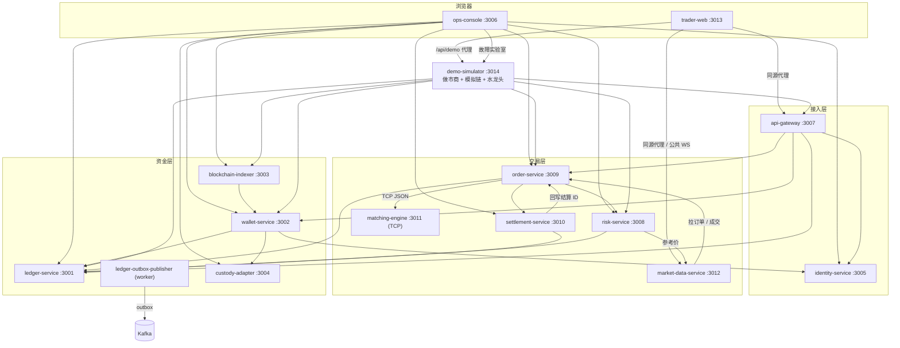
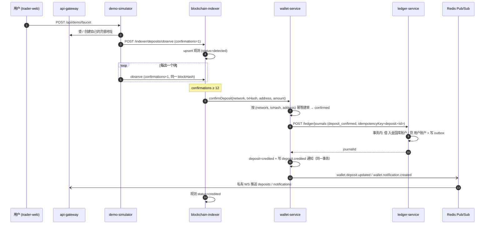
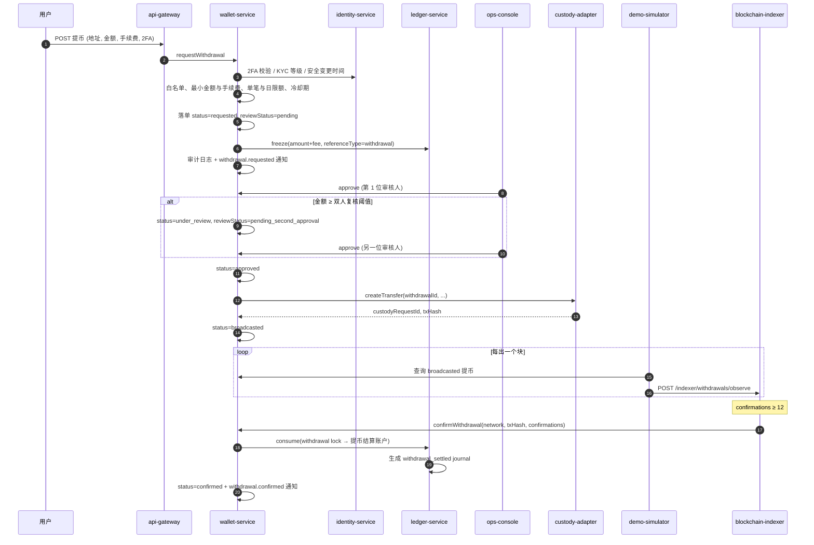
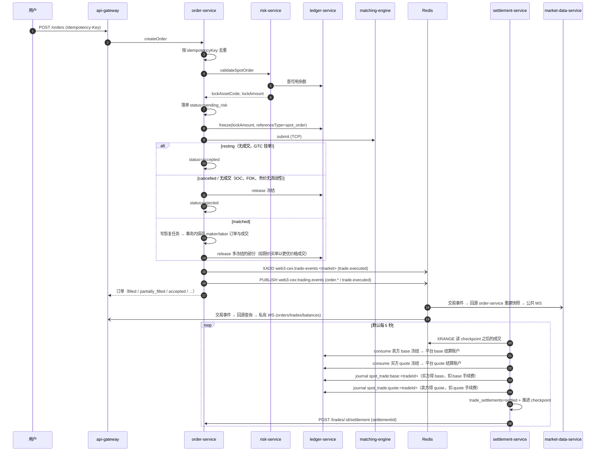

# 系统架构

本文描述这个学习型 Web3 CEX demo 的整体架构：用了哪些技术、拆成了哪些服务、服务之间怎么通信，以及充值、提币、现货交易三条主链路是如何在代码里跑通的。所有内容都以当前仓库代码为准。

> 想先跑起来再看架构，请先读 [getting-started.md](./getting-started.md)；术语和状态机见 [domain-model.md](./domain-model.md)；事件和消息见 [event-catalog.md](./event-catalog.md)。

## 1. 技术栈

| 层面 | 选型 | 说明 |
| --- | --- | --- |
| 业务服务 | TypeScript + NestJS（Node.js，ESM） | `services/*`，每个服务一个进程 |
| 撮合引擎 | Rust（标准库 TCP + `serde_json`） | `engines/matching-engine`，纯内存订单簿 |
| 前端 | React（`apps/trader-web`、`apps/ops-console` 的 `client`） | 共享组件在 `packages/web-ui` |
| 共享领域包 | `packages/domain` | 领域类型、精确十进制运算、内部 HMAC 签名、市场配置加载 |
| 追踪 | OpenTelemetry + Jaeger | `packages/telemetry`，默认关闭 |
| 关系库 | PostgreSQL 16 | 所有服务共用一个库 `web3_cex`，各自管理自己的表 |
| 缓存 / 消息 | Redis 7 | 限流与幂等、行情快照、Pub/Sub 实时事件、成交 Stream |
| 事件总线 | Kafka（`apache/kafka`，单节点） | 只承载账本 outbox 事件 |
| 分析库 | ClickHouse 24.8 | 行情快照落盘与 1 分钟 K 线物化视图 |
| 编排 | pnpm workspace + `scripts/*.mjs` | `infra/local/docker-compose.yml` 启动基础设施 |

## 2. 系统全景

系统按职责分为三层：**接入层**面向用户和运营，**交易层**处理订单到结算，**资金层**管理账本、链上充提和托管。另有一个 `demo-simulator` 扮演"外部世界"（做市商 + 模拟区块链）。

上图只画同步 HTTP/TCP 调用。异步消息（Redis Pub/Sub、Redis Stream、Kafka）见 [第 4 节](#4-服务间通信)。

## 3. 服务清单

端口和启动方式以 `scripts/full-stack-lib.mjs` 中的 `serviceDefinitions` 为准，`pnpm stack:start` 会按该清单拉起全部进程。

### 3.1 接入层

| 服务 | 端口 | 存储 | 职责 |
| --- | --- | --- | --- |
| `trader-web` | 3013 | 无（会话放在 HttpOnly Cookie） | 用户侧交易前台。Node Web Host 提供 React SPA，并把 `/api/gateway/*` 代理到 `api-gateway`、`/api/market/*` 代理到 `market-data-service`、`/api/demo/*` 代理到 `demo-simulator`；`/api/realtime` 代理私有 WebSocket 并在服务端附加会话；CSRF double-submit。浏览器直连 `market-data-service` 的公共 WebSocket。 |
| `ops-console` | 3006 | PostgreSQL `ops_action_audit_logs` | 运营后台（React + NestJS BFF）。登录（邮箱 + 密码 + TOTP）、提现审核与双人复核、KYC 审核、用户手续费等级指定、市场暂停/恢复、市场监控告警处理、账本对账、恢复队列、故障实验室、操作审计。只通过 HTTP 调用各服务，不直接读别的服务的表。 |
| `api-gateway` | 3007 | Redis（限流、幂等键） | 用户侧统一 REST 入口 `/api/v1/gateway/*` 与私有 WebSocket `/api/v1/gateway/realtime`。支持 Bearer 会话和 API Key + HMAC 两种认证，校验账户归属，下游调用 identity / wallet / ledger / order。每个响应带 `x-trace-id`（追踪开启时）。 |
| `identity-service` | 3005 | PostgreSQL `identity_*`、`user_two_factor_profiles` | 用户与运营账号、密码与会话（`customer_web` / `ops_console` 两种 scope）、TOTP 2FA 与恢复码、RBAC（`ops_admin`、`ops_reviewer` 等 6 个角色）、API Key、KYC 等级（`unverified` / `L1` / `L2`）与审核、用户冻结。 |

### 3.2 交易层

| 服务 | 端口 | 存储 | 职责 |
| --- | --- | --- | --- |
| `order-service` | 3009 | PostgreSQL `spot_orders`、`spot_trades`、`spot_order_recovery_jobs`、`spot_order_automation_executions`、`spot_fee_tier_overrides`、`spot_fee_tier_override_audit`；Redis | 订单生命周期的编排中心：调 `risk-service` 预检 → 调 `ledger-service` 冻结 → 经 TCP 调撮合引擎 → 落库订单与成交 → 发布交易事件。负责撤单、恢复队列（lease / dead-letter）、撮合引擎状态同步（引擎重启后自动恢复序号并重放挂单）。成交时按双方 VIP 手续费等级（30 日成交量 / 做市商计划 / 运营指定）定费率并把费率和等级写进成交；为 `risk-service` 的市场监控提供成交与撤单窗口。 |
| `risk-service` | 3008 | PostgreSQL `risk_market_status_overrides`、`risk_surveillance_alerts`、`risk_surveillance_alert_events` | 下单前校验：市场状态（listed / halted / delisted）、`timeInForce`、价格与数量 step 对齐、最小数量、限价单价格偏离、可用余额（查 ledger），并算出需要冻结的资产与金额。运营的市场暂停/恢复写在这里。市场监控：每分钟从 `order-service` 读取成交与撤单窗口，检测对敲 / 自成交、成交集中、幌骗、价格异动并生成带证据的告警（只读，不拦截交易）。 |
| `matching-engine` | 3011 | 无（纯内存） | Rust 实现，每行一条 JSON 命令（`submit` / `seed` / `cancel` / `reset` / `restore` / `snapshot`）。每个市场一本订单簿，价格优先、时间优先，支持 `limit` / `market` 与 `gtc` / `ioc` / `fok`，多档扫单、部分成交。为每笔成交生成 `executionSequence`、`replayCursor`（`<market>:<seq>`）和协议版本 `v2`。不访问数据库，不改余额。 |
| `settlement-service` | 3010 | PostgreSQL `trade_settlements`、`trade_settlement_recovery_jobs`、`trade_event_consumer_checkpoints`、汇总表；Redis | 消费 Redis Stream 中的 `trade.executed`，按成交幂等结算：消耗买卖双方的冻结，过账 base / quote 两笔 journal（含手续费，费率用成交上记录的值），在结算记录上保存双方的费率与 VIP 等级，再把 `settlementId` 回写给 `order-service`。失败进入恢复队列。 |
| `market-data-service` | 3012 | Redis（行情快照）、ClickHouse | 订阅交易事件后从 `order-service` 拉取订单和成交，重建 ticker / depth / recent trades 快照写入 Redis，并把快照落到 ClickHouse；K 线优先从 ClickHouse 读，失败时用成交现算。提供公共 REST 与公共 WebSocket `/api/v1/market-data/ws`。 |

### 3.3 资金层

| 服务 | 端口 | 存储 | 职责 |
| --- | --- | --- | --- |
| `ledger-service` | 3001 | PostgreSQL `accounts`、`balances`、`ledger_journals`、`ledger_entries`、`balance_locks`、`outbox_events` | 资金事实源。双分录记账（每笔 journal 借贷平衡、按 `idempotencyKey` 幂等）、冻结 / 解冻 / 消耗（消耗一定生成一笔 journal）、余额快照、对账与重放。每次资金变动在同一事务里写 outbox 事件。详见 [ledger-service-design.md](./ledger-service-design.md)。 |
| `ledger-outbox-publisher` | 无 | 同上 | 常驻 worker（`ledger-service` 的 `publish-outbox` 脚本），把 `outbox_events` 投递到 Kafka `ledger.events`，失败退避重试，超过次数标记死信并尽力投递 `dead-letter.events`。 |
| `wallet-service` | 3002 | PostgreSQL `wallet_addresses`、`deposits`、`withdrawals`、`withdrawal_address_book`、`withdrawal_audit_logs`、`wallet_notifications`；Redis | 充值地址分配（服务内生成地址）、充值单据与入账、提币申请 / 校验（白名单、2FA、KYC 限额、安全冷却期）/ 审核（大额双人复核）/ 广播 / 确认、站内通知。资金动作全部委托给 `ledger-service`。 |
| `blockchain-indexer` | 3003 | PostgreSQL `blockchain_deposit_observations`、`blockchain_withdrawal_observations`、`blockchain_scan_cursors` | 记录链上观测事实（充值交易、提币交易的确认数和区块哈希），检测重组，达到确认阈值后调用 `wallet-service` 入账或确认提币。提供 `scan-evm` / `replay-evm` / `repair-backlog` 脚本对接真实 EVM RPC；演示环境中观测数据由 `demo-simulator` 推送。 |
| `custody-adapter` | 3004 | PostgreSQL `custody_transfers`、`custody_transfer_attempts` | 托管供应商抽象：按网络路由 provider（默认 `mock-custody` → `mock-custody-backup` 故障切换，另有 `evm-hot-wallet`），广播、重试、状态回查、provider 健康检查与熔断。 |

### 3.4 演示环境

| 进程 | 端口 | 职责 |
| --- | --- | --- |
| `demo-simulator` | 3014 | `scripts/demo-simulator.mjs`。① 两个做市账户在每个启用的市场围绕随机游走中间价挂 10 档梯子单并偶尔吃单（直接调 `order-service`）；② 模拟一条 EVM 链，默认每 1.5 秒出一个块，把待确认充值和已广播提币的确认数推送给 `blockchain-indexer`；③ 测试水龙头 `/api/demo/faucet`（经网关确认是用户自己的充值地址后，向 indexer 报告一笔充值）；④ 故障实验室 `/internal/lab/*`（暂停出块、触发重组，需要内部签名）。 |

### 3.5 基础设施端口

| 组件 | 端口 |
| --- | --- |
| PostgreSQL | 5432 |
| Redis | 6379 |
| Kafka | 9092 |
| ClickHouse | 8123（HTTP）/ 9000（Native） |
| Jaeger | 16686（UI）/ 4318（OTLP HTTP），仅 `observability` profile |

## 4. 服务间通信

### 4.1 三种通道

| 通道 | 用途 | 特点 |
| --- | --- | --- |
| 同步 HTTP（`fetch`） | 绝大多数服务间调用 | 失败直接反映到调用方；资金类调用都带幂等键或业务引用 |
| TCP 行协议 | `order-service` → `matching-engine` | 每个连接发一行 JSON、收一行 JSON |
| Redis Pub/Sub | 实时推送：`web3-cex:trading.events`、`web3-cex:wallet.notifications` | 至多一次，订阅方收到后再回源查询 |
| Redis Stream | 成交事件 `web3-cex:trade-events:<market>` | 可回放；结算服务按 checkpoint 拉取 |
| Kafka | 账本 outbox → `ledger.events` / `dead-letter.events` | 至少一次；仓库内没有 Kafka 消费者，供学习和外部订阅 |

事件的完整清单见 [event-catalog.md](./event-catalog.md)。

### 4.2 同步调用矩阵

| 调用方 | 被调方 | 典型用途 |
| --- | --- | --- |
| `trader-web` | `api-gateway`、`market-data-service`、`demo-simulator` | 同源代理 |
| `api-gateway` | `identity-service` | 会话 / API Key 认证、注册登录、2FA、KYC |
| `api-gateway` | `wallet-service` | 充值地址、充提记录、提币申请、通知 |
| `api-gateway` | `ledger-service` | 开户、余额、资金流水 |
| `api-gateway` | `order-service` | 下单、撤单、订单 / 成交查询、本人手续费等级 |
| `order-service` | `risk-service` | `validateSpotOrder` |
| `order-service` | `ledger-service` | 冻结 / 释放订单资金 |
| `order-service` | `matching-engine`（TCP） | 提交、撤单、快照、重放挂单 |
| `order-service` | `settlement-service` | 同步结算模式和订单恢复时调用 `settleTrade` |
| `risk-service` | `ledger-service`、`market-data-service` | 查可用余额、取参考价 |
| `risk-service` | `order-service` | 市场监控读取成交 / 撤单窗口（`GET /api/v1/surveillance/activity`） |
| `settlement-service` | `ledger-service` | 消耗冻结、过账 journal、创建平台账户 |
| `settlement-service` | `order-service` | 回写 `settlementId`；`http` 传输模式下也从这里拉成交事件 |
| `market-data-service` | `order-service` | 拉取订单（算深度）与成交 |
| `wallet-service` | `ledger-service` | 充值入账、提币冻结 / 释放 / 消耗 |
| `wallet-service` | `identity-service` | 校验 2FA、读 KYC 等级、安全变更冷却 |
| `wallet-service` | `custody-adapter` | `createTransfer` 广播提币 |
| `blockchain-indexer` | `wallet-service` | `confirmDeposit`、`confirmWithdrawal` |
| `ops-console` | identity / wallet / ledger / indexer / custody / order / settlement / risk / demo-simulator | 运营查询与处置 |
| `demo-simulator` | indexer / wallet / ledger / order / risk / gateway | 推进链上确认、做市、水龙头 |

### 4.3 内部服务认证

六个核心内部服务 `identity-service`、`wallet-service`、`ledger-service`、`order-service`、`settlement-service`、`risk-service` 要求每个请求带 HMAC 签名头，并默认只监听 `127.0.0.1`（`INTERNAL_SERVICE_BIND_HOST`）。

- 请求头：`x-internal-service-name`、`x-internal-service-timestamp`、`x-internal-service-signature`。
- 签名：`HMAC-SHA256(secret, callerName \n METHOD \n path \n timestamp \n sha256(body))`，时间戳允许 30 秒偏差，实现在 `packages/domain` 的 `createInternalServiceSignature` / `verifyInternalServiceSignature`。
- 共享密钥 `INTERNAL_SERVICE_AUTH_SECRET`，`pnpm stack:start` 自动注入；调用方名称取自 `INTERNAL_SERVICE_CALLER_NAME`，演示脚本使用 `demo-scripts`。
- 每个服务有调用方白名单（可用 `INTERNAL_SERVICE_ALLOWED_CALLERS` 覆盖）：

| 被调方 | 默认允许的调用方 |
| --- | --- |
| `identity-service` | api-gateway、wallet-service、ops-console、demo-scripts |
| `wallet-service` | api-gateway、blockchain-indexer、ops-console、demo-scripts |
| `ledger-service` | api-gateway、wallet-service、order-service、settlement-service、risk-service、ops-console、demo-scripts |
| `order-service` | api-gateway、settlement-service、market-data-service、ops-console、demo-scripts、risk-service |
| `settlement-service` | order-service、ops-console、demo-scripts |
| `risk-service` | order-service、ops-console、demo-scripts |

`demo-simulator` 的 `/internal/lab/*` 也校验同样的签名，只接受 `ops-console` 和 `demo-scripts`。更多安全设计见 [security.md](./security.md)。

## 5. 主链路

### 5.1 充值

演示环境没有真实区块链：`demo-simulator` 扮演链和链上扫描器，把观测结果推给 `blockchain-indexer`。indexer 在确认数未达阈值（默认 12，`INDEXER_CONFIRMATION_THRESHOLD`）时只记录观测；达到阈值后才调用 `wallet-service`。

要点：

- 幂等层层兜底：indexer 观测按 `(network, tx_hash, address)` 唯一；wallet 充值单同样唯一；账本 journal 按 `deposit:<depositId>` 幂等。
- 重组检测：同一笔交易报告的 `blockNumber` / `blockHash` 变化时，indexer 记录 `reorg_detected_at`，扫描游标打上重组标记触发告警。模拟器的重组深度始终小于确认阈值，避免已入账的充值被孤立（账本无法撤销）。
- 用户在钱包侧看到充值单时，它已经是 `confirmed`/`credited`；确认中的进度来自 indexer 观测（水龙头状态接口读的就是它）。

对应学习章节：[04 钱包与托管](../learning/04-wallet-custody.md)、[05 账本](../learning/05-ledger.md)。

### 5.2 提币

要点：

- 冻结金额是 `amount + fee`。冻结失败时提币单直接置为 `failed`。
- 审核拒绝（`rejected`）会调用 ledger `release` 释放冻结。
- 广播失败时单据停留在 `approved` 并记录 `broadcastError`，运营可重新广播（`rebroadcast`）。
- 双人复核阈值默认 `USDT=5000, USDC=5000, ETH=2, BTC=0.1, SOL=50`（`WITHDRAWAL_DUAL_APPROVAL_THRESHOLD_BY_ASSET`），两次批准必须来自不同运营账号。
- 安全冷却期：修改 2FA 或新增提币地址后一段时间内禁止提币；演示栈默认 `WITHDRAWAL_SECURITY_COOLDOWN_SECONDS=0` 关闭。

对应学习章节：[03 账户、身份与安全](../learning/03-account-identity-security.md)、[04 钱包与托管](../learning/04-wallet-custody.md)、[09 风控](../learning/09-risk-control.md)。

### 5.3 现货交易

默认结算模式是**异步**（`ORDER_SETTLEMENT_MODE` 不为 `sync`）：`order-service` 在撮合后立即更新订单和成交并返回，结算由 `settlement-service` 从 Redis Stream 拉取成交事件完成。

要点：

- **冻结金额**由 `risk-service` 计算：卖单冻结 base 数量；限价买单冻结 `price × quantity` 的 quote；市价买单冻结 `参考价 × quantity × (1 + maxPriceDeviationRatio)`。
- **手续费**：每方用自己收到的资产付费——卖方从 quote 扣，买方从 base 扣。`order-service` 在构造成交时解析双方的 VIP 等级（运营指定 > `config/fee-tiers.json` 的做市商计划 > 30 日成交量），按订单在本笔成交中的 maker / taker 角色取 `min(等级费率, 市场费率)`，把费率和等级（`buyerFeeRate` / `buyerFeeTier` 等）写进成交和 `trade.executed` 事件。结算与重放只用记录的费率，不重新解析，保证同一笔成交永远收同样的手续费。等级缓存默认 30 秒（`ORDER_FEE_TIER_CACHE_MS`），解析失败时退回市场默认费率、不影响成交。
- **异步结算的后果**：订单可能已显示 `filled`，而结算还在路上；成交记录的 `settlementId` 先是占位值，结算完成后被回写。撤单时只释放真正从订单簿撤下的数量对应的冻结，已成交待结算的冻结保留。
- **撮合失败补偿**：撮合后落库或结算失败时，订单进入 `recovery_pending`，由恢复任务（lease + 重试 + dead-letter）收尾；若无法继续则按数据库中的挂单重放引擎订单簿。
- **引擎状态同步**：撮合引擎是纯内存的。`order-service` 定期比对引擎序号与数据库最新成交序号，发现引擎落后（例如重启）时用 `restore` 抬高序号并 `seed` 重放所有挂单。
- **同步模式**（`ORDER_SETTLEMENT_MODE=sync`）下，`order-service` 在返回前直接调用 `settlement-service` 的 `settleTrade`。

对应学习章节：[06 订单与撮合](../learning/06-order-matching.md)、[07 清算结算与手续费](../learning/07-clearing-settlement-fees.md)、[08 行情](../learning/08-market-data.md)、[09 风控](../learning/09-risk-control.md)。

## 6. 数据存储

| 存储 | 存什么 | 是否事实源 |
| --- | --- | --- |
| PostgreSQL | 用户、订单、成交、结算、充提单据、链上观测、托管转账、账本（journal / entries / locks / balances）、outbox、运营审计 | 是。账本以 journal + entries 为准，`balances` 是可重建的快照 |
| Redis | 网关限流与幂等键、行情快照（TTL 300 秒）、Pub/Sub 实时事件、成交 Stream 与归档 Stream | 否。成交 Stream 丢失后可由 `order-service` 从数据库重放 |
| Kafka | 账本事件流 | 否。数据库中的 `outbox_events` 才是事实源 |
| ClickHouse | 行情 ticker / depth / trade 快照，`market_data_kline_1m` 聚合表与物化视图 | 否 |

各服务的数据库表结构在 `services/*/sql/*.sql`，可用 `pnpm db:prepare:core` 等脚本初始化。

## 7. 市场配置

`config/markets.json` 是全系统唯一的市场和币种定义来源，`packages/domain` 的 `market-config.ts` 在进程启动时读取并校验（可用 `WEB3_CEX_MARKETS_CONFIG` 指向其他文件）。

- 币种：`USDT`、`USDC`、`ETH`、`BTC`、`SOL`，包含精度、网络、提币手续费、水龙头参数。
- 市场：`BTC-USDT`、`ETH-USDT`（默认市场）、`SOL-USDT`，包含 `priceStep`、`quantityStep`、`minQuantity`、`makerFeeRate`（0.05%）、`takerFeeRate`（0.1%）、`maxPriceDeviationRatio`（0.2）、`referencePrice` 和做市模拟参数。
- 市场状态 `listed` / `halted` / `delisted`：配置给出默认值；运营在 `ops-console` 暂停 / 恢复会写入 `risk_market_status_overrides` 并覆盖配置（`delisted` 只能在配置中设置）。

撮合引擎、风控、结算、行情、前端和模拟器都从这份配置派生自己的市场列表。字段说明见 [config/README.md](../config/README.md)。

`config/fee-tiers.json` 是 VIP 手续费等级的唯一来源（`packages/domain/src/fee-tiers.ts` 校验，可用 `WEB3_CEX_FEE_TIERS_CONFIG` 替换）：VIP0–VIP3 的 30 日成交量门槛（USDT 计）与 maker / taker 费率，VIP0 等于市场默认费率；`marketMakers` 列出做市商计划账户（演示的两个做市账户，固定 VIP0），市场监控用它把做市商标注为「做市商」而不告警。

## 8. 可观测性

追踪默认关闭。`pnpm stack:start:observability` 会额外启动 Jaeger，并给每个 Node 服务注入 `OTEL_ENABLED=true`、`OTEL_SERVICE_NAME=<服务 id>`、`OTEL_EXPORTER_OTLP_ENDPOINT=http://127.0.0.1:4318`。

- 所有 Node 服务以 `node --import @web3-cex/telemetry/register ./dist/main.js` 启动，保证埋点在 `pg`、`redis`、`express`、`@nestjs/core` 加载前挂上。
- 自动埋点：HTTP 入站 / 出站、NestJS / Express 路由、`fetch`（undici）、PostgreSQL、Redis。
- 手工 span：
  - `order-service` → 撮合引擎：`matching-engine submit|cancel|seed|reset|snapshot`，带 `market`、`action`、`outcome` 属性。
  - 成交事件写入 Stream：`web3-cex:trade-events:<market> publish`（PRODUCER），W3C `traceparent` 作为 Stream 条目的额外字段保存，事件 JSON 不变。
  - `settlement-service` 消费：`web3-cex:trade-events:<market> process`（CONSUMER），以 Stream 中的 `traceparent` 为父上下文，所以结算挂在下单的同一条 trace 下。
- `api-gateway` 每个响应带 `x-trace-id`，`trader-web` 代理原样转发；`ops-console` 的业务追踪页可跳转 Jaeger（`OPS_TRACING_UI_URL`）。

学习时可以在交易页下一笔会成交的单，复制响应头 `x-trace-id`，到 `http://127.0.0.1:16686` 按 Trace ID 查询，从 `trader-web` 一路看到 `settlement-service` 的 SQL。

## 9. 与真实交易所的差异 / 简化

| 方面 | 本项目 | 真实交易所通常 |
| --- | --- | --- |
| 区块链 | `demo-simulator` 模拟一条 EVM 链，充值地址由 `wallet-service` 生成 | 自建节点集群、HD 钱包 / MPC 派生地址、多链独立扫描 |
| 托管 | `mock-custody` 立即返回 txHash；`evm-hot-wallet` 仅作示例 | 冷热钱包分层、MPC / HSM 签名、归集与补充热钱包 |
| 撮合 | 单进程内存订单簿，每条命令一个 TCP 连接，无持久化，靠 `order-service` 重放恢复 | 带命令日志 / 快照的确定性撮合集群，主备热切 |
| 下单链路 | 同步串行调用 risk → ledger → engine | 预冻结在内存账户中完成，异步排队进入撮合 |
| 事件总线 | 交易事件走 Redis Pub/Sub + Stream；Kafka 只承载账本 outbox 且无消费者 | 全链路统一事件总线，严格分区与消费组 |
| 结算 | 每笔成交独立结算，轮询拉取 | 批量 / 流式清算，轧差 |
| 风控 | 下单前静态规则 + 提币限额；市场监控是每分钟一次的批量扫描（只识别同一用户的自成交，没有设备 / IP 关联图），无实时风控计数器、无 AML | 实时风控引擎、流式市场监控、反洗钱、Travel Rule、设备与行为风控 |
| KYC | 演示用等级与人工审核，证件号只做脱敏存储 | 接入第三方 KYC/KYB 服务 |
| 部署 | 单机、单库、单节点中间件，无高可用 | 多可用区、主从、灾备演练 |
| 内部认证 | 共享 HMAC 密钥 + 本地监听 | mTLS、每服务独立凭据、网络隔离 |

## 10. 学习章节映射

| 本文内容 | 学习章节 |
| --- | --- |
| 系统分层与服务清单 | [02 系统总架构](../learning/02-system-architecture.md) |
| 身份、会话、2FA、KYC、内部认证 | [03 账户、身份与安全](../learning/03-account-identity-security.md) |
| 充值、提币、indexer、托管 | [04 钱包与托管](../learning/04-wallet-custody.md) |
| 账本、冻结、outbox | [05 账本](../learning/05-ledger.md) |
| 订单、风控预检、撮合引擎 | [06 订单与撮合](../learning/06-order-matching.md) |
| 结算与手续费、VIP 等级 | [07 清算结算与手续费](../learning/07-clearing-settlement-fees.md)、[12 商业模式](../learning/12-business-model.md) |
| 行情快照、公共 WS、K 线 | [08 行情](../learning/08-market-data.md) |
| 风控规则、提币限额、市场暂停 | [09 风控](../learning/09-risk-control.md) |
| 市场监控（对敲、幌骗、成交集中、价格异动） | [B05 业务风控](../learning/backstage/B05-business-risk.md) |
| 恢复队列、故障实验室、追踪 | [13 可靠性与安全事故](../learning/13-reliability-security-incidents.md) |

相关文档：[domain-model.md](./domain-model.md) · [event-catalog.md](./event-catalog.md) · [api-contracts.md](./api-contracts.md) · [ledger-service-design.md](./ledger-service-design.md) · [fault-lab.md](./fault-lab.md) · [troubleshooting.md](./troubleshooting.md)
