# 领域模型

本文整理系统中的核心实体、状态机和关键不变量。来源是 `packages/domain/src`（跨服务共享的类型）、各服务 `src/domain/types.ts` 和 `services/*/sql/*.sql` 中的表结构。

> 一个需要注意的细节：`packages/domain` 里的 `DepositStatus`、`WithdrawalStatus` 等类型是早期定义的共享类型，**实际行为以服务内部类型为准**。例如提币状态在共享包中是 `reviewing`，而 `wallet-service` 真正使用的是 `under_review` 和 `rejected`。下文的状态机都按服务实现来写。

## 1. 实体总览

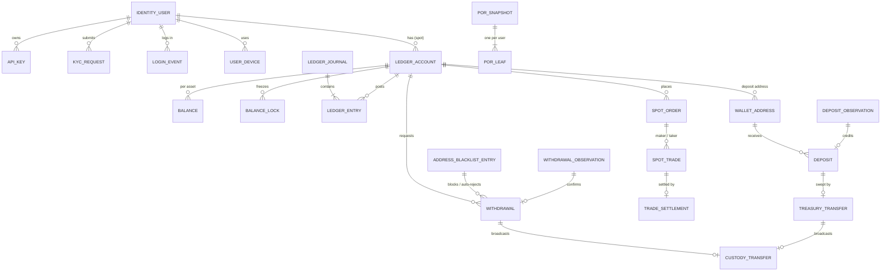

| 实体 | 所属服务 | 表 | 说明 |
| --- | --- | --- | --- |
| 用户 `IdentityUser` | identity-service | `identity_users` | `userType` 为 `customer` 或 `ops`；带 `kyc_tier` |
| 凭据 / 会话 | identity-service | `identity_user_credentials`、`identity_ops_sessions` | 会话按 scope 区分 `customer_web` 与 `ops_console`，只存 token 哈希 |
| 2FA | identity-service | `user_two_factor_profiles`、`identity_two_factor_recovery_codes` | TOTP；恢复码只存哈希、一次性 |
| 运营角色 | identity-service | `identity_user_roles` | `ops_admin`、`ops_reviewer`、`ops_finance_operator`、`ops_risk_operator`、`ops_platform_operator`、`ops_observer` |
| API Key | identity-service | `identity_api_keys` | scope：`read`、`trade`、`withdraw`（默认前两个） |
| KYC 申请 / 事件 | identity-service | `identity_kyc_requests`、`identity_kyc_events` | 等级 `unverified` → `L1` → `L2`；每次等级变化追加事件 |
| 登录事件 `LoginEvent` | identity-service | `identity_login_events` | 每次密码登录一行：`outcome`（`success / failure / locked`）、`failure_code`、设备 ID、IP、User-Agent、`is_new_device`；未注册邮箱也记录（`user_id` 为空） |
| 用户设备 `UserDevice` | identity-service | `identity_user_devices` | `(user_id, device_id)` 唯一：首次 / 最近登录、登录次数、`flagged_new`、`revoked_at`；会话的 `identity_ops_sessions.device_id` 指向它 |
| 账本账户 `LedgerAccount` | ledger-service | `accounts` | 类型见 [2.1](#21-账户类型) |
| 余额快照 `Balance` | ledger-service | `balances` | 每个 (账户, 资产) 一行：`available`、`locked`、`version` |
| 日记账 `Journal` / 分录 `Entry` | ledger-service | `ledger_journals`、`ledger_entries` | 双分录，`journal.idempotency_key` 唯一 |
| 冻结 `BalanceLock` | ledger-service | `balance_locks` | 按 `(reference_type, reference_id, account_id, asset_code)` 唯一 |
| Outbox 事件 | ledger-service | `outbox_events` | 与资金变动同事务写入 |
| 充值地址 | wallet-service | `wallet_addresses` | `(network, address)` 唯一 |
| 充值 `Deposit` | wallet-service | `deposits` | `(network, tx_hash, address)` 唯一 |
| 提币 `Withdrawal` | wallet-service | `withdrawals` | 业务状态 `status` + 审核状态 `review_status`；KYT `risk_score`、`risk_level`、`risk_reasons` |
| 地址黑名单 | wallet-service | `withdrawal_address_blacklist` | 生效中的 `(network, address)` 唯一；`category`：`sanctioned / mixer / scam / hack / other`；移出时保留记录与 `removed_by / removal_reason` |
| 提币地址簿 | wallet-service | `withdrawal_address_book` | `(user_id, network, address)` 唯一，可加入 / 移出白名单 |
| 提币审计 / 通知 | wallet-service | `withdrawal_audit_logs`、`wallet_notifications` | 每次状态迁移写一条审计（含前后快照）；通知也承载账户安全事件 `security.new_device_login`（不关联提币 / 充值） |
| 平台内部转账 `TreasuryTransfer` | wallet-service | `treasury_transfers`、`treasury_sweep_deposits` | 注资、归集、冷热调拨；见 [4.5](#45-冷热分层与内部转账wallet-service-treasury) |
| 储备金证明 | wallet-service | `proof_of_reserves_snapshots`、`proof_of_reserves_leaves` | Merkle 根 + 每用户一个叶子与路径；见 [4.6](#46-储备金证明快照) |
| 链上观测 | blockchain-indexer | `blockchain_deposit_observations`、`blockchain_withdrawal_observations`、`blockchain_scan_cursors` | 充值观测 `(network, tx_hash, address)` 唯一；提币观测 `(network, tx_hash)` 唯一 |
| 托管转账 | custody-adapter | `custody_transfers`、`custody_transfer_attempts` | `idempotency_key` 唯一 |
| 现货订单 `SpotOrder` | order-service | `spot_orders` | `idempotency_key` 唯一，记录冻结资产与金额 |
| 成交 `SpotTrade` | order-service | `spot_trades` | 带撮合序号、`replayCursor`、协议版本、双方费率与费率来源的 VIP 等级（`buyer_fee_tier` / `seller_fee_tier`） |
| 手续费等级指定 | order-service | `spot_fee_tier_overrides`、`spot_fee_tier_override_audit` | 每个用户最多一条运营指定；每次设置 / 取消追加一条审计（操作人、备注、前后等级） |
| 订单恢复任务 | order-service | `spot_order_recovery_jobs` | 撮合后落库 / 结算失败时的补偿任务 |
| 结算 `TradeSettlement` | settlement-service | `trade_settlements` | `trade_id` 唯一；保存实际收费的双方费率与 VIP 等级 |
| 结算恢复任务 / 消费位点 | settlement-service | `trade_settlement_recovery_jobs`、`trade_event_consumer_checkpoints` | |
| 市场状态覆盖 | risk-service | `risk_market_status_overrides` | 只允许 `listed` / `halted` |
| 市场监控告警 | risk-service | `risk_surveillance_alerts`、`risk_surveillance_alert_events` | `alert_key` 唯一（检测器 + 市场 + 用户 + 窗口锚点）；状态 `open` / `acknowledged` / `dismissed`，每次检测与处理追加一条事件 |
| 运营操作审计 | ops-console | `ops_action_audit_logs` | |

市场和币种不是数据库实体，而是 `config/markets.json` 中的配置，见 [architecture.md 第 7 节](./architecture.md#7-市场配置)。VIP 手续费等级阶梯和做市商计划成员同样是配置（`config/fee-tiers.json`），数据库里只有运营指定和成交上记录的结果。

## 2. 账本

### 2.1 账户类型

`packages/domain` 定义的 `AccountType`：

| 类型 | 用途 |
| --- | --- |
| `spot` | 用户现货账户；结算服务的平台结算账户也用此类型 |
| `fee` | 平台手续费账户（每个资产一个） |
| `opening_balance` | 期初权益账户，种子资金的来源，**唯一允许负余额**的类型 |
| `main`、`funding`、`hot_wallet`、`cold_wallet`、`withdrawal_pending` | 类型中保留，演示流程未使用。平台链上持仓（充值地址 / 热钱包 / 冷钱包）不记在账本里，而由 `wallet-service` 的 treasury 模块单独记录，见 [第 4.5 节](#45-冷热分层与内部转账wallet-service-treasury) |

几个固定的系统账户：

- 入金国库账户（`LEDGER_DEPOSIT_SOURCE_ACCOUNT_ID`，默认 `00000000-0000-0000-0000-000000000098`）：充值入账时被借记；提币最终消耗也贷记到这里（`LEDGER_WITHDRAWAL_SETTLEMENT_ACCOUNT_ID` 未设置时）。
- 平台结算账户 `platform:spot:settlement:<asset>` 与手续费账户 `platform:spot:fee:<asset>`：由 `settlement-service` 按需创建。
- 故障实验室账户 `00000000-0000-0000-0000-0000000000a1`（`account_type = fault_lab`）：只在「账本对账差额」实验中出现，写入没有分录的余额用来触发对账熔断，清除后没有余额行。

### 2.2 余额与冻结

余额快照只有两个桶：`available` 和 `locked`。

| 操作 | 效果 | 是否写 journal |
| --- | --- | --- |
| `postJournal` | 按分录增减 `available` | 是 |
| `freeze` | `available → locked`，新建 lock | 否（写 `balance.locked` 事件） |
| `release` | `locked → available`，可部分释放 | 否（写 `balance.released` 事件） |
| `consume` | 冻结 → 解锁 → 立即借记给结算账户，可部分消耗 | 是（`spot_order_lock_settled` 或 `withdrawal_settled`），并写 `balance.consumed` |

`consume` 刻意不提供"直接减少 locked"的路径：资金离开用户账户时必须体现为一笔平衡的 journal，否则对账和重放无法解释资金去向。

### 2.3 冻结状态机

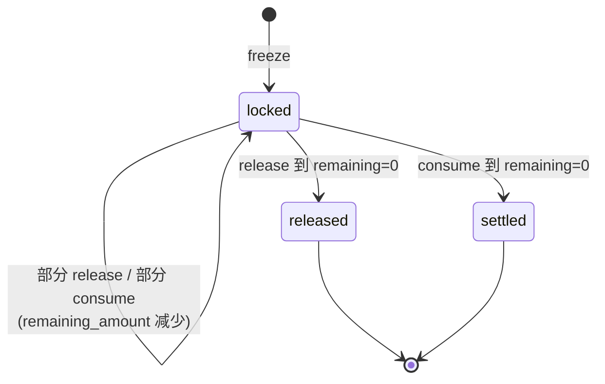

- 同一引用已存在 `locked` 的冻结时再次 `freeze` 返回 `DUPLICATE_BALANCE_LOCK`；已结束的冻结则直接返回原记录（幂等）。
- `consume` 按 `<referenceType>:<referenceId>:<asset>:settlement:<businessId>` 生成幂等键，同一笔成交重复消耗不会重复记账。
- 表约束中还允许 `consumed`，是旧数据的状态，当前代码只写 `settled`。

## 3. 充值

充值涉及两个状态机：indexer 的**链上观测**和 wallet 的**充值单**。

### 3.1 充值观测（blockchain-indexer）

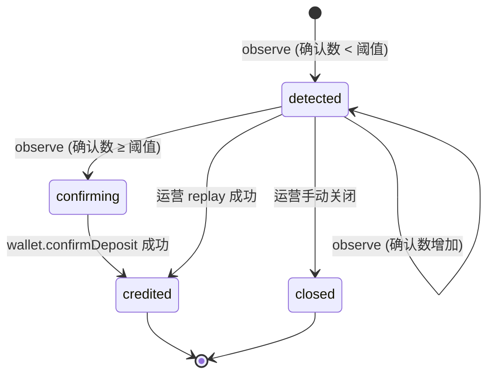

- `confirming` 是短暂状态：达到阈值后立刻调用 wallet；调用失败时观测停在 `confirming`，下次上报或运营 replay 会重试。
- 同一交易的区块号或区块哈希变化会写入 `reorg_detected_at` / `reorged_from_block_number`，并给扫描游标打上重组标记，运营确认后清除。
- 运营动作 `replayed` / `closed` 记录在 `last_manual_action*` 字段。

### 3.2 充值单（wallet-service）

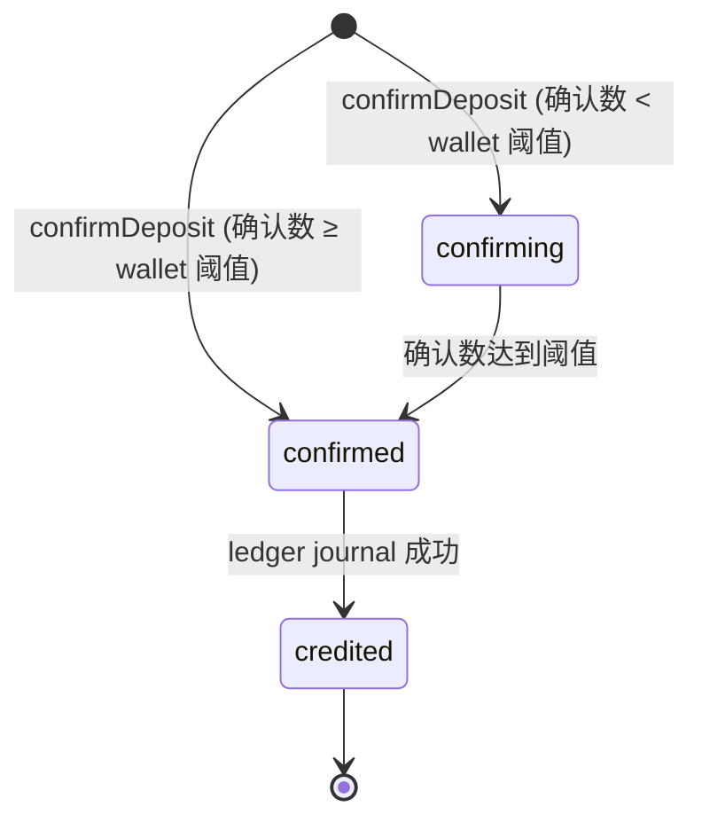

- indexer 只在达到阈值后才通知 wallet，所以默认配置（两边都是 12）下充值单一出现就是 `confirmed`，随即变为 `credited`。
- `credited` 与 `deposit.credited` 站内通知在同一事务提交；已 `credited` 的单据再次被确认会直接返回，不会重复入账。
- 类型中的 `detected`（仅作为新建记录的默认值）和 `failed` 当前不会作为最终状态写入。

## 4. 提币

### 4.1 提币单（wallet-service）

提币单有两个字段：业务状态 `status` 和审核状态 `reviewStatus`。

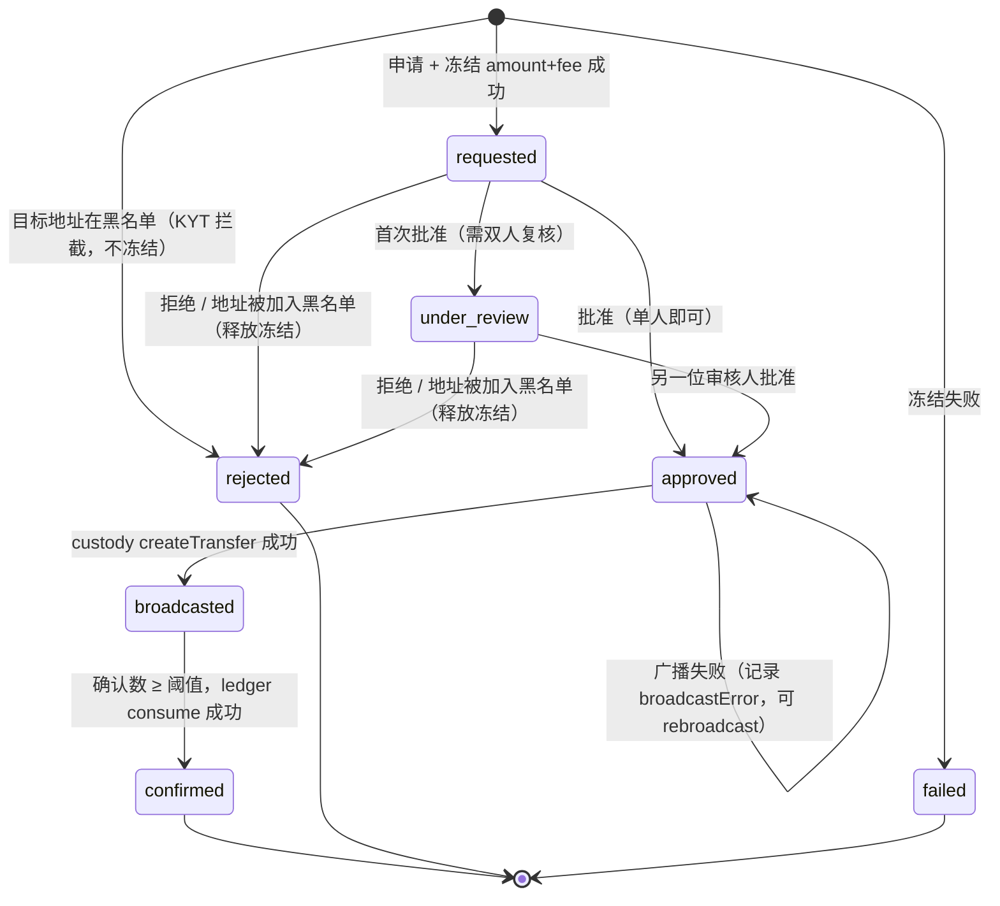

| `status` | `reviewStatus` | 含义 |
| --- | --- | --- |
| `requested` | `pending` | 已冻结，等待审核 |
| `under_review` | `pending_second_approval` | 大额提币已获一次批准，等待另一位运营 |
| `approved` | `approved` | 审核通过，尚未广播或广播失败 |
| `broadcasted` | `approved` | 托管已广播，有 `txHash`、`custodyRequestId` |
| `confirmed` | `approved` | 链上确认，冻结已消耗 |
| `rejected` | `rejected` | 审核拒绝或 KYT 自动拒绝（操作人 `system:kyt`，`riskLevel=blocked`），冻结已释放；申请时就命中黑名单的记录 `frozenAmount=0` |
| `failed` | `pending` | 冻结失败，从未进入审核 |

审计动作 `WithdrawalAuditAction`：`requested`、`first_approved`、`approved`、`rejected`、`broadcasted`、`confirmed`。站内通知类型：`withdrawal.requested`、`withdrawal.approved`、`withdrawal.rejected`、`withdrawal.broadcasted`、`withdrawal.confirmed`、`deposit.credited`、`security.new_device_login`。

KYT 风险等级 `riskLevel`：`low`（< 30 分）、`medium`（≥ 30）、`high`（≥ 60，强制双人复核，审批策略 `reason: "risk_high"`）、`blocked`（黑名单）。`riskReasons` 是命中规则列表（`code`、`score`、`message`），规则见 [security.md 第 2.7 节](security.md#27-提现控制wallet-service)。

### 4.2 提币申请校验

在冻结之前依次检查：紧急开关（全站 / 该币种提现暂停 `WITHDRAWALS_PAUSED` / `ASSET_WITHDRAWALS_PAUSED`，API 写入冻结 `API_WRITE_FROZEN`；批准与广播时也会再查提现暂停）、资产与网络受支持、金额与手续费合法、KYT 地址风险（黑名单 `WITHDRAWAL_ADDRESS_BLOCKED`）、安全冷却期（`WITHDRAWAL_SECURITY_COOLDOWN`）、新设备提现锁（可选，`WITHDRAWAL_NEW_DEVICE_LOCK`）、最小金额 / 最小手续费、地址在白名单中（`WITHDRAWAL_ADDRESS_NOT_WHITELISTED`）、按 KYC 等级的单笔与日限额（`WITHDRAWAL_SINGLE_LIMIT_EXCEEDED` / `WITHDRAWAL_DAILY_LIMIT_EXCEEDED`）、2FA。

默认 KYC 限额（单笔 / 日累计，节选）：

| 资产 | unverified | L1 | L2 |
| --- | --- | --- | --- |
| USDT | 1000 / 2000 | 10000 / 20000 | 100000 / 200000 |
| ETH | 0.5 / 1 | 5 / 10 | 50 / 100 |
| BTC | 0.02 / 0.05 | 0.2 / 0.5 | 2 / 5 |

### 4.3 提币观测（blockchain-indexer）

`detected`（确认数不足）→ `confirming`（达到阈值、正在调用 wallet）→ `confirmed`（`wallet.confirmWithdrawal` 成功）。

### 4.4 托管转账（custody-adapter）

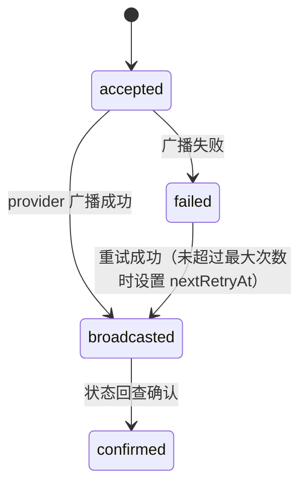

每次广播、重试、回查都在 `custody_transfer_attempts` 记一条（`broadcast` / `retry` / `sync_status`，`succeeded` / `failed`）。provider 有健康状态（`healthy` / `degraded` / `unhealthy`）和熔断器（`closed` / `open` / `half_open`）。

### 4.5 冷热分层与内部转账（wallet-service treasury）

平台链上持仓分 `deposit`（用户充值地址）、`hot`、`cold` 三层，所有平台内部的链上移动都是一条 `treasury_transfers`：

| `kind` | 方向 | 触发 | 是否审批 |
| --- | --- | --- | --- |
| `genesis` | 外部 → hot / cold | 演示注资（bootstrap、模拟器储备补足），按 `reference` 幂等 | 否，直接 `confirmed` |
| `sweep` | deposit → hot | 归集任务（`trigger=sweep_job`），每个 (充值地址, 币种) 一笔 | 否，创建即 `approved` 并广播 |
| `rebalance_to_cold` | hot → cold | 热钱包高于水位上限（`trigger=watermark`）或运营手动（`manual`） | 是 |
| `rebalance_to_hot` | cold → hot | 热钱包低于水位下限或运营手动 | 是 |

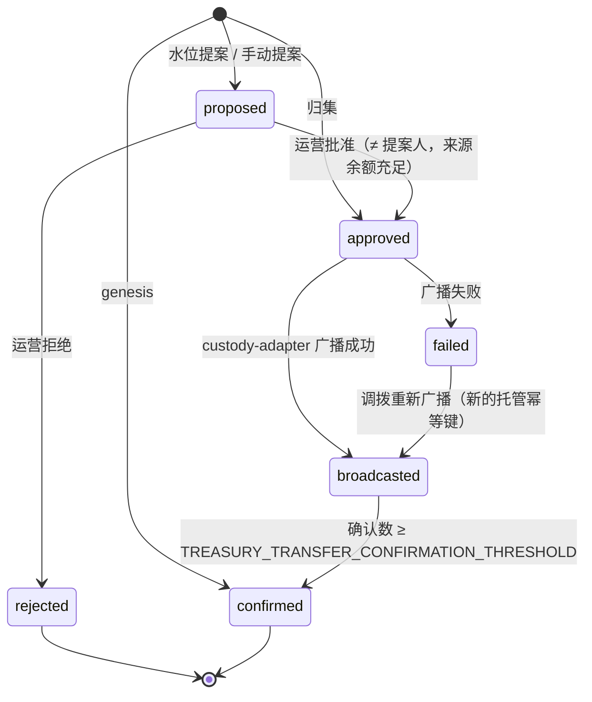

- 归集失败时删除它在 `treasury_sweep_deposits` 中关联的充值，下一轮归集重新纳入；一笔充值同一时间只能属于一个归集（主键 `deposit_id`）。
- 同一币种同一时间最多一笔未完成（`proposed` / `approved` / `broadcasted`）的水位调拨；水位提案的幂等键是 `watermark:<asset>:<network>:<序号>`，并发评估只会成功一笔。
- 每次状态迁移追加到 `events`（时间、动作、操作人、备注），运营动作另写 `ops_action_audit_logs`。
- 持仓由事实推导、不落余额表：来源钱包在广播时扣减，目标钱包在确认时增加，中间计为"在途"；提现在广播时从热钱包扣 `amount`。规则见 `services/wallet-service/src/domain/treasury-policy.ts`。

### 4.6 储备金证明快照

| 实体 | 表 | 说明 |
| --- | --- | --- |
| 快照 `ProofOfReservesSnapshot` | `proof_of_reserves_snapshots` | Merkle 根、叶子数、树高、逐币种 `assets`（储备、负债 = 叶子合计、在途提现、净负债、储备率、状态 `covered` / `shortfall` / `no_liabilities`）、生成人 |
| 叶子 `ProofOfReservesLeaf` | `proof_of_reserves_leaves` | 每个 (快照, 用户) 一行：随机 `nonce`、盐化用户哈希、规范化余额、叶子哈希、位置、兄弟哈希路径 `proof` |

叶子来自 `ledger-service` 中属于用户的账户（`accounts.user_id` 非空）的 `available + locked` 合计，按盐化用户哈希排序后建树；奇数个节点时最后一个与自身配对。

## 5. 现货订单与成交

### 5.1 订单字段

`spot_orders` 的关键字段：`side`（`buy` / `sell`）、`type`（`limit` / `market` / `stop_limit` / `stop_market`）、`time_in_force`（`gtc` / `ioc` / `fok`）、`price`（市价单、止损市价单存 0）、`quantity`、`filled_quantity`、`resting_quantity`（仍在簿内的数量）、`lock_asset_code`、`lock_amount`、`idempotency_key`、`trace_id`、`otel_trace_id`、`post_only`（只做 Maker）、`stp_mode`（自成交保护模式，空表示引擎默认 `expire_taker`）、`trigger_price`（止损触发价）、`triggered_at`（止损单提交到引擎的时间）、`rejected_reason`（拒绝或过期原因，如 `post_only_would_take`、`stp_expired_taker`、`stp_expired_maker`）。

撮合时订单的 owner 是 `account_id`：引擎不会让同一账户的买卖单互相成交（STP）。

### 5.2 订单状态机

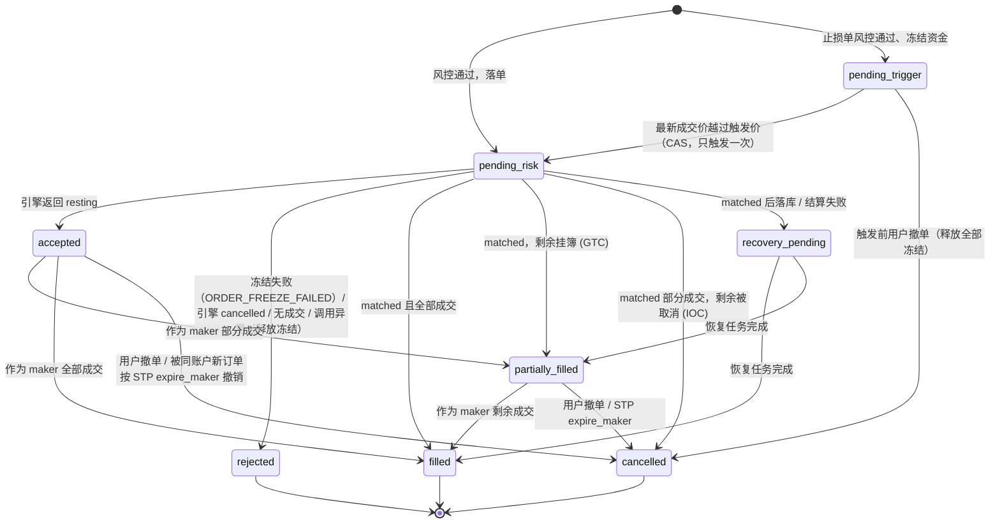

- 风控拒绝时订单不会落库，网关直接返回风控错误码（如 `INSUFFICIENT_AVAILABLE_BALANCE`、`PRICE_DEVIATION_TOO_HIGH`、`MARKET_HALTED`）。
- 落单后冻结失败（例如风控检查和冻结之间余额被占用、ledger 不可达）时，订单置为 `rejected`，`rejected_reason` 以 `ORDER_FREEZE_FAILED:` 开头；同时尽力释放该订单引用下可能已部分写入的冻结（请求超时但 ledger 已提交时），发布 `order.rejected`，调用方收到 `ORDER_FREEZE_FAILED` 错误。撮合提交失败时同样先释放冻结再置为 `rejected`；释放失败也不会让订单停在 `pending_risk`，原因里会注明 `lock release failed`。因此 `pending_risk` 只是一次下单请求内部的瞬时状态。
- `FOK` 流动性不足、市价单无对手盘时引擎返回 `cancelled`，订单为 `rejected`。
- Post-Only 订单到达时会与对手盘成交：引擎整单拒绝，订单 `rejected`、`rejected_reason = post_only_would_take`。
- STP：taker 遇到同账户挂单时按 `stp_mode` 处理。taker 剩余部分过期时，无成交为 `rejected`、部分成交为 `cancelled`（`stp_expired_taker` / `stp_expired_both`）；被撤的同账户挂单为 `cancelled`（`stp_expired_maker`），按剩余量解冻。
- 止损单在 `pending_trigger` 时不在引擎订单簿里，可撤；触发后 `type` 保持 `stop_limit` / `stop_market`，按 `limit` / `market` 撮合，后续状态与普通订单相同。
- 只有 `pending_trigger`，或 `accepted` / `partially_filled` 且 `resting_quantity > 0` 的订单可撤；终态订单撤单直接返回原订单。
- 恢复任务失败到上限时订单仍停在 `recovery_pending`，任务进入 dead-letter，等待运营重排。

### 5.3 订单恢复任务

状态 `pending` → `processing`（带 lease 和心跳）→ `completed` / `failed`；`failed` 即 dead-letter，可单条或批量重新排队。当前唯一的阶段是 `persist_matched_outcome`。

### 5.4 成交

`spot_trades` 一行对应引擎的一次撮合：`maker_order_id` / `taker_order_id`、`buyer_*` / `seller_*`（订单、用户、账户）、`price`、`quantity`、`seller_fee_rate`、`buyer_fee_rate`、`execution_id`、`execution_batch_id`、`execution_sequence`（每个市场单调递增）、`execution_batch_sequence`、`replay_cursor`（`<market>:<seq>`）、`protocol_version`（`v2`）、`settlement_id`。

异步结算模式下 `settlement_id` 先写一个由 `tradeId` 派生的占位 UUID，结算完成后由 `settlement-service` 回写真实值。

## 6. 结算

### 6.1 结算记录状态

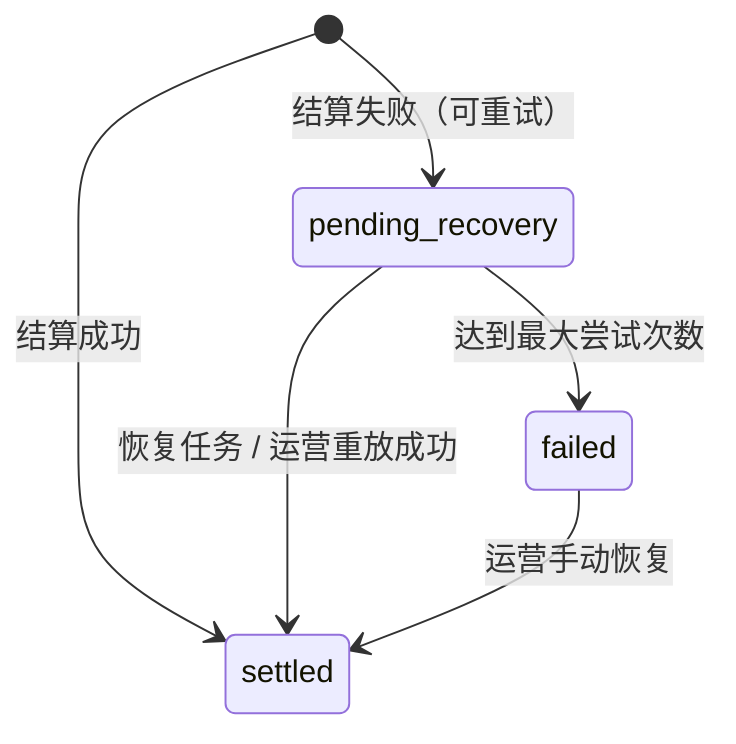

结算恢复任务 `trade_settlement_recovery_jobs` 的状态与订单恢复任务相同：`pending` / `processing` / `completed` / `failed`。

### 6.2 一笔成交的资金分录

以 ETH-USDT 成交 `quantity=q`、`price=p` 为例，`quoteAmount = p × q`，卖方费 `feeQ = quoteAmount × sellerFeeRate`，买方费 `feeB = q × buyerFeeRate`：

| 步骤 | 借 | 贷 |
| --- | --- | --- |
| consume 卖方冻结（`spot_order_lock_settled`） | 卖方 ETH `q` | 平台 ETH 结算账户 `q` |
| consume 买方冻结（`spot_order_lock_settled`） | 买方 USDT `p×q` | 平台 USDT 结算账户 `p×q` |
| `spot_trade_settlement_base` | 平台 ETH 结算账户 `q` | 买方 ETH `q − feeB`；平台 ETH 手续费账户 `feeB` |
| `spot_trade_settlement_quote` | 平台 USDT 结算账户 `p×q` | 卖方 USDT `p×q − feeQ`；平台 USDT 手续费账户 `feeQ` |

结束后平台结算账户净额为 0，手续费沉淀在 `fee` 账户。

`sellerFeeRate` / `buyerFeeRate` 是成交时由 `order-service` 解析并写进成交的值：

- 等级：运营指定（`spot_fee_tier_overrides`）> `config/fee-tiers.json` 中做市商计划的固定等级 > 30 日成交量（该用户在报价资产为 `volumeAsset` 的市场里作为买方或卖方的成交额之和）对应的最高等级。
- 费率：按本笔成交中的 maker / taker 角色取 `min(等级费率, 市场费率)`；VIP0 等于市场默认费率。
- 记录：`spot_trades.buyer_fee_rate` / `seller_fee_rate` 与 `buyer_fee_tier` / `seller_fee_tier`，随 `trade.executed` 事件传给结算，结算记录也保存一份；quote 分录的 journal 描述带上 `seller fee <等级> @ <费率>`，base 分录带上 `buyer fee …`。重放或恢复只用记录值，不重新解析等级。

### 6.3 消费位点

`trade_event_consumer_checkpoints` 以 `(consumerId, market)` 记录最后处理的 `eventId`、`tradeId`、`executionSequence`、`replayCursor`、`streamEntryId`。新事件序号小于等于位点视为重复；序号跳跃（大于位点 + 1）抛出 `SETTLEMENT_EVENT_SEQUENCE_GAP`。

### 6.4 市场监控告警

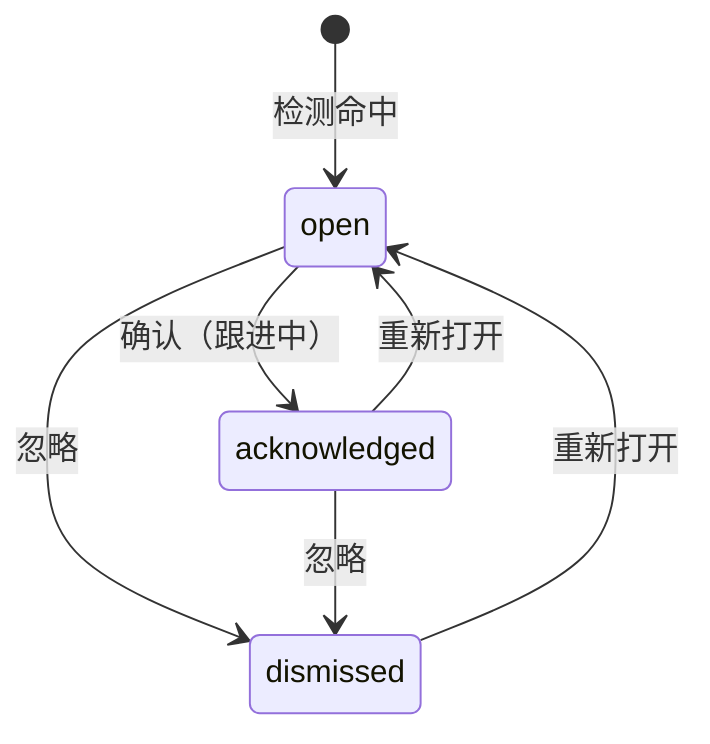

每次状态变化都必须带备注，并在 `risk_surveillance_alert_events` 追加一条（`detected` / `acknowledged` / `dismissed` / `reopened`）。仍为 `open` 的告警在后续扫描中更新证据和最近命中时间；已处理的告警保持处理结论，只有出现新的证据（之前任何告警都没覆盖的成交 / 委托）才会生成新的告警。

## 7. 身份与 KYC

### 7.1 用户状态

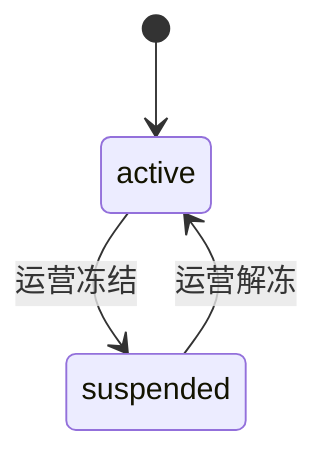

类型中还有 `disabled`：处于该状态的用户不能被冻结或解冻，但当前代码没有提供迁移到 `disabled` 的入口。API Key 状态为 `active` / `revoked`。

### 7.2 KYC

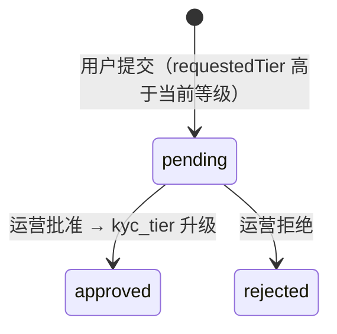

用户等级变化（批准、拒绝、运营直接调整 `tier_adjusted`）都追加到 `identity_kyc_events`。KYC 等级直接决定提币限额（见 [4.2](#42-提币申请校验)）。证件号在存储前脱敏，不做真实核验。

### 7.3 登录安全

- 设备 ID：trader-web 在 localStorage 保存的随机值随登录提交；缺省时按 User-Agent 派生 `ua-<hash>`。
- 新设备：用户已有其他设备、而本次设备从未出现过时 `is_new_device = true`，设备 `flagged_new = true`，并写一条 `security.new_device_login` 站内信（只对客户登录）。账户的第一台设备不算新设备。
- 登录失败锁定：最近一次成功登录之后、窗口内的 `INVALID_CREDENTIALS / TWO_FACTOR_INVALID_CODE / TWO_FACTOR_RECOVERY_CODE_INVALID` 失败次数达到阈值即锁定，锁定期间的尝试记为 `locked` 且不延长锁定；默认 15 分钟内 5 次、锁 5 分钟。
- 吊销设备：把该设备上未过期、未吊销的会话全部吊销，并记录设备的 `revoked_at`。

## 8. 市场状态

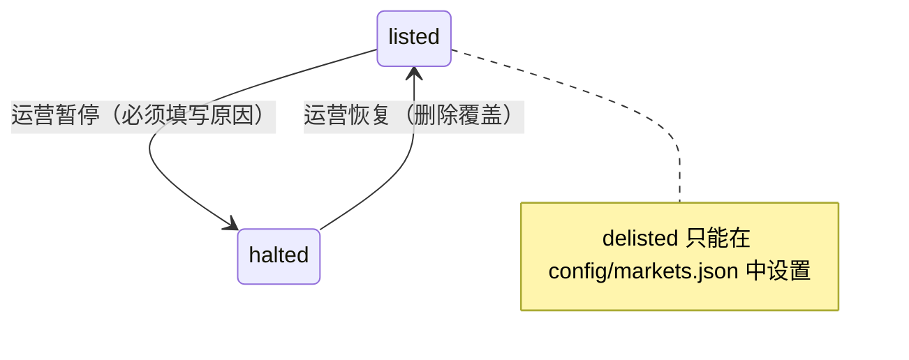

`halted` 和 `delisted` 的市场下单会被风控拒绝（`MARKET_HALTED` / `MARKET_DELISTED`），做市模拟器也会停止在该市场报价。

### 8.1 紧急开关

risk-service 持有三个开关，开启时各有一行 `risk_control_switches`，关闭即删除；每次变更追加 `risk_control_switch_events`。

| 开关 `scope` | 键 | 影响 |
| --- | --- | --- |
| `withdrawals_global` | `withdrawals_global` | 全部提现申请 / 批准 / 广播 |
| `withdrawals_asset` | `withdrawals_asset:<ASSET>` | 该币种的提现申请 / 批准 / 广播 |
| `api_write` | `api_write` | 新委托、提现申请（撤单不受影响） |

每个开关带 `reason`、`source`（`manual` 人工 / `automatic` 对账熔断）、`updatedBy`、`updatedAt`。自动来源不覆盖已开启的开关、不能关闭开关；熔断开启的币种恢复前必须有一轮一致的对账。

## 9. 关键不变量

| 不变量 | 由谁保证 |
| --- | --- |
| 每笔 journal 内同一资产借贷相等 | `ledger-service` `ensureBalanced`，不平衡直接拒绝 |
| 除 `opening_balance` 外任何账户余额不为负 | `ledger-service` 过账时检查 |
| 同一业务只记一次账 | `ledger_journals.idempotency_key` 唯一（如 `deposit:<id>`、`spot_trade:base:<tradeId>`） |
| 资金离开用户必须有 journal | `consume` 总是生成结算 journal |
| 下单 / 提币先冻结后执行 | `order-service` 冻结成功才提交撮合；`wallet-service` 冻结成功才进入审核 |
| 冻结最终一定被释放或消耗 | 撤单、拒单、成交后多余部分 `release`；成交与提币确认 `consume` |
| 同一链上交易不重复入账 | 观测表与充值表 `(network, tx_hash, address)` 唯一 + journal 幂等键 |
| 同一订单请求只建一次单 | `spot_orders.idempotency_key` 唯一 |
| 同一账户的买卖单不互相成交 | 撮合引擎按 `owner_id`（账户 ID）执行 STP |
| 止损单只触发一次 | `order-service` 用 `status = 'pending_trigger'` 条件更新（CAS）认领触发 |
| 同一成交只结算一次 | `trade_settlements.trade_id` 唯一，已 `settled` 直接返回 |
| 成交按序结算 | `executionSequence` 在每个市场单调递增，结算按位点检测重复与跳号 |
| 资金变动与事件原子一致 | outbox 事件与余额、journal 在同一数据库事务中写入 |
| 提币状态迁移可追溯 | 每次迁移写 `withdrawal_audit_logs`（含前后快照、操作人） |
| 大额提币需两名不同审核人 | `applyApproval` 拒绝同一人第二次批准（`WITHDRAWAL_SAME_APPROVER`） |
| 冷热调拨的提案人不能批准自己的提案 | `TreasuryService.approveTransfer`（`TREASURY_SAME_APPROVER`） |
| 内部转账不改变平台链上总持仓 | 来源广播时扣、目标确认时加，中间计"在途"（`computeTreasuryHoldings`） |
| 链上钱包余额不为负 | 调拨批准与重新广播前校验来源钱包余额（`TREASURY_INSUFFICIENT_BALANCE`） |
| 储备金叶子不泄露其他用户 | 网关按登录用户取叶子；路径只含兄弟哈希；用户 ID 用随机 nonce 盐化 |
| 不向黑名单地址出金 | 申请时 KYT 拦截；加入黑名单时自动拒绝待审核提现并释放冻结；批准时再查一次黑名单 |
| 余额快照 = 分录净额 − 活跃冻结 | 定时余额对账；不平立即暂停该币种提现（对账熔断） |
| 委托的账本冻结 = 未成交部分冻结 + 账本尚未消耗的成交 | 定时委托冻结对账（ledger-service ↔ order-service）；同一委托连续 2 轮不一致时熔断 |

## 10. 共享事件信封

跨服务的交易事件使用 `packages/domain` 的 `DomainEvent`：

```ts
interface DomainEvent<TPayload> {
  eventId: string;
  eventType: string;
  aggregateType: string;
  aggregateId: string;
  traceId: string;
  occurredAt: string;
  schemaId?: string;      // trade.executed 为 "trade.executed"
  schemaVersion?: number; // trade.executed 为 2
  payload: TPayload;
}
```

各事件的具体内容见 [event-catalog.md](./event-catalog.md)。

## 相关学习章节

- [03 账户、身份与安全](../learning/03-account-identity-security.md)：用户、会话、2FA、KYC
- [04 钱包与托管](../learning/04-wallet-custody.md)：充值、提币、观测与托管
- [05 账本](../learning/05-ledger.md)：账户、冻结、双分录
- [06 订单与撮合](../learning/06-order-matching.md)：订单状态机
- [07 清算结算与手续费](../learning/07-clearing-settlement-fees.md)：结算分录与手续费
- [09 风控](../learning/09-risk-control.md)：风控规则、限额、市场状态
- [12 商业模式](../learning/12-business-model.md)：VIP 手续费等级、做市商计划
- [B05 业务风控](../learning/backstage/B05-business-risk.md)：市场监控告警
