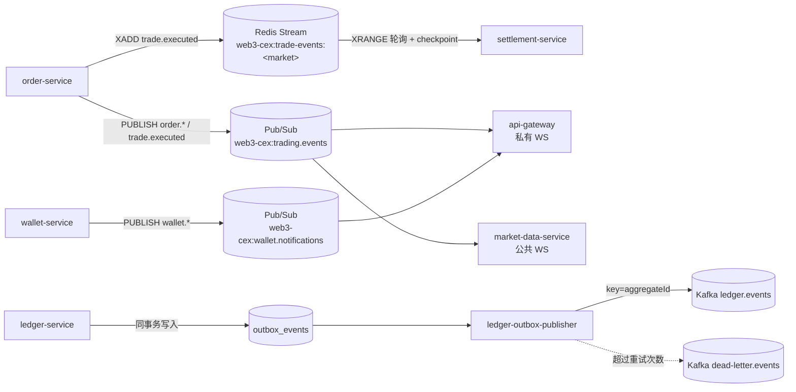
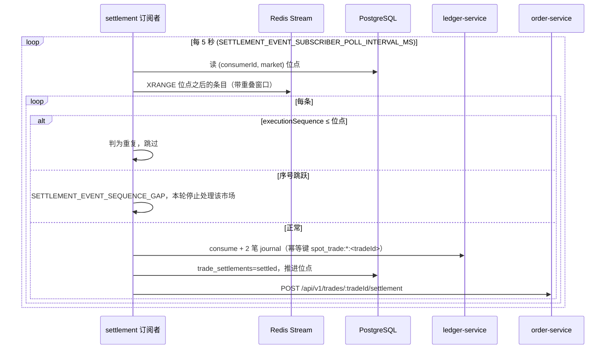

# 事件目录

本文列出系统中**实际发布和消费**的所有事件：走哪条通道、谁生产、谁消费、载荷里有什么、投递语义如何。内容来自对 `xAdd` / `publish` / Kafka producer 的代码检索。

系统里有三类异步通道：

| 通道 | 名称 | 生产者 | 消费者 | 语义 |
| --- | --- | --- | --- | --- |
| Redis Stream | `web3-cex:trade-events:<market 小写>`（如 `web3-cex:trade-events:eth-usdt`） | order-service | settlement-service | 可回放；消费方按位点去重，至少一次 |
| Redis Pub/Sub | `web3-cex:trading.events` | order-service | api-gateway、market-data-service | 即发即弃，至多一次；订阅方回源查询 |
| Redis Pub/Sub | `web3-cex:wallet.notifications` | wallet-service | api-gateway | 即发即弃，至多一次；订阅方回源查询 |
| Kafka | `ledger.events` | ledger-outbox-publisher | 仓库内无 | 事务性 outbox，至少一次 |
| Kafka | `dead-letter.events` | ledger-outbox-publisher | 仓库内无 | 尽力投递 |

> 仓库中**没有任何 Kafka 消费者**。Kafka 只承载账本 outbox 事件，供学习者用 `kafka-console-consumer` 等工具观察，或作为外部对账、报表系统的接入点。订单、成交、充提的跨服务传递走的是同步 HTTP 和 Redis。



## 1. 交易事件（order-service）

### 1.1 信封

交易事件使用 `packages/domain` 的 `TradingEvent`：

```json
{
  "eventId": "…",
  "eventType": "trade.executed",
  "aggregateType": "spot_trade",
  "aggregateId": "<tradeId>",
  "traceId": "execution:<executionId>",
  "occurredAt": "2026-…Z",
  "schemaId": "trade.executed",
  "schemaVersion": 2,
  "payload": {
    "market": "ETH-USDT",
    "userIds": ["<buyerUserId>", "<sellerUserId>"],
    "trade": { "…": "见 1.3" }
  }
}
```

`payload.userIds` 列出与事件相关的用户，api-gateway 据此决定推给哪些 WebSocket 连接。订单事件的 `payload.order`、成交事件的 `payload.trade` 二选一。

### 1.2 订单事件

| `eventType` | 触发时机 | `aggregateType` / `aggregateId` |
| --- | --- | --- |
| `order.accepted` | 引擎返回 `resting`，订单挂入订单簿 | `spot_order` / `orderId` |
| `order.updated` | 撮合后订单进入 `partially_filled`、`filled`、`recovery_pending` 等状态（taker 和被吃的 maker 各发一条）；止损单下单后进入 `pending_trigger` | 同上 |
| `order.cancelled` | 用户撤单成功（含撤销待触发的止损单）；IOC 部分成交后剩余取消；挂单被同账户新订单按 STP `expire_maker` 撤销 | 同上 |
| `order.rejected` | 引擎无成交（IOC / FOK / 市价无流动性、Post-Only 会吃单、STP 过期）或落单后冻结失败（`rejectedReason` 以 `ORDER_FREEZE_FAILED:` 开头）、撮合提交异常 | 同上 |

`payload.order` 字段：`orderId`、`userId`、`market`、`side`、`type`（`limit` / `market` / `stop_limit` / `stop_market`）、`price`（市价单、止损市价单为 `null`）、`quantity`、`filledQuantity`、`restingQuantity`、`timeInForce`、`status`、`createdAt`，以及可选的 `postOnly`、`stpMode`、`triggerPrice`、`triggeredAt`、`rejectedReason`。

这些事件只通过 Pub/Sub `web3-cex:trading.events` 发布。

### 1.3 `trade.executed`

| 项 | 内容 |
| --- | --- |
| 生产者 | order-service（撮合引擎只返回成交结果，不发事件） |
| 发布时机 | 撮合结果落库、多余冻结释放之后 |
| 通道 | ① Redis Stream `web3-cex:trade-events:<market>`；② Pub/Sub `web3-cex:trading.events` |
| 消费者 | settlement-service（Stream）、market-data-service 和 api-gateway（Pub/Sub） |
| `eventId` | 等于引擎生成的 `executionId` |
| Schema | `schemaId=trade.executed`、`schemaVersion=2`、`protocolVersion=v2` |

`payload.trade` 的必填字段（`validateTradeExecutedEvent` 会校验，缺失即拒绝发布 / 消费）：

| 字段 | 说明 |
| --- | --- |
| `tradeId`、`market`、`price`、`quantity`、`executedAt` | 成交基本信息 |
| `makerOrderId`、`takerOrderId` | 角色 |
| `buyerOrderId`、`sellerOrderId`、`buyerUserId`、`sellerUserId`、`buyerAccountId`、`sellerAccountId` | 结算所需的双方信息 |
| `sellerFeeRate` | 卖方费率（以 quote 收取） |
| `buyerFeeRate` | 买方费率（以 base 收取），可选以兼容旧事件 |
| `executionId`、`executionBatchId`、`executionSequence`、`executionBatchSequence` | 引擎序号，`executionSequence` 在每个市场单调递增 |
| `replayCursor` | `<market>:<executionSequence>` |
| `protocolVersion` | 当前只支持 `v2`（版本闸门 `DEFAULT_TRADE_EVENT_VERSION_GATE`） |

#### Stream 条目字段

每条 Stream 条目除了事件 JSON 外还有便于检索的扁平字段：

| 字段 | 内容 |
| --- | --- |
| `eventType` | `trade.executed` |
| `market`、`executionSequence`、`replayCursor`、`protocolVersion` | 从事件中拷贝 |
| `publishedAt` | 写入时间 |
| `event` | 完整 `TradingEvent` JSON |
| `traceparent` | 追踪开启时的 W3C trace context（事件 JSON 本身不含追踪信息） |

Stream 以 `MAXLEN ~ 10000`（`ORDER_EVENT_STREAM_MAX_LEN`）近似裁剪。order-service 还有一个周期性维护任务，可按保留时长裁剪，并把裁掉的条目复制到归档 Stream `web3-cex:trade-events:archive:<market>`（上限 50000 条）。运营可在 ops-console 查看 Stream 头部、手动回放（可选同时重发到 Pub/Sub）或裁剪。

## 2. 钱包事件（wallet-service）

通道：Pub/Sub `web3-cex:wallet.notifications`。消费者：api-gateway 私有 WebSocket。信封比交易事件简单，只有 `eventType` 和 `payload`。

| `eventType` | 触发时机 | `payload` |
| --- | --- | --- |
| `wallet.deposit.updated` | 每次 `confirmDeposit` 保存充值单后、变为 `credited` 后 | 完整充值单：`depositId`、`userId`、`ledgerAccountId`、`assetCode`、`network`、`address`、`txHash`、`amount`、`confirmations`、`status`、`ledgerJournalId` 等 |
| `wallet.withdrawal.updated` | 提币每次状态迁移后（requested / first_approved / approved / broadcasted / confirmed / rejected） | 完整提币单：`withdrawalId`、`userId`、`status`、`reviewStatus`、`amount`、`fee`、`toAddress`、`txHash`、`custodyRequestId` 等 |
| `wallet.notification.created` | 写入一条站内通知后 | 通知记录：`notificationId`、`userId`、`eventType`（见下）、`subject`、`body`、`payload` |

站内通知（`wallet_notifications` 表）的 `eventType`：`deposit.credited`、`withdrawal.requested`、`withdrawal.approved`、`withdrawal.rejected`、`withdrawal.broadcasted`、`withdrawal.confirmed`。它们是数据库记录而非消息主题，与状态变更在同一事务中提交，用户通过网关的通知接口读取；`deliver-notifications` 脚本会把 `pending` 通知交给投递通道（演示中只输出到控制台）并标记 `delivered` / `failed`。

发布失败只打印告警（`event publish degraded`），不影响业务事务。

## 3. 账本事件（ledger-service）

### 3.1 事件类型

| `eventType` | 触发时机 | `aggregateType` / `aggregateId` | 载荷 |
| --- | --- | --- | --- |
| `ledger.journal_posted` | 每笔 journal 过账（含 `consume` 生成的结算 journal） | `journal` / `journalId` | `journalId`、`businessType`、`businessId`、`entryCount`、`assetCodes` |
| `balance.locked` | `freeze` 成功 | `balance` / `<accountId>:<assetCode>` | `accountId`、`assetCode`、`referenceType`、`referenceId`、`amount` |
| `balance.released` | `release` 成功（含部分释放） | 同上 | 同上，`amount` 为本次释放额 |
| `balance.consumed` | `consume` 成功（含部分消耗） | 同上 | 同上，另有 `settled: true`、`settlementAccountId` |

`journal_posted` 中常见的 `businessType`：`deposit_confirmed`、`withdrawal_settled`、`spot_order_lock_settled`、`spot_trade_settlement_base`、`spot_trade_settlement_quote`、`demo_simulator_topup`。

### 3.2 Outbox 与投递

```mermaid
sequenceDiagram
  participant C as 调用方
  participant L as ledger-service
  participant DB as PostgreSQL
  participant P as ledger-outbox-publisher
  participant K as Kafka

  C->>L: freeze / postJournal / consume ...
  L->>DB: BEGIN; 改余额 / 写 journal / 写 lock; INSERT outbox_events; COMMIT
  loop 常驻轮询
    P->>DB: 取 published_at 为空、未死信、到达 next_attempt_at 的事件
    P->>K: send(ledger.events, key=aggregateId)
    alt 成功
      P->>DB: published_at = now
    else 失败且 attempts < 5
      P->>DB: publish_attempts+1, next_attempt_at = now + 5s × attempts
    else 失败且 attempts ≥ 5
      P->>DB: dead_lettered_at = now
      P-->>K: 尽力 send(dead-letter.events)
    end
  end
```

- **原子性**：事件与资金变动在同一个数据库事务中写入，不存在"改了余额但事件丢了"或反之的情况。
- **至少一次**：发送成功但标记失败时会重发，消费方应按 `event_id` 去重。
- **Kafka 消息格式**：`key` 为 `aggregateId`（同一 journal、同一账户资产的事件进入同一分区）；`value` 是 outbox 记录的 JSON，其中 `payload` 为 `{ trace_id, occurred_at, payload }`；headers 包含 `event_id`、`event_type`、`aggregate_type`。两个 topic 在首次发送时自动创建（1 分区、1 副本）。
- **死信**：数据库中的 `dead_lettered_at` 才是事实来源，Kafka 死信 topic 只是尽力投递。运营可在 ops-console 或通过 `POST /api/v1/ledger/ops/outbox/drain` 把死信重新排队并排空。
- **数据库内消费**：账户流水（account statement）直接读取 `outbox_events` 中的 `balance.*` 事件来展示冻结 / 释放 / 消耗，而不经过 Kafka。

可调参数：`KAFKA_BROKERS`（默认 `127.0.0.1:9092`）、`LEDGER_OUTBOX_TOPIC`、`LEDGER_OUTBOX_DEAD_LETTER_TOPIC`、`LEDGER_OUTBOX_MAX_ATTEMPTS`（5）、`LEDGER_OUTBOX_RETRY_DELAY_MS`（5000）、`LEDGER_OUTBOX_BATCH_SIZE`（100）。

## 4. 消费者行为

### 4.1 settlement-service：成交 Stream



- 不使用 Redis 消费组，位点存在 PostgreSQL `trade_event_consumer_checkpoints`，按 `(consumerId, market)` 记录 `executionSequence`、`replayCursor`、`streamEntryId`。
- 重叠读取（默认等于批大小）保证不会因 Stream 条目 ID 边界漏读；重复条目由位点判重，不重复生成追踪 span。
- 结算失败时写恢复任务并抛出可恢复错误；对已移交恢复队列的成交，位点照常推进（action=`deferred`），避免一个坏事件阻塞整个市场。
- 业务幂等有三层：位点判重 → `trade_settlements.trade_id` 唯一（已 `settled` 直接返回）→ ledger journal 幂等键。
- `SETTLEMENT_ORDER_EVENT_TRANSPORT=http` 时改为从 order-service 的 HTTP 接口拉取成交事件；`SETTLEMENT_EVENT_SUBSCRIBER=disabled` 可关闭订阅者（故障实验室也可临时暂停它）。

### 4.2 market-data-service：交易事件

收到 `web3-cex:trading.events` 上的任意事件后，按 `payload.market`：

1. 从 order-service 拉取最近成交和挂单，重建 ticker、depth、recent trades；
2. 写入 Redis 快照（`web3-cex:market-data:*`，TTL 300 秒）并异步落 ClickHouse；
3. 向订阅了该市场的公共 WebSocket 客户端推送新快照。

事件本身只作为"该刷新了"的信号，丢一条不影响正确性，下一条事件或下一次读请求会重建快照。

### 4.3 api-gateway：私有 WebSocket

订阅两个 Pub/Sub 频道，根据事件中的用户 ID 找到对应连接，再回源查询最新数据推送：

| 事件 | 推送频道 |
| --- | --- |
| 含 `payload.order` 的交易事件 | `orders`（按订单版本去重） |
| `trade.executed` | `trades`（按 `tradeId` 去重） |
| 任意交易事件 | `balances`、`positions`（重新查 ledger 计算差量） |
| `wallet.notification.created` | `notifications` |
| `wallet.deposit.updated` | `deposits` |
| `wallet.withdrawal.updated` | `withdrawals` |

推送消息带递增 `sequence`，客户端断线后可用 `resume` 从某个序号续传。由于 Pub/Sub 至多一次，客户端重连后也会先收到一份快照。

## 5. 设计要点

| 问题 | 本项目的做法 |
| --- | --- |
| 数据库与消息一致 | 账本用事务性 outbox；交易事件在落库之后发布，发布失败只告警，可从数据库回放 Stream |
| 重复投递 | 所有消费方按业务主键或序号去重（`event_id`、`tradeId`、`executionSequence`） |
| 顺序 | 成交按市场有序（单调 `executionSequence`），结算检测跳号；Kafka 以 `aggregateId` 为 key |
| 版本演进 | `trade.executed` 带 `schemaVersion` / `protocolVersion`，生产与消费两端都过版本闸门 |
| 追踪传播 | Stream 条目额外携带 `traceparent`，结算 span 挂到下单 trace 下 |
| 实时推送丢消息 | Pub/Sub 只当刷新信号，接收方回源查询；客户端支持快照 + 续传 |

## 相关文档

- [architecture.md](./architecture.md)：服务与主链路
- [domain-model.md](./domain-model.md)：状态机与不变量
- [ledger-service-design.md](./ledger-service-design.md)：账本细节
- [fault-lab.md](./fault-lab.md)：暂停结算消费者、引擎重置等故障演练
- 学习章节：[05 账本](../learning/05-ledger.md)、[07 清算结算与手续费](../learning/07-clearing-settlement-fees.md)、[08 行情](../learning/08-market-data.md)、[13 可靠性与安全事故](../learning/13-reliability-security-incidents.md)
