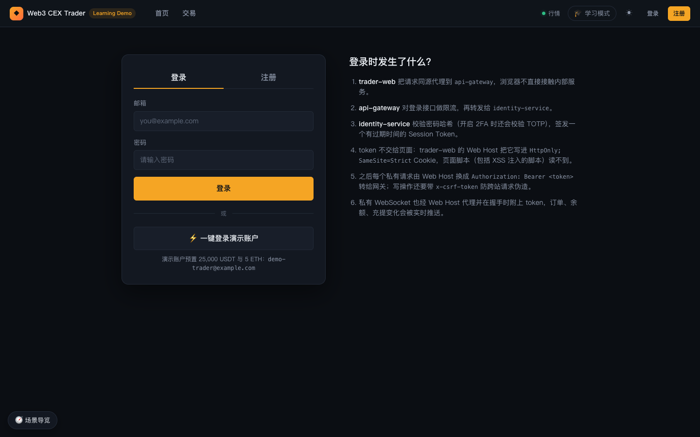
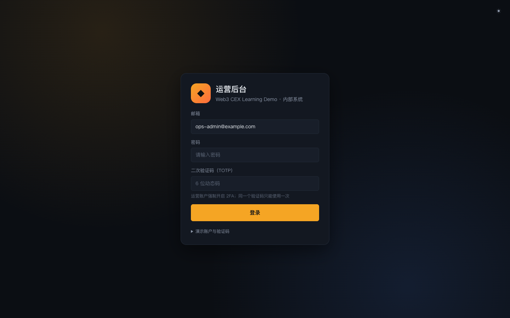

# 01 启动与登录

本篇说明如何在本机把整套演示环境跑起来，并分别登录用户端 trader-web 和运营端 ops-console。更完整的参数、端口与排错说明见 [../getting-started.md](../getting-started.md)。

## 1. 前置条件

| 工具 | 要求 |
| --- | --- |
| Node.js | 22（以根目录 `.nvmrc` 为准） |
| pnpm | 10（`packageManager` 锁定 `pnpm@10.6.0`，可用 `corepack enable` 自动匹配） |
| Docker | 支持 `docker compose`（Compose v2），用于本地 PostgreSQL / Redis / Kafka / ClickHouse |

## 2. 安装与一键启动

### 操作步骤

1. 在仓库根目录安装依赖（按锁文件安装，与 CI 一致）：

   ```bash
   pnpm install --frozen-lockfile
   ```

2. 启动全部服务并写入演示数据：

   ```bash
   pnpm demo:up
   ```

   `demo:up` 等价于 `pnpm stack:start && pnpm demo:prepare`：先拉起基础设施、构建 workspace、初始化数据库并启动所有服务，再清空旧演示数据并写入固定的种子用户、初始资产、充值地址和做市商挂单。

3. 查看服务状态（可选）：

   ```bash
   pnpm stack:status
   ```

   每个服务显示 `running` / `starting` / `stopped` / `port-in-use` 之一。

4. 浏览器打开入口：

   | 入口 | 地址 | 用途 |
   | --- | --- | --- |
   | trader-web（用户端） | <http://127.0.0.1:3013> | 交易、资产、订单、账户 |
   | ops-console（运营后台） | <http://127.0.0.1:3006> | 审核、对账、链路追踪、故障实验 |

如果 trader-web 打开后显示「无法连接到 trader-web 服务」并提示 `pnpm demo:up`，说明后端尚未就绪，等待启动完成后刷新即可。

### 背后的服务

`pnpm stack:start` 由 `scripts/start-all-services.mjs` 统一托管全部后端服务、两个前端 Web Host（trader-web、ops-console）和 demo-simulator（模拟链 + 做市商 + 水龙头）；`pnpm demo:prepare` 调用 `scripts/reset-mvp-demo.mjs` 与 `scripts/bootstrap-mvp-demo.mjs` 写入种子数据。

## 3. 演示账户

演示账户由 `pnpm demo:prepare` 创建，定义在 `scripts/mvp-demo-lib.mjs`：

| 角色 | 邮箱 | 密码 | 二次验证 |
| --- | --- | --- | --- |
| 演示交易员 | `demo-trader@example.com` | `DemoTraderPass123!` | 未开启 |
| 运营管理员（`ops_admin`） | `ops-admin@example.com` | `OpsAdminPass123!` | TOTP：`pnpm -s ops:totp` |
| 运营复核人（`ops_reviewer`） | `ops-reviewer@example.com` | `OpsReviewerPass123!` | TOTP：`pnpm -s ops:totp reviewer` |

获取运营账户当前的 6 位动态码：

```bash
pnpm -s ops:totp            # ops-admin@example.com
pnpm -s ops:totp reviewer   # ops-reviewer@example.com
```

输出形如 `123456  (valid for 18s, account ops-admin@example.com)`，动态码每 30 秒变化一次。两个运营账户用于大额提现等需要「两人复核」的场景。

> 这些账户、密码和 TOTP 种子都是公开的演示数据，只能用于本地学习环境。

## 4. trader-web 登录与注册



### 功能说明

- 顶部导航栏未登录时只显示「首页」「交易」，右上角有「行情」连接状态、「学习模式」开关、主题切换按钮以及「登录」「注册」按钮；左下角固定有「场景导览」入口。
- 登录卡片分「登录」「注册」两个标签：
  - **登录**：邮箱 + 密码。如果账户开启了 2FA，首次提交后会多出「二次验证码」输入框，可填身份验证器 App 的 6 位动态码，也可填一次性恢复码（`xxxx-xxxx`）。
  - **注册**：昵称、邮箱、密码（至少 8 位），点击「创建账户」。注册成功后自动切回登录标签并预填邮箱。新账户余额为 0，可以到「资产」页领取测试币。
- **⚡ 一键登录演示账户**：卡片底部的按钮直接用演示交易员账户登录，下方注明「演示账户预置 25,000 USDT 与 5 ETH」以及账户邮箱。
- 右侧「登录时发生了什么？」用 6 步解释登录链路：同源代理、网关限流、密码哈希与 TOTP 校验、HttpOnly Cookie 保存 Session Token、私有请求附带 Bearer token 与 `x-csrf-token`、私有 WebSocket 由 Web Host 代理握手。
- 登录成功后默认跳到交易页（`/trade/<当前市场>`）；若是从受保护页面跳转过来的（URL 带 `redirect`），则回到原页面。

### 操作步骤

1. 打开 <http://127.0.0.1:3013>，点击右上角「登录」，或首页的「登录 / 体验演示账户」。
2. 最快方式：点击「⚡ 一键登录演示账户」。
3. 想体验新用户流程：切到「注册」标签，填写昵称、邮箱、密码后点击「创建账户」，再用新账户登录。
4. 登录成功后右上角出现「账户」连接状态、通知铃铛和用户头像；点头像可进入资产总览、资金流水、储备金证明、订单中心、账户与 API，或「退出登录」。登录时如果识别为新设备，提示里会多一行「检测到新设备登录，已发送站内通知」（见 [05 账户与安全](05-trader-account.md)）。

### 背后的服务

- **trader-web Web Host**：同源代理 API 与 WebSocket，把 Session Token 写入 `HttpOnly; SameSite=Strict` Cookie。
- **api-gateway**：登录接口限流、私有接口鉴权与 CSRF 校验。
- **identity-service**：用户注册、密码哈希校验、TOTP 校验、签发 Session。

### 延伸学习

- [../../learning/03-account-identity-security.md](../../learning/03-account-identity-security.md)
- [../security.md](../security.md)

## 5. ops-console 登录



### 功能说明

- 登录卡片标题为「运营后台 · Web3 CEX Learning Demo · 内部系统」，右上角可切换主题。
- 邮箱默认预填 `ops-admin@example.com`；密码和「二次验证码（TOTP）」均为必填。提示文字说明：运营账户强制开启 2FA，同一个验证码只能使用一次。
- 底部「演示账户与验证码」折叠区展开后列出管理员账号、密码、TOTP 种子，以及在仓库根目录运行 `pnpm -s ops:totp` 的提示。也可以把种子添加到任意身份验证器 App。

### 操作步骤

1. 打开 <http://127.0.0.1:3006>。
2. 保留预填邮箱，输入密码 `OpsAdminPass123!`。
3. 在终端执行 `pnpm -s ops:totp`，把输出的 6 位码填入「二次验证码（TOTP）」。
4. 点击「登录」。若提示验证码无效，多半是刚好跨过 30 秒窗口或该码已用过，重新生成一次即可。
5. 需要第二位审核人时，退出后用 `ops-reviewer@example.com` / `OpsReviewerPass123!` 与 `pnpm -s ops:totp reviewer` 登录（也可在另一个浏览器 / 无痕窗口中登录）。

### 背后的服务

- **ops-console Web Host**：同源代理运营接口。
- **api-gateway**：运营接口鉴权与角色校验（`ops_admin` / `ops_reviewer`）。
- **identity-service**：密码 + TOTP 校验，并拒绝重复使用同一个验证码。

### 延伸学习

- [../../learning/03-account-identity-security.md](../../learning/03-account-identity-security.md)

## 6. 停止环境

```bash
pnpm stack:stop         # 停止全部托管服务（先 SIGTERM，5 秒后仍存活则 SIGKILL）
pnpm stack:stop:infra   # 同上，并执行 docker compose down
```

`stack:stop:infra` 不会删除 Docker 数据卷。下次启动仍建议使用 `pnpm demo:up`，它会重置演示数据，保证每次演示从同一个起点开始。只想重置数据而不重启服务时，执行 `pnpm demo:prepare`。

---

上一篇：[手册目录](README.md) ｜ 下一篇：[02 首页与学习模式](02-trader-home-and-learning.md)
