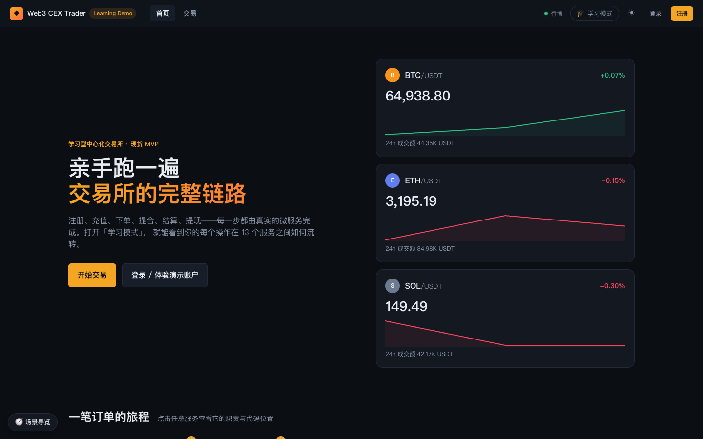
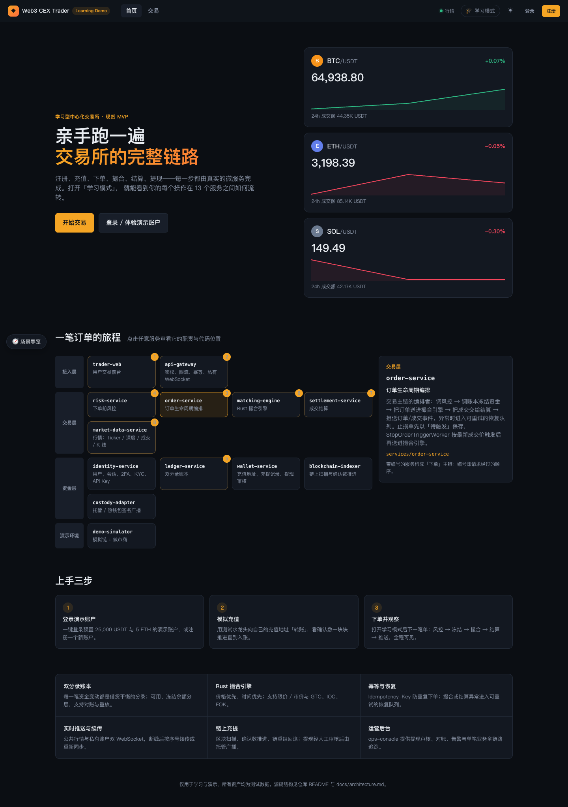
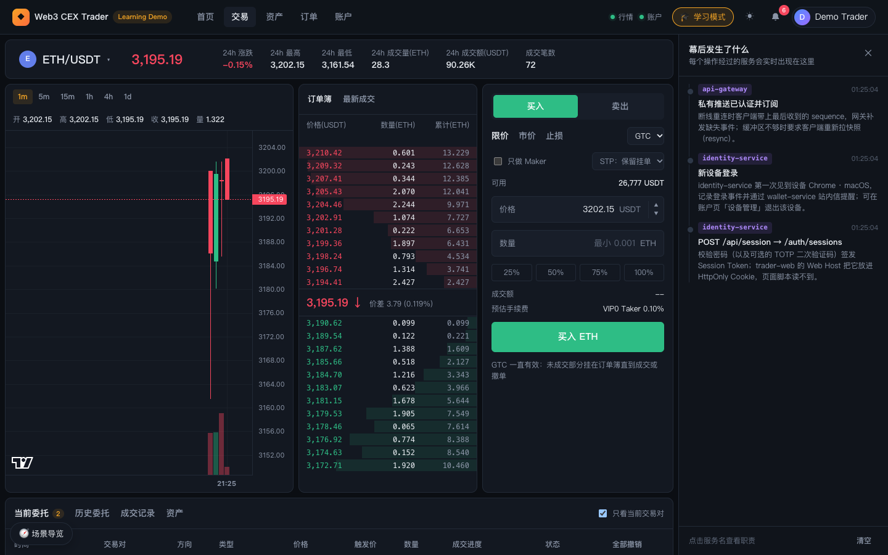
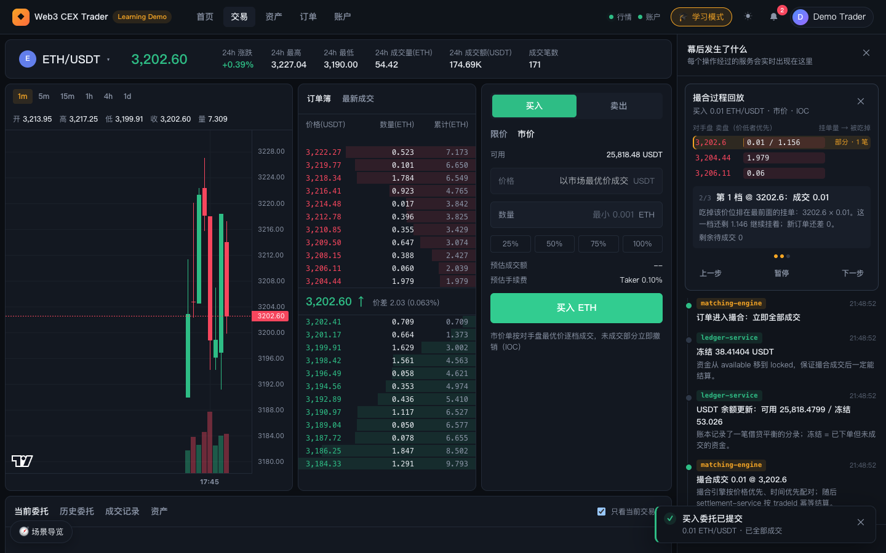
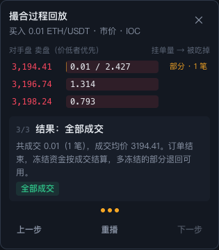
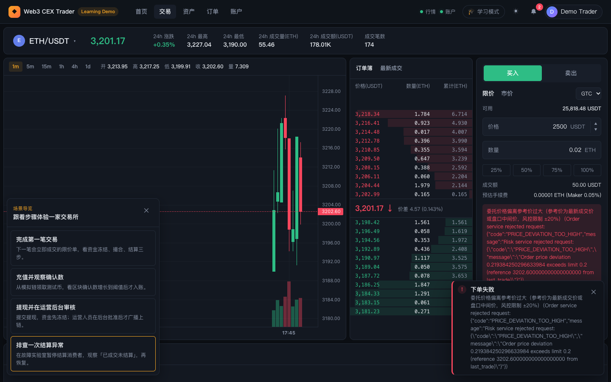
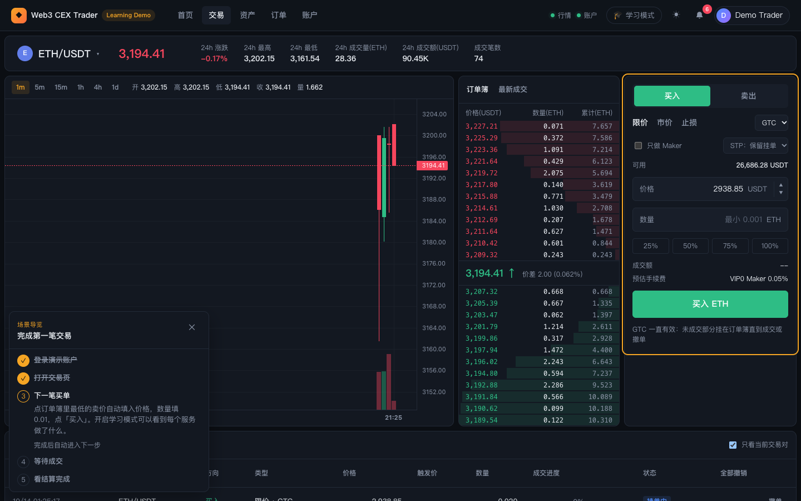
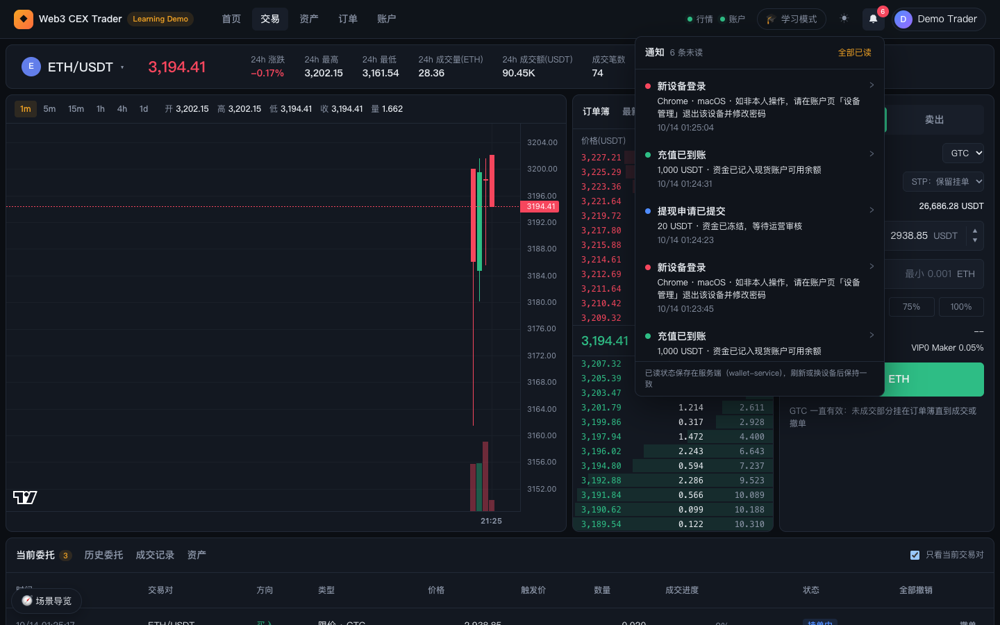

# 02 首页与学习模式

本篇介绍 trader-web 的首页，以及贯穿所有页面的学习与辅助工具：学习模式、撮合回放、场景导览、通知中心、主题切换和连接状态指示。

## 1. 首页

### 功能说明

首页自上而下分为五块：

1. **首屏**：标语「亲手跑一遍交易所的完整链路」，说明注册、充值、下单、撮合、结算、提现都由真实微服务完成。按钮「开始交易」进入当前市场交易页；未登录时第二个按钮为「登录 / 体验演示账户」，登录后变为「查看资产」。
2. **行情卡片**：右侧每个已配置市场一张卡片（截图中为 BTC/USDT、ETH/USDT、SOL/USDT），显示最新价、24h 涨跌幅、最近 60 根 1 分钟 K 线的收盘价走势迷你图和 24h 成交额；迷你图每 20 秒刷新一次，没有成交时显示「等待成交…」。点击卡片进入该市场交易页。
3. **一笔订单的旅程**：按「接入层 / 交易层 / 资金层 / 演示环境」四层排列全部服务。带橙色编号 1–8 的服务构成下单主链（trader-web → api-gateway → order-service → risk-service → ledger-service → matching-engine → settlement-service → market-data-service），编号即请求经过的顺序。点击任意服务，右侧详情卡显示其所在层、一句话职责、详细说明和代码目录（例如 `services/order-service`）。
4. **上手三步**：「登录演示账户」「模拟充值」「下单并观察」三张卡片，分别链接到登录页、资产页充值面板和交易页。
5. **特性介绍**：双分录账本、Rust 撮合引擎、幂等与恢复、实时推送与续传、链上充提、运营后台六项能力简介。

### 操作步骤

1. 打开 <http://127.0.0.1:3013>，默认进入首页。
2. 在「一笔订单的旅程」中依次点击编号 1–8 的服务，阅读每个服务的职责，建立整体印象。
3. 点击「上手三步」的卡片或首屏按钮开始体验。

### 背后的服务

- **market-data-service**：行情卡片的 Ticker（最新价、24h 涨跌、成交额）和 K 线数据。
- 服务分层图是前端静态内容（`apps/trader-web/src/client/state/learn.ts` 中的服务说明），不调用后端。

### 延伸学习

- [../../learning/01-what-is-cex.md](../../learning/01-what-is-cex.md)
- [../../learning/02-system-architecture.md](../../learning/02-system-architecture.md)
- [../architecture.md](../architecture.md)

## 2. 学习模式

### 功能说明

- 顶部导航栏的「🎓 学习模式」按钮是开关，打开后按钮高亮，页面右侧出现「幕后发生了什么」抽屉；开关状态保存在本地偏好里，刷新后保持。
- 抽屉是一条**实时时间线**：每当你登录、下单、撤单、领取测试币等，会按顺序追加若干条事件。每条事件包含：
  - 彩色服务标签（如 `api-gateway`、`identity-service`、`ledger-service`、`matching-engine`）和时间；
  - 一句话标题（例如「POST /api/session → /auth/sessions」「冻结 38.41404 USDT」「订单进入撮合：立即全部成交」「撮合成交 0.01 @ 3,202.6」）；
  - 简短解释（例如「资金从 available 移到 locked，保证撮合成交后一定能结算」）。
- 以下单为例，时间线会依次出现：api-gateway 校验 Idempotency-Key → risk-service 下单前风控 → ledger-service 冻结资金 → matching-engine 撮合结果，随后私有推送带来余额更新、成交等事件。
- 点击事件上的服务标签，抽屉切换为该服务的说明卡（所在层、职责、详细说明、代码目录），点「返回时间线」回来。
- 部分事件带 trace 信息：用 `pnpm stack:start:observability` 启动时显示「查看 trace ↗」，可直接跳到 Jaeger 查看完整调用链；普通启动时只显示 `trace xxxxxxxx…` 的短 ID。
- 抽屉底部「清空」清除时间线；右上角 ✕ 关闭学习模式。
- 时间线为空时显示「还没有事件」，提示去下单、撤单或领取测试币。

### 操作步骤

1. 点击顶部「🎓 学习模式」。
2. 登录演示账户，进入交易页下一笔小额买单（例如市价买入 0.01 ETH）。
3. 观察抽屉中自上而下新增的事件，点击服务标签阅读职责。
4. 需要重新开始观察时点击「清空」。

### 背后的服务

时间线事件分两类：前端在发起请求前后记录的「请求经过了哪些服务」（api-gateway、risk-service、ledger-service、matching-engine 等），以及私有 WebSocket 推送回来的状态变化（订单、成交、余额、充提）。私有推送由 api-gateway 提供，trader-web Web Host 代理握手。

### 延伸学习

- [../../learning/02-system-architecture.md](../../learning/02-system-architecture.md)
- [../../learning/13-reliability-security-incidents.md](../../learning/13-reliability-security-incidents.md)（链路追踪部分）

## 3. 撮合回放

### 功能说明

- **只在学习模式打开时生成**：每次下单成功后，学习抽屉顶部会出现「撮合过程回放」卡片，重现这笔订单如何吃掉对手盘。
- 标题下方显示订单摘要：方向、数量、市场、类型（市价 / 限价 + 价格）、有效方式（GTC / IOC / FOK）。
- **对手盘列表**：买单看卖盘（价低者优先），卖单看买盘（价高者优先）。每档显示价格和一条进度条，播放到该档时进度条填充为「已吃掉 / 原挂单量」，右侧标签显示「吃光 · N 笔」或「部分 · N 笔」；限价单超出限价的档位标为「超出限价」，并画出「限价 xxx」分隔线。
- **步骤说明**：显示「当前步 / 总步数」、本步标题和解释（如「第 1 档 @ 3202.6：成交 0.01」，说明按价格优先、时间优先吃掉最前面的挂单），以及剩余待成交数量。最后一步给出结果徽章，例如「全部成交」「部分成交，剩余挂入订单簿」「未成交，整单挂入订单簿」「部分成交，剩余按 IOC 撤销」等。
- 回放每 1.8 秒自动前进一步；底部有「上一步」「暂停 / 播放」「下一步」，播完后变为「重播」。右上角 ✕ 关闭回放。
- 回放依据的是下单瞬间的订单簿快照和这笔订单作为 Taker 产生的成交记录；如果重建失败只会隐藏回放，不影响订单本身。

### 操作步骤

1. 打开学习模式。
2. 在交易页提交一笔能立即成交的订单（市价单，或价格穿过对手价的限价单）。
3. 观察回放逐档推进；可点「暂停」后用「上一步 / 下一步」逐步阅读。
4. 换不同的有效方式（GTC / IOC / FOK）或较大的数量再试，比较结果差异。

### 背后的服务

- **matching-engine**：真实的撮合由 Rust 撮合引擎完成，回放只是对结果的可视化解释。
- **order-service / api-gateway**：提供订单状态和该订单的成交列表（`/trades?orderId=...`）。
- **market-data-service**：下单前的订单簿深度快照。

### 延伸学习

- [../../learning/06-order-matching.md](../../learning/06-order-matching.md)

## 4. 场景导览

### 功能说明

- 页面左下角固定有「🧭 场景导览」按钮，点击后弹出场景选择面板，内置四个场景：
  | 场景 | 简介 |
  | --- | --- |
  | 完成第一笔交易 | 下一笔会立即成交的限价单，看资金冻结、撮合、结算三步 |
  | 充值并观察确认数 | 从模拟链领取测试币，看区块确认数增长到阈值后才入账 |
  | 提现并在运营后台审核 | 提交提现，资金先冻结；运营人员在后台批准后才广播上链 |
  | 排查一次结算异常 | 在故障实验室暂停结算消费者，观察「已成交未结算」，再恢复 |
- 选择场景后，面板变为步骤清单：已完成的步骤打勾，当前步骤展开显示说明和操作按钮，未开始的步骤显示序号。
- 当前步骤对应的页面元素会被橙色高亮框标出（截图中高亮的是下单表单）。
- 大多数步骤会**自动判定完成**（例如检测到登录、到达交易页、出现新订单或新成交），显示「完成后自动进入下一步」；需要在别处操作的步骤（例如到 ops-console 审核）提供「我已完成」按钮手动确认，并可能带一个跳转按钮，外部链接会在新标签页打开 ops-console。
- 进度保存在浏览器本地，刷新页面不会回退；全部完成后显示「🎉 场景完成」和「选择其他场景」。右上角 ✕ 退出当前导览。

### 操作步骤

1. 点击左下角「🧭 场景导览」。
2. 选择一个场景，例如「完成第一笔交易」。
3. 按当前步骤的说明操作（可点步骤里的按钮直接跳到对应页面）；自动判定的步骤完成后清单会自己前进。
4. 遇到需要手动确认的步骤，完成后点「我已完成」。
5. 完成后点「选择其他场景」继续，或点 ✕ 退出。

### 背后的服务

导览本身是纯前端逻辑（`apps/trader-web/src/client/lib/tours.ts`），通过观察会话、订单、成交、充值、提现等状态判断进度；具体涉及的后端服务取决于场景，详见 [10 典型场景](10-scenarios.md)。

## 5. 通知中心

### 功能说明

- 登录后顶部导航栏出现铃铛图标，有未读通知时右上角显示红色数字（超过 99 显示「99+」）。
- 点击铃铛打开通知面板：标题旁显示「N 条未读」或「全部已读」，右侧「全部已读」按钮一次清零。
- 每条通知有彩色圆点（绿色表示成功，红色表示失败，蓝色表示进行中）、标题、详情和时间。当前会产生通知的事件包括：充值已到账、提现申请已提交、提现审核通过、提现被驳回、提现已广播上链、提现已完成。
- 点击单条通知会把它标为已读；带「›」的通知会跳转到对应记录（充值 / 提现记录列表，或订单中心历史委托），并高亮该行。
- 面板底部说明：已读状态保存在服务端（wallet-service），刷新或换设备后保持一致。
- 点击面板外部或按 Esc 关闭面板。

### 操作步骤

1. 完成一次充值或提交一笔提现后，留意铃铛上的未读数。
2. 点击铃铛查看通知，点击某条通知跳转到对应记录。
3. 点「全部已读」清除未读数。

### 背后的服务

- **wallet-service**：生成充提相关通知并保存已读标记。
- **api-gateway**：通过私有 WebSocket 实时推送新通知，前端据此增加未读计数。

### 延伸学习

- [../../learning/04-wallet-custody.md](../../learning/04-wallet-custody.md)

## 6. 主题切换

### 功能说明

顶部导航栏「学习模式」右侧的 ☀ / ☾ 按钮在深色和浅色主题之间切换（深色时显示 ☀，浅色时显示 ☾）。默认是深色主题，选择保存在浏览器本地偏好中。本手册截图均为深色主题。K 线图颜色会随主题一起切换。

### 操作步骤

1. 点击顶部 ☀ 按钮切换为浅色主题。
2. 再次点击（此时为 ☾）切回深色主题。

## 7. 行情 / 账户连接状态

### 功能说明

导航栏右侧有两个连接状态指示（截图中显示为绿点 + 「行情」「账户」）：

- **行情**：公共 WebSocket，推送 Ticker、深度和最新成交，未登录也会连接。
- **账户**：私有 WebSocket，推送订单、成交、余额、充提和通知变化，仅登录后显示。

鼠标悬停在指示上可看到当前状态文字，共五种：「未连接」「连接中」「实时」「重连中」「离线」。断线后前端按指数退避自动重连；重连后根据最后收到的序号续传，缓冲区不足时会重新拉取快照（resync），学习模式时间线里会出现相应说明。

### 操作步骤

1. 正常情况下两个指示都应为绿色「实时」。
2. 若显示「重连中」或「离线」，先用 `pnpm stack:status` 检查 api-gateway 与 market-data-service 是否在运行。

### 背后的服务

- **market-data-service**：公共行情数据源。
- **api-gateway**：公共与私有 WebSocket 的接入点，私有通道需要会话认证。
- **trader-web Web Host**：代理 WebSocket 并在私有通道握手时附上 token。

### 延伸学习

- [../../learning/08-market-data.md](../../learning/08-market-data.md)

---

上一篇：[01 启动与登录](01-getting-started.md) ｜ 下一篇：[03 交易与订单](03-trader-trading.md)
