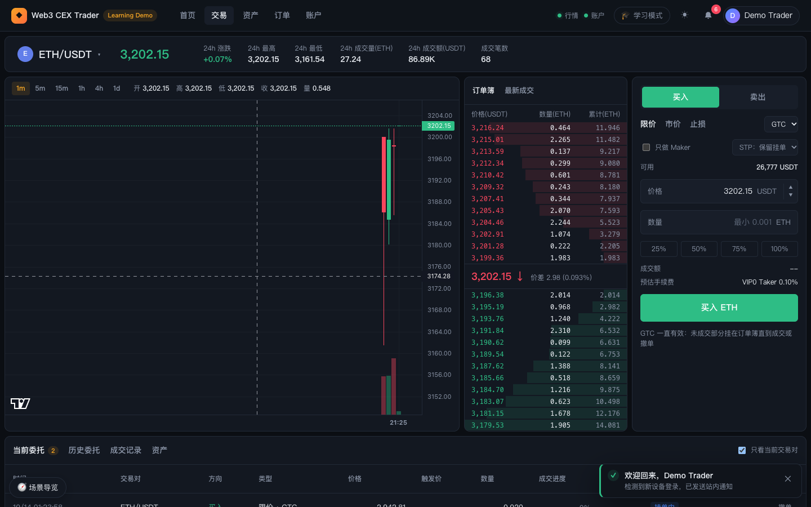
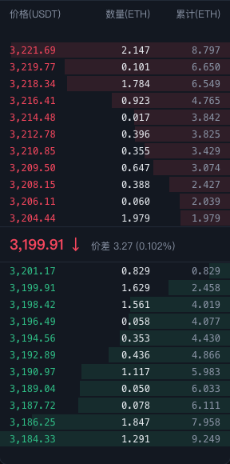
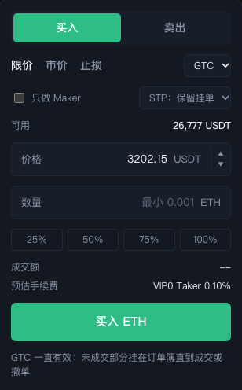
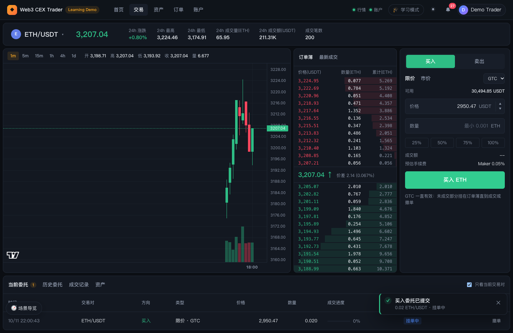
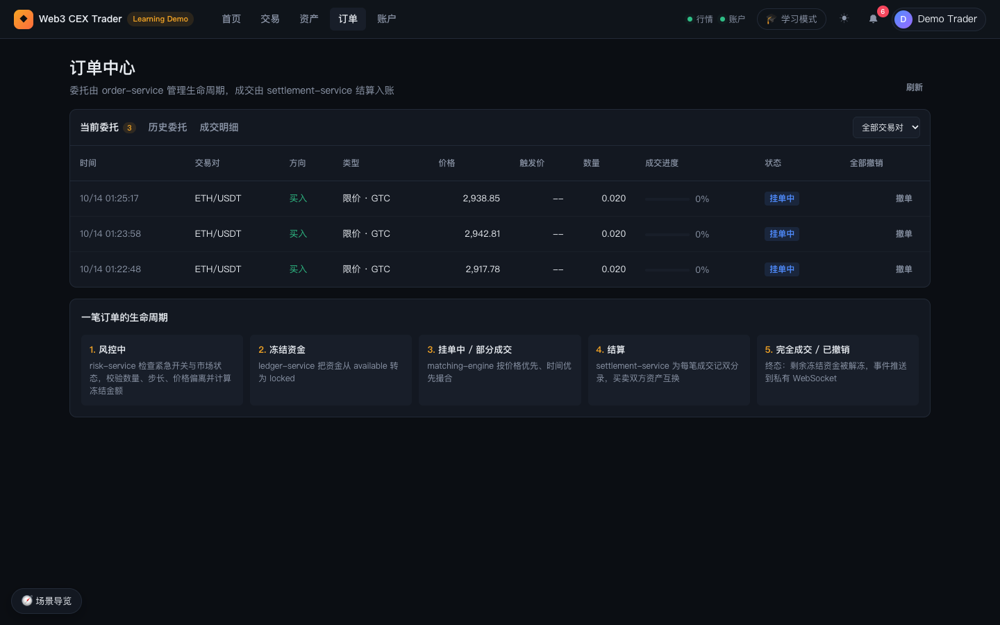
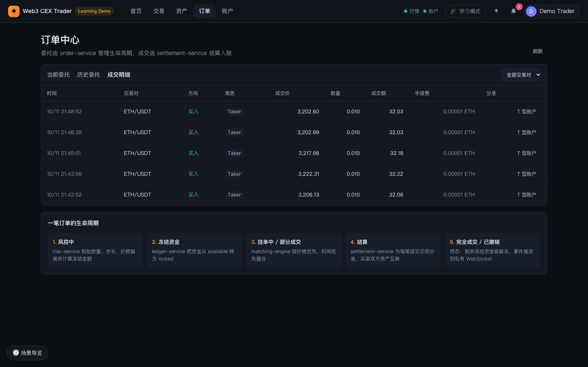
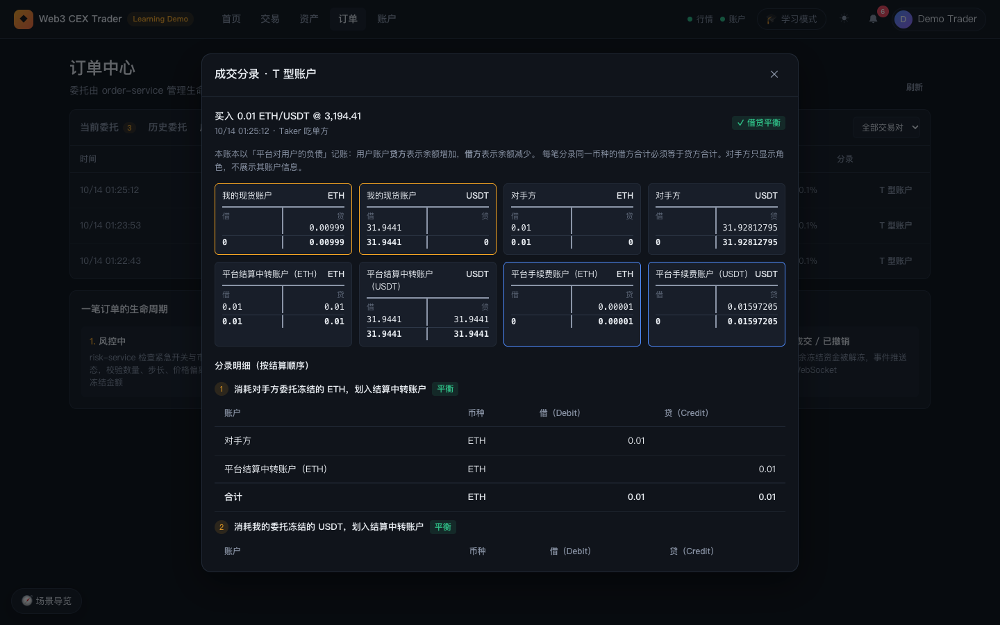

# 03 交易与订单

本篇介绍交易页（`/trade/<市场>`）和订单中心（`/orders`）：看行情、读订单簿、下单撤单，以及用「T 型账户」查看一笔成交在账本里留下的分录。

## 1. 交易页总览

### 功能说明

交易页由五块组成：

1. **市场头部**：交易对选择器、最新价和 24h 统计。
2. **K 线图**：左侧主区域。
3. **订单簿 / 最新成交**：中间一栏，两个标签切换。
4. **下单表单**：右侧一栏。
5. **底部表格**：当前委托、历史委托、成交记录、资产。

屏幕宽度大于 1480px 时，最左侧还会多出一栏「现货市场」列表；截图为 1440px 宽，因此该栏被隐藏，切换市场请使用头部的选择器。浏览器标签页标题会实时显示当前价格，例如「3,199.91 · ETH/USDT · …」。

### 背后的服务

- **market-data-service**：Ticker、K 线、深度和最新成交，通过公共 WebSocket 实时推送。
- **order-service / risk-service / ledger-service / matching-engine / settlement-service**：下单、冻结、撮合、结算主链。
- **api-gateway**：私有数据（委托、成交、余额）的鉴权与私有推送。

### 延伸学习

- [../../learning/06-order-matching.md](../../learning/06-order-matching.md)
- [../../learning/08-market-data.md](../../learning/08-market-data.md)

## 2. 市场选择与头部统计

### 功能说明

- 头部左侧是交易对选择器（币种图标 + 「ETH/USDT ▾」），点击展开市场列表，列出每个市场的最新价、24h 涨跌和 24h 成交额，点击某行即切换市场，URL 也随之变为 `/trade/<市场>`。
- 选择器右侧大字是最新价：优先使用最新成交价，没有成交时使用买一 / 卖一的中间价；颜色随 24h 涨跌变化（绿涨红跌）。
- 统计项依次为：24h 涨跌、24h 最高、24h 最低、24h 成交量（基础币，如 ETH）、24h 成交额（计价币，如 USDT）、成交笔数。

### 操作步骤

1. 点击头部「ETH/USDT ▾」。
2. 在下拉列表中点击 BTC/USDT 或 SOL/USDT 切换市场；下单表单会清空价格和数量，并以新市场当前价重新预填价格。

### 背后的服务

- **market-data-service**：聚合成交得到 24h Ticker。

## 3. K 线

### 功能说明

- 图表上方的周期按钮：`1m`、`5m`、`15m`、`1h`、`4h`、`1d`，默认 `1m`，当前周期高亮。
- 周期按钮右侧显示 OHLC 信息：开、高、低、收（收盘价按涨跌着色）、量。鼠标悬停在某根 K 线上时显示该根的数据，否则显示最新一根。
- 图表下方叠加成交量柱，颜色与 K 线涨跌一致；右侧价格轴上用虚线和标签标出最新价。
- 没有 K 线数据时显示「暂无 K 线」，并提示 K 线由成交聚合而来，运行 demo-simulator 后做市商会持续产生成交。

### 操作步骤

1. 点击 `5m`、`1h` 等按钮切换周期。
2. 鼠标在图上移动，查看每根 K 线的开高低收和成交量。

### 背后的服务

- **market-data-service**：把成交事件按周期聚合成 K 线，存储于 ClickHouse。
- **demo-simulator**：做市商持续挂单和成交，使图表有数据。

### 延伸学习

- [../../learning/08-market-data.md](../../learning/08-market-data.md)

## 4. 订单簿与最新成交

### 功能说明

- **订单簿**标签：表头为「价格(USDT) / 数量(ETH) / 累计(ETH)」。
  - 上半部分为卖盘（红色），越靠近中间价格越低；下半部分为买盘（绿色），越靠近中间价格越高。每侧最多显示 12 档。
  - 每行背景的深度条长度表示从最优价累计到该档的挂单量占比。
  - 中间一行显示最新成交价，带 ↑ / ↓ 箭头表示最后一笔成交是主动买入还是主动卖出；右侧显示价差及其占中间价的百分比，例如「价差 3.27 (0.102%)」。
  - 鼠标悬停在某档上，提示该档挂单笔数和「点击填入价格」。
  - 某侧没有挂单时显示「暂无卖单」/「暂无买单」。
- **最新成交**标签：表头为「价格 / 数量 / 时间」，最多显示最近 40 笔；价格颜色表示主动方向（绿色主动买、红色主动卖）。没有成交时显示「暂无成交」。
- **点击价格填单**：在订单簿或最新成交里点击任意一行，下单表单会自动切换到「限价」并把价格填为该行价格。

### 操作步骤

1. 在订单簿中点击卖一（卖盘最下面一行）的价格。
2. 右侧下单表单自动切到限价并填入该价格，此时下一笔买单会立即与卖一成交（Taker）。
3. 点击「最新成交」标签查看最近成交，点击某行同样可以填价。

### 背后的服务

- **matching-engine**：维护订单簿；深度变化以事件形式发出。
- **market-data-service**：把深度和成交推送到公共 WebSocket。

### 延伸学习

- [../../learning/06-order-matching.md](../../learning/06-order-matching.md)

## 5. 下单表单

### 功能说明

- **买入 / 卖出**：顶部切换方向，表单配色和提交按钮随之变为绿色「买入 ETH」或红色「卖出 ETH」。
- **限价 / 市价**：
  - 限价：需要填写价格；右侧下拉选择有效方式 GTC / IOC / FOK，表单底部显示当前方式的含义：
    - GTC 一直有效：未成交部分挂在订单簿直到成交或撤单；
    - IOC 立即成交或取消：能成交多少成交多少，剩余立即撤销；
    - FOK 全部成交或取消：不能一次全部成交就整单撤销。
  - 市价：价格框变为不可编辑的「以市场最优价成交」，有效方式固定为 IOC，底部说明「市价单按对手盘最优价逐档成交，未成交部分立即撤销（IOC）」。
- **可用**：买入时显示可用计价币（USDT），卖出时显示可用基础币（ETH）；未登录显示「--」。
- **价格**：首次进入时预填当前价；右侧 ▲ / ▼ 按市场最小价格步长加减。
- **数量**：占位提示最小下单量（如「最小 0.001」），单位为基础币。
- **25% / 50% / 75% / 100%**：按可用余额的百分比计算数量并向下取整到数量步长。买入时用「可用 USDT ÷ 价格」，卖出时用可用 ETH。未登录时按钮不可用。
- **成交额 / 预估手续费**：
  - 成交额 = 价格 × 数量；市价单显示为「预估成交额」，按对手盘最优价估算。
  - 预估手续费会判断这笔单会立即成交（Taker）还是挂单（Maker），并按**你自己的 VIP 手续费等级**显示费率，例如「VIP0 Taker 0.10%」「VIP2 Maker 0.03%」；实际费率 = min(等级费率, 市场费率)，未登录时显示市场默认费率（不带等级）。悬停可看到费率来源。买入时手续费以收到的基础币扣除（如「0.00001 ETH」），卖出时以收到的计价币扣除。等级和 30 日成交量见账户页「手续费等级」（[05 账户与安全](05-trader-account.md)）。
- **前端校验**：数量无效、低于最小下单量、限价未填价格、可用余额不足时，表单下方显示红色提示且不会提交。
- **提交结果**：成功时右下角弹出「买入委托已提交」等提示，并说明「已全部成交 / 部分成交 / 挂单中」；被拒绝时提示「委托被拒绝」，请求失败时提示「下单失败」并在表单中显示原因。
- 未登录时提交按钮变为「登录后交易」，点击跳转登录页。

### 操作步骤

1. 选择「买入」，保持「限价」和 GTC。
2. 在订单簿点击卖一价格，或手动输入价格。
3. 输入数量 `0.01`，或点击百分比按钮自动计算。
4. 核对成交额和预估手续费（Maker / Taker）。
5. 点击「买入 ETH」。打开学习模式可以同时看到风控、冻结、撮合、结算的时间线和撮合回放（见 [02 首页与学习工具](02-trader-home-and-learning.md)）。

### 风控拒单示例

[场景导览截图](images/trader-tour-active.png) 中，限价买单价格填了 2500（远低于最新价约 3,202），提交后表单与右下角提示均显示「委托价格偏离参考价过大（参考价为最新成交价或盘口中间价，风控限制 ±20%）」及原始错误码 `PRICE_DEVIATION_TOO_HIGH`。这是 risk-service 在下单前拦截的结果，资金不会被冻结。

### 背后的服务

- **api-gateway**：校验会话与账户归属，按 `Idempotency-Key` 去重，避免重复下单。
- **order-service**：订单生命周期编排。
- **risk-service**：最小数量、步长、价格偏离等下单前检查，并计算需冻结金额。
- **ledger-service**：把资金从 available 转入 locked。
- **matching-engine**：价格优先、时间优先撮合。
- **order-service（手续费等级）**：成交时按双方的 VIP 等级（30 日成交量、做市商计划或运营指定）定费率，把费率和等级写进成交记录；表单的预估来自 `GET /api/gateway/fees/tier`。
- **settlement-service**：成交后记账、按成交上记录的费率扣手续费。

### 延伸学习

- [../../learning/06-order-matching.md](../../learning/06-order-matching.md)
- [../../learning/07-clearing-settlement-fees.md](../../learning/07-clearing-settlement-fees.md)
- [../../learning/09-risk-control.md](../../learning/09-risk-control.md)
- [../../learning/12-business-model.md](../../learning/12-business-model.md)

## 6. 底部表格：当前委托 / 历史委托 / 成交记录 / 资产

### 功能说明

交易页底部有四个标签，右侧「只看当前交易对」勾选框默认勾选（资产标签下不显示）。截图中下了一笔低于市价约 8% 的限价 GTC 买单，它不会立即成交，于是出现在「当前委托」里，成交进度 0%、状态「挂单中」，行尾有「撤单」按钮。

- **当前委托**：未成交或部分成交的挂单，标签旁显示数量。列：时间、交易对、方向、类型、价格、数量、成交进度、状态；每行有「撤单」按钮，表头最右侧有「全部撤销」。没有挂单时显示「暂无当前委托」。
- **历史委托**：已成交、已撤销或被拒绝的委托（最近 50 条）。列：时间、交易对、方向、类型、委托价、委托量、已成交、状态。
- **成交记录**：自己的成交（最近 50 条）。列：时间、交易对、方向、角色（Maker 挂单方 / Taker 吃单方）、成交价、数量、成交额、手续费、分录。手续费列在金额后显示这笔成交实际使用的等级和费率（如「0.00001 ETH · VIP0 0.1%」），这是成交时记录的值，之后等级变化不会改写历史成交。点击整行或「T 型账户」按钮打开成交分录弹窗（见第 8 节）。
- **资产**：各币种的可用、冻结、总额，以及「充值」「提现」「交易」快捷链接。冻结列悬停提示「已下单未成交或提现审核中的资金」。
- 未登录时各标签显示「登录后查看」及「登录 / 注册」按钮。

### 操作步骤

1. 下一笔不会立即成交的限价单（例如买入价低于买一但在 ±20% 以内），它会出现在「当前委托」。
2. 点击该行「撤单」，提示「委托已撤销」，订单移入「历史委托」，冻结资金解冻。
3. 有多笔挂单时，点击「全部撤销」，提示「已撤销 N/M 笔委托」。
4. 取消勾选「只看当前交易对」查看所有市场的委托和成交。

### 背后的服务

- **order-service**：委托列表与撤单（`POST /orders/:id/cancel`）。
- **matching-engine**：从订单簿移除剩余数量。
- **ledger-service**：撤单后解冻资金；提供余额。
- **settlement-service**：成交记录与手续费。
- **order-service**：成交上记录的费率与 VIP 等级（`buyerFeeRate` / `buyerFeeTier` 等）。

### 延伸学习

- [../../learning/05-ledger.md](../../learning/05-ledger.md)

## 7. 订单中心

### 功能说明

- 通过顶部导航「订单」或头像菜单「订单中心」进入（需登录，未登录显示「登录后查看订单」）。页头说明「委托由 order-service 管理生命周期，成交由 settlement-service 结算入账」，右侧「刷新」按钮重新拉取账户数据。
- 三个标签：**当前委托**（带数量）、**历史委托**、**成交明细**。列与交易页底部表格相同，但不限条数。
- 右上角筛选：「全部交易对」下拉按市场筛选；在「历史委托」标签下额外出现状态筛选：全部状态 / 完全成交 / 已撤销 / 已拒绝。
- 从通知或资金流水跳转过来时，会自动切到对应标签并高亮目标行。
- 页面下方「一笔订单的生命周期」用五步说明订单状态流转：风控中 → 冻结资金 → 挂单中 / 部分成交 → 结算 → 完全成交 / 已撤销。

### 操作步骤

1. 点击顶部「订单」。
2. 在「历史委托」中用状态筛选查看被拒绝的委托。
3. 切到「成交明细」，点击任一行或「T 型账户」查看分录。

### 背后的服务

- **order-service**：委托查询。
- **settlement-service**：成交明细与手续费。
- **api-gateway**：鉴权，只返回当前用户自己的数据。

## 8. 成交分录：T 型账户

### 功能说明

弹窗标题「成交分录 · T 型账户」，展示一笔成交在 ledger-service 中产生的全部分录：

- **摘要**：方向、数量、市场、成交价、时间，以及你在这笔成交中的角色（Maker 挂单方 / Taker 吃单方）。右上角徽章显示「✓ 借贷平衡」或「✗ 借贷不平衡」；结算尚未完成时显示「结算中」，并提示「这笔成交还没有入账」，可点「刷新」重试。
- **记账口径**：本账本以「平台对用户的负债」记账，因此用户账户**贷方表示余额增加，借方表示余额减少**；每笔分录中同一币种的借方合计必须等于贷方合计。对手方只显示角色，不展示其账户信息。
- **T 型账户卡片**：每个「账户 × 币种」一张卡片，左列「借」、右列「贷」，最后一行是两列合计。截图中的买单例子：
  | 账户 | 借 | 贷 | 含义 |
  | --- | --- | --- | --- |
  | 我的现货账户 ETH | 0 | 0.00999 | 收到 0.01 ETH，扣除 0.00001 ETH 手续费 |
  | 我的现货账户 USDT | 32.026 | 0 | 支付 0.01 × 3,202.6 USDT |
  | 对手方 ETH | 0.01 | 0 | 卖方交出 0.01 ETH |
  | 对手方 USDT | 0 | 32.009987 | 卖方收到 USDT，扣除其手续费 |
  | 平台结算中转账户 ETH / USDT | 0.01 / 32.026 | 0.01 / 32.026 | 先划入再划出，余额归零 |
  | 平台手续费账户 ETH / USDT | 0 | 0.00001 / 0.016013 | 平台收取的双方手续费 |
  
  卡片按角色用不同边框颜色区分：我的账户、对手方、平台结算、平台手续费。
- **分录明细（按结算顺序）**：每条分录一个小表，标题说明这一步做了什么（例如「消耗对手方委托冻结的 ETH，划入结算中转账户」「消耗我的委托冻结的 USDT，划入结算中转账户」），并标注「平衡」；列为账户、币种、借（Debit）、贷（Credit），表尾是各币种合计。手续费相关行带「· 手续费」标记。
- **底部校验**：按币种列出借方合计、贷方合计和「✓ 相等」；并显示「我的净变动」，例如 +0.00999 ETH、-32.026 USDT。

### 操作步骤

1. 在交易页底部「成交记录」或订单中心「成交明细」中，点击某一行或其「T 型账户」按钮。
2. 先看摘要和右上角是否「借贷平衡」。
3. 对照 T 型账户卡片，找到「我的现货账户」两张卡，理解自己收到和付出了什么。
4. 向下滚动阅读分录明细，理解结算的先后步骤：先把双方冻结资金划入结算中转账户，再分别划给对方，最后扣手续费。
5. 点右上角 ✕ 关闭弹窗。

### 背后的服务

- **settlement-service**：按成交生成结算分录（资产互换 + 手续费）。
- **ledger-service**：保存双分录日志，保证每笔分录借贷平衡。
- **api-gateway**：`GET /trades/:tradeId/journals` 只返回与当前用户相关的成交，并把账户 ID 脱敏为角色标签。

### 延伸学习

- [../../learning/05-ledger.md](../../learning/05-ledger.md)
- [../../learning/07-clearing-settlement-fees.md](../../learning/07-clearing-settlement-fees.md)
- [../ledger-service-design.md](../ledger-service-design.md)

---

上一篇：[02 首页与学习模式](02-trader-home-and-learning.md) ｜ 下一篇：[04 资产：充值、提现与流水](04-trader-assets.md)
