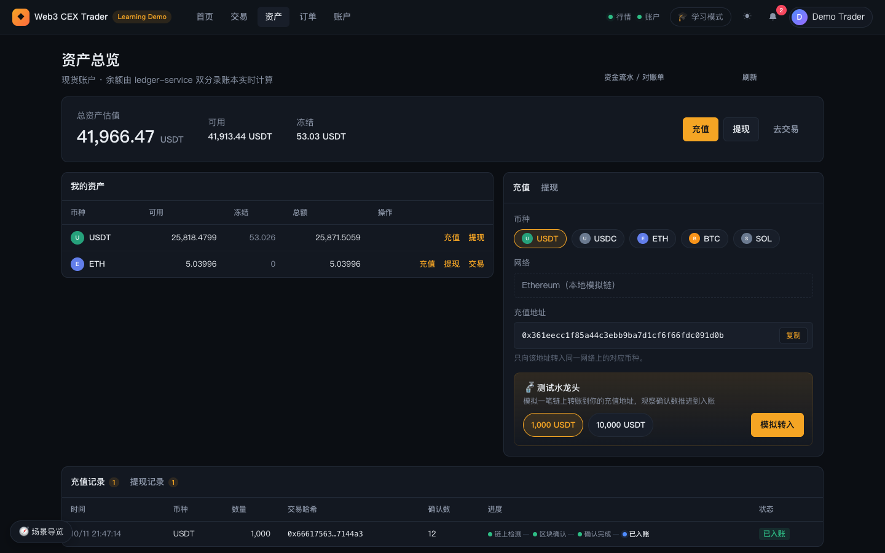
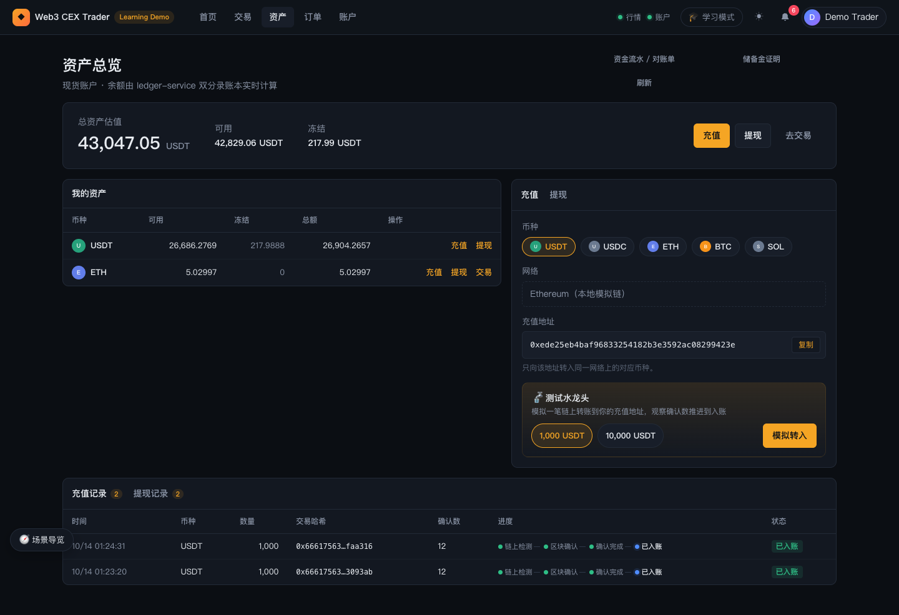
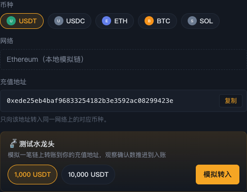
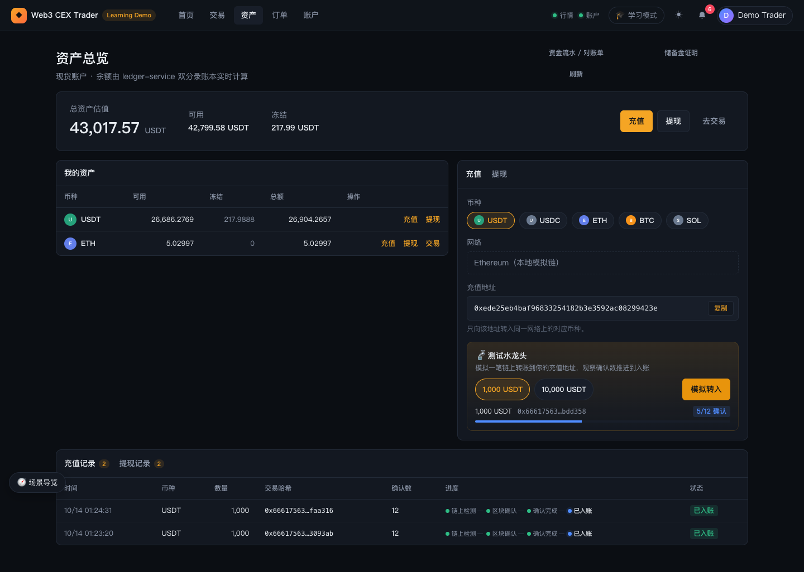
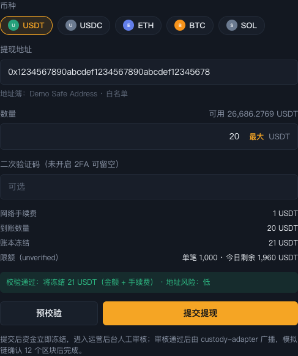
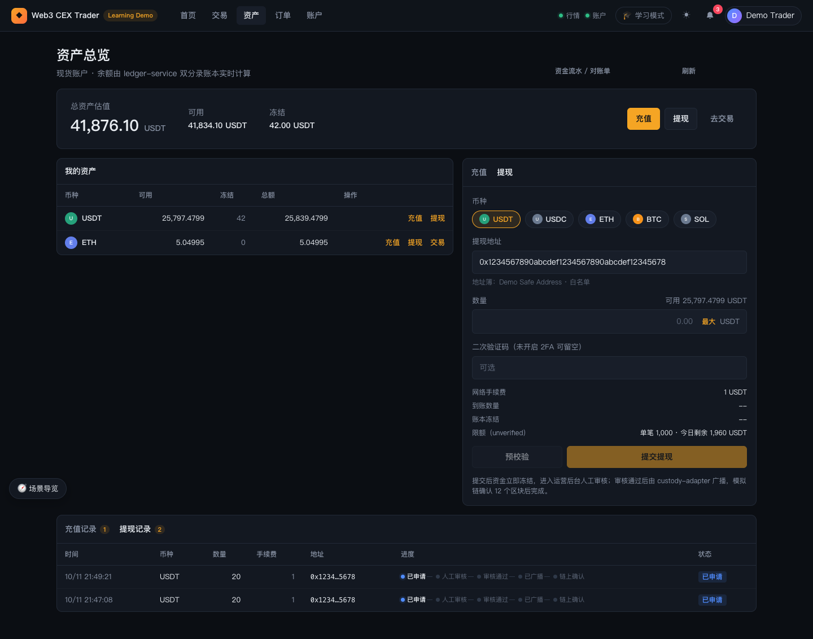
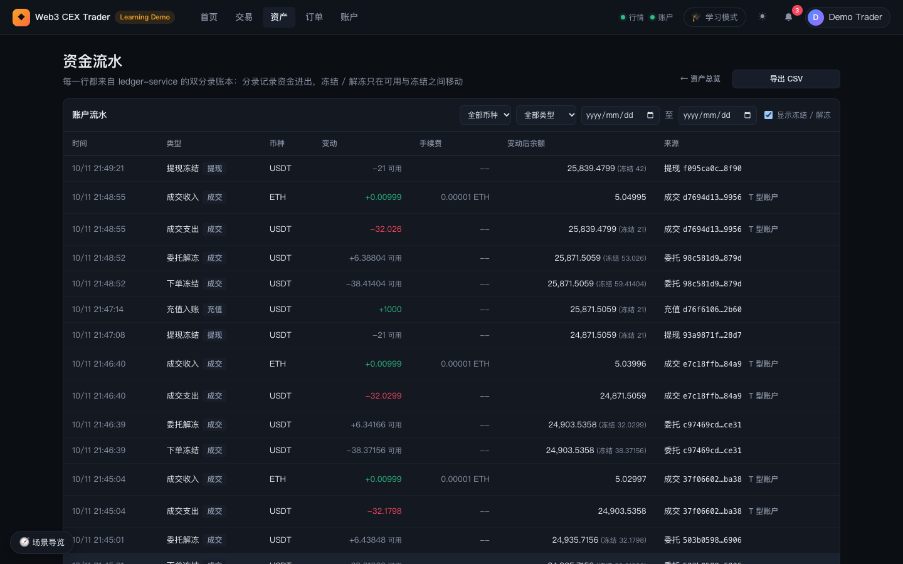

# 04 资产：充值、提现与流水

本章介绍 `trader-web` 的「资产」页（`#/assets`）和「资金流水」页（`#/assets/ledger`）：怎么看余额、怎么用测试水龙头充值、怎么提交提现，以及怎么从账本流水核对每一笔资金变动。

> 资产页和资金流水页都需要登录。未登录时打开，会显示「登录后查看资产」或「登录后查看资金流水」，并提供「登录 / 注册」按钮，登录后自动跳回原页面。

## 1. 资产总览

### 功能说明

页面标题为「资产总览」，副标题写明「现货账户 · 余额由 ledger-service 双分录账本实时计算」。从上到下分为四块：

1. **估值卡片**：
   - 「总资产估值」：把每个币种的总额（可用 + 冻结）按默认市场计价资产（`USDT`）折算后相加。非 `USDT` 资产用 `<币种>-USDT` 市场的最新成交价折算；没有对应市场或还没有成交价的资产按 0 计。
   - 「可用」「冻结」：同样折算成 `USDT`。把鼠标悬停在「冻结」上会提示它包含「下单冻结 + 提现冻结」。
   - 右侧三个按钮：「充值」「提现」切换右侧面板，「去交易」跳到当前交易对的交易页。
2. **我的资产**表：列为币种、可用、冻结、总额、操作。悬停冻结列会提示「已下单未成交或提现审核中的资金」。操作列有「充值」「提现」，可作为 base 资产交易的币种（如 `ETH`）还多一个「交易」链接。没有任何余额时显示「暂无资产」，并提供「去充值」按钮。
3. **充值 / 提现面板**：右侧带页签的面板，见下文第 2、3 节。
4. **充值记录 / 提现记录**：页面底部的两个页签，页签上的数字是记录条数，见第 2.2 和 3.2 节。

页面右上角有两个按钮：「资金流水 / 对账单」打开第 4 节的流水页；「刷新」重新拉取余额、充值和提现记录。余额平时会通过私有 WebSocket 推送自动更新，一般不需要手动刷新。

下面是整页截图，可以看到截图时 `USDT` 有 53.026 处于冻结状态（一笔未成交挂单冻结的资金）：

### 操作步骤

1. 登录后点顶栏的「资产」，或点右上角头像菜单里的「资产总览」。
2. 看估值卡片，了解总资产和冻结资金的规模。
3. 在「我的资产」表里找到要操作的币种，点该行的「充值」「提现」或「交易」。用行内链接跳转时，右侧面板会自动选好对应币种。

### 背后的服务

- 余额来自 `ledger-service`，经 `api-gateway` 聚合给前端；只统计现货（spot）账户。
- 估值用的最新价来自 `market-data-service` 的行情推送。

## 2. 充值

### 2.1 充值面板与测试水龙头

#### 功能说明

- **币种**：一排币种按钮，选项来自 `config/markets.json` 里配置的资产（截图中是 `USDT`、`USDC`、`ETH`、`BTC`、`SOL`）。默认选中计价资产 `USDT`。
- **网络**：只读，显示该币种配置的第一个网络。演示基线下显示「Ethereum（本地模拟链）」。
- **充值地址**：已有地址时显示完整地址和「复制」按钮，下方提示「只向该地址转入同一网络上的对应币种。」还没有地址时，这里显示「生成 `<币种>` 充值地址」按钮。
- **🚰 测试水龙头**（只在演示模式开启时出现）：说明文字为「模拟一笔链上转账到你的充值地址，观察确认数推进到入账」。可以选择预设金额（每个币种的预设来自 `config/markets.json`，例如 `USDT` 是 `1,000 USDT` / `10,000 USDT`），然后点「模拟转入」。如果你还没有该币种的充值地址，领取后系统会自动生成一个。

点「模拟转入」后，水龙头下方出现一条回执：金额、交易哈希（缩写）、确认进度徽标和进度条。页面每 1.5 秒向模拟链查询一次确认数，徽标从「0/12 确认」逐步涨到「12/12」，达到阈值后变成绿色的「已确认」。最多保留最近 5 条回执。

#### 操作步骤

1. 在资产页点「充值」（或在资产表某行点「充值」）。
2. 在「币种」里选择要充值的资产，例如 `ETH`。
3. 如果显示「生成 ETH 充值地址」，点它生成地址；已有地址可以直接点「复制」。
4. 在「🚰 测试水龙头」里选一个预设金额，点「模拟转入」。
5. 观察回执的确认数从 `x/12` 推进到「已确认」。模拟链每 1.5 秒出一个块，12 个确认大约需要 20 秒。
6. 到账后，余额增加，顶栏铃铛出现「充值已到账」通知，同时弹出 Toast。

#### 背后的服务

`demo-simulator`（模拟链，写入转账并出块）→ `blockchain-indexer`（观察交易、累计确认数）→ `wallet-service`（创建充值单、推进状态）→ `ledger-service`（达到确认阈值后入账）。充值地址由 `wallet-service` 分配。

为什么要等 12 个确认：确认数不够时，链重组可能让交易被回滚。故障实验室的「链重组」实验可以看到确认数回落后重新累积，见 [09 · 系统运维与故障实验室](09-ops-system-and-lab.md) 和 [../fault-lab.md](../fault-lab.md)。

### 2.2 充值记录

#### 功能说明

页面底部「充值记录」页签的列为：时间、币种、数量、交易哈希、确认数、进度、状态。

- **进度**是四步进度条：链上检测 → 区块确认 → 确认完成 → 已入账。
- **状态**徽标：已检测、确认中、待入账、已入账；失败时显示「失败」，进度条标红。
- 还没有记录时显示「暂无充值记录」，提示使用上方的测试水龙头。

从通知中心点一条充值通知，会跳到这个页签并高亮、滚动到对应记录。

#### 操作步骤

1. 在资产页底部点「充值记录」页签。
2. 找到刚才的充值，看确认数和进度条；状态变成「已入账」即完成。

## 3. 提现

### 3.1 提现表单

#### 功能说明

在资产页右侧面板切到「提现」页签，表单从上到下是：

- **币种**：与充值相同的币种按钮。
- **提现地址**：输入框带下拉候选（来自你的地址簿，只显示当前网络的条目）；如果地址簿里有条目，会默认填入第一条。
  - 输入的地址已在地址簿中时，下方提示「地址簿：`<备注>`」，已加入白名单的还会带「· 白名单」（截图中为「地址簿：Demo Safe Address · 白名单」）。
  - 输入一个新的合法 EVM 地址时，会出现「地址备注（可选）」输入框和「保存到地址簿」按钮。
  - 未填写时提示「EVM 地址（0x 开头 40 位十六进制）」。
- **数量**：右上角显示「可用 x `<币种>`」；「最大」按钮会填入「可用余额 − 手续费」。
- **二次验证码**：已开启 2FA 时标签为「二次验证码（必填）」，需要填身份验证器里的 6 位动态码；未开启时标签为「二次验证码（未开启 2FA 可留空）」。
- **费用与限额汇总**：
  - 网络手续费：固定值，来自该币种的配置（截图中 `USDT` 为 1 USDT）。
  - 到账数量：等于填写的数量。
  - 账本冻结：数量 + 手续费，提交后会从可用转入冻结。
  - 限额（KYC 等级）：如「单笔 1,000 · 今日剩余 1,980 USDT」。括号里是当前 KYC 等级，截图中为 `unverified`（未认证）。
  - 审核：数量超过该币种的大额阈值时，额外出现一行「大额提现，需两名运营人员复核」。
- **提示条**（满足条件时出现）：
  - 平台开启强制 2FA 而你没开启时：「平台要求提现前开启二次验证。」并附「请先在账户页开启二次验证 →」链接。
  - 处于安全冷却期时：「安全冷却期：修改二次验证 / 新增提现地址后暂停提现，还需等待 …」。
- **按钮**：「预校验」只做校验，不冻结资金；「提交提现」真正提交。地址格式不对、数量为 0 或超过可提数量时，两个按钮都是灰的。
- 底部说明：「提交后资金立即冻结，进入运营后台人工审核；审核通过后由 custody-adapter 广播，模拟链确认 12 个区块后完成。」

预校验通过时显示绿色提示，例如截图中的「校验通过：将冻结 21 USDT（金额 + 手续费）」；不通过时显示红色的原因（如超过单笔限额、冷却期中、2FA 码错误）。修改币种、地址或数量后，上一次的校验结果会被清除。

**提现规则**（由 `wallet-service` 在预校验和提交时执行，前端只是提前展示）：

| 规则 | 默认值 |
| --- | --- |
| KYC 分级限额（单笔 / 每日，按 UTC 自然日） | 未认证：USDT 1,000 / 2,000，ETH 0.5 / 1；L1：USDT 10,000 / 20,000，ETH 5 / 10；L2：USDT 100,000 / 200,000，ETH 50 / 100（其他币种见账户页限额表） |
| 平台限额 | 可选，与 KYC 限额取更严格的一个 |
| 2FA | 用户已开启 2FA 时每笔提现都要验证码；平台开启 `WITHDRAWAL_REQUIRE_2FA=true` 时未开启 2FA 不能提现（演示默认不强制） |
| 双人复核阈值（严格大于才触发） | USDT 5000、USDC 5000、ETH 2、BTC 0.1、SOL 50 |
| 安全冷却期 | 新增提现地址或开启 / 关闭 2FA 后暂停提现；代码默认 24 小时，演示栈启动时设为 0（关闭） |

演示账户默认是「未认证」，小额演示请用不超过 0.5 ETH 或 1,000 USDT 的金额。要演示大额双人复核，先在账户页把 KYC 提到 L1，见 [05 · 账户与安全](05-trader-account.md) 和 [10 · 端到端场景](10-scenarios.md)。

#### 操作步骤

1. 在资产页点「提现」（或资产表某行的「提现」）。
2. 选择币种，例如 `USDT`。
3. 在「提现地址」里选地址簿中的「Demo Safe Address」（演示账户已预置并加入白名单）；也可以输入新的 EVM 地址，填备注后点「保存到地址簿」。
4. 填写数量，或点「最大」。确认下方的手续费、账本冻结和限额。
5. 如果已开启 2FA，填写 6 位动态码。
6. 点「预校验」，看到「校验通过」后点「提交提现」。
7. 提交成功后，表单清空，资产表中该币种的「冻结」增加（数量 + 手续费），「提现记录」出现一条新记录。

#### 背后的服务

`api-gateway` → `wallet-service`（地址格式、地址簿 / 白名单、KYC 限额、2FA、冷却期、双人复核策略）→ `identity-service`（读取 2FA 状态并校验动态码、读取 KYC 等级）→ `ledger-service`（冻结金额 + 手续费）。之后的人工审核在 `ops-console` 完成，见 [07 · 资金运营](07-ops-funds.md)。

### 3.2 提现记录

#### 功能说明

「提现记录」页签的列为：时间、币种、数量、手续费、地址、进度、状态。

- **进度**是五步进度条：已申请 → 人工审核 → 审核通过 → 已广播 → 链上确认。
- **状态**徽标：已申请、审核中、审核通过、已广播、已完成；被拒绝或失败时显示「已拒绝」或「失败」，进度条标红。被拒绝的提现，冻结资金会退回可用余额。
- 截图中的两笔 20 USDT 提现都停在「已申请」，等待运营后台审核；此时 `USDT` 冻结为 42（两笔各冻结 20 + 1 手续费）。

运营人员批准后，状态会依次推进到已广播、已完成，前台通过私有推送实时更新，铃铛也会收到通知。点通知会跳到这个页签并高亮对应记录。

#### 操作步骤

1. 提交提现后，在资产页底部点「提现记录」页签。
2. 等待运营在 `ops-console` 审核（操作见 [10 · 端到端场景](10-scenarios.md) 的场景 3）。
3. 审核通过后约 20 秒，状态从「已广播」变为「已完成」，冻结资金被最终扣除。

## 4. 资金流水 / 对账单

### 功能说明

从资产页右上角的「资金流水 / 对账单」，或头像菜单里的「资金流水」进入，地址为 `#/assets/ledger`。页面标题「资金流水」，副标题说明：每一行都来自 `ledger-service` 的双分录账本，分录记录资金进出，冻结 / 解冻只在可用与冻结之间移动。

**表格列**：时间、类型、币种、变动、手续费、变动后余额、来源。

- **类型**：显示具体动作和分类徽标。动作包括充值入账、提现冻结、提现解冻、提现出账、下单冻结、委托解冻、成交支出、成交收入、调账入账、调账出账；分类为充值、提现、成交、手续费、调账 / 期初。
- **变动**：会改变总额的行用绿色（+）/ 红色（−）显示；冻结 / 解冻类只在可用与冻结之间移动，用灰色显示并带「可用」后缀（如截图中「−21 可用」是一笔提现冻结）。
- **手续费**：成交行显示扣除的手续费，例如截图中买入 ETH 的成交收入行带「0.00001 ETH」。
- **变动后余额**：变动后的总额（可用 + 冻结），有冻结时括号里显示「冻结 x」；悬停可看到可用和冻结的明细。如果某币种存在账本分录之外写入的历史数据，无法还原余额，表格上方会提示并把这一列显示为「--」。
- **来源**：充值、提现、成交、委托等来源单号（缩写），可点击跳到对应记录；成交行另有「T 型账户」按钮，打开这笔成交的分录弹窗（见 [03 · 交易](03-trader-trading.md)）。

**筛选**（表格右上角）：全部币种 / 某币种、全部类型 / 某分类、开始日期 至 结束日期、「显示冻结 / 解冻」复选框（默认勾选；取消后只看改变总额的分录）。修改任一筛选条件会回到第 1 页。

**分页**：每页 20 条，底部显示「共 N 条 · 第 x/y 页」和「上一页」「下一页」。

**导出 CSV**：右上角「导出 CSV」导出**当前筛选条件下的全部行**（不止当前页，上限 10,000 行），文件名形如 `statement-<币种或all>-<日期>.csv`。文件为 UTF-8 带 BOM、CRLF 换行，方便 Excel 正确识别中文表头；可能被表格软件当作公式执行的文本会被转义。导出完成后弹出「对账单已导出」提示和行数。没有任何流水时按钮不可用。

### 操作步骤

1. 在资产页点「资金流水 / 对账单」。
2. 用筛选条件缩小范围，例如币种选 `USDT`、类型选「提现」。
3. 对照「变动后余额」检查每一步资金变化：例如一笔提现会先出现「提现冻结」（只动可用），审核通过并确认后出现「提现出账」（总额减少）。
4. 成交行点「T 型账户」，查看这笔成交的借贷分录是否平衡。
5. 需要留档时点「导出 CSV」。

### 背后的服务

`api-gateway` → `ledger-service`：返回当前用户现货账户的账本分录和冻结 / 解冻事件。

## 延伸学习

- 钱包、充值确认数、提现状态机：[../../learning/04-wallet-custody.md](../../learning/04-wallet-custody.md)
- 双分录账本、可用 / 冻结：[../../learning/05-ledger.md](../../learning/05-ledger.md)
- 提现限额、白名单、双人复核：[../../learning/09-risk-control.md](../../learning/09-risk-control.md)
- 对账：[../../learning/backstage/B04-reconciliation.md](../../learning/backstage/B04-reconciliation.md)
- 演示脚本中的对应步骤：[../demo-walkthrough.md](../demo-walkthrough.md)

---

上一篇：[03 交易与订单](03-trader-trading.md) ｜ 下一篇：[05 账户与安全](05-trader-account.md)
