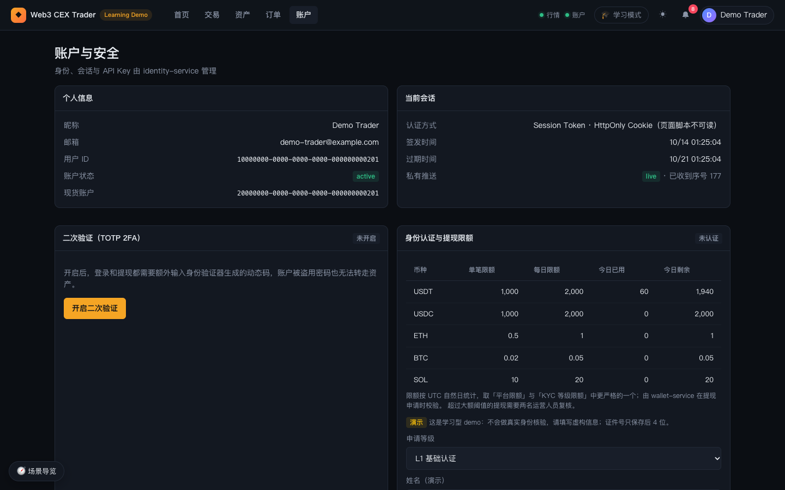
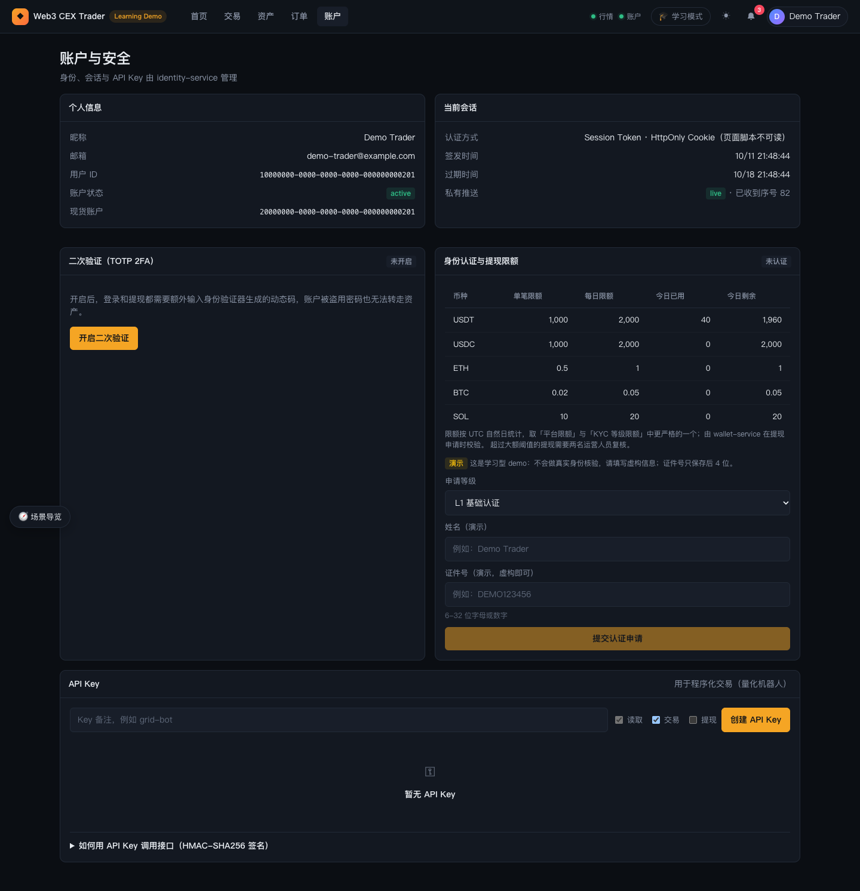
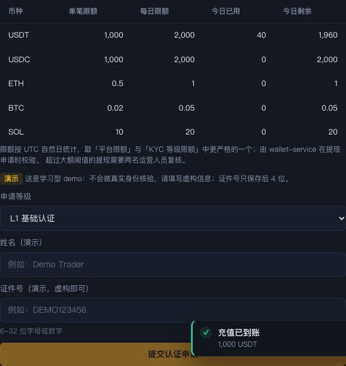
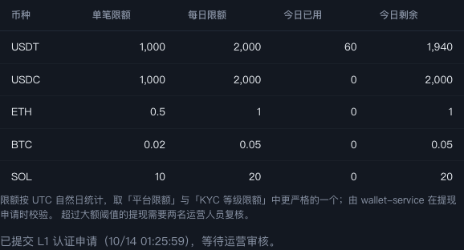

# 05 账户与安全

本章介绍 `trader-web` 的「账户」页（`#/account`）：查看个人信息和当前会话、自助开启二次验证、申请 KYC 提升提现限额、管理登录设备和查看登录记录、创建 API Key，以及退出登录。

## 1. 页面总览

### 功能说明

页面标题为「账户与安全」，副标题「身份、会话与 API Key 由 identity-service 管理」。从上到下依次是：

1. 第一行：「个人信息」和「当前会话」（第 2 节）。
2. 第二行：「二次验证（TOTP 2FA）」（第 3 节）和「身份认证与提现限额」（第 4 节）。
3. 第三行：「设备管理」和「登录记录」（第 5 节）。
4. 底部：「API Key」（第 6 节）。

整页截图如下：

未登录时打开账户页，会显示「登录后管理账户」和「登录 / 注册」按钮。

### 操作步骤

1. 登录后点顶栏的「账户」，或点右上角头像菜单里的「账户与 API」。

## 2. 个人信息与当前会话

### 功能说明

**个人信息**面板显示：昵称、邮箱、用户 ID、账户状态（`active` 为绿色徽标，其他状态为黄色）、现货账户 ID。

**当前会话**面板显示：

- **认证方式**：「Session Token · HttpOnly Cookie（页面脚本不可读）」。登录后的会话令牌保存在 HttpOnly Cookie 里，页面上的 JavaScript 读不到它，即使页面被注入恶意脚本也偷不走会话。
- **签发时间 / 过期时间**：截图中的会话有效期为 7 天。
- **私有推送**：私有 WebSocket 的连接状态，`live` 表示正常；后面的「已收到序号 N」是已收到的私有事件序号。余额、订单、充值提现状态和通知都通过这个通道实时推送。

### 背后的服务

`trader-web` 的服务端负责设置和清除 Cookie，并把请求转发给 `api-gateway`；会话本身由 `identity-service` 签发和校验。

## 3. 二次验证（TOTP 2FA）

### 功能说明

面板右上角徽标显示「未开启」或「已开启」。未开启时的说明是：开启后，登录和提现都需要额外输入身份验证器生成的动态码，账户被盗用密码也无法转走资产。

- **开启流程**：点「开启二次验证」后，面板显示一个二维码（在浏览器本地生成，不经过第三方服务）和三步说明：用 Google Authenticator / 1Password 等身份验证器扫码；无法扫码时手动输入密钥（带「复制密钥」按钮）；输入 App 中的 6 位动态码。填满 6 位后「验证并开启」可点；也可以点「取消」放弃。
- **恢复码**：开启成功后弹出「保存你的恢复码」窗口，列出 8 个恢复码，并提示恢复码只显示这一次；手机丢失时，可以在登录或关闭 2FA 时用任意一个代替动态码，每个只能用一次。可点「复制全部恢复码」，保存好后点「我已妥善保存」。
- **已开启时**：显示开启时间、剩余恢复码数量，以及提示「登录与提现都需要输入身份验证器中的 6 位动态码」。有两个按钮：
  - 「重新生成恢复码」：输入当前 6 位动态码后点「确认生成」，旧恢复码作废，弹出新的一组。
  - 「关闭二次验证」：输入当前动态码或恢复码后点「确认关闭」。
- **冷却期提示**：如果平台配置了安全冷却期，面板底部会提示「开启或关闭 2FA 后 … 内暂停提现（冷却期）」。演示栈默认关闭冷却期，所以通常看不到这行。

### 操作步骤

1. 在账户页「二次验证（TOTP 2FA）」面板点「开启二次验证」。
2. 用手机上的身份验证器扫描二维码，或复制密钥手动添加。
3. 在「动态码」里输入 App 显示的 6 位数字，点「验证并开启」。
4. 在「保存你的恢复码」窗口复制并保存恢复码，点「我已妥善保存」。
5. 之后退出再登录时需要输入动态码；在资产页提现时「二次验证码」变为必填。
6. 需要关闭时，点「关闭二次验证」，输入动态码或恢复码，点「确认关闭」。

### 背后的服务

`identity-service` 生成 TOTP 密钥、校验动态码、生成和核销恢复码；`wallet-service` 在提现时向 `identity-service` 查询 2FA 状态，并把 2FA 变更作为安全冷却期的触发条件之一。

## 4. 身份认证与提现限额（KYC）

### 功能说明

面板右上角徽标显示当前等级：「未认证」「L1 基础认证」或「L2 高级认证」。

- **限额表**：列为币种、单笔限额、每日限额、今日已用、今日剩余。截图中演示账户为「未认证」，`USDT` 单笔 1,000 / 每日 2,000，今日已用 40（两笔 20 USDT 提现），剩余 1,960。
- 表下说明：限额按 UTC 自然日统计，取「平台限额」与「KYC 等级限额」中更严格的一个；由 `wallet-service` 在提现申请时校验。配置了大额阈值时还会提示「超过大额阈值的提现需要两名运营人员复核」。
- **默认等级限额**：

  | 币种 | 未认证（单笔 / 每日） | L1 | L2 |
  | --- | --- | --- | --- |
  | USDT / USDC | 1,000 / 2,000 | 10,000 / 20,000 | 100,000 / 200,000 |
  | ETH | 0.5 / 1 | 5 / 10 | 50 / 100 |
  | BTC | 0.02 / 0.05 | 0.2 / 0.5 | 2 / 5 |
  | SOL | 10 / 20 | 100 / 200 | 1,000 / 2,000 |

- **认证申请表单**：带「演示」徽标的说明——这是学习型 demo，不做真实身份核验，请填写虚构信息，证件号只保存后 4 位。字段为：
  - 申请等级：未认证时可选 L1 或 L2；已是 L1 时只能选 L2；已是 L2 时不再显示表单，改为「已是最高认证等级。」
  - 姓名（演示）：至少 2 个字符。
  - 证件号（演示，虚构即可）：6-32 位字母或数字。
  - 字段填够后「提交认证申请」才可点。
- 如果上次申请被拒绝，表单上方会显示「上次申请未通过：`<原因>`，可修改后重新提交。」
- 处于提现安全冷却期时，面板顶部会显示「安全冷却期：…后暂停提现，还需等待 …」。

**等待审核状态**：提交后表单消失，改为显示「已提交 L1 认证申请（时间），等待运营审核。」

运营人员在 `ops-console` 的「用户与资产」→「KYC 审核」里批准（可批准为 L1 或 L2）或拒绝，见 [07 · 资金运营](07-ops-funds.md)。批准后刷新账户页，徽标和限额表随等级更新。

### 操作步骤

1. 在「身份认证与提现限额」面板看当前等级和各币种限额。
2. 在「申请等级」里选择 L1（或 L2）。
3. 填写虚构的姓名和证件号，例如 `Demo Trader` / `DEMO123456`。
4. 点「提交认证申请」，面板变为「等待运营审核」。
5. 运营在后台批准后，回到账户页刷新，确认等级和限额已提升。

### 背后的服务

`identity-service` 保存 KYC 等级和申请记录（证件号只存后 4 位）；`wallet-service` 按 KYC 等级计算限额和今日已用额度，在预校验和提交提现时执行。

## 5. 设备管理与登录记录

### 功能说明

每次登录时，浏览器会带上保存在本地（localStorage）的一个长期随机设备 ID，`identity-service` 用它记录登录事件、识别新设备。这个 ID 不是设备指纹：清除站点数据后，同一台电脑会被当作新设备。

**设备管理**面板（右上角有「刷新」）列出这个账户登录过的所有设备：

- 设备：浏览器与系统的简要描述（例如「Chrome · macOS」），下方是设备 ID 和首次登录时间。当前浏览器标「本机」；24 小时内首次出现、且当时被识别为新设备的标「新设备」。
- 最近登录、IP、登录次数、活跃会话数。
- 操作：「退出该设备」吊销该设备上的全部会话，那台设备需要重新登录；对本机则显示「退出本机」，点击后当前页面也会退出登录。没有活跃会话的设备按钮不可点。

**登录记录**面板显示最近 20 次登录尝试，包括失败的：时间、结果（「成功」「失败」「已锁定」，失败会附原因，如「密码错误」「动态码错误」）、设备和 IP；新设备登录带「新设备」徽标。

**新设备提醒**：账户已有其他设备时，第一次在一台新设备上登录成功，登录提示会多一行「检测到新设备登录，已发送站内通知」，右上角铃铛里会出现一条「新设备登录」通知（含设备描述，点击跳到账户页）。如果不是本人操作，应立即在「设备管理」里退出该设备并修改密码。账户的第一台设备不会触发提醒。

**登录失败锁定**：同一账户在 15 分钟内（自上次成功登录起）连续输错 5 次密码或动态码后，登录会被临时锁定 5 分钟，期间即使密码正确也会提示「登录失败次数过多，账户已临时锁定，请稍后再试」。缺少动态码的提示和重复使用同一个动态码不计入失败次数。

平台还可以开启「新设备登录后暂停提现」策略（`WITHDRAWAL_NEW_DEVICE_LOCK_SECONDS`，演示栈默认关闭）；开启后在新设备登录后的一段时间内提交提现，会提示「安全冷却期：新设备登录后暂停提现，还需等待 …」。

### 操作步骤

1. 在账户页下方的「设备管理」查看登录过的设备，确认每台都是自己的。
2. 对不认识或已不用的设备点「退出该设备」，提示「已退出该设备」并显示结束的会话数。
3. 在「登录记录」里检查最近的登录时间、IP 和失败尝试。
4. 想体验新设备提醒：换一个浏览器（或无痕窗口）登录同一账户，回到原浏览器查看铃铛里的「新设备登录」通知和设备列表中的「新设备」徽标。

### 背后的服务

`identity-service` 记录登录事件（`identity_login_events`）和设备（`identity_user_devices`），判断新设备和登录失败锁定，并按设备吊销会话；新设备的站内信由 `identity-service` 通过内部接口写入 `wallet-service` 的通知表；`api-gateway` 提供只接受会话鉴权的 `/auth/login-events`、`/auth/devices` 接口。实现位置：`services/identity-service/src/application/login-security-service.ts`、`apps/trader-web/src/client/features/account/device-panels.tsx`。

## 6. API Key

### 功能说明

面板标题「API Key」，右侧说明「用于程序化交易（量化机器人）」。

- **创建表单**：
  - 备注：最多 40 个字符，例如 `grid-bot`；不填时默认为 `my-bot`。
  - 权限范围：「读取」（查询余额、订单、成交，必选且不可取消）、「交易」（下单与撤单，默认勾选）、「提现」（发起提现、管理地址簿，需要显式勾选；鼠标悬停会提示真实交易所通常还要求 IP 白名单）。
  - 点「创建 API Key」。
- **创建成功弹窗**「API Key 已创建」：
  - Key ID（`ak_…`）：公开标识，放在 `X-API-Key` 请求头里，带「复制 Key ID」按钮。
  - Secret（`sk_…`）：红字提示「Secret 只显示这一次，请立即保存。它只用于本地计算签名，永远不要放进请求里。」带「复制 Secret」按钮。关闭弹窗后再也无法查看 Secret。
- **Key 列表**：列为备注、Key ID、权限（「提现」权限用黄色徽标突出）、创建时间、最近使用、状态、操作。有效的 Key 可以点「吊销」。不含 Key ID 的旧格式 Key 会显示「旧格式」，已无法使用，需要吊销后重建。没有任何 Key 时显示「暂无 API Key」。
- **签名说明**：底部折叠区「如何用 API Key 调用接口（HMAC-SHA256 签名）」，展开后有一段 Node.js 示例。要点：
  - 规范请求串为 `METHOD \n PATH \n TIMESTAMP \n NONCE \n sha256(body)`，用 Secret 做 HMAC-SHA256。
  - 请求头带 `x-api-key`、`x-api-timestamp`（毫秒，允许 5 分钟漂移）、`x-api-nonce`（每个请求唯一，重复会被拒绝）、`x-api-signature`。
  - Secret 从不出现在请求里；网关重建规范串，由 `identity-service` 用加密保存的 Secret 重算签名比对；Key 的权限范围决定能否交易或提现。

### 操作步骤

1. 在「API Key」面板填备注，例如 `grid-bot`。
2. 按需勾选「交易」「提现」（「读取」固定勾选）。
3. 点「创建 API Key」。
4. 在弹窗中分别复制 Key ID 和 Secret，妥善保存后关闭弹窗。
5. 按「如何用 API Key 调用接口」里的示例对请求签名并调用。
6. 不再使用时，在列表中点「吊销」。

### 背后的服务

`identity-service` 生成 Key ID 和 Secret（Secret 加密保存）、校验签名和权限；`api-gateway` 负责重建规范请求串、检查时间戳和用 Redis 记录 nonce 防重放。实现位置：`services/api-gateway/src/http/api-key-signature.ts`、`services/identity-service/src/domain/api-key-secret.ts`。

## 7. 退出登录

### 功能说明

点右上角的头像（显示昵称），弹出菜单列出昵称和邮箱，以及「资产总览」「资金流水」「订单中心」「账户与 API」和「退出登录」。点「退出登录」后，`trader-web` 服务端吊销会话并清除 Cookie，页面回到首页并提示「已退出登录」。

### 操作步骤

1. 点右上角头像。
2. 点菜单底部的「退出登录」。

## 延伸学习

- 账户、身份、2FA、API Key：[../../learning/03-account-identity-security.md](../../learning/03-account-identity-security.md)
- 账户安全的后台视角：[../../learning/backstage/B03-account-security.md](../../learning/backstage/B03-account-security.md)
- 提现限额与风控：[../../learning/09-risk-control.md](../../learning/09-risk-control.md)
- 项目安全设计说明：[../security.md](../security.md)

---

上一篇：[04 资产：充值、提现与流水](04-trader-assets.md) ｜ 下一篇：[06 总览、业务追踪与审计](06-ops-overview-and-trace.md)
