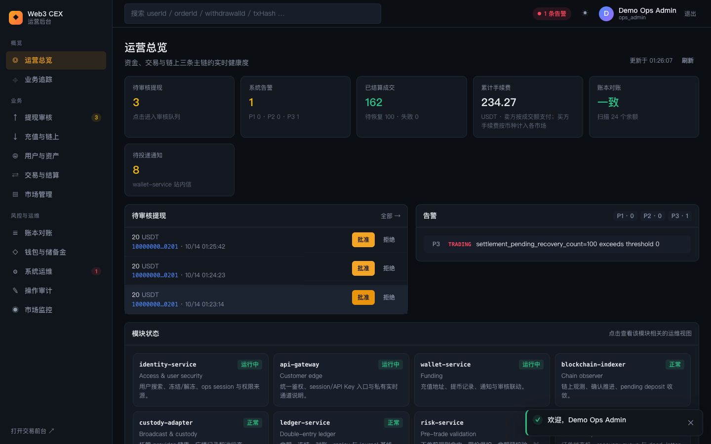
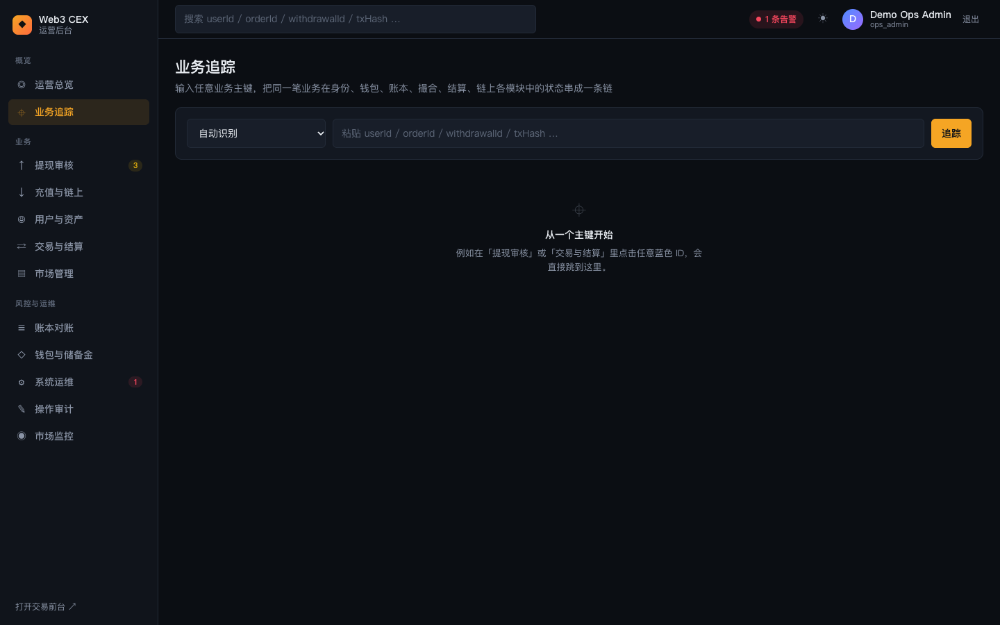
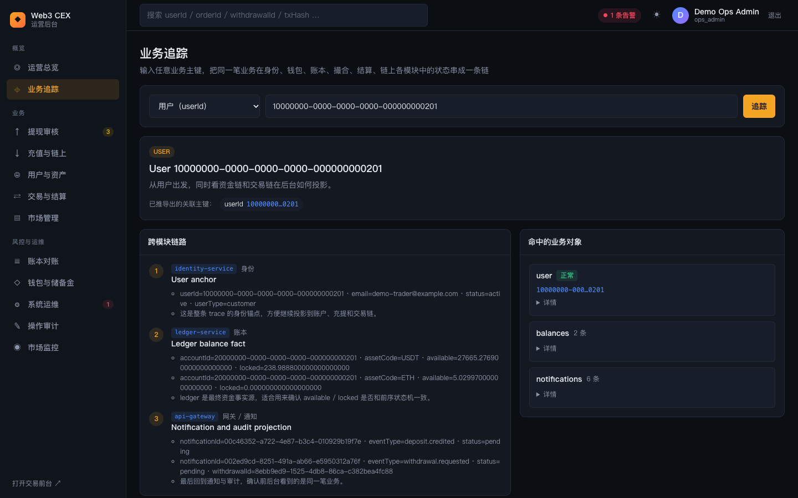
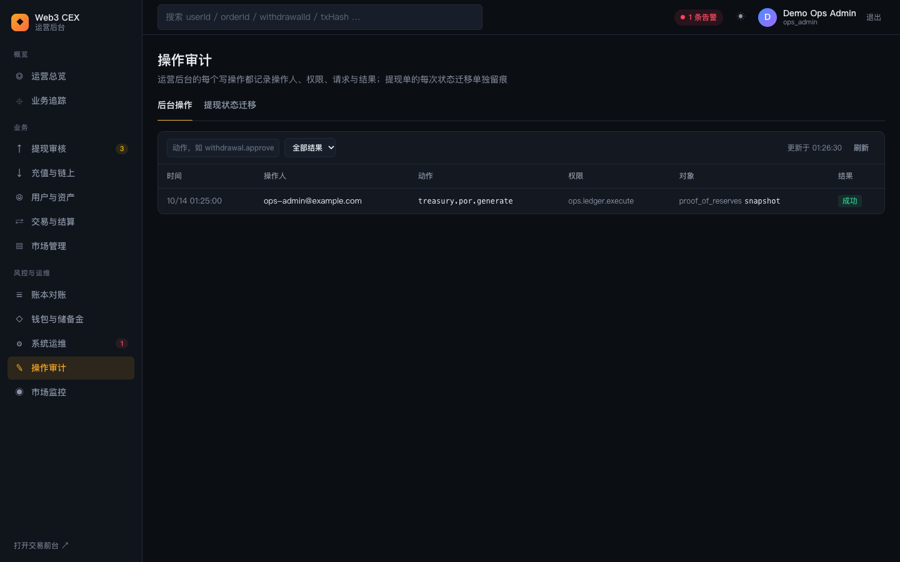

# 06 总览、业务追踪与审计

本篇介绍运营后台 ops-console 的整体布局、角色权限，以及三个"看全局"的页面：运营总览、业务追踪和操作审计。登录方式见 [01 启动与登录](01-getting-started.md#5-ops-console-登录)。

## 1. 后台布局与角色

### 功能说明

- **左侧侧边栏**：顶部是「Web3 CEX · 运营后台」标识（点击回到总览），下面分三组导航：

  | 分组 | 页面 | 进入所需权限 |
  |---|---|---|
  | 概览 | 运营总览、业务追踪 | `ops.dashboard.read` |
  | 业务 | 提现审核 | `ops.withdrawals.read` |
  | | 充值与链上 | `ops.deposits.read` |
  | | 用户与资产 | `ops.users.read` |
  | | 交易与结算 | `ops.assets.read` |
  | | 市场管理 | `ops.markets.read` |
  | 风控与运维 | 账本对账 | `ops.ledger.read` |
  | | 钱包与储备金 | `ops.ledger.read` |
  | | 系统运维 | `ops.dashboard.read` |
  | | 操作审计 | `ops.audit.read` |
  | | 市场监控 | `ops.markets.read` |

  没有对应权限的菜单项不会显示。「提现审核」旁的黄色数字是待审核提现数（每 10 秒刷新），「系统运维」旁的红色数字是当前告警数（每 30 秒刷新），「市场监控」旁的黄色数字是未处理的监控告警数（每 60 秒刷新）。侧边栏底部「打开交易前台 ↗」在新窗口打开 trader-web。
- **顶部全局搜索框**：占位文字为「搜索 userId / orderId / withdrawalId / txHash …」。输入任意业务主键后回车，会跳到「业务追踪」并自动识别主键类型（见第 3 节）。
- **健康胶囊**：显示「系统正常」（绿色）或「N 条告警」（红色），点击进入「系统运维」。
- **主题切换**：☀ / ☾ 按钮在深色和浅色主题之间切换。
- **操作员信息**：头像首字母、显示名（如 Demo Ops Admin）和当前角色（如 `ops_admin`），右侧「退出」按钮注销会话。
- 所有写操作完成后，右下角会弹出提示条（成功 4 秒、失败 7 秒后自动消失）。

### 角色说明

演示环境预置两个运营账号（创建方式见 [01 启动与登录](01-getting-started.md#3-演示账户)）：

| 账号 | 角色 | 能做什么 |
|---|---|---|
| `ops-admin@example.com` | `ops_admin` | 拥有全部运营权限：审核提现、管理用户与 KYC、冻结用户、暂停市场、操作紧急开关（`ops.controls.manage`，只有这个角色有）、执行账本 / 链上 / 恢复作业、触发故障实验 |
| `ops-reviewer@example.com` | `ops_reviewer` | 只能看总览、业务追踪、提现（含审核与批量审核）、充值记录、地址簿、审计和告警；主要用来做大额提现的第二位批准人 |

以 `ops_reviewer` 登录时，侧边栏只剩运营总览、业务追踪、提现审核、充值与链上、系统运维、操作审计。「系统运维」里需要其他权限的页签（如托管通道、恢复队列）会显示「加载失败」。

RBAC 里还定义了 `ops_finance_operator`、`ops_risk_operator`、`ops_platform_operator`、`ops_observer` 四个角色（见 `services/identity-service/src/domain/rbac.ts`）。演示数据没有为它们建账号；未分配角色的运营账号默认是只读的 `ops_observer`。

### 背后的服务

- **ops-console BFF**（`apps/ops-console/src`）：校验运营 Session，按接口要求的权限放行，并把每个写操作记入操作审计。
- **identity-service**：保存运营账号与角色，把角色解析为细粒度权限。

### 延伸学习

- [../security.md](../security.md)（RBAC 与职责分离）
- [../../learning/backstage/B07-incident-response.md](../../learning/backstage/B07-incident-response.md)

## 2. 运营总览

### 功能说明

页面副标题是「资金、交易与链上三条主链的实时健康度」，数据每 10–30 秒自动刷新，右上角显示「更新于 hh:mm:ss」并有「刷新」按钮。

- **指标卡**（点击可跳到对应页面）：
  - **待审核提现**：审核队列总数，非零时为黄色，点击进入「提现审核」。
  - **系统告警**：告警总条数，提示行显示各级数量「P1 n · P2 n · P3 n」；有 P1 时为红色，只有 P2 / P3 时为黄色，没有告警时为绿色。点击进入「系统运维」。
  - **已结算成交**：settlement-service 已结算的成交笔数，提示行显示「待恢复 N · 失败 N」。
  - **累计手续费**：USDT 计价的手续费累计。提示说明卖方按成交额支付，买方手续费按币种计入各市场。
  - **账本对账**：显示「一致」或「N 处不一致」，以及扫描的余额个数，点击进入「账本对账」。
  - **待投递通知**：wallet-service 站内信中尚未投递的条数。
- **待审核提现**面板：列出最多 6 笔待审核提现（金额、用户 ID、申请时间），每行有「批准」「拒绝」按钮，效果与「提现审核」页相同（见 [07 资金运营](07-ops-funds.md#1-提现审核)）。右上「全部 →」进入完整队列。
- **告警**面板：右上角是 P1 / P2 / P3 三个数量徽标。无告警时显示「一切正常 · 账本、对账、链上观察、托管与交易都在阈值内，紧急开关全部关闭」；有告警时按级别排序（P1 在前，最多 12 条），每行依次是级别徽标（P1 红、P2 黄、P3 灰）、来源（如 `reconciliation`、`controls`、`ledger`）和告警内容，悬停可看到该规则的中文说明。级别含义：P1 资金正确性或资金出口（账实不一致、负余额、对账熔断），立即处理；P2 核心链路受损（结算失败或严重滞后、托管熔断、紧急开关开启、对账可疑）；P3 非核心（通知积压、队列偏长）。
- **模块状态**：每个后端模块一张卡片，显示模块 ID、业务域、职责简介和状态（「运行中」/「正常」/「告警」）。点击卡片跳到相关页面，例如 `ledger-service` → 账本对账，`wallet-service` → 提现审核，`blockchain-indexer` → 充值与链上，`custody-adapter` / `risk-service` → 系统运维。`risk-service` 卡片在有紧急开关开启时显示「告警」。
- **待投递通知**：列出事件类型、标题、用户和时间。有 `ops.notifications.manage` 权限时右上角显示「立即投递」，一次最多投递 100 条。

### 操作步骤

1. 登录后默认进入运营总览。
2. 先看指标卡：「待审核提现」非零就去审核；「系统告警」或「账本对账」变红，就点进去排查，先处理 P1。
3. 小额提现可以直接在「待审核提现」面板点「批准」，在弹窗中填写备注后确认。
4. 需要立即推送站内信时，点击「待投递通知」面板的「立即投递」。

### 背后的服务

- **ops-console BFF**：聚合 wallet-service（审核队列、通知）、settlement-service（结算报表）、ledger-service（对账概览、定时对账结果）、risk-service（紧急开关）和各数据源的告警，并按 `src/domain/alert-severity.ts` 的规则为每条告警定级。

### 延伸学习

- [../architecture.md](../architecture.md)
- [../../learning/13-reliability-security-incidents.md](../../learning/13-reliability-security-incidents.md)

## 3. 业务追踪

### 功能说明

业务追踪把同一笔业务在身份、钱包、账本、撮合、结算、链上各模块中的状态串成一条链，是排查问题的主入口。

- **主键类型下拉框**：「自动识别」，或指定以下 7 种之一：

  | 选项 | 参数 |
  |---|---|
  | 提现单 | `withdrawalId` |
  | 订单 | `orderId` |
  | 成交 | `tradeId` |
  | 充值单 | `depositId` |
  | 用户 | `userId` |
  | 账本账户 | `accountId` |
  | 链上交易 | `txHash` |

- **自动识别**：以 `0x` 开头的按交易哈希查询；其他输入依次尝试提现单、订单、成交、充值单、用户、账本账户，取第一个命中的结果。都没命中时提示「没有找到与 … 关联的业务对象」。
- **蓝色 ID 链接**：后台各页面表格里的蓝色短 ID（用户、订单、提现单、交易哈希等）都可以点击，直接跳到这里并带上对应主键。

追踪结果包括：

- **结果头部**：类型标签（如 `USER`、`WITHDRAWAL`）、对象名称和一句话说明（如"从用户出发，同时看资金链和交易链在后台如何投影"），以及「已推导出的关联主键」芯片（如 userId、accountId、txHash），点击芯片可以换个主键继续追踪。
- **OpenTelemetry 调用链**：如果命中的订单或提现带有 trace ID，头部会多出一行。用 `pnpm stack:start:observability` 启动（开启追踪）时显示为「… 在 Jaeger 中查看 ↗」链接，点击在 Jaeger UI（默认 <http://127.0.0.1:16686>）打开这次请求的调用链；未开启追踪时只显示 trace ID 前缀。
- **跨模块链路**：按顺序编号的步骤，每步标出模块 ID 和中文名（身份、钱包、账本、链上观察、托管、订单、撮合、结算、网关 / 通知等），并列出该模块里查到的关键字段。
- **命中的业务对象**：每个对象一张卡片，显示状态徽标和 ID，「详情」展开原始 JSON。
- **关联记录**：同一主键下的其他记录（每类最多 6 条），也可点击继续追踪。
- 页面底部「完整追踪结果（JSON）」可以展开查看全部原始数据。

### 操作步骤

1. 在顶部全局搜索框粘贴主键后回车，或进入「业务追踪」页，在下拉框选择类型（不确定就用「自动识别」）。
2. 输入主键，点击「追踪」。
3. 从上到下阅读「跨模块链路」，确认每个模块看到的状态是否一致，例如提现单已是 `confirmed`，账本冻结是否已释放。
4. 需要换个视角时，点击「已推导出的关联主键」或「关联记录」里的 ID。
5. 开启了追踪时，点击「在 Jaeger 中查看 ↗」看这次请求在各服务的耗时。

### 背后的服务

- **ops-console BFF** 的 `/business-trace` 接口：按主键分别查询 identity-service、wallet-service、ledger-service、order-service、settlement-service、blockchain-indexer、custody-adapter 和通知记录，再拼成链路。

### 延伸学习

- [../architecture.md](../architecture.md)
- [../../learning/backstage/B07-incident-response.md](../../learning/backstage/B07-incident-response.md)

## 4. 操作审计

### 功能说明

副标题为「运营后台的每个写操作都记录操作人、权限、请求与结果；提现单的每次状态迁移单独留痕」。需要 `ops.audit.read`，`ops_admin` 和 `ops_reviewer` 都有。

- **后台操作**页签：
  - 筛选：按动作名过滤（如 `withdrawal.approve`），按结果过滤（全部结果 / 成功 / 失败）。
  - 表格列：时间、操作人（邮箱）、动作、权限、对象（对象类型 + ID）、结果。
  - 点击一行展开详情：失败时显示错误信息，并并排展示「请求」和「响应」JSON。
  - 每 15 秒自动刷新，每页 25 条。
- **提现状态迁移**页签：逐条列出提现单的状态变化，包括时间、提现单、动作、操作方（角色 + ID）和「前状态 → 后状态」。

### 操作步骤

1. 进入「操作审计」，默认是「后台操作」页签。
2. 在动作输入框输入 `withdrawal.approve`，查看所有提现批准记录；结果选「失败」可以找到被拒绝的操作（例如同一人重复批准大额提现）。
3. 点击某一行查看当时的请求参数和返回结果。
4. 切到「提现状态迁移」，按时间核对某笔提现从 `requested` 到 `confirmed` 的全过程。

### 背后的服务

- **ops-console BFF**：每个写接口都通过统一的审计包装执行，记录操作人、所需权限、请求、响应和耗时。
- **wallet-service**：单独保存提现单的状态迁移日志（含前后快照）。

### 延伸学习

- [../../learning/backstage/B01-compliance.md](../../learning/backstage/B01-compliance.md)
- [../security.md](../security.md)

---

上一篇：[05 账户与安全](05-trader-account.md) ｜ 下一篇：[07 资金运营](07-ops-funds.md)
