# 07 资金运营

本篇介绍和用户资金直接相关的三个页面：提现审核（含批量审核与大额双人复核）、充值与链上观察、用户与资产（含冻结、KYC 审核、余额和提现地址簿）。

## 1. 提现审核

### 1.1 待审核队列

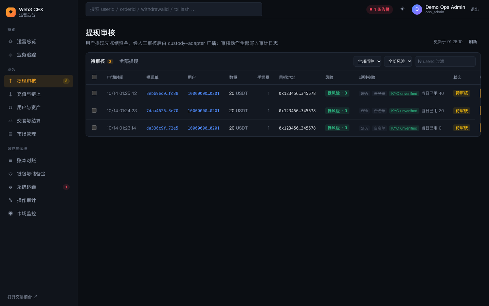

#### 功能说明

副标题为「用户提现先冻结资金，经人工审核后由 custody-adapter 广播；审核动作全部写入审计日志」。列表每 10 秒自动刷新。

- **页签**：「待审核」（旁边显示数量）和「全部提现」。
- **筛选**：币种下拉框、风险等级下拉框（全部风险 / 低风险 / 中风险 / 高风险 / 已拦截）、「按 userId 过滤」输入框；「全部提现」页签还有状态下拉框。
- **表格列**：勾选框、申请时间、提现单、用户、数量、手续费、目标地址、风险、规则校验、状态、操作。
- **风险**列：wallet-service 在申请时给目标地址打的 KYT 风险徽标和分数，如「低风险 · 0」「中风险 · 50」「高风险 · 70」「已拦截 · 100」；鼠标悬停显示命中的规则。演示白名单地址始终是低风险。
- **规则校验**标签：
  - `2FA`、`白名单`：亮色表示提交时已强制校验，灰色划线表示当前环境没有强制该规则。
  - `KYC <等级>`：申请人当时的 KYC 等级（如 `unverified`、`L1`）。
  - `双人复核`：金额超过阈值、或风险等级为高、需要两人批准时出现。
  - 「当日已用 N」：该用户当天已用的提现额度。
- **状态**：需要双人复核的提现会在状态旁多一个「0/2 已批准」或「1/2 已批准」徽标。
- **操作**：「批准」（第一人已批准后变为「复核批准」）和「拒绝」。没有 `ops.withdrawals.review` 权限时按钮不可用；已经批准过这笔大额提现的人再看时，「复核批准」按钮会禁用，悬停提示「你已批准过，需要另一名运营人员复核」。

#### 批量审核

勾选一笔或多笔（表头勾选框可全选当前页）后，表格上方出现批量操作条：「已选择 N 笔」「批量批准」「批量拒绝」「取消选择」。需要 `ops.withdrawals.batch_review` 权限。批量操作逐笔执行，完成后提示「成功 N 笔，失败 N 笔」，每一笔都单独写入操作审计。批量批准同样遵守双人复核规则：大额提现在批量中也只会记录一次批准。

### 1.2 提现详情抽屉

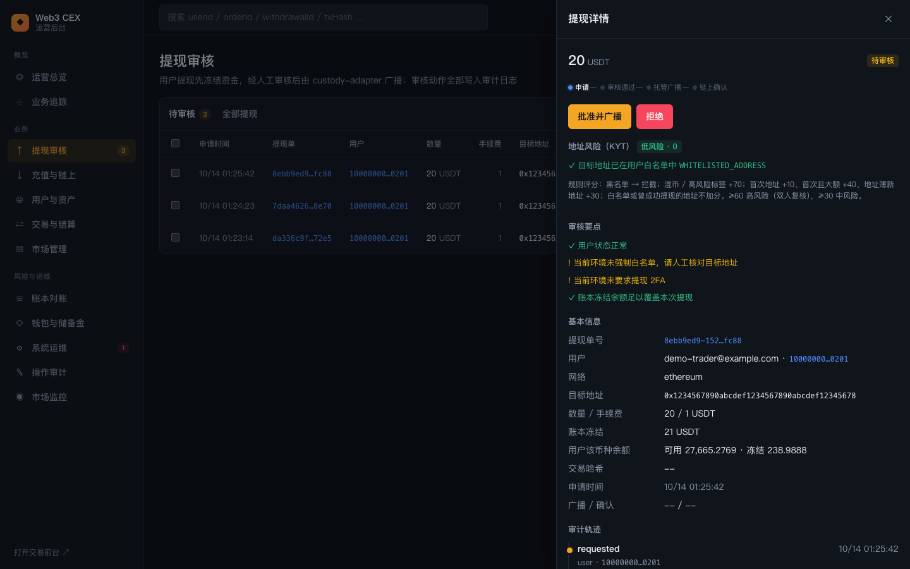

#### 功能说明

点击表格中的任意一行，右侧滑出「提现详情」抽屉（每 5 秒刷新，Esc 或 ✕ 关闭）：

- **头部**：金额、币种和状态徽标；下方是四步进度条「申请 → 审核通过 → 托管广播 → 链上确认」，被拒绝或失败时进度条标红。
- **双人复核**区（大额或高风险提现）：说明"金额超过 X 的提现需要两名不同运营人员批准"，高风险提现则说明"KYT 风险等级为高：无论金额大小都需要两名不同运营人员批准"，并按顺序列出已批准的人、时间和备注。
- **操作按钮**（仅在待审核且有审核权限时显示）：
  - 普通提现：「批准并广播」「拒绝」。
  - 大额提现：第一人看到「第 1 位批准」；第二人看到「复核批准并广播」；已批准过的人看到禁用的「等待另一名运营复核」。
- **地址风险（KYT）**区：风险徽标与分数，以及命中规则列表（加分规则以「+N」标出，白名单 / 曾成功提现等不加分的规则以 ✓ 标出），下方附评分规则说明：黑名单直接拦截；混币 / 高风险标签 +70；首次地址 +10、首次且大额 +40、地址簿新地址 +30；≥60 高风险（双人复核），≥30 中风险。
- **审核要点**（核对清单，仅待审核时显示）：
  - ✓ / ! 用户状态是否正常；
  - 目标地址是否通过白名单校验（未强制时提示"请人工核对目标地址"）；
  - 提交时是否校验了用户 2FA；
  - 账本冻结余额是否足以覆盖本次提现（不足时提示"请先对账"）。
- **基本信息**：提现单号、用户邮箱与 ID、网络、完整目标地址、数量 / 手续费、账本冻结金额、用户该币种的可用与冻结余额、交易哈希、申请时间、广播 / 确认时间。
- **审计轨迹**：按时间列出状态迁移（如 `requested`），以及操作方角色、ID 和备注 / 原因。
- **托管广播**（广播后出现）：Provider、状态、尝试次数、交易哈希。
- **用户通知**：这笔提现产生的站内信（如 `withdrawal.requested`）及投递状态。
- 底部「在业务追踪中查看 →」跳到该提现的业务追踪；「原始数据」可以展开 JSON。

### 1.3 批准与拒绝

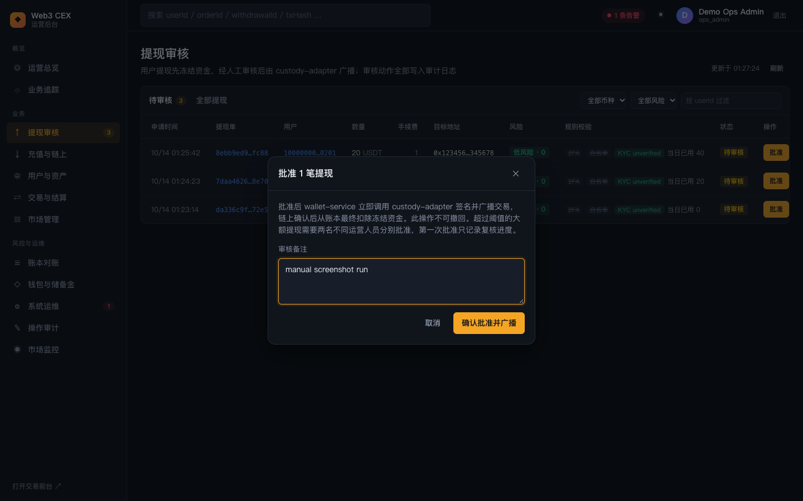

#### 功能说明

- **批准**弹窗标题为「批准 N 笔提现」，说明：批准后 wallet-service 立即调用 custody-adapter 签名并广播，链上确认后从账本最终扣除冻结资金，此操作不可撤回；超过阈值的大额提现需要两名不同运营人员分别批准，第一次批准只记录复核进度。「审核备注」选填。
- **拒绝**弹窗标题为「拒绝 N 笔提现」，说明拒绝后冻结的金额与手续费退回用户可用余额，用户会收到通知。「拒绝原因」必填，未填时确认按钮不可用。
- 批准成功后的提示：
  - 普通提现："custody-adapter 已广播，模拟链确认 12 个区块后完成"；
  - 大额提现第一次批准："大额提现：已记录第 1 位批准，需另一名运营人员复核后才会广播"。

#### 操作步骤（普通提现）

1. 在「待审核」中点击一行打开详情，逐条核对「审核要点」和「基本信息」。
2. 点击「批准并广播」（或在列表中直接点「批准」）。
3. 在弹窗中填写审核备注（可选），点击「确认批准并广播」。
4. 状态变为「已广播」，约 20 秒后模拟链达到 12 个确认，状态变为「已确认」。
5. 如需拒绝：点击「拒绝」，填写拒绝原因，点击「确认拒绝」。

#### 操作步骤（大额提现双人复核）

默认阈值（单笔金额超过该值时需要两人批准）：USDT / USDC 5000、ETH 2、BTC 0.1、SOL 50，可通过 wallet-service 的环境变量 `WITHDRAWAL_DUAL_APPROVAL_THRESHOLD_BY_ASSET` 调整。

1. 用 `ops-admin@example.com` 登录，打开这笔提现，点击「第 1 位批准」并确认。状态变为「审核中」，徽标显示「1/2 已批准」。
2. 退出，用 `ops-reviewer@example.com` / `OpsReviewerPass123!` 登录（动态码用 `pnpm -s ops:totp reviewer`），也可以在另一个浏览器 / 无痕窗口登录。
3. 在「待审核」中找到这笔提现，点击「复核批准」或在详情中点「复核批准并广播」，确认后进入广播和链上确认。
4. 同一个人不能给出两次批准：前端会禁用按钮，服务端也会拒绝（错误码 `WITHDRAWAL_SAME_APPROVER`）。

#### 黑名单地址的提现

- 用户向黑名单地址提交提现时会被直接拦截（前台提示该地址已被平台风控拦截），同时留下一条「已拒绝」、风险「已拦截」、冻结金额为 0 的记录，审计轨迹中的操作人是 `system:kyt`，用户收到「提现被风控拦截」通知。
- 待审核的提现如果目标地址随后被加入黑名单，会被自动拒绝并解冻资金；如果运营在批准时才发现地址已在黑名单，批准会失败并提示已自动拒绝。
- 在风险下拉框选「已拦截」可以集中查看这些记录。

#### 所需权限

- 查看：`ops.withdrawals.read`；单笔批准 / 拒绝：`ops.withdrawals.review`；批量：`ops.withdrawals.batch_review`。`ops_admin` 和 `ops_reviewer` 都具备这三项。

### 1.4 全部提现

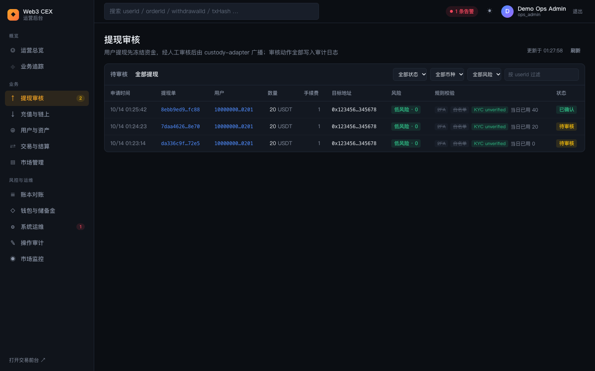

#### 功能说明

列出所有状态的提现，可按状态（全部状态 / 待审核 / 已广播 / 已确认 / 已拒绝 / 失败）、币种和 userId 过滤。这个页签只读，没有勾选框和操作列；点击行同样可以打开详情抽屉，查看已完成提现的托管广播信息和完整审计轨迹。

### 背后的服务

- **wallet-service**：提现状态机、KYT 地址风险评分与黑名单、规则校验（2FA、白名单、KYC 限额、每日额度）、双人复核策略与批准记录。
- **ledger-service**：用户发起提现时冻结金额 + 手续费；拒绝时解冻；链上确认后最终扣除。
- **custody-adapter**：按路由选择托管通道签名广播；**blockchain-indexer** 追踪确认数。提现一律从平台热钱包付出，热钱包余额、归集和冷热调拨在「钱包与储备金」页管理（见 [08 · 交易、市场与账本](08-ops-trading-and-ledger.md) 第 4 节）。
- **ops-console BFF**：把提现、审计轨迹和托管记录拼成详情，并记录每次审核动作。

### 延伸学习

- [../../learning/04-wallet-custody.md](../../learning/04-wallet-custody.md)
- [../../learning/09-risk-control.md](../../learning/09-risk-control.md)
- [../../learning/backstage/B01-compliance.md](../../learning/backstage/B01-compliance.md)
- [../security.md](../security.md)

## 2. 充值与链上

### 2.1 充值记录

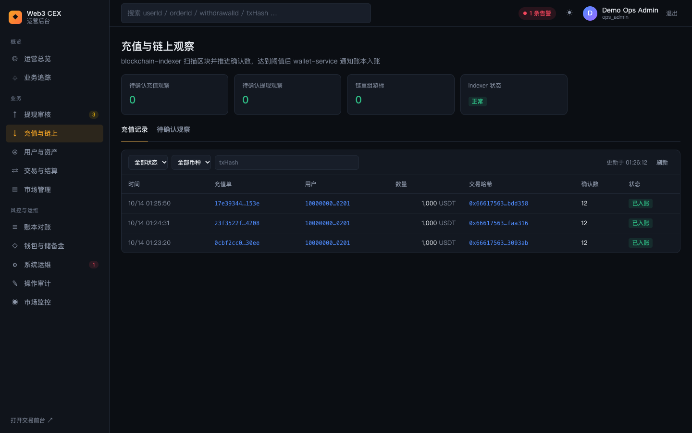

#### 功能说明

页面标题为「充值与链上观察」，副标题说明 blockchain-indexer 扫描区块并推进确认数，达到阈值后 wallet-service 通知账本入账。

- **指标卡**（需要 `ops.indexer.read`，否则显示 `--`）：待确认充值观察、待确认提现观察、链重组游标（非零为红色）、Indexer 状态。
- **充值记录**页签：
  - 筛选：状态（全部状态 / 已入账 / 已确认 / 失败）、币种、txHash。
  - 表格列：时间、充值单、用户、数量、交易哈希、确认数、状态。充值单、用户、交易哈希都可点击进入业务追踪。
  - 每 10 秒自动刷新。没有充值时提示可以在交易前台的测试水龙头模拟一笔。

### 2.2 待确认观察

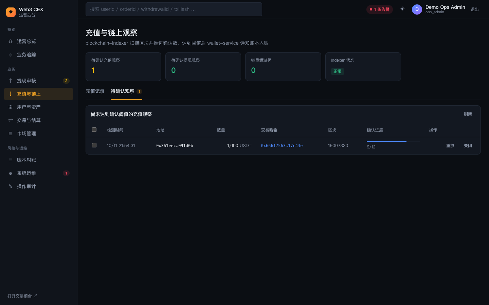

#### 功能说明

列出尚未达到 12 个确认的充值观察，每 5 秒刷新。列为勾选框、检测时间、地址、数量、交易哈希、区块、确认进度（进度条 + `N/12`）和操作。模拟链每 1.5 秒出块，水龙头充值通常 20 秒内就能达到 12 个确认，所以这个列表大多数时候是空的。

- **重放**：以 12 个确认把这条观察重新提交给 wallet-service，满足阈值后立即入账。只应在确认链上交易确实存在时使用。
- **关闭**：这条观察不再入账，例如链重组后交易已不存在。
- 勾选多条后，面板右上角出现「批量重放」「批量关闭」。
- 两种操作都要在弹窗中填写「处置说明」（必填），并写入操作审计。

#### 操作步骤

1. 进入「充值与链上」→「待确认观察」。
2. 找到长时间卡住的观察，先点交易哈希去业务追踪，确认链上状态。
3. 交易确实存在：点「重放」，填写处置说明后点「确认重放」；交易已不存在：点「关闭」，填写说明后点「确认关闭」。
4. 回到「充值记录」，确认该充值已变为「已入账」。

#### 所需权限

查看充值记录需要 `ops.deposits.read`；指标卡需要 `ops.indexer.read`；重放 / 关闭需要 `ops.indexer.pending.manage`，默认只有 `ops_admin` 具备。

### 背后的服务

- **demo-simulator**：模拟 EVM 链出块。
- **blockchain-indexer**：扫描区块、记录充值观察、推进确认数、检测链重组。
- **wallet-service**：确认数达到阈值后创建充值单，并通知 ledger-service 入账。

### 延伸学习

- [../../learning/04-wallet-custody.md](../../learning/04-wallet-custody.md)
- [../../learning/backstage/B04-reconciliation.md](../../learning/backstage/B04-reconciliation.md)

## 3. 用户与资产

页面副标题为「身份来自 identity-service，余额来自 ledger-service 账本」，共五个页签：用户、KYC 审核、余额、提现地址簿、地址黑名单。进入本页需要 `ops.users.read`（`ops_reviewer` 没有该权限，看不到这个菜单）。

### 3.1 用户列表

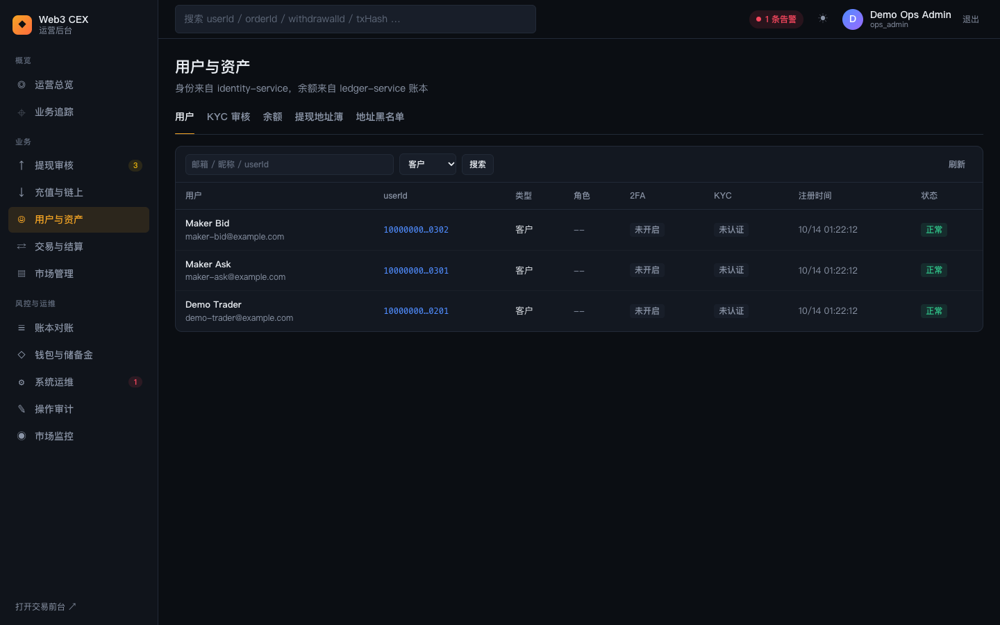

#### 功能说明

- **筛选**：按邮箱 / 昵称 / userId 搜索；类型可选全部类型 / 客户 / 运营（默认「客户」）。
- **表格列**：用户（昵称 + 邮箱）、userId、类型、角色、2FA（已开启 / 未开启）、KYC（未认证 / L1 / L2，运营账号显示 `--`）、注册时间、状态。
- 演示数据中有三位客户：Demo Trader（演示交易员）以及做市账户 Maker Bid、Maker Ask。

### 3.2 用户详情、冻结与解冻

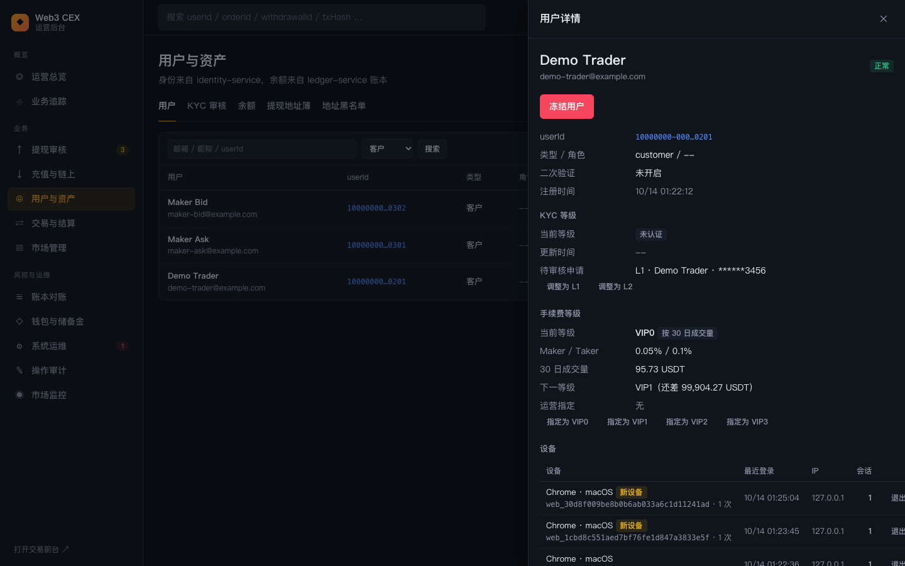

#### 功能说明

点击用户行打开「用户详情」抽屉：

- **头部**：昵称、邮箱、状态徽标。
- **冻结 / 解冻按钮**：有 `ops.users.freeze` 权限且对象是客户时显示。正常用户显示红色「冻结用户」，已冻结用户显示「解冻用户」。
- **基本信息**：userId、类型 / 角色、二次验证、注册时间。
- **KYC 等级**：当前等级、更新时间、待审核申请（申请等级 · 姓名 · 证件号后 4 位）。有 `ops.users.manage` 时显示「调整为 …」按钮，可以手动改成其他等级；下方时间线记录每次审核通过、拒绝或手动调整。
- **资产（账本）**：各币种的可用、冻结和账本账户 ID（账户 ID 可点击追踪）。
- **最近委托**：最近 8 笔订单（订单 ID、市场、方向、数量 @ 价格、状态）。
- **充提记录**：最近 5 笔充值和 5 笔提现。
- **设备**：用户登录过的设备（浏览器 · 系统、设备 ID、登录次数、最近登录、IP、活跃会话数），被识别为新设备的带「新设备」徽标。有 `ops.users.freeze` 权限时，有活跃会话的设备可以点「退出设备」，吊销其全部会话（用于疑似盗号处置，写入操作审计 `user.device.revoke`）。
- **登录记录（最近 10 次）**：时间、结果（成功 / 失败 / 锁定，失败附原因码如 `INVALID_CREDENTIALS`）、是否新设备、设备和 IP。连续失败触发的临时锁定会以「锁定」出现。
- 底部「在业务追踪中查看 →」。

#### 操作步骤（冻结用户）

1. 在用户列表点击目标用户，打开详情。
2. 点击「冻结用户」。弹窗说明：冻结后该用户的会话与 API Key 鉴权会被拒绝，无法下单或提现。
3. 填写「原因」（冻结时必填），点击「确认冻结」。状态变为「已冻结」。
4. 解冻：再次打开详情，点击「解冻用户」，原因选填，点击「确认解冻」。用户可以重新登录并交易。

#### 操作步骤（手动调整 KYC 等级）

1. 在详情的「KYC 等级」区点击「调整为 L1」或「调整为 L2」（也可以降回「未认证」）。
2. 弹窗说明：等级决定该用户的单笔与每日提现限额，wallet-service 在提现申请时校验。填写「调整原因」（必填），点击「确认调整」。

#### 所需权限

冻结 / 解冻需要 `ops.users.freeze`（`ops_admin`，以及 RBAC 中的 `ops_risk_operator`）；调整 KYC 需要 `ops.users.manage`（仅 `ops_admin`）。

### 3.3 KYC 审核

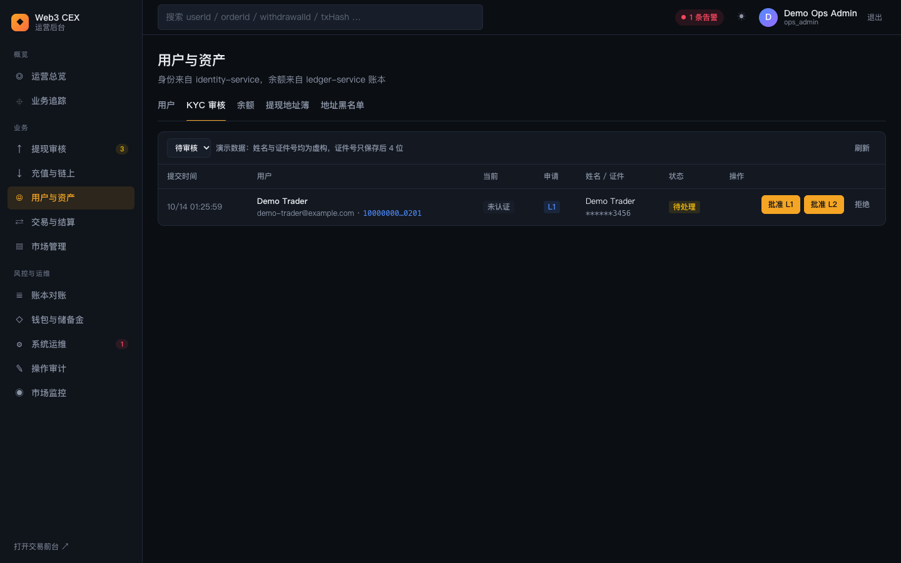

#### 功能说明

- **筛选**：待审核（默认）/ 已通过 / 已拒绝 / 全部。每 15 秒刷新。
- **表格列**：提交时间、用户（昵称、邮箱、userId）、当前等级、申请等级、姓名 / 证件（证件号只保存后 4 位）、状态、操作。已处理的申请在状态下方显示授予的等级、审核人和备注。
- **操作**（待审核且有 `ops.users.manage` 时显示）：「批准 L1」「批准 L2」「拒绝」。审核人可以授予比申请更高或更低的等级。
- 演示环境不收集真实证件，姓名与证件号都是虚构数据。

#### 操作步骤

1. 用户在交易前台「账户」页提交认证申请后（见 [05 账户与安全](05-trader-account.md)），申请出现在这里。
2. 点击「批准 L1」或「批准 L2」，填写审核备注（可选），点击「确认批准」。用户立即获得对应等级的提现限额。
3. 不通过时点击「拒绝」，填写拒绝原因（必填）后确认。用户等级不变，可以重新提交。
4. 审核人和备注同时写入 KYC 事件和运营审计日志。

### 3.4 余额

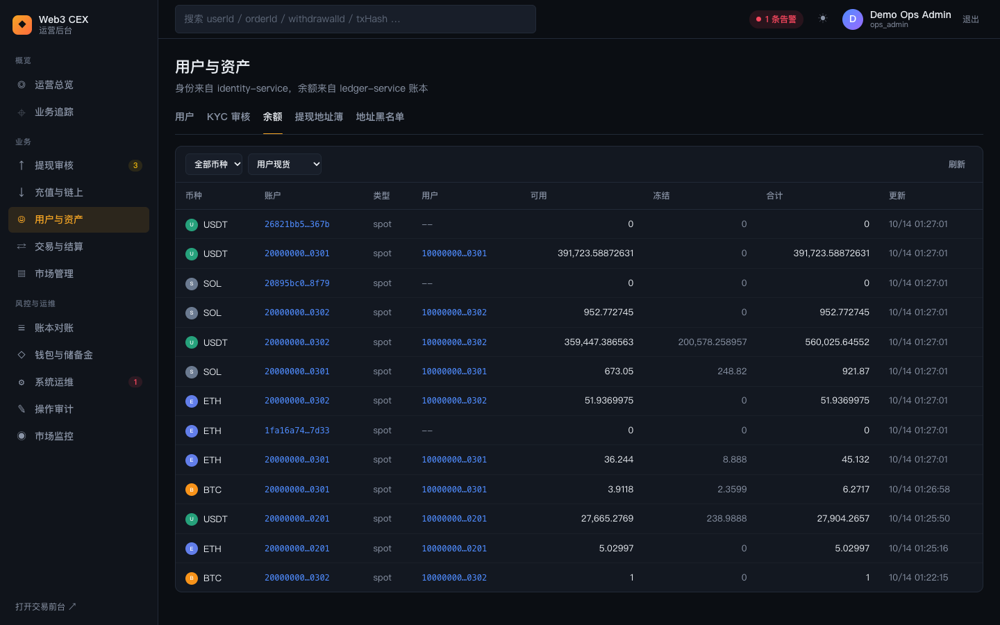

#### 功能说明

直接读取 ledger-service 的余额快照：

- **筛选**：币种；账户类型可选全部 / 用户现货（`spot`，默认）/ 平台国库（`treasury`）/ 手续费（`fee`）/ 期初权益（`opening_balance`）。
- **表格列**：币种、账户、类型、用户、可用、冻结、合计、更新时间。账户和用户 ID 都可点击追踪。
- 做市账户（`…0301`、`…0302`）因为持续挂单，冻结金额通常较大；用户 ID 为 `--` 的行是平台侧账户。
- 想核对快照是否和分录一致，请到「账本对账」（见 [08 交易、市场与账本](08-ops-trading-and-ledger.md#3-账本对账)）。

### 3.5 提现地址簿

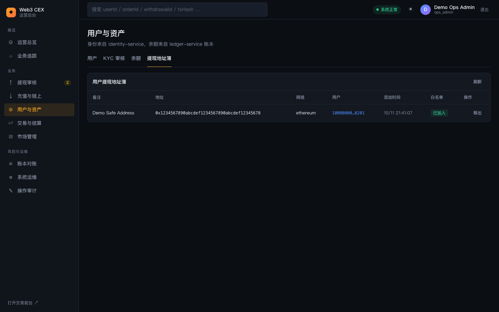

#### 功能说明

列出用户在交易前台保存的提现地址：备注、完整地址、网络、用户、添加时间、白名单状态（已加入 / 未加入）和操作（「加入」/「移出」）。查看需要 `ops.address_book.read`；加入 / 移出白名单需要 `ops.address_book.manage`，否则按钮不可用。

#### 操作步骤

1. 进入「用户与资产」→「提现地址簿」。
2. 对需要放行的地址点击「加入」，对可疑地址点击「移出」。提示条显示「已加入白名单」或「已移出白名单」。
3. 当 wallet-service 开启强制白名单时，只有白名单内的地址可以发起提现。提现列表「规则校验」中的「白名单」标签会显示该规则是否生效。

### 3.6 地址黑名单

#### 功能说明

简化版 KYT 的运营入口，需要 `ops.risk.read` 才能查看（`ops_admin`、`ops_risk_operator`、`ops_reviewer`、`ops_observer` 具备）。

- **加入黑名单**表单（需要 `ops.risk.manage`，即 `ops_admin` 或 `ops_risk_operator`）：网络、地址、类别（制裁名单 / 混币器 / 诈骗 / 被盗资金 / 其他）、原因（必填，写入审计），点「加入黑名单」。成功提示会说明是否自动拒绝了待审核提现。
- **黑名单列表**：可按「生效中 / 已移除 / 全部」筛选；列为地址、网络、类别、原因、来源 / 操作人（演示种子显示「演示种子」）、加入时间、状态、操作。生效中的条目可以「移出」，移出必须填写原因，记录保留并显示移出人与原因。
- 演示数据预置 3 个虚构的黑名单地址：`0xbad0…0001`（制裁名单）、`0xbad0…0002`（被盗资金）、`0xbad0…0003`（混币器）。
- **演示地址标签**：列出不在黑名单、但带混币 / 高风险 / 博彩标签的虚构地址（`0xdeadbeef…0001` 等），向它们提现会被评为高风险并需要两名运营批准。

#### 操作步骤

1. 进入「用户与资产」→「地址黑名单」。
2. 选择网络、填写地址、选择类别、填写原因，点「加入黑名单」。发往该地址的待审核提现会被自动拒绝，之后的提现申请会被直接拦截。
3. 误判时点该条目的「移出」，填写原因后确认。之后该地址按其他规则正常评分。
4. 在「操作审计」中按动作 `risk.blacklist.add` / `risk.blacklist.remove` 可以查到每次变更。

### 背后的服务

- **identity-service**：用户资料、状态（冻结 / 解冻）、2FA、KYC 等级与申请、KYC 事件、登录记录与设备。
- **ledger-service**：余额快照（可用 / 冻结）。
- **wallet-service**：提现地址簿与白名单、地址黑名单与 KYT 标签。
- **order-service**：用户详情中的最近委托。

### 延伸学习

- [../../learning/backstage/B01-compliance.md](../../learning/backstage/B01-compliance.md)
- [../../learning/09-risk-control.md](../../learning/09-risk-control.md)
- [../../learning/05-ledger.md](../../learning/05-ledger.md)

---

上一篇：[06 总览、业务追踪与审计](06-ops-overview-and-trace.md) ｜ 下一篇：[08 交易、市场与账本](08-ops-trading-and-ledger.md)
