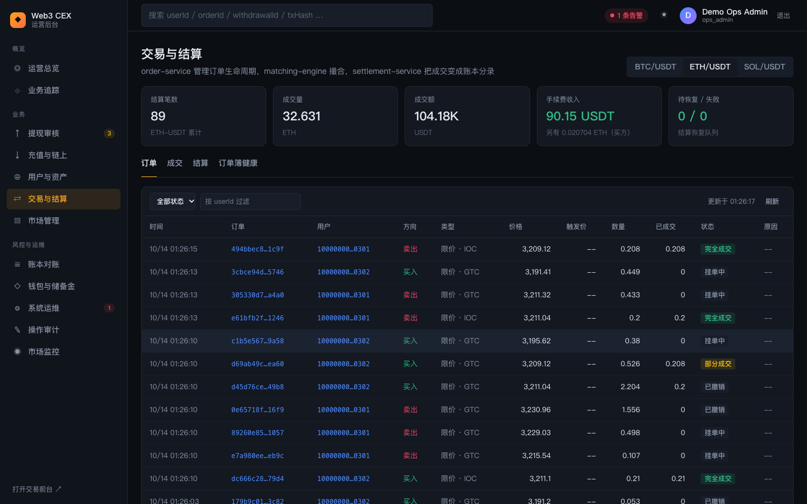
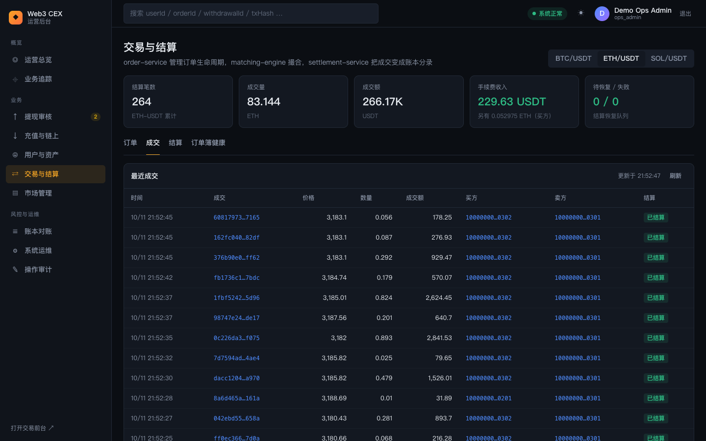
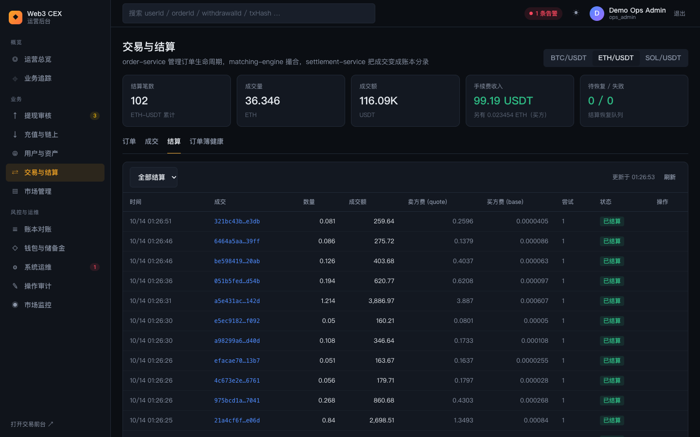
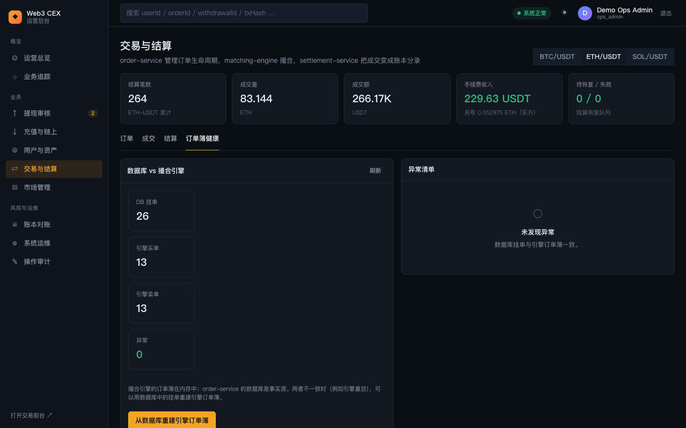
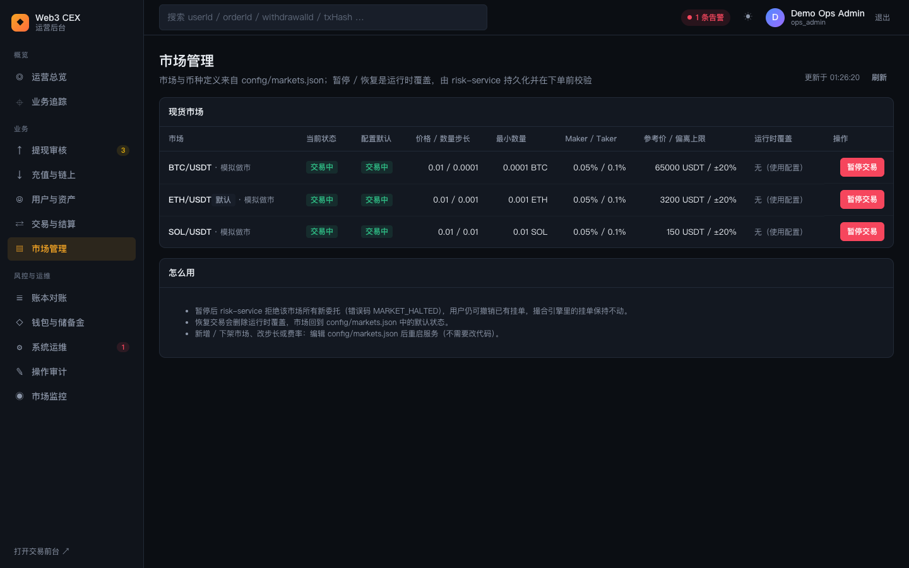
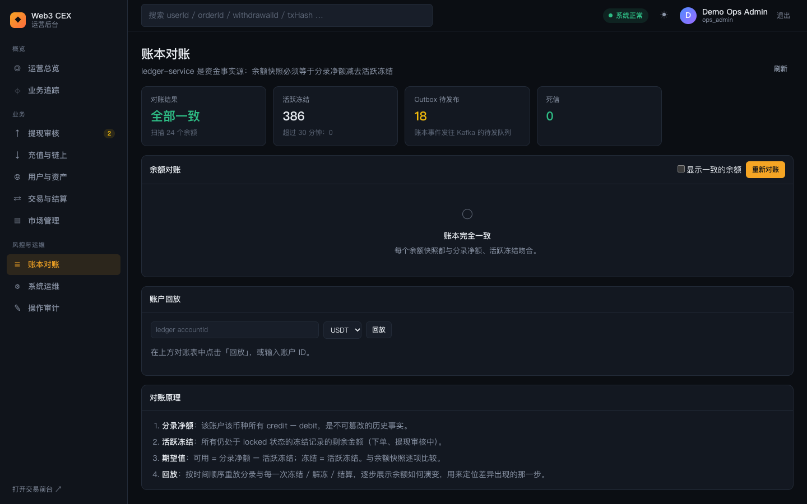

# 08 交易、市场与账本

本篇介绍四个运营页面：交易与结算（订单、成交、结算、订单簿健康）、市场管理（暂停 / 恢复交易）、账本对账（余额对账与账户回放），以及钱包与储备金（冷热分层、归集、调拨审批、钱包 vs 账本对账、储备金证明）。

## 1. 交易与结算

页面副标题为「order-service 管理订单生命周期，matching-engine 撮合，settlement-service 把成交变成账本分录」。进入本页需要 `ops.assets.read`。

### 1.1 市场切换与指标卡

#### 功能说明

- **市场切换**：右上角分段按钮列出 `config/markets.json` 中的全部市场，默认选中配置里的默认市场（ETH/USDT）。下面四个页签都只显示当前市场的数据。
- **指标卡**（当前市场累计）：
  - **结算笔数**；
  - **成交量**（基础币，如 ETH）；
  - **成交额**（计价币，如 USDT）；
  - **手续费收入**：卖方按成交额支付的计价币手续费，提示行显示买方以基础币支付的部分（"另有 … ETH（买方）"）；
  - **待恢复 / 失败**：结算恢复队列中的数量，非零时变红。

### 1.2 订单

#### 功能说明

截图同上，「订单」页签列出当前市场的订单，每 10 秒刷新，每页 30 条：

- **筛选**：状态（全部 / 待触发 / 挂单中 / 部分成交 / 完全成交 / 已撤销 / 已拒绝 / 恢复中）、「按 userId 过滤」。
- **表格列**：时间、订单、用户、方向（买入绿 / 卖出红）、类型（限价 / 市价 / 止损限价 / 止损市价 · `GTC` / `IOC` 等有效期，只做 Maker 订单带「Post-Only」，非默认 STP 模式带「STP expire_maker」等）、价格（市价单显示「市价」）、触发价（止损单；悬停显示触发时间）、数量、已成交、状态（止损单触发前为「待触发」）、原因（如 `post_only_would_take`、`stp_expired_taker`、`stp_expired_maker`）。
- 演示环境中的大部分订单来自做市账户（`…0301`、`…0302`）的模拟做市。

### 1.3 成交

#### 功能说明

列出当前市场最近的成交：时间、成交 ID、价格、数量、成交额（价格 × 数量）、买方、卖方、结算状态。已生成结算记录的显示「已结算」，否则显示「待处理」。如果一直停在「待处理」，说明结算消费滞后，可以到「系统运维」→「事件总线」或「恢复队列」排查（见 [09 系统运维与故障实验室](09-ops-system-and-lab.md)）。

### 1.4 结算

#### 功能说明

- **筛选**：全部结算 / 已结算 / 待恢复 / 失败。
- **表格列**：时间、成交、数量、成交额、卖方费（计价币）、买方费（基础币）、尝试次数（悬停显示最近一次错误）、状态、操作。
- **重试结算**：状态不是「已结算」的行会出现「重试结算」按钮，点击后立即对这笔成交重新执行结算。需要 `ops.ledger.execute`。

#### 操作步骤

1. 状态筛选选「待恢复」或「失败」。
2. 悬停「尝试」列查看失败原因，必要时点成交 ID 去业务追踪核对账本。
3. 点击「重试结算」，提示「已触发结算恢复」后刷新，确认状态变为「已结算」。

### 1.5 订单簿健康

#### 功能说明

撮合引擎的订单簿保存在内存里，order-service 的数据库是事实源。这个页签比较两者：

- **数据库 vs 撮合引擎**：DB 挂单数、引擎买单数、引擎卖单数、异常数、待触发止损单数。正常情况下 DB 挂单 = 引擎买单 + 引擎卖单（截图中 26 = 13 + 13）；待触发的止损单只在数据库里，不计入引擎订单簿。重建订单簿时会带上账户 ID，自成交保护继续生效。
- **异常清单**：列出不一致的订单（异常类型 + 订单 ID，如 `engine_missing_open_order`）。没有异常时显示「未发现异常 · 数据库挂单与引擎订单簿一致」。
- **从数据库重建引擎订单簿**：先清空撮合引擎中该市场的订单簿，再按数据库中的挂单（价格、时间优先级）重新写入。重建期间新订单可能被拒绝。需要 `ops.ledger.execute`。

#### 操作步骤

1. 发现「异常」非零（例如撮合引擎重启后，或在故障实验室清空订单簿后）。
2. 点击「从数据库重建引擎订单簿」，在弹窗中点「确认重建」。
3. 提示「订单簿已重建」后，异常数应回到 0。

### 背后的服务

- **order-service**：订单生命周期、数据库挂单、引擎订单簿重建。
- **matching-engine**：内存订单簿与撮合。
- **settlement-service**：消费成交事件，生成结算记录并调用 ledger-service 记账，失败任务进入恢复队列。

### 延伸学习

- [../../learning/06-order-matching.md](../../learning/06-order-matching.md)
- [../../learning/07-clearing-settlement-fees.md](../../learning/07-clearing-settlement-fees.md)
- [../architecture.md](../architecture.md)

## 2. 市场管理

### 功能说明

副标题为「市场与币种定义来自 config/markets.json；暂停 / 恢复是运行时覆盖，由 risk-service 持久化并在下单前校验」。进入本页需要 `ops.markets.read`，每 10 秒刷新。

- **表格列**：
  - **市场**：交易对；默认市场带「默认」标记；启用了模拟做市的显示「· 模拟做市」。
  - **当前状态**：实际生效的状态（交易中 / 已暂停）。
  - **配置默认**：`config/markets.json` 中的状态。
  - **价格 / 数量步长**、**最小数量**、**Maker / Taker** 费率、**参考价 / 偏离上限**（如 3200 USDT / ±20%）。
  - **运行时覆盖**：有覆盖时显示原因、操作人和时间，否则显示「无（使用配置）」。
  - **操作**（仅有 `ops.markets.manage` 时显示这一列）：交易中的市场显示「暂停交易」，已暂停的显示「恢复交易」；配置为已下架的市场显示「已下架（仅可改配置）」。
- 如果 risk-service 不可用，表格上方会出现红色提示，表格改为显示配置文件中的默认状态，暂停 / 恢复按钮不可用。
- **怎么用**面板说明：
  - 暂停后 risk-service 拒绝该市场所有新委托（错误码 `MARKET_HALTED`），用户仍可撤销已有挂单，撮合引擎里的挂单保持不动。
  - 恢复交易会删除运行时覆盖，市场回到 `config/markets.json` 中的默认状态。
  - 新增 / 下架市场、修改步长或费率：编辑 `config/markets.json` 后重启服务，不需要改代码。

### 操作步骤

1. 点击目标市场的「暂停交易」。
2. 弹窗说明暂停后所有新委托都会被风控拒绝（撤单不受影响），操作会写入操作审计。填写「暂停原因」（必填），点击「确认暂停」。
3. 「当前状态」变为「已暂停」，「运行时覆盖」显示原因、操作人和时间。此时在交易前台对该市场下单会被拒绝。
4. 恢复：点击「恢复交易」，备注选填，点击「确认恢复」。

### 所需权限

查看需要 `ops.markets.read`；暂停 / 恢复需要 `ops.markets.manage`（`ops_admin`，以及 RBAC 中的 `ops_risk_operator`）。

### 背后的服务

- **risk-service**：持久化市场状态覆盖，下单前校验市场是否暂停。
- **ops-console BFF**：合并 `config/markets.json` 与 risk-service 的覆盖，并记录操作审计。

### 延伸学习

- [../../learning/09-risk-control.md](../../learning/09-risk-control.md)
- [../../learning/backstage/B07-incident-response.md](../../learning/backstage/B07-incident-response.md)

## 3. 账本对账

### 功能说明

副标题为「ledger-service 是资金事实源：余额快照必须等于分录净额减去活跃冻结」。进入本页需要 `ops.ledger.read`。

- **指标卡**：
  - **对账结果**：「全部一致」或「N 处不一致」，以及扫描的余额个数。
  - **活跃冻结**：仍处于冻结状态的记录数，提示行显示超过 30 分钟的冻结数（非零为黄色，可能是卡住的订单或提现）。
  - **Outbox 待发布**：账本事件发往 Kafka 的待发队列长度。
  - **死信**：发布失败进入死信的事件数。
- **账本告警**（有告警时出现）：逐条列出 ledger 告警。有 `ops.ledger.execute` 时可点「投递 Outbox 事件」手动投递一轮。`stack:start` 会常驻运行 ledger-outbox-publisher，积压持续增长通常意味着 publisher 或 Kafka 异常。
- **余额对账**：
  - 默认只显示不一致的余额；全部一致时显示「账本完全一致」。勾选「显示一致的余额」可以看到全部记录。
  - 表格列：账户、类型、币种、分录净额、活跃冻结、快照可用、快照冻结、总额差、冻结差、结果（一致 / 不一致）、操作（「回放」）。不一致的行高亮，差额标红。
  - 「重新对账」：立即重新扫描所有余额，完成后提示「扫描 N，不一致 N」。需要 `ops.ledger.execute`。
- **账户回放**：输入账本 `accountId` 并选择币种，或在对账表中点「回放」。结果包括：
  - 四张指标卡：快照可用 / 冻结、回放可用 / 冻结、结果（一致 / 不一致）、事件数；
  - 事件表：按时间顺序列出每一次分录入账、分录出账、冻结、解冻、消耗、结算解冻，以及金额、业务引用和每一步之后的可用 / 冻结余额（最多显示最近 200 条）。
- **对账原理**：解释分录净额、活跃冻结、期望值（可用 = 分录净额 − 活跃冻结；冻结 = 活跃冻结）和回放的含义。

### 操作步骤

1. 进入「账本对账」，先看「对账结果」指标卡。
2. 点击「重新对账」做一次最新扫描。
3. 如果出现不一致，在表格中找到标红的行，点击「回放」。
4. 在「账户回放」中逐行查看余额演变，找到可用 / 冻结开始偏离的那一步，点击业务引用 ID 去业务追踪查看对应的订单、成交或提现。
5. 没有不一致时，也可以从「用户与资产」复制某个账户 ID，粘贴到回放输入框，观察一个用户的完整资金历史。

### 所需权限

查看与回放需要 `ops.ledger.read`；重新对账和投递 Outbox 需要 `ops.ledger.execute`（`ops_admin`，以及 RBAC 中的 `ops_finance_operator`）。

### 背后的服务

- **ledger-service**：复式记账分录、冻结记录、余额快照、对账与回放、事件 Outbox。
- **ledger-outbox-publisher**：把账本事件从 Outbox 发布到 Kafka。

### 延伸学习

- [../../learning/05-ledger.md](../../learning/05-ledger.md)
- [../../learning/backstage/B04-reconciliation.md](../../learning/backstage/B04-reconciliation.md)
- [../ledger-service-design.md](../ledger-service-design.md)

## 4. 钱包与储备金

侧边栏「风控与运维」→「钱包与储备金」（`#/treasury`，排在「账本对账」之后）。账本对账检查的是账本内部是否自洽；这一页检查的是**账本记录的用户负债，平台在链上是否真的有足够的币**，并管理这些币在充值地址、热钱包、冷钱包之间的分布。

### 功能说明

副标题为「平台链上持仓按 充值地址 → 热钱包 ⇄ 冷钱包 分层；与账本用户负债逐币种对账，并生成储备金证明（PoR）」。右上角「刷新」，持仓每 10 秒、对账每 15 秒自动刷新。

- **指标卡**：
  - **钱包 vs 账本**：「全部足额储备」或「N 个币种储备不足」，提示行显示账本负债来自多少个用户。
  - **待审批调拨**：等待审批的冷热调拨提案数。
  - **未完成内部转账**：已提案、已批准或已广播但未到账的内部转账数，提示到账需要的确认数（默认 12）。
  - **最新储备金证明**：最近一次快照的时间、叶子数和 Merkle 根缩写。
- **冷热分层（平台链上持仓）**：每个币种一行，列为币种（带网络）、充值地址、热钱包、冷钱包、在途（内部）、合计、热钱包水位。水位列显示「水位正常」「高于上限」「低于下限」或「未配置」徽标，以及「下限 / 目标 / 上限」。面板底部列出热钱包和冷钱包的地址。有 `ops.ledger.execute` 时面板右上角有三个按钮：
  - 「立即归集」：把已入账、还在用户充值地址里的币按地址归集到热钱包，完成后提示计划、广播、失败的笔数。模拟器每 10 个区块也会自动执行一次。
  - 「检查水位」：热钱包高于上限时生成一笔「热 → 冷」提案，低于下限时生成「冷 → 热」提案（回到上下限中点）；每个币种同一时间最多一笔未完成的调拨。
  - 「发起调拨」：弹窗选择方向（热钱包 → 冷钱包 / 冷钱包 → 热钱包）、币种、金额和原因，提交后生成一笔待审批提案。
- **钱包 vs 账本对账**：每个币种一行，列为链上储备、账本用户负债、在途提现、净负债、盈余（平台自有）、储备率、热钱包覆盖率、结果（足额 / 储备不足 / 无负债）。储备不足的行高亮。表格下方解释四个口径：链上储备 = 充值地址 + 热钱包 + 冷钱包 + 在途内部转账；账本用户负债只统计用户账户；在途提现是已从热钱包广播、账本冻结尚未消耗的金额；盈余是平台放在链上的自有资金。
- **调拨与归集记录**：页签「进行中」「冷热调拨」「归集」「全部」。列为时间、类型（注资上链 / 归集 / 热 → 冷 / 冷 → 热）、金额、方向、状态（待审批 / 已批准 / 已广播 / 已到账 / 已拒绝 / 失败）、发起 / 审批人、交易（txHash 与确认数进度）、操作。
  - 待审批的提案显示「批准」「拒绝」（需要 `ops.withdrawals.review`）。批准弹窗说明：批准后校验来源钱包余额并通过 custody-adapter 广播，**发起人不能批准自己的提案**；拒绝需要填写原因。
  - 失败的调拨显示「重新广播」（需要 `ops.ledger.execute`）；失败的归集会在下一轮归集中自动重试。
  - 点击任意一行打开「内部转账详情」抽屉：类型、金额、方向、来源 / 目标地址、状态、触发方式、原因、txHash、确认数、托管通道、错误信息；归集还列出被归集的充值单（可点击做业务追踪）；「状态历史」按时间列出每一次提案、批准、广播、到账及操作人。
- **储备金证明（PoR）**：有 `ops.ledger.execute` 时右上角有「生成快照」。生成后显示最新快照的 Merkle 根（可复制）、叶子数 / 树高、生成时间和生成人，以及逐币种的储备、负债（叶子合计）、净负债和储备率；更早的快照列在下方。说明文字给出叶子和盐化用户哈希的计算公式。用户随后可以在交易前台「资产 → 储备金证明」自行验证（见 [04 · 资产](04-trader-assets.md) 第 5 节）。

### 操作步骤

**归集一笔充值**

1. 在交易前台用测试水龙头充值，等待充值「已入账」。
2. 进入「钱包与储备金」，看到该币种「充值地址」列增加。
3. 点「立即归集」（或等模拟器自动归集），「调拨与归集记录」出现一笔「归集」，状态「已广播」，确认数逐块增长。
4. 约 20 秒后变为「已到账」：「充值地址」减少、「热钱包」增加，合计不变。

**审批一笔冷热调拨**

1. 点「发起调拨」，选「热钱包 → 冷钱包」、币种 `USDT`、金额 `100`，提交。
2. 在「进行中」页签找到这笔「待审批」提案。用同一个账号点「批准」会失败（发起人不能批准自己的提案）。
3. 换另一名运营账号（例如 `ops-reviewer@example.com`）登录，点「批准」并确认。
4. 状态变为「已广播」，确认数达到 12 后「已到账」：热钱包减少 100、冷钱包增加 100。

**生成储备金证明**

1. 在「钱包 vs 账本对账」确认各币种都是「足额」。
2. 点「生成快照」，记下 Merkle 根。
3. 让用户在交易前台打开「储备金证明」，看到同一个 Merkle 根并验证通过。

### 所需权限

查看需要 `ops.ledger.read`；归集、检查水位、发起调拨、重新广播、生成快照需要 `ops.ledger.execute`；批准 / 拒绝调拨需要 `ops.withdrawals.review`（`ops_admin` 和 `ops_reviewer` 都有）。所有写操作都记入「操作审计」（动作 `treasury.*`）。

### 背后的服务

- **wallet-service（treasury 模块）**：记录内部转账、推导各层持仓、归集、水位评估、审批校验、钱包 vs 账本对账、构建 Merkle 树。
- **custody-adapter**：广播归集和冷热调拨交易。
- **ledger-service**：提供用户负债汇总和按用户的负债明细，本身的分录对账不受这一页的任何操作影响。
- **demo-simulator**：模拟链推进内部转账的确认数，每 10 个区块自动归集、检查水位，并在储备率过低时按演示规则注资补足（演示账户的余额来自期初权益，没有真实的链上币）。

### 延伸学习

- [../../learning/04-wallet-custody.md](../../learning/04-wallet-custody.md) 第 3.5 节（热 / 温 / 冷钱包与水位）、3.6 节（归集）、3.9 节（储备金证明）
- [../../learning/backstage/B06-treasury-liquidity.md](../../learning/backstage/B06-treasury-liquidity.md)
- [../../learning/backstage/B04-reconciliation.md](../../learning/backstage/B04-reconciliation.md) 第 5.3 节（对账与 PoR）
- [../architecture.md](../architecture.md) 第 5.4 节

---

上一篇：[07 资金运营](07-ops-funds.md) ｜ 下一篇：[09 系统运维与故障实验室](09-ops-system-and-lab.md)
