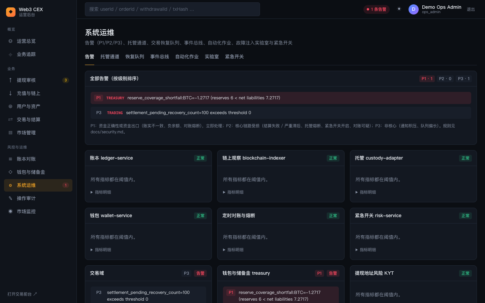
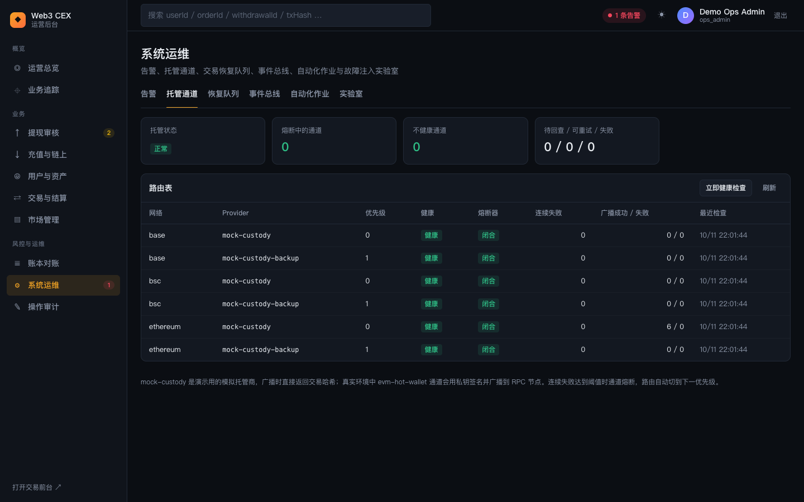
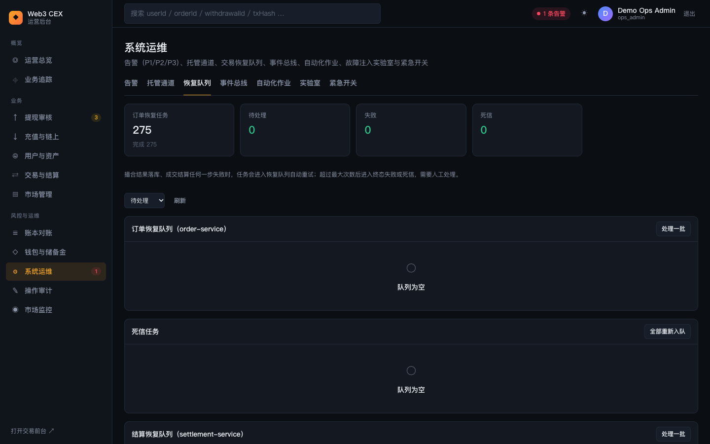
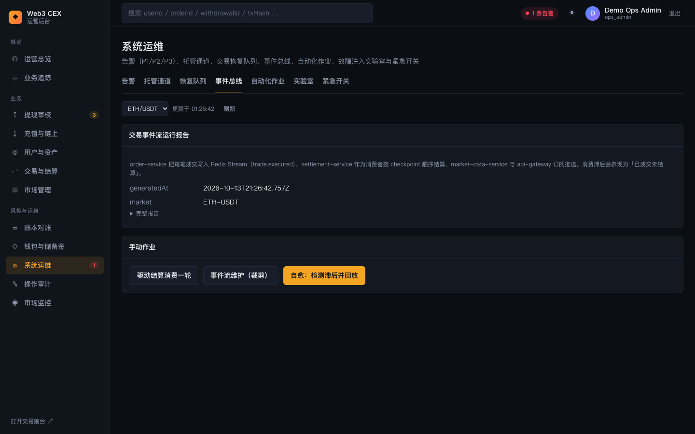
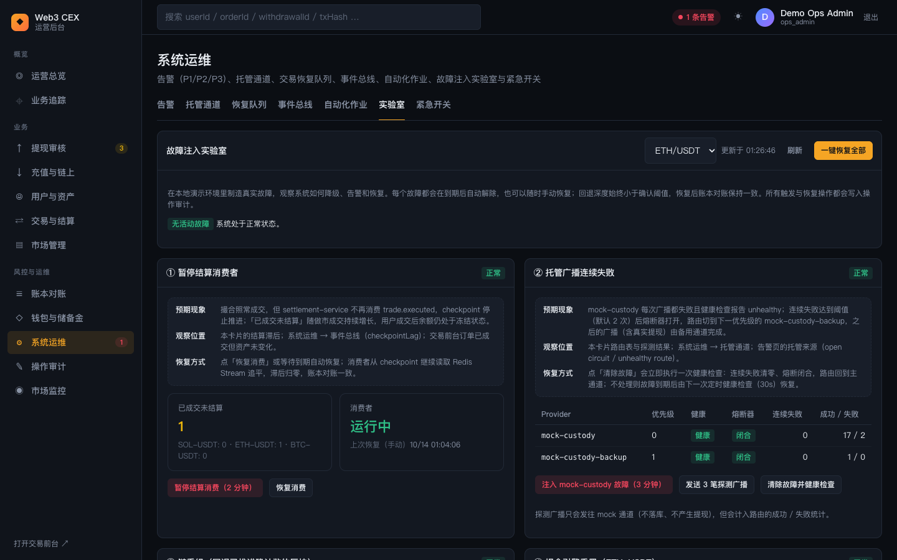

# 09 系统运维与故障实验室

本篇介绍「系统运维」页的六个页签：告警、托管通道、恢复队列、事件总线、自动化作业和实验室（故障注入）。这里是观察系统健康、手动驱动后台作业、动手制造故障并练习恢复的地方。

页面副标题为「告警、托管通道、交易恢复队列、事件总线、自动化作业与故障注入实验室」。进入本页需要 `ops.dashboard.read`；各页签读取的数据和可执行的动作还需要各自的权限（见每节说明），`ops_reviewer` 等权限不足的角色打开这些页签时会看到「加载失败」或只读视图。可以用 `#/system?tab=lab` 这样的地址直接打开指定页签（tab 取值：`alerts`、`custody`、`recovery`、`eventbus`、`automation`、`lab`）。

## 1. 告警

### 功能说明

- 每个告警数据源一张卡片，标题为中文名 + 服务名（账本 ledger-service、链上观察 blockchain-indexer、托管 custody-adapter、钱包 wallet-service 等），右上角是状态徽标（正常 / 告警）。
- 没有告警时显示「所有指标都在阈值内。」；有告警时逐条列出告警文本。截图中钱包 wallet-service 的告警是 `pending_notifications=33 exceeds threshold 20`，即待投递站内信超过阈值，此时顶部健康胶囊变为「1 条告警」，侧边栏「系统运维」旁出现红色数字 1。
- 「指标明细」展开后是该数据源的原始指标 JSON。
- 每 15 秒刷新。顶部健康胶囊、侧边栏「系统运维」上的红色数字、运营总览的「系统告警」卡片都来自同一份数据。需要 `ops.alerts.read`。

### 操作步骤

1. 顶部健康胶囊变红或侧边栏出现红色数字时，进入「系统运维」→「告警」。
2. 找到状态为「告警」的卡片，阅读告警文本，展开「指标明细」看具体数值。
3. 按来源跳到对应页面处理：账本 → 「账本对账」，链上观察 → 「充值与链上」，托管 → 本页「托管通道」，钱包的待投递通知积压 → 运营总览「待投递通知」面板的「立即投递」。

### 背后的服务

- **ops-console BFF** 汇总 ledger-service、blockchain-indexer、custody-adapter、wallet-service 的运行指标，并按阈值生成告警。

## 2. 托管通道

### 功能说明

- **指标卡**：托管状态、熔断中的通道数、不健康通道数、「待回查 / 可重试 / 失败」的广播积压。
- **路由表**：每个网络上的托管通道（Provider）。演示环境中 base、bsc、ethereum 三个网络各有主通道 `mock-custody`（优先级 0）和备用通道 `mock-custody-backup`（优先级 1）。表格列为网络、Provider、优先级、健康状态、熔断器（闭合 / 熔断 / 半开）、连续失败次数、广播成功 / 失败次数、最近检查时间。
- **立即健康检查**：有 `ops.providers.manage` 时显示，立即对所有通道执行一次健康检查。
- 页面底部说明：`mock-custody` 是演示用的模拟托管商，广播时直接返回交易哈希；真实环境中 `evm-hot-wallet` 通道会用私钥签名并广播到 RPC 节点。连续失败达到阈值时通道熔断，路由自动切到下一优先级。

### 操作步骤

1. 进入「托管通道」，确认主通道健康、熔断器「闭合」。
2. 怀疑通道异常时点击「立即健康检查」，观察健康状态和连续失败次数的变化。
3. 想亲眼看到熔断和切换，可以到「实验室」触发「托管广播连续失败」实验（见第 6 节）。

### 所需权限

查看需要 `ops.custody.read`；健康检查需要 `ops.providers.manage`（默认 `ops_admin`）。

### 背后的服务

- **custody-adapter**：托管通道路由、健康检查、熔断器与故障切换、广播记录。

## 3. 恢复队列

### 功能说明

撮合结果落库或成交结算任何一步失败时，任务进入恢复队列自动重试；超过最大次数后进入终态失败或死信，需要人工处理。

- **指标卡**：订单恢复任务总数（及已完成数）、待处理、失败、死信。截图中累计 1372 个订单恢复任务全部完成，待处理、失败、死信都是 0。
- **状态筛选**：全部 / 待处理（默认）/ 处理中 / 失败 / 已完成，作用于下面的订单和结算两个队列。
- 三个任务面板，列都是更新时间、任务、订单或成交、市场、阶段、尝试次数、最近错误、状态、操作：
  - **订单恢复队列（order-service）**：右上角「处理一批」（一次最多 20 条），每行「恢复」。
  - **死信任务**：右上角「全部重新入队」，每行「重新入队」。
  - **结算恢复队列（settlement-service）**：右上角「处理一批」，每行「恢复」（按成交 ID 重新结算）。
- 队列为空时显示「队列为空」，这是正常状态。

### 操作步骤

1. 「交易与结算」的「待恢复 / 失败」非零，或成交长时间停在「待处理」时，进入「恢复队列」。
2. 把状态筛选切到「失败」或「全部」，查看「最近错误」定位原因。
3. 原因排除后，点击单行「恢复」，或点面板右上角「处理一批」。
4. 死信任务点「重新入队」，让它回到正常重试流程。

### 所需权限

查看需要 `ops.assets.read`；所有处理动作需要 `ops.ledger.execute`（`ops_admin`，以及 RBAC 中的 `ops_finance_operator`）。

### 背后的服务

- **order-service**：订单恢复任务与死信。
- **settlement-service**：结算恢复任务。

## 4. 事件总线

### 功能说明

- **市场下拉框**：选择要查看的市场（默认是配置中的默认市场），右侧有刷新按钮。
- **交易事件流运行报告**：说明 order-service 把每笔成交写入 Redis Stream（`trade.executed`），settlement-service 作为消费者按 checkpoint 顺序结算，market-data-service 与 api-gateway 订阅推送；消费滞后会表现为「已成交未结算」。下方以键值对显示报告里的标量字段（截图中为 `generatedAt` 和 `market`），「完整报告」展开包含消费进度等详细指标的原始 JSON。每 15 秒刷新。
- **手动作业**（有 `ops.ledger.execute` 时显示）：
  - **驱动结算消费一轮**：让结算消费者立即处理当前市场最多 100 条事件；
  - **事件流维护（裁剪）**：执行事件流的维护与裁剪；
  - **自愈：检测滞后并回放**：检测消费滞后，必要时从 checkpoint 回放。

### 操作步骤

1. 选择市场，阅读运行报告，关注 checkpoint 滞后类指标。
2. 发现滞后时，先点「驱动结算消费一轮」；仍未追平再点「自愈：检测滞后并回放」。
3. 回到「交易与结算」→「成交」，确认成交变为「已结算」。

### 所需权限

查看需要 `ops.assets.read`；手动作业需要 `ops.ledger.execute`。

### 背后的服务

- **order-service**（写入 Redis Stream）、**settlement-service**（消费与 checkpoint）、**market-data-service** 和 **api-gateway**（订阅推送）。

## 5. 自动化作业

### 功能说明

- **作业模板**：每个模板一张卡片，显示名称、说明、对应的动作名和「执行」按钮。演示环境中有 7 个模板：Order Recovery Batch（批量处理待恢复订单任务）、Order Dead-Letter Requeue（死信重新入队）、Settlement Recovery Batch（批量处理待恢复结算任务）、Trade Domain Recovery Sweep（串行执行订单恢复、结算恢复和可选的死信重入队）、Trade Runtime Alert Delivery（导出交易域告警并推送到外部 sink）、Trade Event Stream Replay（从持久化成交事件流回放指定区间）、Trade Event Bus Self-Heal（按滞后 SLO 自动回放、处理订阅者、裁剪和告警投递）。只有当前账号具备模板要求的权限时按钮才可用；截图中 Trade Runtime Alert Delivery 需要的 `ops.alerts.manage` 没有分配给任何默认角色，所以即使是 `ops_admin` 也显示为灰色。点击后弹窗显示说明和默认参数，点「确认执行」后以默认市场为参数执行。面板右上角提示「每次执行都会写入操作审计」。
- **定时计划**：列出计划名称、市场、间隔（分钟）和下次到期时间。截图中每个市场都有 Trade Domain Recovery Sweep（15 分钟）、Trade Runtime Alert Delivery（10 分钟）、Trade Event Bus Self-Heal（5 分钟）三个计划。有 `ops.ledger.execute` 时显示「执行到期计划」，一次最多执行 10 个到期计划。
- **最近执行**：最近 15 次执行的动作、对象、结果和时间，每 15 秒刷新。截图中显示的是演示过程中的 `withdrawal.approve` 记录。
- 页面底部说明：本地演示环境中这些作业通常处理 0 条记录，说明交易链路是健康的。

### 操作步骤

1. 在「作业模板」中选择一个模板，点击「执行」。
2. 在弹窗中核对说明和默认参数，点击「确认执行」。
3. 在「最近执行」中查看结果；更详细的请求 / 响应在「操作审计」中可以找到。

### 所需权限

查看模板、计划和执行历史需要 `ops.audit.read`；执行模板需要模板自身声明的权限；执行到期计划需要 `ops.ledger.execute`。

### 背后的服务

- **ops-console BFF**：维护作业模板与定时计划，执行时调用对应的下游服务，并把每次执行写入操作审计。

## 6. 实验室（故障注入）

实验室在本地演示环境里制造**受控、会自动解除**的真实故障，用来观察系统如何降级、告警和恢复。设计原则、接口和更多练习见 [故障注入实验室](../fault-lab.md)。

### 功能说明

- **顶部面板「故障注入实验室」**：
  - 撮合市场下拉框（影响第 ④ 个实验）、刷新按钮（状态每 3 秒自动刷新）、「一键恢复全部」。
  - 说明文字：每个故障到期后自动解除，也可以随时手动恢复；回退深度始终小于确认阈值，恢复后账本对账保持一致；所有触发与恢复操作都写入操作审计。
  - 权限不足时显示「只读」徽标，并提示触发实验需要 `ops_admin`。
  - 当前没有故障时显示「无活动故障 · 系统处于正常状态」；有故障时逐条列出类型（结算 / 托管 / 链 / 撮合）、摘要和「自动解除」倒计时。
- **四张实验卡片**：每张卡片右上角显示「正常」「故障中」或「服务不可达」，并用「预期现象 / 观察位置 / 恢复方式」三段说明这个实验。

| 实验 | 按钮 | 预期现象 | 恢复方式 |
|---|---|---|---|
| ① 暂停结算消费者 | 「暂停结算消费（2 分钟）」「恢复消费」 | 撮合照常成交，但 settlement-service 不再消费 `trade.executed`，「已成交未结算」持续增长，用户成交后余额仍处于冻结状态 | 点「恢复消费」或等到期自动恢复；消费者从 checkpoint 继续读取并追平，账本对账一致 |
| ② 托管广播连续失败 | 「注入 mock-custody 故障（3 分钟）」「发送 3 笔探测广播」「清除故障并健康检查」 | `mock-custody` 每次广播都失败，连续失败达到阈值（默认 2 次）后熔断，路由切到 `mock-custody-backup`，之后的广播（含真实提现）由备用通道完成 | 点「清除故障并健康检查」立即闭合熔断器、回到主通道；不处理则到期后由下一次定时健康检查（30 秒）恢复 |
| ③ 链重组 | 「触发重组（回退 6 块）」「制造确认中充值」「暂停出块（3 分钟）」/「恢复出块」「确认重组已处理」 | 模拟链回退最近 6 个区块并重新出块，被回退区块里未满确认的充值确认数跌回 1，随后重新累积确认并正常入账；已入账充值不受影响 | 无需人工干预；核对无误后点「确认重组已处理」清除 indexer 的重组标记，告警随之消失 |
| ④ 撮合引擎重置 | 「清空订单簿（保留序号）」「模拟引擎重启（重置序号）」「从数据库重建订单簿」 | 引擎内存订单簿被清空而数据库仍有挂单，出现 `engine_missing_open_order` 异常，盘口变薄；模拟重启时 order-service 的自动同步（默认每 2 秒）会发现序号落后并自动回放挂单 | 点「从数据库重建订单簿」，异常归零；模拟重启场景通常几秒内自愈 |

- 各卡片的观察数据：
  - ①：「已成交未结算」（按市场列出 checkpoint 滞后）和「消费者」状态（运行中 / 已暂停、跳过轮数、剩余时间、上次恢复方式）。
  - ②：注入中的通道和已拦截次数，路由表（Provider、优先级、健康、熔断器、连续失败、成功 / 失败）。点探测广播后会列出每次尝试走了哪个通道、成功还是失败、熔断器状态。探测广播只发往 mock 通道，不落库、不产生提现。
  - ③：区块高度（暂停出块时显示剩余时间）、确认阈值、重组次数和最近一次回退范围；「重组影响的充值」前后对比表；待确认充值表（交易、资产、区块、确认数、原区块号、状态）。没有确认中的充值时，「触发重组」会自动为演示交易员制造一笔。
  - ④：引擎异常数、「数据库挂单 / 引擎挂单」对比，以及最近一次重置前后的异常数。
- 页面底部「最近操作返回」可以展开每次操作的原始返回。

### 操作步骤（以暂停结算消费者为例）

1. 用 `ops_admin` 登录，进入「系统运维」→「实验室」。
2. 在卡片 ① 点击「暂停结算消费（2 分钟）」。顶部出现一条「结算」活动故障和倒计时，卡片变为「故障中」。
3. 在交易前台下一笔能立即成交的单，或等做市账户成交：卡片中「已成交未结算」持续上升，「交易与结算」→「成交」出现「待处理」，前台资产仍处于冻结状态。
4. 点击「恢复消费」（或等到期）。滞后归零，成交变为「已结算」。
5. 到「账本对账」点「重新对账」，确认结果仍为「全部一致」；到「操作审计」中可以看到 `fault_lab.*` 记录。
6. 练习结束后点击顶部「一键恢复全部」，清除所有实验痕迹。

### 所需权限

- 查看实验室：`ops.dashboard.read`。
- 触发任何实验或恢复（包括「一键恢复全部」）：需要同时具备 `ops.ledger.execute`、`ops.providers.manage`、`ops.indexer.execute`，默认只有 `ops_admin` 满足。
- 卡片 ④ 的「从数据库重建订单簿」只需要 `ops.ledger.execute`。

### 背后的服务

故障开关由各服务自己持有，ops-console BFF 只负责编排、鉴权和审计：

- **settlement-service**：暂停 / 恢复成交事件消费者。
- **custody-adapter**：对 `mock-` 开头的通道注入广播失败，驱动熔断与故障切换。
- **demo-simulator**：暂停出块、制造确认中充值、执行链重组。
- **blockchain-indexer**：清除重组游标标记。
- **order-service / matching-engine**：重置引擎订单簿或序号，从数据库回放挂单。

### 延伸学习

- [故障注入实验室](../fault-lab.md)
- [../../learning/13-reliability-security-incidents.md](../../learning/13-reliability-security-incidents.md)
- [../../learning/backstage/B07-incident-response.md](../../learning/backstage/B07-incident-response.md)
- [../../learning/04-wallet-custody.md](../../learning/04-wallet-custody.md)（托管通道与热钱包）
- [../../learning/07-clearing-settlement-fees.md](../../learning/07-clearing-settlement-fees.md)（结算链路）

---

上一篇：[08 交易、市场与账本](08-ops-trading-and-ledger.md) ｜ 下一篇：[10 端到端场景](10-scenarios.md)
