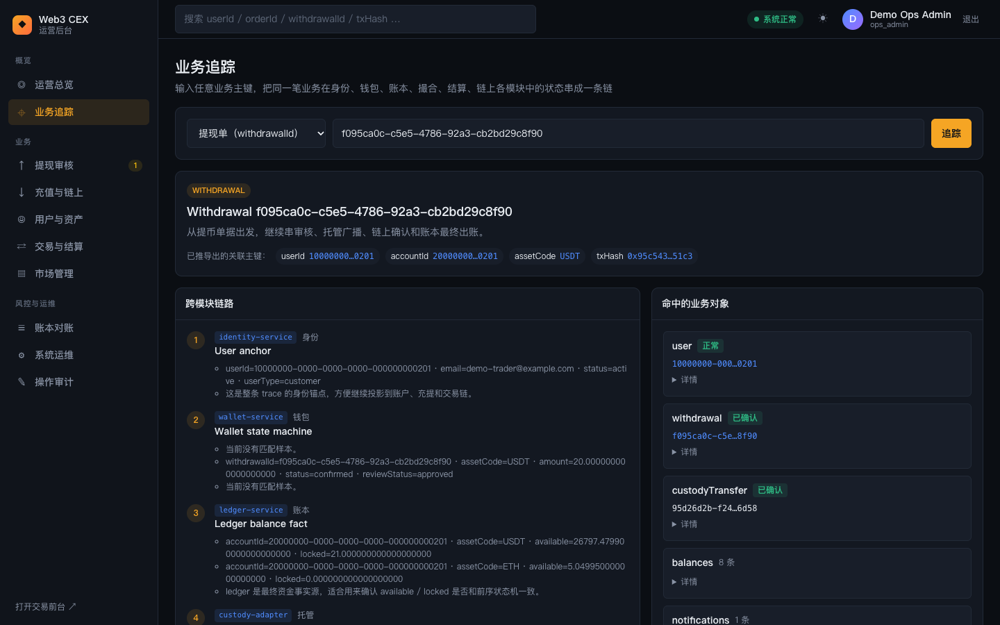
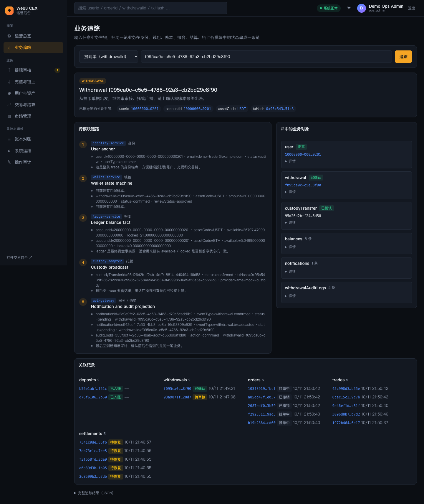

# 10 端到端场景

本章把前面各章的功能串成五条完整业务线：每条都从 `trader-web` 的用户操作开始，到 `ops-console` 的审核、观察或排查结束，帮助你把"页面上点了什么"和"交易所内部发生了什么"对上。

**开始之前**

- 全栈已启动并完成演示数据初始化，启动方法见 [01 · 快速开始](01-getting-started.md)。
- 前台：<http://127.0.0.1:3013>，用登录页的「⚡ 一键登录演示账户」（`demo-trader@example.com`）。
- 后台：<http://127.0.0.1:3006>，用 `ops-admin@example.com` / `OpsAdminPass123!` 登录，动态码在仓库根目录执行 `pnpm -s ops:totp` 获取。场景 4 还需要复核人账户 `ops-reviewer@example.com` / `OpsReviewerPass123!`，动态码用 `pnpm -s ops:totp reviewer`。动态码 30 秒滚动，同一个码只能用一次。
- 建议全程打开前台顶栏的「🎓 学习模式」，右侧抽屉会按时间顺序列出请求经过的服务（见 [02 · 首页与学习辅助](02-trader-home-and-learning.md)）。前台左下角「🧭 场景导览」内置了场景 1～3 的引导步骤。
- 做市机器人在持续挂单和成交，盘口价格会小幅波动，下单时以当前订单簿为准。

---

## 场景 1：第一笔交易

目标：下一笔立即成交的买单，看资金冻结 → 撮合 → 结算 → 记账的完整过程。

### 操作步骤

1. 在前台一键登录演示账户，点顶栏「交易」，进入 `#/trade/ETH-USDT`。订单簿在持续变化，说明做市在运行。
2. 在订单簿卖盘（红色）点最低的一档价格，价格会自动填入下单面板的「价格」。
3. 「数量」填 `0.05`（或更小，最小 0.001 ETH），点「买入 ETH」。因为价格不低于卖一价，订单会立即与卖单撮合。
4. 学习模式抽屉依次出现网关、风控、冻结、撮合等事件。
5. 切到页面下方的「成交记录」页签：出现一笔成交，角色为「Taker」（吃单方），手续费以 ETH 扣除。
6. 点这笔成交的「T 型账户」，弹窗按账户角色展开借贷分录，右上角显示「✓ 借贷平衡」。

   

7. 打开「资产」→「资金流水 / 对账单」：能看到这笔订单的「下单冻结」「委托解冻」，以及成交的「成交支出」（USDT）和「成交收入」（ETH，带手续费）。
8. 切到后台，进入「交易与结算」，选 `ETH/USDT`，在「成交」和「结算」页签找到同一笔成交；结算记录中卖方费（quote）和买方费（base）分列，状态为「已结算」。

   

9. 把成交 ID 粘贴到后台顶栏的搜索框（业务追踪），订单、成交、结算和账本分录会串成一条链。

### 涉及的服务

`api-gateway` → `order-service` → `risk-service`（余额、价格偏离、最小数量）→ `ledger-service`（冻结）→ `matching-engine`（撮合）→ `settlement-service`（结算、手续费）→ `ledger-service`（分录）；行情推送来自 `market-data-service`。

### 延伸学习

[../../learning/06-order-matching.md](../../learning/06-order-matching.md)、[../../learning/07-clearing-settlement-fees.md](../../learning/07-clearing-settlement-fees.md)、[../../learning/05-ledger.md](../../learning/05-ledger.md)。前后台界面细节见 [03 · 交易](03-trader-trading.md) 和 [08 · 交易与账本运营](08-ops-trading-and-ledger.md)。

---

## 场景 2：充值到账

目标：用测试水龙头模拟一笔链上转账，看确认数涨到 12 后入账。

### 操作步骤

1. 前台点「资产」，右侧面板选「充值」，币种选 `ETH`。如果显示「生成 ETH 充值地址」，先点它生成地址。
2. 在「🚰 测试水龙头」选 `1 ETH`，点「模拟转入」。学习模式抽屉出现 `demo-simulator`、`blockchain-indexer` 的事件。
3. 观察水龙头回执的确认数从 `0/12` 逐块增加，同时底部「充值记录」里这笔充值的进度从「链上检测」走到「区块确认」。模拟链每 1.5 秒出一个块，大约 20 秒到 12 个确认。
4. 达到 12 个确认后，回执变成「已确认」，充值记录状态变为「已入账」，`ETH` 可用余额增加；铃铛出现到账通知并弹出 Toast。
5. 打开「资金流水 / 对账单」，出现一条「充值入账」。
6. 切到后台「充值与链上」：「充值记录」里能找到这笔充值；在确认过程中，「待确认观察」里也能看到它（见 [07 · 资金运营](07-ops-funds.md)）。

### 涉及的服务

`demo-simulator`（写入转账、出块）→ `blockchain-indexer`（累计确认数）→ `wallet-service`（充值单状态机）→ `ledger-service`（入账）→ 私有 WebSocket 推送给前台。

### 延伸学习

[../../learning/04-wallet-custody.md](../../learning/04-wallet-custody.md)。为什么要等 12 个确认：故障实验室的「链重组」实验能看到确认数回落再重新累积，见 [../fault-lab.md](../fault-lab.md)。

---

## 场景 3：提现与审核 → 广播 → 确认

目标：用户提交提现，资金被冻结；运营人工审核后由托管服务广播，模拟链确认后完成出账。

### 操作步骤

**前台：提交提现**

1. 前台「资产」→「提现」，币种选 `USDT`（或 `ETH`），地址选地址簿中的「Demo Safe Address」，提示「地址簿：Demo Safe Address · 白名单」。
2. 数量填 `20`（演示账户为「未认证」，USDT 单笔不超过 1,000、ETH 单笔不超过 0.5）。表单显示网络手续费 1 USDT、账本冻结 21 USDT、未认证等级的限额。
3. 点「预校验」，看到「校验通过：将冻结 21 USDT（金额 + 手续费）」后点「提交提现」。
4. 「提现记录」出现新记录，进度停在「已申请」；资产表中 `USDT` 的「冻结」增加 21。界面见 [04 · 资产](04-trader-assets.md) 的第 3 节。

**后台：审核并广播**

5. 在后台左侧导航点「提现审核」（菜单上的数字是待审核笔数）。「待审核」页签列出这笔提现，「规则校验」列显示 2FA、白名单、KYC 等级和当日已用额度。
6. 点这一行的「批准」，在弹窗「批准 1 笔提现」里填写审核备注，点「确认批准并广播」。弹窗说明：批准后 `wallet-service` 立即调用 `custody-adapter` 签名并广播交易，链上确认后从账本最终扣除冻结资金，此操作不可撤回。

   

7. 批准后提示「提现已批准」，并说明「custody-adapter 已广播，模拟链确认 12 个区块后完成」。如需拒绝，点「拒绝」并填写原因，冻结的金额和手续费会退回用户可用余额。

**等待链上确认**

8. 约 20 秒后，前台「提现记录」推进到「已完成」，铃铛收到广播和确认通知；冻结的 21 USDT 被最终扣除，「资金流水」出现「提现出账」。
9. 后台「提现审核」→「全部提现」页签可以按状态、币种、用户筛选，这笔提现的状态显示为「已确认」。

   

**用业务追踪串起整条链**

10. 点提现单号，或在顶栏搜索框粘贴 `withdrawalId`，进入「业务追踪」。页面顶部列出推导出的关联主键（userId、accountId、assetCode、txHash），「跨模块链路」按顺序展示 `identity-service`（用户锚点）→ `wallet-service`（提现状态机，`status=confirmed`、`reviewStatus=approved`）→ `ledger-service`（余额事实）→ `custody-adapter`（托管广播，带 txHash）→ `api-gateway`（通知与审计投影）。右侧「命中的业务对象」可展开查看提现、托管转账、余额、通知和提现审计日志的详情。

    

    整页还包括底部的「关联记录」（同一用户的充值、提现、订单、成交、结算）和「完整追踪结果（JSON）」：

    

11. 在「操作审计」里能查到这次 `withdrawal.approve` 操作及操作人（见 [09 · 系统运维与实验室](09-ops-system-and-lab.md)）。

### 涉及的服务

提交：`api-gateway` → `wallet-service`（白名单、限额、2FA、冷却期）→ `ledger-service`（冻结）。审核：`ops-console` → `wallet-service` → `custody-adapter`（签名、广播）。确认：`demo-simulator` → `blockchain-indexer` → `wallet-service` → `ledger-service`（扣除冻结）→ 通知推送。

### 延伸学习

[../../learning/04-wallet-custody.md](../../learning/04-wallet-custody.md)、[../../learning/09-risk-control.md](../../learning/09-risk-control.md)。后台界面细节见 [06 · 总览与业务追踪](06-ops-overview-and-trace.md) 和 [07 · 资金运营](07-ops-funds.md)。

---

## 场景 4：大额提现双人复核

目标：金额超过大额阈值的提现，必须由两名不同的运营人员先后批准才会广播。

### 规则

- 阈值按币种配置，**严格大于**阈值才触发：USDT 5000、USDC 5000、ETH 2、BTC 0.1、SOL 50（`wallet-service` 的 `WITHDRAWAL_DUAL_APPROVAL_THRESHOLD_BY_ASSET`）。
- 审核策略在用户提交提现时就记录在提现单上，之后改阈值不影响已提交的单据。
- 第一次批准只记录进度，提现保持审核中（`reviewStatus=pending_second_approval`），不会广播；同一个运营人员不能批准两次，第二次批准必须来自另一个人。
- 演示账户默认「未认证」，USDT 单笔限额只有 1,000，所以要先把 KYC 提到 L1（单笔 10,000）才能提交超过 5000 的提现。

### 操作步骤

1. **提升 KYC 等级**：前台「账户」→「身份认证与提现限额」，申请等级选「L1 基础认证」，填虚构的姓名和证件号，点「提交认证申请」，面板显示「等待运营审核」（见 [05 · 账户与安全](05-trader-account.md)）。
2. 后台用 `ops-admin` 登录，进入「用户与资产」→「KYC 审核」，在这条申请上点「批准 L1」并确认。

   

3. 回到前台刷新账户页，徽标变为「L1 基础认证」，USDT 单笔限额变为 10,000。
4. **提交大额提现**：前台「资产」→「提现」，币种 `USDT`，地址选「Demo Safe Address」，数量填 `6000`。表单汇总里多出一行「审核：大额提现，需两名运营人员复核」。预校验通过后点「提交提现」。
5. **第一位批准**：后台「提现审核」→「待审核」，这一行的「规则校验」带「双人复核」标签，状态旁显示「0/2 已批准」。点「批准」并确认。提示「大额提现：已记录第 1 位批准，需另一名运营人员复核后才会广播」，状态旁变为「1/2 已批准」，提现不会广播。
6. 此时 `ops-admin` 再看这一行，按钮变为「复核批准」但不可点，悬停提示「你已批准过，需要另一名运营人员复核」。即使绕过界面直接调用接口，`wallet-service` 也会拒绝同一人的第二次批准。
7. **第二位复核**：点右上角「退出」，用 `ops-reviewer@example.com` / `OpsReviewerPass123!` 登录（动态码用 `pnpm -s ops:totp reviewer`）。复核人角色 `ops_reviewer` 只能看总览、审核提现和看审计。
8. 进入「提现审核」，点这一行的「复核批准」（或打开详情抽屉点「复核批准并广播」）并确认。状态变为「2/2 已批准」，随后进入广播和链上确认，与场景 3 的第 8 步相同。
9. 点提现单打开「提现详情」抽屉：「双人复核」区块说明金额超过 5000 USDT 需要两名不同运营人员批准，并列出「第 1 位批准」「第 2 位批准」的时间、操作人和备注；「审计轨迹」里能看到 `first_approved` 和 `approved` 两次状态迁移。

本场景的截图可以复用场景 3 的提现审核与业务追踪截图：界面相同，只是多了「双人复核」标签和「x/2 已批准」进度。

### 涉及的服务

`identity-service`（KYC 等级）→ `wallet-service`（按等级算限额；提交时按阈值确定 `requiredApprovals`；审核时校验两名不同的批准人）→ `custody-adapter`（第二次批准后才广播）。每次批准都写入 `ops-console` 的操作审计和 `wallet-service` 的提现审计轨迹。

### 延伸学习

[../../learning/09-risk-control.md](../../learning/09-risk-control.md)、[../../learning/04-wallet-custody.md](../../learning/04-wallet-custody.md)、[../../learning/03-account-identity-security.md](../../learning/03-account-identity-security.md)、[../security.md](../security.md)。

---

## 场景 5：排查一次结算异常

目标：用故障实验室制造"成交了但没结算"，观察现象、定位原因并恢复。

### 操作步骤

1. 后台进入「系统运维」→「实验室」页签，在「① 暂停结算消费者」卡片点「暂停结算消费（2 分钟）」。卡片显示消费者已暂停和倒计时。实验室界面见 [09 · 系统运维与实验室](09-ops-system-and-lab.md)。
2. 回到前台交易页，按场景 1 的方法下一笔立即成交的买单。成交照常出现，但打开它的「T 型账户」会显示「结算中」或「这笔成交还没有入账」，相关冻结资金也没有释放。
3. 回到实验室：「已成交未结算」数字随做市成交持续增长。
4. 切到「系统运维」→「事件总线」页签：结算消费者的 checkpoint 滞后在增长。此时点「驱动结算消费一轮」会被拒绝（`409 SETTLEMENT_EVENT_SUBSCRIBER_PAUSED`），因为消费者处于暂停状态。
5. 在实验室点「恢复消费」，或等 2 分钟到期自动恢复。消费者从 checkpoint 继续读取 Redis Stream，补齐积压的成交，滞后归零。
6. 回到前台重新打开那笔成交的「T 型账户」，显示「✓ 借贷平衡」，冻结资金已释放。
7. 后台「账本对账」点「重新对账」，结果全部一致。

结算消费者暂停期间撮合照常进行：撮合和结算是两个独立阶段，通过事件流异步衔接，所以一个阶段出问题不会拖垮另一个阶段，但会产生积压。

如果实验中途出现意外，在实验室点「一键恢复全部」即可清除所有实验故障，不需要重置演示数据。其他故障实验（链重组、托管通道故障等）见 [../fault-lab.md](../fault-lab.md)。

### 涉及的服务

`order-service`（把成交写入 Redis Stream `trade.executed`）→ `settlement-service`（按 checkpoint 消费并结算）→ `ledger-service`（分录与对账）；`ops-console` 的实验室通过 `settlement-service` 的接口暂停和恢复消费者。

### 延伸学习

[../../learning/07-clearing-settlement-fees.md](../../learning/07-clearing-settlement-fees.md)、[../../learning/13-reliability-security-incidents.md](../../learning/13-reliability-security-incidents.md)、[../../learning/backstage/B04-reconciliation.md](../../learning/backstage/B04-reconciliation.md)、[../fault-lab.md](../fault-lab.md)、[../demo-walkthrough.md](../demo-walkthrough.md)。

---

上一篇：[09 系统运维与故障实验室](09-ops-system-and-lab.md) ｜ 下一篇：[返回手册目录](README.md)
