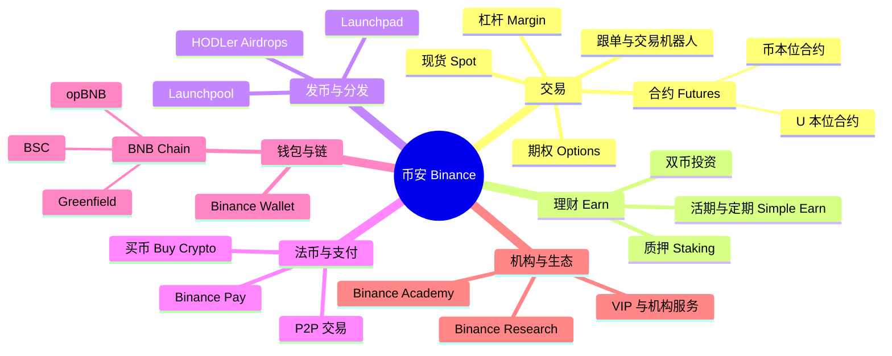
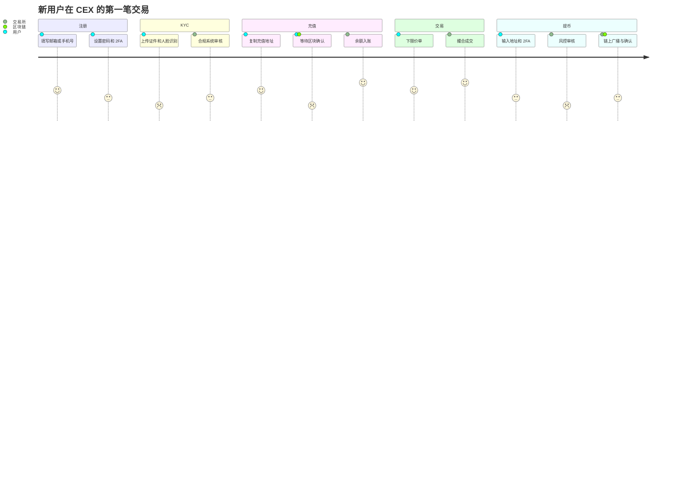
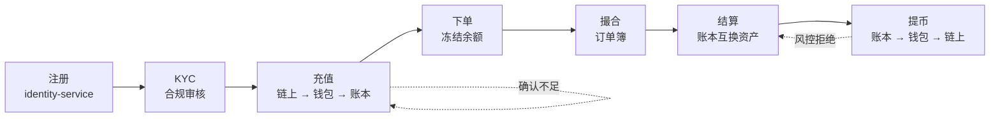
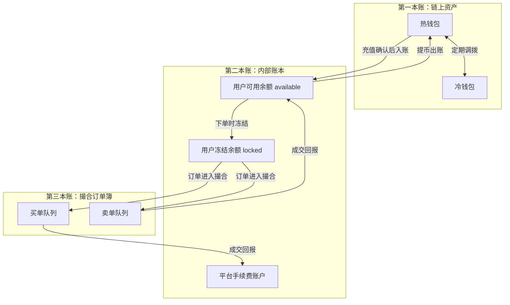

# 01 什么是 CEX：托管 + 记账 + 撮合

> 学习目标：读完本章，你能——
> 1. 用一句话说清中心化交易所（CEX）做什么，并和银行、券商、DEX 做对比。
> 2. 画出币安的业务版图和一个新用户从注册到提币的完整旅程。
> 3. 区分交易所的"三本账"：链上资产、内部账本、撮合订单簿。
>
> 前置章节：无（本章是系列入口）
> 交互实验：[architecture-explorer.html](interactive/architecture-explorer.html)、[deposit-withdraw-sim.html](interactive/deposit-withdraw-sim.html)

---

## 1. 一句话理解

**CEX 替你保管资产，在自己的账本上记账，并在内存里撮合买卖双方的订单。**

中心化交易所（Centralized Exchange，CEX）：由一家公司运营、由这家公司托管用户资产的加密资产交易平台。币安（Binance）、Coinbase、OKX 都是 CEX。

> 🎯 打个比方：CEX 像一家赌场。
> 你进门时把现金交给柜台，柜台给你等值的**筹码**。在赌场里，你和别人交换筹码，钱不离开金库。
> 你离开时把筹码交回柜台，柜台从金库取现金给你。
> - 柜台 = 充值和提币（钱包系统）
> - 筹码余额 = 内部账本（Ledger）
> - 牌桌 = 撮合引擎（Matching Engine）
> - 金库 = 热钱包和冷钱包
>
> 比喻的局限：赌场的输赢由庄家决定；交易所撮合的是**用户和用户之间**的买卖，交易所只收手续费（做市和自营是另一个话题，见 [12-business-model.md](12-business-model.md)）。

这个比喻点出了 CEX 最重要的事实：**你在交易所里买卖时，链上没有发生任何转账。** 只有交易所的账本变了。

---

## 2. 业务视角：它解决什么问题

### 2.1 没有交易所时，用户会遇到什么

假设你有 1 BTC，想换成 USDT。没有交易所时，你要做这几步：

1. 找到一个想卖 USDT、买 BTC 的人。
2. 和对方谈价格。
3. 决定谁先转账。
4. 等待链上确认。
5. 承担对方收钱不给货的风险。

CEX 用三件事解决这些问题：

| 问题 | CEX 的解法 | 对应的系统能力 |
|---|---|---|
| 找不到对手方 | 把所有人的订单集中到一个订单簿 | 撮合 |
| 谁先转账、对方赖账 | 交易所先收下双方资产，成交后在账本上互换 | 托管 + 记账 |
| 链上转账慢、手续费高 | 交易在内部账本完成，不上链 | 记账 |
| 价格不透明 | 公开盘口深度和成交记录 | 行情 |

### 2.2 和银行、券商、DEX 对比

| 维度 | 银行 | 券商（股票） | CEX（币安） | DEX（例如 Uniswap） |
|---|---|---|---|---|
| 谁保管资产 | 银行 | 第三方存管（例如中登、托管行） | 交易所自己（热钱包 + 冷钱包） | 用户自己的钱包 |
| 账本在哪里 | 银行核心系统 | 券商柜台 + 登记结算机构 | 交易所内部账本 | 区块链（智能合约） |
| 撮合在哪里 | 不撮合 | 证券交易所（券商只转发订单） | 交易所自己撮合 | 链上合约（AMM 或订单簿） |
| 结算速度 | T+0 到 T+1 | A 股 T+1，美股 T+1 | 成交即结算（毫秒级） | 一个区块（秒级） |
| 开户要求 | 实名 | 实名 + 适当性 | 实名 KYC（多数地区） | 无需开户 |
| 交易时间 | 工作日 | 交易日的固定时段 | 7×24 小时 | 7×24 小时 |
| 用户保护 | 存款保险 | 投资者保护基金 | 自有保险基金（例如币安 SAFU）+ 储备证明 | 无，代码即规则 |
| 主要风险 | 银行倒闭 | 券商挪用 | 交易所挪用、被盗、跑路 | 合约漏洞、私钥丢失 |

**读表要点：**

- 券商把"托管、记账、撮合"拆给三方。CEX 把三件事放在**同一家公司**里。这是 CEX 高效的原因，也是 CEX 最大的风险来源。
- DEX 把三件事交给区块链。DEX 的透明度高，但速度和体验受链的限制。

> ⚠️ 警告：CEX 上的余额是交易所对你的**负债**，不是你链上的资产。如果交易所挪用资产，账本上的数字不能兑现。2022 年 FTX 倒闭就是这种情况（公开报道和美国法院文件）。储备证明见 [proof-of-reserves.html](interactive/proof-of-reserves.html)。

---

## 3. 系统视角：它如何实现

### 3.1 币安业务版图

币安的产品很多，但都建在同一个底座上：账户、钱包、账本、撮合。

**读图要点：**

- 所有分支最终都落到同一个内部账本上。理财、合约、杠杆只是账本里的不同"账户类型"。
- "钱包与链"分支连接链上世界，其他分支几乎都在链下完成。
- 产品名称以币安官网为准。币安会上线和下线产品（截至 2026 年公开资料）。详见 [11-products-ecosystem.md](11-products-ecosystem.md)。

### 3.2 用户旅程：注册到提币

一个新用户的典型旅程有 5 个阶段。

**读图要点：**

- 分数代表用户体验（1 = 痛苦，5 = 愉快）。KYC 和等待区块确认是体验最差的两步。
- 只有"充值"和"提币"两步涉及区块链。交易一步完全在交易所内部。
- 提币要经过风控审核。如果风控发现异常，提币会被延迟或拒绝。

同一段旅程，从系统的角度看是这样：

**读图要点：**

- 资金从左边的链上进入，在中间的账本里流转，从右边回到链上。
- 虚线是两个常见的"卡住"点：充值确认数不足，提币被风控拒绝。
- 每一步对应后续章节：账户（03）、钱包（04）、账本（05）、撮合（06）、结算（07）。

### 3.3 交易所的"三本账"

理解 CEX 的关键是：**交易所同时维护三本账**。三本账记录不同的东西，更新速度不同。

| 账本 | 记录什么 | 谁维护 | 更新频率 | 例子 |
|---|---|---|---|---|
| 链上资产 | 交易所地址上真实持有的币 | 区块链 | 每次充值、提币、归集 | 热钱包地址持有 5,000 ETH |
| 内部账本 | 每个用户在交易所的余额 | 账本服务（Ledger） | 每次充值入账、成交、提币 | 用户 A：可用 2 ETH，冻结 1 ETH |
| 撮合订单簿 | 当前还没成交的挂单 | 撮合引擎（Matching Engine） | 每次下单、撤单、成交 | ETH/USDT 买一 3,000，数量 1.5 |

**读图要点：**

- 订单簿里的每一笔挂单，在账本里都有对应的冻结余额。如果两者对不上，交易所会"超卖"。
- 账本里所有用户余额之和，应该小于或等于链上资产。这个关系就是"储备证明"要证明的事。
- 三本账之间靠事件同步。同步延迟时，用户会看到"已成交但余额没变"。

> 💡 注意：你在 App 上看到的"余额"来自第二本账，不是链上。链上浏览器上查不到你在交易所的个人余额。

### 3.4 为什么说 CEX 的本质是"托管 + 记账 + 撮合"

把所有产品拆开，CEX 只做三件事：

1. **托管（Custody）**：交易所保管用户的私钥和资产。用户信任交易所，换来速度和便利。
2. **记账（Ledger）**：交易所用双分录账本记录每个用户的余额变化。每一笔借方都有一笔贷方。
3. **撮合（Matching）**：交易所按"价格优先、时间优先"把买单和卖单配对。

其他产品都是这三件事的组合：

| 产品 | 托管 | 记账 | 撮合 |
|---|---|---|---|
| 现货 | 是 | 余额互换 | 是 |
| 合约 | 是（保证金） | 保证金 + 未实现盈亏 | 是 |
| 理财 Earn | 是 | 本金锁定 + 利息发放 | 否 |
| Launchpool | 是 | 质押锁定 + 新币发放 | 否 |
| P2P | 是（担保冻结） | 冻结与划转 | 否（用户自选广告） |
| 法币买币 | 是 | 入账 | 否（由合作方报价） |

---

## 4. 币安怎么做（公开事实 + 业界做法）

### 4.1 公开事实

- **规模**：币安在 2025 年 12 月宣布注册用户超过 3 亿（公开报道，截至 2025 年公开资料）。
- **SAFU 基金**：币安在 2018 年设立"用户安全资产基金"（SAFU）。它用于在极端情况下赔付用户（币安公开公告）。
- **储备证明**：币安在 2022 年 11 月 FTX 事件后发布基于默克尔树（Merkle Tree）的储备证明，后来加入零知识证明（币安公开公告）。
- **2019 年被盗事件**：2019 年 5 月，黑客从币安热钱包盗走约 7,000 BTC。币安用 SAFU 基金覆盖了损失（币安公开公告）。

### 4.2 业界通用做法

以下是 CEX 的业界通用做法。币安的内部实现没有完整公开。

- 大部分资产放在**冷钱包**。热钱包只保留满足日常提币的资产。
- 每个用户分配独立充值地址。交易所定期把小额资产**归集**到热钱包。
- 账本和撮合**分开部署**。撮合追求速度，账本追求正确。
- 每天做一次或多次**对账**：链上资产 vs 账本总额，账本冻结 vs 订单簿挂单。

---

## 5. 故障与边界：哪里会出错，局限在哪

| 风险 | 发生在哪本账 | 用户看到什么 | 后果 |
|---|---|---|---|
| 热钱包私钥泄露 | 链上资产 | 提币暂停 | 资产被盗，需要保险基金赔付 |
| 账本 bug 多记余额 | 内部账本 | 余额异常增加 | 账实不符，交易所亏损 |
| 撮合引擎宕机 | 订单簿 | 下单失败、挂单无法撤销 | 交易暂停，可能需要回滚 |
| 三本账同步延迟 | 账本 ↔ 订单簿 | 成交后余额几秒不变 | 体验差，但最终一致 |
| 交易所挪用资产 | 链上 < 账本 | 无法提币 | 用户无法全额兑付（FTX 2022） |

> ⚠️ 警告：CEX 的核心局限是**信任**。用户无法实时验证交易所是否真的持有全部资产。储备证明只能证明某一时刻的状态，不能证明负债完整。

> 💡 注意：充值确认数、提币手续费、最小提币额都是可变参数。去 [deposit-withdraw-sim.html](interactive/deposit-withdraw-sim.html) 调整参数，观察入账时间和风险的变化。

---

## 6. 本仓库对照（CEX Demo）

本仓库是一个教学用的最小 CEX。三件事对应的服务如下：

| CEX 本质 | 本仓库服务 | 目录 |
|---|---|---|
| 托管 | 充值地址、提币单据 | `services/wallet-service` |
| 托管 | 链上扫描、确认数推进 | `services/blockchain-indexer` |
| 托管 | 对接托管商 / 热钱包广播 | `services/custody-adapter` |
| 记账 | 双分录账本、冻结、解冻 | `services/ledger-service` |
| 记账 | 成交后的资金结算 | `services/settlement-service` |
| 撮合 | Rust 内存订单簿 | `engines/matching-engine` |
| 撮合 | 订单生命周期 | `services/order-service` |
| 账户 | 注册、登录、2FA、API Key | `services/identity-service` |

本仓库只做现货和加密资产，不做法币、合约和理财（见根目录 `README.zh-CN.md` 的"Demo 覆盖的能力"）。

---

## 7. 术语表

| 术语 | 英文 | 定义 |
|---|---|---|
| 中心化交易所 | CEX, Centralized Exchange | 由公司托管资产并撮合交易的平台 |
| 去中心化交易所 | DEX, Decentralized Exchange | 由智能合约完成交易，用户自己保管资产 |
| 托管 | Custody | 交易所代用户保管私钥和资产 |
| 内部账本 | Ledger | 记录每个用户余额的系统，交易所的资金事实源 |
| 订单簿 | Order Book | 按价格排列的未成交买单和卖单 |
| 撮合 | Matching | 把价格相交的买单和卖单配对成交 |
| 冻结 | Lock / Freeze | 把可用余额暂时锁住，用于挂单或提币 |
| 了解你的客户 | KYC, Know Your Customer | 验证用户真实身份的合规流程 |
| 热钱包 | Hot Wallet | 私钥在线、用于日常提币的钱包 |
| 冷钱包 | Cold Wallet | 私钥离线、用于长期存储的钱包 |
| 储备证明 | PoR, Proof of Reserves | 证明交易所持有的资产不少于用户余额 |

---

## 8. 思考题

1. 你在币安把 1 BTC 卖给另一个用户。比特币区块链上会出现一笔交易吗？为什么？
2. 如果账本里所有用户的 USDT 余额之和是 100 万，而链上地址只有 80 万 USDT，会发生什么？打开 [proof-of-reserves.html](interactive/proof-of-reserves.html) 验证你的想法。
3. 打开 [architecture-explorer.html](interactive/architecture-explorer.html)，运行"下单成交"场景。数一数这一笔交易修改了几本账。

下一章：[02-system-architecture.md](02-system-architecture.md) —— 把三件事拆成十几个服务。
