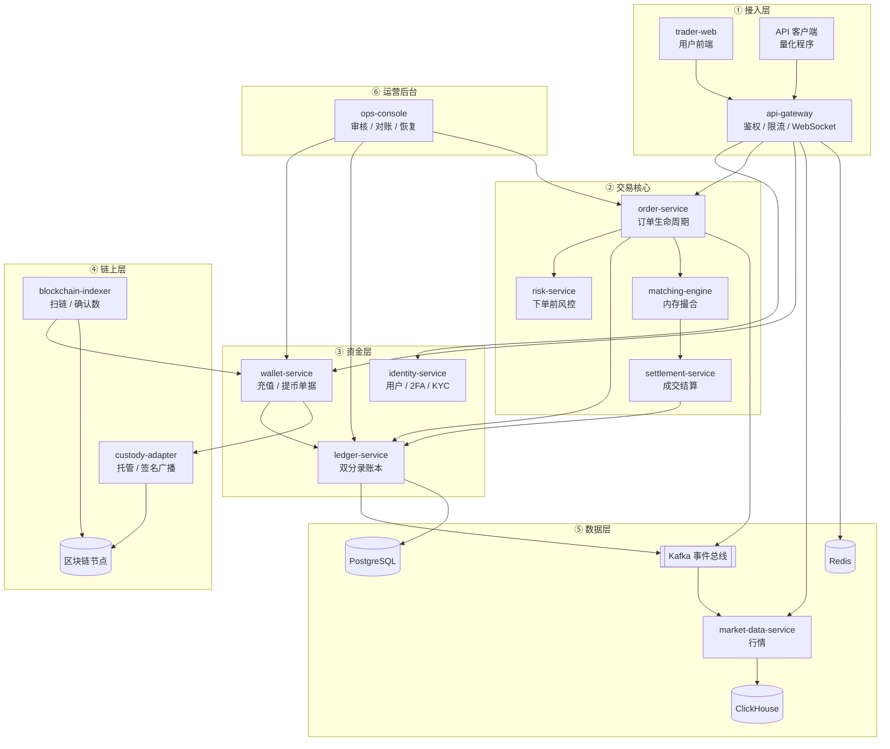
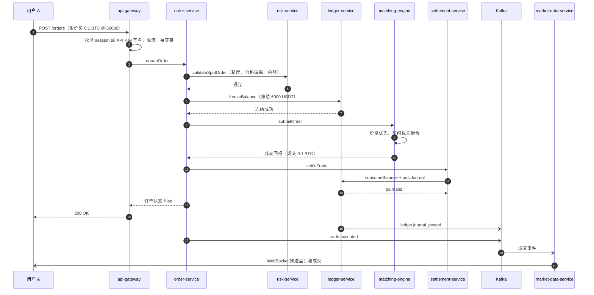
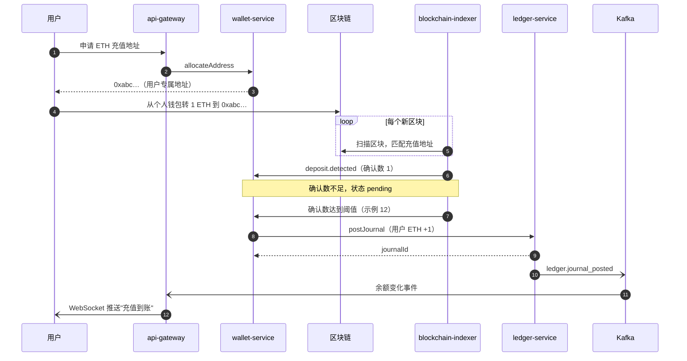
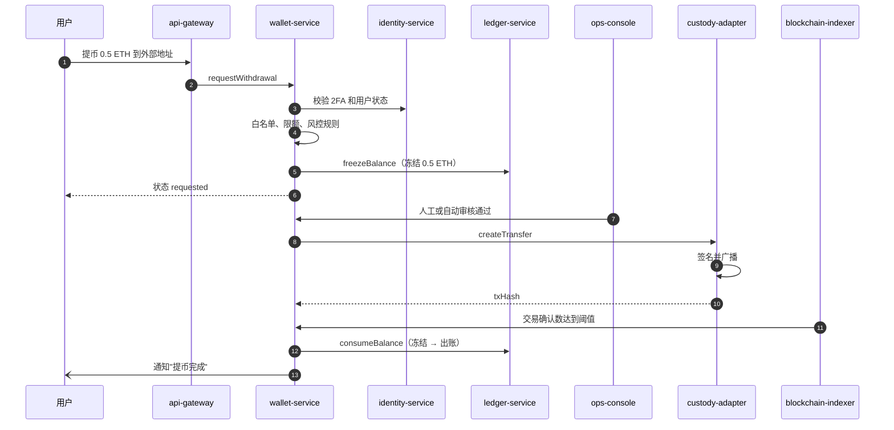
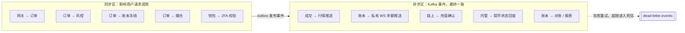

# 02 系统总架构：一家交易所由哪些系统组成

> 学习目标：读完本章，你能——
> 1. 画出 CEX 的六层架构，并说出每层的性能和一致性要求。
> 2. 走完一笔现货下单、一笔充值、一笔提币的完整调用链。
> 3. 指出架构中的单点、热点和同步/异步边界。
>
> 前置章节：[01-what-is-cex.md](01-what-is-cex.md)
> 交互实验：[architecture-explorer.html](interactive/architecture-explorer.html)

---

## 1. 一句话理解

**交易所不是一个大程序，而是一组围绕"资金正确性"拆开的服务。** 撮合追求快，账本追求对，钱包追求安全。三个目标互相冲突，所以必须拆开。

> 🎯 打个比方：交易所像一家大型银行网点。
> - 门口的**保安和叫号机**是接入层（api-gateway）：检查身份，控制人流。
> - **柜员**是订单服务：接收你的申请，检查材料。
> - **风控主管**在柜员旁边：金额太大或行为可疑，他就喊停。
> - **会计室**是账本：每一笔钱的进出都写在总账上，用两支笔（借方和贷方）同时记。
> - **交易大厅的拍卖师**是撮合引擎：他只喊价、配对，不碰钱。
> - **金库和押运车**是钱包和链上层：真钱从这里进出。
> - **后台办公室**是运营后台：审核大额提币，处理投诉。
>
> 拍卖师喊得再快，也要等会计室记完账，钱才算真正换了手。

---

## 2. 业务视角：为什么要拆这么多服务

一个只有几百用户的交易所，可以用一个程序加一个数据库实现。规模变大后，三个矛盾会出现：

| 矛盾 | 说明 | 拆分结果 |
|---|---|---|
| 速度 vs 正确 | 撮合要在微秒内完成；账本写入要等数据库事务提交 | 撮合引擎和账本分开 |
| 在线 vs 离线 | 链上确认要几秒到几十分钟；用户下单要毫秒级响应 | 链上层全部异步 |
| 用户 vs 员工 | 用户接口要高并发；运营后台要强权限和审计 | 用户网关和运营后台分开 |

> 💡 注意：拆分的代价是**分布式一致性**。一笔交易跨 5 个服务时，任何一个服务失败，都需要补偿。本章第 5 节讨论这个代价。

---

## 3. 系统视角：分层架构和调用链

### 3.1 六层架构

**读图要点：**

- 数据从上方用户进入，经过交易核心，落到资金层。链上层只和资金层的钱包服务打交道。
- 撮合引擎（ME）不直接写账本。它把成交结果交给结算服务（SET），结算服务再写账本。
- 账本（LED）是全图唯一的资金事实源。其他服务的余额都是缓存或副本。
- 局限：这张图省略了监控、配置中心、服务发现。真实交易所还有合规、客服、清算对账等十几个系统。

### 3.2 每层的性能与一致性要求

| 层 | 延迟目标（示例） | 吞吐要求 | 一致性要求 | 可用性要求 | 失败时用户看到什么 |
|---|---|---|---|---|---|
| ① 接入层 | < 10 ms | 极高（行情连接数百万） | 无状态 | 极高，多地域部署 | 连接失败、429 限流 |
| ② 交易核心·撮合 | < 1 ms（微秒级） | 极高 | 确定性：同样输入必须同样输出 | 高，主备切换 | 下单被拒、无法撤单 |
| ② 交易核心·订单/风控 | < 10 ms | 高 | 强一致（订单状态） | 高 | 下单被拒 |
| ③ 资金层·账本 | < 50 ms | 中高 | **强一致 + 可审计** | 高 | 余额延迟更新 |
| ③ 资金层·钱包 | 秒级 | 中 | 强一致 + 幂等 | 中 | 充值延迟到账 |
| ④ 链上层 | 秒到小时 | 低 | 最终一致（等确认数） | 中，可暂停 | 提币暂停 |
| ⑤ 数据层·行情 | < 100 ms | 极高（广播） | 最终一致 | 高 | K 线断档 |
| ⑥ 运营后台 | 秒级 | 低 | 强一致 + 审计日志 | 中 | 审核延迟 |

**读表要点：** 越靠近用户的层越追求快；越靠近资金的层越追求对。链上层最慢，但它可以暂停，不会拖垮交易。

### 3.3 一笔现货下单的完整调用链

场景：用户 A 用 USDT 买 0.1 BTC，限价 60,000 USDT（示例）。

**读图要点：**

- 实线箭头（第 1–15 步）是**同步**调用，直接决定用户请求的成败。
- 虚线箭头（`-)`）是**异步**事件，走 Kafka。行情推送慢几百毫秒，不影响资金正确性。
- 最危险的一步是"冻结成功之后、撮合之前"。如果撮合引擎此时宕机，资金已冻结但订单没进簿，系统必须解冻。
- 本仓库是同步调用结算服务。大型交易所的业界通用做法是撮合把成交写入日志流，结算服务异步消费。

### 3.4 充值调用链

**读图要点：**

- 充值由**链上事件**触发，不是用户请求触发。所以整条链是异步的。
- 确认数阈值防止链重组（Reorg）。如果入账后区块被回滚，交易所会亏损。
- 入账必须幂等：同一个 txHash 扫描两次，只能入账一次。详见 [04-wallet-custody.md](04-wallet-custody.md)。

### 3.5 提币调用链

**读图要点：**

- 提币先**冻结**、后**出账**。审核拒绝时，系统执行"解冻"而不是"出账"。
- 签名私钥在托管层（custody-adapter 或外部 MPC），钱包服务不接触私钥。
- 如果广播成功但索引器宕机，提币会停在"已广播"状态。资金已经离开热钱包，但账本还没出账。对账任务负责发现这种情况。

### 3.6 同步 vs 异步边界

**读图要点：**

- 判断标准：**这一步失败时，用户的请求是否应该失败？** 是，就放同步区；否，就放异步区。
- 同步区越长，下单延迟越高，故障面越大。所以行情、通知、报表全部放在异步区。
- 异步区的代价是延迟。Kafka 堆积时，用户会看到"已成交，余额没变"。
- Outbox 模式：服务先把事件写进自己的数据库表，再由后台任务发到 Kafka。这样"写账"和"发事件"不会一个成功一个失败。

---

## 4. 币安怎么做（公开事实 + 业界做法）

### 4.1 公开事实

- **撮合性能**：币安上线时宣称撮合引擎能处理每秒约 140 万笔订单（币安早期公开宣传，多家媒体转述）。
- **撮合升级**：2020 年币安完成一次大规模撮合引擎升级。币安表示新引擎用新的编程语言重写，性能提升约 10 倍（Decrypt 等媒体报道，2020 年）。
- **多地域**：币安在多个司法辖区持牌或注册，并为部分地区提供独立站点（例如 Binance.US 是独立公司）（公开资料）。

### 4.2 业界通用做法（币安未完整公开）

| 主题 | 业界通用做法 |
|---|---|
| 撮合部署 | 每个交易对固定到一个撮合线程；按交易对分片到多台机器 |
| 撮合高可用 | 主备热备。所有输入写入顺序日志，备机重放日志保持同步 |
| 网络 | 撮合机房靠近云厂商核心区域；做市商可申请托管或专线 |
| 账本 | 按用户 ID 分库分表；热点账户（手续费账户）拆成多个子账户 |
| 行情 | 多级扇出：撮合 → 行情服务 → 边缘节点 → 用户 WebSocket |
| 接入 | 全球 CDN 和多地域网关，就近接入 |

> 💡 注意：网上流传的"币安架构图"大多是推测。本章只把媒体报道和官方公告作为公开事实。

---

## 5. 故障与边界：哪里会出错，局限在哪

### 5.1 单点和热点

| 位置 | 问题 | 局限或后果 | 业界缓解办法 |
|---|---|---|---|
| 撮合引擎 | **单线程**处理一个交易对 | 单个交易对的吞吐有上限（受 CPU 单核速度限制） | 按交易对分片；热门交易对独占机器 |
| 撮合引擎 | 内存状态 | 宕机后订单簿丢失 | 顺序日志 + 快照 + 重放 |
| 账本 | **热点账户** | 所有成交都给手续费账户记一笔，行锁竞争严重 | 手续费账户拆成 N 个子账户；批量记账 |
| 账本 | 数据库主库 | 主库宕机时所有资金操作停止 | 主从切换；按用户分库 |
| Kafka | 消费者堆积 | 余额、行情、通知延迟 | 加分区、加消费者、告警 |
| 热钱包 | 私钥 | 泄露导致资产被盗 | 冷热分离、MPC、限额 |
| 网关 | 突发流量 | 行情剧烈波动时请求暴增 | 限流、降级、排队 |

### 5.2 典型故障与补偿

1. **撮合宕机，资金已冻结。**
   - 用户看到：下单失败。
   - 系统补偿：订单服务把订单标记为 rejected，调用账本解冻。
   - 本仓库：`order-service` 的 recovery queue 负责重试和补偿。
2. **Kafka 堆积。**
   - 用户看到：订单已成交，但余额和成交推送延迟。
   - 系统补偿：账本已经正确，只是事件慢了。消费者追上后自动恢复。
3. **结算失败。**
   - 用户看到：订单显示成交，资产没有变化。
   - 系统补偿：结算任务重试。多次失败后进入死信，由运营后台人工处理。
4. **索引器落后。**
   - 用户看到：充值迟迟不到账。
   - 系统补偿：索引器追块后补齐入账。入账靠 txHash 幂等，不会重复。

> ⚠️ 警告：任何补偿动作都必须**幂等**。如果"解冻"执行两次，用户会多出一笔可用余额。这是真实的资金损失。

去 [architecture-explorer.html](interactive/architecture-explorer.html)，在节点上注入故障，观察每个场景在哪一步失败、系统如何补偿。

---

## 6. 本仓库对照（CEX Demo）

| 层 | 服务 | 目录 | 端口 | 技术 |
|---|---|---|---|---|
| ① 接入层 | 用户前端 | `apps/trader-web` | — | Next.js |
| ① 接入层 | 网关 | `services/api-gateway` | 3007 | NestJS + Redis 限流 |
| ② 交易核心 | 订单 | `services/order-service` | 3009 | NestJS |
| ② 交易核心 | 风控 | `services/risk-service` | 3008 | NestJS |
| ② 交易核心 | 撮合 | `engines/matching-engine` | 3011 | Rust，TCP JSON line |
| ② 交易核心 | 结算 | `services/settlement-service` | 3010 | NestJS |
| ③ 资金层 | 账本 | `services/ledger-service` | 3001 | PostgreSQL + Kafka outbox |
| ③ 资金层 | 钱包 | `services/wallet-service` | 3002 | NestJS |
| ③ 资金层 | 身份 | `services/identity-service` | 3005 | TOTP 2FA、RBAC |
| ④ 链上层 | 索引器 | `services/blockchain-indexer` | 3003 | EVM 扫描、重组回滚 |
| ④ 链上层 | 托管适配 | `services/custody-adapter` | 3004 | evm-hot-wallet provider |
| ⑤ 数据层 | 行情 | `services/market-data-service` | 3012 | Redis + ClickHouse |
| ⑥ 运营后台 | 运营控制台 | `apps/ops-console` | 3006 | 审核、对账、恢复 |

本仓库和大型交易所的差异：

- 本仓库的订单服务**同步**调用结算服务。大型交易所通常让结算异步消费成交流。
- 本仓库的撮合引擎是单进程。没有主备，没有按交易对分片。
- 共享领域模型在 `packages/domain`。Kafka topic 规划见 `docs/event-catalog.md`。

更多运行细节见 `docs/architecture.md` 和 `docs/getting-started.md`。

---

## 7. 术语表

| 术语 | 英文 | 定义 |
|---|---|---|
| API 网关 | API Gateway | 所有外部请求的统一入口，负责鉴权和限流 |
| 撮合引擎 | Matching Engine | 在内存中按价格时间优先配对订单的程序 |
| 结算 | Settlement | 把成交结果写成账本分录的过程 |
| 事件总线 | Event Bus | 服务之间传递事件的消息系统，本系列指 Kafka |
| 发件箱模式 | Outbox Pattern | 先把事件写进本地数据库，再异步发布到消息系统 |
| 幂等 | Idempotent | 同一个操作执行多次，结果和执行一次相同 |
| 死信队列 | DLQ, Dead Letter Queue | 多次处理失败的消息存放区，等待人工处理 |
| 热点账户 | Hot Account | 被大量交易同时更新的账户，例如手续费账户 |
| 链重组 | Reorg | 区块链回滚最近的区块，导致已见交易消失 |
| 最终一致 | Eventual Consistency | 数据短时间内不一致，但最终会一致 |

---

## 8. 思考题

1. 为什么撮合引擎不直接修改账本余额？如果它直接改，会出现什么问题？
2. 在 [architecture-explorer.html](interactive/architecture-explorer.html) 中把 Kafka 设为故障，然后运行"下单成交"。用户的资金是否正确？用户看到的是否正确？
3. 手续费账户为什么会成为热点？如果把它拆成 16 个子账户，对账时需要多做什么？

下一章：[03-account-identity-security.md](03-account-identity-security.md)
