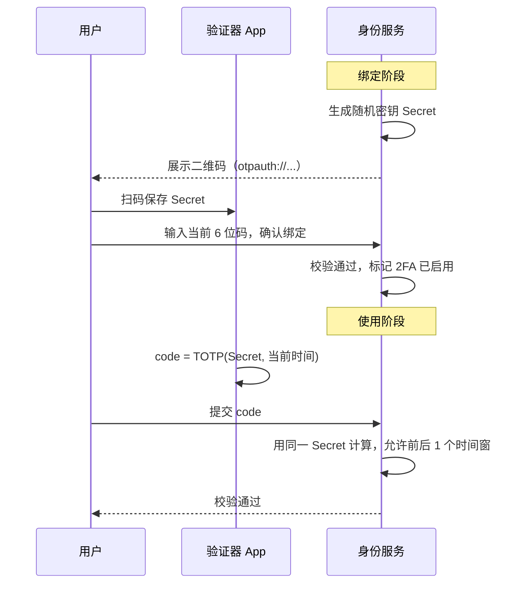
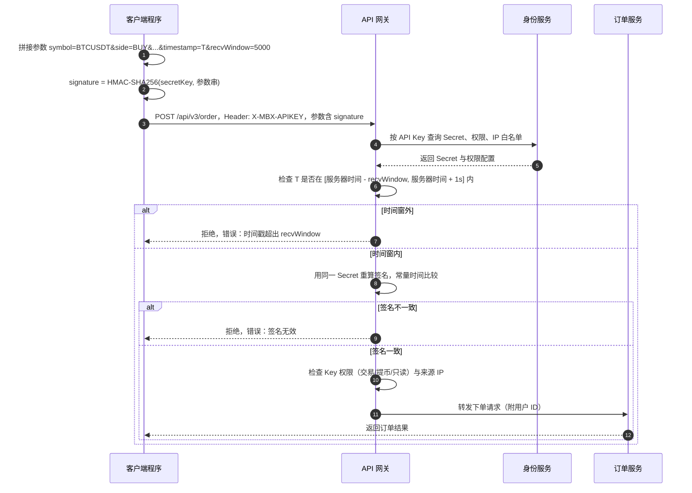
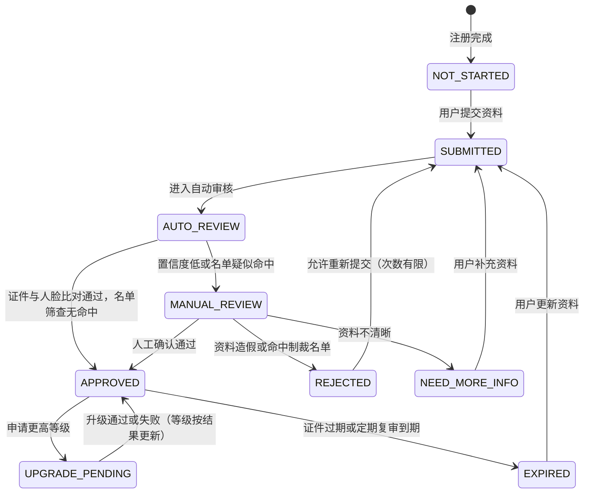
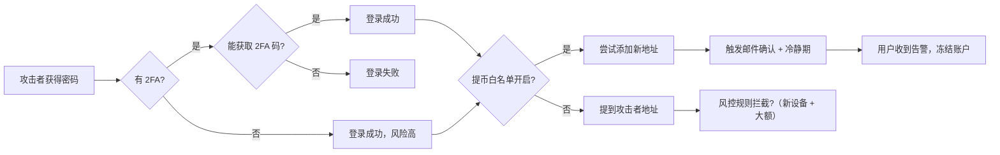

# 03 账户、身份与安全

> 学习目标：读完本章，你能——
> 1. 说清楚用户从注册到发起提币，要经过哪几道身份校验。
> 2. 画出 API Key 请求签名的完整流程，并解释 `timestamp` 和 `recvWindow` 如何防重放。
> 3. 解释 KYC 分级、子账户、反钓鱼码、提币白名单和账户冻结各自防的是什么风险。
>
> 前置章节：[01 什么是 CEX](01-what-is-cex.md)、[02 系统架构](02-system-architecture.md)
> 交互实验：[architecture-explorer.html](interactive/architecture-explorer.html)（查看身份服务在架构中的位置）、[risk-rules-lab.html](interactive/risk-rules-lab.html)（提币风控规则）

---

## 1. 一句话理解

账户系统回答两个问题：**你是谁**（认证，Authentication），**你能做什么**（授权，Authorization）。

交易所里的账户直接对应资产。账户被盗，就是钱被盗。所以交易所的账户系统比普通网站多了几层锁。

> 🎯 打个比方：交易所账户像一个银行保险箱。
> 密码是你家大门钥匙。2FA 是保险箱房间的门禁卡。提币白名单是"这个箱子里的东西只能寄到这几个地址"。
> KYC 是银行开户时看你的身份证。反钓鱼码是银行寄信时印在信封上的暗号，用来识别假信。
> 小偷拿到大门钥匙，还要过门禁卡、地址限制和人工复核，才能拿走东西。每多一层，攻击成本就高一层。

---

## 2. 业务视角：它解决什么问题

交易所的账户系统要同时满足三方的要求：

| 角色 | 诉求 | 账户系统给出的能力 |
|---|---|---|
| 用户 | 资产不被盗；登录方便 | 密码 + 2FA、设备管理、反钓鱼码、提币白名单 |
| 监管 | 知道用户是谁；阻止洗钱 | KYC（Know Your Customer，了解你的客户）分级、制裁名单筛查 |
| 交易所 | 控制风险；支持程序化交易 | 账户冻结、API Key 权限、子账户、风控事件 |

> 💡 注意：认证和授权是两件事。用户登录成功，只说明"你是你"。系统还要检查"你有没有这个权限"。例如，一个只读 API Key 通过了签名校验，但它仍然不能下单。

---

## 3. 系统视角：它如何实现

### 3.1 注册与登录

注册流程（业界通用做法）：

1. 用户提交邮箱或手机号。
2. 系统发送一次性验证码。
3. 用户提交验证码和密码。
4. 系统用慢哈希算法（例如 Argon2、bcrypt、scrypt）保存密码哈希。
5. 系统创建用户记录，状态为 `active`，KYC 等级为"未认证"。

> ⚠️ 警告：系统绝不保存明文密码。系统也不使用 MD5、SHA-256 这类快哈希直接存密码。快哈希的计算成本太低，攻击者可以快速暴力破解。

登录流程：

1. 用户提交账号和密码。
2. 系统校验密码哈希。
3. 系统检查设备指纹和登录 IP。
4. 如果设备或地点异常，系统要求二次验证。
5. 如果用户开启了 2FA，系统要求输入 2FA 验证码。
6. 系统签发会话凭证。

### 3.2 会话与 JWT

会话（Session）：用户登录后，系统给浏览器一个凭证。之后的请求带上这个凭证，系统就不再要求输入密码。

凭证有两种常见形态：

| 形态 | 原理 | 优点 | 缺点 |
|---|---|---|---|
| 不透明令牌（Opaque Token） | 一个随机字符串。服务端查库得知它属于谁。 | 可以立即吊销 | 每次请求都要查存储 |
| JWT（JSON Web Token） | 一段带签名的 JSON。服务端验签即可读出用户 ID。 | 无需查库，验证快 | 签发后难以提前作废 |

业界通用做法是组合使用：

- 访问令牌（Access Token）：有效期短，例如 15 分钟（示例）。
- 刷新令牌（Refresh Token）：有效期长，保存在服务端，可以吊销。
- 用户改密码、关闭 2FA 或点击"退出所有设备"时，系统吊销全部刷新令牌。

> 💡 注意：JWT 的内容只是 Base64 编码，不是加密。任何人都能解码看到内容。不要在 JWT 里放敏感信息。

### 3.3 双因素认证（2FA）与 TOTP

双因素认证（2FA，Two-Factor Authentication）：除了"你知道的"（密码），还要验证"你拥有的"（手机上的验证器）。

TOTP（Time-based One-Time Password，基于时间的一次性密码）是最常见的 2FA 方式。Google Authenticator 和币安验证器都使用它。

TOTP 的原理：

1. 绑定时，服务端生成一个随机密钥（Secret）。
2. 服务端把密钥做成二维码。用户用验证器 App 扫码保存。
3. 每 30 秒，App 和服务端各自计算：`HMAC-SHA1(密钥, floor(Unix 秒数 ÷ 30))`。时间步数按 8 字节大端整数参与计算。
4. 双方用"动态截断"把 20 字节的哈希结果变成 6 位数字（见下方说明）。
5. 用户输入 App 上的 6 位数字。服务端比对自己算出的数字。

**为什么是 6 位数字**（RFC 4226 动态截断，TOTP 沿用）：

1. 取哈希结果最后一个字节的低 4 位，作为偏移量 offset（0–15）。
2. 从 offset 开始取 4 个字节，去掉最高位，得到一个 31 位整数。
3. 这个整数对 10^6 取模。结果不足 6 位时，左侧补 0。

"6 位"来自第 3 步的取模，不是哈希算法本身的输出。标准允许 6–8 位，行业约定用 6 位：手机上容易输入，单次盲猜成功率约百万分之一。服务端容忍前后 1 个时间窗时，约为百万分之三。再加上错误次数限流，暴力猜测基本不可行。

> 💡 注意：TOTP 只是 2FA 的一种。HOTP 用递增计数器代替时间；短信和邮件验证码由服务端直接生成随机数，没有共享密钥计算；通行密钥和硬件安全密钥（FIDO2/WebAuthn）用公私钥签名，不输出数字，并绑定网站域名，所以能防钓鱼。

**读图要点：**
- 密钥只在绑定时传输一次。之后双方各自计算，网络上只传 6 位数字。
- 服务端通常允许前后 1 个时间窗（±30 秒），用来容忍手机时钟误差。
- 如果服务端数据库泄露，TOTP 密钥也会泄露。所以密钥要加密存储。
- 短信验证码（SMS）比 TOTP 弱。攻击者可以通过 SIM 卡劫持（SIM Swap）截获短信。

**TOTP 密钥怎样管理**（业界通用做法）

密码可以只存哈希，TOTP 密钥不行。服务端每次校验都要用明文密钥重算 HMAC。所以管理重点是：可逆加密存储，并严格限制谁能解密。

| 阶段 | 做法 |
|---|---|
| 生成 | 用密码学安全随机数生成器（CSPRNG）生成，通常 160 位。Base32 编码后放进 `otpauth://` 二维码 |
| 传输 | 只在绑定时通过 HTTPS 下发一次。用户输入第一个 6 位码之前，状态是"待绑定"，不启用 |
| 存储 | 信封加密：每条密钥用数据密钥（DEK）加密，DEK 再由 KMS/HSM 中的主密钥（KEK）加密。数据库只存密文 |
| 使用 | 只有身份服务能调用 KMS 解密。明文只在内存中短暂存在，不写日志，不返回给其他服务。其他服务只调用"校验"接口，拿到通过或不通过 |
| 防重放 | 记录最后一次使用的时间步。同一个码不能用两次。错误次数限流并锁定 |
| 重置 | 换手机或重置 2FA 时重新核验身份。新密钥生效后限制提币一段时间（见 3.9 节表格）。旧密钥立即作废 |
| 轮换与审计 | 主密钥定期轮换，只需重新包装 DEK，用户无感。每次解密都写审计日志 |

客户端那一份由验证器 App 保管，通常放在系统钥匙串或安全芯片中。用户丢失手机时，靠恢复码或人工身份复核找回。

> 💡 注意：TOTP 是对称密钥，服务端必须能还原明文，这是它的天然局限。通行密钥和硬件安全密钥（FIDO2/WebAuthn）用非对称签名，服务端只存公钥。公钥泄露也无法伪造登录。密钥保护的平台侧做法见 [B02 平台安全](backstage/B02-platform-security.md)。

### 3.4 设备指纹

设备指纹（Device Fingerprint）：系统收集浏览器或 App 的特征，组合成一个标识。

常见特征：操作系统、浏览器版本、屏幕分辨率、时区、语言、字体列表、App 安装 ID。

系统用设备指纹做三件事：

1. 识别新设备登录。新设备登录时，系统要求二次验证并发送通知。
2. 管理"已授权设备"列表。用户可以在列表里删除陌生设备。
3. 给风控提供信号。同一设备登录大量账户，可能是批量注册或"羊毛党"。

> 💡 注意：设备指纹可以被伪造。它只是风险信号之一，不能单独作为放行依据。

### 3.5 API Key 与 HMAC 签名

API Key：交易所发给用户的一对凭证，用于程序化访问。它包含两部分：

- **API Key**：公开的标识，类似用户名。它随请求明文发送。
- **Secret Key**：私密的签名密钥。它**永不**随请求发送，只用于本地计算签名。

HMAC（Hash-based Message Authentication Code，基于哈希的消息认证码）：用密钥对消息计算出的一段摘要。没有密钥的人无法算出正确的摘要。

币安现货 API 的签名规则（截至 2026 年公开资料，以官方文档为准）：

- 请求头 `X-MBX-APIKEY` 携带 API Key。
- 签名接口（SIGNED）必须带 `timestamp` 参数，单位毫秒。
- 可选参数 `recvWindow` 表示请求的有效时间窗。默认 5000 毫秒，最大 60000 毫秒。
- 签名 = `HMAC-SHA256(secretKey, 查询字符串 + 请求体)`，结果作为 `signature` 参数发送。
- 币安还支持 RSA 和 Ed25519 类型的密钥。它们使用非对称签名，服务端不保存私钥。

**读图要点：**
- Secret 不出现在网络上。攻击者截获请求，只能拿到一个固定参数的签名。
- 攻击者如果原样重放截获的请求，`timestamp` 很快会落到 `recvWindow` 之外，网关拒绝它。这就是防重放（Replay Protection）。
- `recvWindow` 越大，重放窗口越长。网络稳定时，应该使用较小值。
- 签名比较要用常量时间比较（Constant-time Compare），防止攻击者通过响应耗时逐字节猜测签名。

> 💡 注意：`recvWindow` 只缩短重放窗口，不能完全消除重放。在窗口内，同一请求仍可能被重放。对于下单类请求，业界通常再加客户端订单号（`newClientOrderId`）去重，实现幂等。

API Key 的安全配置（币安公开功能）：

| 配置 | 作用 |
|---|---|
| 权限开关 | 分别控制"读取""现货交易""合约交易""提币"等权限 |
| IP 白名单 | 只允许指定 IP 使用该 Key。开启提币权限时，币安要求绑定 IP 白名单 |
| 删除与重建 | Secret 只在创建时展示一次。遗失后只能删除重建 |

### 3.6 KYC 分级

KYC（Know Your Customer，了解你的客户）：交易所核实用户真实身份的流程。它是反洗钱（AML，Anti-Money Laundering）合规的基础。

KYC 分级的思路：认证越充分，可用功能越多，额度越高。

币安的认证级别（截至 2026 年公开资料。各国家和地区的要求不同，以官网为准）：

| 级别 | 需要提交 | 典型权益（示例，按地区变化） |
|---|---|---|
| 未认证（Unverified） | 邮箱或手机号 | 功能受限。币安自 2021 年起要求新用户完成认证才能交易和充提 |
| 已认证（Verified） | 个人信息、身份证件、人脸识别 | 加密货币充值、交易、提币；法币额度较低 |
| 高级认证（Verified Plus） | 在"已认证"基础上提交地址证明 | 更高的法币额度 |
| 企业认证（Entity Verification） | 公司注册文件、股东和董事信息 | 机构账户功能 |

KYC 的处理流程是一个状态机：

**读图要点：**
- 资料从用户端进入，经过自动审核（OCR 识别、活体检测、名单筛查），少数案例转人工。
- `APPROVED` 不是终点。证件过期、定期复审或风控事件会让状态回退。
- 制裁名单命中通常直接 `REJECTED`，并可能触发账户冻结（见 3.9）。
- 本图是业界通用做法的抽象，不是币安内部状态的原样复刻。

### 3.7 子账户

子账户（Sub-account）：挂在一个主账户下面的独立账户。每个子账户有独立的余额、订单和 API Key。

使用场景：

1. 机构把不同策略放在不同子账户，隔离风险。
2. 资管团队给每个交易员分配一个子账户。
3. 主账户统一查看资产，统一划转资金。

关键规则（业界通用做法）：

- 子账户不单独做 KYC，它继承主账户的 KYC。
- 子账户之间的划转是内部记账，不上链，不收链上手续费。
- 子账户默认不能直接提币到外部地址，资金经主账户流出。具体权限以交易所配置为准。

币安向满足条件的用户开放子账户功能。可创建的数量随用户等级变化（截至 2026 年公开资料，以官网为准）。

### 3.8 反钓鱼码与提币白名单

**反钓鱼码（Anti-Phishing Code）**：用户自己设置的一段字符。币安发出的官方邮件会带上这段字符。

- 收到邮件时，用户检查是否有自己设置的反钓鱼码。
- 如果没有，这封邮件就是伪造的。
- 钓鱼者不知道这段字符，所以伪造不出来。

**提币白名单（Withdrawal Whitelist）**：用户预先登记可以提币的地址。开启后，系统只允许向名单内地址提币。

- 新增白名单地址需要 2FA 和邮件确认。
- 业界常见做法：新地址加入后有一段冷静期（例如 24 小时，示例），冷静期内不能提币。
- 攻击者即使登录了账户，也不能马上把币提到自己的地址。

**读图要点：**
- 每一层防护都在切断攻击路径。层数越多，攻击者成功率越低。
- 白名单和冷静期的价值在于"争取时间"。用户和风控可以在冷静期内发现异常。
- 最后一层是交易所风控（见 [09 风控](09-risk-control.md)）。新设备、新地址、大额提币的组合会触发人工审核。
- 局限：如果用户的邮箱也被攻破，邮件确认这一层就失效了。

### 3.9 账户冻结

账户冻结（Account Freeze）：系统限制账户的部分或全部操作。

> 💡 注意：本章的"账户冻结"指账户级的操作限制。它和第 5 章的"冻结余额"是两个概念。冻结余额指为挂单或提币预留的那部分资产。

触发冻结的来源：

| 来源 | 示例 | 冻结范围 |
|---|---|---|
| 用户自助 | 用户发现被盗，点击"冻结账户" | 全部交易与提币 |
| 风控系统 | 异常登录 + 大额提币 | 仅提币 |
| 合规 | 执法机构协查函、制裁名单命中 | 全部 |
| 安全策略 | 修改密码或重置 2FA 后 | 提币限制 24 小时（示例） |

解冻流程（业界通用做法）：

1. 用户提交解冻申请。
2. 系统要求重新验证身份（人脸识别、证件）。
3. 安全团队人工审核。
4. 审核通过后，系统恢复账户状态，并写审计日志。

---

## 4. 币安怎么做（公开事实 + 业界做法）

**币安公开的事实**（截至 2026 年公开资料）：

- 支持 TOTP 验证器（含币安自己的 Binance Authenticator）、短信、邮件、通行密钥（Passkey）和硬件安全密钥等验证方式。
- 提供反钓鱼码、提币白名单、设备管理、账户活动记录和"冻结账户"自助入口。
- API 签名使用 `timestamp` + `recvWindow`；`recvWindow` 默认 5000 毫秒，最大 60000 毫秒。
- 支持 HMAC、RSA、Ed25519 三类 API Key。
- 自 2021 年 8 月起，币安要求新用户完成身份认证才能使用核心功能（公开新闻报道）。

**业界通用做法**（币安未公开细节，但行业普遍如此）：

- 密码使用慢哈希加盐存储。
- 访问令牌短期有效，刷新令牌可吊销。
- 修改安全设置后，限制提币一段时间。
- KYC 由第三方身份核验供应商和内部人工审核共同完成。

> 🎯 打个比方：API Key 和 Secret 像"支票账号"和"签名笔迹"。
> 账号印在支票上，谁都能看见。笔迹只有你会写。银行看笔迹认人。
> `timestamp` 像支票上的日期。银行只收"今天开的支票"，过期支票一律退回。这样，就算有人复印了你的旧支票，也无法拿去重复兑现。

---

## 5. 故障与边界：哪里会出错，局限在哪

| 风险 | 发生方式 | 后果 | 防护 |
|---|---|---|---|
| 钓鱼网站 | 假冒域名骗取密码和 2FA 码 | 账户被接管 | 反钓鱼码、硬件密钥、通行密钥（绑定域名，无法被钓鱼） |
| API Key 泄露 | Secret 写进公开代码库 | 被恶意交易 | IP 白名单、关闭提币权限、最小权限 |
| SIM 卡劫持 | 攻击者在运营商补办用户手机卡 | 短信验证码失效 | 用 TOTP 或硬件密钥代替短信 |
| 重放攻击 | 截获签名请求后重新发送 | 重复下单 | `timestamp` + `recvWindow` + 客户端订单号去重 |
| 时钟偏差 | 客户端时钟慢于服务器 | 正常请求被拒 | 客户端先调用服务器时间接口校准 |
| KYC 伪造 | 深度伪造（Deepfake）人脸或假证件 | 洗钱账户进入平台 | 活体检测、多源数据核验、人工复审 |

> ⚠️ 警告：开启 API Key 的提币权限风险极高。如果必须开启，一定要绑定 IP 白名单，并同时开启提币白名单。

**真实案例：2019 年 5 月币安被盗**（公开来源：币安官方公告与媒体报道）

- 攻击者通过钓鱼、病毒等方式获取了大量用户的 API Key 和 2FA 码。
- 攻击者在一次提币中，从热钱包转走约 7000 BTC。
- 币安用 SAFU 基金（见 [04 钱包与托管](04-wallet-custody.md)）覆盖了损失，用户资产未受影响。
- 教训：单个用户的账户安全问题，规模化之后就会变成平台级的资金风险。

**边界与局限：**

- 2FA 防不住"用户在钓鱼网站上实时输入验证码"。攻击者可以实时转发验证码。只有绑定域名的通行密钥和硬件密钥能防住这一类攻击。
- KYC 证明"提交资料的人"是谁，不证明"操作账户的人"是谁。账户被出售或出借时，KYC 无法发现。

---

## 6. 本仓库对照（CEX Demo 中的对应服务）

| 本章概念 | 本仓库位置 | 实现情况 |
|---|---|---|
| 注册、登录、会话 | `services/identity-service`：`registerCustomer`、`createCustomerSession`、`introspectCustomerSession`、`revokeCustomerSession` | 已实现，使用服务端可吊销会话 |
| TOTP 2FA | `services/identity-service/src/domain/totp.ts` | 已实现，默认 30 秒周期、6 位数字，校验支持时间窗容差 |
| API Key 签名 | `services/api-gateway/src/http/api-key-signature.ts` | 已实现，见下方说明 |
| 提币时校验 2FA | `wallet-service` 的 `requestWithdrawal` 调用 `identity-service /two-factor/verify` | 已实现 |
| 提币白名单 | `wallet-service` 的 `withdrawal-address-book` 接口 | 已实现 |
| 账户冻结 | `identity-service` 的 `freezeUser` / `unfreezeUser`；用户状态 `active / suspended / disabled` | 已实现 |
| 运营后台 RBAC | `identity-service` 的 ops 会话与 RBAC | 已实现 |
| KYC 分级、子账户、反钓鱼码 | — | 未实现，属于 MVP 之外 |

本仓库 API Key 签名方案与币安的差异：

- 请求头使用 `X-API-Key`、`X-API-Timestamp`、`X-API-Signature`。
- 待签名串是 `方法\nURL\n时间戳\nSHA256(请求体)`，各段用换行连接。币安直接签"查询字符串 + 请求体"。
- 时间容差由 `GATEWAY_API_KEY_MAX_DRIFT_MS` 控制，默认 300000 毫秒（5 分钟）。它相当于固定的 `recvWindow`。
- 签名比较使用 Node.js 的 `timingSafeEqual`，是常量时间比较。

---

## 7. 术语表

| 术语 | 英文 | 定义 |
|---|---|---|
| 认证 | Authentication | 确认"你是谁" |
| 授权 | Authorization | 确认"你能做什么" |
| 会话 | Session | 登录后用于免密访问的凭证 |
| JWT | JSON Web Token | 带签名的 JSON 令牌，服务端验签即可读取内容 |
| 双因素认证 | 2FA | 密码之外再验证一个用户持有的因素 |
| TOTP | Time-based One-Time Password | 用共享密钥和当前时间算出的 6 位动态码 |
| 设备指纹 | Device Fingerprint | 由设备特征组合出的标识 |
| HMAC | Hash-based Message Authentication Code | 用密钥对消息计算的认证摘要 |
| 防重放 | Replay Protection | 阻止攻击者重复发送截获请求的机制 |
| recvWindow | Receive Window | 请求时间戳被接受的最大时间差（毫秒） |
| KYC | Know Your Customer | 核实用户真实身份的流程 |
| AML | Anti-Money Laundering | 反洗钱 |
| 子账户 | Sub-account | 挂在主账户下、资产独立的账户 |
| 反钓鱼码 | Anti-Phishing Code | 用户设置的、出现在官方邮件中的暗号 |
| 提币白名单 | Withdrawal Whitelist | 只允许向预登记地址提币的限制 |
| 账户冻结 | Account Freeze | 系统限制账户部分或全部操作 |

---

## 8. 思考题

1. 某用户的 `recvWindow` 设为 60000 毫秒。攻击者截获了一笔下单请求。攻击者最多有多长时间可以重放它？如果订单带了 `newClientOrderId`，重放会成功吗？
2. 攻击者拿到了用户的密码和 TOTP 密钥，但用户开启了提币白名单和 24 小时冷静期（示例）。攻击者还能做什么？平台在哪个环节最有机会拦截？打开 [risk-rules-lab.html](interactive/risk-rules-lab.html)，试着设计一条拦截规则。
3. 为什么子账户不单独做 KYC？如果允许子账户直接向外部地址提币，会给反洗钱带来什么问题？
