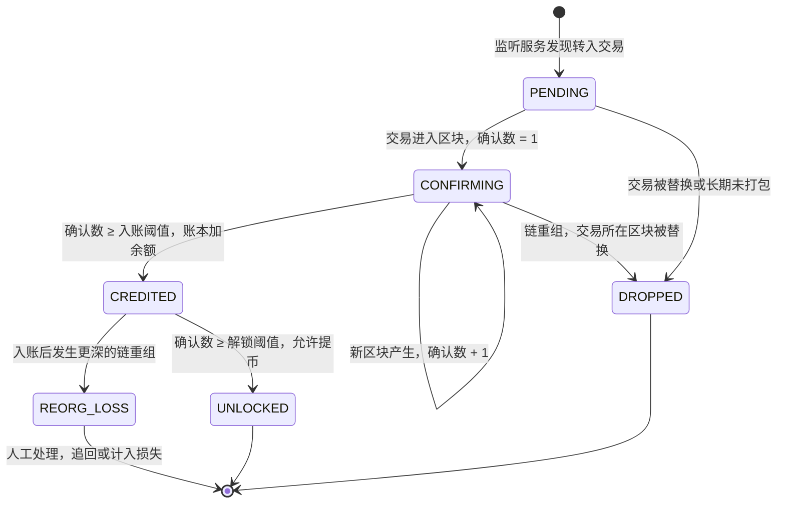
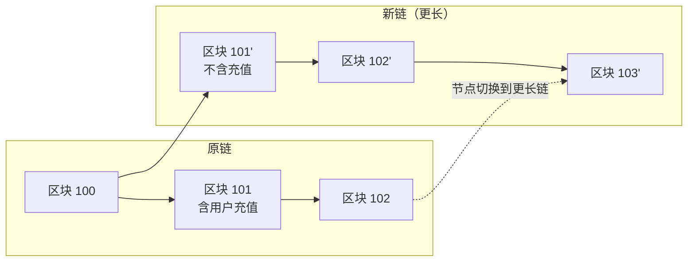
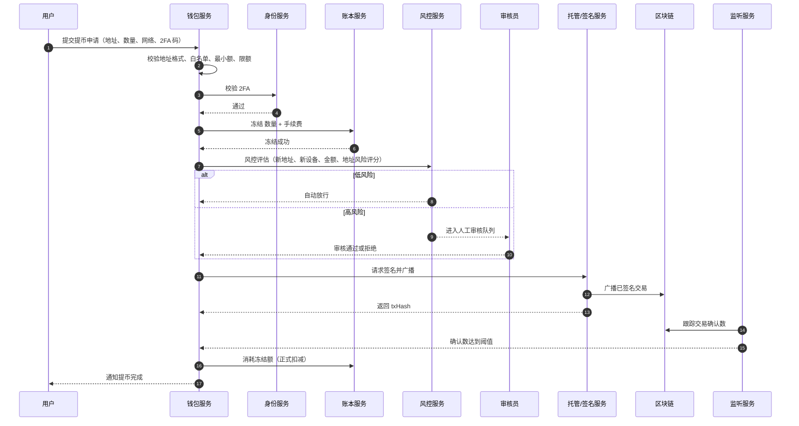
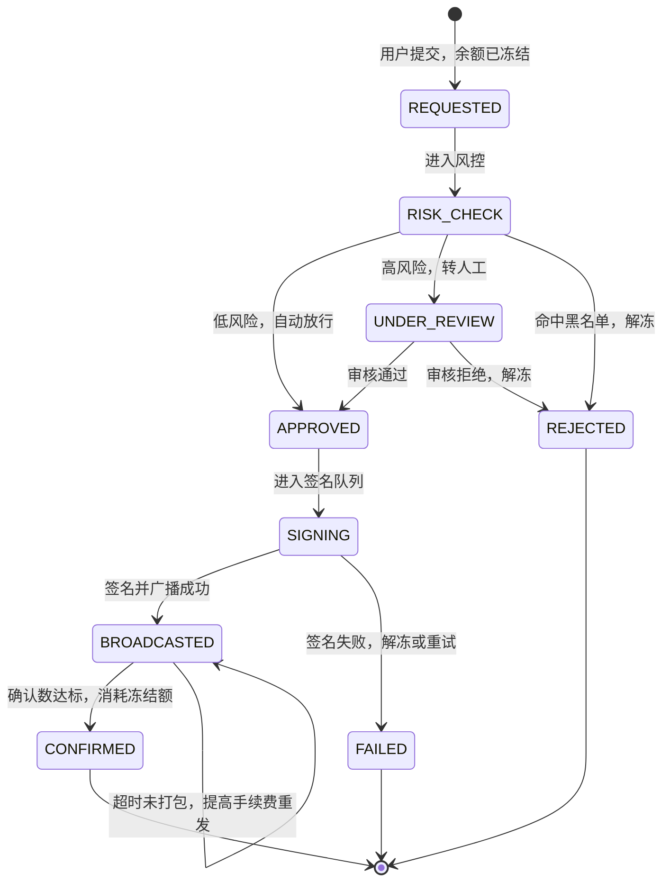
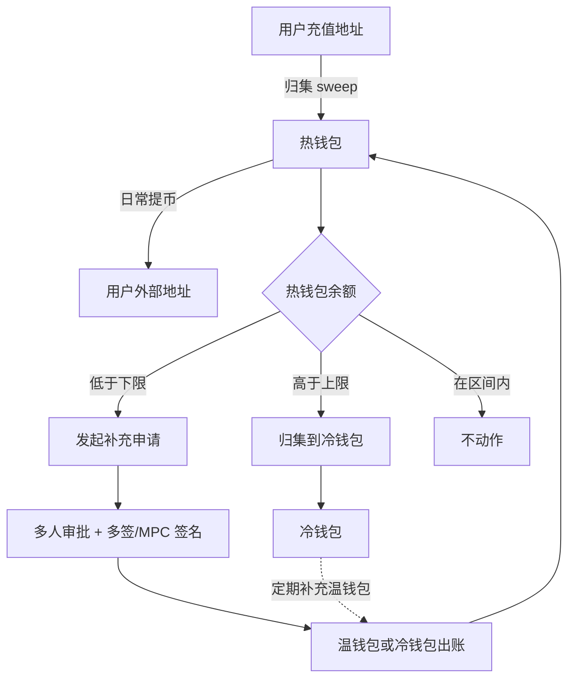
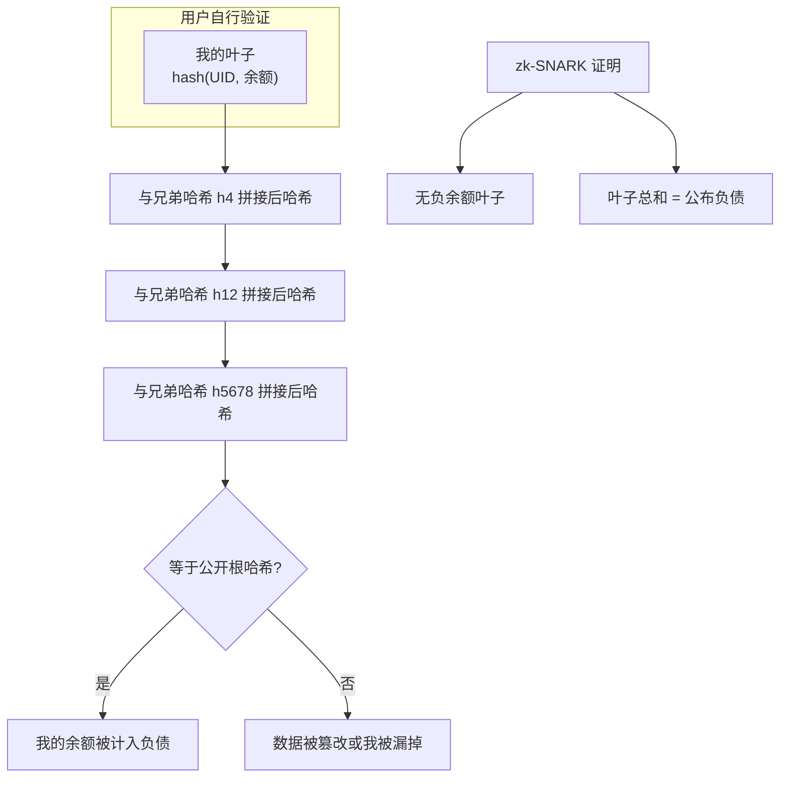

# 04 钱包与托管

> 学习目标：读完本章，你能——
> 1. 画出充值和提币的完整状态机，说清楚确认数和链重组（reorg）的关系。
> 2. 解释热钱包、温钱包、冷钱包的分层，以及水位阈值如何驱动资金调拨。
> 3. 说明储备金证明（Proof of Reserves）能证明什么、不能证明什么。
>
> 前置章节：[02 系统架构](02-system-architecture.md)、[03 账户与身份](03-account-identity-security.md)
> 交互实验：[deposit-withdraw-sim.html](interactive/deposit-withdraw-sim.html)（确认数、链重组、热冷水位）、[proof-of-reserves.html](interactive/proof-of-reserves.html)（Merkle 树储备金证明）

---

## 1. 一句话理解

钱包系统负责**链上的真实资产**和**交易所账本里的数字**之间的转换。

- 充值：链上资产进入交易所地址 → 账本给用户加余额。
- 提币：账本扣减用户余额 → 交易所从自己的地址把资产转出去。

用户在交易所里买卖时，链上资产不动，只有账本在变（见 [05 账本](05-ledger.md)）。链上资产只在充值和提币时移动。

> 🎯 打个比方：交易所的钱包体系像一家银行的现金管理。
> 柜台抽屉（热钱包）里只放当天要用的现金，方便随时付款，但抢劫时损失也在这里。
> 后台保险柜（温钱包）放备用金，需要两个人一起开。
> 城外金库（冷钱包）放大部分资产，调钱要提前预约、多人签字、押运车出动。
> 抽屉的钱少了，就从保险柜补；抽屉的钱太多，就送回金库。这就是"水位管理"。

---

## 2. 业务视角：它解决什么问题

| 问题 | 钱包系统的回答 |
|---|---|
| 用户的币打到哪里？交易所怎么知道是谁的？ | 充值地址分配：每用户独立地址，或共用地址 + memo/tag |
| 链上交易什么时候算"真的到账"？ | 确认数阈值：达到 N 个区块确认后入账 |
| 怎样防止提币被盗？ | 冻结 → 风控 → 审核 → 签名，多道关口 |
| 私钥放哪里才安全？ | 冷热分层 + MPC / 多签 / HSM |
| 用户凭什么相信交易所真的有钱？ | 储备金证明（Proof of Reserves） |
| 真的被盗了怎么办？ | SAFU 等用户保护基金 |

---

## 3. 系统视角：它如何实现

### 3.1 充值地址分配

链上转账只认地址。交易所要把一笔链上转账归属到某个用户，有两种模式：

| 对比项 | 每用户独立地址 | 共用地址 + memo/tag |
|---|---|---|
| 原理 | 系统给每个用户派生一个专属地址 | 所有用户充到同一地址，用附加字段区分用户 |
| 典型链 | BTC、ETH、BSC 等 EVM 链 | XRP（Destination Tag）、XLM（Memo）、EOS（Memo）、TON、ATOM |
| 识别用户 | 按收款地址查找用户 | 按 memo/tag 查找用户 |
| 用户出错点 | 选错网络 | 漏填或填错 memo/tag |
| 归集成本 | 高：资金分散在大量地址，需要归集 | 低：资金天然在一个地址 |
| 为什么这样设计 | 这些链创建地址免费，且无最低余额 | 这些链创建账户要冻结保证金（例如 XRP 账户储备金），每用户一个地址成本太高 |

每用户独立地址的派生方式（业界通用做法）：

1. 系统保管一个主公钥（xpub）。主私钥不在线上。
2. 系统按 BIP-32/BIP-44 规则，用"主公钥 + 序号"派生子地址。
3. 系统把"地址 ↔ 用户 ID"写入地址表。
4. 线上服务只有公钥，所以能生成地址，但不能花钱。

> 💡 注意：在 EVM 链上，同一个私钥在 Ethereum、BSC、Base 上对应同一个地址。这让"选错链"在技术上能到账，但交易所未必在那条链上监听你的地址（见第 5 节）。

### 3.2 充值流程

充值流程由区块链监听服务（Indexer）驱动：

1. 监听服务扫描新区块。
2. 它发现一笔转入交易所地址的交易。
3. 它记录充值，状态为 `PENDING`（已发现）。
4. 每出一个新区块，它把确认数加 1。状态为 `CONFIRMING`。
5. 确认数达到阈值后，它通知钱包服务。
6. 钱包服务调用账本服务，给用户加余额。状态为 `CREDITED`（已入账）。

确认数（Confirmations）：交易所在区块之后又产生的区块数，加 1。交易刚上链时确认数是 1。确认数越高，这笔交易被推翻的概率越低。

**读图要点：**
- 数据从链上节点来，经监听服务转成内部事件，最后到账本。
- `DROPPED` 发生在入账前，用户余额没变，交易所无损失。
- `REORG_LOSS` 发生在入账后。如果用户已经把余额卖掉或提走，损失由交易所承担。
- 很多交易所设两个阈值：入账阈值（可交易）和解锁阈值（可提币）。币安对 BTC 曾公开"1 个确认入账、2 个确认可提币"的规则（以官网为准）。

### 3.3 确认数与链重组（reorg）

链重组（Reorg，Reorganization）：节点发现另一条更长（或更"重"）的链，于是丢弃自己原来的最后几个区块，切换到新链。被丢弃的区块里的交易，可能在新链上不存在。

为什么会发生：

- 两个矿工几乎同时出块，网络暂时分叉。这是常见的 1 块重组。
- 攻击者掌握大量算力，私下挖一条更长的链，然后公布。这是"51% 攻击"，可造成深度重组。

**读图要点：**
- 用户充值在原链的区块 101 里。新链从区块 100 之后分叉，区块 101' 不含这笔充值。
- 如果交易所在确认数 = 2（区块 102）时就入账，切换后这笔充值消失，交易所多记了一笔余额。
- 攻击者可以利用这一点：先充值、入账、卖出提走，再用重组让充值消失。这就是"重组双花"。
- 确认数阈值越高，攻击者需要重写的区块越多，成本越高。但用户等待时间也越长。

各链的确认数阈值（示例，不是币安当前参数，以官网充值页显示为准）：

| 链 | 出块时间（约） | 示例入账阈值 | 示例等待时间 |
|---|---|---|---|
| BTC | 10 分钟 | 1–2 | 10–20 分钟 |
| ETH | 12 秒 | 6–64（或等待 finalized） | 1–13 分钟 |
| BSC | 3 秒以内 | 15 左右 | 1 分钟以内 |

> 💡 注意：以太坊合并（The Merge）之后有"最终确定性"（Finality）。区块被 finalize 后，推翻它需要销毁至少 1/3 的质押 ETH。所以以太坊上更合理的做法是等待 finalized 状态，而不是只数区块。

打开 [deposit-withdraw-sim.html](interactive/deposit-withdraw-sim.html)，用滑块调整确认阈值，观察"等待时间"和"重组风险"的权衡。

### 3.4 提币流程

提币是资金流出交易所的唯一出口，所以关口最多。

**读图要点：**
- 第一步就冻结资金。这样用户不能用同一笔余额既提币又下单。
- 风控拒绝或审核拒绝时，钱包服务调用账本"解冻"，余额回到可用。
- 广播后不立即扣减，而是等链上确认后才把冻结额"消耗"掉。广播失败时可以重试或解冻。
- 签名服务和业务服务隔离部署。业务服务被攻破，也拿不到私钥。

提币状态机：

**读图要点：**
- 每个终态都对应一个账本动作：`CONFIRMED` 消耗冻结额；`REJECTED` 和 `FAILED` 解冻。
- `BROADCASTED` 状态最难处理。交易可能卡在内存池，需要加速（替换交易）或确认它确实失败后才能解冻。
- 如果系统在"已广播但未确认"时错误地解冻，用户会拿到双份资产。这是提币系统最危险的 bug。

### 3.5 热钱包、温钱包、冷钱包

| 层级 | 私钥状态 | 签名速度 | 存放比例（示例） | 用途 |
|---|---|---|---|---|
| 热钱包（Hot Wallet） | 在线，系统可自动签名 | 秒级 | 2%–5% | 日常小额提币 |
| 温钱包（Warm Wallet） | 在线但需要多方审批 | 分钟到小时 | 5%–15% | 补充热钱包 |
| 冷钱包（Cold Wallet） | 离线，物理隔离 | 小时到天 | 80% 以上 | 长期储备 |

资金调拨由"水位"驱动：

**读图要点：**
- 热钱包余额就是"被盗风险暴露量"。上限越低，被盗时损失越小。
- 下限越高，提币越不容易卡住。但下限高意味着热钱包长期放更多钱。
- 冷钱包到热钱包的补充需要人工多签，有延迟。如果提币高峰来得太快，用户会遇到"提币排队"。
- 在 [deposit-withdraw-sim.html](interactive/deposit-withdraw-sim.html) 第二部分，你可以调整上下限，观察提币等待和风险暴露的变化。

### 3.6 归集（Sweep）

归集：把分散在大量用户充值地址里的资金，转到交易所的热钱包。

1. 系统扫描余额超过阈值的充值地址。
2. 对于 ERC-20 代币，系统先给该地址转入少量 ETH 作为 Gas。
3. 系统从充值地址发起转账，把代币转到热钱包。
4. 系统更新地址余额记录。

> 💡 注意：ERC-20 归集要两笔交易（先打 Gas，再转代币），成本高。业界有几种优化：在 Gas 便宜时批量归集；使用合约钱包作为充值地址，由合约统一转出；或使用 EIP-7702 等账户抽象方案。

### 3.7 私钥保护：MPC、多签、HSM

| 方案 | 原理 | 优点 | 局限 |
|---|---|---|---|
| 多签（Multisig） | 链上规则要求 M 个私钥中的 N 个签名，例如 2-of-3 | 规则公开透明，链上可验证 | 每条链实现不同；部分链不支持；手续费更高 |
| MPC（Multi-Party Computation，多方计算） | 私钥被拆成多个分片，多方协同计算签名，完整私钥从不出现 | 链无关；链上看起来是普通签名 | 协议复杂；依赖实现质量 |
| HSM（Hardware Security Module，硬件安全模块） | 私钥存放在防篡改硬件中，只能在硬件内签名 | 私钥不可导出 | 硬件被授权调用时，仍可能被滥用 |

业界通用做法是组合使用。例如：MPC 分片分别存放在不同机房的 HSM 中，签名前还要经过审批策略引擎。

### 3.8 Gas 费管理

链上转账要支付手续费（Gas）。交易所要管理三件事：

1. **向用户收取提币手续费**。通常是固定值，按网络拥堵定期调整。
2. **为热钱包和充值地址准备原生币**。例如 ETH、BNB，用于支付 Gas。
3. **处理拥堵**。交易卡住时，用更高的 Gas 重新发送同一 nonce 的交易进行替换。

> ⚠️ 警告：热钱包的原生币（Gas 币）耗尽时，所有代币提币都会卡住。业界会对 Gas 币单独设置水位告警。

### 3.9 储备金证明（Proof of Reserves）

储备金证明（PoR）：交易所公开证明"我持有的资产 ≥ 我欠用户的资产"。

它分成两半：

- **资产端**：交易所公开钱包地址，任何人都能在链上查余额。
- **负债端**：交易所证明所有用户余额的总和。难点是既要让用户能核对，又不能泄露每个人的余额。

币安的做法（公开资料：币安于 2022 年 11 月上线基于 Merkle 树的 PoR，2023 年 2 月加入 zk-SNARK）：

1. 币安把每个用户的"用户 ID 哈希 + 各币种净余额"作为一个叶子。
2. 币安两两哈希叶子，一层层向上，得到一个根哈希（Merkle Root），并公开根哈希。
3. 用户拿到自己的叶子和一条"兄弟哈希路径"（Merkle Proof）。
4. 用户自己计算到根，与公开的根比对。一致就说明自己的余额被计入了。
5. zk-SNARK（零知识简洁非交互式论证）证明额外两件事：每个叶子的余额都非负；所有叶子的总和等于公布的负债总额。

**读图要点：**
- 8 个用户的树只要 3 个兄弟哈希就能验证。100 万用户也只要约 20 个。
- Merkle 树只证明"我在树里"。它不能阻止交易所塞入负余额的假账户，压低负债总额。zk-SNARK 补上了这个缺口。
- 局限：PoR 只证明某一时刻资产 ≥ 负债。它不证明负债完整（交易所可能漏掉没人验证的账户），也不证明资产不是借来的。
- 在 [proof-of-reserves.html](interactive/proof-of-reserves.html) 里，你可以构建 Merkle 树、验证路径，并尝试篡改余额。

### 3.10 SAFU 基金

SAFU（Secure Asset Fund for Users，用户安全资产基金）：币安设立的用户保护基金。

公开事实（以官网和公开报道为准）：

- 2018 年 7 月设立。币安当时宣布把一部分交易手续费（10%）注入该基金。
- 2019 年 5 月币安热钱包被盗约 7000 BTC，币安用 SAFU 覆盖损失。
- 2022 年 1 月，币安宣布基金规模补足到 10 亿美元。
- 2024 年，基金中的稳定币部分从 BUSD 换成 USDC。
- 2026 年初公开报道：币安把约 10 亿美元的 SAFU 储备换成约 15000 BTC，并承诺价值低于 8 亿美元时补足到 10 亿美元。

> 💡 注意：SAFU 是交易所自己的承诺，不是存款保险。它不受第三方监管机构担保。

---

## 4. 币安怎么做（公开事实 + 业界做法）

**币安公开的事实**（截至 2026 年公开资料）：

- 充值页面会显示每个网络的"入账确认数"和"解锁确认数"。参数会调整，以页面为准。
- 需要 memo/tag 的币种，充值页会强制提示。漏填时，可通过客服申请找回，但不保证成功，可能收费。
- 提币支持白名单、2FA、新地址冷静期等保护。
- 定期发布储备金证明，用户可在官网验证自己的 Merkle 叶子，zk-SNARK 验证代码已开源。
- 设有 SAFU 基金。

**业界通用做法**（币安未公开内部细节）：

- 冷热分层，热钱包只放少量资金。
- MPC、多签、HSM 组合保护私钥。
- 链上余额与账本余额每小时或每天对账。
- 大额提币强制人工审核。

---

## 5. 故障与边界：哪里会出错，局限在哪

### 5.1 充错链

用户在 A 链发送，但交易所只在 B 链监听这个地址。

- EVM 链之间地址相同，资产确实到了交易所控制的地址，但系统不会自动入账。
- 找回需要交易所人工在 A 链上用同一私钥签名转出。冷钱包或 MPC 场景下操作成本很高。
- 如果目标地址是合约钱包，A 链上可能根本没有部署这个合约，资产可能永久丢失。

> ⚠️ 警告：充值前，务必确认充值页选择的网络与发送方选择的网络一致。

### 5.2 漏填 memo/tag

资产到了交易所的共用地址，但系统无法判断属于哪个用户。资产进入"无主充值"队列，需要用户提交交易哈希申请人工找回。

### 5.3 重组双花

攻击者用重组推翻自己已入账的充值。2020 年 ETC（以太经典）多次遭受 51% 攻击，部分交易所因确认数不足遭受损失（公开报道）。之后多家交易所把 ETC 的确认数提高到数千。

防护：

- 小市值、算力低的链，设置更高的确认数。
- 监控链的算力和重组深度，异常时暂停充值。
- 入账和解锁分开设阈值。

### 5.4 热钱包被盗

| 年份 | 事件 | 来源类型 |
|---|---|---|
| 2014 | Mt. Gox 倒闭，约 85 万 BTC 丢失 | 公开报道、破产文件 |
| 2019 | 币安热钱包被盗约 7000 BTC，SAFU 覆盖 | 币安官方公告 |
| 2025 | Bybit 冷钱包多签操作被攻击，损失约 14.6 亿美元的 ETH 及衍生代币 | 公开报道、交易所公告 |

> 💡 注意：2025 年 2 月 21 日 Bybit 事件（据公开报道，约 14.6 亿美元的 ETH 及衍生代币被盗，是史上最大的加密资产盗窃）说明，冷钱包也会被攻破。攻击点不是私钥本身。攻击者先入侵了多签钱包服务商 Safe{Wallet} 一名开发者的电脑，再在其网页中注入恶意代码。Bybit 的签名人看到的界面被篡改，签了一笔他们看不懂的交易。FBI 将此事归因于朝鲜 Lazarus 组织。所以"签什么"和"怎么存私钥"一样重要。

### 5.5 储备金证明的局限

- 只是时点快照。证明前借入资产、证明后还回去，快照看不出来。
- 不证明负债完整。没人验证的账户可能被漏掉。
- 不证明资产没有被抵押或借出。
- 不覆盖链下负债，例如对机构的借款。

---

## 6. 本仓库对照（CEX Demo 中的对应服务）

| 本章概念 | 本仓库位置 | 实现情况 |
|---|---|---|
| 充值地址分配 | `services/wallet-service`：`createDepositAddress` | 已实现，EVM 链每用户独立地址 |
| 链上监听、确认数推进 | `services/blockchain-indexer`：EVM 原生币与 ERC-20 `Transfer` 扫描 | 已实现，按阈值回调 `wallet-service /deposits/confirm` |
| 链重组处理 | `blockchain-indexer` 对非最终区块尾部重扫；记录 `block_hash` 变化 | 已实现最小版本 |
| 充值状态 | `DepositStatus = detected / confirming / confirmed / credited / failed` | 对应本章 PENDING / CONFIRMING / CREDITED / DROPPED |
| 提币状态 | `WithdrawalStatus = requested / under_review / approved / broadcasted / confirmed / failed / rejected` | 与本章状态机基本一致 |
| 提币冻结、消耗、解冻 | `wallet-service` 调用 `ledger-service` 的 `freeze` / `consume` / `release` | 已实现 |
| 签名与广播 | `services/custody-adapter`：`mock-custody`、`evm-hot-wallet` provider | 已实现，支持路由、熔断、重试 |
| 陈旧提币清理 | `reconcile-stale-withdrawals` 脚本 | 已实现 |
| 冷热分层、归集、PoR | `hot_wallet`、`cold_wallet` 只是保留的账户类型，演示流程未使用（`docs/domain-model.md` 第 2.1 节）；`docs/security.md` 第 4 节把冷热分离列为缺口 | 本仓库未实现 |

---

## 7. 术语表

| 术语 | 英文 | 定义 |
|---|---|---|
| 热钱包 | Hot Wallet | 私钥在线、可自动签名的钱包 |
| 温钱包 | Warm Wallet | 在线但需要多方审批才能签名的钱包 |
| 冷钱包 | Cold Wallet | 私钥离线存放的钱包 |
| 确认数 | Confirmations | 交易所在区块及其后续区块的数量 |
| 链重组 | Reorg | 节点丢弃最近区块、切换到另一条链 |
| 最终确定性 | Finality | 区块不可再被推翻的状态 |
| 归集 | Sweep | 把充值地址的资金集中到热钱包 |
| memo/tag | Memo / Destination Tag | 共用地址模式下区分用户的附加字段 |
| 水位 | Watermark | 热钱包余额的上下限阈值 |
| 多签 | Multisig | 需要多个私钥共同签名的链上规则 |
| MPC | Multi-Party Computation | 多方协同签名，完整私钥从不出现 |
| HSM | Hardware Security Module | 私钥不可导出的防篡改硬件 |
| 储备金证明 | Proof of Reserves | 证明交易所资产 ≥ 用户负债 |
| Merkle 树 | Merkle Tree | 两两哈希、逐层向上得到根哈希的树结构 |
| zk-SNARK | Zero-Knowledge Succinct Non-interactive Argument of Knowledge | 不泄露数据就能证明某个计算正确的证明方法 |
| SAFU | Secure Asset Fund for Users | 币安的用户保护基金 |

---

## 8. 思考题

1. 某条链出块时间 15 秒，攻击者重写 6 个区块的成本是 2 万美元（示例）。交易所把入账阈值设为 6，单笔充值上限应该设为多少才安全？打开 [deposit-withdraw-sim.html](interactive/deposit-withdraw-sim.html)，观察不同阈值下的重组损失。
2. 热钱包上限从 500 BTC 降到 100 BTC（示例），被盗风险暴露量下降了。代价出现在哪里？用交互页的水位实验验证你的答案。
3. 交易所在 Merkle 树里加入一个余额为 -1000 BTC 的假账户。只用 Merkle 证明，用户能发现吗？在 [proof-of-reserves.html](interactive/proof-of-reserves.html) 里试一试，再说明 zk-SNARK 如何发现它。
