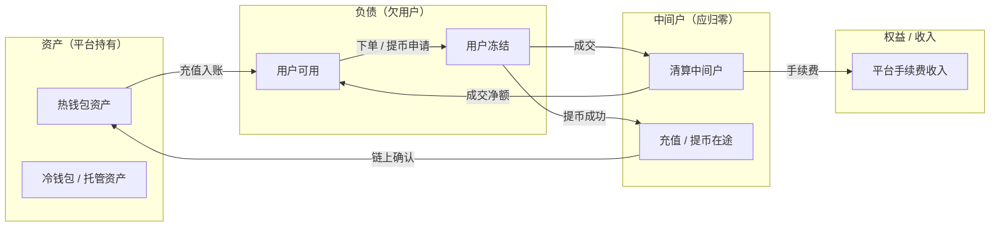
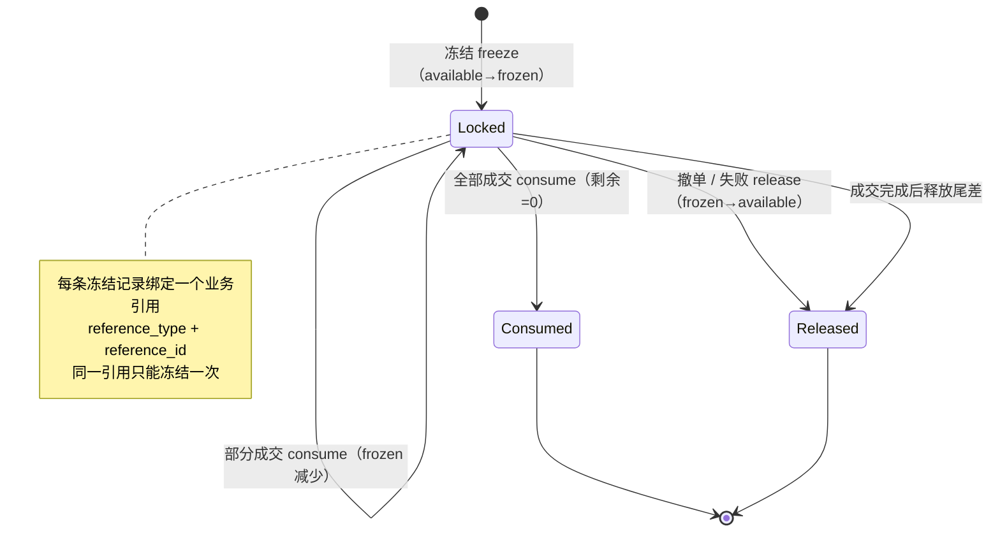
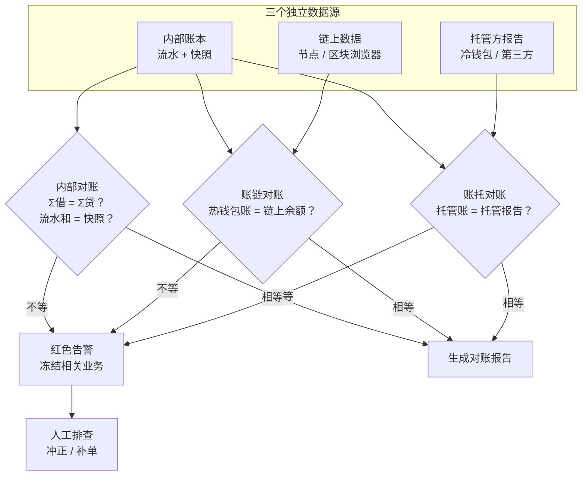
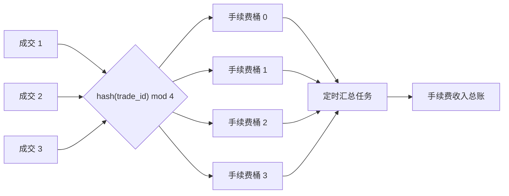
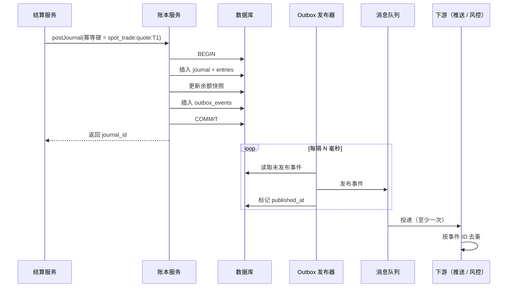

# 05 账本：交易所真正的心脏

> 学习目标：读完本章，你能——
> 1. 用双分录（借/贷）写出充值、下单、成交、提币的分录。
> 2. 画出"冻结—解冻—扣减"的状态机，并说明幂等键的作用。
> 3. 解释三方对账、热点账户和 outbox 模式各解决什么问题。
>
> 前置章节：[02-system-architecture.md](02-system-architecture.md)、[04-wallet-custody.md](04-wallet-custody.md)
> 交互实验：[ledger-double-entry.html](interactive/ledger-double-entry.html)（迷你账本 + 制造 bug）

---

## 1. 一句话理解

账本（Ledger）是交易所记录"谁拥有多少钱"的唯一事实源。

撮合引擎决定"谁和谁成交"。账本决定"成交后每个人的钱变成多少"。撮合出错，影响一笔订单。账本出错，影响平台的偿付能力。所以本章的结论是：**交易所的核心是账本，不是撮合。**

> 🎯 打个比方：交易所像一家银行营业厅。撮合引擎是叫号机，它决定谁去哪个窗口。账本是金库的总账簿。叫号机坏了，客户多排一会儿队。总账簿错了，银行可能当场破产。

---

## 2. 业务视角：它解决什么问题

用户把币充进交易所后，链上的币进入平台的钱包。用户手里只剩一个数字："我在交易所有 1 BTC"。这个数字就是平台对用户的**负债**。

账本要回答 4 个问题：

1. 每个用户现在有多少钱？其中多少可以用？
2. 每一分钱的变化，原因是什么？
3. 平台欠用户的钱，和平台实际持有的钱，是否相等？
4. 系统重启、消息重投、网络超时之后，上面三个答案是否仍然正确？

> ⚠️ 警告：如果用户负债总额大于平台实际资产，平台处于"资不抵债"状态。2022 年 FTX 倒闭的核心原因之一，就是用户资产被挪用，负债与资产不再相等（公开报道与破产文件）。

### 2.1 为什么是"账本"而不是"余额表"

最简单的设计是一张余额表：`user_id, asset, amount`。每次变化执行 `UPDATE amount = amount + x`。

这种设计有 3 个缺陷：

| 缺陷 | 后果 |
|---|---|
| 没有历史 | 余额错了以后，无法知道哪一步出错 |
| 没有约束 | 程序 bug 可以凭空增加余额，系统不报错 |
| 无法审计 | 监管和审计要求每一笔变化都有凭证 |

账本的做法是：**只记录变化（流水），余额由流水算出**。余额表仍然存在，但它只是流水的快照（Snapshot），可以随时重建。

---

## 3. 系统视角：它如何实现

### 3.1 双分录记账（Double-Entry Bookkeeping）

双分录记账：每一笔业务至少写两条分录。一条记"借"（Debit），一条记"贷"（Credit）。同一资产的借方合计必须等于贷方合计。

这条规则叫**借贷平衡**。它让钱不能凭空出现，也不能凭空消失。钱只能从一个账户移到另一个账户。

借和贷不是"增加"和"减少"的同义词。它们的含义取决于账户类型：

| 账户类型 | 例子 | 借（Debit） | 贷（Credit） |
|---|---|---|---|
| 资产类 | 热钱包资产 | 增加 | 减少 |
| 负债类 | 用户可用、用户冻结 | 减少 | 增加 |
| 权益/收入类 | 平台手续费收入 | 减少 | 增加 |
| 中间类 | 清算中间户、在途 | 记账后必须归零 | 记账后必须归零 |

> 💡 注意：站在平台的角度看，用户余额是平台的**负债**。用户充值 1 BTC，平台的资产增加 1 BTC，负债也增加 1 BTC。

例：用户 A 充值 1000 USDT（示例）。

| 分录 | 账户 | 借 | 贷 |
|---|---|---|---|
| 1 | 热钱包资产-USDT | 1000 | |
| 2 | 用户A-USDT-可用 | | 1000 |
| 合计 | | 1000 | 1000 |

### 3.2 账户科目设计

科目（Chart of Accounts）：账本中所有账户的分类清单。业界通用做法是按"所有者 × 资产 × 用途"组合出账户。

| 科目 | 所有者 | 类型 | 用途 |
|---|---|---|---|
| 用户可用（available） | 用户 | 负债 | 用户可以下单、提币的余额 |
| 用户冻结（frozen） | 用户 | 负债 | 挂单或提币中，暂时不能动用的余额 |
| 平台手续费收入 | 平台 | 收入 | 累计收到的手续费 |
| 热钱包资产 | 平台 | 资产 | 平台在链上热钱包中实际持有的币 |
| 冷钱包/托管资产 | 平台 | 资产 | 冷钱包或第三方托管中持有的币 |
| 充值在途 / 提币在途 | 平台 | 中间 | 链上已发生、账本未终结的金额 |
| 清算中间户 | 平台 | 中间 | 成交结算时临时过渡，结算完成后归零 |

**读图要点**

- 左侧是平台"有什么"，中间是平台"欠什么"。两边必须相等：资产 = 负债 + 权益。
- 清算中间户和在途账户是"走廊"。钱只是路过，结算完成后余额必须为 0。
- 中间户长期不为 0，说明有结算卡住或漏记。这是对账的重点检查项。
- 本图是业界通用做法的简化版。真实系统还有借贷、理财、合约保证金等更多科目。

### 3.3 余额分层

一个用户看到的"1 BTC"，在不同层面有不同的含义：

| 层 | 名字 | 谁维护 | 说明 |
|---|---|---|---|
| L1 | available（可用） | 账本 | 用户可以立即使用 |
| L2 | frozen（冻结） | 账本 | 被订单或提币占用 |
| L3 | 链上余额 | 区块链 | 平台地址在链上的真实余额 |
| L4 | 托管余额 | 托管方 / 冷钱包 | 离线或第三方保管的余额 |

L1 和 L2 是平台对用户的负债。L3 和 L4 是平台的资产。平台的健康条件是：

`Σ 所有用户(available + frozen) ≤ 链上余额 + 托管余额`

币安公开的储备金证明（Proof of Reserves）就是在向用户证明这个不等式成立。详见 [04-wallet-custody.md](04-wallet-custody.md) 和交互页 [proof-of-reserves.html](interactive/proof-of-reserves.html)。

### 3.4 冻结—解冻—扣减生命周期

用户下单时，系统不直接扣钱。系统先**冻结**（Freeze）。冻结：把金额从 available 移到 frozen，资金仍然属于用户。

1. 用户 A 下买单：0.1 BTC，价格 60000 USDT（示例）。
2. 账本冻结 6000 USDT。
3. 订单成交 0.04 BTC。账本**扣减**（Consume）2400 USDT。
4. 用户撤单。账本**解冻**（Release）剩余 3600 USDT。

**读图要点**

- 一条冻结记录对应一个业务引用，例如一个订单号或一个提币单号。
- 部分成交时，状态停留在 Locked，剩余冻结额减少。
- Consumed 和 Released 是终态。终态记录不能再被扣减或解冻。
- 状态机挡住了"撤单后又成交"这类竞态。如果撤单先到，后到的成交扣减会失败，进入补偿流程。

冻结和解冻本身也要记分录：

| 动作 | 借 | 贷 |
|---|---|---|
| 冻结 | 用户-可用 | 用户-冻结 |
| 解冻 | 用户-冻结 | 用户-可用 |
| 成交扣减 | 用户-冻结 | 清算中间户 |

### 3.5 幂等：同一件事只做一次

幂等（Idempotency）：同一个请求执行 1 次和执行 N 次，结果相同。

交易所的消息系统通常是"至少投递一次"（At-least-once）。网络超时后，上游会重试。所以账本**一定**会收到重复请求。

做法是：每个资金动作带一个**业务唯一键**（Idempotency Key）。

1. 上游生成唯一键，例如 `spot_trade:quote:T1001`。
2. 账本在同一个数据库事务里写入流水和唯一键。
3. 数据库对唯一键建唯一索引。
4. 如果唯一键已经存在，账本返回第一次的结果，不再记账。

> ⚠️ 警告：唯一键必须来自业务（成交号、充值交易哈希 + 输出序号），不能用随机数或时间戳。随机数在每次重试时都会变，等于没有幂等。

### 3.6 流水不可改，只追加

账本流水是 append-only（只追加）。已经写入的分录不能 UPDATE，也不能 DELETE。

如果发现记错了，系统写一笔**冲正分录**（Reversal）。冲正分录方向相反、金额相同，并引用原分录。

好处：

- 任何时刻的余额，都能从第一条流水回放得出。
- 审计员能看到"错误发生过，并且被纠正过"。
- 余额快照损坏时，可以从流水重建。

### 3.7 余额快照与对账

每次都从全部流水求和太慢。所以系统维护余额快照：每次记账时，在同一事务里更新快照。

对账（Reconciliation）：定期用独立的数据源，检查快照是否正确。交易所至少做三类对账：

1. **内部对账**：流水求和 = 余额快照。每个资产 Σ借 = Σ贷。中间户余额 = 0。
2. **账链对账**：账本中热钱包资产 = 链上地址余额。
3. **账托对账**：账本中冷钱包/托管资产 = 托管方报告的余额。

**读图要点**

- 三个数据源互相独立。一个源出错，另外两个源能发现它。
- 账链对账要处理"时间差"：链上已出块，账本还没入账。这部分记在"在途"账户里。
- 不平时，业界通用做法是先暂停相关币种的提币，再人工排查。
- 局限：对账只能发现"不等"。它不能自动告诉你是哪一笔错了，定位要靠流水回放。

### 3.8 金额必须用精确算术

> ⚠️ 警告：账本不能用浮点数（float / double）存金额。

在 JavaScript 中，`0.1 + 0.2` 的结果是 `0.30000000000000004`。在账本里，这类误差会累积成对账差额。

业界通用做法：

1. 用最小单位的整数存金额。例如 BTC 用聪（1 BTC = 10^8 聪）。
2. 或者用数据库的定点小数类型，例如 `numeric(36, 18)`。
3. 程序中用大整数（BigInt）或十进制库计算。
4. 每次乘除都明确舍入方向。手续费通常向下取整，差额留在规则中写明的一方。

交互页 [ledger-double-entry.html](interactive/ledger-double-entry.html) 全部用 BigInt 按 10^-8 单位计算。你可以输入 `0.1` 和 `0.2` 验证结果没有误差。

### 3.9 热点账户问题

每一笔成交都要给"平台手续费收入"账户记一笔贷方。币安这类大所每秒有大量成交（具体数字未公开）。所有事务都去更新**同一行**余额快照。

结果：数据库行锁排队，账本吞吐量被这一行卡死。这叫**热点账户**（Hot Account）问题。

> 🎯 打个比方：一个商场有 100 个收银台，但所有收银员都要跑到同一个保险柜存钱。保险柜门口一定排长队。解决方法是每个收银台先放一个小钱箱，下班时再统一存进保险柜。

业界通用的两个解决办法：

| 方法 | 做法 | 代价 |
|---|---|---|
| 分桶（Sharding） | 把手续费账户拆成 N 个子账户（例如 64 个桶）。按成交号哈希选一个桶记账。 | 查询总额时要把 N 个桶相加 |
| 异步汇总 | 成交时只写流水，不更新快照。后台任务每隔 T 秒把新流水汇总进快照。 | 快照有 T 秒延迟；只适用于平台账户，不能用于用户可用余额 |

**读图要点**

- 成交事务只锁一个桶。4 个桶让并发写冲突降为原来的约 1/4。
- 汇总任务也要记分录（桶 → 总账），也要带幂等键。
- 用户账户一般不分桶。用户余额要求实时准确，否则会出现超额下单。

### 3.10 Outbox 模式：事件不丢

账本记账后，要通知下游：推送余额给用户、更新风控额度、写入数据仓库。

错误做法：先提交数据库事务，再发消息到消息队列。如果进程在两步之间崩溃，账已经记了，消息丢了。

Outbox 模式：

1. 账本在**同一个数据库事务**里写入流水、快照和一条 outbox 事件记录。
2. 事务提交。三者要么全部成功，要么全部失败。
3. 独立的发布器（Publisher）轮询 outbox 表，把未发布的事件发给消息队列。
4. 发布成功后，发布器标记 `published_at`。
5. 发布失败时，发布器记录重试次数。超过上限后，事件进入死信（Dead Letter）。

**读图要点**

- 记账和"要发的事件"在同一事务里落库。事件不会比账本少。
- 发布器可能重复发布（发完、标记前崩溃）。所以下游必须按事件 ID 去重。
- outbox 表堆积说明消息队列或发布器有故障。这是一项必须告警的指标。

---

## 4. 币安怎么做（公开事实 + 业界做法）

**币安公开的事实**

- 币安账户分为现货、资金、合约、杠杆等多个钱包。用户在钱包之间"划转"（Transfer）。这说明内部账本按"用途"拆分了账户。
- 币安用户界面上，现货余额显示"可用"和"冻结"（挂单占用）两部分。
- 币安发布储备金证明（Proof of Reserves），用 Merkle 树让用户验证自己的余额被计入负债总额。
- 2019 年 5 月，币安热钱包被盗约 7000 BTC。币安用 SAFU 基金承担损失，用户余额未受影响（币安官方公告）。这说明"用户负债"和"平台资产"是两本账：资产少了，负债不变，差额由平台权益补。

**业界通用做法（币安未公开内部实现）**

- 双分录 + append-only 流水 + 余额快照。
- 按资产、按用户分库分表。平台账户分桶。
- 每日（或更频繁）三方对账。不平时暂停对应币种提币。
- 消息"至少一次"投递 + 消费端幂等。

> 💡 注意：币安没有公开账本的数据库选型和分片方式。本章第 3 节的做法是业界常见设计，不代表币安的具体实现。

---

## 5. 故障与边界：哪里会出错，局限在哪

| 故障 | 表现 | 谁能发现 | 处理 |
|---|---|---|---|
| 漏记手续费分录 | Σ借 ≠ Σ贷 | 记账前的平衡校验 | 拒绝提交该 journal |
| 重复消费成交事件 | 买方多收币，卖方多扣币；冻结可能变负 | 幂等键；撮合与结算对账；冻结对账 | 唯一索引拦截；已入账则冲正 |
| 快照与流水不一致 | 用户看到的余额错 | 内部对账 | 用流水重建快照 |
| 中间户不归零 | 清算户长期有余额 | 内部对账 | 查找卡住的结算，补偿或人工处理 |
| 链上余额少于账本 | 热钱包被盗或漏记提币 | 账链对账 | 暂停提币，排查 |
| 浮点误差 | 对账出现 0.00000001 级差额 | 内部对账 | 改用整数 / 定点数 |
| 撤单与成交竞态 | 已解冻的钱又被扣 | 冻结状态机 | 后到者失败，进入补偿 |

**局限**

- 双分录只保证"钱不会凭空出现"。它不保证"钱记到了正确的人名下"。把 A 的钱记给 B，借贷仍然平衡。
- 对账有延迟。对账周期内发生的错误，会先影响用户，再被发现。
- 储备金证明只证明某一时刻的资产 ≥ 负债。它不证明平台没有其他隐藏负债。

去 [ledger-double-entry.html](interactive/ledger-double-entry.html) 打开"制造 bug"开关，亲手触发前两类故障。

---

## 6. 本仓库对照（CEX Demo 中的对应服务）

本仓库的 `services/ledger-service` 是资金事实源。设计见 [docs/ledger-service-design.md](../docs/ledger-service-design.md)。

| 本章概念 | 本仓库实现 |
|---|---|
| 双分录 | `postJournal`：一个 journal 带多条 entries，校验同一资产借贷平衡（错误码 `JOURNAL_NOT_BALANCED`） |
| 借贷方向 | 用户账户按负债类处理：`credit` 增加可用余额，`debit` 减少 |
| 幂等 | `ledger_journals.idempotency_key` 有唯一约束；同键同内容（含并发）返回原 journal，同键不同内容返回 409 `DUPLICATE_IDEMPOTENCY_KEY`，并发撞唯一索引也不会变成 500（[`journal-idempotency.ts`](../services/ledger-service/src/application/journal-idempotency.ts)） |
| 冻结状态机 | `balance_locks` 表，状态 `locked` → `consumed` / `released`；`remaining_amount` 支持部分成交 |
| 余额分层 | `balances` 表的 `available` 和 `locked` 两列 |
| 快照可重建 | `reconcile-balances` 脚本用 `ledger_entries` + 活跃锁重算快照 |
| 流水回放 | `replay-account` 脚本按时间序回放单个账户 |
| 精确算术 | `src/domain/money.ts` 用 BigInt，按 18 位小数换算；数据库用 `numeric(36, 18)` |
| Outbox | `outbox_events` 与账本同事务提交；`publish-outbox` 发布到 Kafka，带重试和死信 |
| 告警 | `check-alerts` 覆盖 outbox 堆积、死信、超时锁、快照不一致、负余额 |

本仓库与生产级账本的差距：

- 没有手续费账户分桶。手续费账户是单个 `platform:spot:fee:<asset>`。
- 没有链上和托管方的自动三方对账。
- 冻结记录本身不写 journal，只更新快照和锁表。本章的交互页把冻结也写成分录，便于观察。

---

## 7. 术语表

| 术语 | 英文 | 定义 |
|---|---|---|
| 账本 | Ledger | 记录所有资金变化的事实源 |
| 双分录 | Double-Entry | 每笔业务同时记借和贷，同一资产借贷合计相等 |
| 借 / 贷 | Debit / Credit | 分录的两个方向；增减含义取决于账户类型 |
| 科目 | Chart of Accounts | 账户的分类清单 |
| 可用 | Available | 用户可以立即使用的余额 |
| 冻结 | Frozen / Locked | 被订单或提币占用、暂不可用的余额 |
| 扣减 | Consume | 从冻结余额中实际扣走资金 |
| 解冻 | Release | 把冻结余额退回可用余额 |
| 幂等键 | Idempotency Key | 标识一次业务动作的唯一字符串 |
| 冲正 | Reversal | 用一笔反向分录纠正错误分录 |
| 快照 | Snapshot | 由流水计算出的当前余额 |
| 对账 | Reconciliation | 用独立数据源检查余额是否一致 |
| 中间户 | Clearing / Suspense Account | 临时过渡的账户，完成后余额应为 0 |
| 热点账户 | Hot Account | 被大量事务并发写入的单个账户 |
| Outbox 模式 | Transactional Outbox | 把待发事件和业务数据写在同一事务里 |
| 死信 | Dead Letter | 多次发布失败、需要人工处理的事件 |

---

## 8. 思考题

1. 在 [ledger-double-entry.html](interactive/ledger-double-entry.html) 中打开"忘记记手续费分录"，完成一笔成交。哪一条恒等式先变红？为什么"资产 = 负债 + 权益"也会同时失败？
2. 打开"关闭幂等"，然后点击"重投最近成交事件"。每个 journal 自身仍然借贷平衡，"资产 = 负债 + 权益"也仍然成立。系统靠什么发现错误？如果没有这项检查，用户 A 能做什么？
3. 手续费账户分成 64 个桶后，运营要查"今天手续费收入"。你会直接对 64 个桶求和，还是读汇总表？两者的数值在什么时刻可能不同？

下一章：[06-order-matching.md](06-order-matching.md) 讲撮合引擎如何产生成交。成交之后账本怎么记，见 [07-clearing-settlement-fees.md](07-clearing-settlement-fees.md)。
