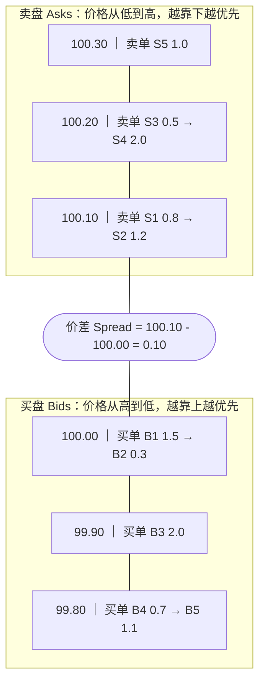
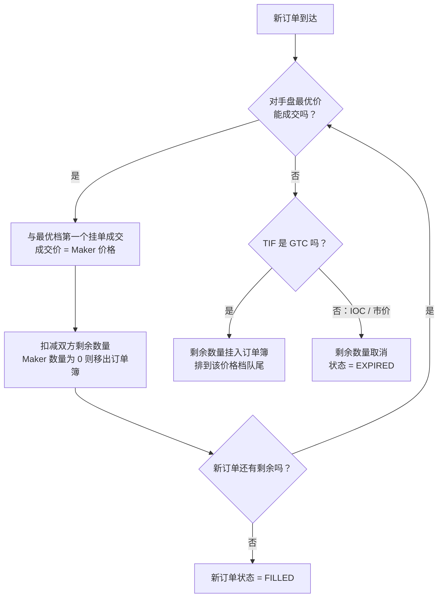
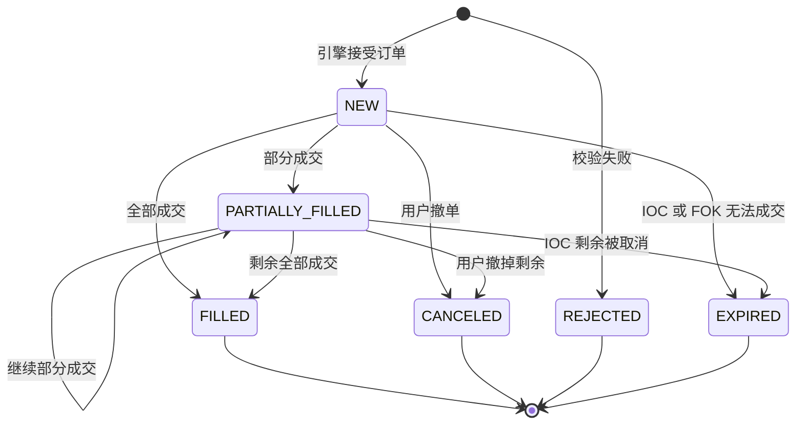
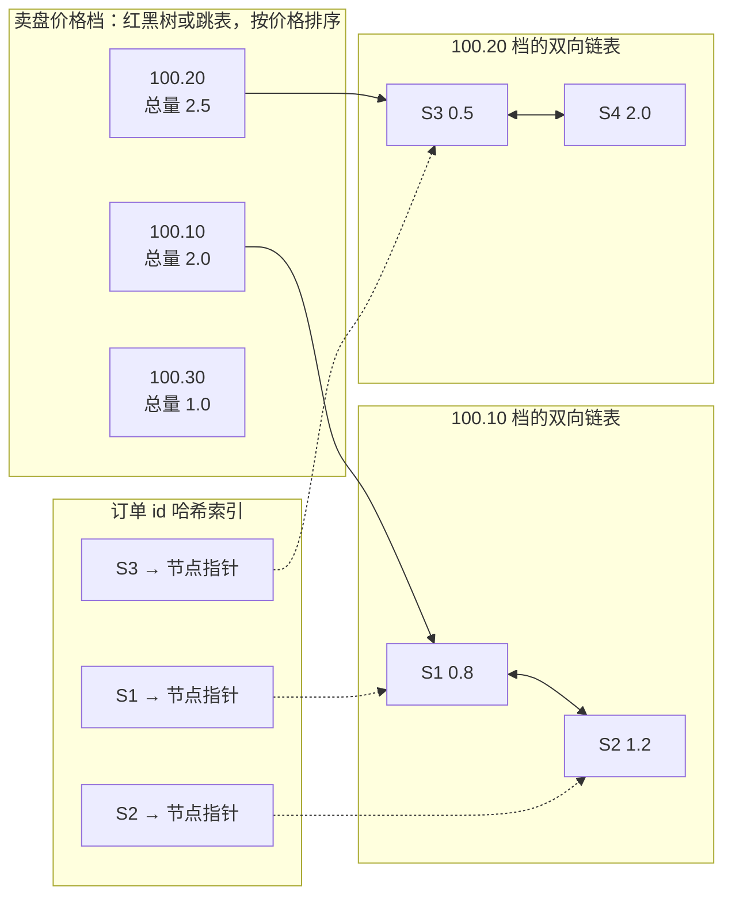
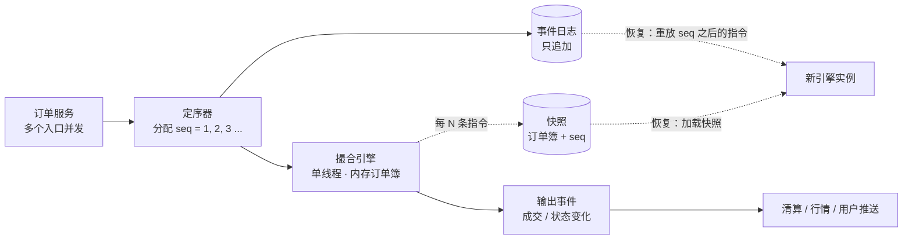
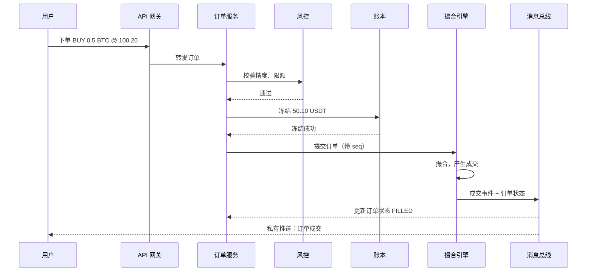

# 06 订单与撮合

> 学习目标：读完本章，你能——
> 1. 说清订单簿的结构和"价格优先、时间优先"规则；
> 2. 区分限价、市价、止损、OCO、冰山、Post-Only 订单，以及 GTC / IOC / FOK；
> 3. 解释撮合引擎为什么是单线程、确定性、可重放的。
>
> 前置章节：[02 系统架构](02-system-architecture.md)、[05 账本](05-ledger.md)
> 交互实验：[order-book-matching.html](interactive/order-book-matching.html)（可操作的撮合引擎）

---

## 1. 一句话理解

撮合引擎是交易所的心脏。它把买单和卖单按"价格优先、时间优先"配对，产出成交。

> 🎯 打个比方：订单簿像菜市场里的两排摊位。左边一排是"想买菜的人"，出价高的站前面；右边一排是"想卖菜的人"，要价低的站前面。同样的价格，先来的人排在前面。撮合引擎就是市场管理员：新顾客一到，管理员就拿他的出价和对面第一排比。价格对得上，就当场成交；对不上，就让他去自己那一排按规矩排队。

---

## 2. 业务视角：它解决什么问题

一笔交易需要两个人：一个想买，一个想卖。交易所要解决三个问题：

| 问题 | 撮合引擎的答案 |
|---|---|
| 谁和谁成交？ | 按价格优先、时间优先选对手方 |
| 成交价是多少？ | 用挂单方（Maker）的价格 |
| 没成交的单怎么办？ | 按有效方式（TIF）决定：挂单、撤单或整单拒绝 |

先定义四个基本术语：

- **挂单方（Maker）**：订单进入订单簿后等待成交的一方。它为市场"提供"流动性。
- **吃单方（Taker）**：订单一到达就和已有挂单成交的一方。它"消耗"流动性。
- **买盘（Bids）**：所有未成交的买单，按价格从高到低排列。
- **卖盘（Asks）**：所有未成交的卖单，按价格从低到高排列。

买一价（最高买价）和卖一价（最低卖价）之间的差叫**价差（Spread）**。价差越小，市场越活跃。

> 💡 注意：成交价使用 Maker 的价格，不是 Taker 的价格。如果你挂 101 买，而卖一价是 100，你会以 100 成交。多出的 1 不会"白付"。

---

## 3. 系统视角：它如何实现

### 3.1 订单簿的结构

订单簿按**价格档位（Price Level）**组织。一个价格档位是同一价格上所有挂单的集合。

**读图要点**：
- 卖一价（100.10）和买一价（100.00）最靠近中间，它们最先被吃掉。
- 同一价格档内，箭头表示排队顺序。S1 比 S2 先到，所以 S1 先成交。
- 所有数字是示例。真实订单簿有成千上万个档位。

### 3.2 撮合规则：价格优先、时间优先

价格-时间优先（Price-Time Priority）又叫 FIFO（First In First Out，先进先出）。规则只有两条：

1. 价格更好的订单先成交。买单价格越高越好，卖单价格越低越好。
2. 价格相同时，先到的订单先成交。

新订单到达后，撮合引擎执行以下步骤：

**读图要点**：
- 循环从"对手盘最优价"开始，每次只吃一个挂单。这就是"逐档吃单"。
- 市价单没有限价，所以"能成交吗"永远为是，直到对手盘吃空。
- FOK 不在这张图里。FOK 在进入循环前先检查总量，见 3.4 节。

**示例**：卖盘如 3.1 节。用户下限价买单：价格 100.20，数量 2.5。

1. 引擎和 S1 成交 0.8 @ 100.10。剩余 1.7。
2. 引擎和 S2 成交 1.2 @ 100.10。剩余 0.5。
3. 引擎和 S3 成交 0.5 @ 100.20。剩余 0。
4. 订单状态变为 FILLED。成交均价 = (0.8×100.10 + 1.2×100.10 + 0.5×100.20) / 2.5 = 100.12。

### 3.3 订单类型

| 类型 | 中文 | 行为 | 币安 API 对应 |
|---|---|---|---|
| Limit | 限价单 | 指定价格。能成交就成交，剩余挂单。 | `LIMIT` |
| Market | 市价单 | 不指定价格。按对手盘最优价逐档成交。 | `MARKET` |
| Stop-Limit | 止损限价单 | 最新价触及触发价后，系统下一个限价单。 | `STOP_LOSS_LIMIT` / `TAKE_PROFIT_LIMIT` |
| OCO | 二选一订单 | 两个订单绑在一起。一个成交，另一个自动撤销。 | 订单列表（Order List），`contingencyType=OCO` |
| Iceberg | 冰山单 | 订单簿只显示一小部分数量。显示部分成交后，系统补上下一部分。 | 参数 `icebergQty` |
| Post-Only | 只做 Maker | 如果订单会立即成交，系统拒绝它。保证只当 Maker。 | `LIMIT_MAKER` |

以上 API 名称来自币安现货 API 公开文档（截至 2026 年公开资料）。

补充说明：

- **止损单**在触发前不进入订单簿。触发条件由一个独立的"条件单服务"监控（业界通用做法）。触发后它才变成普通订单进入撮合。
- **冰山单**的数量上限受 `ICEBERG_PARTS` 过滤器限制。拆分份数 = 向上取整(总量 / icebergQty)。
- **Post-Only** 常被做市商使用。Maker 手续费通常低于 Taker 手续费，见 [07 清算结算与手续费](07-clearing-settlement-fees.md)。

> ⚠️ 警告：市价单在薄盘口里会吃穿多个档位，成交均价可能远差于你看到的最新价。用 [depth-slippage.html](interactive/depth-slippage.html) 体验滑点。

### 3.4 有效方式 TIF

**有效方式（Time In Force，TIF）**：订单在订单簿里能存活多久的规则。

| TIF | 全称 | 能成交的部分 | 不能成交的部分 |
|---|---|---|---|
| GTC | Good Till Canceled | 立即成交 | 挂入订单簿，直到成交或用户撤单 |
| IOC | Immediate Or Cancel | 立即成交 | 立即取消 |
| FOK | Fill Or Kill | 必须**全部**立即成交 | 如果不能全部成交，整单取消，一笔也不成交 |

FOK 的实现要点：撮合引擎先"预演"。它累加对手盘中所有可成交的数量。如果总量小于订单数量，引擎直接取消订单，不修改订单簿。

### 3.5 订单生命周期状态机

**读图要点**：
- 终态有四个：FILLED、CANCELED、REJECTED、EXPIRED。订单进入终态后不再变化。
- REJECTED 表示订单没进入撮合（例如价格不符合 tickSize）。EXPIRED 表示订单按规则被系统取消。
- 币安公开文档还定义了 `EXPIRED_IN_MATCH`：订单因自成交预防（STP）被系统取消。图中省略了它。
- 状态只能向前走。如果下游看到 FILLED 之后又收到 PARTIALLY_FILLED，它必须按序号丢弃旧消息。

### 3.6 撮合引擎内部实现

#### 为什么是单线程

撮合必须严格有序。两个订单谁先到，决定谁先成交。如果多线程同时修改同一个订单簿，就需要加锁。锁会带来竞争和不确定的执行顺序。

业界通用做法是：**一个交易对只由一个线程处理**。不同交易对之间没有依赖，所以可以按交易对分片（Sharding）。BTC/USDT 在线程 A，ETH/USDT 在线程 B。

> 🎯 打个比方：每个交易对是一个独立的收银台，每个收银台只有一个收银员。收银员不需要和别人商量，所以速度很快。但如果所有人都挤到同一个收银台（热门币上线），这一台就会排长队。

#### 数据结构

订单簿需要高效完成三种操作：

| 操作 | 频率 | 需要的数据结构 |
|---|---|---|
| 找到最优价 | 每个订单都要做 | 有序结构，O(1) 读取最优档 |
| 新增价格档 / 删除空档 | 频繁 | 有序结构，O(log n) 插入删除 |
| 按订单 id 撤单 | 非常频繁 | 哈希表，O(1) 定位订单 |

**读图要点**：
- 价格档用红黑树或跳表存储，引擎缓存最优档指针，读取最优价是 O(1)。
- 每个价格档挂一条双向链表。新订单追加到链表尾部，成交从链表头部取。这就是 FIFO。
- 撤单时，引擎用哈希表找到节点，再从双向链表中 O(1) 摘除。不需要遍历。
- 每个价格档缓存"总量"。行情深度直接读这个值，不用逐单求和。

> 💡 注意：价格和数量在引擎内部用**整数**表示。例如 tickSize 为 0.01 时，价格 100.10 存成整数 10010。浮点数会产生 0.1 + 0.2 ≠ 0.3 这类误差，撮合不能接受。

### 3.7 定序器、事件日志与快照恢复

撮合引擎把订单簿放在**内存**里。内存很快，但进程崩溃后数据会丢失。业界的解决办法是"定序 + 日志 + 快照"。

- **定序器（Sequencer）**：给每条输入指令分配一个全局递增序号。序号决定处理顺序。
- **事件日志（Event Log）**：按序号持久化保存所有输入指令。日志只追加，不修改。
- **快照（Snapshot）**：定期把整个订单簿写到磁盘，并记录快照对应的序号。

**读图要点**：
- 输入先定序、再落日志、再撮合。日志是唯一的事实来源。
- 恢复步骤：加载最近快照 → 重放快照序号之后的日志 → 订单簿恢复到崩溃前状态。
- 备用引擎可以实时消费同一份日志，保持热备。主引擎故障时，备用引擎接管。
- 风险点：如果日志写入失败但撮合已执行，两者会不一致。所以必须先落日志，再撮合。

#### 为什么撮合必须是确定性的

**确定性（Deterministic）**：相同的初始状态 + 相同顺序的输入 = 完全相同的输出。

撮合引擎要满足确定性，必须遵守以下规则：

1. 不读取系统时钟。时间戳由定序器写进指令。
2. 不使用随机数。
3. 不依赖哈希表的遍历顺序。
4. 不使用浮点数计算价格和数量。
5. 不在撮合逻辑里调用外部服务（数据库、网络）。

满足这五条后，重放日志就能得到逐字节相同的订单簿和成交记录。这让故障恢复、主备切换和审计对账成为可能。

在 [order-book-matching.html](interactive/order-book-matching.html) 中点击"重放事件日志"按钮。页面会清空订单簿，按序号重新执行全部指令，然后比较重建结果和当前订单簿。

### 3.8 LMAX 架构思路

LMAX 是英国的一家外汇交易所。它在 2010 年前后公开了自己的架构，后来被很多交易所参考。核心思路：

| 思路 | 说明 |
|---|---|
| 单线程业务逻辑 | 业务逻辑处理器（Business Logic Processor）只用一个线程，全部状态在内存中 |
| 事件溯源（Event Sourcing） | 输入事件持久化，状态可以通过重放事件重建 |
| Disruptor 环形队列 | 用无锁环形缓冲区在线程间传递消息，替代传统队列 |
| 输入输出分离 | 日志落盘、复制到备机、反序列化都在业务线程之外并行完成 |

LMAX 公开资料称单线程每秒可以处理数百万个订单（以原始资料为准）。关键原因是：没有锁、没有磁盘等待、CPU 缓存命中率高。

### 3.9 价格精度：tickSize、stepSize、minNotional

交易所不接受任意精度的价格和数量。币安通过 `GET /api/v3/exchangeInfo` 公开每个交易对的**过滤器（filters）**（截至 2026 年公开资料）：

| 过滤器 | 关键字段 | 含义 |
|---|---|---|
| `PRICE_FILTER` | `minPrice` / `maxPrice` / `tickSize` | 价格的上下限和最小变动单位 |
| `LOT_SIZE` | `minQty` / `maxQty` / `stepSize` | 数量的上下限和最小变动单位 |
| `NOTIONAL` | `minNotional` / `maxNotional` | 订单金额（价格 × 数量）的上下限 |
| `MARKET_LOT_SIZE` | 同 LOT_SIZE | 市价单的数量规则 |
| `ICEBERG_PARTS` | `limit` | 冰山单最多拆成几份 |
| `MAX_NUM_ORDERS` | `maxNumOrders` | 单个账户在该交易对的最大挂单数 |

**示例**：某交易对 tickSize = 0.01，stepSize = 0.00001，minNotional = 5 USDT（数值为示例）。

1. 价格 100.123 不合法。它不是 0.01 的整数倍。
2. 数量 0.000001 不合法。它不是 0.00001 的整数倍。
3. 价格 100、数量 0.01 的订单金额是 1 USDT。它小于 5 USDT，系统拒绝订单。

这些校验在订单进入撮合引擎**之前**完成。引擎只处理已经对齐精度的整数。

### 3.10 自成交预防 STP

**自成交（Self-Trade）**：同一个账户的买单和卖单互相成交。它不改变持仓，但会制造虚假成交量。监管上常被视为"对敲"。

**自成交预防（Self-Trade Prevention，STP）**：撮合引擎发现买卖双方属于同一账户（或同一交易组）时，按规则取消订单，不产生成交。

币安现货 API 公开的 STP 模式（截至 2026 年公开资料，完整列表以官方 enums 文档为准）：

| 模式 | 行为 |
|---|---|
| `EXPIRE_TAKER` | 取消新来的 Taker 订单剩余部分 |
| `EXPIRE_MAKER` | 取消订单簿中的 Maker 订单 |
| `EXPIRE_BOTH` | 两边都取消 |
| `DECREMENT` | 双方都扣减重叠数量，不产生成交 |
| `NONE` | 不做自成交预防 |

因 STP 被取消的订单，状态为 `EXPIRED_IN_MATCH`。

---

## 4. 币安怎么做

### 4.1 公开事实（截至 2026 年公开资料）

- 订单类型：`LIMIT`、`MARKET`、`STOP_LOSS`、`STOP_LOSS_LIMIT`、`TAKE_PROFIT`、`TAKE_PROFIT_LIMIT`、`LIMIT_MAKER`。
- TIF：`GTC`、`IOC`、`FOK`。
- 订单状态：`NEW`、`PARTIALLY_FILLED`、`FILLED`、`CANCELED`、`REJECTED`、`EXPIRED`、`EXPIRED_IN_MATCH` 等。
- 订单列表（Order List）支持 `OCO` 和 `OTO` 两种联动类型。
- 每个交易对的精度规则通过 `exchangeInfo` 的 filters 公开。
- 交易对有状态字段，例如 `TRADING`、`HALT`、`BREAK`。系统维护时交易对会暂停撮合。

### 4.2 业界通用做法（币安未完全公开）

- 撮合引擎按交易对分片，单线程，内存订单簿。
- 输入经过定序，事件日志持久化，定期快照。
- 主备引擎消费同一份日志，实现快速切换。
- 撮合结果通过消息总线发给清算、行情、用户推送服务。

下面的时序图展示一笔订单从 API 到成交回报的典型路径（业界通用做法）：

**读图要点**：
- 冻结资金发生在撮合**之前**。撮合引擎本身不碰余额，见 [05 账本](05-ledger.md)。
- 撮合引擎的输出是事件。清算服务消费事件后才真正划转资产，见 [07 清算结算与手续费](07-clearing-settlement-fees.md)。
- 如果撮合成功但消息总线丢消息，下游会不一致。所以下游要按序号检测缺口并重放。

---

## 5. 故障与边界

### 5.1 单交易对吞吐上限

一个交易对只有一个线程。这个线程的处理能力就是该交易对的上限。分片只能扩展"交易对数量"，不能扩展"单个交易对的吞吐"。

### 5.2 热门币上线拥堵

新币上线的第一分钟，大量用户同时下市价单。常见现象：

1. 输入队列积压。用户下单后数秒才收到回报。
2. 价格在几秒内剧烈波动。早到的市价单成交价远高于预期。
3. 撤单指令排在大量新订单后面，无法及时撤单。

常见缓解措施（业界通用做法）：

- 上线前设置"仅限价单"阶段，暂时禁止市价单。
- 设置价格保护，拒绝偏离参考价过多的订单（币安有 `PERCENT_PRICE_BY_SIDE` 过滤器）。
- 对单个用户限频。

### 5.3 其他边界

| 风险 | 后果 | 对策 |
|---|---|---|
| 使用浮点数 | 剩余数量出现 0.0000000001 这样的"灰尘" | 全部用整数 tick 和 step |
| 非确定性代码 | 重放结果和原结果不同，主备不一致 | 遵守 3.7 节五条规则 |
| 快照间隔太长 | 恢复时重放日志耗时长 | 缩短快照间隔，或用热备 |
| 时间优先被滥用 | 高频交易抢队首位置 | 部分交易所试验随机延迟或批量拍卖，币安现货仍用连续撮合 |

> ⚠️ 警告：撤单不是即时生效。撤单指令也要排队定序。如果你的撤单排在一笔吃单之后，你的挂单仍会被成交。

---

## 6. 本仓库对照（CEX Demo）

| 主题 | 本仓库实现 | 与生产级做法的差距 |
|---|---|---|
| 撮合内核 | `engines/matching-engine`：Rust，TCP + JSON line 协议，支持 `submit` / `cancel` / `snapshot` / `reset` / `seed` | 结构清晰，适合学习 |
| 订单簿数据结构 | `OrderBook { bids: Vec, asks: Vec }`，每次插入后整体排序 | 生产级用红黑树/跳表 + 双向链表 + 哈希索引 |
| 优先级 | 价格优先，同价按 `created_at` 时间排序 | 一致 |
| 订单类型 / TIF | `limit`、`market`；`gtc`、`ioc`、`fok`；FOK 先累加可成交量再决定 | 未实现止损、OCO、冰山、Post-Only、STP |
| 并发模型 | `Arc<Mutex<HashMap<market, OrderBook>>>`，所有交易对共享一把锁 | 生产级按交易对分片、单线程、无锁 |
| 数值 | `f64` + `0.00000001` 容差比较 | 生产级用整数 tick / step |
| 恢复 | `order-service` 的 `POST /api/v1/orders/ops/replay-engine` 从数据库读出挂单，用 `seed` 重建订单簿 | 没有定序器和事件日志，重建依赖数据库快照，不是逐条重放 |
| 精度校验 | `risk-service` 校验最小数量、价格 step、数量 step、价格偏离 | 与币安 filters 思路一致 |
| 订单状态 | `order-service`：`pending_risk` → `accepted` / `partially_filled` → `filled` / `cancelled` / `rejected` | 多了 `pending_risk`、`recovery_pending` 等编排状态 |

相关文件：

- [engines/matching-engine/src/main.rs](../engines/matching-engine/src/main.rs)：`submit_order`、`crosses`、`sum_executable_quantity`
- [services/order-service/README.md](../services/order-service/README.md)
- [docs/architecture.md](../docs/architecture.md)

> 💡 注意：本仓库撮合内核的 `created_at` 由调用方传入。这和"时间戳由定序器写入"的思路一致，有利于重放的确定性。

---

## 7. 术语表

| 术语 | 英文 | 定义 |
|---|---|---|
| 订单簿 | Order Book | 所有未成交挂单的集合，分买盘和卖盘 |
| 价格档位 | Price Level | 同一价格上所有挂单的集合 |
| 挂单方 | Maker | 订单进入订单簿等待成交的一方 |
| 吃单方 | Taker | 订单到达后立即与挂单成交的一方 |
| 价差 | Spread | 卖一价减买一价 |
| 价格-时间优先 | Price-Time Priority / FIFO | 先比价格，价格相同比到达时间 |
| 有效方式 | Time In Force（TIF） | 订单存活规则：GTC / IOC / FOK |
| 只做 Maker | Post-Only / LIMIT_MAKER | 会立即成交时被拒绝的限价单 |
| 冰山单 | Iceberg Order | 只显示部分数量的大额限价单 |
| 二选一订单 | OCO（One-Cancels-the-Other） | 两个订单联动，一个成交另一个撤销 |
| 定序器 | Sequencer | 给输入指令分配全局递增序号的组件 |
| 事件日志 | Event Log | 只追加的输入指令记录，用于重放 |
| 快照 | Snapshot | 某个序号时刻的完整订单簿副本 |
| 确定性 | Deterministic | 相同输入顺序产生相同输出 |
| 最小价格变动 | tickSize | 价格必须是它的整数倍 |
| 最小数量变动 | stepSize | 数量必须是它的整数倍 |
| 最小名义金额 | minNotional | 价格 × 数量的最小值 |
| 自成交预防 | Self-Trade Prevention（STP） | 阻止同一账户买卖单互相成交 |

---

## 8. 思考题

1. 在 [order-book-matching.html](interactive/order-book-matching.html) 中，用 FOK 下一个数量超过卖盘总量的市价买单。订单簿有没有变化？为什么 FOK 需要"预演"？
2. 在同一个页面勾选 Post-Only，挂一个价格高于卖一价的买单。系统怎么处理？做市商为什么需要这个选项？
3. 连续下几笔单后点击"重放事件日志"。如果撮合逻辑里使用了 `Math.random()` 决定同价订单的顺序，重放结果还会一致吗？
