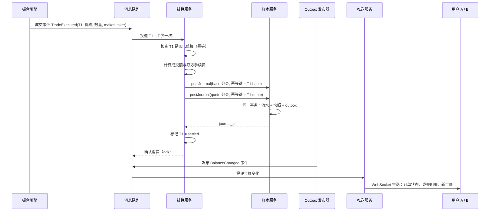
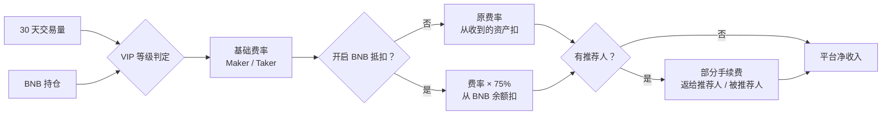
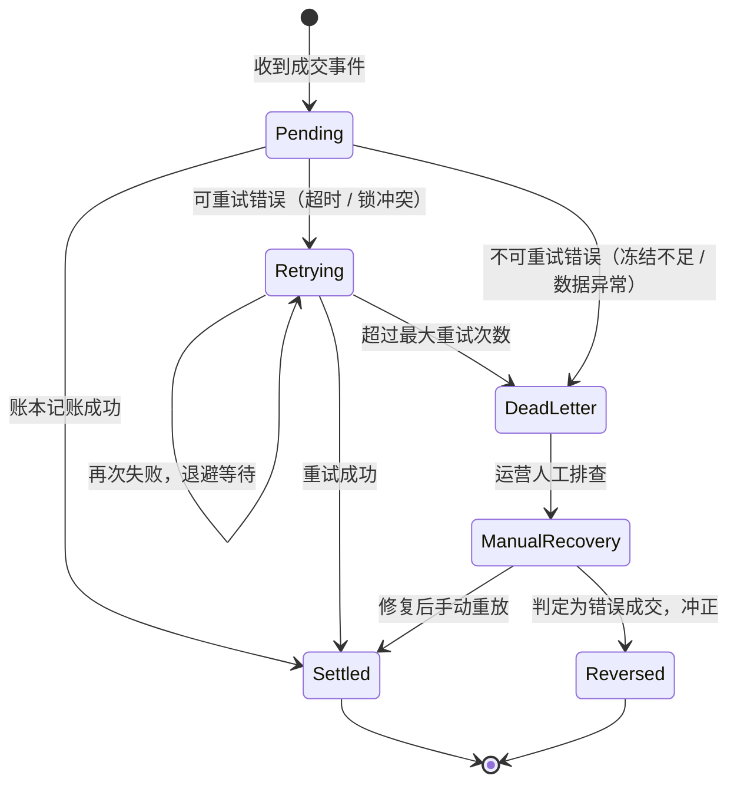

# 07 清算结算与手续费

> 学习目标：读完本章，你能——
> 1. 说出一笔成交从撮合到账本、再到用户推送的完整链路。
> 2. 写出一笔 BTC/USDT 成交中买方、卖方、手续费账户的全部分录。
> 3. 解释 Maker/Taker 费率、VIP 等级、BNB 抵扣、返佣和零手续费的商业逻辑。
>
> 前置章节：[05-ledger.md](05-ledger.md)、[06-order-matching.md](06-order-matching.md)
> 交互实验：[ledger-double-entry.html](interactive/ledger-double-entry.html)（迷你账本 + 手续费计算器）

---

## 1. 一句话理解

撮合引擎只产生一句话："A 和 B 以 60000 成交了 0.04 BTC"。**清算结算**把这句话翻译成账本里的钱：谁减少多少、谁增加多少、平台收多少手续费。

两个词的区别：

- 清算（Clearing）：计算每一方应收、应付多少。它只算账，不动钱。
- 结算（Settlement）：按清算结果实际修改账本余额。它动钱。

在现货交易所，清算和结算通常在同一个服务里连续完成。所以本章把它们合称"结算"。

> 🎯 打个比方：撮合像拍卖师落槌喊"成交！"。结算像拍卖行的财务室：落槌之后，财务从买家押金里扣款，把货款减去佣金转给卖家，佣金进拍卖行的账户。落槌只要一秒。财务室必须一分不差。

---

## 2. 业务视角：它解决什么问题

成交以后，平台必须保证 3 件事：

1. **原子性**：买方拿到币，卖方拿到钱。不能只完成一半。
2. **准确性**：金额精确到最小单位。手续费按规则计算和舍入。
3. **不重不漏**：每一笔成交结算且只结算一次。

手续费是交易所最主要的收入来源之一（见 [12-business-model.md](12-business-model.md)）。所以结算服务同时也是"收银台"。

---

## 3. 系统视角：它如何实现

### 3.1 成交后发生什么

**读图要点**

- 数据从撮合引擎出发，经消息队列进入结算服务，最终落在账本。
- 结算服务先做幂等检查。消息队列会重投，同一个 T1 可能到达多次。
- 结算服务在账本成功之后才 ack。如果中途崩溃，消息会重投，幂等键保证不会重复记账。
- 推送走 outbox，所以推送可能比账本晚几十到几百毫秒（示例）。用户界面短暂显示旧余额是正常现象。

### 3.2 一笔 BTC/USDT 成交的完整分录

场景（示例数值）：

- 用户 A 先挂买单：0.1 BTC，价格 60000 USDT。A 是挂单方（Maker）。下单时已冻结 6000 USDT。
- 用户 B 后下卖单，立即成交 0.04 BTC。B 是吃单方（Taker）。
- 成交额 = 60000 × 0.04 = 2400 USDT。
- 费率：Maker 0.1%，Taker 0.1%（普通用户，示例）。
- 手续费从"收到的资产"中扣：A 收到 BTC，付 BTC 手续费；B 收到 USDT，付 USDT 手续费。

手续费：

- A（Maker）：0.04 BTC × 0.1% = 0.00004 BTC
- B（Taker）：2400 USDT × 0.1% = 2.4 USDT

**BTC 分录**（journal 幂等键 `T1:base`）

| # | 账户 | 借 | 贷 | 说明 |
|---|---|---|---|---|
| 1 | 用户B-BTC-可用 | 0.04 | | B 交出 BTC |
| 2 | 清算中间户-BTC | | 0.04 | 进入清算户 |
| 3 | 清算中间户-BTC | 0.04 | | 清算户转出 |
| 4 | 用户A-BTC-可用 | | 0.03996 | A 收到净额 |
| 5 | 平台手续费收入-BTC | | 0.00004 | A 的 Maker 手续费 |
| | **合计** | **0.08** | **0.08** | 平衡 |

**USDT 分录**（journal 幂等键 `T1:quote`）

| # | 账户 | 借 | 贷 | 说明 |
|---|---|---|---|---|
| 1 | 用户A-USDT-冻结 | 2400 | | 扣减 A 的冻结 |
| 2 | 清算中间户-USDT | | 2400 | 进入清算户 |
| 3 | 清算中间户-USDT | 2400 | | 清算户转出 |
| 4 | 用户B-USDT-可用 | | 2397.6 | B 收到净额 |
| 5 | 平台手续费收入-USDT | | 2.4 | B 的 Taker 手续费 |
| | **合计** | **4800** | **4800** | 平衡 |

成交后：

- A 的 USDT 冻结还剩 3600。订单剩余 0.06 BTC 继续挂在簿上。
- 清算中间户两个资产的余额都回到 0。
- 平台资产（热钱包）没有变化。成交只是负债在用户之间重新分配，加上一部分负债转成平台收入。

> 💡 注意：B 是直接从可用余额卖出的简化写法。真实系统中，B 的卖单也先冻结 BTC，再从冻结中扣减。

> ⚠️ 警告：如果漏写第 5 行，journal 借贷不平衡。账本必须拒绝提交。如果账本没有平衡校验，A 和 B 的余额看起来都正确，但平台收入凭空少了一笔，对账时才会发现差额。

你可以在 [ledger-double-entry.html](interactive/ledger-double-entry.html) 中逐步重现这张表。

### 3.3 Maker 与 Taker

- 挂单方（Maker）：订单进入订单簿等待成交的一方。它为市场提供了流动性。
- 吃单方（Taker）：订单立即与簿上已有挂单成交的一方。它消耗了流动性。

交易所通常让 Maker 费率 ≤ Taker 费率。原因：挂单越多，订单簿越厚，滑点越小，更多 Taker 愿意来交易。详见 [08-market-data.md](08-market-data.md) 和 [depth-slippage.html](interactive/depth-slippage.html)。

### 3.4 币安 VIP 等级（截至 2026 年公开资料，示例）

币安现货按"过去 30 天现货交易量（USD）"和"BNB 持仓"划分 VIP 等级。下表引自币安官网费率页（截至 2026 年公开资料）。币安会调整参数，请以官网为准。

| 等级 | 30 天交易量（USD） | BNB 持仓 | Maker | Taker | Maker（BNB 抵扣） | Taker（BNB 抵扣） |
|---|---|---|---|---|---|---|
| 普通 | < 1,000,000 | ≥ 0 | 0.100% | 0.100% | 0.0750% | 0.0750% |
| VIP 1 | ≥ 1,000,000 | ≥ 5 | 0.090% | 0.100% | 0.0675% | 0.0750% |
| VIP 2 | ≥ 5,000,000 | ≥ 25 | 0.080% | 0.100% | 0.0600% | 0.0750% |
| VIP 3 | ≥ 20,000,000 | ≥ 100 | 0.040% | 0.060% | 0.0300% | 0.0450% |
| VIP 4 | ≥ 75,000,000 | ≥ 500 | 0.040% | 0.052% | 0.0300% | 0.0390% |
| VIP 5 | ≥ 150,000,000 | ≥ 1,000 | 0.025% | 0.031% | 0.01875% | 0.02325% |
| VIP 6 | ≥ 400,000,000 | ≥ 1,750 | 0.020% | 0.029% | 0.0150% | 0.02175% |
| VIP 7 | ≥ 800,000,000 | ≥ 3,000 | 0.019% | 0.028% | 0.01425% | 0.0210% |
| VIP 8 | ≥ 2,000,000,000 | ≥ 4,500 | 0.016% | 0.025% | 0.0120% | 0.01875% |
| VIP 9 | ≥ 4,000,000,000 | ≥ 5,500 | 0.011% | 0.023% | 0.00825% | 0.01725% |

> 💡 注意：官网费率页对 VIP 1 及以上写的是"交易量 **and** BNB 持仓"。历史上币安多次调整过判定规则。手续费计算器提供"同时满足"和"满足任一"两种规则，便于对比。

币安公开说明：系统每天 00:00（UTC）按过去 30 天交易量和 BNB 余额重新评估等级。

**读图要点**

- 等级由两个输入决定。交易量奖励"活跃"，BNB 持仓把用户绑定到币安生态。
- BNB 抵扣同时改变两件事：费率打 75 折，扣费资产换成 BNB。
- 返佣发生在手续费收取之后。平台净收入 = 手续费 − 返佣。
- 参数会变化。用 [ledger-double-entry.html](interactive/ledger-double-entry.html) 底部的计算器体验等级变化。

### 3.5 BNB 抵扣手续费

用户开启"使用 BNB 抵扣"后：

1. 系统按折后费率（原费率 × 75%，截至 2026 年公开资料）计算手续费。
2. 系统把手续费按当时价格折算成 BNB。
3. 系统从用户 BNB 可用余额中扣除。
4. 如果 BNB 不足，系统按原费率从收到的资产中扣。

在账本里，BNB 抵扣让 BTC/USDT 成交多出一组 BNB 分录：借 用户-BNB-可用，贷 平台手续费收入-BNB。

商业逻辑：BNB 抵扣给 BNB 创造了持续的使用需求。它是交易所平台币的典型设计（见 [11-products-ecosystem.md](11-products-ecosystem.md)）。

### 3.6 返佣与推荐计划

推荐计划（Referral）：老用户分享推荐码。新用户注册后，平台把新用户手续费的一部分返给推荐人，或返给新用户本人。

- 据第三方公开资料，币安现货推荐的基础返佣比例为 20%。推荐人持有至少 500 BNB 时，最高可达 40%。2024 年起，部分地区的基础比例下调到 10%–15%。这些数字来自非官方整理，币安会按地区调整，以官网为准。
- 推荐人可以把一部分返佣让给被推荐人，这叫"返现"（Kickback）。例如：标准费率 0.1%，被推荐人获得 20% 返现，实际费率是 0.08%。

账本做法（业界通用）：

1. 成交结算时，手续费先全部进入"平台手续费收入"。
2. 返佣服务按周期（例如每小时或每天，示例）汇总应返金额。
3. 返佣服务记分录：借 平台手续费收入（或"返佣支出"科目），贷 推荐人-可用。

批量返佣也降低了手续费账户的热点压力。热点账户见 [05-ledger.md](05-ledger.md) 第 3.9 节。

### 3.7 零手续费活动的商业逻辑

2022 年 7 月 8 日，币安对 13 个 BTC 现货交易对取消交易手续费，包括 BTC/USDT、BTC/BUSD 和多个法币交易对。2023 年 3 月 22 日，币安结束了这些交易对的零手续费，只保留 BTC/TUSD 一个交易对（币安官方公告）。

平台为什么愿意放弃手续费？

| 目的 | 机制 |
|---|---|
| 抢市场份额 | 交易量向币安集中，竞争对手的成交量下降 |
| 改善流动性 | 更多挂单让价差变窄，吸引更多用户 |
| 引流到其他产品 | 用户进入平台后，会使用合约、理财等收费产品 |
| 推广特定稳定币 | 只对某个稳定币交易对免费，提升该稳定币的使用 |

代价：零手续费也会吸引刷量（Wash Trading）。平台需要风控识别自成交和异常交易（见 [09-risk-control.md](09-risk-control.md)）。

### 3.8 结算失败与补偿

结算可能在任何一步失败：账本超时、数据库锁冲突、冻结记录不存在、服务崩溃。

**读图要点**

- 可重试错误自动重试。每次重试的间隔递增（指数退避，Exponential Backoff）。
- 不可重试错误直接进入死信，不浪费重试次数。
- 所有重试和人工重放都用同一个幂等键。所以重放多少次都只记一次账。
- 局限：结算卡住期间，用户 A 看到订单已成交，但余额没有变化。平台需要在界面显示"结算中"。

步骤：

1. 结算服务捕获错误，判断错误类型。
2. 如果错误可重试，结算服务写入恢复任务（recovery job），设置下次执行时间。
3. 后台 worker 按时间扫描恢复任务，重新执行结算。
4. 如果重试次数超过上限，worker 把任务标记为终态失败（死信）。
5. 运营人员在运营后台查看死信，修复后手动恢复。

> ⚠️ 警告：结算是成交的"后半段"。撮合已经确认的成交不能撤销。所以结算失败只能"补"，不能"退回到撮合前"。

### 3.9 实时结算 vs 批量结算

| 维度 | 实时结算（逐笔） | 批量结算（按周期） |
|---|---|---|
| 时机 | 每笔成交立即结算 | 每 N 秒或每天汇总后结算 |
| 用户体验 | 成交后余额立即可用 | 余额延迟到账 |
| 账本压力 | 高：每笔成交都写多条分录 | 低：多笔合并成一条净额分录 |
| 热点账户 | 严重 | 轻 |
| 风险敞口 | 小：没有未结算的应收应付 | 大：周期内存在未结算头寸 |
| 典型场景 | 加密现货交易所（币安现货属于这一类） | 传统证券 T+1、返佣发放、手续费汇总 |

加密现货交易所的用户期待"成交后马上能卖"。所以用户余额通常实时结算。平台内部账户（手续费汇总、返佣）可以批量结算。这种混合方案兼顾体验和吞吐。

---

## 4. 币安怎么做（公开事实 + 业界做法）

**币安公开的事实**

- 现货费率按 VIP 等级区分 Maker 和 Taker（见 3.4 表）。
- 开启 BNB 抵扣后，费率打 75 折（截至 2026 年公开资料）。
- 默认情况下，手续费从用户收到的资产中扣。
- 现货成交后，余额在界面上实时变化；成交明细中显示手续费金额和扣费币种。
- 币安运行推荐计划，并多次举办零手续费活动（官方公告）。

**业界通用做法（币安未公开内部实现）**

- 撮合与结算解耦，通过消息队列传递成交事件。
- 以成交号作为结算幂等键。
- 用户余额逐笔实时结算，平台账户批量汇总。
- 结算失败进入重试队列，超限进入死信并人工处理。

---

## 5. 故障与边界：哪里会出错，局限在哪

| 故障 | 后果 | 防线 |
|---|---|---|
| 同一成交被结算两次 | 买方多收币，卖方多收钱 | 成交号幂等键 + 唯一索引 |
| 手续费四舍五入方向不统一 | 长期累积出对账差额 | 统一"向下取整"等规则，写进文档 |
| 浮点数计算成交额 | 0.00000001 级差额 | 整数最小单位 / 定点数 / BigInt |
| 撤单与成交同时到达 | 冻结已释放，扣减失败 | 冻结状态机；结算失败进入补偿 |
| 结算服务长期积压 | 用户余额不更新 | 监控消费延迟；扩容消费者 |
| VIP 等级计算延迟 | 用户短时间内按旧费率交易 | 公开说明每日更新时间 |
| 推荐返佣被滥用 | 自己推荐自己，套取返佣 | 设备指纹、KYC 关联识别 |

**局限**

- 本章分录示例省略了卖方冻结、BNB 抵扣分录和价格优于限价时的退款。
- 费率表是某一时刻的快照。币安会调整，计算器只用于理解机制。

---

## 6. 本仓库对照（CEX Demo 中的对应服务）

本仓库的 `services/settlement-service` 负责结算。主链说明见 [docs/architecture.md](../docs/architecture.md)。

| 本章概念 | 本仓库实现 |
|---|---|
| 结算入口 | `POST /api/v1/settlement/trades/settle`，当前由 `order-service` **同步**调用（不是异步消费） |
| 幂等 | 按 `tradeId` 幂等；journal 幂等键为 `spot_trade:base:<tradeId>` 和 `spot_trade:quote:<tradeId>` |
| 清算中间户 | `platform:spot:settlement:<asset>`：先 `consumeBalance` 把冻结转入，再 `postJournal` 转给对手方 |
| 手续费账户 | `platform:spot:fee:<asset>`（卖方 quote 费、买方 base 费各入对应资产的账户），未分桶 |
| 手续费规则 | 双边收费：卖方按 `sellerFeeRate` 收 quote，买方按 `buyerFeeRate` 收 base；Maker / Taker 费率按订单在本笔成交中的角色区分 |
| VIP 等级 | `config/fee-tiers.json` 定义 VIP0–VIP3（30 日 USDT 成交量门槛 + Maker / Taker 费率，VIP0 = 市场默认费率），由 `packages/domain/src/fee-tiers.ts` 校验；`order-service` 的 `src/application/fee-tier-service.ts` 在成交时解析双方等级（运营指定 > 做市商计划 > 30 日成交量），费率取 `min(等级费率, 市场费率)` |
| 费率记录与重放 | 费率和等级写进 `spot_trades`（`buyer_fee_rate` / `buyer_fee_tier` 等）与 `trade.executed`，`settlement-service` 只按记录值收费并在 `trade_settlements` 保存一份，重放同一笔成交手续费不变 |
| 部分成交 | 买方 quote 按实际成交额部分消耗冻结，冻结记录保留 `remaining_amount` |
| 失败补偿 | recovery jobs：自动重试、单笔人工恢复 `POST /trades/:tradeId/recover`、终态失败标记 |
| 结算报表 | 物化汇总表驱动的 settlement report |

本仓库与本章的差距：

- 没有平台币抵扣和返佣；VIP 成交量只统计 USDT 计价市场，没有资产余额（持仓）维度的等级条件。
- 结算是同步调用。改成"消息队列 + 消费端幂等"后，才是 3.1 图中的形态。

---

## 7. 术语表

| 术语 | 英文 | 定义 |
|---|---|---|
| 清算 | Clearing | 计算每一方应收应付的金额 |
| 结算 | Settlement | 按清算结果修改账本余额 |
| 挂单方 | Maker | 订单进入订单簿等待成交的一方 |
| 吃单方 | Taker | 订单立即与已有挂单成交的一方 |
| 成交额 | Quote Amount | 成交价格 × 成交数量 |
| VIP 等级 | VIP Tier | 按交易量和 BNB 持仓划分的费率档位 |
| BNB 抵扣 | BNB Fee Deduction | 用 BNB 支付手续费并享受折扣 |
| 返佣 | Referral Commission | 推荐人从被推荐人手续费中获得的分成 |
| 返现 | Kickback | 推荐人让给被推荐人的返佣部分 |
| 死信 | Dead Letter | 超过重试上限、等待人工处理的任务 |
| 指数退避 | Exponential Backoff | 每次重试间隔按倍数增加 |
| 刷量 | Wash Trading | 自己和自己成交，制造虚假交易量 |

---

## 8. 思考题

1. 在 [ledger-double-entry.html](interactive/ledger-double-entry.html) 中，让 B 分 3 次吃完 A 的 0.1 BTC 买单。A 的 USDT 冻结最后是否正好为 0？如果成交价有很多位小数，尾差会去哪里？
2. 在同一页面的手续费计算器里，把 30 天交易量设为 2,500 万 USD，BNB 持仓设为 50。切换"同时满足"和"满足任一"规则，等级和月手续费分别变成多少？
3. 零手续费期间，平台的手续费收入为 0。请列出平台仍然能从这些用户身上获得收入的 2 个途径，并对照 [revenue-model.html](interactive/revenue-model.html) 验证。

下一章：[08-market-data.md](08-market-data.md) 讲成交如何变成行情。
