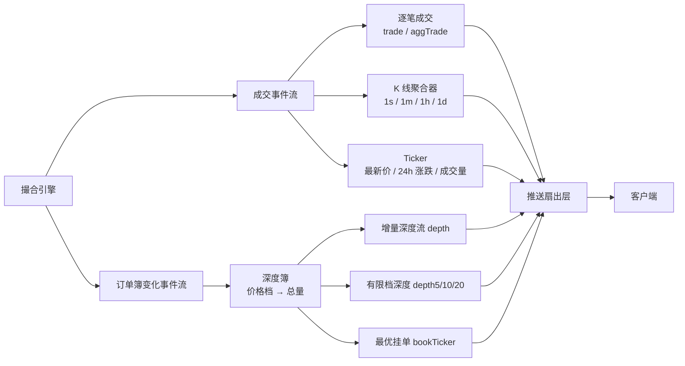
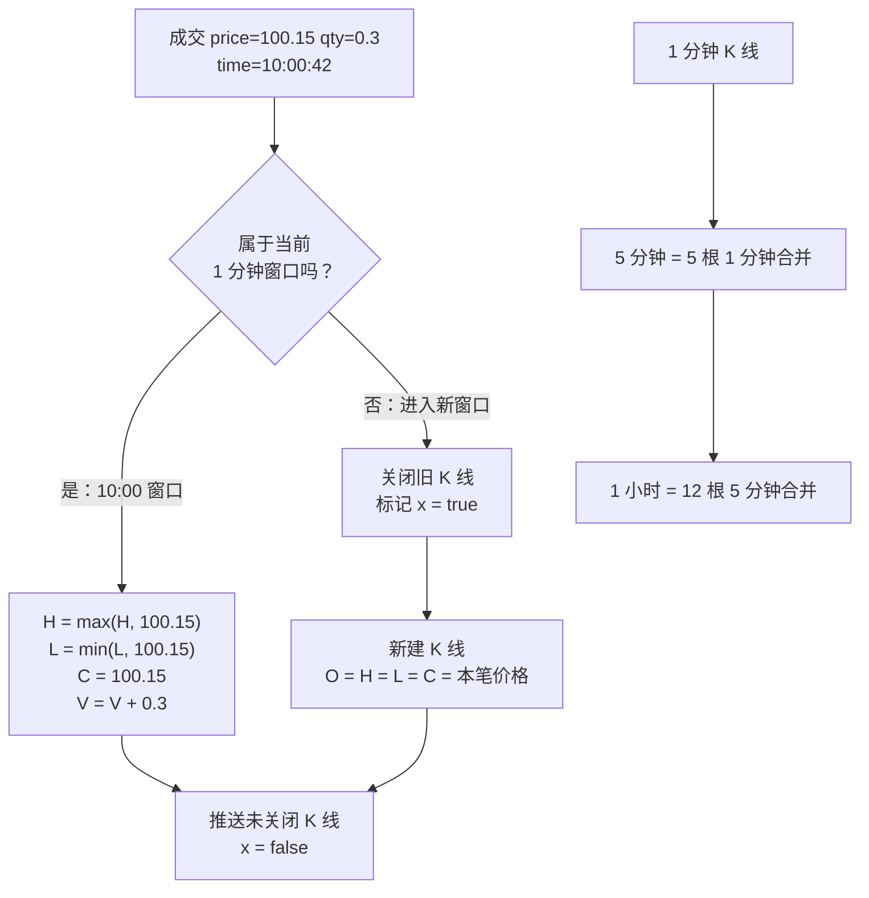
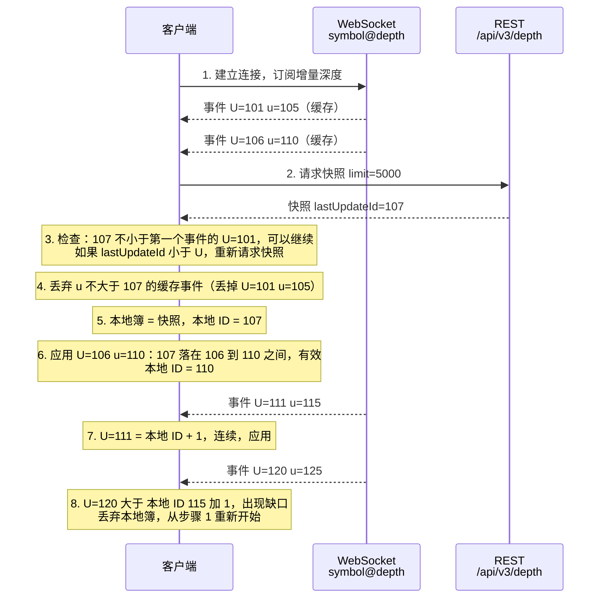
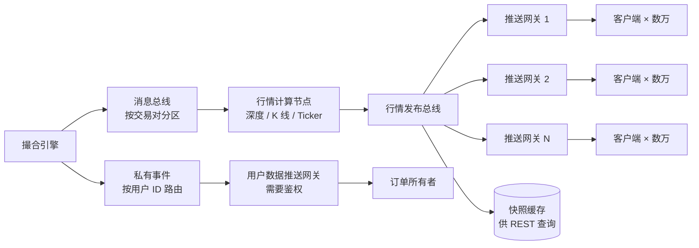

# 08 行情

> 学习目标：读完本章，你能——
> 1. 说清成交流如何变成深度、Ticker 和 K 线；
> 2. 按币安公开文档的步骤，用"快照 + 增量"维护一个本地订单簿；
> 3. 解释 WebSocket 扇出架构、指数价格，以及行情延迟带来的问题。
>
> 前置章节：[06 订单与撮合](06-order-matching.md)
> 交互实验：[depth-slippage.html](interactive/depth-slippage.html)（深度与滑点）、[order-book-matching.html](interactive/order-book-matching.html)（订单簿如何变化）

---

## 1. 一句话理解

行情系统把撮合引擎产出的事件加工成人能看懂的数据：深度、最新价、K 线。然后它把这些数据实时推送给数百万个客户端。

> 🎯 打个比方：撮合引擎是球场，行情系统是电视转播车。球场里每一次传球（成交）、每一次站位变化（挂单撤单）都被摄像机拍下。转播车把画面剪成"比分牌"（Ticker）、"阵型图"（深度）和"精彩回放"（K 线），再通过卫星（WebSocket）发给千家万户。观众看到的永远比现场晚一点点。

---

## 2. 业务视角：它解决什么问题

| 用户 | 需要什么行情 | 用途 |
|---|---|---|
| 普通用户 | 最新价、24 小时涨跌幅、K 线 | 判断买卖时机 |
| 量化交易者 | 逐笔成交、完整深度、低延迟 | 算法下单、做市 |
| 合约系统 | 指数价格、标记价格 | 计算资金费率和强平，见 [10 衍生品与合约](10-derivatives-futures.md) |
| 风控系统 | 价格异常波动 | 触发熔断或价格保护，见 [09 风控](09-risk-control.md) |

行情分两类：

- **公共行情（Public Market Data）**：所有人都能看到。例如深度、成交、K 线。不需要登录。
- **私有推送（Private User Data）**：只发给订单所有者。例如"你的订单成交了"、"你的余额变了"。需要鉴权。

> 💡 注意：公共成交流里**没有**用户身份。你只能看到"某人以 100.10 买了 0.5"，看不到是谁。

---

## 3. 系统视角：它如何实现

### 3.1 从撮合事件到各类行情

撮合引擎输出两类事件：

1. **成交事件（Trade）**：价格、数量、方向、时间。
2. **订单簿变化事件（Book Delta）**：某个价格档的数量变成了多少。

行情系统消费这两类事件，生成下游数据：

**读图要点**：
- 成交事件决定"价格走势"类数据：成交、K 线、Ticker。
- 订单簿变化事件决定"挂单分布"类数据：深度、最优挂单。
- 行情系统**不改变**订单簿。它只读撮合引擎的输出，是一个只读副本。
- 如果行情系统丢失一个事件，它的深度就和真实订单簿不一致。所以每个事件都要带序号。

### 3.2 深度的生成

深度（Depth）是按价格档汇总后的订单簿。它不显示单个订单，只显示每个价格的总量。

| 价格 | 订单簿里的挂单 | 深度显示 |
|---|---|---|
| 100.20 | S3 0.5、S4 2.0 | 100.20 → 2.5 |
| 100.10 | S1 0.8、S2 1.2 | 100.10 → 2.0 |

当 S1 被吃掉 0.8 时，行情系统发出一条增量：`100.10 → 1.2`。注意，增量里的数量是**新的总量**，不是变化量。数量为 0 表示该价格档被清空。

### 3.3 Ticker 与 K 线

**Ticker**：一个交易对的统计摘要。常见字段：最新价、24 小时开盘价、最高价、最低价、成交量、涨跌幅。

**K 线（Kline / Candlestick）**：把一个时间窗口内的成交压缩成五个数字：开盘价（Open）、最高价（High）、最低价（Low）、收盘价（Close）、成交量（Volume），简称 OHLCV。

K 线聚合器处理每笔成交的步骤：

1. 用成交时间计算所属窗口。例如 1 分钟 K 线的窗口起点 = 时间戳向下取整到分钟。
2. 如果窗口是新的，系统关闭上一根 K 线，新建一根。新 K 线的开盘价 = 本笔成交价。
3. 更新最高价和最低价。
4. 收盘价 = 本笔成交价。
5. 成交量加上本笔数量。

**读图要点**：
- 当前 K 线是"进行中"的。币安 K 线流用字段 `x` 表示该 K 线是否已关闭（截至 2026 年公开资料）。
- 大周期 K 线由小周期合并：O 取第一根的 O，C 取最后一根的 C，H 取最大，L 取最小，V 求和。
- 如果某分钟没有成交，业界常见做法是不生成 K 线，或用上一根收盘价补一根零成交量 K 线。不同系统做法不同。
- 迟到的成交（时间戳属于已关闭的窗口）会造成历史 K 线修订。生产系统要定义"迟到容忍"规则。

### 3.4 本地订单簿同步：全量快照 + 增量更新

量化交易者需要在本地维护一个和交易所一致的订单簿。直接每秒拉一次全量快照太慢、太重。正确做法是：**先拉一次快照，再持续应用增量**。

币安现货公开文档给出了标准步骤（截至 2026 年公开资料）。增量深度流的每个事件包含：

- `U`：本事件第一个更新 ID。
- `u`：本事件最后一个更新 ID。
- `b` / `a`：买盘 / 卖盘的变化档位，格式为 `[价格, 新总量]`。

REST 深度快照（`GET /api/v3/depth`）返回 `lastUpdateId`。

**读图要点**：
- 先开 WebSocket、后拉快照。顺序反了会丢失"快照之后、连接建立之前"的事件。
- 对齐规则：第一个应用的事件必须满足 `U <= lastUpdateId + 1 <= u`，即 `lastUpdateId` 落在 `[U; u]` 区间内。
- 每个后续事件的 `U` 必须等于上一个事件的 `u + 1`。不等于就说明有缺口，必须重建。
- 快照最多 5000 档。快照范围外的档位，只有在发生变化时你才会知道。

应用单个增量事件的步骤：

1. 如果 `u` 小于本地 ID，忽略该事件。
2. 如果 `U` 大于本地 ID + 1，丢弃本地订单簿，重新开始。
3. 对每个价格档：如果数量为 0，删除该档；否则用新数量覆盖（不存在则插入）。
4. 把本地 ID 设为该事件的 `u`。

> ⚠️ 警告：增量里的数量是新的总量，不是变化量。如果你把它当作"加减量"处理，本地订单簿会迅速失真。

> 💡 注意：币安 U 本位合约的增量深度流多一个字段 `pu`（上一个事件的 `u`），对齐规则略有不同。以对应产品的官方文档为准。

### 3.5 WebSocket 推送扇出架构

一个热门交易对可能有几十万个订阅者。撮合引擎不能直接给每个客户端发消息。行情系统用多层**扇出（Fan-out）**解决这个问题。

**读图要点**：
- 行情只计算一次，然后复制多份。计算成本和订阅人数无关，网络带宽和订阅人数成正比。
- 推送网关无状态，可以水平扩容。每个网关只维护"连接 → 订阅频道"的映射。
- 慢客户端是主要风险：如果它的发送缓冲区满了，网关应该断开它，不能让它拖慢其他人。
- 私有推送走另一条路径，按用户 ID 路由，必须鉴权。

扇出的常见优化手段（业界通用做法）：

| 手段 | 说明 |
|---|---|
| 合并推送 | 100ms 或 1000ms 内的多次变化合并成一条消息。币安增量深度流提供 100ms 和 1000ms 两种速度 |
| 有限档深度 | 只推前 5/10/20 档，减少消息体积 |
| 序列化一次 | 同一条消息只做一次 JSON 编码，所有连接共用字节 |
| 分频道订阅 | 客户端只订阅自己关心的交易对和频道 |

币安公开的 WebSocket 连接规则（截至 2026 年公开资料）：

- 单个连接最多有效 24 小时，到期会被断开。
- 服务端每 20 秒发送一次 ping。如果 1 分钟内没收到 pong，服务端断开连接。
- 单个连接每秒最多接收 5 条客户端消息（ping、pong、订阅指令都算）。

### 3.6 指数价格

**指数价格（Index Price）**：多家现货交易所价格的加权平均。它代表"全市场公允价格"，主要用于合约产品。

为什么需要它？因为单一交易所的最新价容易被操纵。一个人在薄盘口砸一笔大单，就能让最新价瞬间偏离。如果合约强平用这个价格，很多人会被错误强平。

计算步骤（业界通用做法，权重和成分以币安官方公告为准）：

1. 从多家交易所采集同一交易对的价格。
2. 剔除异常值。例如偏离中位数超过阈值（示例：5%）的报价。
3. 剔除数据过期的交易所。
4. 按权重（通常与成交量相关）求加权平均。

**示例**：

| 交易所 | 价格 | 权重 |
|---|---|---|
| 交易所 A | 100.00 | 40% |
| 交易所 B | 100.20 | 35% |
| 交易所 C | 99.90 | 25% |

指数价格 = 100.00×0.40 + 100.20×0.35 + 99.90×0.25 = 100.045。

标记价格（Mark Price）在指数价格基础上再加一个平滑的基差，用于计算未实现盈亏和强平。详见 [10 衍生品与合约](10-derivatives-futures.md)。

---

## 4. 币安怎么做

### 4.1 公开事实（截至 2026 年公开资料）

币安现货 WebSocket 行情的常用流：

| 流名称 | 内容 | 更新速度 |
|---|---|---|
| `<symbol>@trade` | 逐笔成交 | 实时 |
| `<symbol>@aggTrade` | 归集成交：同一 Taker 订单、同价格的成交合并成一条 | 实时 |
| `<symbol>@kline_<interval>` | K 线，周期从 `1s` 到 `1M` | 1s 周期 1000ms，其他 2000ms |
| `<symbol>@ticker` | 24 小时滚动统计 | 1000ms |
| `<symbol>@bookTicker` | 最优买卖价和数量 | 实时 |
| `<symbol>@depth<levels>` | 前 5 / 10 / 20 档快照 | 1000ms 或 100ms |
| `<symbol>@depth` | 增量深度 | 1000ms 或 100ms |

其他公开事实：

- 基础地址为 `wss://stream.binance.com:9443`。流名称中的交易对全部小写。
- 支持组合流：`/stream?streams=a/b/c`，每条消息用 `{"stream": ..., "data": ...}` 包装。
- 有一个只提供行情的地址 `wss://data-stream.binance.vision`，不提供用户数据流。
- 用户私有数据（订单更新、余额变化）通过单独的用户数据流（User Data Stream）推送，需要鉴权。

### 4.2 业界通用做法（币安未完全公开）

- 行情计算与撮合分离，部署在独立集群。
- 推送网关部署在多个地区，靠近用户以降低延迟。
- REST 深度和 Ticker 查询读缓存，不直接访问撮合引擎。
- 历史 K 线落到时序数据库或列式数据库，供图表和 API 查询。

---

## 5. 故障与边界

### 5.1 行情延迟

延迟来自每一层：撮合输出 → 消息总线 → 行情计算 → 推送网关 → 公网 → 客户端解析。

| 来源 | 典型影响 |
|---|---|
| 合并推送间隔 | 1000ms 流天然最多延迟 1 秒 |
| 极端行情消息暴增 | 网关队列积压，延迟从毫秒级升到秒级 |
| 客户端处理慢 | 本地缓冲区积压，看到的是"过去的"订单簿 |
| 跨地区网络 | 远离服务器的用户多出几十到几百毫秒 |

> ⚠️ 警告：行情延迟时，你看到的价格不是当前价格。在剧烈波动中用市价单，实际成交价可能大幅偏离屏幕价格。在 [depth-slippage.html](interactive/depth-slippage.html) 中模拟"做市商撤单"，体验这种落差。

### 5.2 一致性问题

| 问题 | 现象 | 对策 |
|---|---|---|
| 增量丢失 | 本地深度出现买一价 ≥ 卖一价（交叉盘口） | 按 `U` / `u` 检测缺口，重建 |
| REST 与 WS 不同步 | REST 返回的深度比 WS 旧或新 | 用 `lastUpdateId` 对齐，不要按时间对齐 |
| 多个推送网关版本不同 | 两个客户端看到不同的最新价 | 每条消息带序号或事件时间，客户端以序号为准 |
| K 线修订 | 已关闭 K 线的数据被更新 | 定义迟到容忍窗口，发布修订事件 |

### 5.3 行情不是成交依据

行情只是撮合结果的"副本"。如果行情显示你的订单已成交，但订单查询接口显示未成交，以订单接口为准。订单接口读的是订单服务，它更接近事实来源。

---

## 6. 本仓库对照（CEX Demo）

| 主题 | 本仓库实现 | 与生产级做法的差距 |
|---|---|---|
| 行情服务 | `services/market-data-service`，HTTP 端口 3012 | — |
| REST | `tickers`、`ticker`、`depth`、`trades` 四个接口 | 缺少 K 线查询接口 |
| 公共 WebSocket | `WS /api/v1/market-data/ws`，频道 `ticker` / `depth` / `trades` | 每次事件推送完整快照，不是增量；没有 `U` / `u` 序号 |
| 事件来源 | 订阅 Redis 频道 `web3-cex:trading.events` | 生产级通常用 Kafka 等可重放的总线 |
| 深度生成 | 从 `order-service` 拉取挂单列表，`aggregateLevels` 按价格汇总 | 生产级直接消费撮合引擎的订单簿变化事件 |
| K 线 | ClickHouse 物化视图生成 `1m` K 线 | 还没有更长周期 |
| 快照缓存 | Redis 存 ticker / depth / trades 快照 | 思路一致 |
| 私有推送 | `api-gateway` 的 `/api/v1/gateway/realtime`，频道 `orders` / `trades` / `notifications` / `balances`，需要 token 或 API Key 签名 | 思路一致 |

相关文件：

- [services/market-data-service/README.md](../services/market-data-service/README.md)
- [services/market-data-service/src/http/market-data-realtime-server.ts](../services/market-data-service/src/http/market-data-realtime-server.ts)
- [docs/architecture.md](../docs/architecture.md)

> 💡 注意：本仓库每次推送完整深度快照。它简单可靠，但消息体积大。练习：给它加上递增的 `updateId`，并改成增量推送，然后按 3.4 节的规则写一个客户端。

---

## 7. 术语表

| 术语 | 英文 | 定义 |
|---|---|---|
| 公共行情 | Public Market Data | 不需要登录就能获取的市场数据 |
| 私有推送 | User Data Stream | 只发给订单所有者的订单、余额更新 |
| 深度 | Depth | 按价格档汇总的订单簿 |
| 增量深度 | Diff Depth | 只包含变化价格档的深度消息 |
| 快照 | Snapshot | 某个时刻的完整深度 |
| 更新 ID | Update ID（`U` / `u` / `lastUpdateId`） | 深度变化的递增序号，用于对齐快照和增量 |
| Ticker | Ticker | 一个交易对的统计摘要 |
| K 线 | Kline / Candlestick | 一个时间窗口内成交的 OHLCV 汇总 |
| 归集成交 | Aggregate Trade | 同一 Taker 订单、同价格的多笔成交合并成一条 |
| 扇出 | Fan-out | 一份数据复制给大量订阅者 |
| 指数价格 | Index Price | 多家交易所价格的加权平均 |
| 标记价格 | Mark Price | 用于计算合约盈亏和强平的公允价格 |
| 滑点 | Slippage | 实际成交均价与预期价格的差 |

---

## 8. 思考题

1. 在 3.4 节的流程中，如果先拉快照、后开 WebSocket，会丢失哪一段事件？请画出时间线说明。
2. 打开 [depth-slippage.html](interactive/depth-slippage.html)，把流动性调到最薄，下一个大额市价单。再切换"做市商撤单"。滑点变化了多少？这对依赖最新价做强平的系统有什么风险？
3. 一个 1 小时 K 线由 60 根 1 分钟 K 线合并。如果第 37 分钟的 K 线丢了，合并后的 1 小时 K 线哪些字段可能出错？
