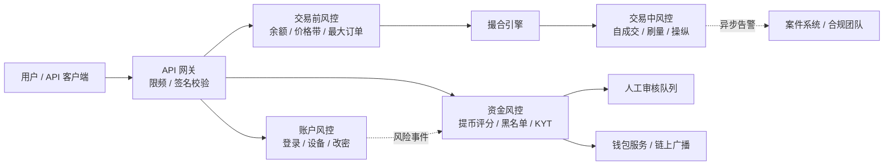
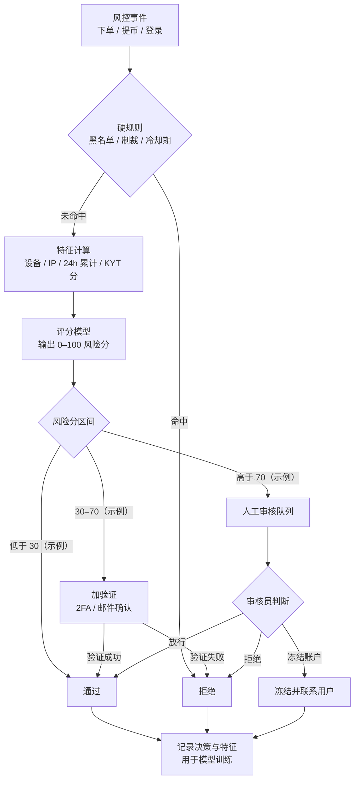
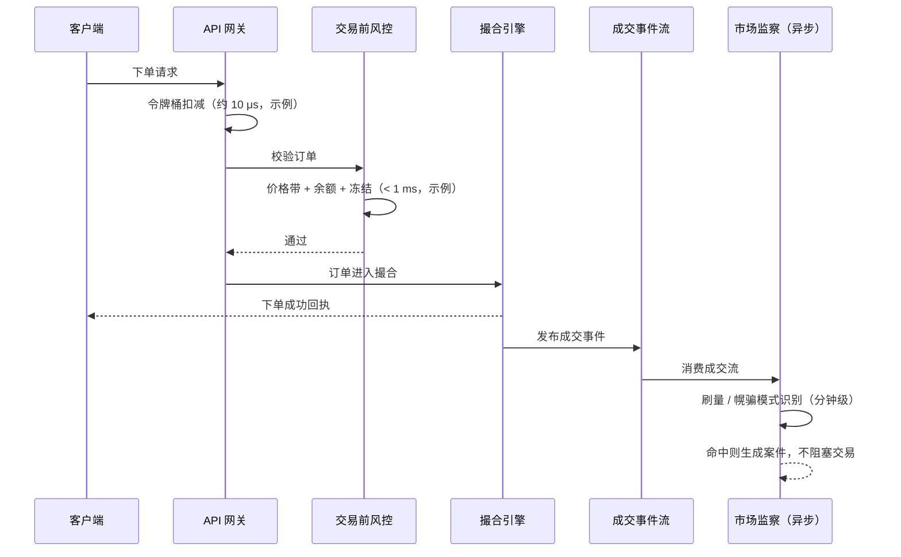
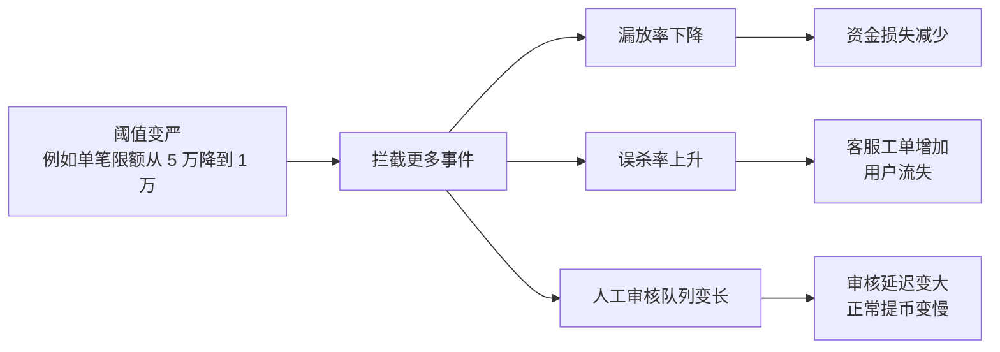

# 09 风控

> 学习目标：读完本章，你能——
> 1. 说出交易所风控的四层（交易前、交易中、资金、账户）和每层的典型规则。
> 2. 画出"规则引擎 + 评分模型 + 人工审核"的决策流，并解释同步风控与异步风控的延迟预算。
> 3. 用误杀率和漏放率评估一组阈值，并说明币安 API 限频（权重、429、418）的公开规则。
>
> 前置章节：[03 账户身份与安全](03-account-identity-security.md)、[04 钱包与托管](04-wallet-custody.md)、[06 订单与撮合](06-order-matching.md)
> 交互实验：[risk-rules-lab.html](interactive/risk-rules-lab.html)（风控规则实验室）

> ⚠️ 警告：本章内容仅用于学习交易所系统设计。本章不构成任何投资建议。本章的数值除标注"公开资料"外，都是示例。

---

> 🔎 进阶：风控系统怎样工程化，见 [B08 实时风控平台工程](backstage/B08-risk-platform.md)；业务风控见 [B05](backstage/B05-business-risk.md)。

## 1. 一句话理解

风控（Risk Control）是交易所的"安检系统"。它在每一笔订单、每一次提币、每一次登录前后做检查。它的目标是：拦住坏人和错误操作，同时不打扰正常用户。

> 🎯 打个比方：风控像机场安检。所有乘客都要过金属探测门（同步规则，快、粗）。门响了，安检员手检（人工审核，慢、准）。安检门后面还有监控室，回看录像找可疑人员（异步风控，事后发现）。门调得太灵敏，带皮带扣的乘客都要被拦（误杀）；调得太迟钝，真的危险品会混进去（漏放）。

---

## 2. 业务视角：它解决什么问题

交易所同时面对四类风险。每类风险对应一层风控。

| 风险层 | 要防的事 | 典型损失 |
|---|---|---|
| 交易前（Pre-trade） | 余额不足下单、"胖手指"错价、超大订单、请求洪水 | 用户亏损、撮合引擎过载 |
| 交易中（In-trade） | 自成交、刷量（Wash Trading）、拉盘砸盘、幌骗（Spoofing） | 行情失真、监管处罚 |
| 资金（Funds） | 盗号提币、洗钱、向制裁地址转账 | 资产被盗、牌照被吊销 |
| 账户（Account） | 撞库登录、SIM 卡劫持、钓鱼后改密 | 用户资产被盗、信任崩塌 |

风控的业务目标有三个：

1. 减少资金损失。
2. 满足合规要求（反洗钱、制裁）。
3. 把正常用户的摩擦降到最低。

第 3 条和前两条互相冲突。风控的全部难点，都来自这个冲突。

> 💡 注意：风控不等于"拒绝"。风控有五种动作：通过、拒绝、限制（例如降额度）、加验证（例如要求 2FA）、转人工审核。

---

## 3. 系统视角：它如何实现

### 3.1 风控分层总览

读图要点：
- 请求先过 API 网关。网关做最便宜的检查：限频和签名。
- 交易前风控和资金风控是**同步**的。它们在请求路径上，结果决定请求能否继续。
- 交易中风控是**异步**的。它读取成交流，事后发现问题，再把结果送进案件系统。
- 账户风控的信号（例如"刚改密码"）会流入资金风控。这条线是盗号防御的关键。

### 3.2 交易前风控（Pre-trade）

交易前风控在订单进入撮合引擎前运行。它必须快。业界通用做法是把它的延迟预算控制在 1 毫秒以内（示例）。

检查顺序如下：

1. 校验订单格式：价格精度、数量精度、最小名义价值。
2. 检查价格保护带：订单价格不能偏离参考价太远。
3. 检查最大订单：单笔数量和名义价值不能超过上限。
4. 检查挂单数量：一个账户的未成交订单不能超过上限。
5. 检查可用余额：余额足够时，系统冻结对应金额。

**价格保护带（Percent Price）**：如果买单价格高于参考价的 (1 + 上限)，系统拒绝订单。这个规则防"胖手指"。币安现货公开了 `PERCENT_PRICE` 和 `PERCENT_PRICE_BY_SIDE` 两种过滤器（Filter），在 `GET /api/v3/exchangeInfo` 中下发。参考价是一段时间的加权平均价，参数为 `avgPriceMins`（截至 2026 年公开资料，具体倍数以接口返回为准）。

示例：参考价 50,000 USDT，上限 5%（示例）。

- 买单价格 52,000：偏离 4%。系统通过。
- 买单价格 60,000：偏离 20%。系统拒绝。

> 💡 注意：价格保护带的参考价不能用"最新成交价"。最新成交价可以被一笔小单操纵。业界通用做法是用一段时间的平均价，或用多个交易所的指数价。合约里的"标记价格"用的是同一个思路，见 [10 合约](10-derivatives-futures.md)。

### 3.3 交易中风控（In-trade / Market Surveillance）

交易中风控也叫市场监察。它找四类行为：

| 行为 | 定义 | 识别信号（业界通用做法） |
|---|---|---|
| 自成交（Self-Trade） | 同一用户的买单和卖单互相成交 | 成交双方的用户 ID 相同 |
| 刷量（Wash Trading） | 关联账户之间对敲，制造虚假成交量 | 设备、IP、资金来源关联；成交对手高度集中 |
| 幌骗（Spoofing） | 挂大单制造假象，成交前撤单 | 大额挂单的撤单率极高，撤单前价格向有利方向移动 |
| 拉盘砸盘（Pump and Dump） | 低流动性币种集中拉高后抛售 | 短时涨幅异常，社交媒体信号，资金集中流入 |

自成交有一个同步解决方案：**自成交预防**（STP，Self-Trade Prevention）。币安现货 API 公开支持 `selfTradePreventionMode` 参数。取值包括 `EXPIRE_TAKER`、`EXPIRE_MAKER`、`EXPIRE_BOTH` 等（截至 2026 年公开资料）。撮合引擎发现两边是同一账户时，按该参数让一边或两边订单失效。

刷量和幌骗没有同步方案。系统必须看一段时间的行为才能判断。所以它们属于异步风控。

### 3.4 资金风控（提币风控）

提币是资产离开交易所的唯一出口。链上转账不可撤回。所以提币风控是最严的一层。

提币风控的检查项（业界通用做法）：

| 检查项 | 规则示例 | 动作 |
|---|---|---|
| 单笔限额 | 单笔 > 50,000 USDT（示例） | 转人工审核 |
| 24 小时累计限额 | 24h 累计 > 账户等级额度 | 拒绝 |
| 新设备冷却 | 新设备登录后 24 小时内（示例） | 禁止提币 |
| 改密冷却 | 修改密码或 2FA 后 24 小时内（示例） | 禁止提币 |
| 新地址 | 首次向该地址提币 | 加验证或延迟 |
| 地址黑名单 | 地址在内部黑名单或制裁名单中 | 拒绝并上报 |
| 链上 KYT 评分 | 目标地址风险分 ≥ 阈值 | 拒绝或转人工 |
| 行为评分 | 模型分数 ≥ 阈值 | 转人工审核 |

> 💡 注意：币安公开的安全机制包括"修改安全设置后暂停提币 24 小时"和"提币地址白名单"。具体时长以官网为准（截至 2026 年公开资料）。

**KYT（Know Your Transaction）**：KYT 是链上交易监测。服务商（例如 Chainalysis、Elliptic、TRM Labs）给地址打标签。标签包括"暗网市场""混币器""被盗资金""制裁实体"。服务商再给出风险分。交易所对充值和提币都调用 KYT。

- 充值方向：如果充值来源是高风险地址，系统冻结这笔充值并转合规审核。
- 提币方向：如果目标地址是高风险地址，系统拒绝提币。

### 3.5 账户风控（盗号检测）

盗号者拿到密码后的典型路径是：登录 → 改 2FA 或改邮箱 → 加新提币地址 → 提走全部余额。账户风控在每一步设卡。

信号（业界通用做法）：

1. 新设备指纹。
2. 异常 IP（机房 IP、代理、和历史国家不同）。
3. 登录后立刻修改安全设置。
4. 登录后立刻查看余额并发起全额提币。
5. 行为节奏异常（输入速度、鼠标轨迹）。

单个信号不能说明问题。正常用户也会换手机。所以账户风控输出的是**风险分**，不是"是/否"。

### 3.6 决策流：规则引擎 + 评分模型 + 人工审核

读图要点：
- 硬规则先跑。硬规则便宜、可解释、零容忍（例如制裁地址）。
- 评分模型处理"灰色地带"。它把几十个弱信号合成一个分数。
- 分数分三档：通过、加验证、人工。加验证是一种"软拒绝"，它把误杀的成本转给用户的一次点击。
- 所有决策都要记录。审核员的结论是模型的训练标签。没有记录，模型无法改进。

### 3.7 同步风控 vs 异步风控：延迟预算

每个风控检查都消耗时间。请求路径上的时间是有限的。这个上限叫**延迟预算**（Latency Budget）。

| 场景 | 延迟预算（示例） | 可以做的检查 | 不能做的检查 |
|---|---|---|---|
| 下单 | < 1 ms | 内存中的余额、价格带、限频计数 | 调用外部 KYT、跑大模型 |
| 登录 | 100–300 ms | 设备指纹、IP 信誉、轻量模型 | 人工审核 |
| 提币 | 秒级到小时级 | KYT、复杂模型、人工审核 | — |
| 市场监察 | 分钟级到天级（异步） | 关联图谱、跨市场分析 | — |

读图要点：
- 客户端拿到回执时，异步风控还没开始。
- 同步路径只放"便宜且必须立刻知道结果"的检查。
- 异步风控的代价是"事后"。它发现问题时，成交已经发生。它的补救手段是限制账户、冻结资金、追责。
- 提币是例外。提币可以"慢"，因为链上不可撤回，多等几分钟换取安全是值得的。

### 3.8 限流：令牌桶与币安 API 权重

**令牌桶（Token Bucket）**：一个桶最多装 B 个令牌。系统按速率 R 往桶里加令牌。每个请求取走 N 个令牌（N 是请求的权重）。如果桶里令牌不够，系统拒绝请求，返回 HTTP 429。

> 🎯 打个比方：令牌桶像一个按固定速度滴水的水杯。你每次喝一口要用掉一定的水。水杯满了，多滴的水溢出。你可以一口气喝光满杯（允许突发），但之后只能等水慢慢滴。

令牌桶的两个参数：

- 速率 R：长期平均允许多少请求。
- 容量 B：允许多大的突发。

**币安的公开规则**（截至 2026 年公开资料，以官方 API 文档为准）：

1. 每个接口有一个**权重**（Weight）。重的接口（例如一次查询全部交易对）权重高。
2. 限额按 **IP** 计算，不按 API Key 计算。
3. 每个响应带 `X-MBX-USED-WEIGHT-(intervalNum)(intervalLetter)` 头（例如 `X-MBX-USED-WEIGHT-1M`）。客户端用它查看已用权重。
4. 下单还有独立的订单数限制。响应头 `X-MBX-ORDER-COUNT-*` 显示计数。
5. 超过限额时，接口返回 **HTTP 429**。响应带 `Retry-After` 头。
6. 收到 429 后继续请求，IP 会被自动封禁，接口返回 **HTTP 418**。
7. 封禁时长按违规历史递增，范围是 **2 分钟到 3 天**。
8. 当前的具体额度（例如每分钟权重上限）在 `exchangeInfo` 的 `rateLimits` 字段中下发。

> ⚠️ 警告：客户端收到 429 后必须停止并按 `Retry-After` 等待。立刻重试会把 429 升级为 418 封禁，影响同一 IP 下的全部程序。

> 💡 注意：币安文档没有说明内部用令牌桶还是固定窗口。"令牌桶"是业界通用做法，本章用它解释原理。本仓库实际用的是固定窗口计数器，见第 6 节。

### 3.9 误杀与漏放：Precision / Recall

风控是一个分类问题。每个事件有真实标签（好/坏）和风控决策（放/拦）。

| | 实际是坏人 | 实际是好人 |
|---|---|---|
| 风控拦截 | 真阳性 TP（拦对了） | 假阳性 FP（**误杀**） |
| 风控放行 | 假阴性 FN（**漏放**） | 真阴性 TN（放对了） |

两个核心指标：

- **精确率**（Precision）= TP / (TP + FP)。含义：被拦的人里，真坏人占多少。精确率低，说明误杀多。
- **召回率**（Recall）= TP / (TP + FN)。含义：所有坏人里，被拦住多少。召回率低，说明漏放多。

本章的交互页用两个更直白的指标：

- **误杀率** = FP / 全部好人事件。
- **漏放率** = FN / 全部坏人事件。

读图要点：
- 同一个阈值同时影响误杀和漏放。两者不能同时降为零。
- 人工审核是"缓冲区"。它能同时降低误杀和漏放，但它的容量有限（审核员人数 × 每人处理速度）。
- 队列积压本身也是一种成本。正常用户等待 6 小时提币，体验等同于误杀。
- 阈值的选择是商业决策：一次漏放的损失 vs 一次误杀的损失 × 误杀次数。

去 [risk-rules-lab.html](interactive/risk-rules-lab.html) 拖动阈值，观察这两个指标如何此消彼长。

---

## 4. 币安怎么做（公开事实 + 业界做法）

### 4.1 币安公开的事实（截至 2026 年公开资料）

| 领域 | 公开事实 |
|---|---|
| 现货价格保护 | `exchangeInfo` 下发 `PERCENT_PRICE`、`PERCENT_PRICE_BY_SIDE`、`LOT_SIZE`、`MAX_NUM_ORDERS` 等过滤器 |
| 自成交预防 | 下单参数 `selfTradePreventionMode` |
| API 限频 | 按 IP 计权重；429 → 418；封禁 2 分钟到 3 天；`Retry-After` 头 |
| 账户安全 | 2FA、提币地址白名单、防钓鱼码、修改安全设置后暂停提币（时长以官网为准） |
| 合规 | KYC 分级认证；对制裁地区限制服务 |

### 4.2 公开案例

- **2019 年币安被盗**（公开报道）：攻击者通过钓鱼和病毒获取用户 API Key 与 2FA 数据。攻击者从热钱包提走约 7,000 BTC。币安用 SAFU 基金覆盖损失。教训是：提币风控必须把"单次大额提币"和"多账户同时提币"当作异常模式。
- **2023 年币安与美国监管和解**（公开报道）：美国司法部与财政部指控币安违反反洗钱和制裁规定。币安同意支付约 43 亿美元。教训是：制裁合规不是"可选功能"。缺少合规会威胁公司的生存。

### 4.3 业界通用做法

1. 规则引擎与模型并存。规则负责"零容忍"和"可解释"，模型负责"灰色地带"。
2. 风控规则支持热更新。运营人员调整阈值时，不需要重新发布服务。
3. 新规则先进入"影子模式"（Shadow Mode）。影子模式只记录决策，不真正拦截。团队对比影子结果和实际结果，确认误杀率后再上线。
4. 所有风控决策写入审计日志，保留特征快照。

### 4.4 制裁合规

制裁合规（Sanctions Compliance）要求交易所不与被制裁的个人、实体、地区交易。主要名单包括：

- 美国财政部 OFAC 的 SDN 名单（包含部分加密地址）。
- 联合国、欧盟、英国的制裁名单。

交易所在三处执行制裁检查：

1. 注册和 KYC 时：筛查姓名、国籍、居住地。
2. 登录时：筛查 IP 地理位置。
3. 充值和提币时：筛查链上地址（KYT 服务商通常已包含 SDN 地址）。

> ⚠️ 警告：制裁命中是硬规则。系统直接拒绝，并上报合规团队。系统不能把制裁命中交给模型"打分后放行"。

---

## 5. 故障与边界：哪里会出错，局限在哪

| 故障 | 后果 | 缓解措施（业界通用做法） |
|---|---|---|
| 风控服务宕机 | 下单或提币全部失败 | 下单路径"失败即关闭"（Fail-Closed）；提币路径暂停并排队 |
| 参考价过期 | 价格保护带失效，错价订单成交 | 参考价超过 N 秒未更新时，暂停该交易对 |
| KYT 服务商超时 | 提币卡住 | 超时转人工审核，不能默认放行 |
| 规则配置错误 | 大面积误杀 | 影子模式、灰度上线、一键回滚 |
| 模型漂移 | 召回率逐月下降 | 定期用新标签重训，监控分数分布 |
| 人工审核积压 | 提币延迟数小时 | 设置积压告警，自动调整分流阈值 |
| 攻击者探测阈值 | 攻击者把提币拆成小于阈值的多笔 | 加 24h 累计限额；累计规则按账户和设备两个维度计算 |

> 💡 注意：Fail-Open（故障时放行）和 Fail-Closed（故障时拒绝）是风控设计的关键选择。资金相关的检查一律选 Fail-Closed。

风控的根本局限：

1. 风控只能降低风险，不能消除风险。
2. 风控依赖标签。新型攻击没有历史标签，模型看不到它。
3. 风控和用户体验永远对立。完美的风控等于关闭交易所。

---

## 6. 本仓库对照（CEX Demo 中的对应服务）

| 风控层 | 本仓库现状 | 位置 |
|---|---|---|
| 交易前：余额 | ✅ 已实现。调用 ledger-service 查询可用余额，返回需冻结的资产和金额 | `services/risk-service/src/application/risk-application-service.ts` |
| 交易前：价格保护带 | ✅ 已实现。`maxPriceDeviationRatio` 为 0.2（即 ±20%） | `packages/domain/src/index.ts` 的 `SPOT_MARKET_DEFINITIONS` |
| 交易前：精度与最小数量 | ✅ 已实现。`minQuantity`、`priceStep`、`quantityStep` | 同上 |
| 交易前：参考价 | ⚠️ 来自环境变量 `RISK_REFERENCE_PRICE_*`，不是实时行情 | `services/risk-service/README.md` |
| 限频 | ✅ 已实现。API 网关用**固定窗口计数器**：窗口 60 秒，匿名 30 次，已认证 120 次；超限返回 429 | `services/api-gateway/src/infrastructure/redis-rate-limiter.ts` |
| 资金：提币审核 | ✅ 已有状态 `under_review` 和人工审核动作 | `services/wallet-service/src/domain/types.ts` |
| 资金：限额、黑名单、KYT | ✅ 单笔 / 日累计限额和 KYC 分级限额；简化 KYT：规则评分（黑名单 → 拦截，混币 / 高风险标签 +70，首次地址 +10、首次且大额 +40、地址簿新地址 +30，白名单 / 已用过的地址不加分），≥60 高风险强制双人复核；运营后台「用户与资产 → 地址黑名单」维护黑名单（带原因、审计、`ops.risk.manage` 权限），新加入的地址会自动拒绝待审核提现并解冻资金。没有接入真实 KYT 供应商，地址标签是演示数据 | `services/wallet-service/src/domain/withdrawal-risk.ts`、`withdrawal-policy.ts`；`docs/security.md` 第 2.7 节 |
| 交易中：STP、刷量监察 | ❌ 未实现 | — |
| 账户：设备与盗号检测 | ⚠️ 已实现登录记录、新设备识别与站内提醒、按设备吊销会话、登录失败临时锁定、可选的新设备提现锁（默认关闭）；没有设备指纹、IP 信誉和异常登录评分 | `services/identity-service/src/application/login-security-service.ts`；`docs/security.md` 第 2.2 节 |

如果要补齐，建议按以下顺序：

1. 把参考价切换到 market-data-service 的实时价格，并加"参考价过期即暂停"。
2. 把 wallet-service 内的规则评分接到真实 KYT 数据源（地址标签、资金来源多跳暴露），并支持影子模式试运行新规则。
3. 把固定窗口限频改成令牌桶或滑动窗口。固定窗口在窗口边界允许 2 倍突发。
4. 在撮合引擎加 STP 参数。
5. 新增一个异步"市场监察"消费者，订阅成交事件。

---

## 7. 术语表

| 术语 | 英文 | 定义 |
|---|---|---|
| 交易前风控 | Pre-trade Risk | 订单进入撮合引擎前的同步检查 |
| 价格保护带 | Percent Price Filter | 限制订单价格偏离参考价的比例 |
| 自成交预防 | STP, Self-Trade Prevention | 阻止同一账户的买卖单互相成交 |
| 刷量 | Wash Trading | 关联账户对敲，制造虚假成交量 |
| 幌骗 | Spoofing | 挂单制造假象，成交前撤单 |
| KYT | Know Your Transaction | 对链上交易和地址做风险评分 |
| 制裁名单 | Sanctions List（例如 OFAC SDN） | 政府公布的禁止交易对象 |
| 令牌桶 | Token Bucket | 按固定速率补充令牌、允许有限突发的限流算法 |
| 权重 | Request Weight | 币安为每个接口设定的限频消耗值 |
| 误杀 | False Positive | 风控拦截了正常用户 |
| 漏放 | False Negative | 风控放行了恶意事件 |
| 精确率 | Precision | 被拦截事件中真恶意的比例 |
| 召回率 | Recall | 全部恶意事件中被拦截的比例 |
| 影子模式 | Shadow Mode | 新规则只记录、不拦截的试运行方式 |
| 失败即关闭 | Fail-Closed | 风控故障时默认拒绝 |

---

## 8. 思考题

1. 打开 [risk-rules-lab.html](interactive/risk-rules-lab.html)。把"单笔提币限额"从最高拖到最低。误杀率和漏放率分别怎么变？人工审核队列长度怎么变？哪一个阈值让"误杀率 + 漏放率"最小？
2. 在实验室里关闭"改密后冷却"规则，只生成"盗号者"事件。漏放率变成多少？这说明账户风控信号对资金风控有什么作用？
3. 本仓库的限频是 60 秒固定窗口、120 次。一个客户端在第 59 秒发 120 次、第 61 秒再发 120 次。2 秒内服务端收到多少请求？换成令牌桶（速率 2 次/秒，容量 120）结果是多少？
