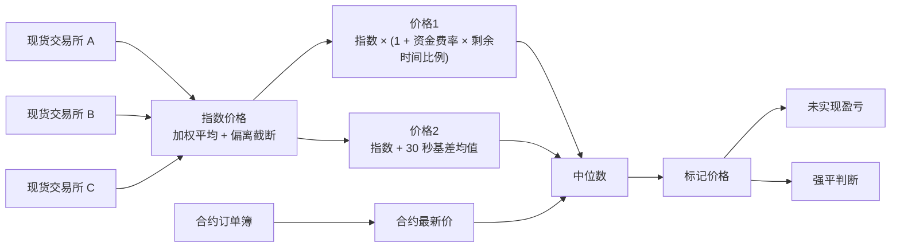
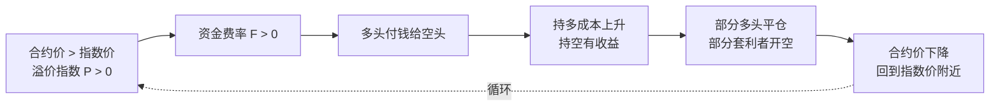
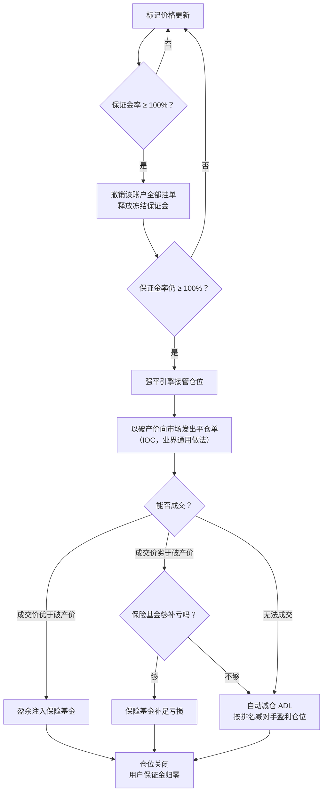
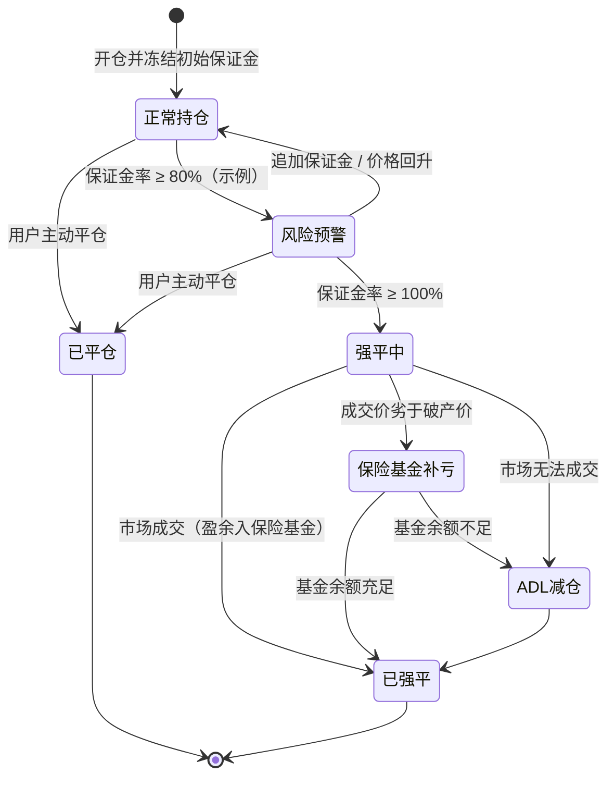

# 10 合约与永续合约

> 学习目标：读完本章，你能——
> 1. 区分现货、杠杆、交割合约、永续合约，并解释永续合约如何用资金费率锚定现货价格。
> 2. 区分指数价格、标记价格、最新价，并用简化公式算出逐仓仓位的强平价格。
> 3. 画出强平流程：强平引擎接管 → 市场平仓 → 保险基金 → 自动减仓（ADL）。
>
> 前置章节：[05 账本](05-ledger.md)、[06 订单与撮合](06-order-matching.md)、[09 风控](09-risk-control.md)
> 交互实验：[perpetual-liquidation.html](interactive/perpetual-liquidation.html)（永续合约实验室）

> ⚠️ 警告：本章内容仅用于学习交易所系统设计，不构成任何投资建议。杠杆交易会放大亏损，可能在几分钟内损失全部保证金。本章所有数值除标注"公开资料"外，都是示例。

---

## 1. 一句话理解

合约（Futures）是"对未来价格的约定"。你不需要真的买入 BTC，只需要存一笔保证金，就能获得 BTC 涨跌带来的盈亏。永续合约（Perpetual Futures）是一种没有到期日的合约，它靠**资金费率**把自己的价格拉回现货价格附近。

> 🎯 打个比方：永续合约像一根橡皮筋，一头拴在现货价格上，一头拴在合约价格上。合约价格跑得离现货太远，橡皮筋就绷紧。资金费率就是橡皮筋的拉力：合约比现货贵，做多的人付钱给做空的人；合约比现货便宜，做空的人付钱给做多的人。付钱的一方会减少，价格就被拉回来。

---

## 2. 业务视角：它解决什么问题

### 2.1 四种交易方式的对比

| 方式 | 你持有什么 | 杠杆 | 到期日 | 能否做空 | 主要成本 |
|---|---|---|---|---|---|
| 现货（Spot） | 真实的币 | 1 倍 | 无 | 不能（只能卖出已有的币） | 手续费 |
| 杠杆（Margin） | 借来的币或 USDT 买入的真实币 | 3–10 倍（示例） | 无 | 能（借币卖出） | 手续费 + 借币利息 |
| 交割合约（Delivery Futures） | 一份到期结算的合约 | 最高 125 倍（示例） | 有（例如季度合约） | 能 | 手续费 |
| 永续合约（Perpetual） | 一份不到期的合约 | 最高 125 倍（示例） | 无 | 能 | 手续费 + 资金费 |


读图要点：
- 每一步都是对上一步的一个不便做了改进。
- 交割合约在到期日强制按指数价格结算，所以合约价格自然收敛到现货。
- 永续合约去掉了到期日，就失去了"自然收敛"。它必须引入资金费率这个新机制。
- 越往右，系统越复杂：需要标记价格、强平引擎、保险基金、ADL。

### 2.2 交易所为什么做合约

1. 合约成交量远大于现货。合约手续费是交易所的主要收入之一，见 [12 商业模式](12-business-model.md)。
2. 合约让用户能做空和对冲。矿工、做市商需要对冲工具。
3. 合约不需要实物交割。交易所不需要动用钱包，资金只在账本内流转。

### 2.3 币本位 vs U 本位

| 类型 | 保证金和结算币种 | 示例 | 特点 |
|---|---|---|---|
| U 本位（USDⓈ-M） | USDT 或 USDC | BTCUSDT 永续 | 盈亏用 USDT 计算，直观；本章默认使用 |
| 币本位（COIN-M） | 标的币本身 | BTCUSD 永续，用 BTC 作保证金 | 每张合约面值固定（例如 100 USD）；盈亏用 BTC 计算，非线性 |

> 💡 注意：币本位多单有"双重敞口"。BTC 下跌时，仓位亏损，同时保证金（BTC）本身也在贬值。

---

## 3. 系统视角：它如何实现

### 3.1 三种价格：指数价格、标记价格、最新价

| 价格 | 英文 | 来源 | 用途 |
|---|---|---|---|
| 最新价 | Last Price | 本合约最新一笔成交价 | 显示行情、下单参考 |
| 指数价格 | Index Price | 多个现货交易所价格的加权平均 | 资金费率计算、标记价格的基础 |
| 标记价格 | Mark Price | 由指数价格和合约价格推导 | **计算未实现盈亏和强平** |

币安 U 本位永续的标记价格公式（截至 2026 年公开资料）：

```
标记价格 = 中位数(价格1, 价格2, 合约最新价)
价格1   = 指数价格 × (1 + 上次资金费率 × 距下次结算时间 / 资金费率周期)
价格2   = 指数价格 + 移动平均基差（30 秒）
```

指数价格的保护：如果某个交易所的报价偏离全部报价中位数超过 3%，系统把它的值截断在中位数的 0.97 倍到 1.03 倍之间（截至 2026 年公开资料）。

**为什么用标记价格算强平？** 合约的订单簿可能很薄。一笔大额市价单会把最新价瞬间打穿几个百分点，然后价格又弹回来。这叫**插针**（Wick）。如果系统用最新价判断强平，插针那一瞬间会误伤大量仓位。标记价格取三者中位数，单一来源的插针会被另外两个值"投票否决"。



读图要点：
- 数据从多个现货交易所流入，先合成指数价格。
- 合约最新价只是中位数的三个输入之一。它单独被插针时，不会改变中位数。
- 局限：如果全部现货交易所同时暴跌（真实行情），标记价格也会跟着跌。标记价格防的是"假"波动，不防"真"波动。
- 交互页第三个标签页演示了"最新价插针 vs 标记价格"的差别。

### 3.2 资金费率：永续合约为什么不到期

资金费率（Funding Rate）是多空双方之间定期交换的费用。交易所不收这笔钱，它只在多空之间转移。

币安 U 本位永续的公式（截至 2026 年公开资料）：

```
资金费率 F = 平均溢价指数 P + clamp(利率 I − 平均溢价指数 P, −0.05%, +0.05%)
```

- **溢价指数**（Premium Index）衡量合约价格比指数价格高多少。币安的定义为：P = [max(0, 冲击买价 − 指数价格) − max(0, 指数价格 − 冲击卖价)] / 指数价格。系统在每个周期内多次采样，取平均。
- **利率 I**：默认 0.01% / 8 小时（截至 2026 年公开资料）。它代表 USDT 和 BTC 的借贷利差。
- **clamp(x, −0.05%, +0.05%)**：把 x 限制在 ±0.05% 之间。
- 如果 P 在 −0.04% 到 0.06% 之间，那么 F 恰好等于利率 0.01%。这是市场平静时资金费率常年为 0.01% 的原因。
- 资金费率还有上下限。主流合约的上下限与维持保证金率挂钩，其他合约为 ±2%（截至 2026 年公开资料，以官网为准）。

**结算周期**：默认每 8 小时一次（UTC 00:00、08:00、16:00）。部分合约为 4 小时或 1 小时。行情剧烈时，币安可以缩短周期。周期为 N 小时时，公式整体除以 (8 / N)。

**资金费的计算**：

```
资金费 = 持仓名义价值 × 资金费率
持仓名义价值 = 标记价格 × 仓位数量
```

- 如果 F > 0：多头付给空头。
- 如果 F < 0：空头付给多头。
- 只有在结算时刻持仓的用户才付或收资金费。

示例：你持有 1 BTC 多单，标记价格 50,000 USDT，资金费率 0.01%。结算时你支付 50,000 × 0.01% = 5 USDT。持有同样空单的人收到 5 USDT。



读图要点：
- 这是一个负反馈回路。价格偏离越大，拉回的力越大。
- 套利者是关键角色：他们在现货买入、在合约做空，赚取资金费，同时把价差压回去。
- 局限：资金费率每个周期才结算一次。在两次结算之间，合约价可以偏离很远。
- 资金费率计算器在交互页第二个标签页。

### 3.3 保证金：初始、维持、分层

- **初始保证金**（Initial Margin）= 仓位名义价值 / 杠杆。开仓时系统冻结这笔钱。
- **维持保证金**（Maintenance Margin）= 仓位名义价值 × 维持保证金率（MMR）− 维持保证金速算额（cum）。保证金余额低于它时，系统触发强平。
- **保证金余额**（Margin Balance）= 钱包余额 + 未实现盈亏。
- **保证金率**（Margin Ratio）= 维持保证金 / 保证金余额。币安规定保证金率达到 100% 时触发强平（截至 2026 年公开资料）。

**分层杠杆**（Leverage Bracket）：仓位越大，允许的最大杠杆越低，维持保证金率越高。原因是大仓位在强平时更难在市场上平掉。

BTCUSDT 分层表（**示例**，数值参考历史公开资料，实际以币安官网"杠杆与保证金"页面为准）：

| 层级 | 名义价值（USDT） | 最大杠杆 | 维持保证金率 | 速算额 cum（USDT） |
|---|---|---|---|---|
| 1 | 0 – 50,000 | 125x | 0.40% | 0 |
| 2 | 50,000 – 250,000 | 100x | 0.50% | 50 |
| 3 | 250,000 – 3,000,000 | 50x | 1.00% | 1,300 |
| 4 | 3,000,000 – 15,000,000 | 20x | 2.50% | 46,300 |

速算额的作用：它让维持保证金在层级边界上连续，不会跳变。计算方式为：本层 cum = 上层 cum + 本层下限 × (本层 MMR − 上层 MMR)。例如第 2 层：0 + 50,000 × (0.5% − 0.4%) = 50。

### 3.4 全仓 vs 逐仓

| 模式 | 英文 | 风险范围 | 优点 | 缺点 |
|---|---|---|---|---|
| 逐仓 | Isolated Margin | 只亏该仓位的保证金 | 亏损有上限 | 容易被强平 |
| 全仓 | Cross Margin | 账户全部余额共同支撑全部仓位 | 不容易被强平 | 强平时亏掉更多 |

> 🎯 打个比方：逐仓像给每艘船单独配救生艇。一艘船沉了，只损失它的救生艇。全仓像所有船共用一个大仓库。任何一艘船漏水都从仓库调物资补，但如果漏得太多，仓库会被搬空，所有船一起沉。

### 3.5 强平价格公式

币安 U 本位（单向持仓）的通用公式（截至 2026 年公开资料）：

```
强平价格 LP = (WB − TMM1 + UPNL1 + cum − Side × Q × EP) / (Q × MMR − Side × Q)
```

- WB：钱包余额。逐仓时为该仓位的逐仓余额。全仓时为全仓钱包余额。
- TMM1、UPNL1：其他仓位的维持保证金和未实现盈亏。逐仓时都为 0。
- cum：维持保证金速算额。
- Side：多仓为 1，空仓为 −1。
- Q：仓位数量（绝对值）。EP：开仓均价。MMR：维持保证金率。

**逐仓 U 本位简化公式**（本章和交互页使用）。假设：逐仓、单一仓位、cum = 0、忽略手续费和资金费。此时 WB = 初始保证金 = Q × EP / L（L 为杠杆）。代入通用公式：

```
多仓强平价 = EP × (1 − 1/L) / (1 − MMR)
空仓强平价 = EP × (1 + 1/L) / (1 + MMR)
```

**数值检验**（示例）：多仓，EP = 50,000 USDT，L = 10x，MMR = 0.4%。

1. 1 − 1/L = 0.9。
2. 50,000 × 0.9 = 45,000。
3. 45,000 / 0.996 ≈ 45,180.72。

强平价约为 45,181 USDT。价格只需要下跌约 9.6%，仓位就会被强平。这比"跌 10% 亏光"更早，因为系统要留出维持保证金。

**破产价格**（Bankruptcy Price）：保证金余额恰好为 0 的价格。逐仓多仓的破产价 = EP × (1 − 1/L) = 45,000。强平价和破产价之间的距离，就是给强平引擎留的"操作空间"。

**全仓的简化**：全仓单一仓位时，WB = 初始保证金 + 账户其他可用余额。WB 越大，强平价离开仓价越远。交互页的"全仓"模式使用这个简化。

**其他指标**：

```
未实现盈亏（多）= (标记价格 − EP) × Q
未实现盈亏（空）= (EP − 标记价格) × Q
ROE（回报率）  = 未实现盈亏 / 初始保证金
保证金率       = 维持保证金 / (WB + 未实现盈亏)
```

### 3.6 强平流程



读图要点：
- 第一步不是平仓，而是撤单。撤单能释放冻结的保证金，可能让账户脱离强平。
- 强平单的价格是破产价，不是强平价。强平价到破产价之间的余量，大部分时候会变成保险基金的收入。
- 保险基金是第二道防线，ADL 是最后一道防线。ADL 保证交易所本身不承担穿仓亏损。
- 大仓位（高层级）在币安可能先被部分强平：系统逐步降低仓位层级，而不是一次全平（截至 2026 年公开资料，以官网为准）。

仓位的状态变化如下：



读图要点：
- "风险预警"是用户最后的自救窗口。交易所通常发送"追加保证金通知"（Margin Call）。
- 进入"强平中"后，用户失去对仓位的控制权。
- 对手方视角：ADL 时，盈利的对手方仓位被按破产价强制减少。他没有亏钱，但失去了继续盈利的机会。

### 3.7 保险基金

保险基金（Insurance Fund）是交易所为穿仓准备的资金池。

- **来源**：强平单的成交价优于破产价时，差额进入保险基金。
- **用途**：强平单的成交价劣于破产价时，保险基金补足差额。这个差额叫**穿仓**亏损。
- 币安公开展示各合约保险基金的余额历史（截至 2026 年公开资料）。

示例：多仓破产价 45,000。强平单以 45,100 成交，盈余 100 × Q 注入保险基金。如果以 44,800 成交，保险基金拿出 200 × Q 补亏。

### 3.8 自动减仓（ADL）排序

ADL（Auto-Deleveraging）选择"盈利最多、杠杆最高"的对手方先减仓。业界通用的排序公式（BitMEX 公开，币安使用同类方法，截至 2026 年公开资料）：

```
如果收益率 > 0：排名分 = 收益率 × 有效杠杆
如果收益率 < 0：排名分 = 收益率 / 有效杠杆
收益率   = 未实现盈亏 / 仓位开仓价值
有效杠杆 = |标记价值| / (保证金余额)
```

币安在界面上用 5 格指示灯显示用户在 ADL 队列中的位置。灯越多，被减仓的优先级越高。

> 💡 注意：ADL 减仓按破产价成交。被 ADL 的用户不支付手续费。

### 3.9 统一账户与组合保证金（概要）

传统模式下，现货账户、U 本位账户、币本位账户各自独立。资金不能互相支撑。

- **统一账户**（Unified Account，币安称为"统一账户 / Portfolio Margin Pro"等产品，名称以官网为准）：一个账户同时持有现货、杠杆、合约。多种资产按折算率（Collateral Ratio）计入保证金。
- **组合保证金**（Portfolio Margin）：系统按整个组合的风险算保证金。例如，现货多 1 BTC + 合约空 1 BTC 的组合几乎没有价格风险，所需保证金远低于两者分开计算之和。

组合保证金的系统挑战：每次价格变化都要重算整个组合的风险，计算量远大于逐仓模式。业界通用做法是用情景压力测试（例如价格 ±15%、波动率变化）取最差结果。

---

## 4. 币安怎么做（公开事实 + 业界做法）

| 项目 | 币安公开事实（截至 2026 年公开资料） | 本章示例或业界做法 |
|---|---|---|
| 最高杠杆 | 部分 U 本位合约最高 125x，按分层逐级降低 | 分层表数值为示例 |
| 资金费率 | F = P + clamp(I − P, ±0.05%)；I 默认 0.01%/8h；周期 8h，部分合约 4h 或 1h | — |
| 标记价格 | 中位数(价格1, 价格2, 合约价) | — |
| 强平触发 | 保证金率 ≥ 100% | 80% 预警为示例 |
| 强平价格 | 公开通用公式，含 WB、TMM、UPNL、cum | 简化公式忽略 cum 与费用 |
| 保险基金 | 公开余额历史 | — |
| ADL | 5 格指示灯 | 排序公式为业界通用做法 |
| 强平引擎内部 | 未公开 | 撤单 → 接管 → IOC → 保险基金 → ADL 为业界通用做法 |

**公开案例**：

- **2020 年 3 月 12 日（"312"）**（公开报道）：BTC 一天内跌幅约 40%。多家交易所出现大量强平。BitMEX 一度暂停交易。部分交易所保险基金被大幅消耗，触发 ADL。教训是：极端行情下，订单簿的流动性会枯竭，强平单无法按破产价成交。
- **2025 年 10 月 10 日**（公开报道）：美国宣布对中国进口商品加征 100% 关税后，加密市场 24 小时内强平超过 190 亿美元，是史上最大单日强平。多家交易所触发 ADL。在币安，USDe、WBETH、BNSOL 三种资产在 UTC 21:36–22:16 出现指数偏离，USDe 在币安一度跌破 0.66 美元，而其他场所基本维持锚定。用这些资产做保证金的用户因此被强平。币安称约 75% 的强平发生在偏离之前，并在 24 小时内向受影响的合约、杠杆、借贷用户补偿约 2.83 亿美元。教训是：**保证金资产的估价**和标记价格一样，必须引用多个外部来源。只看本所订单簿的价格，会在流动性枯竭时被砸穿，引发不公正的连锁强平。

---

## 5. 故障与边界：哪里会出错，局限在哪

| 故障 | 后果 | 缓解措施（业界通用做法） |
|---|---|---|
| 指数源交易所宕机 | 指数价格失真 | 偏离截断；剔除故障源；权重归零 |
| 现货全市场真实暴跌 | 连锁强平，强平单进一步砸价 | 分层强平、部分强平、保险基金 |
| 流动性枯竭 | 强平单无法成交，保险基金被耗尽 | ADL 兜底 |
| 标记价格计算延迟 | 强平滞后，穿仓扩大 | 强平引擎与标记价格服务同机房部署，监控延迟 |
| 资金费结算瞬间系统卡顿 | 部分用户漏扣或重复扣 | 资金费结算用账本幂等记账，见 [05 账本](05-ledger.md) |
| 用户误解"强平价 = 亏光价" | 用户以为还有余量 | 前端同时显示强平价和保证金率 |

> ⚠️ 警告：杠杆越高，强平价离开仓价越近。125x 多仓、MMR 0.4% 时，价格下跌约 0.4% 就会触发强平（示例，可在交互页验证）。

---

## 6. 本仓库对照（CEX Demo 中的对应服务）

本仓库（CEX Demo）**只实现了现货交易**，没有任何衍生品功能。代码中不存在合约、杠杆、标记价格或强平相关的服务。

如果要增加 U 本位永续合约，至少需要新增以下组件：

| 新组件 | 职责 | 依赖的现有服务 |
|---|---|---|
| index-price-service | 聚合多个外部现货价格，计算指数价格 | market-data-service |
| mark-price-service | 计算标记价格、溢价指数、资金费率 | index-price-service |
| futures-order-service + 合约撮合 | 合约订单簿与撮合；支持只减仓（reduce-only） | 可复用 order-service 的撮合模式 |
| position-service | 维护仓位、开仓均价、未实现盈亏 | ledger-service |
| margin-risk-service | 开仓前检查初始保证金与杠杆分层 | 现有 risk-service 的模式 |
| liquidation-engine | 订阅标记价格，计算保证金率，接管仓位 | position-service、futures 撮合 |
| insurance-fund 账户 | 在账本中新增保险基金账户类型 | ledger-service |
| funding-settlement job | 每个周期按资金费率在多空之间记账 | ledger-service、settlement-service |

现有服务需要的改动：

1. ledger-service 增加账户类型：合约保证金账户、保险基金账户、资金费中转账户。
2. risk-service 目前只校验现货订单（`POST /api/v1/risk/spot-orders/validate`）。需要增加合约订单校验接口。
3. 事件目录（`docs/event-catalog.md`）增加 `position.opened`、`position.liquidated`、`funding.settled` 等事件。

---

## 7. 术语表

| 术语 | 英文 | 定义 |
|---|---|---|
| 永续合约 | Perpetual Futures | 无到期日、用资金费率锚定现货的合约 |
| 交割合约 | Delivery Futures | 在到期日按指数价格结算的合约 |
| U 本位 | USDⓈ-M | 用 USDT/USDC 作保证金和结算的合约 |
| 币本位 | COIN-M | 用标的币作保证金和结算的合约 |
| 指数价格 | Index Price | 多个现货交易所价格的加权平均 |
| 标记价格 | Mark Price | 用于计算未实现盈亏和强平的公允价格 |
| 插针 | Wick | 最新价瞬间大幅偏离后迅速回归 |
| 资金费率 | Funding Rate | 多空双方定期交换费用的比率 |
| 溢价指数 | Premium Index | 合约价格相对指数价格的偏离比例 |
| 初始保证金 | Initial Margin | 开仓时冻结的保证金，等于名义价值除以杠杆 |
| 维持保证金 | Maintenance Margin | 维持仓位的最低保证金 |
| 维持保证金率 | MMR | 维持保证金占名义价值的比例 |
| 分层杠杆 | Leverage Bracket | 仓位越大、最大杠杆越低的分层规则 |
| 逐仓 | Isolated Margin | 每个仓位单独使用保证金 |
| 全仓 | Cross Margin | 全部仓位共用账户余额 |
| 强平价格 | Liquidation Price | 触发强平的标记价格 |
| 破产价格 | Bankruptcy Price | 保证金余额恰好为 0 的价格 |
| 保险基金 | Insurance Fund | 覆盖穿仓亏损的资金池 |
| 自动减仓 | ADL, Auto-Deleveraging | 保险基金不足时，按排名强制减少盈利对手仓位 |
| ROE | Return on Equity | 未实现盈亏除以初始保证金 |
| 组合保证金 | Portfolio Margin | 按整个组合的风险计算保证金 |

---

## 8. 思考题

1. 打开 [perpetual-liquidation.html](interactive/perpetual-liquidation.html)。多仓、开仓价 50,000、MMR 0.4%。把杠杆从 10x 拖到 125x。强平价离开仓价的距离如何变化？距离和杠杆是什么关系？
2. 在资金费率标签页，把溢价指数设为 0.03%。资金费率是多少？为什么它等于 0.01%，而不是 0.03%？把溢价指数设为 0.2% 呢？
3. 在"插针对比"标签页，让最新价插针到强平价下方。用最新价判断会不会强平？用标记价格呢？如果全部现货交易所同时下跌，标记价格还能保护仓位吗？
