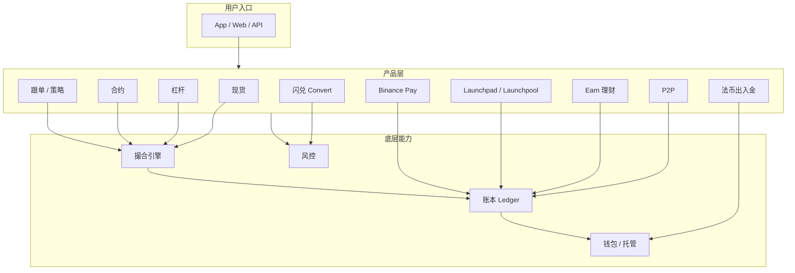
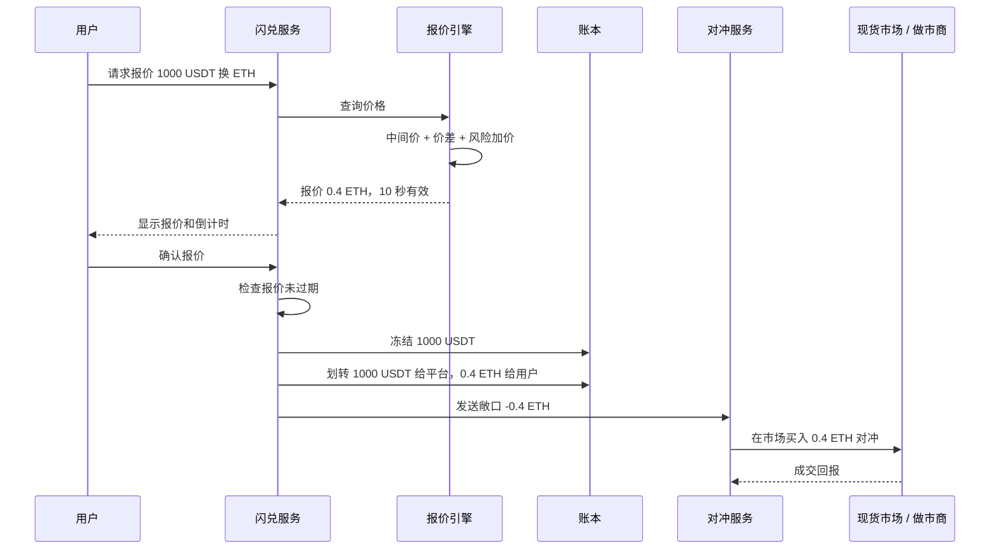
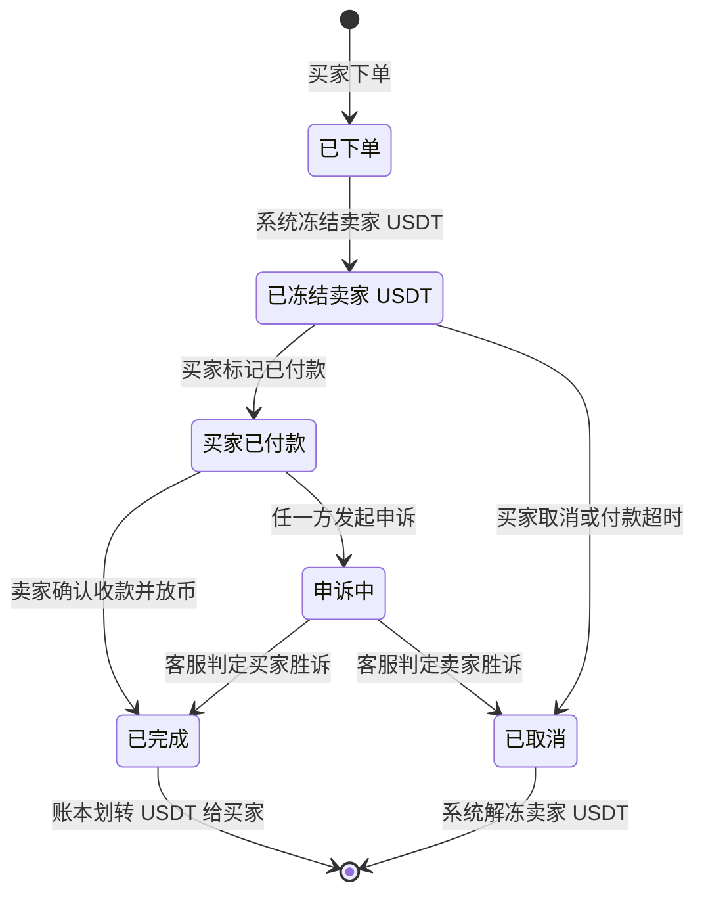
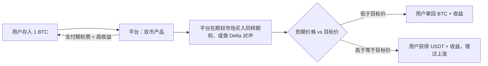
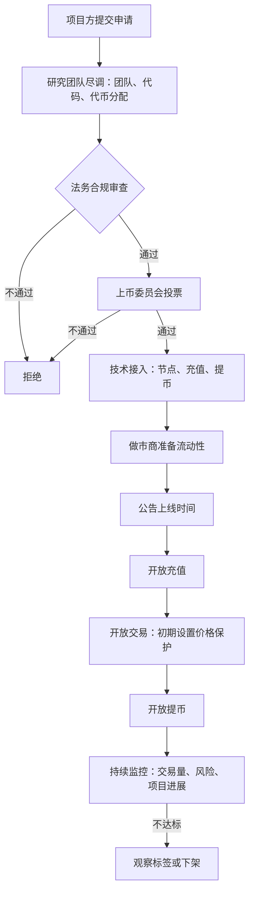

# 11 产品生态及其背后实现

> 学习目标：读完本章，你能——
> 1. 说出币安 10 类主要产品分别"用户看到什么、系统做什么"。
> 2. 指出每个产品的收入来源和主要风险。
> 3. 把任意新产品拆回到"账本 + 撮合 + 风控 + 钱包"这四个底层能力。
>
> 前置章节：[05-ledger.md](05-ledger.md)、[06-order-matching.md](06-order-matching.md)、[09-risk-control.md](09-risk-control.md)、[10-derivatives-futures.md](10-derivatives-futures.md)
> 交互实验：[revenue-model.html](interactive/revenue-model.html)、[risk-rules-lab.html](interactive/risk-rules-lab.html)、[perpetual-liquidation.html](interactive/perpetual-liquidation.html)

## 1. 一句话理解

交易所的每个产品都是同一套底层能力的不同组合。底层能力只有四个：账本记账、撮合成交、风控拦截、钱包收发。

> 🎯 打个比方：交易所像一家大型商场。地基和水电（账本、撮合、风控、钱包）只建一次。商场里的每个店铺（杠杆、闪兑、理财、P2P）都接同一套水电。店铺装修不同，但如果水电出事，所有店铺一起停业。

## 2. 业务视角：它解决什么问题

现货交易只满足一个需求：用 A 资产换 B 资产。用户还有更多需求：

- 想用更少本金放大收益 → 杠杆交易、合约。
- 想一键换币，不看订单簿 → 闪兑 Convert。
- 想用本地货币买币 → P2P、法币出入金。
- 想让闲置资产产生收益 → Earn 理财。
- 想参与新项目 → Launchpad、Launchpool。
- 不会交易，想跟专业的人做 → 跟单交易、策略交易。
- 想用币付款或在链上使用资产 → Binance Pay、Web3 钱包。

平台通过这些产品做两件事：

1. 把用户留在平台内。用户的资产在不同产品之间流转，不离开平台。
2. 增加收入来源。每个产品都有自己的收费方式（见第 12 章）。

读图要点：

- 所有产品最后都写入同一个账本。账本是唯一的余额事实源。
- 撮合类产品（现货、杠杆、合约、跟单）共用撮合引擎；非撮合类产品（理财、P2P、Pay）只做账本内划转。
- 风控挡在所有产品前面。一个产品的风控漏洞会影响整个账本。
- 局限：图中省略了行情、通知、KYC 等通用服务（见 [02-system-architecture.md](02-system-architecture.md)）。

## 3. 系统视角：它如何实现

本节逐个拆解产品。每个产品回答四个问题：用户看到什么、系统如何实现、平台怎么赚钱、风险在哪。第 3.12 节用一张表汇总。

### 3.1 杠杆交易（Margin）

**用户看到什么**：用户存入 1,000 USDT 作为保证金。用户借入 2,000 USDT。用户用 3,000 USDT 买 BTC。

**系统如何实现**：

1. 用户把资产从现货账户划转到杠杆账户。账本记一笔内部划转。
2. 用户发起借款。借贷服务检查最大可借额度。
3. 借贷服务从平台资金池转出资产。账本记"用户负债 + 用户资产"。
4. 用户下单。订单进入与现货相同的撮合引擎。
5. 计息服务每小时累计利息（业界通用做法，币安按小时计息，截至 2026 年公开资料）。
6. 风控服务持续计算保证金水平。如果保证金水平低于强平线，系统强平仓位。

保证金水平（Margin Level）：总资产除以总负债（含利息）。示例：总资产 3,000 USDT，负债 2,000 USDT，保证金水平 = 1.5。

**全仓与逐仓**：

| 模式 | 定义 | 优点 | 缺点 |
|---|---|---|---|
| 全仓（Cross Margin） | 账户内所有资产共同担保所有负债 | 不容易单笔强平 | 一个仓位亏损会拖累全部资产 |
| 逐仓（Isolated Margin） | 每个交易对单独一个保证金账户 | 亏损只限于该交易对 | 每个仓位需要单独补保证金 |

> 💡 注意：杠杆交易的仓位是"真实借币 + 真实现货"。合约的仓位是"合约头寸"，不借币。两者的风控逻辑不同（合约见 [10-derivatives-futures.md](10-derivatives-futures.md)）。

**平台怎么赚钱**：借款利息；杠杆交易的手续费；强平时收取的清算费用。

**风险在哪**：极端行情下，强平成交价可能低于负债。差额形成穿仓损失，由平台保险基金承担。

> 🔎 深潜：[P01-margin-and-loans.md](products/P01-margin-and-loans.md)

### 3.2 闪兑（Convert）

**用户看到什么**：用户输入"用 1,000 USDT 换 ETH"。页面显示一个报价和倒计时（例如 10 秒，示例）。用户点确认，立即成交，不收显式手续费。

**系统如何实现**：闪兑使用询价（RFQ，Request for Quote）模式：用户先请求报价，报价方给出一个限时有效的价格，用户接受后按该价格成交。

读图要点：

- 用户的对手方是平台，不是订单簿上的其他用户。成交后平台持有一个反向敞口。
- 平台通过对冲服务在现货市场或外部做市商处平掉这个敞口。
- 出错点：报价有效期内价格剧烈波动。平台对冲时价格已变化，差额由平台承担。
- 局限：大额闪兑可能被拆单对冲，也可能直接拒绝报价。具体策略属于业界通用做法，币安未完整公开。

**平台怎么赚钱**：报价中包含价差（Spread）。用户看到"零手续费"，但价差就是隐含费用。

**风险在哪**：报价延迟被套利（用户在报价有效期内比较外部价格，只接受对自己有利的报价）；对冲失败造成的库存风险。

> 🎯 打个比方：闪兑像机场的货币兑换柜台。柜台直接卖给你外币，牌价里已经包含利润。柜台再去银行补货。牌价变化快时，柜台可能补货亏钱。

> 🔎 深潜：[P02-convert-otc.md](products/P02-convert-otc.md)

### 3.3 P2P / C2C 交易

**用户看到什么**：买家在 P2P 市场选择一个卖家广告。买家通过银行转账付法币给卖家。卖家确认收款后，买家收到 USDT。

**系统如何实现**：平台不经手法币。平台只托管加密资产。这种模式叫担保交易（Escrow）：平台先冻结卖家的币，等双方完成法币支付后再放币。

读图要点：

- 加密资产的状态由平台账本控制。法币的状态只能靠双方声明和凭证判断。
- 申诉中状态下，资产保持冻结。客服根据转账凭证和聊天记录仲裁。
- 出错点：卖家收到的法币后来被银行撤回（例如付款方使用被盗银行卡）。平台已经放币，无法追回。
- 局限：平台无法直接验证银行转账。这是 P2P 欺诈和账户冻结纠纷的主要来源。

**平台怎么赚钱**：向广告方（商家）收取挂单手续费（示例：0.1%–0.35%，以官网为准）；用户通常免手续费，用来拉新。

**风险在哪**：诈骗、洗钱、银行卡被冻结。平台通过 KYC、商家保证金、限额和风控模型降低风险。

> 🔎 深潜：[P03-p2p-fiat.md](products/P03-p2p-fiat.md)

### 3.4 法币出入金

**用户看到什么**：用户用银行卡、银行转账或第三方支付买币，或把币卖成法币提回银行。

**系统如何实现**：

1. 平台与支付通道（Payment Channel）合作。支付通道包括银行、卡组织收单机构、本地电子钱包。
2. 用户付款。支付通道回调平台，通知"付款成功"。
3. 法币网关在账本中给用户记入法币余额或直接买入加密资产。
4. 出金时，法币网关调用银行接口付款。银行确认后，账本扣减余额。
5. 对账服务每天比对"银行流水"和"账本法币余额"。

> ⚠️ 警告：信用卡付款存在拒付（Chargeback）风险。用户在付款后数周内可向发卡行申请撤销交易。如果平台已放币，平台承担损失。

**平台怎么赚钱**：通道手续费加价（示例：卡支付 1.8%–3.5%，依地区不同）；汇率价差。

**风险在哪**：银行合作关系不稳定（银行可能因合规压力终止合作）；拒付欺诈；各国监管要求不同。

> 🔎 深潜：[P03-p2p-fiat.md](products/P03-p2p-fiat.md)

### 3.5 Earn 理财

Earn 是一组产品的统称。它们的共同点是：用户把资产交给平台一段时间，换取收益。

#### 3.5.1 活期与定期

| 类型 | 用户看到什么 | 资产去哪里（业界通用做法） |
|---|---|---|
| 活期（Flexible） | 随存随取，按日计息 | 平台出借给杠杆/合约用户，或参与链上质押 |
| 定期（Locked） | 锁定 30/60/90 天（示例），利率更高 | 链上质押（Staking）、出借，期限更确定 |

系统实现：

1. 用户申购。账本把资产从现货账户划到理财账户。
2. 平台把资金池分配给收益来源：出借、质押、做市等。
3. 计息服务每天按年化利率计算收益，记入用户账户。
4. 用户赎回活期时，系统从流动性储备中支付。

**平台怎么赚钱**：利差。示例：平台借给杠杆用户的利率是 8%，给理财用户 5%，利差 3%。

> 💡 注意：理财收益不是"凭空产生"。收益一定来自某个付费方：借款人、链上质押奖励、或平台补贴。

#### 3.5.2 Launchpool 挖矿

用户把 BNB 或其他指定资产锁入 Launchpool。系统按用户份额每小时分发新项目代币。用户资产不被扣减，随时可赎回（以具体活动规则为准）。

- 新代币来源：项目方拿出一部分代币作为分发额度。
- 平台的收益：用户为参与活动购买和持有 BNB，提高 BNB 需求；平台获得新项目的上线流量。

#### 3.5.3 双币投资（Dual Investment）

**用户看到什么**：用户存入 1 BTC，选择"目标价 70,000 USDT，7 天后到期，年化 30%"（示例）。到期时：

- 如果 BTC 价格低于 70,000，用户拿回 BTC 和利息。
- 如果 BTC 价格高于等于 70,000，用户按 70,000 卖出 BTC，拿回 USDT 和利息。

**背后是什么**：这是"用户卖出一份期权"。上例中，用户卖出一份 BTC 看涨期权（Call Option）：买方有权在到期日按 70,000 买入 BTC。用户收到的"高利息"就是期权费（Premium）。

读图要点：

- 用户的收益上限固定。如果 BTC 大涨，用户只拿到目标价，错过超额上涨。
- 平台在期权市场（例如币安期权或外部期权平台）对冲。平台赚取"市场期权费"与"支付给用户的期权费"之差。
- 出错点：用户把它当成"保本理财"。它不保本（以币本位计算会损失上涨收益）。
- 局限：平台的对冲细节属于内部实现。本节描述的是业界通用做法。

> 🔎 深潜：[P05-earn-savings-staking.md](products/P05-earn-savings-staking.md) · [P06 结构化产品](products/P06-structured-products.md)

### 3.6 Launchpad 与上币流程

**用户看到什么**：用户持有 BNB，参与新代币认购。项目上线后，用户可在现货市场交易该代币。

**系统如何实现**：上币是一个跨部门流程，涉及研究、法务、合规、技术、做市和运营。

读图要点：

- 上线顺序通常是"先充值、再交易、后提币"，让订单簿有足够深度。
- 做市商在开盘前准备好买卖挂单，避免开盘价格剧烈跳动。
- 出错点：尽调遗漏风险项目（例如代码后门、团队跑路），用户遭受损失后平台声誉受损。
- 局限：币安公开声明上币不收费，但项目方可能需要承诺空投或营销额度。具体条件以官方公告为准。

**平台怎么赚钱**：新币带来交易手续费；用户为参与 Launchpad/Launchpool 持有 BNB。

**风险在哪**：新币价格波动大；监管机构可能认定某些代币为证券；上币决策被质疑存在利益冲突。

> 🔎 深潜：[P07-listing-launch.md](products/P07-listing-launch.md)

### 3.7 跟单交易（Copy Trading）

**用户看到什么**：用户在排行榜选择一位带单员（Lead Trader）。用户投入 1,000 USDT。带单员开仓时，用户账户按比例自动开仓。

**系统如何实现**：

1. 带单员下单，订单正常进入撮合。
2. 跟单服务监听带单员的成交事件。
3. 跟单服务按资金比例为每个跟随者生成子订单。
4. 子订单进入撮合引擎。成交价可能与带单员不同。
5. 跟随者盈利时，系统按带单员设定的比例把利润分给带单员。币安合约跟单的比例按带单员等级封顶，范围 0%–30%，每周结算（截至 2026 年官方 FAQ，详见 P08）。

**平台怎么赚钱**：跟随者的交易手续费。

**风险在哪**：跟随者的成交价有滑点；带单员可能在排行榜上"刷业绩"；大量跟单集中下单会冲击盘口。

> 🔎 深潜：[P08-strategy-copy-trading.md](products/P08-strategy-copy-trading.md)

### 3.8 策略交易与合约网格

**用户看到什么**：用户设置价格区间 60,000–70,000 USDT，网格数量 10（示例）。机器人自动在每个格子低买高卖。

**系统如何实现**：

1. 策略服务按参数计算 10 个价位。
2. 策略服务在每个价位挂限价单。
3. 某个买单成交后，策略服务在上一格挂卖单。
4. 价格离开区间后，策略暂停或按用户设置止损。

策略交易是"平台托管的机器人"。它与用户自己用 API 写机器人没有本质区别，只是运行在平台内部。

**平台怎么赚钱**：频繁挂单和成交产生手续费。

**风险在哪**：单边行情下，网格会持续买入下跌资产或过早卖出上涨资产；合约网格叠加杠杆，可能被强平。

> 🔎 深潜：[P08-strategy-copy-trading.md](products/P08-strategy-copy-trading.md)

### 3.9 Binance Pay

**用户看到什么**：用户扫码付款或给好友转账，免手续费，秒级到账。

**系统如何实现**：Binance Pay 是账本内划转，不上链。系统从付款方账户扣减，给收款方账户记增加。两笔分录在同一个数据库事务中完成。

> 🎯 打个比方：Binance Pay 像同一家银行内部转账。钱没有离开银行，只是两个账户的数字变了。链上转账则像跨行汇款，要经过清算网络。

**平台怎么赚钱**：商户收款手续费（以官网为准）；更重要的是把资金留在平台内。

**风险在哪**：盗号后快速转走资产；被用于洗钱。平台用风控规则和限额控制。

> 🔎 深潜：[P09-pay-and-card.md](products/P09-pay-and-card.md)

### 3.10 Web3 钱包

**用户看到什么**：App 内的一个独立钱包页面。用户直接与 DEX、链上应用交互。

**系统如何实现**：币安 Web3 钱包使用 MPC（多方计算）技术。私钥分成多个分片，用户设备和平台各持一部分，任何单方都不能单独签名（截至 2026 年公开资料）。

- 与交易所账户的区别：Web3 钱包的资产在链上，地址属于用户。交易所账户的资产在平台账本中。
- 平台的作用：提供界面、路由、聚合 DEX 报价。

**平台怎么赚钱**：DEX 聚合交易的路由费（如有）；把链上用户导回交易所。

**风险在哪**：用户与恶意合约交互后授权被滥用；链上交易不可撤销，平台无法冻结或追回。

> 🔎 深潜：[P10-web3-wallet.md](products/P10-web3-wallet.md)

### 3.11 BNB Chain 与 BNB

- **BNB**：最初于 2017 年作为币安平台代币发行，总量 2 亿枚（公开资料）。
- **BNB Chain**：一条公链生态，包括 BNB Smart Chain（BSC）等。BNB 是这条链的原生 Gas 代币。
- **关系**：BNB 同时承担两个角色。在交易所内，BNB 用于手续费抵扣、Launchpool 参与等。在链上，BNB 用于支付 Gas 和质押。

| 维度 | 交易所内的 BNB | 链上的 BNB |
|---|---|---|
| 存放位置 | 平台账本 | 用户链上地址 |
| 主要用途 | 手续费抵扣、Launchpool、VIP 门槛 | Gas 费、验证者质押、DeFi |
| 转换方式 | 提币到 BSC 地址 | 充值到交易所地址 |

> 💡 注意：BNB Chain 的运营主体与币安交易所对外表述为相互独立。本系列不评价二者的治理关系，只描述公开的技术关系。

> 🔎 深潜：[P10-web3-wallet.md](products/P10-web3-wallet.md)

### 3.12 汇总表

| 产品 | 用户看到什么 | 系统如何实现 | 平台怎么赚钱 | 风险在哪 |
|---|---|---|---|---|
| 杠杆交易 | 借币放大仓位 | 借贷服务 + 撮合 + 保证金监控 | 利息、手续费 | 穿仓、强平失败 |
| 闪兑 | 一键换币，零显式手续费 | RFQ 报价 + 平台对冲 | 报价价差 | 报价被套利、对冲失败 |
| P2P | 用法币与他人交易 | 担保托管 + 申诉状态机 | 商家手续费 | 诈骗、银行冻结 |
| 法币出入金 | 银行卡买币 | 支付通道 + 法币网关 + 对账 | 通道加价、汇差 | 拒付、银行断联 |
| 活期/定期理财 | 存币生息 | 资金池分配 + 每日计息 | 利差 | 挤兑、收益来源违约 |
| Launchpool | 锁仓领新币 | 份额计算 + 定时分发 | BNB 需求、上币流量 | 新币价格下跌 |
| 双币投资 | 高年化、到期换币 | 用户卖期权 + 平台对冲 | 期权费差价 | 用户误解为保本 |
| Launchpad/上币 | 认购新币、交易新币 | 尽调 + 技术接入 + 做市 | 新币手续费 | 项目欺诈、监管认定 |
| 跟单交易 | 自动复制带单员 | 事件监听 + 按比例子订单 | 手续费 | 滑点、刷业绩 |
| 策略/网格 | 机器人自动交易 | 平台托管挂单程序 | 手续费 | 单边行情亏损 |
| Binance Pay | 免费转账付款 | 账本内划转 | 商户费、资金沉淀 | 盗号、洗钱 |
| Web3 钱包 | 链上交互 | MPC 签名 + DEX 聚合 | 路由费、导流 | 恶意授权、不可撤销 |

## 4. 币安怎么做（公开事实 + 业界做法）

**币安公开的事实**（截至 2026 年公开资料，参数以官网为准）：

- 币安提供全仓杠杆和逐仓杠杆两种模式，借款按小时计息。
- 闪兑页面显示限时报价，用户确认后按报价成交。
- P2P 支持多种本地支付方式。平台托管卖家的加密资产，并提供申诉通道。
- Earn 包括活期、定期、双币投资、Launchpool 等产品。双币投资页面明确提示"非保本"。
- 币安 Web3 钱包采用 MPC 技术，不使用助记词。
- 币安会定期发布上币和下架公告，并对部分代币加"观察标签"（Monitoring Tag）。

**业界通用做法**（币安未完整公开，本文按行业惯例描述）：

- 闪兑和双币投资的对冲策略、报价模型。
- 理财资金池的具体配置比例。
- 上币委员会的决策细节和做市商合作条件。

## 5. 故障与边界：哪里会出错，局限在哪

1. **产品之间的资金耦合**：理财资金被出借给杠杆用户。如果大量理财用户同时赎回，平台需要回收借款或使用自有资金。这与银行挤兑的机制相同。
2. **对冲失效**：闪兑和双币投资依赖对冲。如果外部市场流动性枯竭，平台持有无法平掉的敞口。
3. **链下事实无法验证**：P2P 和法币出入金依赖银行侧事实。平台只能用凭证和风控规则间接判断。
4. **复杂产品被误解**：双币投资、合约网格的风险结构复杂。如果用户不理解，就会产生投诉和监管压力。
5. **监管边界**：理财产品在部分地区可能被认定为证券或存款类业务。平台需要按地区下线或调整产品（第 12 章讨论合规）。

> ⚠️ 警告：所有"高收益"产品都有对应的风险。收益越高，风险结构越复杂。本章内容不构成投资建议。

## 6. 本仓库对照（CEX Demo 中的对应服务）

本仓库 MVP 只覆盖现货交易，不做法币入金（见 `README.zh-CN.md` 的"Demo 覆盖的能力"）。本章产品在仓库中的对应关系：

| 本章产品 | 仓库现状 | 可以复用的服务 |
|---|---|---|
| 杠杆/借贷 | 未实现 | `ledger-service`（冻结/解冻）、`risk-service`（前置校验） |
| 闪兑 | 未实现 | `order-service`（可以把对冲单作为市价单提交） |
| P2P | 未实现 | `ledger-service` 的冻结/释放就是担保托管的基础 |
| 法币出入金 | 明确不在 MVP 范围 | — |
| 理财 | 未实现 | `ledger-service` 的内部划转分录 |
| 上币 | 部分：交易对配置 | `matching-engine` 的 market 配置、`blockchain-indexer` 的链支持 |
| Pay | 未实现 | `ledger-service` 的 `postJournal` 可以实现账本内划转 |

关键观察：本仓库的 `ledger-service` 已提供 `freezeBalance`、`releaseBalance`、`consumeBalance`。P2P 担保托管的"冻结 → 放币 / 解冻"正好映射到这三个操作。后续扩展产品时，应在账本之上新增产品服务，而不是修改账本本身。

## 7. 术语表

| 术语 | 英文 | 定义 |
|---|---|---|
| 全仓 | Cross Margin | 账户内所有资产共同担保所有负债 |
| 逐仓 | Isolated Margin | 每个交易对单独计算保证金 |
| 保证金水平 | Margin Level | 总资产除以总负债 |
| 询价 | RFQ, Request for Quote | 先报价、后成交的交易方式 |
| 价差 | Spread | 买入价与卖出价之差，或报价与中间价之差 |
| 对冲 | Hedge | 用反向交易抵消价格风险 |
| 担保交易 | Escrow | 第三方先托管资产，条件满足后再交付 |
| 拒付 | Chargeback | 持卡人向发卡行申请撤销已完成的付款 |
| 期权费 | Premium | 期权买方支付给卖方的费用 |
| 看涨期权 | Call Option | 买方有权按约定价买入资产的合约 |
| 带单员 | Lead Trader | 跟单交易中被复制的交易者 |
| 多方计算 | MPC, Multi-Party Computation | 多方各持密钥分片，共同完成签名 |

## 8. 思考题

1. 闪兑宣传"零手续费"。打开 [revenue-model.html](interactive/revenue-model.html)，想一想：如果把闪兑的价差折算成费率，它应该放进哪一类收入？
2. 双币投资中，如果 BTC 到期价格是目标价的 1.5 倍，用户相对于"一直持有 BTC"少赚了多少？用期权的语言解释这个差额。
3. P2P 申诉状态下，资产保持冻结。如果申诉处理需要 7 天，这对买家、卖家和平台分别意味着什么？结合 [risk-rules-lab.html](interactive/risk-rules-lab.html) 设计一条降低 P2P 欺诈的风控规则。
