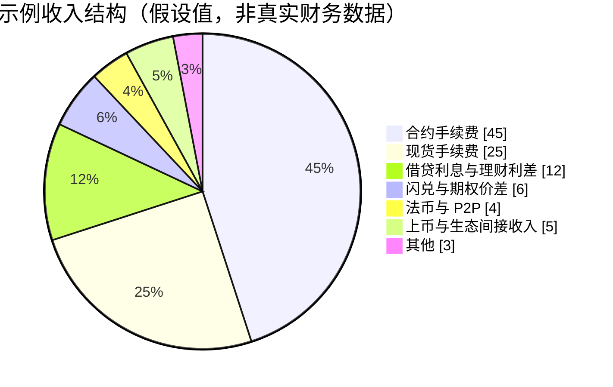
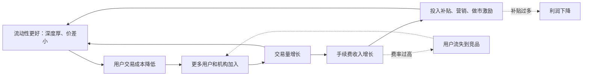
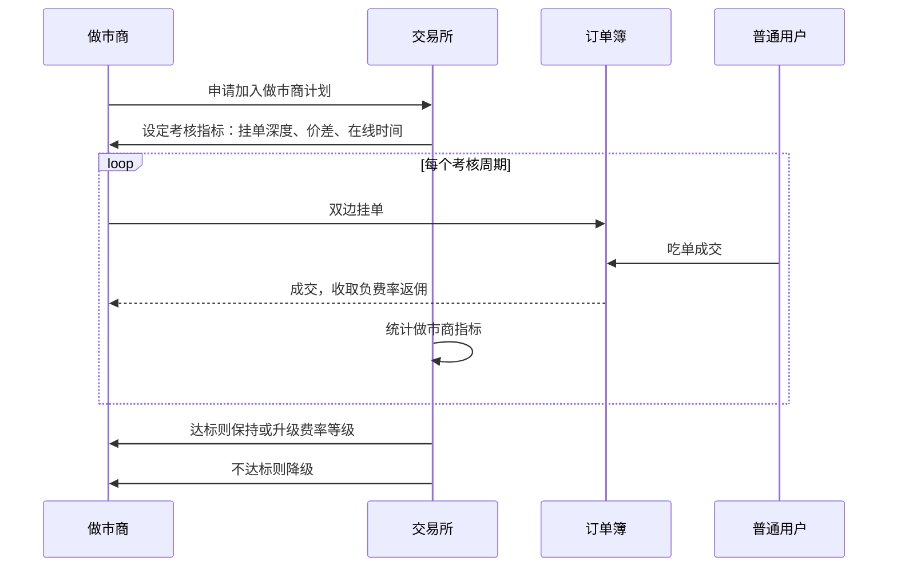
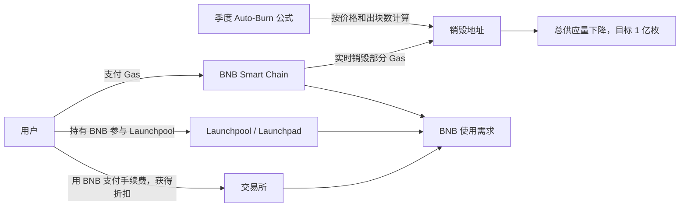
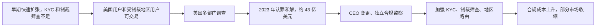

# 12 商业逻辑：交易所如何赚钱

> 学习目标：读完本章，你能——
> 1. 列出交易所的 8 类收入来源，并说明交易手续费为什么是主体。
> 2. 用飞轮模型解释"降费—流动性—交易量"的循环，以及它的代价。
> 3. 说明 BNB 代币经济、全球合规成本和竞争格局如何影响交易所的利润。
>
> 前置章节：[07-clearing-settlement-fees.md](07-clearing-settlement-fees.md)、[11-products-ecosystem.md](11-products-ecosystem.md)
> 交互实验：[revenue-model.html](interactive/revenue-model.html)

> 💡 注意：本章区分三类内容。**【事实】** 指有公开资料支持的内容；**【分析】** 指作者基于公开信息的推理；**【示例】** 指为了说明机制而假设的数字。币安是私营公司，不公开完整财报。本章所有收入比例都是示例，不是真实财务数据。本章不构成投资建议。

## 1. 一句话理解

交易所卖的是"流动性"。流动性越好，用户越多；用户越多，交易量越大；交易量越大，手续费越多；手续费再拿去补贴流动性。

> 🎯 打个比方：交易所像一个菜市场的管理方。摊位越多、菜越全，来买菜的人越多。人越多，摊主越愿意来。管理方收的是"每笔买卖的一点点管理费"。管理方有时会减免新摊主的费用，让市场更热闹。减免太多，管理方就亏钱；收费太高，摊主和顾客就去隔壁市场。

## 2. 业务视角：它解决什么问题

一个交易所要回答三个问题：

1. **钱从哪里来**：收入构成。
2. **钱花在哪里**：成本结构。
3. **为什么用户不走**：护城河，也就是飞轮和生态。

### 2.1 收入构成

| 收入类别 | 来源 | 计费方式 | 相关章节 |
|---|---|---|---|
| 现货交易手续费 | 每笔成交 | 成交额 × 费率 | [07](07-clearing-settlement-fees.md) |
| 合约交易手续费 | 每笔合约成交 | 名义价值 × 费率 | [10](10-derivatives-futures.md) |
| 合约清算相关 | 强平订单 | 强平清算费，部分注入保险基金 | [10](10-derivatives-futures.md) |
| 借贷利息 | 杠杆借款 | 借款额 × 小时利率 | [11](11-products-ecosystem.md) |
| 理财利差 | Earn 资金池 | 资产收益率 − 支付给用户的利率 | [11](11-products-ecosystem.md) |
| 闪兑/双币价差 | RFQ 报价、期权 | 报价与市场价之差 | [11](11-products-ecosystem.md) |
| 法币通道 | 卡支付、P2P 商家 | 通道费加价、商家手续费 | [11](11-products-ecosystem.md) |
| 上币与生态 | Launchpad、BNB 生态 | 间接收入：BNB 需求、新币交易量 | 本章第 3.3 节 |

【分析】在大多数中心化交易所中，交易手续费（现货 + 合约）是最大的收入来源。上市交易所 Coinbase 的公开财报显示，交易收入长期占总收入的主要部分，同时"订阅与服务"收入的比例在上升（据 Coinbase 公开财报）。币安不公开财报，但行业分析普遍认为合约手续费占比高。

下图是一个**示例**收入结构，只用于说明比例关系：

读图要点：

- 数据来源：本文作者的假设，不来自任何财报。
- 手续费（合约 + 现货）占示例的 70%。这反映"交易所本质上是交易撮合平台"的业界共识。
- 局限：真实比例随牛熊市剧烈变化。熊市交易量下降时，利息和理财收入的占比会上升。
- 在 [revenue-model.html](interactive/revenue-model.html) 中调整参数，可以看到比例如何变化。

### 2.2 手续费的计算细节

交易手续费不是"成交额 × 一个费率"这么简单。实际净收入要经过多层折扣：

1. **Maker/Taker 区分**：挂单方（Maker）费率通常低于吃单方（Taker）。挂单方提供流动性，平台给予优惠。
2. **VIP 等级**：交易量越大，费率越低。示例：普通用户 0.1%，最高 VIP 0.02%。
3. **BNB 抵扣**：用 BNB 支付手续费可打折。截至 2026 年公开资料，币安现货 BNB 抵扣折扣为 25%，以官网为准。
4. **返佣（Referral）**：邀请人获得被邀请人手续费的一定比例。示例：20%。
5. **做市商返佣**：顶级做市商的 Maker 费率可以是负数，即平台倒贴做市商。

净手续费的计算步骤（示例）：

1. 计算毛手续费：成交额 × 加权平均费率。
2. 扣除 BNB 抵扣折扣。
3. 扣除返佣支出。
4. 扣除做市商负费率支出。
5. 得到净手续费收入。

> 💡 注意：BNB 抵扣不是"平台少收了钱"那么简单。用户用 BNB 付费，平台收到的是 BNB。这增加了 BNB 的需求。第 3.3 节解释这个机制。

## 3. 系统视角：它如何实现

### 3.1 飞轮效应

飞轮效应（Flywheel Effect）：多个环节互相推动，形成自我加强的循环。一旦转起来，维持转动所需的力量越来越小。

读图要点：

- 实线是正循环。交易量本身也会直接改善流动性（D → A），因为更多订单让订单簿更厚。
- 虚线是两个刹车：费率过高会流失用户；补贴过多会吃掉利润。
- 出错点：飞轮也会反转。如果发生信任危机（例如安全事故、监管处罚），用户撤离会让流动性变差，再导致更多用户撤离。
- 在 [revenue-model.html](interactive/revenue-model.html) 第二部分，你可以逐期运行这个循环，观察降费和补贴的长期效果。

【分析】飞轮的起点是流动性，不是手续费。新交易所即使零手续费，如果订单簿很薄，用户的滑点成本仍然高于老交易所的手续费。这就是为什么流动性有很强的"马太效应"（见 [depth-slippage.html](interactive/depth-slippage.html)）。

### 3.2 做市商计划与流动性激励

做市商（Market Maker）：持续在买卖两侧挂单、赚取价差的专业交易方。交易所需要做市商来保证订单簿深度。

读图要点：

- 做市商的收入 = 价差收入 + 平台返佣。平台的成本 = 返佣支出。
- 平台的回报：普通用户以更小的价差成交，留存率提高。
- 出错点：做市商在行情剧烈时撤单，订单簿瞬间变薄。考核指标通常要求"极端行情下的最低在线率"来约束这一点。
- 局限：具体返佣比例和考核指标属于商业合同，币安只公开了部分计划的大致框架。

【事实】币安公开运营现货和合约的流动性提供者计划（Liquidity Provider Program），对达标做市商提供 Maker 费率优惠。具体门槛以官网为准。

### 3.3 BNB 代币经济

**基本事实**（据币安和 BNB Chain 公开资料）：

- 【事实】BNB 于 2017 年发行，初始总量 2 亿枚。
- 【事实】币安承诺通过销毁把 BNB 总量减少到 1 亿枚。
- 【事实】2021 年底，BNB 改用自动销毁机制（Auto-Burn）。每季度执行一次。销毁数量按公式计算，公式的输入是该季度 BNB 价格和 BNB Smart Chain 出块数量。
- 【事实】2021 年起，BNB Smart Chain 还执行实时销毁（BEP-95）：每个区块的一部分 Gas 费被销毁。
- 【事实】据公开报道，2026 年 1 月完成第 34 次季度销毁，约 137 万枚 BNB 被销毁。销毁后总量约 1.36 亿枚。

读图要点：

- 需求侧：手续费抵扣、Launchpool、Gas 费、VIP 门槛。
- 供给侧：季度 Auto-Burn 和实时 Gas 销毁持续减少总量。
- 出错点：BNB 的需求与币安平台的经营状况高度相关。如果平台遭遇监管或信任危机，BNB 需求同时下降。
- 局限：Auto-Burn 公式的输入会随时间调整。本图描述的是公开机制框架，不预测价格。

【分析】从平台角度看，BNB 抵扣的成本是"少收的手续费"。回报是"用户持有 BNB 的意愿"和"用户被锁定在生态中"。用户持有的 BNB 越多，转向其他平台的成本越高。

> ⚠️ 警告：本节描述代币机制，不评价 BNB 的投资价值。代币价格受多种因素影响，读者应自行判断风险。

### 3.4 成本结构

| 成本类别 | 内容 | 特点 |
|---|---|---|
| 技术 | 撮合、账本、行情、云和机房、研发人员 | 固定成本为主，规模越大边际成本越低 |
| 合规 | 牌照申请、KYC/AML 供应商、法务、审计、监管罚款 | 随业务地区数量增长 |
| 营销 | 返佣、空投、活动补贴、品牌赞助 | 弹性大，牛市高、熊市低 |
| 做市激励 | 做市商负费率、流动性计划 | 与交易量正相关 |
| 安全储备 | SAFU 基金、保险基金、安全团队 | 用于覆盖黑客事件和穿仓损失 |
| 客服运营 | 多语言客服、P2P 申诉仲裁 | 随用户数增长 |

【事实】安全资产基金（SAFU，Secure Asset Fund for Users）：币安于 2018 年 7 月设立，最初从交易手续费中提取 10% 注入（公开公告）。据公开报道，SAFU 基金规模约 10 亿美元；2024 年转为稳定币持有，2026 年初又在 30 天内转换为比特币（约 15,000 BTC），并承诺市值低于 8 亿美元时补足到 10 亿美元。第 13 章介绍 SAFU 在 2019 年被盗事件中的作用。

【分析】合规成本在 2022 年之后显著上升。原因是全球监管趋严，以及 2023 年的美国和解（见第 4.2 节）。这部分成本是"进入市场的门票"，很难压缩。

## 4. 币安怎么做（公开事实 + 业界做法）

### 4.1 全球合规与牌照

【事实】据公开资料，币安在多个国家和地区获得了虚拟资产服务商注册或牌照，例如迪拜 VARA、阿布扎比 ADGM 等。币安也在部分国家退出或限制服务。

【事实·据公开报道】币安曾在法国、意大利、西班牙等欧盟国家持有 MiCA 之前的本国注册。MiCA 过渡期于 2026 年 7 月 1 日结束。币安在 2026 年 6 月撤回了在希腊的 MiCA 申请，自 2026 年 7 月 1 日起停止向欧盟居民提供大部分服务：不能注册、充值、新下现货订单和使用理财，提币保持开放。币安表示将在其他欧盟成员国申请授权。各地现状见 [B09 全球监管与牌照](backstage/B09-global-licensing.md)。

【业界通用做法】全球化交易所通常按地区设立独立法人实体：

1. 每个实体在当地申请牌照。
2. 每个实体按当地规则提供不同的产品组合。例如，某地区不允许衍生品，该地区实体就不提供合约。
3. 系统按用户的 KYC 国家，把用户路由到对应实体和产品范围。

这对系统的要求是：产品开关必须能按地区配置。风控必须能按地区执行不同的限额和禁止名单。

### 4.2 2023 年美国和解

【事实】据美国司法部（DOJ）等机构 2023 年 11 月 21 日公开公告：

- 币安承认违反《银行保密法》（BSA）等法律，涉及反洗钱、无牌经营汇款业务、违反制裁规定。
- 币安同意支付总计约 43 亿美元。和解涉及 DOJ、美国财政部金融犯罪执法网络（FinCEN）、外国资产控制办公室（OFAC）和商品期货交易委员会（CFTC）。其中 FinCEN 民事罚款约 34 亿美元，OFAC 罚款约 9.68 亿美元，CFTC 要求返还和罚款合计约 27 亿美元（各机构金额有部分相互抵扣）。
- 创始人赵长鹏（CZ）认罪并卸任 CEO，个人支付 5,000 万美元罚款。Richard Teng（滕瑞贤）接任 CEO。
- 币安同意接受独立合规监察（Monitor），为期数年。

读图要点：

- 根因是"增长优先于合规"的早期策略（【分析】，基于和解文件的公开描述）。
- 影响分两层：一次性罚款，以及长期的合规投入和业务调整。
- 改进措施落在系统层面：KYC 强制、制裁名单实时筛查、按地区的产品开关。
- 局限：本图只总结公开文件的结论，不评价各方立场。

### 4.3 竞争格局

| 维度 | 币安 | OKX | Coinbase | DEX（例如 Uniswap、Hyperliquid） |
|---|---|---|---|---|
| 类型 | 全球 CEX | 全球 CEX | 美国上市 CEX | 链上协议 |
| 主要优势 | 交易量和流动性、产品线全 | 产品线全、Web3 钱包 | 美国合规、公开财报 | 自托管、无需 KYC、透明 |
| 主要挑战 | 监管历史、多地合规 | 多地合规 | 衍生品和全球市场受限 | Gas 成本、MEV、用户体验 |
| 资产托管 | 平台托管 | 平台托管 | 平台托管 | 用户自托管 |

【分析】CEX 与 DEX 的竞争不是零和。CEX 的优势是低延迟、法币通道、客服和复杂产品。DEX 的优势是透明和自托管。2022 年 FTX 倒闭后，"储备金证明"成为 CEX 回应透明度质疑的主要手段（见 [proof-of-reserves.html](interactive/proof-of-reserves.html) 和第 13 章）。

> 💡 注意：本表使用中性描述。各平台的市场份额随时间变化，读者应参考最新的第三方数据（例如 CoinGecko、The Block 等的公开统计）。

## 5. 故障与边界：哪里会出错，局限在哪

1. **收入的周期性**：交易手续费随市场活跃度波动。熊市时交易量下降，固定成本（技术、合规）不变，利润快速下降。
2. **飞轮反转**：信任危机会让飞轮反向转动。2022 年 FTX 事件中，用户集中提币导致流动性枯竭（见第 13 章）。
3. **补贴依赖**：如果流动性完全靠补贴维持，停止补贴后，流动性会快速流失。
4. **平台代币的双刃剑**：BNB 把用户与平台绑定。平台出问题时，BNB 价格下跌会进一步削弱用户信心。
5. **监管不确定性**：一个地区的禁令可能让该地区的收入瞬间归零。

## 6. 本仓库对照（CEX Demo 中的对应服务）

| 本章概念 | 仓库现状 |
|---|---|
| 交易手续费 | `settlement-service` 在成交结算时生成手续费分录（见 `services/settlement-service/README.md` "生成手续费入账"） |
| 手续费账户对账 | 本仓库未实现专门的手续费日级对账。手续费账户 `platform:spot:fee:<asset>` 和其他账户一样，由 `ledger-service` 的 `reconcile-balances` 按 journal 校验余额快照（见 `docs/ledger-service-design.md` 第 11 节） |
| 费率等级、VIP | 已实现：`config/fee-tiers.json`（VIP0–VIP3，按 30 日 USDT 成交量，VIP0 = 市场默认费率），`order-service` 的 `src/application/fee-tier-service.ts` 在成交时解析等级并把费率写进成交；用户在 trader-web 账户页「手续费等级」查看等级、30 日成交量和升级进度，下单面板按本人费率预估手续费 |
| 返佣、BNB 抵扣 | 未实现 |
| 做市商计划 | 部分实现：`config/fee-tiers.json` 的 `marketMakers` 列出做市账户（演示的两个做市账户固定 VIP0），ops-console 用户详情可为任意账户「指定」等级（备注必填、写审计，见 `spot_fee_tier_override_audit`）；没有负费率（返还）。做市流动性由 `demo-simulator` 模拟 |
| 地区合规路由 | 未实现。`identity-service` 已有 KYC 状态字段，可作为扩展入口 |

建议的扩展顺序（【分析】）：先实现"费率配置表 + Maker/Taker 区分"，再实现 VIP 等级，最后实现返佣。原因是返佣涉及跨用户的分账，需要账本支持更多科目。

## 7. 术语表

| 术语 | 英文 | 定义 |
|---|---|---|
| 飞轮效应 | Flywheel Effect | 多个环节互相推动的自我加强循环 |
| 做市商 | Market Maker | 持续双边挂单、提供流动性的交易方 |
| 负费率 | Negative Maker Fee / Rebate | 平台向挂单方支付费用，而不是收取 |
| 返佣 | Referral Rebate | 邀请人获得被邀请人手续费的一部分 |
| 自动销毁 | Auto-Burn | BNB 按公式每季度销毁的机制 |
| 安全资产基金 | SAFU | 币安设立的用户资产保护基金 |
| 独立合规监察 | Independent Monitor | 监管机构指定的第三方，监督公司合规整改 |
| 去中心化交易所 | DEX | 在链上通过智能合约完成交易的平台 |

## 8. 思考题

1. 在 [revenue-model.html](interactive/revenue-model.html) 中，把 BNB 抵扣使用率从 0% 调到 80%。净手续费下降了多少？平台为什么仍然愿意提供这个折扣？
2. 在飞轮模拟中，比较"费率 0.10% 不补贴"和"费率 0.06% 加补贴"两种策略。运行 12 期后，哪种策略的累计利润更高？结果对哪个参数最敏感？
3. 2023 年和解后，币安的合规成本上升。用本章的成本结构表，分析这部分成本更像固定成本还是变动成本，以及它对小型交易所和大型交易所的影响有什么不同。
