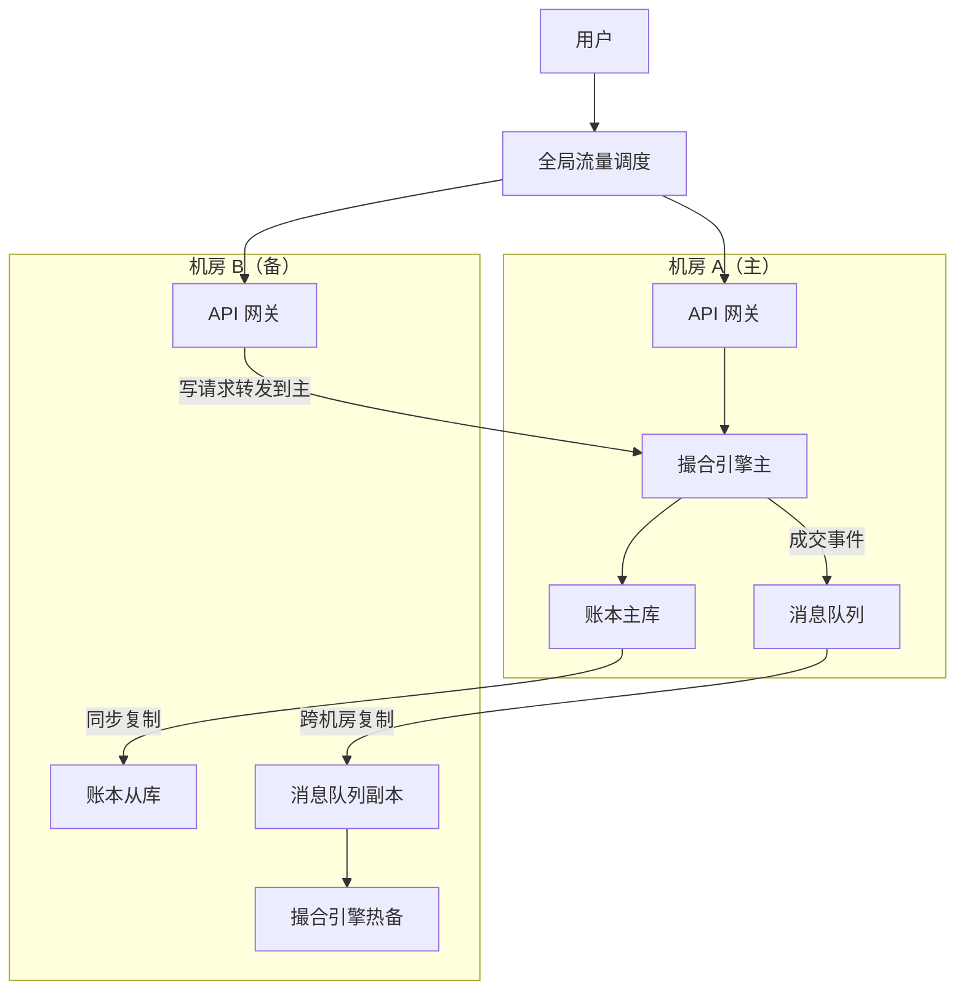
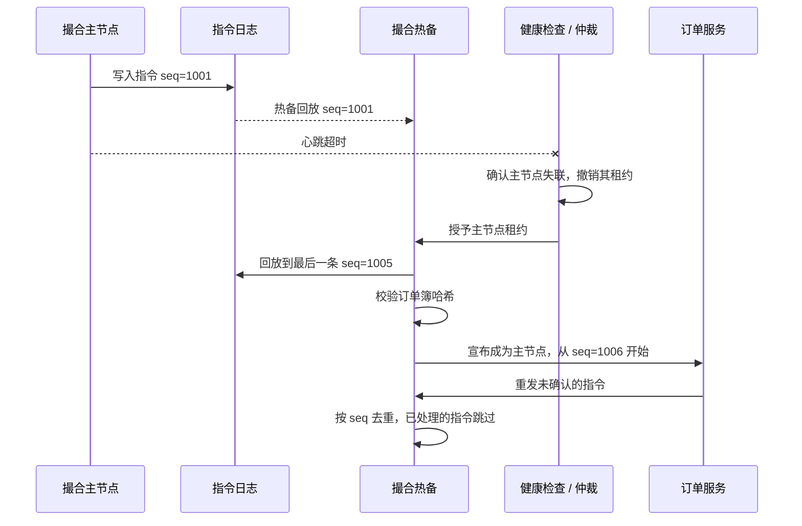
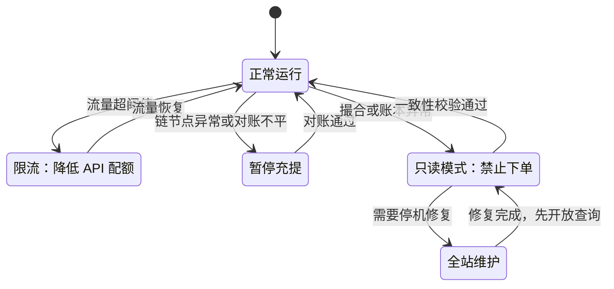

# 13 可靠性与安全事故

> 学习目标：读完本章，你能——
> 1. 说明交易所如何做高可用：多活、主备切换、冷启动重放、降级。
> 2. 列出可观测性的四类信号，以及安全纵深的四层防线。
> 3. 用因果图复盘 4 个真实事故，并说明账本隔离和储备金证明为什么重要。
>
> 前置章节：[02-system-architecture.md](02-system-architecture.md)、[04-wallet-custody.md](04-wallet-custody.md)、[05-ledger.md](05-ledger.md)
> 交互实验：[proof-of-reserves.html](interactive/proof-of-reserves.html)、[architecture-explorer.html](interactive/architecture-explorer.html)、[deposit-withdraw-sim.html](interactive/deposit-withdraw-sim.html)

> 🔎 进阶：更多交易所安全事故及防线映射见 [B12 安全事故案例库](backstage/B12-incident-casebook.md)。

## 1. 一句话理解

交易所的可靠性有两条底线：**资金不能错**，**错了必须能发现并恢复**。可用性排在这两条之后。

> 🎯 打个比方：交易所像一架民航客机。客机有多套液压系统（多活），有副驾驶随时接管（主备切换），有黑匣子记录每一秒（日志和账本），出问题时先保持平飞再排查（降级）。飞机可以延误，但不能坠毁。交易所可以暂停提币，但不能算错余额。

## 2. 业务视角：它解决什么问题

交易所 7×24 小时运行。加密市场没有休市。用户对中断的容忍度很低：

- 行情剧烈时停机 5 分钟，用户无法止损，会产生大量投诉和赔付。
- 账本出错 1 次，用户信任会受到长期影响。
- 私钥泄露 1 次，损失可能无法追回。

所以交易所必须同时回答三个问题：

1. **怎样不停机**：高可用（第 3.1–3.3 节）。
2. **怎样尽早发现问题**：可观测性（第 3.4 节）。
3. **怎样不被攻破**：安全纵深（第 3.5 节）。

第 4 节用 4 个真实事故说明：这三个问题任何一个没做好，代价是什么。

## 3. 系统视角：它如何实现

### 3.1 高可用架构：多活与灾备

不同服务的高可用策略不同。原因是服务的状态性质不同：

| 服务类型 | 示例 | 状态性质 | 高可用策略（业界通用做法） |
|---|---|---|---|
| 无状态服务 | API 网关、行情推送 | 无本地状态 | 多机房多活，负载均衡 |
| 有序状态服务 | 撮合引擎 | 内存订单簿，必须严格有序 | 单主 + 热备，按交易对分片 |
| 强一致存储 | 账本数据库 | 资金余额 | 主从同步复制，跨机房灾备 |
| 外部依赖 | 区块链节点、托管商 | 外部状态 | 多节点、多供应商、熔断 |

读图要点：

- 网关是多活：两个机房都接流量。撮合和账本是主备：同一时刻只有一个主。
- 撮合热备通过消费同一份有序事件流，保持与主节点相同的订单簿。
- 出错点：主备同时认为自己是主（脑裂，Split Brain）。两个撮合引擎同时成交会导致重复成交。系统必须用租约或仲裁服务保证"同一时刻只有一个主"。
- 局限：跨机房同步复制会增加延迟。业界常见的取舍是"撮合同机房低延迟，账本跨机房强一致"。

### 3.2 撮合主备切换与冷启动重放

撮合引擎把订单簿保存在内存中。内存数据在进程退出后丢失。所以撮合引擎必须能从持久化数据重建订单簿。

重建依赖两样东西：

- **快照（Snapshot）**：某一时刻订单簿的完整副本。
- **指令日志（Command Log）**：快照之后的所有下单和撤单指令，按序号严格排序。

读图要点：

- 热备一直在回放日志，所以切换时只需补齐最后几条指令。切换时间是秒级（业界通用目标）。
- 去重依赖序号。如果没有序号，重发会导致同一笔订单成交两次。
- 冷启动（没有热备时）：系统加载最近快照，再回放快照之后的全部日志。日志越长，冷启动越慢。所以系统要定期生成快照。
- 出错点：快照与日志的序号不连续，重放结果与原订单簿不一致。系统必须校验重放后的订单簿哈希。

### 3.3 维护窗口与降级策略

降级（Degradation）：系统部分故障时，主动关闭非核心功能，保护核心功能。

读图要点：

- 降级按影响范围从小到大排序：限流 → 暂停充提 → 只读 → 全站维护。
- 恢复顺序与降级顺序相反：先开放查询，再开放撤单，最后开放下单。这样用户先能看到真实余额。
- 出错点：只读模式下，已经挂在订单簿中的订单状态必须冻结。如果只读期间行情服务仍推送旧价格，用户会误判。
- 局限：暂停充提只能控制平台侧。链上的充值交易仍会到达，系统恢复后必须补扫这段时间的区块。

**计划维护窗口**的标准步骤（业界通用做法）：

1. 提前公告维护时间（币安通常提前数天公告，截至 2026 年公开资料）。
2. 维护开始前，暂停充提。
3. 停止接收新订单。
4. 撤销或保留现有挂单（按公告规则）。
5. 生成订单簿快照和账本快照。
6. 执行升级。
7. 执行对账：快照余额 = 升级后余额。
8. 按"查询 → 撤单 → 下单 → 充提"的顺序逐步恢复。

### 3.4 可观测性

可观测性（Observability）：通过系统对外输出的信号，判断系统内部状态的能力。

| 信号 | 回答的问题 | 交易所示例 |
|---|---|---|
| 指标（Metrics） | 现在怎么样？ | 下单延迟 P99、撮合吞吐、Kafka 堆积、提币队列长度 |
| 日志（Logs） | 发生了什么？ | 每笔订单的状态变化、每次后台操作的审计日志 |
| 链路追踪（Traces） | 慢在哪里？ | 一笔订单经过网关 → 风控 → 冻结 → 撮合 → 结算的耗时 |
| 告警（Alerts） | 谁需要立即处理？ | 账本借贷不平衡、热钱包余额异常下降 |

> 💡 注意：交易所最重要的告警不是"服务挂了"，而是"资金对不上"。服务挂了，用户会立即发现。资金对不上，可能几天后才有人发现。

告警分级示例（业界常见做法；本仓库未实现 P1/P2/P3 分级，`ops-console` 的告警只区分 `warning` / `critical`）：

- **P1**：资金错误、提币异常扩大、账实不一致。立即呼叫值班。
- **P2**：核心交易受影响、订单堆积。15 分钟内响应（示例）。
- **P3**：非核心功能异常、报表延迟。工作时间处理。

### 3.5 安全纵深

安全纵深（Defense in Depth）：设置多层独立防线。攻击者必须突破所有层，才能造成损失。

| 层 | 目标 | 措施（业界通用做法） |
|---|---|---|
| 网络层 | 让攻击者进不来 | DDoS 防护、WAF、核心服务不暴露公网、内网分区 |
| 账户层 | 让盗号者拿不走 | 2FA、设备绑定、提币白名单、新地址提币延迟 |
| 密钥层 | 让内鬼和黑客签不了名 | 冷热钱包分离、MPC 或多签、硬件安全模块（HSM） |
| 内控层 | 让单人做不成恶 | 四眼原则、权限最小化、操作审计 |

- **四眼原则（Four-Eyes Principle）**：任何高风险操作必须由两人完成，一人发起、一人审批。例如：大额提币、修改风控参数、上线新币。
- **权限最小化（Least Privilege）**：每个账号只获得完成工作所需的最小权限。客服可以查看用户信息，不能修改余额。
- **热钱包限额**：热钱包只保留日常提币所需的小部分资产。其余资产存放在冷钱包。

> ⚠️ 警告：任何人（包括管理员）都不能绕过账本直接修改余额。如果系统允许这样做，审计和对账就失去意义。

## 4. 币安怎么做（公开事实 + 业界做法）：真实案例复盘

本节的事件数据均据公开报道，包括当事方公告、法院文件和主流媒体报道。金额按事发时的市值估算。

### 4.1 2019 年币安热钱包被盗 7,000 BTC

【据公开报道】2019 年 5 月 7 日，攻击者从币安热钱包中提走约 7,000 BTC（当时约 4,000 万美元）。攻击者通过钓鱼、病毒等手段收集了大量用户的 API 密钥和 2FA 验证码，然后在一笔交易中完成提币。被盗资产约占币安 BTC 总持仓的 2%。币安暂停充提约一周，并用 SAFU 基金全额覆盖损失，用户没有承担损失。

读图要点：

- 攻击入口是用户侧凭证，而不是平台私钥。所以密钥层防线没有被突破。
- 被突破的是账户层和风控层：系统没有识别出"多个账户在短时间内协同提币"这一模式。
- 热钱包限额起了作用：损失被限制在总持仓的约 2%。
- 改进的关键是把 SAFU 这样的储备变成用户信任的一部分。

### 4.2 2022 年 BNB Chain 跨链桥漏洞

【据公开报道】2022 年 10 月 6 日，攻击者利用 BSC Token Hub 跨链桥的证明验证漏洞，伪造证明凭空铸造了 200 万枚 BNB（当时约 5.7 亿美元）。攻击者把部分资产跨链转出。BNB Chain 协调验证者暂停了链的运行。最终实际转出的损失估计约 1 亿–1.1 亿美元，部分资产被冻结。

读图要点：

- 这是链层事故，不是交易所账本事故。交易所用户的账户余额没有被直接修改。
- 跨链桥是高价值目标：一个验证漏洞就能凭空铸造资产。
- "暂停整条链"引发了关于去中心化程度的讨论。这是安全与去中心化之间的取舍。
- 对交易所的启示：交易所充值服务应对异常大额充值和刚升级的链设置更严格的确认数和人工审核。

### 4.3 2022 年 FTX 挪用客户资产并倒闭

【据公开报道和美国法院文件】2022 年 11 月初，媒体披露 FTX 关联交易公司 Alameda Research 的资产负债表大量依赖 FTX 自己发行的 FTT 代币。用户开始集中提币。FTX 无法兑付，于 2022 年 11 月 11 日申请破产保护。调查显示，FTX 把客户资产转移给 Alameda 使用，形成约 80 亿美元的缺口。创始人 Sam Bankman-Fried 于 2023 年 11 月被陪审团判定欺诈等罪名成立，2024 年 3 月被判处 25 年监禁。

读图要点：

- 这不是黑客事故，而是内控和治理失败。技术系统允许"有人绕过账本规则"。
- 如果客户资产严格隔离，平台自有资金的亏损不会传导到客户资产。
- 储备金证明（PoR，Proof of Reserves）让外部可以验证"平台持有的资产 ≥ 用户余额总和"。FTX 事件后，币安等交易所开始定期发布基于默克尔树的储备金证明（见 [proof-of-reserves.html](interactive/proof-of-reserves.html)）。
- 局限：PoR 只证明某一时刻的资产，不证明负债的完整性。完整的保障还需要独立审计。

### 4.4 2014 年 Mt.Gox 倒闭

【据公开报道】Mt.Gox 曾是全球最大的比特币交易所。2014 年 2 月，Mt.Gox 暂停提币，随后申请破产。约 85 万枚 BTC 下落不明（当时约 4.5 亿美元），之后找回约 20 万枚。调查认为，热钱包被长期持续盗取，而交易所多年没有发现。Mt.Gox 当时把问题归因于"交易延展性"（Transaction Malleability）漏洞。2018 年，破产程序转为民事再生程序，债权人因此可以按 BTC 而不是按法币获得赔付。2024 年 7 月起，受托人开始大规模向债权人返还 BTC 和 BCH，距离倒闭已有 10 年。

读图要点：

- 核心问题是"账"和"实"脱节。账本显示用户有钱，链上地址里没有钱。
- 如果每日执行"链上余额 vs 账本余额"对账，异常会在第一天被发现。
- 这个事故是现代交易所冷热钱包分离和定期对账制度的直接来源之一。
- 局限：事故调查时间长，部分细节在公开报道中存在不同说法。

### 4.5 四个案例对比

| 案例 | 被突破的防线 | 损失是否由用户承担 | 最关键的教训 |
|---|---|---|---|
| 2019 币安被盗 | 账户层、风控层 | 否，SAFU 覆盖 | 热钱包限额 + 储备基金 |
| 2022 BNB 跨链桥 | 链协议层 | 否，用户余额未变 | 跨链组件要有限额和紧急开关 |
| 2022 FTX | 内控层、治理层 | 是，破产程序处理 | 客户资产隔离 + 储备金证明 |
| 2014 Mt.Gox | 密钥层、对账 | 是，多年后部分赔付 | 每日账实对账 |

## 5. 故障与边界：哪里会出错，局限在哪

1. **高可用不能替代正确性**：主备切换再快，如果重放逻辑有 bug，切换后的订单簿就是错的。可用性必须让位于一致性校验。
2. **降级会伤害用户**：暂停提币会引发恐慌。平台必须同时发公告，说明原因和预计恢复时间。
3. **可观测性有盲区**：告警只覆盖已知的故障模式。FTX 式的内控失败不会触发任何技术告警。
4. **储备金证明的局限**：PoR 证明的是"某一时刻"。平台可以在快照前临时借入资产。PoR 也不能证明平台没有隐藏负债。
5. **人是最弱的一环**：钓鱼、社会工程、内鬼。技术防线必须假设"某个员工的账号会被攻破"。

## 6. 本仓库对照（CEX Demo 中的对应服务）

| 本章概念 | 仓库实现 | 位置 |
|---|---|---|
| 撮合快照 | `matching-engine` 支持 book snapshot / reset / seed | `engines/matching-engine/src/main.rs` |
| 订单簿重放 | `order-service` 支持订单簿 replay 和异常检测 | `services/order-service/README.md` |
| 账本重放与对账 | `ledger-service` 的 `reconcile-balances`、`replay-account`、`check-alerts` | `docs/ledger-service-design.md` 第 11 节、`docs/troubleshooting.md` 第 6.4 节 |
| 降级与紧急开关 | 只有单市场交易开关：运营可把市场设为 `halted`，拒绝新单、撤单放行。全站提币、单资产提币、API 写入开关本仓库未实现 | `services/risk-service/src/application/market-status-service.ts`、`docs/api-contracts.md` 第 5.1 节 |
| 告警分级 | 本仓库未实现 P1/P2/P3 分级。`ops-console` 的交易运行时告警只分 `warning` / `critical`；`ledger-service` 的 `check-alerts` 按阈值输出 `alert` | `apps/ops-console/src/application/ops-console-application-service.ts`、`docs/ledger-service-design.md` 第 11.3 节 |
| 审计日志 | `ops_action_audit_logs` 记录运营写操作的操作人、角色、权限、目标、请求 / 响应和结果；`withdrawal_audit_logs` 记录提现各状态的操作人、`trace_id` 和前后快照 | `docs/security.md` 第 2.8 节 |
| 权限控制 | 6 个运营角色映射到细粒度权限，提现审核（`ops_reviewer`）与账本执行（`ops_finance_operator`）分属不同角色 | `services/identity-service/src/domain/rbac.ts`、`docs/security.md` 第 2.2 节 |
| 托管熔断 | `custody-adapter` 多 provider 路由、失败熔断、健康检查 | `services/custody-adapter/README.md`、`docs/fault-lab.md` |
| 排障顺序 | 先看日志和状态，先只读检查，再修复；不直接手改余额或状态列 | `docs/troubleshooting.md` 第 1、6.4 节 |

关键观察：本仓库的排障原则"不直接手改余额快照或状态列"，正是对 FTX 和 Mt.Gox 教训的工程化表达。账本只追加不覆盖，所有资金变更可回放。

当前缺口（来自仓库文档）：撮合引擎是单进程，没有热备和自动主备切换；多机房部署不在 MVP 范围内。

## 7. 术语表

| 术语 | 英文 | 定义 |
|---|---|---|
| 多活 | Active-Active | 多个机房同时承接流量 |
| 热备 | Hot Standby | 实时同步状态、可立即接管的备用节点 |
| 脑裂 | Split Brain | 主备同时认为自己是主节点 |
| 快照 | Snapshot | 某一时刻状态的完整副本 |
| 指令日志 | Command Log | 按序记录的全部状态变更指令 |
| 降级 | Degradation | 主动关闭非核心功能以保护核心功能 |
| 可观测性 | Observability | 通过外部信号判断系统内部状态的能力 |
| 链路追踪 | Distributed Tracing | 记录一个请求经过所有服务的路径和耗时 |
| 安全纵深 | Defense in Depth | 设置多层独立的安全防线 |
| 四眼原则 | Four-Eyes Principle | 高风险操作必须由两人共同完成 |
| 权限最小化 | Least Privilege | 只授予完成工作所需的最小权限 |
| 储备金证明 | PoR, Proof of Reserves | 证明平台资产不少于用户负债的方法 |
| 安全资产基金 | SAFU | 币安设立的用户资产保护基金 |

## 8. 思考题

1. 在 [proof-of-reserves.html](interactive/proof-of-reserves.html) 中构造一个"平台在快照前临时借入资产"的场景。PoR 能发现这个问题吗？还需要哪些机制？
2. 撮合主节点在 seq=1005 处崩溃，热备只回放到 seq=1003。指令日志中 seq=1004 和 1005 已经持久化。切换后应该怎么做？如果 seq=1005 没有持久化又会怎样？
3. 用第 3.5 节的四层防线，分析 2019 年币安被盗事件：哪一层被突破了？哪一层限制了损失？在 [deposit-withdraw-sim.html](interactive/deposit-withdraw-sim.html) 中设计一条能拦截这类批量提币的规则。
