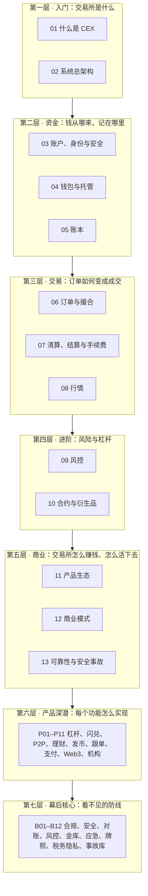

# CEX 交易所系统学习材料（以币安为例）

> 目标：由浅入深，理解中心化交易所（CEX）的**底层系统逻辑**和**业务/商业逻辑**。
> 形式：Markdown 章节（文字 + Mermaid 图）+ HTML 交互实验（按钮、滑块、动画）。
> 风格：80% 遵循 ASD-STE100 受控语言（短句、主动语态、一词一义），20% 用比喻和案例。

## 1. 一张图看懂学习路径

读图要点：

- 先读第一层，建立全局地图。后面每一章都是地图上的一个节点。
- 第二层和第三层是交易所的"心脏"。资金正确性优先于交易速度。
- 第四、五层依赖前面的概念。例如合约强平依赖账本、撮合和风控。
- 第六、七层是"下篇"：第六层把主站每个产品拆成"底层逻辑卡"；第七层讲用户看不见、但决定交易所生死的系统。

## 2. 章节目录

| # | 章节 | 你会学到 | 交互实验 |
|---|---|---|---|
| 01 | [什么是 CEX](01-what-is-cex.md) | CEX 的本质：托管 + 记账 + 撮合；币安业务版图；用户旅程 | — |
| 02 | [系统总架构](02-system-architecture.md) | 分层架构、调用链、同步与异步边界、单点与故障 | [架构探索器](interactive/architecture-explorer.html) |
| 03 | [账户、身份与安全](03-account-identity-security.md) | 登录、2FA、API Key 签名、KYC 状态机 | — |
| 04 | [钱包与托管](04-wallet-custody.md) | 充值确认数、链重组、提币流程、冷热钱包、储备金证明 | [充提模拟器](interactive/deposit-withdraw-sim.html) · [储备金证明](interactive/proof-of-reserves.html) |
| 05 | [账本](05-ledger.md) | 双分录、冻结/解冻、幂等、对账、热点账户 | [双分录账本](interactive/ledger-double-entry.html) |
| 06 | [订单与撮合](06-order-matching.md) | 订单簿、价格-时间优先、订单类型、撮合引擎实现 | [撮合引擎](interactive/order-book-matching.html) |
| 07 | [清算、结算与手续费](07-clearing-settlement-fees.md) | 成交后的分录、Maker/Taker、VIP、BNB 抵扣 | [双分录账本 · 手续费计算器](interactive/ledger-double-entry.html) |
| 08 | [行情](08-market-data.md) | 深度、K 线、增量同步、WebSocket 扇出 | [深度与滑点](interactive/depth-slippage.html) |
| 09 | [风控](09-risk-control.md) | 交易前/中/后风控、提币风控、限流、误杀与漏放 | [风控规则实验室](interactive/risk-rules-lab.html) |
| 10 | [合约与衍生品](10-derivatives-futures.md) | 永续合约、资金费率、标记价格、强平、保险基金、ADL | [永续合约实验室](interactive/perpetual-liquidation.html) |
| 11 | [产品生态](11-products-ecosystem.md) | 杠杆、闪兑、P2P、理财、Launchpool、上币流程 | — |
| 12 | [商业模式](12-business-model.md) | 收入结构、飞轮、BNB 代币经济、合规 | [商业模型沙盘](interactive/revenue-model.html) |
| 13 | [可靠性与安全事故](13-reliability-security-incidents.md) | 高可用、降级、真实事故复盘（币安 2019、FTX、Mt.Gox） | — |

### 下篇 · 产品深潜（[products/](products/README.md)）

| # | 主题 | 交互实验 |
|---|---|---|
| P01 | [杠杆与借贷](products/P01-margin-and-loans.md) | [借贷与杠杆实验室](interactive/margin-loan-lab.html) |
| P02 | [闪兑与 OTC](products/P02-convert-otc.md) | [闪兑报价沙盘](interactive/convert-rfq.html) |
| P03 | [P2P 与法币通道](products/P03-p2p-fiat.md) | [P2P 担保交易](interactive/p2p-escrow.html) |
| P04 | [合约进阶：统一账户、组合保证金、期权](products/P04-advanced-derivatives.md) | — |
| P05 | [理财 I：存币生息与质押](products/P05-earn-savings-staking.md) | — |
| P06 | [理财 II：结构化产品](products/P06-structured-products.md) | [双币投资拆解](interactive/dual-investment.html) |
| P07 | [上币与新币分发](products/P07-listing-launch.md) | [Launchpool 计算器](interactive/launchpool-calc.html) |
| P08 | [策略交易与跟单](products/P08-strategy-copy-trading.md) | [网格策略回测](interactive/grid-bot.html) |
| P09 | [支付与卡](products/P09-pay-and-card.md) | — |
| P10 | [Web3 钱包与链上](products/P10-web3-wallet.md) | — |
| P11 | [增长与机构](products/P11-growth-institutional.md) | — |

### 下篇 · 幕后核心（[backstage/](backstage/README.md)）

| # | 主题 | 交互实验 |
|---|---|---|
| B01 | [合规防护](backstage/B01-compliance.md) | [AML 资金流图谱](interactive/aml-graph.html) |
| B02 | [平台安全防护](backstage/B02-platform-security.md) | — |
| B03 | [账户安全风控](backstage/B03-account-security.md) | [盗号攻防实验](interactive/ato-defense.html) |
| B04 | [系统对账](backstage/B04-reconciliation.md) | [对账实验室](interactive/reconciliation-lab.html) |
| B05 | [业务风控](backstage/B05-business-risk.md) | [市场监控实验](interactive/market-surveillance.html) |
| B06 | [资金与流动性管理](backstage/B06-treasury-liquidity.md) | — |
| B07 | [应急响应](backstage/B07-incident-response.md) | — |
| B08 | [实时风控平台工程](backstage/B08-risk-platform.md) | [风控决策流水线](interactive/risk-pipeline-lab.html) |
| B09 | [全球监管与牌照](backstage/B09-global-licensing.md) | [牌照与监管矩阵](interactive/license-matrix.html) |
| B10 | [税务报送与数据隐私](backstage/B10-tax-privacy.md) | — |
| B11 | [安全工程](backstage/B11-security-engineering.md) | — |
| B12 | [安全事故案例库](backstage/B12-incident-casebook.md) | [事故案例浏览器](interactive/incident-explorer.html) |

### 动画讲解幻灯片 · 40 集（[slides/](slides/index.html)）

主线 13 章拆成 17 集，加上幕后核心 B01–B12、产品深潜 P01–P11，每集一个可翻页的动画讲解页。浏览器打开 [slides/index.html](slides/index.html) 选集观看，无需服务器。

全部交互实验入口：[interactive/index.html](interactive/index.html)（用浏览器直接打开即可，无需服务器）。

## 3. 三种学习路线

| 你的角色 | 推荐路线 | 重点 |
|---|---|---|
| 产品 / 运营 / 投资研究 | 01 → 02 → 07 → 10 → 11 → 12 → 13 → P01–P11 | 业务逻辑、收入来源、风险事件 |
| 后端 / 架构工程师 | 01 → 02 → 05 → 06 → 07 → 04 → 08 → 09 → 13 → B04 → B02 | 账本一致性、撮合确定性、异步补偿、对账 |
| 风控 / 合规 / 安全 | 01 → 03 → 04 → 09 → 10 → 13 → B01–B12 | 身份、资金安全、强平、事故复盘、幕后防线 |

## 4. 怎么用交互实验

1. 先读对应章节的"一句话理解"和第一张图。
2. 打开交互页。按页面上的"试一试"操作。
3. 记录你观察到的现象。回到章节的"思考题"，用实验结果回答。

> 💡 注意：交互页里的费率、确认数、保证金率等参数是**示例值**，用于演示机制。币安会调整真实参数，请以币安官网为准。

> ⚠️ 警告：本材料仅用于学习系统设计和业务逻辑，不构成任何投资建议。杠杆和合约交易可能导致全部本金损失。

## 5. 三个层次的信息

本材料始终区分三类信息：

- **币安公开事实**：来自币安官网、API 文档、公告和公开新闻。
- **业界通用做法**：交易所普遍采用的设计。币安内部实现未公开时使用此标注。
- **本仓库实现**：本仓库根目录下的 CEX Demo 代码（见 [../README.md](../README.md)）中的服务实现，用于对照理解。
