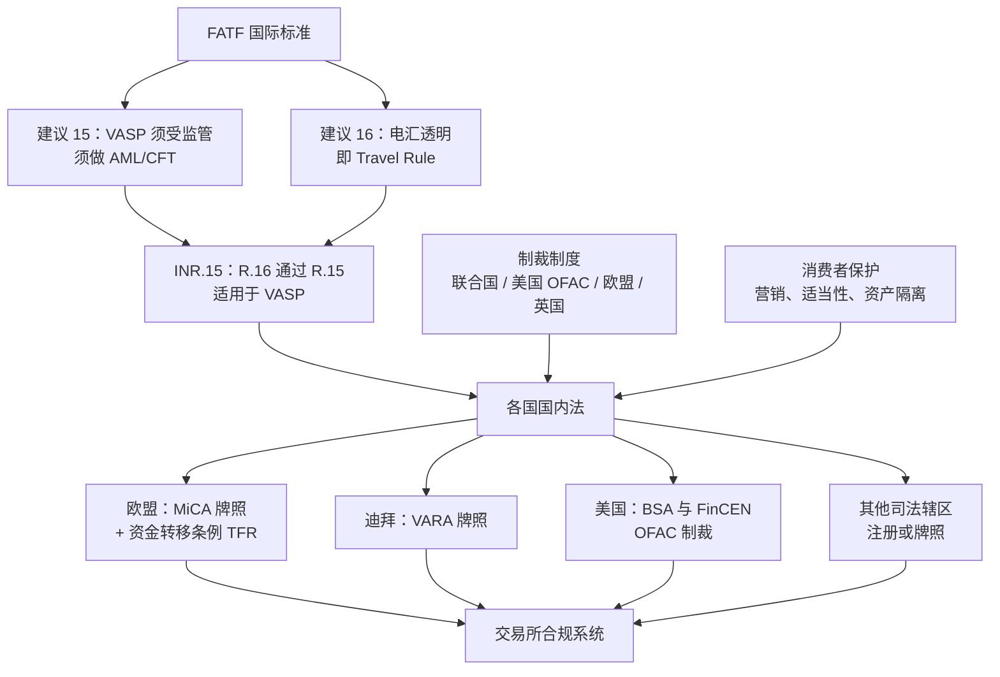
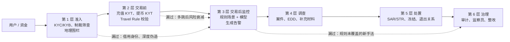
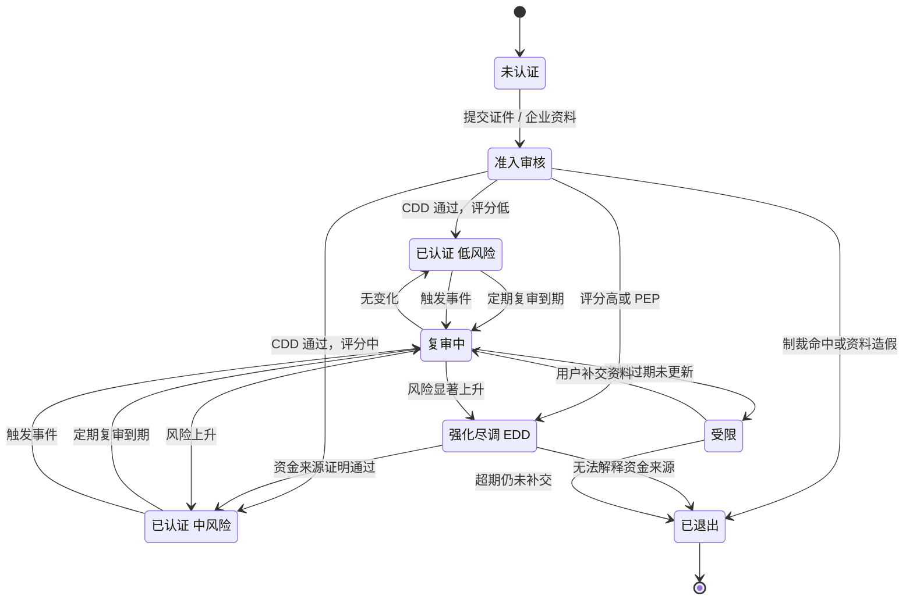
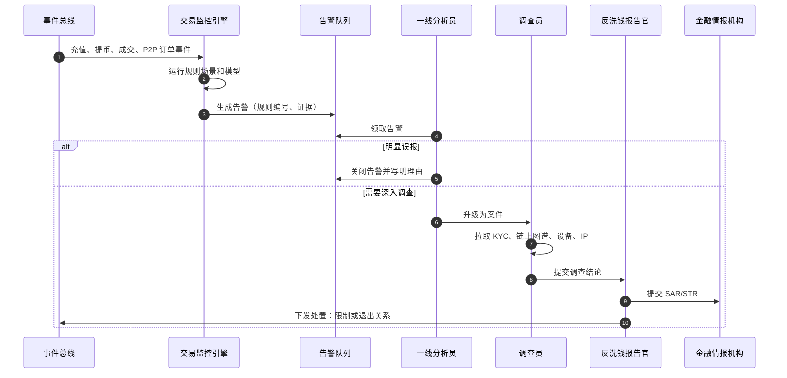
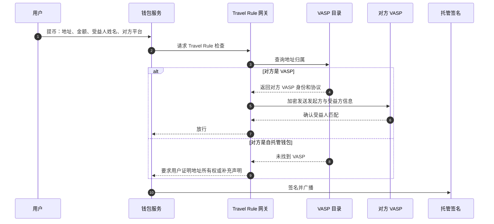
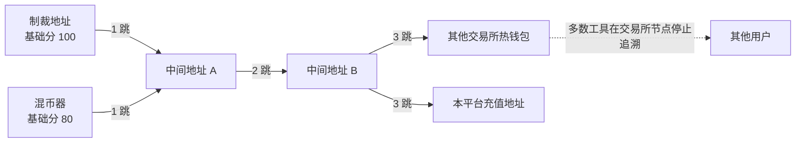
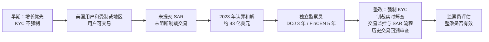

# B01 合规防护：KYC、交易监控、KYT、Travel Rule 与制裁筛查

> 学习目标：读完本章，你能——
> 1. 画出交易所面对的监管要求地图：AML/CFT、FATF 建议 15 与 16、制裁、消费者保护、各地 VASP 牌照。
> 2. 说出 KYC/KYB 生命周期的状态机，以及"交易监控 → 告警 → 案件 → 可疑交易报告"的处理链。
> 3. 解释链上 KYT 的直接暴露和间接暴露，Travel Rule 的数据如何随提币传递，以及制裁筛查的三个维度。
>
> 前置章节：[03 账户、身份与安全](../03-account-identity-security.md)（KYC 分级与冻结）、[09 风控](../09-risk-control.md)（KYT 与制裁硬规则）、[12 商业模式](../12-business-model.md)（牌照与 2023 年美国和解）
> 交互实验：[aml-graph.html](../interactive/aml-graph.html)（AML 资金流图谱）、[risk-rules-lab.html](../interactive/risk-rules-lab.html)（风控规则实验室）

> ⚠️ 警告：本章仅用于学习交易所系统设计。本章不构成法律意见。各地法规会变化，读者应以监管机构的原文为准。本章的阈值除标注"公开资料"外，都是示例。

---

> 🔎 进阶：各地牌照要求对照见 [B09](B09-global-licensing.md)；税务信息报送与数据隐私见 [B10](B10-tax-privacy.md)。

## 1. 一句话理解 + 🎯 打个比方

合规防护（Compliance Controls）是交易所为满足反洗钱、反恐融资和制裁法规而建的一套"认人 + 看钱 + 报告"系统。它回答三个问题：客户是谁？钱从哪来、到哪去？发现可疑情况后向谁报告？

> 🎯 打个比方：合规系统像一家大型物流公司的海关申报部。
> 收件前，柜台核对寄件人身份证（KYC）。
> 包裹上路后，分拣中心的 X 光机扫描每个包裹（交易监控、KYT）。
> 包裹跨国时，运单必须写清寄件人和收件人（Travel Rule）。
> 柜台墙上贴着"禁运名单"（制裁名单）。
> 发现可疑包裹，申报部填表交给海关（可疑交易报告）。
> 海关要求扣下某个包裹，物流公司必须配合（执法协作与冻结）。

第 03 章讲了 KYC 分级。第 09 章讲了 KYT 和制裁硬规则。本章不重复它们的入口规则。本章讲"入口之后"的持续运营：复审、监控、调查、报告和整改。

---

## 2. 威胁 / 问题模型

### 2.1 要防什么

| 威胁 | 典型手法 | 违规后果 | 主要防线 |
|---|---|---|---|
| 洗钱（Money Laundering） | 放置 → 分层 → 整合；拆分、多跳、跨链、P2P 套现 | 监管罚款、牌照吊销、刑事责任 | KYC、交易监控、KYT、SAR |
| 恐怖融资（Terrorist Financing） | 小额、高频、多国汇款 | 同上，且制裁风险更高 | 制裁筛查、地理围栏、交易监控 |
| 制裁规避（Sanctions Evasion） | 受制裁人员借用他人账户、VPN 隐藏 IP、经中间地址转账 | 严格责任；高额罚款 | 姓名筛查、地址名单、IP 与地理围栏 |
| 欺诈资金流入 | 盗号赃款、杀猪盘赃款、黑客被盗资金充值 | 协助洗钱的指控；用户投诉 | KYT 充值筛查、冻结、执法协作 |
| 无牌经营 | 向未取得牌照的地区提供服务 | 罚款、业务禁令 | 地区路由、产品开关（见第 12 章） |
| 消费者保护违规 | 误导营销、高风险产品卖给不合适的人 | 罚款、产品下架 | 适当性评估、风险披露 |

### 2.2 监管要求地图

读图要点：

- FATF（Financial Action Task Force，金融行动特别工作组）只发布标准。标准本身不直接约束企业。各国把标准写进国内法后，交易所才有法定义务。
- 建议 15（R.15）要求各国监管 VASP（Virtual Asset Service Provider，虚拟资产服务商）。建议 16（R.16）要求转账附带发起方和受益方信息。R.16 通过 R.15 的释义适用于 VASP。
- 制裁是独立的法律体系。制裁不看金额，没有"小额豁免"。
- 局限：同一笔提币可能同时受多地法规约束。各地阈值和数据字段不一致，系统必须按"最严格的一方"或"按对手方所在地"配置。

### 2.3 各地规则速览（截至 2026 年公开资料，中立表述）

| 规则 | 要点 | 时间（公开资料） |
|---|---|---|
| FATF R.15 / INR.15 | VASP 须注册或持牌；须执行 KYC、监控、报告；Travel Rule 的转账门槛为 1,000 美元/欧元 | 2019 年 6 月通过对 VASP 的修订 |
| FATF R.16 修订 | 统一跨境支付报文中的发起方和受益方信息；把欺诈防范纳入考虑 | 2025 年 6 月全会通过；预计 2030 年底前落地 |
| 欧盟 MiCA | 加密资产服务商（CASP）须获得授权；一国授权可在欧盟通行（护照） | 2024 年 12 月 30 日全面适用；过渡期最长到 2026 年 7 月 1 日，部分成员国更短 |
| 欧盟 TFR（资金转移条例） | 加密资产转账适用 Travel Rule，**没有最低金额豁免** | 与 MiCA 同日适用 |
| 迪拜 VARA | 虚拟资产服务按活动类别发牌；有营销和合规规则手册 | 币安 FZE 于 2024 年 4 月获得完整 VASP 牌照（公开报道） |
| 美国 BSA / FinCEN | 货币服务业务（MSB）须注册、建 AML 计划、提交 SAR | 长期有效 |
| 美国 OFAC | SDN 名单；对受制裁对象的资产实行冻结；名单含加密地址 | 长期有效 |

> 💡 注意：牌照状态变化很快。例如，据公开报道，币安于 2026 年 6 月撤回在希腊提交的 MiCA 授权申请，并转向其他欧盟成员国；自 2026 年 7 月 1 日 MiCA 过渡期结束起，币安停止向欧盟居民提供大部分服务，提币保持开放（详见 [B09](B09-global-licensing.md)）。读者应以监管机构的公开登记册为准。

---

## 3. 防线分层

读图要点：

- 每层只拦截它看得见的风险。准入层看人，交易前看地址，交易后看行为模式。
- 虚线是每层的典型漏洞。下一层的任务之一是补上一层的漏洞。
- 第 6 层不直接拦截资金。它检查前 5 层是否按规则运转，并推动整改。
- 局限：越靠后的层越慢、越贵。第 4 层依赖人工，产能有上限。

| 层 | 拦截什么 | 漏过什么 | 延迟 |
|---|---|---|---|
| 准入 | 假证件、制裁名单上的人、受限地区居民 | 账户买卖、出借 | 分钟到天 |
| 交易前 | 直接来自制裁地址、混币器的资金 | 多跳之后的间接资金 | 秒级（同步） |
| 交易后监控 | 拆分、快进快出、异常 P2P | 新型手法 | 分钟到天（异步） |
| 调查 | 告警中的真问题 | 告警积压导致的超时 | 天到周 |
| 处置 | — | 报告质量低，执法机构无法使用 | 按法定时限 |

---

## 4. 关键流程

### 4.1 KYC/KYB 生命周期

KYB（Know Your Business，了解你的企业客户）：对企业客户的尽职调查。它除了核验企业本身，还要识别最终受益所有人（UBO，Ultimate Beneficial Owner）。

CDD（Customer Due Diligence，客户尽职调查）：对所有客户执行的标准核验。EDD（Enhanced Due Diligence，强化尽职调查）：对高风险客户追加的核验，例如资金来源证明。

读图要点：

- 准入只是起点。客户在整个关系期都处在"认证 → 复审 → 认证"的循环中。
- 复审有两种入口：定期复审（按评级决定周期）和触发式复审（事件驱动）。
- "受限"不等于"冻结"。受限账户通常只允许提出，不允许新增交易（业界通用做法）。
- 局限：状态机只能处理已知事件。账户被转卖后，KYC 资料仍然"有效"，状态机看不见。

触发式复审的典型事件（业界通用做法）：

1. 用户更新国籍或居住地。
2. 制裁名单更新后，用户出现新的模糊匹配。
3. 交易监控产生的告警被确认为真。
4. 执法机构发来协查函。
5. 证件到期。

### 4.2 客户风险评级模型

业界通用做法是"因子加权打分"。示例模型：

| 因子 | 取值示例 | 分值（示例） |
|---|---|---|
| 地域 | 居住地属于 FATF 高风险名单 / 一般 / 低风险 | 30 / 10 / 0 |
| 客户类型 | 个人 / 企业 / 复杂股权企业 | 0 / 10 / 25 |
| PEP（政治公众人物） | 是 / 否 | 30 / 0 |
| 产品使用 | 仅现货 / P2P 高频 / OTC 大宗 | 0 / 15 / 15 |
| 预期交易量与收入不匹配 | 是 / 否 | 20 / 0 |
| 历史告警 | 近 12 个月有确认告警 / 无 | 25 / 0 |

评级规则（示例）：总分 < 30 为低风险，复审周期 3 年。30–59 为中风险，周期 2 年。≥ 60 为高风险，进入 EDD，周期 1 年。

> 💡 注意：评级的输出是"复审周期"和"监控强度"，不是"是否放行"。制裁命中不进入评分，它是硬规则（见第 09 章 4.4 节）。

### 4.3 交易监控：告警 → 案件 → 报告

读图要点：

- 监控引擎只生成告警。告警是否构成"可疑"由人判断，并由 MLRO（Money Laundering Reporting Officer，反洗钱报告官）签发报告。
- SAR（Suspicious Activity Report）是美国的叫法。STR（Suspicious Transaction Report）是多数其他地区的叫法。两者指同一类报告。
- 报告有法定时限。例如美国规定，从发现可疑事实起，通常在 30 个日历日内提交（公开法规）。
- 局限：多数司法辖区禁止向客户透露"你已被报告"（Tipping-off 禁令）。客服话术必须为此设计。

### 4.4 Travel Rule 实现

Travel Rule：VASP 在转出虚拟资产时，必须把发起方和受益方信息传给接收方 VASP。接收方 VASP 必须核对这些信息。

读图要点：

- 信息走"链下"通道。区块链交易本身不携带姓名。
- 最难的一步是"查询地址归属"。区块链地址不写明属于哪个平台。业界靠 VASP 目录、KYT 标签和对方确认来解决。
- VASP 之间使用不同协议，例如 TRUST、TRP、GTR、IVMS101 数据格式（业界通用做法）。协议不互通时，网关需要做转换。
- 局限：接收方不响应时，发出方要决定"等待、退回还是放行"。各地规则对此要求不同。

数据字段（以 FATF 释义为基础，示例）：发起方姓名、账号或钱包地址、住址或证件号或出生日期（三选一）；受益方姓名、账号或钱包地址。欧盟 TFR 对加密资产转账没有最低金额豁免。

### 4.5 链上 KYT：直接暴露与间接暴露

KYT 服务商（例如 Chainalysis、Elliptic、TRM Labs）给地址打标签，并计算风险暴露（Exposure）。

- 直接暴露（Direct Exposure）：资金在 1 跳内来自高风险实体。例如充值地址直接收到混币器的转账。
- 间接暴露（Indirect Exposure）：资金经过 2 跳或更多跳来自高风险实体。

读图要点：

- 示例算法：风险分 = 基础分 × 衰减系数^(跳数 − 1) × 资金占比。跳数越多，分数越低。
- 交易所、大型支付机构这类"聚合节点"会混合大量正常资金。业界通常在这些节点停止追溯，否则全网地址都会被标红。
- 局限：攻击者用"剥离链"（Peel Chain）拉长跳数，让风险分衰减到告警线以下。拉长追溯跳数能抓到它，但误报会增加。
- 交互实验 [aml-graph.html](../interactive/aml-graph.html) 的案例 3 演示这个权衡。

### 4.6 制裁名单筛查

| 维度 | 输入 | 方法 | 难点 |
|---|---|---|---|
| 姓名 | KYC 姓名、企业名、UBO 姓名 | 模糊匹配：音译变体、编辑距离、别名表 | 常见姓名误报高；中文、阿拉伯文、俄文的拉丁转写不统一 |
| 地址 | 充值来源、提币目标 | 精确匹配名单中的链上地址；结合 KYT 标签 | 名单只列已知地址；新地址需要图谱推断 |
| 地理 | 注册 IP、登录 IP、证件国籍、居住地 | 地理围栏（Geofencing）：受限地区直接拒绝 | VPN、代理；用户出差的误杀 |

名单是动态的。例如美国 OFAC 于 2022 年 8 月把 Tornado Cash 智能合约地址列入 SDN 名单，又于 2025 年 3 月将其移除（公开公告）。系统必须支持"名单增量更新后，对存量客户和历史交易做回溯筛查"。

### 4.7 执法协作与冻结

1. 执法机构发出协查函或冻结令。
2. 合规团队核验来函的真实性和管辖权。
3. 系统按指令冻结账户或指定资产（见第 03 章 3.9 节）。
4. 合规团队提供数据，并记录交付内容。
5. 案件结束后，系统按指令解冻、没收或返还。

> ⚠️ 警告：伪造执法函是已知的诈骗手法。第 2 步不能省略。核验应通过已知的官方渠道回拨确认，不能只信来函上的联系方式。

---

## 5. 规则、指标与阈值

### 5.1 交易监控规则场景（示例）

| 编号 | 场景 | 条件（示例） | 动作 |
|---|---|---|---|
| TM-01 | 快进快出 | 充值后 2 小时内提走 ≥ 90%，且几乎没有交易 | 告警 |
| TM-02 | 结构化拆分（Structuring） | 24 小时内 ≥ 3 笔，每笔在报告阈值的 50%–100% 之间，合计 ≥ 阈值 | 告警 |
| TM-03 | 多跳快速转移（Layering） | 连续 ≥ 3 跳，每跳间隔 ≤ 时间窗口，金额保留 ≥ 90% | 告警；跨链时加权 |
| TM-04 | 高风险地址交互 | KYT 直接暴露 ≥ 告警线，或间接暴露在跳数阈值内 ≥ 告警线 | 拦截或告警 |
| TM-05 | P2P 异常 | 同一账户 7 天内与 ≥ 20 个不同对手方成交，且资金快速转出 | 告警（见 [P03](../products/P03-p2p-fiat.md)） |
| TM-06 | 资料与行为不符 | 申报为学生，月交易额超过 100 万 USDT | 触发复审 |
| TM-07 | 多账户共享设备 | ≥ 5 个已认证账户共用一个设备指纹 | 告警（见 [B03](B03-account-security.md)） |

### 5.2 运营指标（示例）

| 指标 | 定义 | 告警条件（示例） |
|---|---|---|
| 告警积压量 | 未处理告警数 | > 一线分析员 3 天产能 |
| 告警处理时长 P90 | 从生成到关闭的时间 | > 7 天 |
| 真阳性率 | 升级为案件的告警 ÷ 全部告警 | < 2% 时说明规则过宽 |
| SAR 超时率 | 超过法定时限提交的报告比例 | > 0 即告警 |
| 复审逾期率 | 复审到期未完成的客户比例 | > 5% |
| 名单更新延迟 | 官方名单发布到系统生效的时间 | > 24 小时 |

> 💡 注意：真阳性率低于 5% 在交易监控中很常见（业界通用做法）。阈值放宽会降低漏报，但告警成本会线性上升。调参的方法与第 09 章 3.9 节的误杀/漏放分析相同。

---

## 6. 真实案例

### 6.1 2023 年币安与美国监管机构和解及之后的合规监察

【事实，据公开报道和和解文件】2023 年 11 月，币安承认违反《银行保密法》和制裁规定，同意支付约 43 亿美元（金额细节见第 12 章 4.2 节）。和解要求币安接受独立合规监察：

- 美国司法部（DOJ）的监察员来自 Forensic Risk Alliance，任期 3 年，2024 年 5 月正式任命。
- FinCEN 的监察员来自 Sullivan & Cromwell 律所，任期 5 年。
- 据公开报道，2025 年币安与 DOJ 讨论提前结束监察。2026 年 4 月，美国参议员致信 DOJ 和财政部，询问两名监察员的工作状态。截至本文写作时，相关结果以官方公告为准。

读图要点：

- 根因不在单个技术缺陷，在于"合规不是准入条件"的早期策略（【分析】）。
- 监察员不运营系统。监察员检查整改是否落地、是否有效，并向监管机构报告。
- 整改落在本章的每一层：第 1 层强制 KYC，第 2 层实时制裁筛查，第 3–5 层监控和报告，第 6 层监察。
- 局限：公开报道只能看到结论，看不到整改的系统细节。上表的整改项是基于和解文件的业界通用解读。

### 6.2 Tornado Cash 名单变化

【事实，公开公告】2022 年 8 月，OFAC 将 Tornado Cash 列入制裁名单。2025 年 3 月，OFAC 将其移除。这一案例说明：名单筛查系统必须支持"加入"和"移除"两个方向的变更，并保留变更前的判定记录用于审计。

---

## 7. 局限与权衡

| 权衡 | 一侧 | 另一侧 | 常见做法（业界通用做法） |
|---|---|---|---|
| 误报 vs 漏报 | 阈值严：告警多，调查团队被淹没 | 阈值松：洗钱漏过，监管处罚 | 分层阈值；对高风险客户收紧 |
| 体验 vs 合规 | 准入快，转化率高 | 准入严，用户流失 | 分级 KYC：先开放低额度 |
| 追溯深度 vs 噪声 | 跳数多：抓到剥离链 | 跳数多：正常用户被牵连 | 在聚合节点停止追溯；结合资金占比 |
| 自动化 vs 可解释 | 模型召回率高 | 监管要求能解释"为什么告警" | 规则兜底，模型排序 |
| 全球统一 vs 本地化 | 一套规则，成本低 | 各地法规不同 | 按实体和地区配置规则集 |
| 隐私 vs Travel Rule | 少传数据，隐私好 | 法规要求传姓名 | 加密传输；最小字段 |

> 💡 注意：合规系统的"漏报"往往在多年后才暴露。2023 年和解涉及的行为发生在数年前。因此合规系统必须保存完整的判定记录和证据，用于事后回溯。

---

## 8. 本仓库对照

本仓库（[CEX Demo](../..)）是现货交易 MVP，合规模块大部分未实现。

| 合规能力 | 本仓库现状 | 位置 |
|---|---|---|
| KYC 字段 | ✅ 用户带 `kyc_tier`，`unverified → L1 → L2` 逐级申请、运营审核，证件号只做格式校验并脱敏存储 | `../../services/identity-service/src/domain/kyc.ts` |
| KYC/KYB 状态管理 | ⚠️ KYC 由 identity-service 实现，等级决定提现限额；没有 KYB（机构认证） | `../../docs/domain-model.md` 第 7 节 |
| AML、Travel Rule | ❌ 本仓库未实现，架构文档把它列为与真实交易所的差异 | `../../docs/architecture.md` 第 9 节 |
| 提币人工审核 | ✅ 已有审核动作，测试用例的审核备注为 "passed aml review" | `../../services/wallet-service/src/__tests__/wallet-application-service.test.ts` |
| 高风险地址强制人工审核 | ⚠️ 简化 KYT：提现时按规则给目标地址打分并保存分数、等级和原因；黑名单（制裁 / 被盗资金 / 混币，带演示种子）直接拦截，已在队列中的提现自动拒绝并解冻；混币等高风险标签强制两名运营复核；运营后台可按风险等级筛选。没有真实 KYT 供应商和多跳资金溯源 | `../../services/wallet-service/src/domain/withdrawal-risk.ts`；`../../docs/security.md` 第 2.7 节 |
| KYC/AML 供应商接入 | ❌ 本仓库未实现，KYC 不接任何第三方核验 | `../../docs/security.md` 第 1.2 节 |

如果要补齐，建议按以下顺序：

1. 在 identity-service 增加 KYC 状态机（4.1 节），状态变更写审计事件。
2. 把 wallet-service 的规则评分接到真实 KYT 数据源，制裁名单改为定期同步（OFAC 等），并为命中记录生成合规告警。
3. 新增异步交易监控消费者，订阅充值、提币、成交事件，输出告警表。
4. 新增案件表：告警 → 案件 → 结论 → 报告编号。
5. Travel Rule 网关作为 wallet-service 的前置检查，先支持"自托管地址声明"。

---

## 9. 术语表 / 思考题

### 术语表

| 术语 | 英文 | 定义 |
|---|---|---|
| 反洗钱 / 反恐融资 | AML / CFT | 阻止犯罪资金进入和流经金融体系的法规与措施 |
| 金融行动特别工作组 | FATF | 制定反洗钱国际标准的政府间组织 |
| 虚拟资产服务商 | VASP | 为他人提供虚拟资产兑换、转移、托管等服务的机构 |
| 加密资产服务商 | CASP | MiCA 中对同类机构的称呼 |
| 了解你的企业客户 | KYB | 对企业客户及其最终受益所有人的核验 |
| 客户尽职调查 / 强化尽职调查 | CDD / EDD | 标准核验 / 对高风险客户追加的核验 |
| 政治公众人物 | PEP | 担任或曾担任重要公职的人员及其亲属 |
| 了解你的交易 | KYT | 链上交易风险监测 |
| 直接暴露 / 间接暴露 | Direct / Indirect Exposure | 1 跳内 / 多跳后接触高风险实体的资金比例 |
| 结构化拆分 | Structuring / Smurfing | 把大额拆成多笔小额，以避开报告阈值 |
| 分层 | Layering | 通过多跳、跨链、换币切断资金来源 |
| 可疑交易报告 | SAR / STR | 向金融情报机构提交的可疑活动报告 |
| 反洗钱报告官 | MLRO | 负责签发可疑交易报告的责任人 |
| 转账规则 | Travel Rule | 转账时传递发起方和受益方信息的要求 |
| 地理围栏 | Geofencing | 按地理位置限制服务 |
| 独立合规监察员 | Independent Monitor | 监管机构指定的第三方，监督整改 |

### 思考题

1. 打开 [aml-graph.html](../interactive/aml-graph.html) 的案例 1。把单笔报告阈值从 10,000 调到 5,000。哪个正常账户被误报？为什么拆分规则天然对"工资发放"类行为不友好？
2. 在案例 3 中，把跳数阈值从 3 调到 5，再取消"在交易所节点停止追溯"。误报和漏报各如何变化？如果你是合规负责人，你会选哪一组参数？请说明理由。
3. 一个用户向自托管钱包提币，Travel Rule 网关找不到对方 VASP。请设计这个场景下的产品流程，并说明它对用户体验和合规各有什么影响。
