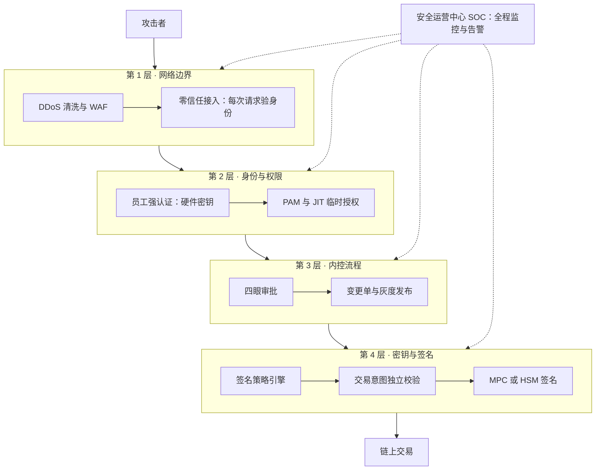
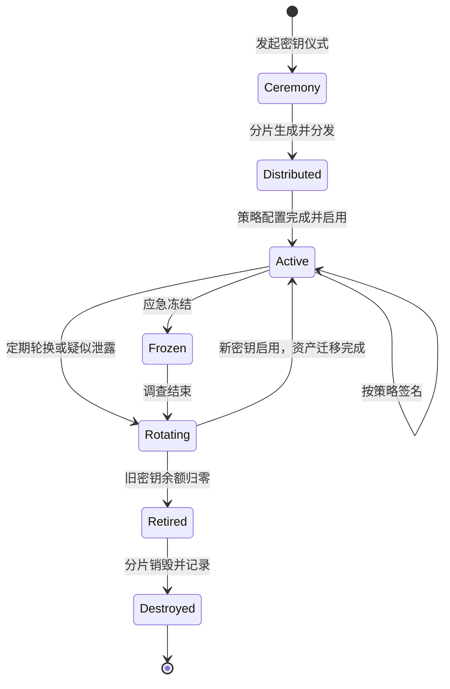
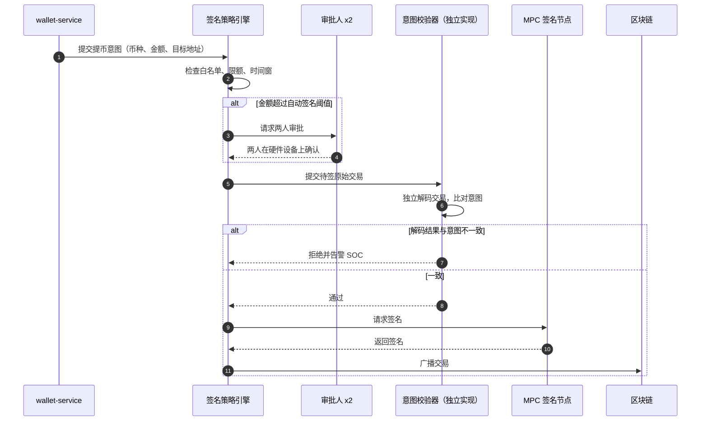
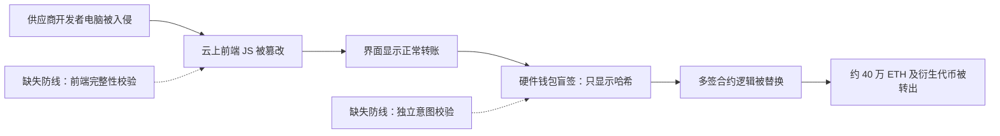
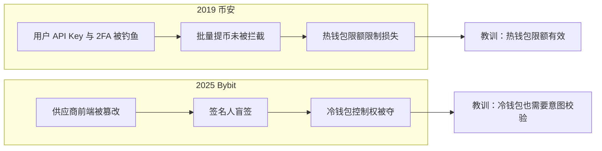

# B02 平台安全防护

> 学习目标：读完本篇，你能——
> 1. 列出交易所平台面对的五类攻击者，并说出每类攻击者瞄准的资产。
> 2. 画出私钥从生成到签名的全生命周期，并说明签名策略引擎检查哪些条件。
> 3. 用 2025 年 Bybit 事件解释"所见即所签"为什么是最后一道防线。
>
> 前置章节：[04 钱包与托管](../04-wallet-custody.md)、[13 可靠性与安全事故](../13-reliability-security-incidents.md)（第 3.5 节"安全纵深"）
> 交互实验：[architecture-explorer.html](../interactive/architecture-explorer.html)（查看签名服务在架构中的位置）；相关篇：[B03 账户安全](B03-account-security.md)、[B07 应急响应](B07-incident-response.md)

---

> 🔎 进阶：研发与运营中的安全工程见 [B11](B11-security-engineering.md)；历年事故按攻击路径分类见 [B12](B12-incident-casebook.md)。

## 1. 一句话理解

平台安全回答一个问题：**即使攻击者已经在内网，或者攻击者就是员工，他能不能把钱签出去？**

B03 讲"用户账户被盗"。本篇讲"平台本身被攻破"。用户账户被盗，损失通常是一个账户。平台私钥被盗，损失可能是整个钱包。

> 🎯 打个比方：交易所的私钥像银行金库的开门密码。
> 好的银行不把整串密码交给一个人。密码分成三段，三个保管员各记一段（MPC 分片）。
> 开门要在规定时间（时间窗），要在监控下（审计），要先核对"今天要取哪几袋钱、送到哪家分行"（签名策略）。
> 2025 年 Bybit 的教训是：三个保管员都核对了单据，但单据本身是假的。所以最后还要再加一条规则：**保管员亲眼看到的，必须就是金库真正执行的**。

> 💡 注意：本篇区分三层信息。**币安公开的事实**会标注"截至 2026 年公开资料"。**业界通用做法**用于币安未公开的内部实现。**本仓库实现**见第 8 节。

---

## 2. 威胁 / 问题模型

威胁模型（Threat Model）：系统化地列出"谁会攻击、攻击什么、用什么手段、我们怎么防"。

### 2.1 五类攻击者

| 攻击者 | 典型能力 | 主要目标 | 典型入口 | 主要防线 |
|---|---|---|---|---|
| 外部黑客 | 扫描、漏洞利用、钓鱼 | 热钱包、用户数据库 | 公网 Web、API、员工邮箱 | WAF、补丁管理、零信任网络 |
| APT 组织（如 Lazarus） | 长期潜伏、定制恶意软件、社会工程 | 签名系统、多签界面 | 员工电脑、第三方供应商 | 签名机隔离、所见即所签、供应链审查 |
| 内部人员 | 合法账号、业务知识 | 后台审批权、数据库、密钥分片 | 运营后台、运维跳板机 | 职责分离、四眼原则、PAM、审计 |
| 供应链 | 污染依赖、CI/CD、SaaS | 前端代码、构建产物 | npm 包、构建服务器、钱包 SaaS | 依赖锁定、制品签名、SRI |
| 物理与灾难 | 闯入机房、胁迫、设备丢失 | HSM、冷钱包设备、备份介质 | 机房、保险柜、员工本人 | 门禁、地理分散、胁迫码、多地备份 |

APT（Advanced Persistent Threat，高级持续性威胁）：有组织、有资源、长期针对特定目标的攻击者。据公开报道，美国 FBI 把 2025 年 2 月 Bybit 被盗约 14.6 亿美元归因于朝鲜 Lazarus 组织。

### 2.2 资产分级

| 资产 | 失窃后果 | 等级（示例） |
|---|---|---|
| 冷钱包私钥分片 | 大部分客户资产不可逆转出 | 最高 |
| 热钱包签名权限 | 热钱包余额被转出 | 高 |
| 签名策略配置（白名单、限额） | 绕过全部签名检查 | 高 |
| 运营后台审批权 | 批准恶意提币、修改用户状态 | 高 |
| 用户数据库 | 隐私泄露；成为钓鱼和撞库的原料 | 中高 |
| 前端代码与 CDN | 向全体用户投放恶意脚本 | 中高 |

> ⚠️ 警告：签名策略配置的等级等于私钥本身。攻击者如果能把自己的地址加入白名单，就不需要偷私钥。

---

## 3. 防线分层

读图要点：

- 第 1 层拦截"不认识的人"。它漏过已经拿到合法员工凭证的攻击者。
- 第 2、3 层拦截"单个合法账号做坏事"。它们漏过"多人同时被骗"的情况。
- 第 4 层是最后防线。即使前三层全部失效，策略引擎仍然拒绝向非白名单地址签大额交易。
- SOC 不拦截，它负责发现。发现越早，B07 的止血越有效。

---

## 4. 关键流程

### 4.1 密钥全生命周期

读图要点：

- 密钥仪式（Key Ceremony）：多人在受控环境中生成密钥的正式流程。全程录像、全程记录、每一步签字。
- `Rotating` 状态必须同时完成两件事：新密钥启用，旧地址资产迁移。只换密钥不迁资产，等于没换。
- `Frozen` 由 B07 触发。冻结后签名服务拒绝所有请求，只接受调查人员的只读查询。
- 局限：链上地址由公钥决定。轮换密钥就是换地址。所有对外公布的地址（例如 PoR 地址）都要同步更新。

**密钥仪式步骤（业界通用做法）：**

1. 安全负责人发布仪式计划。计划写明参与人、地点、设备序列号。
2. 参与人到达隔离房间。房间内没有网络。
3. 审计员检查设备封条。审计员记录封条编号。
4. 每个分片持有人在自己的设备上生成分片。
5. 系统输出公钥和地址。全体参与人核对地址。
6. 每个持有人把分片备份封存到防篡改袋。
7. 备份送往不同城市的保险库。
8. 审计员签署仪式报告。

### 4.2 MPC 分片分布

| 分片（2-of-3 示例） | 存放位置 | 由谁控制 | 防的是什么 |
|---|---|---|---|
| 分片 A | 机房 1 的 HSM | 签名服务 | 单机被入侵 |
| 分片 B | 机房 2 的 HSM | 策略服务（独立团队） | 签名服务被完全控制 |
| 分片 C | 离线保险库 | 安全团队，需双人开箱 | 前两个机房同时故障 |

HSM（Hardware Security Module，硬件安全模块）：私钥只在防篡改硬件内使用、不能导出的设备。MPC 和 HSM 的原理见 [04 钱包与托管](../04-wallet-custody.md) 第 3.7 节。

> 💡 注意：MPC 的价值在于"分片由不同团队控制"。如果三个分片都由同一个运维账号管理，MPC 退化成单签。

### 4.3 签名请求的完整调用链

读图要点：

- 策略引擎检查"意图"。意图校验器检查"原始交易字节"。两者必须一致。
- 意图校验器由另一个团队、用另一套代码实现。同一份代码的两份副本会有同一个漏洞。
- 审批人在硬件设备上看到的内容，来自设备自己解码的交易。它不能来自网页界面。
- 局限：如果交易调用的是复杂合约（例如 `delegatecall`），解码器必须能识别。识别不了就必须拒绝，不能"盲签"。

### 4.4 Bybit 2025 事件：所见即所签为什么重要

【据公开报道】2025 年 2 月 21 日，Bybit 的一个以太坊冷钱包（Safe 多签）被转走约 40.1 万枚 ETH，以及约 11.3 万枚 stETH、cmETH、mETH 等以太坊衍生代币，合计约 14.6 亿美元。公开调查结论如下：

1. 攻击者先入侵了多签服务商 Safe{Wallet} 一名开发者的电脑。
2. 攻击者借此修改了 Safe 托管在云上的前端 JavaScript。
3. 恶意脚本只对 Bybit 的钱包生效。
4. 签名人在网页上看到的是正常转账。
5. 硬件钱包上显示的是一串难以人工核对的数据（盲签）。
6. 签名人实际签的交易修改了多签合约的逻辑，把控制权交给攻击者。

读图要点：

- 签名人数（多签）没有失效。失效的是"签名人看到的信息"。
- 攻击入口在供应链，不在 Bybit 自己的系统。所以供应商也是威胁模型的一部分。
- 两道缺失防线：前端完整性校验（第 4.6 节）和独立意图校验（第 4.3 节）。
- 教训：所见即所签（WYSIWYS，What You See Is What You Sign）。签名设备必须自己解码交易，并以人能读懂的方式显示。

### 4.5 内控：让单人做不成恶

| 机制 | 定义 | 交易所示例 |
|---|---|---|
| 四眼原则（Four-Eyes） | 一人发起，另一人审批 | 大额提币、修改风控参数 |
| 职责分离（SoD，Segregation of Duties） | 冲突的权限不给同一人 | 能加白名单的人不能审批提币 |
| 最小权限（Least Privilege） | 只给完成工作所需的权限 | 客服能看订单，不能看完整手机号 |
| 特权访问管理（PAM，Privileged Access Management） | 高权限账号统一托管、会话录像 | DBA 登录生产库必须经过 PAM 跳板机 |
| 即时授权（JIT，Just-In-Time Access） | 平时无权限，需要时申请，到期自动收回 | 工程师申请 2 小时生产只读权限 |
| 生产变更审批 | 每次上线有变更单、评审人、回滚方案 | 修改签名策略需安全团队批准 |
| 不可篡改审计 | 日志只追加，写入独立存储 | 审计日志写入 WORM 存储，运维无删除权 |

WORM（Write Once Read Many，一次写入多次读取）：写入后不能修改或删除的存储。

**JIT 授权流程（业界通用做法）：**

1. 工程师提交权限申请。申请写明原因和时长。
2. 系统通知值班负责人。
3. 负责人批准。
4. PAM 签发临时凭证。
5. 工程师的全部会话被录像。
6. 凭证到期，系统自动收回权限。
7. 安全团队每周抽查录像。

### 4.6 基础设施与软件供应链

**网络分区（业界通用做法）：**

| 区域 | 内容 | 能访问谁 | 谁能访问它 |
|---|---|---|---|
| 公网区 | CDN、WAF、API 网关 | 业务区 | 互联网 |
| 业务区 | 订单、账本、钱包服务 | 数据区、签名区（单向） | 公网区 |
| 数据区 | 数据库、消息队列 | 无 | 业务区 |
| 签名区 | 策略引擎、MPC 节点 | 区块链节点（只出不进） | 仅业务区的签名请求接口 |
| 离线区 | 冷钱包签名机 | 无网络 | 人工携带介质，双人在场 |

零信任网络（Zero Trust）：不因为"在内网"就信任请求。每次请求都验证身份、设备和权限。

**软件供应链防线：**

| 风险 | 示例 | 防线 |
|---|---|---|
| 依赖投毒 | 恶意 npm 包、拼写相近的包名 | 锁定版本、私有镜像、依赖扫描 |
| 构建系统被入侵 | CI 服务器被植入后门 | 构建隔离、制品签名、可复现构建 |
| 前端脚本被替换 | CDN 上的 JS 被篡改 | SRI、CSP、发布前哈希比对 |
| SaaS 供应商被入侵 | 2025 年 Safe 前端被篡改 | 关键界面自托管、独立校验 |

SRI（Subresource Integrity，子资源完整性）：页面为外部脚本写上期望哈希。浏览器下载后计算哈希。哈希不一致时，浏览器拒绝执行该脚本。

CSP（Content Security Policy，内容安全策略）：网站告诉浏览器"只允许从这些来源加载脚本"。

### 4.7 漏洞赏金、红队与 SOC

- **漏洞赏金（Bug Bounty）**：交易所付钱给外部研究者，奖励他们报告漏洞。截至 2026 年公开资料，币安在 Bugcrowd 平台运营漏洞赏金计划，页面标注单个漏洞 200–10,000 美元，最高 100,000 美元。金额会调整，以官网为准。
- **红队（Red Team）**：内部或外聘团队模拟真实攻击者，测试防线。红队的目标是"拿到签名权限"或"改动一笔余额"，而不是"找到一个漏洞"。
- **安全运营中心（SOC，Security Operations Center）**：7×24 值班团队。SOC 收集日志，运行检测规则，处理告警，并在需要时启动 B07 的应急响应。

---

## 5. 规则、指标与阈值

### 5.1 签名策略规则（示例）

| 规则 | 条件 | 动作 |
|---|---|---|
| 地址白名单 | 目标地址不在签名白名单 | 拒绝签名 |
| 单笔限额 | 热钱包单笔 > 50 BTC（示例） | 转两人审批 |
| 日累计限额 | 热钱包 24 小时累计 > 500 BTC（示例） | 拒绝，转冷钱包流程 |
| 时间窗 | 冷钱包签名不在工作日 10:00–16:00（示例） | 拒绝 |
| 白名单变更冷却 | 白名单新增地址 < 72 小时（示例） | 不允许作为大额目标 |
| 合约调用限制 | 交易包含 `delegatecall` 或修改多签配置 | 拒绝，必须走仪式流程 |
| 意图不一致 | 解码结果与意图字段不同 | 拒绝并触发 SEV1 告警 |

### 5.2 监控指标与告警条件

| 指标 | 告警条件（示例） | 可能含义 |
|---|---|---|
| 签名请求拒绝率 | 1 小时内 > 5% | 策略被试探，或上游服务异常 |
| 非工作时间特权登录 | 出现 1 次 | 账号被盗或未经批准的操作 |
| JIT 申请次数 | 单人单日 > 5 次 | 权限设计不合理，或滥用 |
| 审计日志写入中断 | 持续 > 1 分钟 | 有人在掩盖操作 |
| 前端产物哈希 | 与发布记录不一致 | CDN 或构建链被篡改 |
| 白名单变更 | 任何一次 | 必须由第二人确认 |

> ⚠️ 警告：审计日志中断要按资金事故处理。攻击者常常先关日志，再动手。

---

## 6. 真实案例

| 年份 | 事件 | 被突破的环节 | 来源类型 |
|---|---|---|---|
| 2019 | 币安热钱包被盗约 7,000 BTC | 用户凭证层 + 提币风控（非平台私钥） | 币安公告、媒体报道；见 [13 章 4.1 节](../13-reliability-security-incidents.md) |
| 2022 | BNB Chain 跨链桥被伪造证明 | 链协议层 | 公开报道；见 [13 章 4.2 节](../13-reliability-security-incidents.md) |
| 2025 | Bybit 冷钱包被盗约 40 万 ETH 及衍生代币（约 14.6 亿美元） | 供应链 + 签名界面 | Bybit 公告、Safe 声明、FBI 公告、安全公司分析 |

读图要点：

- 2019 年的攻击没有碰平台私钥。损失被热钱包限额封顶，约占 BTC 持仓 2%（据公开报道）。
- 2025 年的攻击直接拿到冷钱包控制权。冷钱包的"冷"没有起作用，因为签名人主动签了恶意交易。
- 两个案例的共同点：攻击者绕开了最强的密码学防线，从"人看到的信息"下手。
- 局限：公开报道不包含全部内部细节。本表只用于理解防线位置。

---

## 7. 局限与权衡

| 权衡 | 一端 | 另一端 | 业界常见选择 |
|---|---|---|---|
| 安全 vs 提币速度 | 全部冷钱包签名，最安全 | 热钱包自动签名，最快 | 小额热钱包自动，大额人工 |
| 隔离 vs 运维效率 | 签名机完全离线 | 签名机在线，可远程运维 | 冷钱包离线，热钱包隔离网段 |
| 四眼 vs 应急速度 | 每个操作都两人审批 | 值班人员可单人操作 | 应急开关单人可"关"，"开"需两人 |
| 自研 vs 采购 | 自研 MPC 和钱包界面 | 使用托管商或 SaaS | 核心签名路径自研或自托管 |
| 审计粒度 vs 隐私 | 录下全部会话 | 只记录关键操作 | 特权会话全录，普通操作记摘要 |

> 💡 注意："应急开关单人可关，开启需两人"是一条常见规则。关闭提币伤害体验，但不会丢钱。开启提币可能丢钱，所以开启要更严格。

**常见误区：**

1. 认为"多签 = 安全"。Bybit 事件说明，多签只防"单人作恶"，不防"所有人都被骗"。
2. 认为"内网 = 可信"。APT 的典型路径就是先进内网，再横向移动。
3. 认为"上了 HSM 就不会丢钱"。HSM 防止私钥被导出，不防止私钥被授权调用。

---

## 8. 本仓库对照

| 本篇概念 | 本仓库位置 | 实现情况 |
|---|---|---|
| 运营后台 RBAC、职责分离 | [`services/identity-service/src/domain/rbac.ts`](../../services/identity-service/src/domain/rbac.ts) | 已实现。`ops_reviewer`（审核提币）和 `ops_finance_operator`（执行账本）是不同角色；`ops_admin` 仍拥有全部权限 |
| 运营操作审计 | [`apps/ops-console/sql/001_init.sql`](../../apps/ops-console/sql/001_init.sql) 的 `ops_action_audit_logs` 表；[`apps/ops-console/src/domain/action-audit.ts`](../../apps/ops-console/src/domain/action-audit.ts) | 已实现。审计写入普通 Postgres 表，不是 WORM 存储 |
| 服务间鉴权 | [`services/identity-service/src/http/internal-service-auth.guard.ts`](../../services/identity-service/src/http/internal-service-auth.guard.ts) | 已实现 HMAC 共享密钥鉴权，覆盖 identity / wallet / ledger / order / risk / settlement / blockchain-indexer / custody-adapter，均带调用方白名单；所有服务默认监听 `127.0.0.1`。尚未升级到 mTLS |
| 网关审计与限流 | [`services/api-gateway/src/http/api-gateway-audit.interceptor.ts`](../../services/api-gateway/src/http/api-gateway-audit.interceptor.ts)、[`api-gateway-rate-limit.guard.ts`](../../services/api-gateway/src/http/api-gateway-rate-limit.guard.ts) | 已实现；客户端 IP 默认取 socket 对端地址，仅在 `GATEWAY_TRUST_PROXY=true` 时信任 `X-Forwarded-For`（[`client-ip.ts`](../../services/api-gateway/src/http/client-ip.ts)） |
| 安全基线与紧急开关 | [`docs/security.md`](../../docs/security.md) 第 2、4 节 | 已编写，按代码列出已实现的控制和缺口。紧急开关只有单市场暂停（`risk-service` 市场 `halted`）；全站 / 单资产提币开关、API 写入开关和变更单流程本仓库未实现 |
| 威胁模型 | [`docs/security.md`](../../docs/security.md) 第 3 节 | 已编写。按资产列出威胁、现有缓解和真实 CEX 的做法；第 4 节把"`custody-adapter` 从环境变量读私钥 / 助记词"列为最高风险缺口 |
| 签名策略引擎、MPC/HSM、意图校验 | — | 未实现。`custody-adapter` 仍可用环境变量中的私钥直接签名 |
| 四眼审批、JIT、PAM | [`docs/security.md`](../../docs/security.md) 第 2.7 节 | ⚠️ 只有提现大额双人审批（超过分资产阈值需两名不同运营批准，同一人不能批两次）；JIT、PAM 未实现 |

关键观察：本仓库只对超过阈值的大额提现做双人审批，阈值以下单人审批即可推进广播。这正是本篇第 4.5 节四眼原则要解决的问题。

---

## 9. 术语表 / 思考题

### 术语表

| 术语 | 英文 | 定义 |
|---|---|---|
| 威胁模型 | Threat Model | 系统化列出攻击者、目标、手段和防线的分析 |
| APT | Advanced Persistent Threat | 有组织、长期针对特定目标的攻击者 |
| 密钥仪式 | Key Ceremony | 多人在受控环境中生成密钥的正式流程 |
| HSM | Hardware Security Module | 私钥不可导出的防篡改硬件 |
| MPC | Multi-Party Computation | 多方各持分片、协同签名的技术 |
| 签名策略引擎 | Signing Policy Engine | 签名前检查白名单、限额、时间窗和审批的服务 |
| 盲签 | Blind Signing | 签名人看不懂待签内容就签名 |
| 所见即所签 | WYSIWYS | 签名人看到的内容必须等于实际签名的内容 |
| 四眼原则 | Four-Eyes Principle | 高风险操作一人发起、另一人审批 |
| 职责分离 | SoD | 冲突权限不授予同一人 |
| 特权访问管理 | PAM | 统一托管高权限账号并录像 |
| 即时授权 | JIT Access | 按需申请、到期自动收回的权限 |
| 零信任 | Zero Trust | 每次请求都验证，不因网络位置而信任 |
| 子资源完整性 | SRI | 浏览器用哈希校验外部脚本 |
| 安全运营中心 | SOC | 7×24 监控和处理安全告警的团队 |
| WORM 存储 | Write Once Read Many | 写入后不能修改或删除的存储 |

### 思考题

1. 一名运维工程师同时拥有"修改签名白名单"和"审批提币"两个权限。请写出他单人盗币的路径。哪一条内控规则能切断它？
2. 你的团队使用第三方多签网页签名冷钱包。参考 Bybit 事件，列出三项你会立即增加的检查。其中哪一项不依赖供应商？
3. 第 7 节说"应急开关单人可关，开启需两人"。请结合 [B07 应急响应](B07-incident-response.md) 的决策树，说明这条规则在黑客事件中如何缩短止血时间。再打开 [architecture-explorer.html](../interactive/architecture-explorer.html)，找到提币路径上可以放置"紧急开关"的服务。
