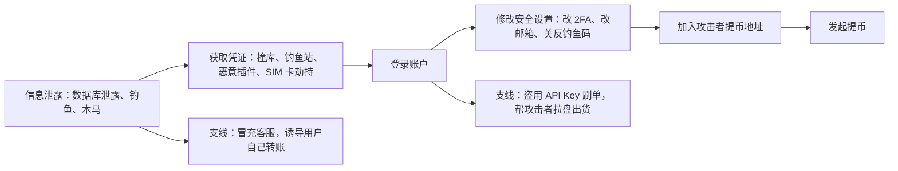
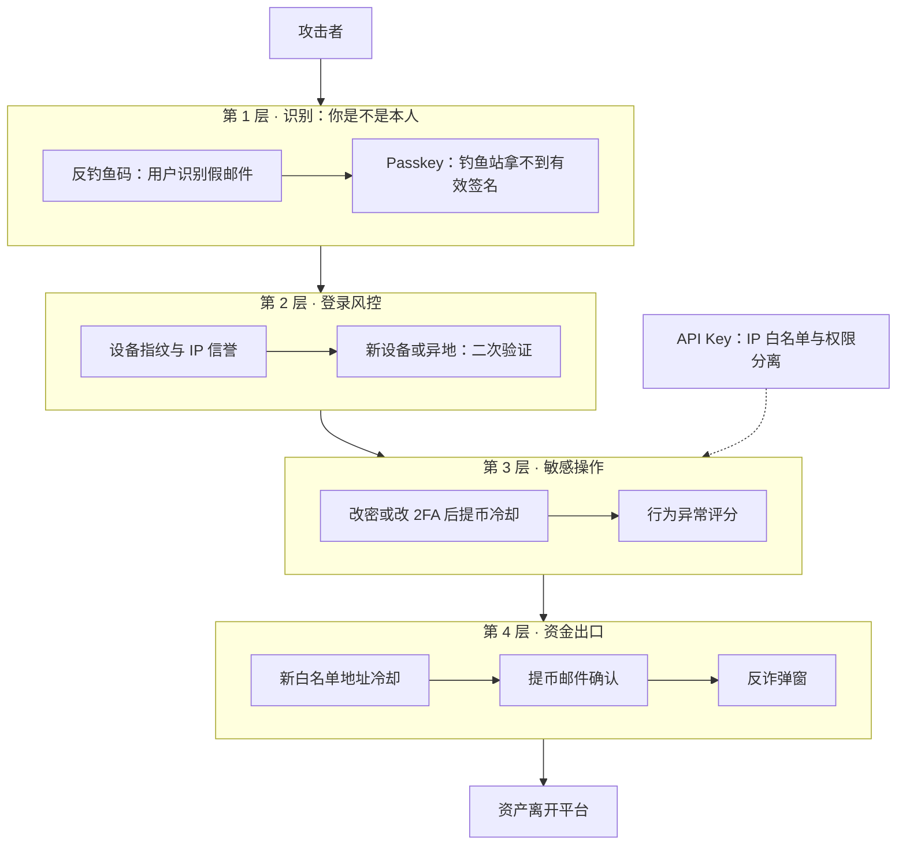
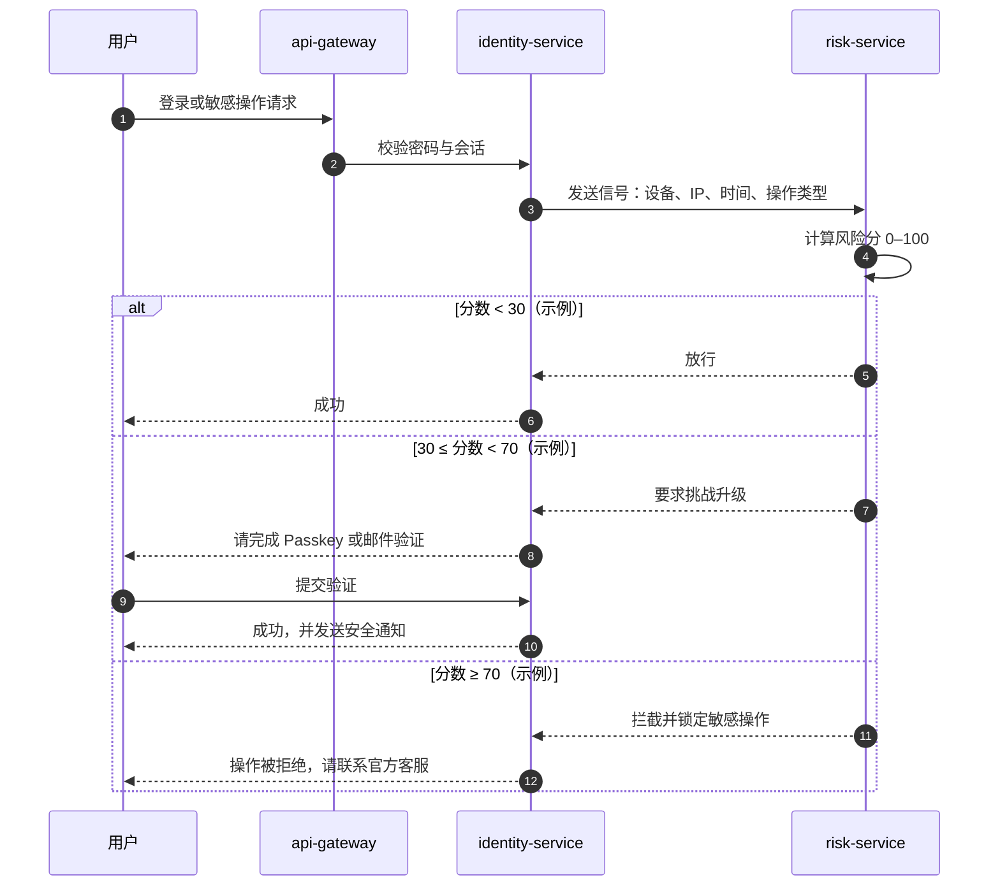
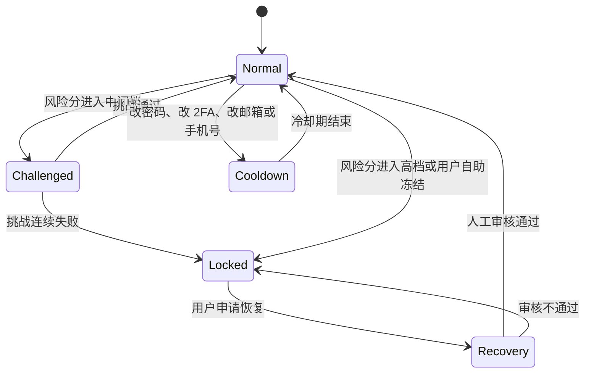
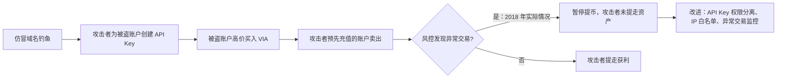

# B03 账户安全风控

> 学习目标：读完本篇，你能——
> 1. 画出一条完整的盗号攻击链，并在每一步标出对应的防线。
> 2. 解释风险评分如何决定"放行、挑战升级、拦截"三种结果。
> 3. 说明每道防线给正常用户带来的体验成本，并为一个场景选出平衡方案。
>
> 前置章节：[03 账户、身份与安全](../03-account-identity-security.md)（2FA、设备指纹、反钓鱼码、白名单的基础定义）、[09 风控](../09-risk-control.md)（第 3.5 节账户风控）
> 交互实验：[ato-defense.html](../interactive/ato-defense.html)（盗号攻防实验：开关防线、选择攻击剧本、观察拦截率与摩擦分）

---

## 1. 一句话理解

账户接管（ATO，Account Takeover）：攻击者控制了不属于他的账户。

03 章讲了每一把"锁"是什么。本篇讲攻击者**按什么顺序**撬锁，平台在**哪一步**最容易拦住他，以及每多一把锁，正常用户要多花多少时间。

> 🎯 打个比方：盗号像小偷进小区偷保险箱。
> 他要先拿到门禁卡（密码），再骗过保安（登录风控），然后换掉你家的门锁（改 2FA、改邮箱），让你进不来。
> 接着他要把你的快递地址改成他的（加白名单地址），最后才能把东西寄走（提币）。
> 小区每一道关卡都能拦他。但关卡太多，住户自己回家也要排队。好的物业把最严的检查放在"寄走东西"那一步，而不是"进小区门"那一步。

---

## 2. 威胁 / 问题模型

### 2.1 盗号攻击链

读图要点：

- 主线有 6 步。攻击者必须走完全部步骤才能拿走资产。平台只需要拦住其中 1 步。
- 两条支线绕开了"提币"这一步：API Key 支线在站内转移价值，客服冒充支线让用户自己操作。所以只守提币不够。
- 第 3 步"修改安全设置"是最强信号：正常用户很少在新设备登录后马上改 2FA。
- 局限：本图描述的是攻击阶段，不是具体手法。本篇只写到理解防线所需的程度。

### 2.2 攻击剧本与入口

| 剧本 | 攻击者拿到什么 | 绕过了什么 | 最有效的防线 |
|---|---|---|---|
| 钓鱼站 | 密码 + 实时转发的 2FA 码 | TOTP 2FA | Passkey（绑定域名）、反钓鱼码 |
| 撞库（Credential Stuffing） | 其他网站泄露的同一密码 | 密码 | 新设备二次验证、登录风险评分 |
| SIM 卡劫持（SIM Swap） | 用户手机号 → 短信验证码 | 短信 2FA | 不用短信作唯一因素、改手机号后冷却 |
| 恶意浏览器插件 | 页面会话或 API Key | 登录环节 | API Key IP 白名单、权限分离 |
| 客服冒充（社会工程） | 用户的信任 | 全部技术防线 | 官方验证渠道、反诈弹窗 |
| 地址投毒（Address Poisoning） | 用户的复制粘贴习惯 | 用户自己的核对 | 地址相似度提示、白名单 |

撞库（Credential Stuffing）：攻击者用其他网站泄露的"账号 + 密码"批量尝试登录。

地址投毒（Address Poisoning）：攻击者生成首尾字符与用户常用地址相同的地址，并向用户发送小额或零额转账。用户从历史记录里复制地址时，复制到了攻击者的地址。

### 2.3 两个支线的历史案例

- **API Key 拉盘（2018 年 3 月，据公开报道）**：攻击者通过仿冒域名钓鱼，收集了大量币安用户的凭证。攻击者为这些账户创建交易 API Key。攻击者用被盗账户高价买入 VIA，同时用自己预先充值的账户卖出。币安的自动风控发现异常交易，暂停了提币。攻击者没有提走资产。币安随后悬赏 25 万美元征集线索。
- **2019 年 5 月热钱包被盗（据公开报道）**：攻击者获取了大量用户的 API Key、2FA 码和其他数据，一次提走约 7,000 BTC。完整复盘见 [13 章 4.1 节](../13-reliability-security-incidents.md)。

> 💡 注意：两个案例的入口都是用户凭证，不是平台私钥。用户侧问题规模化以后，就变成平台级风险。

---

## 3. 防线分层

读图要点：

- 越靠近资金出口，防线可以越严。因为正常用户提币的频率远低于登录频率。
- 第 1 层防"凭证被骗走"。它漏过撞库和木马，因为那些场景下用户没有访问钓鱼站。
- 第 3、4 层的冷却期不阻止攻击者登录。它们给真正的用户和风控争取时间。
- API Key 防线单独画出：API 请求不走网页登录，必须在 Key 本身上加限制。

### 3.1 每道防线拦什么、漏什么、成本多少

| 防线 | 拦截 | 漏过 | 正常用户成本（示例） |
|---|---|---|---|
| 设备指纹 | 撞库、新设备登录 | 木马在用户原设备上操作 | 几乎无感 |
| 异地 / 新设备二次验证 | 撞库、远程登录 | 钓鱼站实时转发验证码 | 换设备时多一步，约 30 秒 |
| Passkey / FIDO2 | 钓鱼站 | 恶意插件、客服冒充 | 首次设置约 1 分钟；之后比密码快 |
| 改密 / 改 2FA 后提币冷却 | 改设置后立刻提币 | 不改设置直接提币 | 改设置后 24–48 小时不能提币 |
| 新地址白名单冷却 | 加新地址后立刻提币 | 已在白名单的地址被替换为相似地址 | 新地址等待 24 小时（示例） |
| 提币邮件确认 | 邮箱未被控制的情况 | 邮箱也被攻破 | 每次提币多一步，约 1 分钟 |
| API Key IP 白名单 | Key 被盗后在别处使用 | 攻击者控制白名单内服务器 | 开发者配置一次 |
| 反钓鱼码 | 钓鱼邮件 | 不用邮件的钓鱼（短信、社交软件） | 设置一次 |
| 行为异常评分 | 机器人、非本人操作节奏 | 熟练的人工攻击者 | 误判时需要额外验证 |

FIDO2：FIDO 联盟制定的无密码认证标准。Passkey（通行密钥）基于它实现。私钥保存在用户设备内，签名绑定网站域名，所以钓鱼域名拿不到可用的签名。

---

## 4. 关键流程

### 4.1 风险评分与挑战升级

挑战升级（Step-up Authentication）：系统根据风险分，要求用户补充更强的验证。低风险不打扰，高风险多问一步。

读图要点：

- 风险服务只给分数。身份服务根据分数选择挑战方式。两者职责分离，便于单独调整阈值。
- 中间档是关键：它把"误杀"变成"多一步验证"，正常用户仍能完成操作。
- 每次挑战成功都发安全通知。真实用户看到陌生通知，会第一时间冻结账户。
- 局限：分数依赖信号质量。攻击者在用户原设备上操作时，设备信号失效。

### 4.2 风险评分模型（示例）

| 信号 | 加分（示例） | 说明 |
|---|---|---|
| 新设备指纹 | +25 | 正常用户换手机也会触发 |
| IP 国家与历史不同 | +15 | 出差、VPN 会触发 |
| 机房 IP 或匿名代理 | +20 | 攻击者常用 |
| 登录后 10 分钟内改安全设置 | +30 | 强信号 |
| 登录后直接查看余额并全额提币 | +25 | 强信号 |
| 输入节奏与历史差异大 | +10 | 行为生物特征（Behavioral Biometrics） |
| 使用已绑定 Passkey 登录 | −30 | 强本人证明 |
| 已知设备 + 常用 IP | −20 | 基线行为 |

行为生物特征（Behavioral Biometrics）：用打字节奏、滑动轨迹等行为特征判断"是不是同一个人"。

> 💡 注意：评分表只是示例。真实系统通常使用规则 + 机器学习模型组合，并用影子模式验证新规则（见 [09 风控](../09-risk-control.md) 第 4.3 节）。

### 4.3 敏感操作状态机

读图要点：

- `Cooldown` 状态下，用户可以登录、交易、充值，只是不能提币。这是体验与安全的折中。
- `Locked` 只能通过 `Recovery` 回到 `Normal`。恢复流程必须比正常登录更严格。
- 攻击者的理想路径是 `Normal → Cooldown → Normal → 提币`。冷却期越长，用户越有机会发现异常。

### 4.4 账户恢复流程本身的风险

账户恢复（Account Recovery）：用户丢失 2FA 或邮箱后，重新取得账户控制权的流程。

恢复流程是攻击者最喜欢的后门。原因是：它的设计目的就是"在用户没有正常凭证时放行"。

**业界通用做法：**

1. 用户提交恢复申请。
2. 系统要求活体人脸识别，并与 KYC 照片比对。
3. 系统检查申请设备和 IP 的风险分。
4. 安全团队人工复核高风险申请。
5. 系统通知原邮箱和原手机号："有人申请恢复你的账户"。
6. 系统等待一段时间（例如 48 小时，示例），让原用户有机会拒绝。
7. 恢复完成后，系统限制提币一段时间。

> ⚠️ 警告：恢复流程绝不能只依赖客服的判断。社会工程攻击者擅长制造紧急感，例如"我的仓位马上要被强平"。

---

## 5. 规则、指标与阈值

### 5.1 示例规则表

| 规则 | 条件 | 动作 | 公开事实 / 业界做法 |
|---|---|---|---|
| 改密后提币冷却 | 修改密码 | 24 小时内禁止提币 | 币安美国站帮助中心写明改密码后 24 小时不能提币；币安全球站存在类似限制，时长以官网为准（截至 2026 年公开资料） |
| 重置 2FA 后冷却 | 重置 2FA 设备 | 48 小时内禁止提币和 P2P 卖出 | 币安美国站帮助中心与币安学院文章说明（截至 2026 年公开资料） |
| 新地址冷却 | 白名单新增地址 | 24 小时内不能向它提币（示例） | 业界通用做法 |
| 新设备提币 | 新设备登录 < 24 小时 + 提币 | 挑战升级 + 人工审核 | 业界通用做法 |
| API Key 提币权限 | 开启提币权限 | 必须绑定 IP 白名单 | 币安 API 管理页的公开要求（截至 2026 年公开资料，以官网为准） |
| 地址相似度 | 目标地址与历史地址首尾相同、中间不同 | 弹出地址投毒警告 | 业界通用做法 |
| 反诈弹窗 | 首次向新地址大额提币 | 展示"客服不会让你转账"提示 | 业界通用做法 |

截至 2026 年公开资料，币安自 2023 年起加入 FIDO 联盟并支持 Passkey 登录。

### 5.2 监控指标

| 指标 | 告警条件（示例） | 含义 |
|---|---|---|
| 登录失败率 | 5 分钟内上升 3 倍 | 撞库攻击开始 |
| 同一 IP 尝试的账户数 | 1 小时 > 50 个 | 撞库来源 |
| 安全设置修改量 | 1 小时内是基线的 5 倍 | 钓鱼活动或数据泄露 |
| 挑战通过率 | 突然下降 | 误杀上升，或攻击者在试探 |
| 账户恢复申请量 | 单日是基线的 3 倍 | 针对恢复流程的攻击 |
| 用户冻结自助次数 | 突然上升 | 用户发现了异常，可能是钓鱼潮 |
| 正常用户摩擦分 | 季度上升 > 20% | 防线过严，流失风险 |

---

## 6. 真实案例

| 年份 | 事件 | 入口 | 拦截点 | 来源类型 |
|---|---|---|---|---|
| 2018 | 币安用户 API Key 被用于拉盘 VIA | 仿冒域名钓鱼 | 自动风控发现异常交易，暂停提币 | 币安公告、媒体报道 |
| 2019 | 币安热钱包被盗约 7,000 BTC | 用户 API Key 与 2FA 被窃取 | 未在提币前拦截；SAFU 覆盖 | 币安公告、媒体报道 |
| 持续 | 地址投毒 | 用户复制历史地址 | 钱包与交易所的地址提示 | 安全公司报告 |

读图要点：

- 这条攻击链没有一笔"从被盗账户提币"。价值通过交易从受害者转移到攻击者。
- 只守提币的风控会漏掉它。需要交易侧的异常监控（见 [B05 业务风控](B05-business-risk.md)）。
- API Key 的 IP 白名单能直接切断第 2 步之后的利用：攻击者的服务器不在白名单内。
- 局限：本图按公开报道整理，细节以币安公告为准。

---

## 7. 局限与权衡

**防线越多，正常用户越烦。** 每道防线都有成本。

| 场景 | 偏安全的选择 | 偏体验的选择 | 平衡建议 |
|---|---|---|---|
| 登录 | 每次登录都要 2FA | 已知设备免 2FA | 已知设备 + 低风险分免验证 |
| 提币 | 每笔都邮件确认 | 白名单地址免确认 | 白名单地址小额免确认，大额确认 |
| 改设置 | 冷却 72 小时 | 不冷却 | 冷却 24–48 小时，可交易不可提币 |
| API Key | 永不允许提币权限 | 自由开启 | 开启必须绑 IP 白名单 |
| 恢复账户 | 全人工审核，耗时一周 | 邮件即可恢复 | 活体 + 原渠道通知 + 等待期 |

**误杀 vs 漏放：**

- 误杀（False Positive）：正常用户被拦截。后果是投诉、流失。
- 漏放（False Negative）：攻击者被放行。后果是资产损失、赔付。
- 平台通常对"提币"容忍更多误杀，对"登录"容忍更多漏放。因为登录被漏放还有后面的防线，提币被漏放就没有了。

> 💡 注意：最好的防线同时提升安全和体验。Passkey 是典型例子：它防钓鱼，登录也比"密码 + 6 位码"更快。在 [ato-defense.html](../interactive/ato-defense.html) 中比较它与其他防线的"拦截数 / 摩擦分"比值。

**防不住的部分：** 客服冒充让用户自己操作。技术防线只能提醒，不能代替用户做决定。反诈弹窗、官方渠道验证工具和用户教育是主要手段。

---

## 8. 本仓库对照

| 本篇概念 | 本仓库位置 | 实现情况 |
|---|---|---|
| TOTP 2FA | [`services/identity-service/src/domain/totp.ts`](../../services/identity-service/src/domain/totp.ts) | 已实现 |
| 密码哈希 | [`services/identity-service/src/domain/password.ts`](../../services/identity-service/src/domain/password.ts) | 已实现（PBKDF2） |
| 会话吊销、账户冻结 | [`services/identity-service/src/application/identity-application-service.ts`](../../services/identity-service/src/application/identity-application-service.ts) | 已实现 |
| API Key 签名校验 | [`services/api-gateway/src/http/api-key-signature.ts`](../../services/api-gateway/src/http/api-key-signature.ts) | 已实现 HMAC + 5 分钟时间窗、nonce 防重放、`read / trade / withdraw` scope；没有 IP 白名单 |
| 提币白名单 | [`services/wallet-service/src/application/wallet-application-service.ts`](../../services/wallet-service/src/application/wallet-application-service.ts) 的 `whitelistWithdrawalAddress` 与 `requireWhitelist` 规则 | 已实现；新增地址或修改 2FA 后有安全冷却期（`WITHDRAWAL_SECURITY_COOLDOWN_SECONDS`） |
| 新设备二次校验 | [`docs/security.md`](../../docs/security.md) 第 3 节 | 本仓库未实现设备指纹和新设备二次校验，威胁模型把它列为真实 CEX 需要补的措施 |
| 会话存储风险 | [`docs/security.md`](../../docs/security.md) 第 2.4 节 | 已缓解：token 由 Web Host / BFF 写入 `HttpOnly; SameSite=Strict` Cookie，页面脚本读不到；写操作走 double-submit CSRF。仍没有 CSP 等安全响应头 |
| 风险评分、挑战升级、Passkey | — | 未实现 |

关键观察：本仓库早期把 token 放在 `localStorage`，恶意浏览器扩展可直接读取，正是本篇"恶意插件"剧本的现实版本；现在改为 HttpOnly Cookie 后页面脚本读不到 token，但扩展仍可在页面里代用户发起操作，所以敏感操作还需要 2FA 等二次确认。

---

## 9. 术语表 / 思考题

### 术语表

| 术语 | 英文 | 定义 |
|---|---|---|
| 账户接管 | ATO, Account Takeover | 攻击者控制了不属于他的账户 |
| 撞库 | Credential Stuffing | 用其他网站泄露的账号密码批量尝试登录 |
| SIM 卡劫持 | SIM Swap | 攻击者把用户手机号转到自己的 SIM 卡 |
| 地址投毒 | Address Poisoning | 用首尾相似的地址诱导用户复制错误地址 |
| 社会工程 | Social Engineering | 利用人的信任或恐惧让其主动泄露信息或操作 |
| 挑战升级 | Step-up Authentication | 根据风险要求更强的验证 |
| 通行密钥 | Passkey | 基于 FIDO2、绑定域名的无密码凭证 |
| 行为生物特征 | Behavioral Biometrics | 用操作习惯识别是否本人 |
| 冷却期 | Cooldown | 敏感操作后限制提币的时间段 |
| 账户恢复 | Account Recovery | 丢失凭证后重新取得账户控制权的流程 |
| 误杀 | False Positive | 正常用户被错误拦截 |
| 漏放 | False Negative | 攻击者被错误放行 |

### 思考题

1. 攻击者通过钓鱼站实时转发了用户的密码和 TOTP 码。请列出后续还能拦住他的三道防线。如果用户使用 Passkey，攻击链在哪一步就断了？在 [ato-defense.html](../interactive/ato-defense.html) 中选择"钓鱼站"剧本验证。
2. 一个量化团队抱怨"API Key 必须绑 IP 白名单"影响了他们的云服务器弹性扩容。你会怎样调整规则，既保住安全，又照顾他们的需求？
3. 在 [ato-defense.html](../interactive/ato-defense.html) 中，找出一组防线组合：拦截全部 5 个剧本中的至少 4 个，且正常用户摩擦分尽量低。哪个剧本最难拦？为什么？
