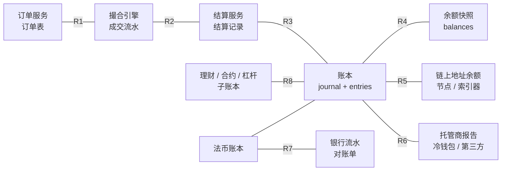
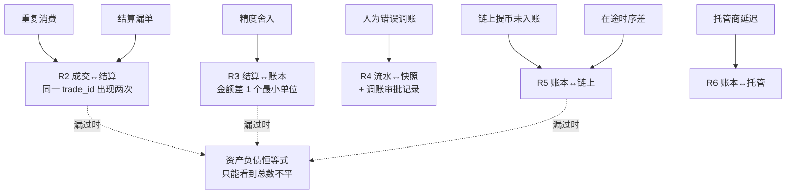
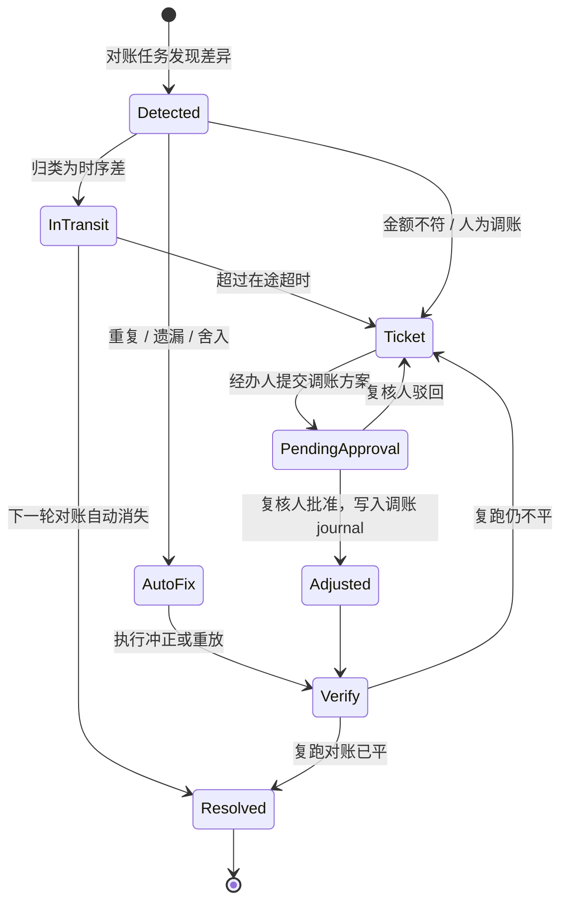
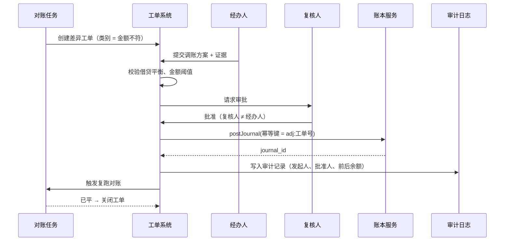
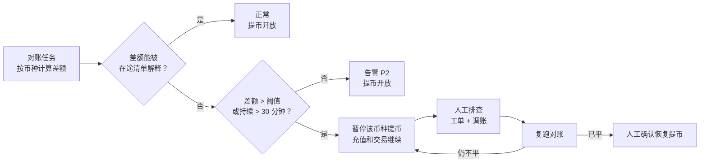

# B04 系统对账（全链路）

> 学习目标：读完本章，你能——
> 1. 画出交易所的对账矩阵：哪两个数据源做对比，用什么键、多久一次、容差多少。
> 2. 把一条差异分到 6 个类别之一，并说出它走自动修复还是人工工单。
> 3. 解释"资产 = 负债 + 权益"按币种核对、对账与 PoR 的关系，以及"对账不平就停提币"的熔断设计。
>
> 前置章节：[05-ledger.md](../05-ledger.md)（双分录、三方对账）、[07-clearing-settlement-fees.md](../07-clearing-settlement-fees.md)（成交结算）、[04-wallet-custody.md](../04-wallet-custody.md)（充提、PoR）
> 交互实验：[reconciliation-lab.html](../interactive/reconciliation-lab.html)（六源对账 + 注入差异 + 熔断）

---

## 1. 一句话理解

对账（Reconciliation）：用两个**独立**的数据源记录同一批业务，逐笔或逐汇总比较，找出不一致。

[05 账本](../05-ledger.md) 第 3.7 节介绍了三类对账：内部、账链、账托。本章把范围扩大到**全链路**：从订单服务到银行流水，共 8 对数据源。每一对只能发现一类错误。一个错误如果漏过了它所在的那一对，下游的对账通常只能看到"总数不平"，看不到原因。

> 🎯 打个比方：对账像超市的三道清点。收银员下班前清点钱箱（订单 ↔ 成交）。店长晚上核对钱箱和收银小票（成交 ↔ 结算 ↔ 账本）。总部月底核对门店报表和银行存款（账本 ↔ 链上 / 托管 / 银行）。钱箱少了 100 元，收银员当场能说出是哪一笔找错了零钱。如果拖到总部月底才发现，只能知道"这个月少了 100 元"。**越靠近源头的对账，定位越便宜。**

---

## 2. 威胁 / 问题模型

对账防的主要不是外部攻击者，而是**系统自身的错误**和**内部人员的错误或舞弊**。

| 错误来源 | 典型例子 | 后果 | 谁的对账能发现 |
|---|---|---|---|
| 消息系统 | 至少一次投递导致成交被重复消费 | 用户多得币，平台少了资产 | 成交 ↔ 结算（重复键） |
| 服务崩溃 | 结算服务崩溃，一笔成交没有结算 | 买方付了钱没收到币 | 成交 ↔ 结算（遗漏） |
| 链上与账本时序 | 提币已上链，账本还没扣款 | 账本资产多于链上 | 账本 ↔ 链上（在途） |
| 精度 | 手续费舍入方向不一致 | 每笔差 1 个最小单位，日累计变大 | 结算 ↔ 账本（金额不符） |
| 第三方 | 托管商报告延迟、银行入账延迟 | 当日报表不平 | 账本 ↔ 托管 / 银行（时序差） |
| 内部人员 | 运营人员手工调账输错金额或输错账户 | 用户余额错；可能被用于舞弊 | 调账审批 + 账本 ↔ 余额快照 |
| 挪用 | 平台挪用用户资产（FTX 类） | 资产 < 负债 | 资产负债恒等式；外部审计；PoR |
| 监管要求 | 客户资产隔离、每日对账报表 | 不合规会被罚款或吊销牌照 | 法币账本 ↔ 银行流水 |

> ⚠️ 警告：双分录只保证"每笔分录借贷平衡"。把用户 A 的钱记给用户 B，借贷仍然平衡。只有和外部独立数据源比较，才能发现这类错误。

---

## 3. 防线分层：对账矩阵

### 3.1 全链路数据流与对账点

**读图要点**

- 数据从左向右流动：订单 → 成交 → 结算 → 账本。每条连线是一对对账（R1–R8）。
- R1–R4 是**内部对账**：两边都是平台自己的系统。R5–R7 是**外部对账**：一边来自区块链、托管商或银行。
- R8 把各业务线的子账本汇总到总账。子账本内部平，不代表总账平。
- 局限：R5–R7 依赖第三方数据的可用性和时效。第三方数据迟到时，系统只能先标"在途"。

### 3.2 对账矩阵（业界通用做法，数值为示例）

| # | 数据源 A ↔ 数据源 B | 对账键 | 频率 | 容差（示例） | 主要能发现 |
|---|---|---|---|---|---|
| R1 | 订单服务 ↔ 撮合成交 | `order_id`；订单已成交量 = Σ 成交量 | 实时流式 + 小时 | 0（数量必须完全相等） | 订单状态与引擎不一致、孤儿订单 |
| R2 | 撮合成交 ↔ 结算记录 | `trade_id`；按市场的 `execution_sequence` 连续 | 实时流式 | 0；在途 ≤ 30 秒 | 重复消费、漏结算、序号断档 |
| R3 | 结算记录 ↔ 账本分录 | `trade_id` → 幂等键 `T:base` / `T:quote`；金额 | 实时 + 小时 | 0（最小单位） | 金额不符、精度舍入、漏记手续费 |
| R4 | 账本流水 ↔ 余额快照 | `(account_id, asset)`；Σ流水净额 = 可用 + 冻结 | 小时 + 日终 | 0 | 快照被直接改写、并发 bug |
| R5 | 账本热钱包科目 ↔ 链上地址余额 | `(chain, address, asset)`；`tx_hash` | 每个区块 / 每 10 分钟 | 在途金额以内 | 提币未入账、充值漏记、热钱包被盗 |
| R6 | 账本托管科目 ↔ 托管商报告 | `(custodian, vault, asset)` | 日终 | 在途金额以内 | 托管商延迟、未授权转出 |
| R7 | 法币账本 ↔ 银行流水 | 银行参考号 + 金额 + 日期 | 日终（T+1） | 0；跨日在途单独列 | 入金未上账、出金退回、银行手续费 |
| R8 | 子账本（理财 / 合约 / 杠杆）↔ 总账 | `(业务线, asset)` 汇总 | 小时 + 日终 | 0 | 子系统内部调整未同步到总账 |

> 💡 注意：容差为 0 不代表"不能有差异"。它代表"差异不能被忽略"。时序造成的差异放进"在途"清单，带上超时时间。超时后在途仍不归零，差异升级为错误。

### 3.3 哪一层能发现哪类错误

**读图要点**

- 每类错误有一个"最早能发现它"的对账层。在这一层发现，系统能直接定位到单笔业务。
- 虚线表示漏过之后的结果：恒等式能发现"总数不平"，但不能告诉你是哪一笔。
- 重复消费在 R2 被发现时，账本还没有被污染太多。它如果漏到恒等式层，用户可能已经把多得的币提走。
- 局限：人为调账如果同时改了流水和快照，R4 仍然平。所以调账必须靠审批和审计日志，而不是靠对账。

---

## 4. 关键流程

### 4.1 差异分类

| 类别 | 定义 | 典型信号 | 默认处置 |
|---|---|---|---|
| 时序差 / 在途 | 两边都会记，只是时间不同 | 差额等于某笔在途业务金额；下一轮自动消失 | 自动：标记在途，设超时（例如 30 分钟） |
| 重复 | 同一业务键在一边出现两次 | 同一 `trade_id` 有两条结算 | 自动：冲正第二条（幂等键应已挡住；挡不住时人工复核） |
| 遗漏 | 一边有，另一边没有 | 成交存在，结算不存在 | 自动：重放该成交事件，触发补结算 |
| 金额不符 | 两边都有，金额不同 | 差额大于精度单位 | 人工工单 |
| 精度舍入 | 差额在 1 个最小单位以内，方向固定 | 大量记录同方向差 1 | 自动：记入"舍入差额"科目；同时提缺陷单修复规则 |
| 人为调账 | 差异来源是一笔人工 journal | `business_type = manual_adjustment` | 人工：双人审批复核；必要时冲正 |

> ⚠️ 警告：自动修复只能做"可逆、有业务依据"的动作：重放事件、冲正重复分录、关闭超时在途。自动修复**不能**直接修改余额快照，也不能凭空补一笔"使两边相等"的分录。

### 4.2 差异处置状态机

**读图要点**

- 每条差异都有终态 `Resolved`。没有终态的差异是审计的重点。
- 自动修复之后**必须复跑对账**。修复动作本身也可能出错。
- 人工路径一定经过 `PendingApproval`。经办人和复核人必须是两个不同的人（四眼原则，Four-Eyes Principle）。
- 局限：在途超时设得太短，工单会被时序差淹没；设得太长，真实错误会被延迟发现。

### 4.3 人工调账流程

调账（Manual Adjustment）：由人发起、不来自业务事件的账本分录。它是账本里风险最高的操作。

1. 经办人在工单里写明差异、根因、证据（链上哈希、银行参考号）。
2. 经办人提交调账方案：借哪个科目、贷哪个科目、金额。
3. 系统校验：借贷平衡；涉及金额超过阈值时，要求更高级别复核人。
4. 复核人在独立界面审批。系统拒绝"经办人 = 复核人"。
5. 账本写入 journal，`business_type = manual_adjustment`，引用工单号作为幂等键。
6. 系统写审计日志：谁发起、谁批准、何时、修改前后余额。
7. 系统复跑相关对账，结果回写工单。

**读图要点**

- 调账走和业务相同的 `postJournal` 接口。它同样受借贷平衡和幂等约束。
- 幂等键用工单号。同一工单重复提交，账本只记一次。
- 审计日志和账本分开存储。审计日志只追加，运营人员没有删除权限。
- 局限：如果经办人和复核人合谋，四眼原则失效。所以调账报表还要进入内审和外部审计的抽查范围。

---

## 5. 规则、指标与阈值

### 5.1 资产负债恒等式（按币种）

对每一个币种 `c`，平台必须满足：

`Σ 用户负债(c) + 平台权益(c) = Σ 平台资产(c)`

- 用户负债 = 全部用户的可用 + 冻结 + 理财本金 + 合约保证金 + 其他子账本余额。
- 平台权益 = 手续费收入 + 自有资金 + 保险基金等平台所有的科目。
- 平台资产 = 热钱包链上余额 + 冷钱包余额 + 托管商余额 + 在途净额。

> 💡 注意：恒等式必须**按币种**核对，不能折算成 USDT 后核对。BTC 少 1 个、ETH 多 20 个，折算后可能恰好相等，但平台实际欠用户 1 BTC。

数值示例（BTC，单位：聪，示例）：

| 项 | 金额 |
|---|---|
| 用户可用 + 冻结 | 1,200,000,000 |
| 理财子账本 | 300,000,000 |
| 合约保证金子账本 | 150,000,000 |
| 平台手续费收入 | 2,000,000 |
| **左边合计** | **1,652,000,000** |
| 热钱包链上余额 | 150,000,000 |
| 冷钱包余额 | 1,450,000,000 |
| 托管商余额 | 50,000,000 |
| 提币在途（已从账本扣，未上链） | 2,000,000 |
| **右边合计** | **1,652,000,000** |

### 5.2 总分账核对

总分账核对：总账科目余额 = 该科目下全部明细账户余额之和。例如"用户可用-BTC"总账 = Σ 每个用户的可用 BTC。

它能发现两类问题：明细账户被单独改写；子账本向总账汇总时丢了一批记录（R8）。

### 5.3 对账与 PoR 的关系

| 维度 | 内部对账 | 储备金证明（PoR） |
|---|---|---|
| 目的 | 平台自己发现错误 | 向用户和公众证明资产 ≥ 负债 |
| 频率 | 实时到日终 | 币安按月发布（截至 2026 年公开资料：每月初快照，数日后发布） |
| 粒度 | 逐笔、逐账户 | 每个用户一个 Merkle 叶子 + 总额 |
| 能否定位 | 能，到单笔业务 | 不能；只给出某一时刻的总数 |
| 依赖关系 | PoR 的负债数据来自账本 | PoR 可信的前提是内部对账已平 |

> 💡 注意：PoR 是对账结果的"对外快照"。如果内部对账不平，PoR 公布的负债总额本身就是错的。PoR 的机制见 [04-wallet-custody.md](../04-wallet-custody.md) 第 3.9 节和 [proof-of-reserves.html](../interactive/proof-of-reserves.html)。

### 5.4 熔断：对账不平就停提币

熔断（Circuit Breaker）：对账结果超过阈值时，系统自动暂停某个币种的提币。

为什么停提币，不停交易？提币是资产离开平台的唯一出口，链上转账不能撤回。交易只在平台内部移动负债，出错后可以冲正。

示例规则（业界通用做法，数值为示例）：

| 条件 | 动作 |
|---|---|
| 某币种恒等式差额 > 0，且不能被在途清单解释 | 告警 P2 |
| 差额 > 该币种热钱包余额的 0.1%，或持续 > 30 分钟 | 自动暂停该币种提币；告警 P1 |
| 链上热钱包余额在一个区块内下降，且无对应提币单 | 立即暂停该币种提币；通知安全团队 |
| 对账任务本身失败或超时（无结果） | 视为"未知"，按不平处理 |
| 恢复提币 | 必须人工确认，并且至少一轮对账已平 |

**读图要点**

- 熔断按**币种**生效。BTC 不平只停 BTC，不影响 ETH。
- "对账任务失败"按不平处理。这叫 Fail-Closed（失败即关闭）。没有结果不能当作"平"。
- 恢复需要人工确认。自动恢复可能在攻击仍在进行时重新开放出口。
- 局限：熔断会让正常用户的提币也被暂停。阈值太敏感会频繁误停，损害用户信任。

### 5.5 监控指标（示例）

| 指标 | 告警条件（示例） |
|---|---|
| 各对账对的未解决差异条数 | > 0 且持续 2 个周期 |
| 在途最老一笔的年龄 | > 30 分钟（链上）/ > 1 个工作日（银行） |
| 中间户（清算户、在途户）余额 | 日终 ≠ 0 |
| 结算消费者的序号断档 | 出现任何断档 |
| 人工调账笔数和金额 | 日调账金额 > 阈值，或单人发起数异常 |
| 对账任务运行时长 / 成功率 | 超时或失败一次即告警 |

---

## 6. 真实案例

### 6.1 2022 年 FTX：没有独立对账的后果（公开报道与破产文件）

据公开报道和 FTX 破产程序中的文件，FTX 的客户存款有一部分被转入关联公司 Alameda Research。FTX 内部系统存在允许 Alameda 负余额交易的特殊设置。FTX 破产后的新管理层表示，公司缺少基本的财务控制和可靠的账目记录。

**读图要点**

- 起点是 R7（法币账本 ↔ 银行流水）缺失：客户资金进了谁的银行账户，账本没有独立核对。
- 负余额特权让 R4 的"负余额告警"失效。对账规则的例外本身就是风险。
- 挤兑是结果，不是原因。恒等式早已不成立，只是没人检查或检查结果没被公开。
- 局限：本图是根据公开报道的简化因果，不代表完整的法律事实认定。

### 6.2 2019 年币安热钱包被盗（币安官方公告）

2019 年 5 月，攻击者从币安热钱包提走约 7,000 BTC。币安暂停了充提，并用 SAFU 基金承担损失。这一事件说明两点：账链对账（R5）能直接看到"热钱包余额下降"；用户负债不变时，资产缺口由平台权益（SAFU 基金）补足，恒等式重新成立。详细复盘见 [13-reliability-security-incidents.md](../13-reliability-security-incidents.md) 第 4.1 节。

---

## 7. 局限与权衡

| 权衡 | 一端 | 另一端 |
|---|---|---|
| 频率 vs 成本 | 实时流式对账：发现快，计算和存储成本高 | 日终对账：成本低，错误可能已被利用 24 小时 |
| 容差 vs 噪声 | 容差 0、在途超时短：漏放少 | 工单被时序差淹没，真实问题被忽略 |
| 熔断敏感度 | 一有差额就停提币：资金安全 | 正常用户频繁被停，客服压力大 |
| 自动修复范围 | 自动修复多：人力省 | 修复逻辑有 bug 时会批量制造新错误 |
| 第三方依赖 | 等托管商 / 银行数据：结果准确 | 第三方延迟时，对账结果长时间"未知" |

**局限**

- 对账只能发现"两个源不一致"。如果两个源被同一个 bug 同时写错，对账仍然平。
- 对账发现的是过去的错误。高频交易下，几秒的延迟已足够让错误扩散到多个账户。
- 资产端的"拥有权"对账做不到：链上余额证明地址里有币，不证明这些币没有被抵押或借出。

---

## 8. 本仓库对照

本仓库（`CEX Demo`）实现了 R1–R4 的一部分、订单冻结 ↔ 账本冻结对账、定时对账与按币种的提币熔断、提币在途的超时清理，以及一个简化版 R5（钱包 vs 账本逐币种覆盖率对账，覆盖率不足只告警 P1、不接熔断）和储备金证明。R6–R8 未实现。

| 本章概念 | 本仓库实现 | 状态 |
|---|---|---|
| R4 流水 ↔ 快照 | `ledger-service` 的 `reconcile-balances` 脚本：对每个 `(account_id, asset_code)`，用 `ledger_entries` 净额减去活跃 `balance_locks`，得到期望可用和期望冻结，与 `balances` 快照比较；差异原因为 `available_mismatch` / `locked_mismatch` / `total_mismatch` | 已实现 |
| 单账户定位 | `replay-account` 脚本：按时间序回放 `entry_credit`、`entry_debit`、`lock`、`release`、`consume`，输出每一步后的余额，并与快照比较 | 已实现 |
| 对账告警阈值 | `check-alerts` 中 `LEDGER_ALERT_MAX_BALANCE_MISMATCHES`、负余额、超时锁等阈值；ops-console 把对账差异、负余额定为 P1 | 已实现 |
| 订单冻结 ↔ 账本冻结 | `ledger-service` 的 `order-lock-reconciliation.ts`：对每个账户 + 币种，比较「order-service 的未成交部分冻结 + 账本快照中尚未消耗的成交」与账本 `spot_order` 冻结；刚下单 / 刚成交 / 恢复中的委托按在途处理（第 5.4 节的「能被在途清单解释」） | 已实现 |
| 定时对账 | `ledger-service` 的 `reconciliation-job.ts`：每 `RECONCILIATION_INTERVAL_SECONDS`（演示栈 30 秒）跑余额对账 + 订单冻结对账，结果写入 `ledger_reconciliation_runs`，ops-console「账本对账」展示历史 | 已实现 |
| 熔断：对账不平就停提币 | `reconciliation-breaker.ts`：余额对账不平立即暂停该币种提币；订单冻结不一致需同一委托连续 2 轮才触发，首轮只告警 P2；经 `risk-service` 紧急开关自动暂停（来源「对账熔断」）并告警 P1；恢复必须人工，且要有一轮一致的对账（第 5.4 节最后一条）。故障实验室可注入差额演示 | 已实现。对账任务失败时本仓库按「部分完成 / 失败」告警，不按不平处理（未 Fail-Closed） |
| 对账 HTTP 接口 | `GET/POST /api/v1/ledger/ops/reconciliation`、`/ops/replay` | 已实现 |
| R2 成交 ↔ 结算 | `settlement-service` 按市场维护消费者检查点；`executionSequence` 小于检查点、或相等且 `replayCursor` 不大于检查点时按重复处理；出现断档时抛出 `SETTLEMENT_EVENT_SEQUENCE_GAP`；支持 `trade-executed/replay` | 已实现 |
| R5（简化）钱包 ↔ 账本 | `wallet-service` 的 `GET /api/v1/wallet/treasury/reconciliation`：逐币种比较链上储备（充值地址 + 热钱包 + 冷钱包 + 在途内部转账，来自 treasury 记录）与 `ledger-service` 用户负债（`GET /ops/liabilities`，扣除已广播未确认的在途提现），输出储备率、盈余与 `covered` / `shortfall`；ops-console「钱包与储备金」页展示。与真实 R5 的差别：持仓来自 treasury 自己的转账记录而不是节点 / 索引器读取的地址余额，且是覆盖率检查（储备 ≥ 负债）而非逐笔相等 | 已实现（简化） |
| 对外快照（5.3 节 PoR） | ops-console 生成储备金证明快照（Merkle 根 + 逐币种储备率），用户在 trader-web「资产 → 储备金证明」自行验证叶子；叶子数据来自账本用户负债（`GET /ops/liabilities/users`） | 已实现（无 zk 证明） |
| R1 订单 ↔ 撮合 | `order-service` 的 `getAnomalies`：发现 `engine_missing_open_order`、`engine_orphan_order`、`db_open_order_without_resting_quantity`；`replay-engine` 用数据库中的挂单重建订单簿 | 已实现 |
| 提币在途超时 | `wallet-service` 的 `reconcile-stale-withdrawals`：默认 30 分钟，待审的拒绝，已批准的重新广播 | 已实现 |
| 运营入口 | `ops-console` 提供财务对账、账户 replay 页面 | 已实现 |
| R6 / R7 / R8、双人审批调账 | — | 未实现 |

相关文件：

- [ledger-ops.ts](../../services/ledger-service/src/application/ledger-ops.ts)（`buildBalanceReconciliationReport`、`buildAccountReplayReport`）
- [ledger-ops-reporter.ts](../../services/ledger-service/src/infrastructure/ledger-ops-reporter.ts)（读取快照、流水净额、活跃锁的 SQL）
- [reconcile-balances.ts](../../services/ledger-service/src/scripts/reconcile-balances.ts)、[replay-account.ts](../../services/ledger-service/src/scripts/replay-account.ts)
- [settlement-application-service.ts](../../services/settlement-service/src/application/settlement-application-service.ts)（序号断档检测）
- [order-ops-service.ts](../../services/order-service/src/application/order-ops-service.ts)（订单 ↔ 撮合异常、`replayEngineBook`）
- [wallet-ops-service.ts](../../services/wallet-service/src/application/wallet-ops-service.ts)（`reconcileStaleWithdrawals`）
- [reconciliation-job.ts](../../services/ledger-service/src/application/reconciliation-job.ts)、[order-lock-reconciliation.ts](../../services/ledger-service/src/application/order-lock-reconciliation.ts)、[reconciliation-breaker.ts](../../services/ledger-service/src/application/reconciliation-breaker.ts)（定时对账、订单冻结对账、熔断）
- [treasury-policy.ts](../../services/wallet-service/src/domain/treasury-policy.ts)（`computeTreasuryHoldings`、`buildReserveReconciliation`）、[ledger-liabilities.ts](../../services/ledger-service/src/application/ledger-liabilities.ts)（用户负债）
- [ledger-service-design.md](../../docs/ledger-service-design.md) 第 11 节、[troubleshooting.md](../../docs/troubleshooting.md) 第 6.4 节

排障顺序（来自本仓库排障文档）：先跑只读检查（`reconcile-balances`），再用 `replay-account` 区分单账户问题和历史回填问题；**不直接手改余额快照或状态列**；最后才做 backfill 或人工补记。这和本章第 4 节的原则一致。

> 💡 注意：`reconcile-balances` 的 `LEDGER_RECONCILE_FAIL_ON_MISMATCH` 默认为 `true`，发现差异时进程退出码为 1，适合接入外部定时任务做"不平即告警"。服务内的定时对账任务则直接接到了提币开关（对账熔断）。

---

## 9. 术语表 / 思考题

### 术语表

| 术语 | 英文 | 定义 |
|---|---|---|
| 对账 | Reconciliation | 用两个独立数据源比较同一批业务，找出不一致 |
| 对账键 | Matching Key | 两边记录配对所用的字段，例如 `trade_id` |
| 容差 | Tolerance | 允许忽略的差额上限 |
| 在途 | In-Transit | 一边已记、另一边将记的业务 |
| 时序差 | Timing Difference | 由记账时间不同造成、会自行消失的差异 |
| 调账 | Manual Adjustment | 由人发起、不来自业务事件的账本分录 |
| 四眼原则 | Four-Eyes Principle | 敏感操作必须由两个不同的人分别发起和批准 |
| 总分账核对 | GL-Subledger Reconciliation | 总账科目余额 = 明细账户余额之和 |
| 子账本 | Subledger | 某业务线（理财、合约）的明细账 |
| 熔断 | Circuit Breaker | 指标越过阈值时自动停止某项业务 |
| 失败即关闭 | Fail-Closed | 检查无法完成时，按"不通过"处理 |
| 序号断档 | Sequence Gap | 消费者收到的事件序号不连续 |

### 思考题

1. 在 [reconciliation-lab.html](../interactive/reconciliation-lab.html) 中注入"消息重复消费"，运行对账。哪一对最先变红？如果关闭这一对，资产负债恒等式还能发现它吗？
2. 同时注入"托管商延迟"和"在途时序差"。为什么它们显示为 ⚠️ 而不触发熔断？如果在途超时被设为 0，会发生什么？
3. 注入"人为错误调账"。为什么 R1–R3 全部是 ✅？要在哪个环节拦住它，才不需要事后对账？
