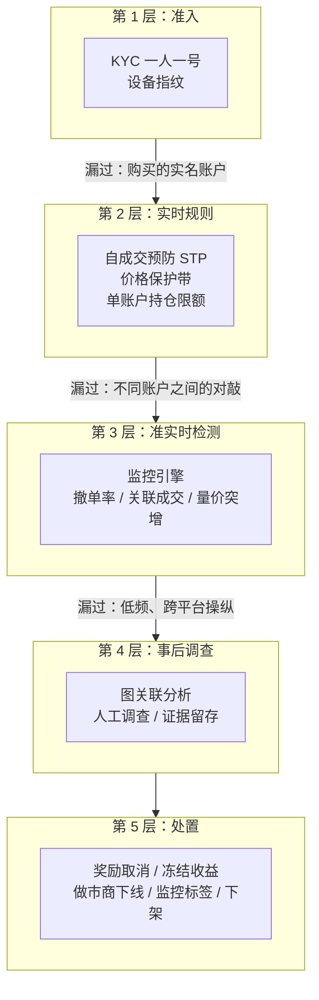
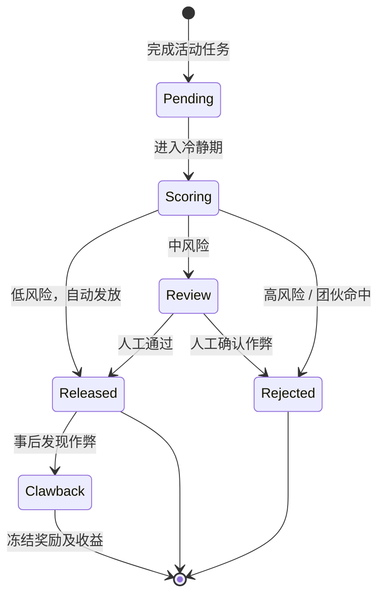
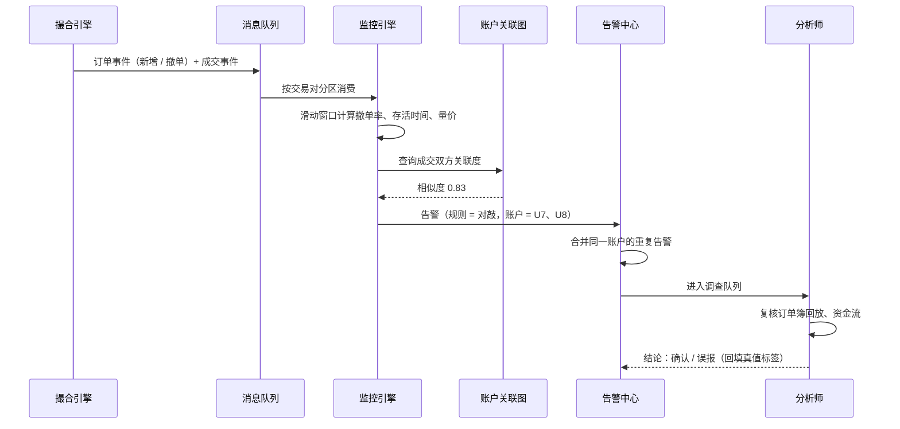
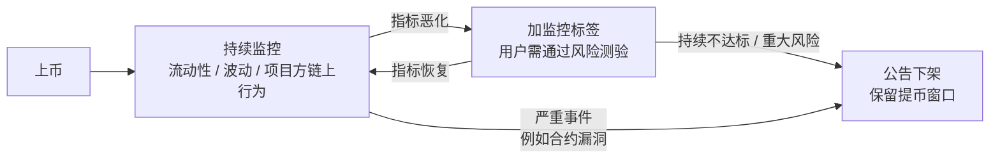
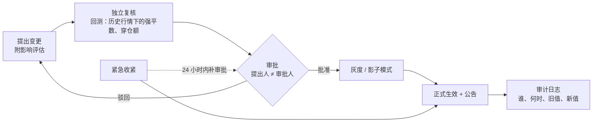
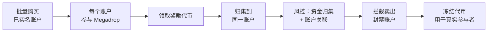

# B05 业务风控

> 学习目标：读完本章，你能——
> 1. 说出营销反作弊、市场监控、信用风险、资产风险四类业务风险各防什么、靠什么信号识别。
> 2. 解释幌骗、分层挂单、对敲、拉盘砸盘、内幕抢跑的检测规则，并用 Precision / Recall 评估检测器。
> 3. 说明风险参数（杠杆、限额、指数权重）为什么必须走变更审批。
>
> 前置章节：[09-risk-control.md](../09-risk-control.md)（风控分层、Precision / Recall）、[10-derivatives-futures.md](../10-derivatives-futures.md)（指数价格、强平、保险基金）、[B03-account-security.md](B03-account-security.md)、[B04-reconciliation.md](B04-reconciliation.md)
> 交互实验：[market-surveillance.html](../interactive/market-surveillance.html)（市场监控检测器）

---

## 1. 一句话理解 + 🎯 打个比方

业务风控：识别"账户安全、规则合规，但行为在损害平台或其他用户"的业务风险。

[09 风控](../09-risk-control.md) 讲的是交易前、提币、盗号这类**单笔请求**的拦截。本章讲的风险通常看不出单笔异常。它们只在**一群账户、一段时间、一批订单**里显现。所以业务风控以异步检测为主，以事后处置为主。

> 🎯 打个比方：交易所像一个大型商场。门口安检（09 章）检查每个人有没有带危险品。业务风控是商场的保安监控室：它看的是"这 30 个人一小时内办了 30 张新会员卡、领完赠品就走"（羊毛党），"这个摊位一直摆满货、顾客一靠近就收起来"（幌骗），"两个摊主互相买卖同一件货刷销量"（对敲）。每个人单独看都没违法，合起来就是作弊。

---

## 2. 威胁 / 问题模型

| 风险类别 | 攻击者 / 来源 | 目标 | 平台损失 | 主要信号 |
|---|---|---|---|---|
| 营销作弊 | 羊毛党、工作室、设备农场 | 批量领取新人奖励、空投、返佣 | 营销预算被套走；真实用户拿不到奖励 | 设备 / IP / 行为聚类，资金归集 |
| 市场操纵 | 操纵者、不合规做市商 | 制造虚假价格或成交量 | 用户受损；监管处罚；声誉 | 撤单率、关联账户成交、量价异常 |
| 内幕交易 | 员工、项目方、合作方 | 利用未公开的上币、公告信息提前交易 | 用户信任；监管处罚 | 交易时间早于公告；账户与内部人关联 |
| 信用风险 | 借款人、穿仓用户 | — | 借出资产收不回；保险基金被消耗 | 抵押率、集中度、强平失败 |
| 资产风险 | 稳定币脱锚、指数源被操纵、项目方跑路 | — | 抵押品贬值；错误强平；用户资产归零 | 价格偏离、单一源异常、链上解锁和转移 |
| 参数风险 | 内部人员误操作或越权 | — | 杠杆或限额设错导致系统性损失 | 参数变更记录、审批记录 |

> 💡 注意：本章的信号、阈值和规则是**业界通用做法**的示例。币安没有公开其业务风控的内部规则。

---

## 3. 防线分层

**读图要点**

- 第 1 层拦住"一个人注册很多号"。它漏过的是**购买他人实名账户**：每个账户的 KYC 都真实。
- 第 2 层同步执行，只能处理"同一账户"的问题。STP 挡住自成交，挡不住两个关联账户的对敲。
- 第 3、4 层看一段时间、一群账户。它们发现问题时，损失往往已经发生。所以奖励发放要**后置**，给检测留出时间。
- 局限：跨平台操纵（在 A 所拉盘、在 B 所卖出）在单个平台内只看到一半。

---

## 4. 关键流程

### 4.1 营销反作弊

营销作弊的经济逻辑很简单：如果一个新账户能领 10 USDT（示例）奖励，而注册和养号成本是 3 USDT，作弊者会注册 1 万个账户。

**识别信号**（业界通用做法）

| 维度 | 信号 | 例子 |
|---|---|---|
| 设备 | 设备指纹重复；模拟器；改机工具；电量和传感器数据异常 | 200 个账户共享 5 个设备指纹 |
| 网络 | 同一 IP 段、同一代理出口、数据中心 IP | 注册集中在一个 /24 网段 |
| 行为 | 注册到领奖的时间分布过于整齐；操作路径完全相同 | 每个账户都在注册后 3 分钟完成同一套任务 |
| 资金 | 领奖后资金归集到同一个地址或账户 | 297 个账户把奖励转给同一个账户 |
| 身份 | KYC 证件来自同一批次；人脸相似度高；手机号段连续 | — |

**图关联**：把账户作为节点，把"共享设备 / IP / 提币地址 / 充值来源 / 转账"作为边。连通分量（Connected Component）大的子图，就是疑似团伙。

**奖励发放后置**：

1. 用户完成任务后，系统只记一条"待发奖励"。
2. 冷静期（例如 7 天，示例）内，反作弊模型和图关联持续评分。
3. 冷静期结束，低风险账户自动发放；中风险进入人工审核；高风险取消资格。
4. 已发放的奖励如果事后确认作弊，系统冻结该奖励及其收益。

**读图要点**

- `Pending` 和 `Scoring` 是奖励后置的核心：奖励在评分完成前不进入用户可用余额。
- 冷静期越长，检测越准，但真实用户的体验越差。
- `Clawback`（追回）的前提是奖励还在平台内。作弊者通常领完立即提走，所以追回能力有限，后置比追回更重要。
- 局限：被拒绝的真实用户会投诉。所以中风险必须有人工通道。

### 4.2 市场监控

市场监控（Market Surveillance）：持续分析订单流和成交流，发现操纵行为。

| 行为 | 定义 | 检测规则（示例） |
|---|---|---|
| 幌骗（Spoofing） | 挂出不打算成交的大额订单，诱导他人交易后撤单 | 订单量 ≥ 盘口均量 × 5；存活时间 < 2 秒；该账户撤单率 > 90%；撤单前对侧有成交 |
| 分层挂单（Layering） | 在多个价位挂多笔订单制造深度假象，是幌骗的变体 | 同一账户在同一侧 ≥ 3 个价位同时挂单并在短时间内同时撤销 |
| 对敲 / 自成交（Wash Trading） | 同一实体或关联账户之间互相成交，制造虚假成交量 | 成交双方为同一用户（STP 应已拦截）或关联度 ≥ 阈值；成交对手高度集中 |
| 拉盘砸盘（Pump and Dump） | 短时间集中买入拉高价格，吸引跟风后集中卖出 | 窗口成交量 ≥ 基线 × N；价格涨幅 ≥ X%；随后同一批账户净卖出 |
| 内幕抢跑（Front-running on Insider Info） | 利用未公开信息（上币、公告、大客户订单）提前交易 | 交易时间早于公告；账户与员工、项目方关联；收益异常集中 |

**关联账户相似度**：把两个账户的特征向量做比较。特征包括设备指纹、IP、充值来源地址、提币目标地址、KYC 信息、下单时间模式。相似度 = 共享特征数 / 全部特征数（Jaccard 相似度，示例公式）。

**读图要点**

- 监控引擎消费的是撮合引擎的**全部订单事件**，不只是成交。幌骗的证据在撤单里。
- 关联图是独立的服务。它由风控、KYC、钱包数据离线构建，监控引擎实时查询。
- 分析师的结论回填为真值标签。标签用来计算 Precision / Recall，并调整阈值。
- 局限：监控引擎在撮合之后运行。它发现操纵时，操纵已经完成，平台只能事后处置。

### 4.3 员工交易限制

内幕抢跑最危险的来源是平台员工。业界通用做法：

1. 员工及其直系亲属的交易账户需要申报。
2. 员工在获知上币、下架、重大公告信息后，进入"禁止交易窗口"。
3. 员工交易需要预先申请，并设定最短持有期。
4. 监控系统把员工申报账户和关联图中的疑似关联账户列为重点监控对象。
5. 设立举报渠道，并对有效举报给予奖励。

据公开报道，2025 年 3 月，币安停职了一名 Binance Wallet 团队员工。该员工此前在 BNB Chain 做业务拓展，利用获得的未公开信息，在某代币发行（TGE）前买入，随后卖出部分获利。币安称该行为构成"基于非公开信息的抢跑"，并向 4 名举报人分配 10 万美元奖励。

### 4.4 做市商行为监控

做市商（Market Maker）：与平台签约、持续提供买卖报价的机构。平台给它费率优惠，它承担报价义务。

| 义务 / 禁止 | 监控指标（示例） |
|---|---|
| 双边报价 | 买卖两侧都有挂单的时间占比 ≥ 90% |
| 价差上限 | 最优买卖价差 ≤ 0.5% 的时间占比 |
| 最小深度 | 盘口 ±2% 内的挂单金额 ≥ 约定值 |
| 禁止单边倾销 | 净卖出量 / 总成交量；只挂卖单不挂买单的时长 |
| 禁止过度撤单 | 订单 / 成交比（Order-to-Trade Ratio） |

据公开报道，币安于 2025 年 3 月宣布下线一家 MOVE 代币的做市商。该做市商在 2024 年 12 月 MOVE 上线次日大量卖出约 6,600 万枚 MOVE，几乎没有提供买方支撑，获利约 3,800 万 USDT。币安冻结了相关收益，并通知了项目方。币安在公告中重申做市商应保持买卖平衡、提供足够深度，并避免过度高频挂撤单。

### 4.5 信用风险

信用风险：借款人或交易对手不能偿还平台借出的资产。

| 场景 | 风险来源 | 主要控制（业界通用做法） |
|---|---|---|
| 杠杆借贷 | 抵押品价格下跌速度快于强平速度 | 分层保证金率；强平；借贷限额（见 [P01-margin-and-loans.md](../products/P01-margin-and-loans.md)） |
| VIP 借贷 | 大额借款，抵押率可能低于普通产品 | 单客户敞口上限；人工授信；更频繁的盯市 |
| 合约穿仓 | 强平成交价比破产价格更差 | 保险基金；自动减仓（ADL）（见 [10-derivatives-futures.md](../10-derivatives-futures.md) 第 3.7–3.8 节） |
| 集中度 | 少数账户持有某币种大部分借款或持仓 | 单币种借贷总额上限；单账户持仓上限 |

监控指标：全平台按币种的借出总额、抵押率分布、保险基金余额与日变化、穿仓次数。

### 4.6 资产风险

| 风险 | 例子（据公开报道） | 平台动作（业界通用做法） |
|---|---|---|
| 稳定币脱锚 | 2022 年 5 月 UST 脱锚并崩溃；2023 年 3 月 USDC 因储备银行倒闭短暂跌破 1 美元 | 降低该币作为抵押品的折算率；暂停相关借贷；调高保证金 |
| 指数源污染 | 2022 年 10 月 Mango Markets（链上协议）的预言机价格被操纵，协议损失超过 1 亿美元 | 指数由多个来源加权；单一来源偏离中位数时截断（见 [10 章](../10-derivatives-futures.md) 第 3.1 节）；薄流动性来源降权 |
| 项目方风险 | 上币后团队大额解锁抛售、合约后门、团队失联 | 链上监控项目方地址；监控标签；下架 |

**监控标签**（Monitoring Tag）：币安对"波动和风险明显高于其他已上线代币"的代币加上的标签。用户交易这些代币前需要通过风险测验，每 90 天重新测验一次。带标签的代币如果持续不达标，可能被下架（截至 2026 年公开资料）。

**读图要点**

- 标签是下架之前的"黄灯"。它不禁止交易，只要求用户确认风险。
- 严重事件可以跳过标签直接下架。
- 下架后平台通常保留一段提币窗口。账本仍然欠用户这些代币，见 [B04-reconciliation.md](B04-reconciliation.md)。
- 局限：标签公告本身会引发价格大跌。公告时机和信息披露也是需要治理的风险。

---

## 5. 规则、指标与阈值

### 5.1 示例规则表

| 规则 ID | 类别 | 条件（示例阈值） | 动作 |
|---|---|---|---|
| MKT-01 | 幌骗 | 订单量 ≥ 盘口均量 × 5，存活 < 2 秒，账户撤单率 > 90% | 告警，人工复核 |
| MKT-02 | 对敲 | 成交双方关联相似度 ≥ 0.7 | 告警；成交量从统计中剔除 |
| MKT-03 | 拉盘砸盘 | 5 分钟成交量 ≥ 基线 × 4，且涨幅 ≥ 8% | 告警；标记该时段的大额净买入账户 |
| MKT-04 | 内幕 | 公告前 24 小时内，员工关联账户买入该币 | P1 告警，合规介入 |
| MKT-05 | 做市商 | 双边报价时间占比 < 90%，连续 3 天 | 警告；扣减费率优惠 |
| MKT-06 | 营销 | 同一设备指纹 ≥ 5 个账户领取同一活动奖励 | 奖励进入人工审核 |
| CRD-01 | 信用 | 单币种借出总额 ≥ 平台可借上限 × 90% | 暂停新增借款 |
| AST-01 | 资产 | 稳定币价格偏离 1 美元 ≥ 2%，持续 10 分钟 | 降低抵押折算率；通知风险委员会 |

本章交互页 [market-surveillance.html](../interactive/market-surveillance.html) 实现了 MKT-01、MKT-02、MKT-03 的简化版。你可以拖动阈值，观察混淆矩阵的变化。

### 5.2 风险参数治理

风险参数：杠杆上限、保证金率、借贷限额、持仓上限、指数成分与权重、价格保护带、做市商义务。

这些参数改一个数字，影响全部用户。所以它们必须按"代码变更"一样治理。

| 参数 | 谁提出 | 谁审批 | 生效方式 |
|---|---|---|---|
| 杠杆上限 / 保证金分层 | 风险团队 | 风险委员会 + 业务负责人 | 提前公告；分批生效 |
| 借贷限额 | 风险团队 | 风险委员会 | 可立即生效（收紧）；放宽需审批 |
| 指数成分与权重 | 指数团队 | 风险委员会；独立复核 | 公告后生效 |
| 紧急收紧（例如脱锚时降折算率） | 值班风险官 | 事后 24 小时内补审批 | 立即生效 |

**读图要点**

- 正常路径是"提出 → 复核 → 审批 → 灰度 → 生效"。和代码发布一样，提出人和审批人分离。
- 紧急路径只允许**收紧**风险（降杠杆、降限额）。放宽风险不走紧急路径。
- 每次变更都留下旧值和新值。事后复盘时，能回答"那一刻的参数是什么"。
- 局限：审批流程会拖慢反应速度。所以需要明确"哪些参数允许紧急收紧"。

---

## 6. 真实案例

### 6.1 2024 年 Lista Megadrop 批量账户（据公开报道）

据公开报道，2024 年 6 月，币安在 Lista DAO 的 Megadrop 活动中识别出大量作弊账户。作弊者使用批量购买的 KYC 账户参与活动，领奖后把代币归集到同一账户准备卖出。币安风控拦截了归集后的卖出，封禁了 297 个账户，并表示冻结的代币将用于项目活动，返还给真实参与者。

**读图要点**

- 第 1 层（KYC）没有拦住：每个账户的实名都是真的，只是被买卖。
- 发现点在资金归集。归集是羊毛党的"变现必经之路"，是最稳定的信号。
- 奖励已经发放，平台依靠"卖出前拦截"挽回损失。这说明奖励后置和提币前检查都很重要。
- 局限：如果作弊者在每个账户分别卖出、分散提币，归集信号会变弱。

### 6.2 2024–2025 年 MOVE 做市商（据公开报道）

见第 4.4 节。教训：做市商协议必须写明可监控的义务；监控系统要能计算"净卖出占比"这类指标；平台需要有冻结收益的合同依据。

### 6.3 2025 年员工内幕抢跑（据公开报道）

见第 4.3 节。教训：员工交易限制必须覆盖"调岗前获得的信息"；举报渠道能发现监控系统没有覆盖的关联账户。

---

## 7. 局限与权衡

| 权衡 | 一端 | 另一端 |
|---|---|---|
| 误杀 vs 漏放 | 撤单率阈值低：抓到更多幌骗 | 正常做市商和高频策略被误报 |
| 体验 vs 反作弊 | 奖励即时到账：拉新效果好 | 羊毛党领完即走，预算被套 |
| 透明 vs 对抗 | 公开规则：用户可预期 | 作弊者按规则调整行为 |
| 速度 vs 治理 | 风险官可直接改参数：反应快 | 误操作或越权的风险高 |
| 平台利益 vs 市场公平 | 刷量能提高排名和手续费 | 虚假成交量误导用户，招致监管处罚 |

**局限**

- 关联图依赖数据质量。购买的实名账户、住宅代理 IP、真机农场都能削弱关联信号。
- 规则检测器只能发现"已知模式"。新型操纵需要分析师发现后再写成规则。
- 单个平台看不到跨平台操纵的全貌。
- 真值标签来自人工调查，本身有延迟和偏差。Precision / Recall 只是估计值。

---

## 8. 本仓库对照

本仓库（`CEX Demo`）的风控集中在**交易前**校验，没有业务风控。

| 本章概念 | 本仓库实现 | 状态 |
|---|---|---|
| 价格保护带 | `risk-service` 校验价格偏离参考价上限；参考价来自本地配置（`RISK_REFERENCE_PRICE_BTC_USDT` 等） | 已实现（简化） |
| 下单规则 | `risk-service` 校验最小数量、价格 / 数量 step、可用余额 | 已实现 |
| 自成交预防 STP | — | 未实现 |
| 市场监控（幌骗 / 对敲 / 拉盘） | — | 未实现；可用 `order-service` 的成交记录和订单事件作为数据源 |
| 营销反作弊、关联图 | — | 未实现（本仓库没有营销活动） |
| 信用风险 / 保险基金 | — | 未实现（本仓库只有现货） |
| 风险参数治理 | 参数通过环境变量配置，无审批流程 | 未实现 |

相关文件：[services/risk-service/README.md](../../services/risk-service/README.md)、[risk-application-service.ts](../../services/risk-service/src/application/risk-application-service.ts)。

> 💡 注意：如果要在本仓库上做市场监控实验，`order-service` 的成交记录已带 `executionSequence` 和 `replayCursor`，可以按市场有序回放。这是监控引擎所需的"有序订单流"。

---

## 9. 术语表 / 思考题

### 术语表

| 术语 | 英文 | 定义 |
|---|---|---|
| 业务风控 | Business Risk Control | 识别行为层面损害平台或其他用户的风险 |
| 羊毛党 | Bonus Hunter / Sybil | 批量注册或控制账户、领取营销奖励的人或团伙 |
| 设备指纹 | Device Fingerprint | 由设备软硬件特征计算出的标识 |
| 奖励后置 | Deferred Reward | 奖励在风控评分完成后才发放 |
| 市场监控 | Market Surveillance | 分析订单流和成交流以发现操纵 |
| 幌骗 | Spoofing | 挂出不打算成交的订单，诱导他人后撤单 |
| 分层挂单 | Layering | 在多个价位挂单制造虚假深度 |
| 对敲 | Wash Trading | 同一实体或关联账户之间互相成交 |
| 拉盘砸盘 | Pump and Dump | 拉高价格吸引跟风，再集中卖出 |
| 抢跑 | Front-running | 利用未公开信息提前交易 |
| 订单成交比 | Order-to-Trade Ratio | 订单数与成交数之比，衡量过度挂撤单 |
| 监控标签 | Monitoring Tag | 币安对高风险代币加的标签 |
| 脱锚 | Depeg | 稳定币价格偏离锚定值 |
| 风险参数 | Risk Parameter | 杠杆、限额、保证金率、指数权重等 |

### 思考题

1. 在 [market-surveillance.html](../interactive/market-surveillance.html) 中只注入"幌骗"。把存活时间阈值从 2 秒调到 10 秒，Precision 和 Recall 分别怎么变？为什么正常做市商的撤单会被误报？
2. 只注入"对敲"，把关联相似度阈值调低到 0.3。新增的告警涉及哪些账户？它们为什么和真实对敲账户"相似"？
3. 一次营销活动的预算是 100 万 USDT（示例）。你会把冷静期设为 1 天还是 14 天？用"作弊成本 vs 真实用户流失"解释你的选择。
