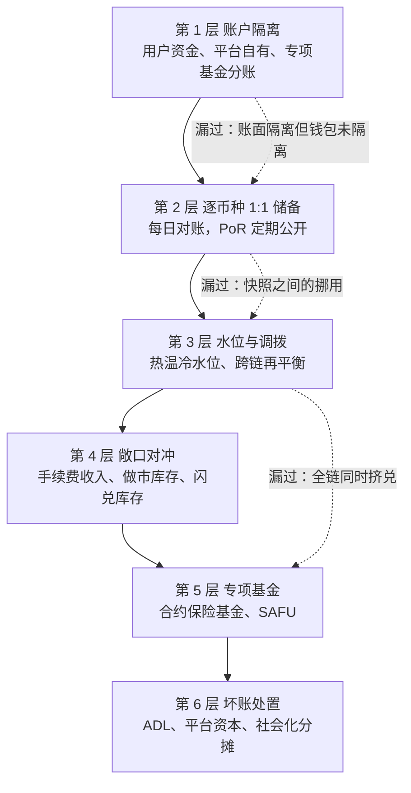
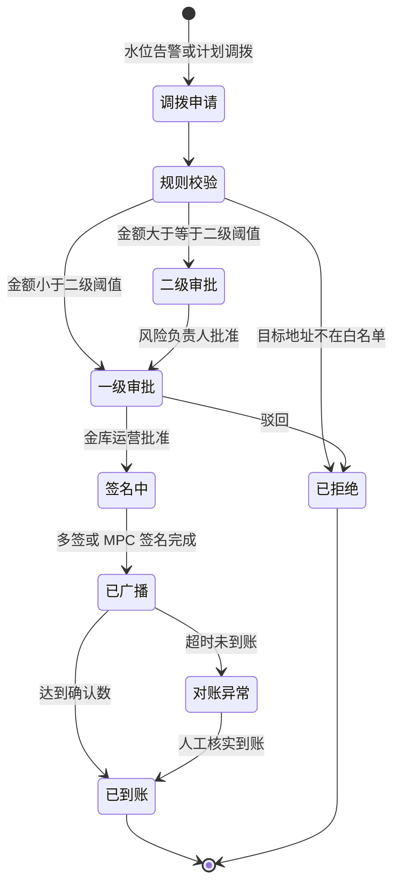
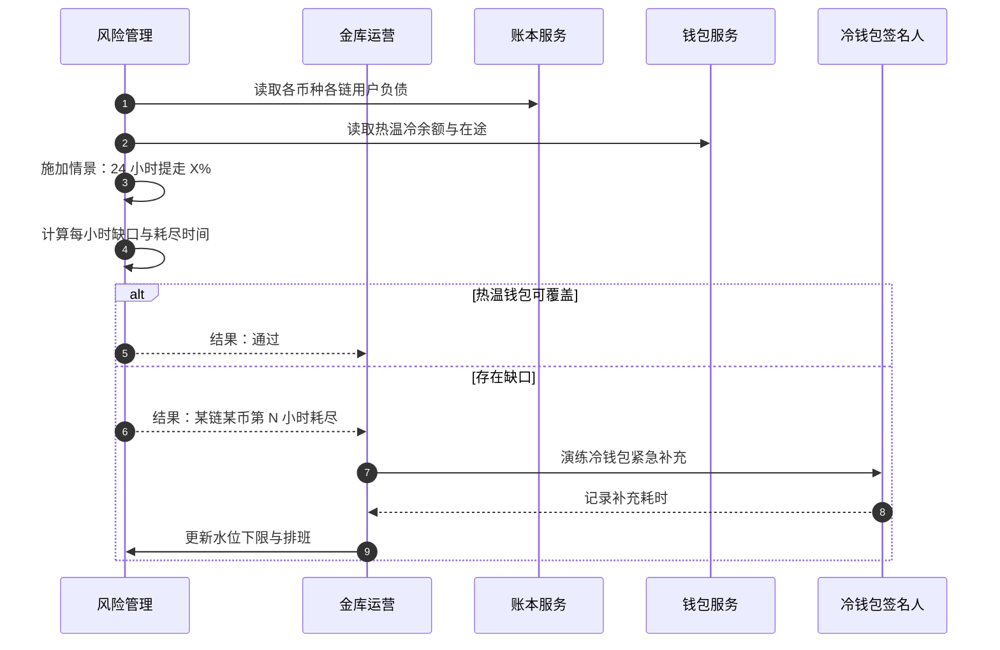
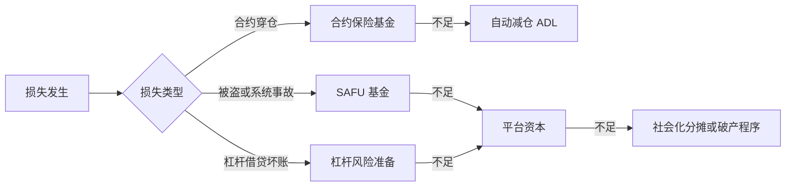
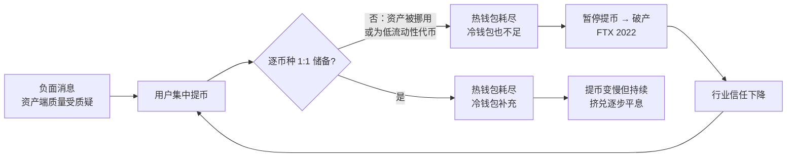

# B06 资金与流动性管理：金库运营、敞口对冲与挤兑压力测试

> 学习目标：读完本章，你能——
> 1. 用资产负债表视角解释"1:1 储备"：用户负债、平台资产、平台自有资金各在哪一栏。
> 2. 说出金库运营的日常工作：按币种按链的流动性分布、调拨审批流、跨链再平衡、稳定币与法币通道。
> 3. 设计一次挤兑压力测试，并说明保险基金、SAFU 与坏账处置的先后顺序。
>
> 前置章节：[04 钱包与托管](../04-wallet-custody.md)（冷热分层、归集、PoR、SAFU）、[05 账本](../05-ledger.md)（双分录）、[10 合约与衍生品](../10-derivatives-futures.md)（保险基金、ADL）、[13 可靠性与安全事故](../13-reliability-security-incidents.md)（FTX 案例）
> 交互实验：[proof-of-reserves.html](../interactive/proof-of-reserves.html)（储备金证明）、[deposit-withdraw-sim.html](../interactive/deposit-withdraw-sim.html)（热冷水位）、[reconciliation-lab.html](../interactive/reconciliation-lab.html)（对账实验）

> ⚠️ 警告：本章仅用于学习交易所系统设计。本章不构成投资建议。本章的比例、阈值和金额除标注"公开资料"或"据公开报道"外，都是示例。

---

## 1. 一句话理解 + 🎯 打个比方

金库运营（Treasury Operations）是交易所管理"钱放在哪里、放多少、怎么调"的后台职能。它的首要目标是：任何时刻，用户要提走的每一种币，在对应的链上都有足够的余额可付。

> 🎯 打个比方：交易所金库像一家连锁超市的现金和库存调度中心。
> 每家门店（每条链、每个币种）的收银台（热钱包）只放当天要找零的现金。
> 总部金库（冷钱包）放大部分现金，调拨要两个经理签字。
> 门店之间的现金不能直接用：A 店的人民币不能给 B 店的顾客找美元（不同链、不同币种）。
> 调度中心每天看各店的现金水位，提前把钱运到快要不够的门店（再平衡）。
> 春节前，调度中心要演练"所有顾客同时来退货退款"（挤兑压力测试）。

第 04 章讲了冷热钱包的技术结构。本章不重复私钥和签名，只讲"金库运营"：资金在各个钱包之间如何计划、审批、调度和兜底。

---

## 2. 威胁 / 问题模型

### 2.1 资产负债表视角

交易所的资产负债表可以分成两部分：

| 资产（交易所持有） | 负债与权益（交易所欠谁） |
|---|---|
| 链上钱包余额：热、温、冷，按币种按链 | 用户负债：所有用户的可用余额 + 冻结余额 |
| 在途资金：已签名未确认的转账 | 待处理提币：已扣款未上链 |
| 法币银行账户、支付通道备付金 | 法币用户负债 |
| 做市和闪兑库存（平台自有） | 平台权益：手续费累计、自营利润 |
| 保险基金、SAFU（平台自有，专款专用） | 保险基金、SAFU 对应的专项准备 |

1:1 储备（Full Reserve）：对每一种币，交易所持有的用户资产 ≥ 用户负债。它是逐币种比较，不是按美元总值比较。

> ⚠️ 警告：按美元总值看"资产 ≥ 负债"是不够的。如果交易所用 100 万美元的自有代币冒充 100 万美元的 BTC 储备，总值相等，但 BTC 挤兑时付不出 BTC。FTX 的问题之一就是资产端大量持有低流动性的关联代币（见第 13 章 4.3 节）。

### 2.2 要防什么

| 风险 | 来源 | 后果 | 主要防线 |
|---|---|---|---|
| 单链流动性不足 | 某条链提币集中爆发；热钱包水位低 | 提币排队，信任下降 | 水位告警、预调拨 |
| 币种错配 | 用户负债是 BTC，资产是 USDT | 价格波动时储备不足 | 逐币种 1:1，敞口对冲 |
| 资金混用 | 平台自有资金与用户资金在同一账户 | 挪用风险，破产时用户受损 | 账户隔离、独立对账 |
| 稳定币脱锚或发行方冻结 | 稳定币价格偏离 1 美元；发行方黑名单 | 储备价值缩水 | 多稳定币分散，限额 |
| 法币通道中断 | 合作银行终止服务 | 法币出入金停止 | 多银行，多通道 |
| 挤兑 | 负面消息引发集中提币 | 流动性枯竭，最终破产 | 1:1 储备，压力测试，PoR |
| 坏账 | 穿仓、闪兑报价错误、被盗 | 用户负债 > 资产 | 保险基金、SAFU、ADL |
| 内部挪用 | 高管绕过审批调用用户资金 | 资不抵债 | 多签审批、职责分离、外部审计 |

---

## 3. 防线分层

读图要点：

- 前 4 层是"预防"：让资金在正确的地方、正确的币种、正确的数量。第 5、6 层是"兜底"：损失已经发生后，谁来承担。
- 第 2 层依赖第 05 章的账本和 [B04 对账](B04-reconciliation.md)。负债数字错了，储备率也是错的。
- 虚线是每层的典型漏洞。例如 PoR 只看快照，两次快照之间的挪用看不见（见第 04 章 5.5 节）。
- 局限：没有任何一层能让交易所在"全部用户同时提走全部资产"时毫无延迟。冷钱包出账需要时间，这是安全设计的代价。

---

## 4. 关键流程

### 4.1 按币种按链的流动性分布

同一个币种在不同链上是不同的"库存"。例如 USDT 有 Ethereum、Tron、BNB Smart Chain 等多个版本。每个版本都要单独管理水位。

| 币种-链（示例） | 用户负债 | 热钱包 | 温钱包 | 冷钱包 | 热钱包覆盖率 |
|---|---|---|---|---|---|
| BTC-Bitcoin | 100,000 BTC | 3,000 | 10,000 | 87,500 | 3.0% |
| USDT-Tron | 8,000,000,000 | 320,000,000 | 800,000,000 | 6,900,000,000 | 4.0% |
| USDT-Ethereum | 5,000,000,000 | 100,000,000 | 500,000,000 | 4,420,000,000 | 2.0% |
| ETH-Ethereum | 2,000,000 ETH | 60,000 | 200,000 | 1,750,000 | 3.0% |

热钱包覆盖率 = 热钱包余额 ÷ 该币种该链的用户负债。示例数据中，各行资产合计略大于负债，差额是平台自有部分。

### 4.2 调拨审批流

读图要点：

- 调拨只能在"内部白名单地址"之间进行。白名单本身的变更也需要多人审批。
- 金额越大，审批人越多、层级越高。示例：单笔 > 1,000 万美元等值需要二级审批。
- 发起人、审批人、签名人三个角色分离（职责分离）。任何一人都不能单独把钱调走。
- 局限：审批流增加延迟。挤兑时，冷钱包到热钱包的补充速度受审批人在线时间限制。业界会预先排班，并设计"紧急补充"通道（业界通用做法）。

### 4.3 跨链再平衡

用户在 A 链充值、在 B 链提币时，A 链的库存增加，B 链的库存减少。金库要把资金从 A 链挪到 B 链。

| 方法 | 原理 | 优点 | 缺点 |
|---|---|---|---|
| 发行方换链 | 在 A 链把稳定币交还发行方，在 B 链重新发行 | 无桥风险 | 依赖发行方处理时间和最小额 |
| 跨链桥 | 在 A 链锁定，在 B 链铸造 | 快 | 桥被攻击的风险（见第 13 章 4.2 节） |
| 场内对冲 | 在 A 链卖出、B 链买入，或与做市商场外互换 | 不上桥 | 价差成本，对手方风险 |
| 引导用户 | 调整 B 链提币手续费或暂停 B 链提币 | 零成本 | 影响体验 |

### 4.4 稳定币与法币通道

- 稳定币分散：业界通用做法是同时持有多种主流稳定币，并给单一发行方设置上限。
- 发行方风险：稳定币发行方可以在链上冻结地址。交易所需要监控发行方的黑名单，避免储备地址被误冻。
- 法币通道：法币出入金依赖银行和支付机构。每个通道有日限额和清算时间。金库要为法币通道单独计算备付金。
- 【据公开报道】2022 年 9 月，币安把用户持有的 USDC、USDP、TUSD 自动转换为 BUSD。2023 年 2 月，纽约州金融服务部要求 Paxos 停止新铸 BUSD。之后币安逐步停止 BUSD 相关产品。这一过程说明：稳定币的选择本身是金库风险。

### 4.5 平台敞口与对冲

平台自有资金也会产生币价敞口。

| 敞口来源 | 例子 | 对冲方式（业界通用做法） |
|---|---|---|
| 手续费收入币种 | 手续费以 BTC、ETH、各种代币收取 | 定期把手续费换成稳定币或目标币种 |
| 做市库存 | 平台自营做市持有的现货 | 用永续合约做空对冲 |
| 闪兑库存 | 闪兑报价后，平台持有用户卖给它的币（见 [P02](../products/P02-convert-otc.md)） | 在现货市场或向做市商平盘 |
| 理财产品错配 | 用户活期理财，平台把资产借给杠杆用户（见 [P01](../products/P01-margin-and-loans.md)、[P05](../products/P05-earn-savings-staking.md)） | 期限管理、保留赎回缓冲 |

数值示例：平台本月手续费收入 500 BTC。BTC 价格 60,000 美元。如果不对冲，BTC 下跌 20% 时，收入缩水 600 万美元（500 × 60,000 × 20%）。如果每天把当日手续费换成 USDT，敞口只剩一天的价格波动。

### 4.6 挤兑压力测试

读图要点：

- 压力测试的输入是"真实负债 + 真实余额"，输出是"哪条链、哪个币、第几小时会耗尽"。
- 关键参数是冷钱包补充速度。它取决于审批人到位时间、签名设备的物理位置和链的确认时间。
- 1:1 储备的交易所在挤兑时"有钱但可能慢"。非 1:1 储备的交易所"慢了之后就没钱"。两者的区别是挤兑能否被熬过去。
- 局限：情景是假设的。真实挤兑往往集中在某几条链和某几种稳定币，比平均情景更极端。

示例情景表：

| 情景 | 24 小时提币比例（示例） | 关注点 |
|---|---|---|
| 温和 | 5% | 热钱包是否覆盖 |
| 严重 | 15% | 温钱包补充速度 |
| 极端 | 30%，且集中在 2 条链 | 冷钱包紧急出账能力；跨链再平衡是否来得及 |

### 4.7 保险基金、SAFU 与坏账处置顺序

读图要点：

- 不同类型的损失走不同的兜底池。合约保险基金只覆盖合约穿仓（见第 10 章）。SAFU 覆盖极端事件，例如被盗（见第 04 章 3.10 节）。
- 平台资本是最后一道"自愿"防线。社会化分摊意味着用户承担损失，是最差结果。
- 专项基金必须与运营资金隔离。专项基金被挪作他用时，兜底就是空的。
- 局限：各池的规模是公开承诺，规模是否足够取决于极端事件的大小。

---

## 5. 规则、指标与阈值

### 5.1 金库监控指标（示例）

| 指标 | 定义 | 告警条件（示例） |
|---|---|---|
| 逐币种储备率 | 该币种平台持有 ÷ 用户负债 | < 100% 立即告警（P0） |
| 热钱包覆盖率 | 热钱包余额 ÷ 该链该币用户负债 | < 1% 或 > 5% |
| 热钱包耗尽时间 | 热钱包余额 ÷ 近 1 小时净流出速率 | < 4 小时 |
| 净流出 | 1 小时、24 小时提币减充值 | > 过去 30 天 P99 |
| Gas 币水位 | 热钱包原生币余额 | < 3 天预计消耗 |
| 单一稳定币集中度 | 某稳定币储备 ÷ 稳定币储备总额 | > 60% |
| 单一银行集中度 | 某银行法币余额 ÷ 法币总余额 | > 40% |
| 对冲后净敞口 | 平台自有资金在各币种上的净头寸 | > 风险限额 |
| 调拨在途超时 | 已广播未到账的时间 | > 预期确认时间 3 倍 |

### 5.2 调拨规则（示例）

| 规则 | 内容 |
|---|---|
| 地址白名单 | 调拨只能发往内部白名单地址；白名单变更需要 3 人审批 |
| 分级审批 | ≤ 100 万美元等值：1 人；100 万–1,000 万：2 人；> 1,000 万：2 人 + 风险负责人 |
| 时间窗 | 冷钱包常规出账只在工作时段；紧急出账需要额外审批 |
| 拆分上限 | 单笔冷钱包出账 ≤ 冷钱包余额的 10% |
| 双人复核 | 签名人在签名设备上复核目标地址和金额（见第 04 章 5.4 节 Bybit 案例） |

---

## 6. 真实案例

### 6.1 2022 年 11 月 FTX 挤兑与之后的行业挤兑

【据公开报道】2022 年 11 月 8 日前的 72 小时内，FTX 用户提走约 60 亿美元，FTX 随后暂停提币，并于 11 月 11 日申请破产。事件之后，用户对所有中心化交易所的信任下降，行业出现集中提币。

【据公开报道】2022 年 12 月 13 日前后，据数据机构 Nansen 统计，币安一周净流出约 37 亿美元，其中最近 24 小时约 20 亿美元。币安在此期间保持提币处理。币安于 2022 年 11 月上线储备金证明（见第 04 章 3.9 节）。

读图要点：

- 挤兑本身不会让 1:1 储备的交易所破产，只会考验它的流动性调度速度。
- FTX 的根因是资产端：用户资金被转移到关联公司，并用低流动性代币填补（据破产程序公开文件）。挤兑只是暴露了问题。
- 行业挤兑是"传染"：一家倒闭会让用户怀疑所有交易所。PoR 是这一阶段各交易所的主要回应。
- 局限：公开数据来自链上分析机构的地址标注。这类数据覆盖不完整，不同机构的数字会有差异。

---

## 7. 局限与权衡

| 权衡 | 一侧 | 另一侧 | 常见做法（业界通用做法） |
|---|---|---|---|
| 安全 vs 流动性 | 热钱包少：被盗损失小 | 热钱包少：挤兑时提币慢 | 动态水位；挤兑时临时调高下限 |
| 收益 vs 储备 | 用户资金出借或投资：有收益 | 1:1 储备被破坏 | 用户资金不出借；理财产品单独披露 |
| 跨链效率 vs 桥风险 | 用桥：再平衡快 | 桥被攻击：损失大 | 优先发行方换链；桥设上限 |
| 对冲 vs 成本 | 全对冲：无价格风险 | 对冲有手续费和资金费率成本 | 按敞口限额部分对冲 |
| 透明 vs 安全 | 公开钱包地址：用户可查 | 公开地址：攻击者知道目标 | 公开冷钱包和 PoR，不公开调拨计划 |
| 审批 vs 速度 | 多人审批：防内部挪用 | 多人审批：紧急时慢 | 预设紧急流程 + 事后复核（见 [B07](B07-incident-response.md)） |

> 💡 注意：1:1 储备是"必要条件"，不是"充分条件"。储备在，但签名设备失联、审批人缺席、链拥堵，用户依然提不出币。金库运营要同时管"有没有钱"和"能不能及时付出去"。

---

## 8. 本仓库对照

本仓库（[CEX Demo](../..)）有平台账户类型和对账脚本，但没有金库运营模块。

| 金库能力 | 本仓库现状 | 位置 |
|---|---|---|
| 平台账户分类 | ✅ 账户类型包含 `fee`、`hot_wallet`、`cold_wallet`、`withdrawal_pending`、`opening_balance` | `../../packages/domain/src/index.ts` |
| 账本对账 | ✅ `reconcile-balances` 脚本和运维接口 | `../../services/ledger-service/README.md` |
| 陈旧提币清理 | ✅ `reconcile-stale-withdrawals` | `../../services/wallet-service/README.md` |
| 对账维度与频率 | ⚠️ 只有账本内部对账（journal 与余额快照），通过运维接口或 `check-alerts` 脚本触发；热钱包链上余额对账和定时（小时级 / 日级）对账本仓库未实现 | `../../docs/ledger-service-design.md` 第 11 节 |
| 热冷分层 | ❌ 本仓库未实现。`hot_wallet`、`cold_wallet` 只是保留的账户类型，演示流程未使用；没有水位调度和归集 | `../../docs/domain-model.md` 第 2.1 节 |
| 调拨审批、跨链再平衡、敞口对冲、压力测试 | ❌ 未实现 | — |

如果要补齐，建议按以下顺序：

1. 在 ledger-service 增加"逐币种储备率"查询：`hot_wallet + cold_wallet` 余额 ÷ 用户账户余额合计。
2. 在 wallet-service 增加水位配置和告警事件。
3. 新增调拨单实体，复用提币的审核状态机，并加入白名单校验。
4. 写一个离线脚本：读取负债和余额，按情景表输出耗尽时间。

---

## 9. 术语表 / 思考题

### 术语表

| 术语 | 英文 | 定义 |
|---|---|---|
| 金库运营 | Treasury Operations | 管理交易所资金分布、调拨和兜底的后台职能 |
| 1:1 储备 | Full Reserve | 每种币的平台持有量 ≥ 用户负债 |
| 用户负债 | Customer Liabilities | 交易所欠用户的余额总和 |
| 储备率 | Reserve Ratio | 平台持有 ÷ 用户负债，逐币种计算 |
| 热钱包覆盖率 | Hot Wallet Coverage | 热钱包余额 ÷ 该链该币用户负债 |
| 再平衡 | Rebalancing | 在链之间、钱包之间调整资金分布 |
| 敞口 | Exposure | 平台自有资金受价格变动影响的头寸 |
| 对冲 | Hedging | 用反向头寸抵消敞口 |
| 挤兑 | Bank Run | 大量用户在短时间内集中提取资金 |
| 压力测试 | Stress Test | 在假设的极端情景下计算资金缺口 |
| 职责分离 | Segregation of Duties | 发起、审批、执行由不同人完成 |
| 社会化分摊 | Socialized Loss | 平台把无法覆盖的损失按比例分给用户 |
| 用户安全资产基金 | SAFU | 币安设立的用户保护基金 |

### 思考题

1. 用 4.1 节的示例表计算：如果 USDT-Ethereum 在 6 小时内净流出 1.5 亿 USDT，热钱包何时耗尽？温钱包能撑多久？你会先从哪个钱包补充，还是先从 Tron 链再平衡？
2. 一家交易所按美元总值计算的储备率是 105%，但 BTC 单币种储备率是 80%。在 [proof-of-reserves.html](../interactive/proof-of-reserves.html) 里，PoR 能否发现这个问题？逐币种公开为什么重要？
3. 平台闪兑库存里积压了 2,000 万美元的小币种。该币种没有永续合约，无法做空对冲。你会用什么方法控制这个敞口？代价是什么？
