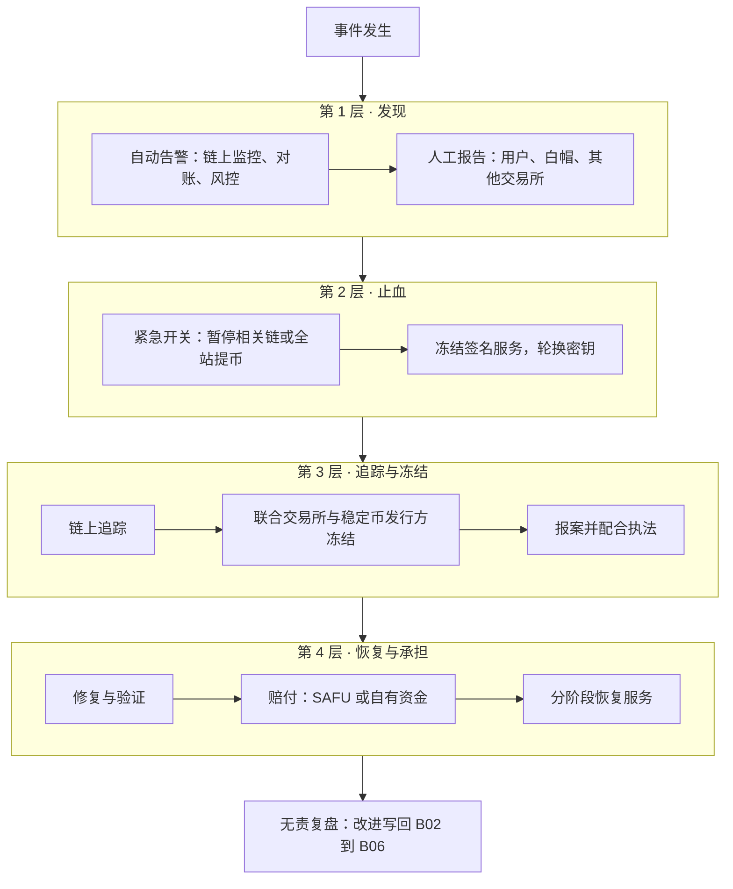
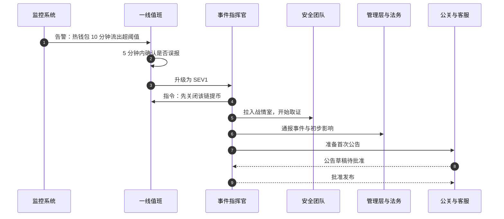
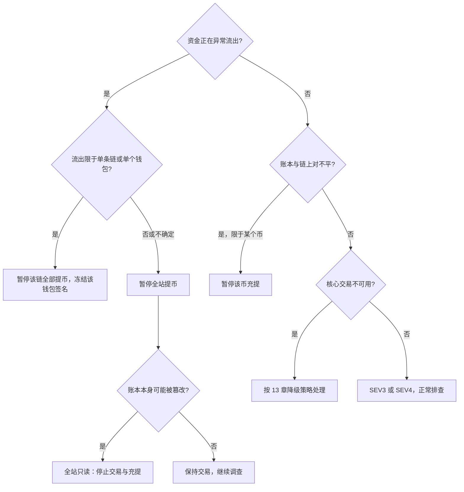
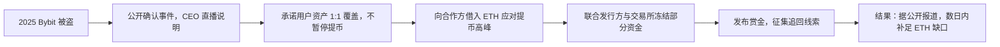

# B07 应急响应

> 学习目标：读完本篇，你能——
> 1. 按 SEV1–SEV4 给一个安全或资金事件定级，并说出对应的响应时限和升级对象。
> 2. 用决策树判断：该暂停某个币、某条链、全站提币，还是全站只读。
> 3. 写出黑客事件的处置时序，以及一份无责复盘报告的结构。
>
> 前置章节：[13 可靠性与安全事故](../13-reliability-security-incidents.md)（降级与真实案例）、[B02 平台安全](B02-platform-security.md)、[B04 对账](B04-reconciliation.md)
> 交互实验：[architecture-explorer.html](../interactive/architecture-explorer.html)（注入故障，观察哪个服务失败会影响资金）、[deposit-withdraw-sim.html](../interactive/deposit-withdraw-sim.html)（提币路径）

---

## 1. 一句话理解

应急响应（Incident Response）：事故发生后，团队按预先写好的流程，**先止血，再查因，再恢复，最后复盘**。

前面的幕后篇都在"防止事故"。本篇假设防线已经被突破。此时最重要的不是找到黑客，而是**在下一笔钱流出之前关上阀门**。

> 🎯 打个比方：应急响应像医院急诊。
> 病人推进来，分诊护士先看颜色：红色立刻抢救，黄色排队，绿色等待（事件分级）。
> 抢救时先止血、保呼吸（暂停提币、轮换密钥），然后才拍片找原因（取证）。
> 病人稳定后，医生要和家属沟通（用户公告）。最后科室开病例讨论会，不追究个人，只问"流程哪里能改"（无责复盘）。

---

## 2. 威胁 / 问题模型

### 2.1 事件来源

| 来源 | 示例 | 典型发现方式 |
|---|---|---|
| 外部攻击 | 热钱包私钥泄露、签名界面被篡改 | 链上监控、热钱包余额告警 |
| 用户账户批量被盗 | 钓鱼潮、撞库 | 安全设置修改量激增（见 [B03](B03-account-security.md)） |
| 内部错误 | 错误配置导致重复入账 | 对账差异（见 [B04](B04-reconciliation.md)） |
| 链层事故 | 链重组、跨链桥漏洞、链停摆 | 节点监控、行业通报 |
| 第三方故障 | 托管商、云服务、稳定币发行方冻结 | 供应商通知、健康检查 |
| 系统故障 | 撮合宕机、数据库主从切换失败 | 可用性监控 |

### 2.2 事件分级（示例）

| 等级 | 定义 | 示例 | 响应时限（示例） | 升级到 |
|---|---|---|---|---|
| SEV1 | 资金正在流失，或账本可能错误 | 热钱包异常转出；账实不平且扩大 | 5 分钟内组建战情室 | CEO、CISO、法务、公关 |
| SEV2 | 核心功能中断，资金未受损 | 撮合停止；某条链充值全部延迟 | 15 分钟 | 技术 VP、业务负责人 |
| SEV3 | 部分功能降级 | 某个币种提币广播失败率升高 | 1 小时 | 团队负责人 |
| SEV4 | 轻微问题，无用户影响 | 报表延迟；单个告警误报 | 下一个工作日 | 值班工程师自行处理 |

战情室（War Room）：SEV1/SEV2 事件中，所有相关角色集中在一个会议或频道里协同处置。

> ⚠️ 警告：定级"宁高勿低"。资金类事件在确认之前，一律先按 SEV1 处理。降级比升级容易。

---

## 3. 防线分层

读图要点：

- 第 1 层决定损失上限。从"第一笔异常转出"到"按下开关"的时间，就是损失窗口。
- 第 2 层只做可逆的保护动作。暂停提币是可逆的；删除数据、回滚链上交易不可逆或不可能。
- 第 3 层依赖行业协作。被盗资产一旦进入混币器或跨链桥，追回难度会急剧上升。
- 局限：第 4 层"赔付"取决于平台储备。没有储备的平台，止血再快也可能倒闭（见 [B06](B06-treasury-liquidity.md)）。

---

## 4. 关键流程

### 4.1 值班与升级

读图要点：

- 事件指挥官（IC，Incident Commander）只负责决策和协调，不亲自排查。这样决策不会被技术细节淹没。
- 一线值班有权**单人关闭**提币，不需要等待审批。开启必须两人（见 [B02](B02-platform-security.md) 第 7 节）。
- 首次公告在止血后尽快发出。公告可以说"正在调查"，但不能沉默。
- 局限：凌晨事件中，升级链上的人可能联系不上。每一级都要有备份人。

### 4.2 止血决策树

读图要点：

- 判断顺序是"钱在流吗 → 账对吗 → 能交易吗"。资金正确性优先于可用性。
- 范围不确定时选更大的范围。暂停全站提币的代价是几小时投诉；漏关一条链的代价可能是全部热钱包。
- 全站只读是最后手段。它会让用户无法止损，所以只在"账本可能被篡改"时使用。
- 局限：暂停提币本身会引发恐慌性挤兑预期。必须同时发布公告。

### 4.3 黑客事件处置时序

| 阶段 | 时间（示例） | 动作 |
|---|---|---|
| 发现 | T+0 | 告警触发，值班确认 |
| 止血 | T+5 分钟 | 暂停相关链提币；冻结签名服务 |
| 止血 | T+30 分钟 | 轮换可能泄露的密钥；剩余资产转入新地址 |
| 取证 | T+1 小时 | 保全日志、内存、磁盘镜像；禁止重启被入侵主机 |
| 链上追踪 | T+1 小时 | 标记攻击者地址；推送给链上分析公司 |
| 联合冻结 | T+2 小时 | 通知其他交易所、稳定币发行方、跨链桥 |
| 执法 | T+1 天 | 报案；提供链上证据 |
| 用户沟通 | T+1 小时起 | 首次公告；之后定时更新 |
| 赔付 | T+1 天内宣布 | 说明是否由 SAFU 或自有资金覆盖 |
| 恢复 | T+数天 | 新密钥、新地址；分币种逐步开放提币 |
| 复盘 | T+2 周内 | 无责复盘报告；改进项入排期 |

**取证的四条纪律（业界通用做法）：**

1. 先保全，再修复。
2. 不重启被入侵的主机。内存中的证据会丢失。
3. 所有取证操作都记录"谁、何时、做了什么"。
4. 证据副本计算哈希，保证后续可用于司法程序。

### 4.4 行业协作：联合冻结

被盗资产要变现，通常要经过中心化交易所或稳定币。所以交易所和稳定币发行方是"收费站"。

**公开报道的例子：**

- 【据公开报道】2019 年 11 月，韩国交易所 Upbit 被盗约 34.2 万 ETH。部分被盗资金转入币安后，币安冻结了这些资金并开展调查。
- 【据公开报道】2024 年 8 月，币安发布公告称：截至 2024 年 7 月 31 日，其安全团队当年已追回或冻结超过 7,300 万美元的外部被盗资金，约 80% 与外部黑客、漏洞利用和盗窃事件相关。
- 【据公开报道】2025 年 2 月 Bybit 事件后，Bybit 表示在 Tether、Circle、多家交易所和链上分析公司协助下冻结了约 4,289 万美元。

> 💡 注意：联合冻结需要证据和法律依据。交易所通常要求受害方提供交易哈希和报案材料，才会长期冻结。错误冻结同样会伤害用户。

### 4.5 对外沟通原则

| 原则 | 做法 | 反例 |
|---|---|---|
| 快 | 止血后尽快发首次公告 | 沉默数小时，用户从链上浏览器先发现 |
| 准 | 只说已确认的事实 | 首次公告就给出损失数字，之后多次改口 |
| 定时更新 | 承诺下一次更新时间并做到 | 公告后失联 |
| 说清用户影响 | "你的资产是否受影响、能否提币、何时恢复" | 只讲技术细节 |
| 一个声音 | 只由指定发言人对外 | 多名员工在社交媒体各说各话 |

【据公开报道】"Funds are SAFU" 源自币安创始人赵长鹏在 2018 年的一次异常事件中发推说"Funds are safe"。之后网络视频把它念成 "SAFU"，形成迷因。2018 年 7 月，币安设立同名的用户安全资产基金 SAFU（见 [04 钱包与托管](../04-wallet-custody.md) 第 3.10 节）。2019 年热钱包被盗后，币安宣布由 SAFU 覆盖损失，用户无需承担（见 [13 章 4.1 节](../13-reliability-security-incidents.md)）。

这个例子说明：一句简短、明确、说清"用户资产是否安全"的话，比长篇技术解释更能稳定信任。前提是这句话必须是真的，并且有储备支撑。

### 4.6 无责复盘

无责复盘（Blameless Postmortem）：复盘只分析流程和系统哪里出了问题，不惩罚犯错的个人。目的是让每个人都敢说出真实经过。

**复盘模板：**

| 段落 | 内容 |
|---|---|
| 摘要 | 一句话：发生了什么、影响多大、持续多久 |
| 影响 | 受影响用户数、资金金额、停服时长 |
| 时间线 | 精确到分钟：发现、升级、止血、恢复 |
| 根因分析 | 5 Whys（见下） |
| 做得好的 | 哪些防线起了作用 |
| 做得不好的 | 哪些环节慢了或失效 |
| 改进项 | 每项有负责人和截止日期 |

**5 Whys 示例（示例场景）：**

1. 为什么热钱包被转出？因为签名服务签了一笔攻击者构造的交易。
2. 为什么签名服务会签？因为策略引擎认为目标地址在白名单内。
3. 为什么攻击者地址在白名单内？因为它在 3 天前被一名运维加入。
4. 为什么运维能单人加白名单？因为白名单变更没有四眼审批。
5. 为什么没有四眼审批？因为该功能上线时被列为"低风险配置"。

→ 改进项：白名单变更升级为高风险操作，必须两人审批，并设冷却期。

### 4.7 演练

| 类型 | 做法 | 频率（示例） |
|---|---|---|
| 桌面推演（Tabletop Exercise） | 参与者围坐，主持人逐步给出事件信息，各角色口头说出动作 | 每季度 |
| 紧急开关演练 | 在预发环境真实按下全站提币开关，测量生效时间 | 每月 |
| 混沌工程（Chaos Engineering） | 在受控范围内主动注入故障，例如关掉一个节点 | 持续 |
| 红队联合演练 | 红队真实攻击，SOC 和值班不提前知道 | 每年 |

混沌工程（Chaos Engineering）：主动在系统中制造故障，验证系统和团队的应对能力。

---

## 5. 规则、指标与阈值

### 5.1 自动止血规则（示例）

| 规则 | 条件 | 自动动作 |
|---|---|---|
| 热钱包流出异常 | 10 分钟流出 > 过去 7 天同时段均值的 5 倍 | 暂停该链提币，呼叫 SEV1 |
| 对账差异扩大 | 某币种账实差异连续 3 次扩大 | 暂停该币充提，呼叫 SEV1 |
| 签名拒绝激增 | 意图不一致拒绝 ≥ 1 次 | 冻结签名服务，呼叫 SEV1 |
| 安全设置修改激增 | 1 小时内为基线 5 倍 | 全站提高挑战等级，呼叫 SEV2 |
| 链重组 | 重组深度超过入账确认数 | 暂停该链充值入账，呼叫 SEV2 |

### 5.2 响应指标

| 指标 | 定义 | 目标（示例） |
|---|---|---|
| MTTD | 平均发现时间（Mean Time To Detect） | 资金事件 < 5 分钟 |
| MTTA | 平均确认时间（Mean Time To Acknowledge） | SEV1 < 5 分钟 |
| MTTC | 平均止血时间（Mean Time To Contain） | SEV1 < 15 分钟 |
| MTTR | 平均恢复时间（Mean Time To Recover） | 按事件类型分别设定 |
| 复盘完成率 | SEV1/SEV2 两周内完成复盘的比例 | 100% |
| 改进项关闭率 | 复盘改进项按期关闭的比例 | > 90% |

---

## 6. 真实案例

| 年份 | 事件 | 处置要点 | 来源类型 |
|---|---|---|---|
| 2018 | 币安用户 API Key 被用于拉盘 VIA | 自动风控暂停提币；悬赏征集线索 | 币安公告、媒体报道 |
| 2019 | 币安热钱包被盗约 7,000 BTC | 暂停充提约一周；SAFU 覆盖损失 | 币安公告、媒体报道 |
| 2019 | Upbit 被盗约 34.2 万 ETH | 币安冻结流入的被盗资金 | 媒体报道 |
| 2025 | Bybit 冷钱包被盗约 40 万 ETH 及衍生代币（约 14.6 亿美元） | 未暂停提币；借款补足缺口；行业联合冻结 | Bybit 公告、媒体报道 |

读图要点：

- 这里没有选择"暂停全站提币"。原因是被盗的是冷钱包，热钱包和其他资产仍可用。止血范围与受影响范围匹配。
- 不暂停提币需要储备或借款支撑。这是 B06 金库能力的体现。
- 联合冻结只追回了总额的一小部分（约 4,289 万美元）。追回不能作为主要的损失兜底。
- 局限：不同事件的最优决策不同。2019 年币安选择暂停充提约一周，因为当时需要全面排查。

---

## 7. 局限与权衡

| 权衡 | 一端 | 另一端 | 说明 |
|---|---|---|---|
| 止血范围 | 全站暂停，最安全 | 只停受影响部分，用户影响小 | 范围不确定时先大后小 |
| 公告速度 vs 准确 | 立刻公告 | 查清再公告 | 先公告"已知 + 正在查"，再更新 |
| 自动 vs 人工 | 自动熔断，速度快 | 人工判断，误判少 | 自动只做可逆动作，例如暂停 |
| 冻结 vs 用户权利 | 宽松冻结，追回多 | 严格证据，误冻少 | 短期临时冻结 + 证据补齐后长期冻结 |
| 透明 vs 安全 | 公开全部细节 | 保留攻击细节 | 修复前不公开可被复用的漏洞细节 |

**常见错误：**

1. 在被入侵的主机上直接修复，覆盖了证据。
2. 只轮换了泄露的密钥，没有迁移旧地址中的资产。
3. 恢复提币时一次性全部开放，导致积压请求冲垮热钱包。
4. 复盘找到了"责任人"，然后停止追问。下一次换个人还会犯同样的错。

---

## 8. 本仓库对照

| 本篇概念 | 本仓库位置 | 实现情况 |
|---|---|---|
| 告警分级 P1/P2/P3 | [`apps/ops-console/src/domain/alert-severity.ts`](../../apps/ops-console/src/domain/alert-severity.ts) | 已实现。每条告警按规则表定为 P1（资金正确性 / 资金出口）、P2（核心链路受损）、P3（非核心），运营总览与系统运维按级别排序、着色、计数；没有值班呼叫 |
| 处置原则 | [`docs/troubleshooting.md`](../../docs/troubleshooting.md) 第 6.4 节 | 没有成文的事件处置原则；排障文档要求先跑只读检查再修复，不直接手改余额或状态列 |
| 紧急开关 | [`services/risk-service/src/application/control-switch-service.ts`](../../services/risk-service/src/application/control-switch-service.ts)、[`apps/ops-console/client/features/controls-tab.tsx`](../../apps/ops-console/client/features/controls-tab.tsx) | 已实现：单市场交易开关（`halted`）、全站提币暂停、单资产提币暂停、API 写入冻结（撤单放行）；必填原因、二次确认、审计，仅 `ops_admin` 可操作 |
| 对账异常处置 | [`docs/ledger-service-design.md`](../../docs/ledger-service-design.md) 第 11 节 | 有余额对账、单账户回放、阈值告警，以及定时对账 + 对账熔断：不平时自动暂停相关资产提币（决策树 A5）并告警 P1，恢复需人工且要一轮一致的对账 |
| 排障顺序与 runbook | [`docs/troubleshooting.md`](../../docs/troubleshooting.md) 第 1、6 节 | 已编写。先看日志和状态，先只读检查，再修复 |
| 运营操作审计 | [`apps/ops-console/src/domain/action-audit.ts`](../../apps/ops-console/src/domain/action-audit.ts) | 已实现。事件中的人工操作可追溯 |
| 账户冻结 | [`services/identity-service/src/application/identity-application-service.ts`](../../services/identity-service/src/application/identity-application-service.ts) | 已实现 `freezeUser` / `unfreezeUser` |
| 战情室工具、复盘模板 | — | 未实现（自动熔断见上方「对账异常处置」） |

关键观察：本仓库的"上线前检查清单"包含"紧急开关验证通过"和"对账流程演练完成"。这对应本篇第 4.7 节的演练要求。

---

## 9. 术语表 / 思考题

### 术语表

| 术语 | 英文 | 定义 |
|---|---|---|
| 应急响应 | Incident Response | 事故发生后按预定流程止血、查因、恢复、复盘 |
| 事件分级 | Severity Level, SEV | 按影响程度给事件定的等级 |
| 事件指挥官 | Incident Commander, IC | 事件中负责决策和协调的人 |
| 战情室 | War Room | 集中处置重大事件的会议或频道 |
| 止血 | Containment | 阻止损失继续扩大的动作 |
| 取证 | Forensics | 保全并分析事件证据 |
| 链上追踪 | On-chain Tracing | 沿区块链交易追踪资金去向 |
| 联合冻结 | Coordinated Freeze | 多家机构冻结流入的被盗资产 |
| 无责复盘 | Blameless Postmortem | 只分析流程、不惩罚个人的事后复盘 |
| 5 Whys | 5 Whys | 连续追问五次"为什么"找根因 |
| 桌面推演 | Tabletop Exercise | 口头模拟事件处置的演练 |
| 混沌工程 | Chaos Engineering | 主动注入故障，验证系统韧性 |
| MTTD / MTTC / MTTR | — | 平均发现 / 止血 / 恢复时间 |

### 思考题

1. 凌晨 3 点，监控显示 TRON 链热钱包 10 分钟流出量是平时的 8 倍，其他链正常。请按第 4.2 节决策树写出你的前三个动作。如果 20 分钟后发现以太坊热钱包也开始异常流出，你的决策如何变化？
2. 2019 年币安暂停充提约一周，2025 年 Bybit 没有暂停提币。请从"被盗的是哪种钱包"和"平台储备"两个角度比较这两个决策。
3. 打开 [architecture-explorer.html](../interactive/architecture-explorer.html)，把 `blockchain-indexer` 设为故障，运行"提币"。这种情况应该定为 SEV 几？应该按哪个紧急开关？
