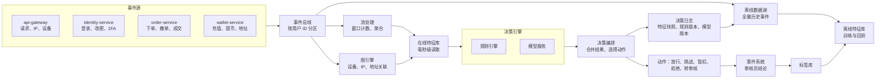
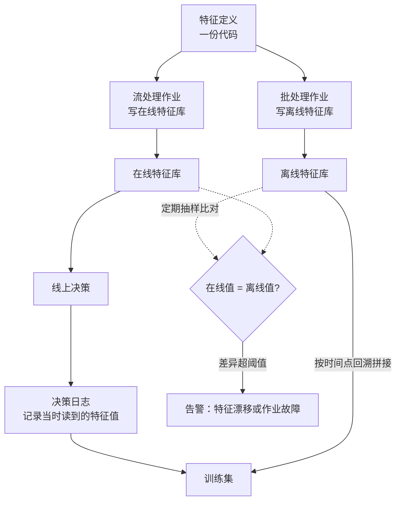
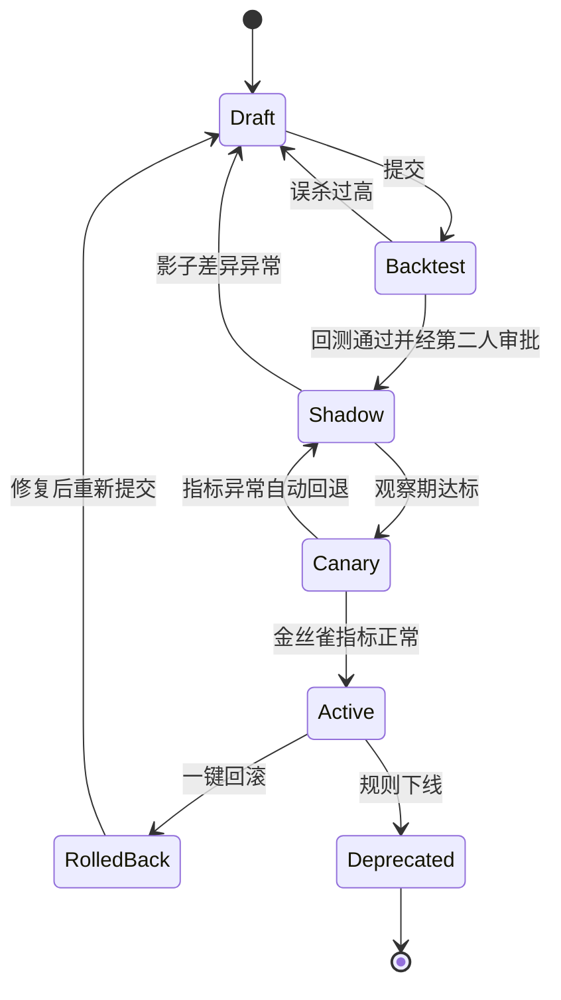
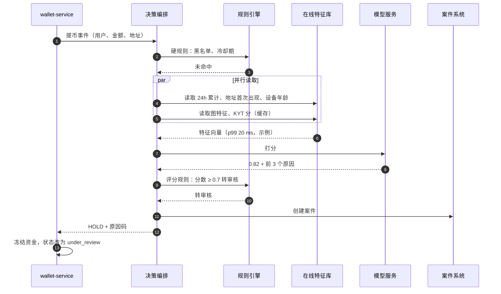
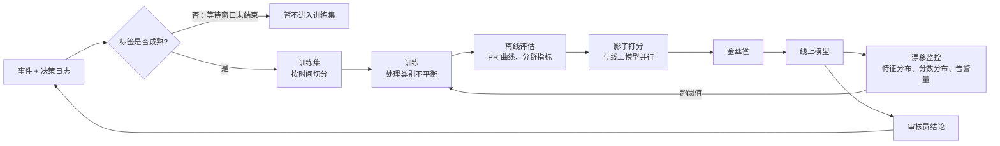
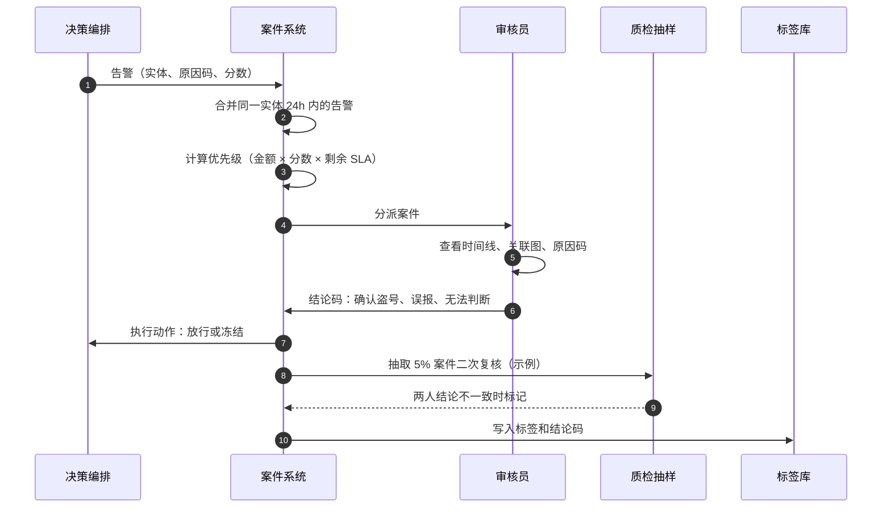
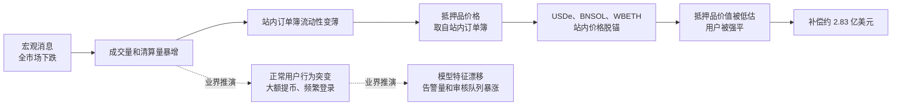
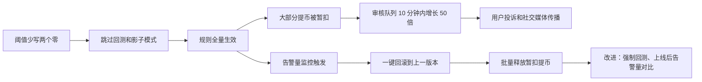

# B08 实时风控平台工程

> 学习目标：读完本篇，你能——
> 1. 画出实时风控平台的六个部件：事件接入、流处理、特征库、决策引擎、决策编排、案件系统。
> 2. 说明一条新规则从编写到全量的步骤：回测、影子模式、金丝雀、回滚。
> 3. 为每类动作（下单、登录、提币、领奖）选出延迟预算和故障时的默认动作（Fail-Open 或 Fail-Closed）。
>
> 前置章节：[09 风控](../09-risk-control.md)（决策流、延迟预算、Precision / Recall）、[B03 账户安全风控](B03-account-security.md)（风险评分与挑战升级）、[B05 业务风控](B05-business-risk.md)（市场监控、营销反作弊、关联图）
> 交互实验：[risk-pipeline-lab.html](../interactive/risk-pipeline-lab.html)（风控决策流水线实验：影子模式、金丝雀、模型阈值、特征库故障、延迟预算、回测）

---

## 1. 一句话理解 + 🎯 打个比方

实时风控平台（Real-time Risk Platform）：一套共享的工程系统。它接收全站的业务事件，计算特征，运行规则和模型，再把决策返回给业务服务。

09、B03、B05 讲的是"查什么"：冷却期、撤单率、关联账户。本篇讲"怎么造一台机器来查"：数据怎么进来，特征怎么算，规则怎么安全上线，模型怎么不变旧，平台自己坏了怎么办。

> 🎯 打个比方：风控平台像一座城市的交通指挥中心。
> 路口摄像头（事件接入）把画面实时送进来。计算机统计每条路的车流（特征）。交通规则（规则引擎）和经验丰富的老交警（模型）一起判断要不要变灯。
> 新的限行规则不会直接执行，而是先"只拍照不罚款"一周（影子模式），再在一个区试行（金丝雀）。
> 如果指挥中心停电，每个路口必须事先约定好：学校门口默认红灯（Fail-Closed），普通路口默认黄灯闪烁（降级）。停电那一刻再商量，就来不及了。

---

## 2. 威胁 / 问题模型

风控平台本身也是一个会出错的系统。它要防两类问题：**外部攻击者绕过它**，以及**它自己出错**。

| 问题来源 | 具体表现 | 后果 | 本篇对应 |
|---|---|---|---|
| 攻击者探测阈值 | 把提币拆成略低于阈值的多笔 | 漏放 | 第 3.2 节：滑动窗口累计特征 |
| 攻击者分散身份 | 用多个账户、多个设备、多个地址 | 单账户规则全部失效 | 第 3.3 节：图特征 |
| 特征不一致 | 训练用的特征和线上算出的特征不同 | 模型线上效果远差于离线 | 第 3.2 节：在线 / 离线一致性 |
| 规则配置错误 | 单位写错、条件写反、阈值多一个零 | 大面积误杀或全面漏放 | 第 4.1 节：规则生命周期 |
| 标签延迟 | 盗号和拒付在数天到数月后才确认 | 模型学不到新攻击 | 第 4.3 节：模型生命周期 |
| 模型漂移 | 行情剧变后正常用户行为改变 | 误杀暴涨或召回下降 | 第 6.1 节：2025-10-10 |
| 平台依赖故障 | 特征库超时、模型服务宕机 | 决策无法完成 | 第 5.3 节：降级矩阵 |
| 审核积压 | 告警量超过审核员产能 | 正常用户提币等待数小时 | 第 4.4 节：案件系统 |
| 监管问询 | "为什么拦截这笔交易？" | 无法解释就无法合规 | 第 4.3 节：可解释性 |

> 💡 注意：本篇描述的架构、阈值和流程都是**业界通用做法**的示例。币安没有公开其风控平台的内部架构。本篇标注"公开报道"的内容才是币安相关事实。

---

## 3. 防线分层

### 3.1 平台总架构



读图要点：

- 数据有两条路。实时路（总线 → 流处理 → 在线特征库）服务决策；批量路（总线 → 数据湖 → 离线特征库）服务训练和回测。
- 决策日志写回数据湖。它保存"做决策那一刻看到的特征"。这是回测和事后解释的唯一可靠来源。
- 审核员结论进入标签库，再回到训练。没有这条回路，模型就会停在上线那一天的水平。
- 局限：图中每个箭头都可能延迟或丢消息。第 5.3 节讲每个部件故障时怎么办。

事件总线（Event Bus）：一个持久化的消息队列，例如 Kafka。各业务服务把事件写进去，风控平台按顺序读出来。按用户 ID 分区，可以保证同一用户的事件有序。

### 3.2 特征工程：计数器、窗口和一致性

特征（Feature）：从原始事件算出的、模型和规则能直接使用的数值。例如"该用户过去 1 小时提币次数"。

常见特征类别（业界通用做法）：

| 类别 | 例子 | 实现方式 | 新鲜度要求（示例） |
|---|---|---|---|
| 速度计数器（Velocity） | 1 小时提币次数；5 分钟同 IP 登录失败次数 | 流处理按 key 累加 | < 1 秒 |
| 滑动窗口累计 | 24 小时提币总额；7 天新地址数 | 分桶求和（例如 24 个 1 小时桶） | < 1 秒 |
| 首次出现 | 设备首次出现距今小时数；地址首次使用 | 维表 + 时间戳 | < 1 秒 |
| 信誉分 | IP 信誉（机房、代理、Tor）；设备信誉 | 外部情报 + 内部历史 | 小时级 |
| 图特征 | 共享设备的账户数；距已知坏节点的跳数 | 图引擎 | 分钟级 |
| 链上特征 | 目标地址 KYT 风险分 | 外部 KYT 服务商 | 秒级（有缓存） |
| 画像特征 | 账户年龄；KYC 等级；历史提币中位数 | 离线批算，每天同步到在线库 | 天级 |

**滑动窗口的实现：**

1. 系统把 24 小时切成 24 个 1 小时桶。每个事件加到当前桶。
2. 读取时，系统求 24 个桶的和。每过 1 小时，系统丢弃最老的桶。

分桶是近似值。最老的桶可能多算最多 1 小时的数据。如果规则需要精确值（例如监管限额），系统用有序集合保存每笔事件时间戳。

> 💡 注意：流处理用**事件时间**（Event Time，事件实际发生的时间），不用**处理时间**（Processing Time，系统收到的时间）。网络延迟会让事件晚到。水位线（Watermark）告诉系统"早于这个时间的事件已经到齐"。

**在线 / 离线一致性**：模型在离线特征上训练，在在线特征上打分。如果两边对同一特征的算法不同，模型线上效果会下降。这个问题叫**训练-服务偏差**（Training-Serving Skew）。



读图要点：

- 一份特征定义同时生成流作业和批作业。两份手写代码迟早会不一致。
- 最可靠的训练数据是决策日志里的特征快照。它就是模型上线后真正看到的值。
- 离线回溯必须做**按时间点拼接**（Point-in-time Join）：只用事件发生前已知的数据。用了"未来数据"会让离线指标虚高，这叫标签泄漏（Label Leakage）。
- 局限：快照只覆盖已上线的特征。新特征没有历史快照，只能靠离线回溯，存在偏差。

### 3.3 图特征：从单账户到团伙

B05 讲了关联图如何发现羊毛党和对敲团伙。本节只讲平台如何把图变成**实时特征**。

| 图特征 | 定义 | 典型用途 |
|---|---|---|
| 共享设备账户数 | 与该账户共用设备指纹的账户总数 | 批量注册、设备农场 |
| 共享提币地址账户数 | 向同一外部地址提币的账户数 | 资金归集、羊毛变现 |
| 坏节点距离 | 到最近的已封禁账户或被盗资金地址的跳数 | 洗钱、盗号团伙 |
| 簇内坏节点比例 | 所在连通分量中已确认坏账户的占比 | 团伙风险 |
| 簇增长速度 | 连通分量过去 24 小时新增节点数 | 正在扩张的作弊团伙 |

图引擎做两件事：

1. 增量更新：每条事件到达时，系统新增或更新边。
2. 预计算：系统定期计算连通分量和簇统计，写入在线特征库。

决策时，系统只读预计算结果，不在请求路径上遍历图。遍历大图的延迟无法预测。交互演示见 [aml-graph.html](../interactive/aml-graph.html)。

> ⚠️ 警告：公共设施会制造"超级节点"。例如公司出口 IP、校园网、热门公共钱包地址。如果不过滤超级节点，成千上万个无关账户会被连成一个簇，误杀会暴涨。

### 3.4 决策编排：多个引擎，一个答案

规则、模型和图各自给出结论。决策编排（Decision Orchestration）把它们合成一个动作。

业界通用的合并顺序：

1. 硬规则先跑。制裁、黑名单、冷却期命中时，系统直接拒绝，不再调用模型。
2. 系统并行读取特征、调用模型。
3. 系统按"最严动作优先"合并：拒绝 > 暂扣 > 转审核 > 挑战 > 放行。
4. 系统附上原因码（Reason Code）。每个原因码对应一条规则或一个模型解释。
5. 系统写决策日志，再返回动作。

| 动作 | 含义 | 典型场景 |
|---|---|---|
| 放行（Allow） | 请求继续 | 低风险 |
| 挑战（Challenge） | 要求补充验证 | 新设备登录；见 B03 第 4.1 节 |
| 暂扣（Hold） | 请求挂起，资金冻结，等待更多信息 | KYT 超时；大额提币 |
| 转审核（Review） | 暂扣并创建案件 | 模型高分；规则命中中风险 |
| 拒绝（Reject） | 请求失败 | 制裁、黑名单 |

---

## 4. 关键流程

### 4.1 规则生命周期

规则 DSL（Domain-Specific Language）：给风控分析师用的规则描述语言。分析师不改服务代码，就能编写和发布规则。下面是一个示例：

```text
rule WD_NEW_ADDR_LARGE  version 3
  when event.type == "withdrawal"
   and feature.addr_first_seen_hours < 24
   and event.amount_usd >= 10000
   and feature.device_age_hours < 72
  then action = HOLD
       reason = "NEW_ADDR_LARGE_NEW_DEVICE"
```



读图要点：

- 回测（Backtest）：用历史事件重放新规则，统计"它会拦下多少好人和坏人"。回测必须读决策日志里的特征快照，不能读今天的特征。
- 影子模式（Shadow Mode）：规则在线上运行，只记录"本来会拦截"，不执行动作。它能发现回测发现不了的问题，例如新特征在线上的取值和离线不同。
- 金丝雀（Canary）：规则只对一小部分用户执行动作，例如按用户 ID 哈希取 5%（示例）。其余用户仍是影子。
- 每个版本都不可修改。回滚就是把"生效版本号"指回上一个版本，耗时应在秒级。

> ⚠️ 警告：紧急封堵规则（例如一个正在被利用的漏洞）可以跳过影子模式，但只能**收紧**，不能放宽。这与 B05 第 5.2 节的参数治理原则一致。事后 24 小时内补回测和审批（示例）。

规则发布的检查清单（业界通用做法）：

1. 回测窗口至少覆盖 30 天，并包含一次已知攻击事件（示例）。回测报告列出新增拦截数、已知坏人数、预计新增审核量。
2. 第二人审批。提出人不能审批自己的规则。
3. 影子期间，系统每小时比较"影子拦截率"和回测预测值。偏差超过 2 倍时告警（示例）。
4. 金丝雀按 1% → 5% → 25% → 100% 逐级放量（示例）。

### 4.2 一次提币的同步决策



读图要点：

- 硬规则在模型之前。硬规则命中时，后面的步骤都不运行，节省延迟和成本。
- 特征读取并行进行。总延迟取决于最慢的那一次读取。
- 编排服务对每一步都设超时。任一步超时，编排服务执行第 5.3 节的降级动作。
- 局限：KYT 实时调用可能需要数秒。业界通用做法是缓存地址风险分，或把 KYT 放进异步复核。

### 4.3 模型生命周期



读图要点：

- 标签成熟需要时间。训练集只放"等待窗口已结束"的事件，否则还没被投诉的盗号会被当成好样本。
- 评估集按时间切分，不随机切分。随机切分会让模型"看到未来"，离线指标虚高。
- 新模型和规则一样，走影子和金丝雀。
- 局限：模型只能学到被标注过的攻击。全新攻击要靠规则和审核员先发现。

**标签延迟**（Label Delay）：事件发生到确认"好或坏"之间的时间。

| 风险类型 | 标签来源 | 典型延迟（业界通用做法，示例） |
|---|---|---|
| 盗号提币 | 用户报案、客服工单 | 数小时到数天 |
| 法币拒付（Chargeback） | 银行或卡组织的拒付通知 | 数周到数月 |
| 营销作弊 | 冷静期评分、人工复核 | 数天 |
| 市场操纵 | 监察调查 | 数周 |
| 洗钱 | 合规调查、执法请求 | 数月 |

**类别不平衡**（Class Imbalance）：坏样本很少，例如 1 万笔提币中只有 5 笔是盗号（示例）。一个"全部放行"的模型准确率是 99.95%，但毫无用处。业界通用做法：

1. 不看准确率（Accuracy）。看 PR 曲线和固定误杀率下的召回率。
2. 对好样本降采样，同时给样本加权，保证分数可以校准回真实概率。
3. 按用户群分别评估。新用户、大户、API 用户的基线差异很大。

**漂移监控**：模型上线后，系统持续比较线上分布和训练分布。常用指标是 PSI（Population Stability Index，群体稳定性指数）。业界经验值：PSI < 0.1 表示稳定；0.1–0.25 需要关注；> 0.25 表示显著漂移（经验阈值，不是标准）。

**可解释性**：审核员和监管机构都会问"为什么"。

| 对象 | 需要什么 | 平台提供什么 |
|---|---|---|
| 审核员 | 3 秒内知道该看哪里 | 原因码 + 前 3 个贡献最大的特征（例如 SHAP 值） |
| 用户 | 知道下一步怎么做 | 不暴露规则细节的提示，例如"请完成身份验证" |
| 监管机构 | 决策可复现 | 决策日志：规则版本、模型版本、特征快照、审核记录 |

SHAP（SHapley Additive exPlanations）：一种把模型分数拆成"每个特征贡献多少"的方法。

> 💡 注意：给用户的解释不能泄露阈值。"因为金额超过 10,000 USDT"会教攻击者拆成 9,999 USDT。各地监管对记录保存和自动化决策的要求见 [B09 全球牌照](B09-global-licensing.md)；特征中的个人数据保存期限见 [B10 税务与隐私](B10-tax-privacy.md)。

### 4.4 案件系统与反馈回路

案件（Case）：围绕一个实体（用户、设备、地址）聚合的一组告警。审核员处理案件，而不是逐条处理告警。



读图要点：

- 合并告警能大幅减少审核量。同一盗号者触发的 10 条告警只生成 1 个案件。
- 优先级综合金额、风险分和剩余 SLA。大额且快超时的案件排在前面。
- 结论码必须是固定枚举，不能是自由文本。自由文本无法变成训练标签。
- 质检能估计标签噪声。两名审核员结论不一致的比例过高，说明审核规范不清楚。

> 💡 注意：审核员只看到被拦下的事件。被放行的事件没有审核员结论。如果只用审核结论训练，模型会越来越"看不见"它曾经放过的攻击。业界通用做法是随机抽取一小部分放行事件做审核，补充无偏标签。

---

## 5. 规则、指标与阈值

### 5.1 延迟预算

| 动作 | 方式 | 端到端预算（示例） | 能用的特征 | 能用的模型 | 超时后默认动作 |
|---|---|---|---|---|---|
| 下单（交易前） | 同步，进程内 | < 1 ms | 内存中的余额、价格带、本地计数器 | 无，或极小的本地模型 | 拒绝（Fail-Closed） |
| 登录 | 同步 | 100–300 ms | 设备、IP 信誉、失败次数 | 轻量模型 | 挑战升级 |
| 改安全设置 / 创建 API Key | 同步 | 200–500 ms | 登录风险、设备年龄 | 轻量模型 | 挑战升级 |
| 提币 | 同步打分 + 异步审核 | 打分 1–3 s；审核数分钟到数小时 | 全部在线特征、图特征、KYT 缓存 | 完整模型 | 暂扣转审核 |
| 充值入账 | 异步 | 秒级到分钟级 | KYT、来源地址图特征 | 完整模型 | 入账但冻结 |
| 市场监察 | 异步流 | 分钟级 | 订单流窗口、关联图 | 检测器 + 模型 | 告警延后 |
| 营销领奖 | 异步批 | 小时到天 | 图特征、行为聚类 | 完整模型 + 图 | 延后发放 |

> 💡 注意：预算看 **p99**，不看平均值。平均 5 ms 的特征读取，p99 可能是 80 ms。p99 超预算意味着每 100 个请求就有 1 个走降级路径。

### 5.2 平台指标

| 指标 | 定义 | 告警条件（示例） | 说明 |
|---|---|---|---|
| 精确率 | 被拦截中真坏人的比例 | 周环比下降 20% | 误杀上升 |
| 召回率 | 坏人中被拦截的比例 | 低于 80% | 标签延迟，只能滞后计算 |
| 告警量 | 每小时生成的告警数 | 超过基线 3 倍 | 攻击、规则错误或漂移 |
| 审核 SLA 达成率 | 在时限内处理的案件比例 | 低于 95% | 队列积压 |
| 损失率 | 欺诈损失 / 业务量，单位 bp（万分之一） | 超过 0.5 bp（示例） | 最终业务结果 |
| 客户摩擦 | 每万次正常操作中的挑战数和误杀数 | 季度上升 20% | 体验成本 |
| 决策延迟 p99 | 从请求到返回动作 | 超过预算 | 降级比例上升 |
| 降级率 | 走默认动作的决策比例 | 超过 0.5%（示例） | 依赖故障 |
| 特征新鲜度 | 在线特征的最大滞后 | 超过 5 秒（示例） | 流处理积压 |
| 影子差异率 | 影子拦截率 / 回测预测值 | 超出 0.5–2 倍区间 | 规则或特征异常 |
| PSI | 特征或分数的分布漂移 | > 0.25 | 需要复核或重训 |

### 5.3 降级矩阵：Fail-Open 还是 Fail-Closed

Fail-Open（故障放行）：依赖故障时，请求继续。Fail-Closed（故障拒绝）：依赖故障时，请求失败或挂起。

09 章说"资金相关的检查一律选 Fail-Closed"。在平台层面，这句话需要按动作细化：

| 动作 | 特征库故障时的默认动作（示例） | 理由 |
|---|---|---|
| 下单 | 本地检查照常运行；远程特征不参与，相当于对远程特征 Fail-Open | 下单路径本来就不依赖远程特征。全部拒绝等于停止交易 |
| 登录 | 降级为挑战升级 | 不让攻击者趁机登录，也不把所有用户锁在门外 |
| 改安全设置 | 挑战升级 + 延长冷却 | 盗号链路的关键一步 |
| 提币 | 暂扣转审核（Fail-Closed） | 链上转账不可撤回 |
| 充值 | 正常入账，标记待复核 | 拒绝充值无法退回，资金已经到达平台 |
| 营销领奖 | 延后发放 | 奖励可以等，被套走的预算追不回 |

> ⚠️ 警告：降级动作必须事先写进配置并定期演练。故障发生时才讨论"要不要放行"，会造成数十分钟的混乱。演练方法见 [B11 安全工程](B11-security-engineering.md)，事故复盘见 [B12 事故案例库](B12-incident-casebook.md)。

---

## 6. 真实案例

### 6.1 2025-10-10 行情剧变（据公开报道）

**公开事实（据公开报道）：**

- 2025 年 10 月 10 日，加密市场发生大规模下跌。全市场清算规模约 190 亿美元。
- 当晚 21:36–22:16 UTC，USDe、BNSOL、WBETH 三种资产在币安的价格大幅偏离锚定值。USDe 一度低于 0.66 美元。这些资产在其他交易场所的偏离小得多。
- 币安称，全市场最低点出现在 21:20–21:21 UTC，严重脱锚发生在 21:36 UTC 之后。
- 用这三种资产作抵押品的杠杆、合约、借贷用户被强平。币安向这些用户补偿约 2.83 亿美元，并称 24 小时内完成。
- 据媒体和研究机构报道，相关抵押品价格依赖站内订单簿价格，而不是外部指数或赎回价值。



读图要点：

- 实线是公开报道的因果链。核心是"单一价格源"：抵押品定价只看站内订单簿，订单簿变薄时价格失真。指数源设计见 [10 合约](../10-derivatives-futures.md) 第 3.1 节和 [B05](B05-business-risk.md) 第 4.6 节。
- 虚线是对风控平台的**业界推演**，不是币安公开的事实。行情剧变时，正常用户的提币额、登录频率、新设备比例都会突增。模型在平静期训练，会把这些正常行为打成高分。
- 这类事件中，误杀和审核积压会同时上升。审核员越忙，真正的盗号越容易被淹没。
- 局限：公开报道没有披露币安风控平台当晚的告警量和审核量。

**平台工程教训（业界通用做法）：**

1. 漂移监控要有"市场状态"维度。行情剧变时，系统自动切换到预先回测过的"高波动阈值集"，而不是临时手调。
2. 特征要做归一化。例如用"本次提币额 / 用户 90 天提币中位数"，再除以"全站当日提币额 / 全站 90 天中位数"。全站一起变大时，个人特征不跟着报警。
3. 审核队列要有溢出策略。队列超过容量时，系统优先审核大额和高分案件，低风险小额案件按规则自动放行并事后抽查。
4. 价格类风控参数（抵押率、价格带）同样需要多源校验，与 09 章"参考价不能用最新成交价"同理。

### 6.2 规则配置错误（虚构示例，用于说明）

下面是一个**虚构**的复合场景。它综合了业界常见的配置事故类型，不对应任何具体交易所。真实事故复盘见 [B12 事故案例库](B12-incident-casebook.md)。

一名分析师把规则阈值 `amount_usd >= 10000` 写成了 `amount_usd >= 100`。规则跳过了回测，直接全量上线。



读图要点：

- 根因不是"写错一个数"，而是"错误可以绕过回测直达全量"。流程缺陷比个人失误更重要。
- 告警量监控是最快的发现手段。它不需要标签，几分钟就能发现异常。
- 回滚之后还要处理"已经被错误暂扣的请求"。批量释放也需要审批，避免把真正的坏请求一起放出。
- 局限：如果错误方向是"放宽"（例如阈值多写一个零），告警量会下降而不是上升。下降同样需要告警。

---

## 7. 局限与权衡

| 权衡 | 一端 | 另一端 | 常见折中（业界通用做法） |
|---|---|---|---|
| 实时 vs 准确 | 同步路径只用少量特征，延迟低 | 异步路径用图和复杂模型，更准 | 同步打分决定"放 / 暂扣"，异步复核决定"确认 / 释放" |
| 规则 vs 模型 | 规则可解释、上线快 | 模型覆盖灰色地带 | 规则兜底零容忍，模型处理评分，两者都留原因码 |
| 上线速度 vs 安全 | 紧急规则立即生效 | 回测 + 影子 + 金丝雀需要数天 | 紧急通道只允许收紧，事后补流程 |
| Fail-Open vs Fail-Closed | 故障时放行，体验好 | 故障时拒绝，资金安全 | 按动作类型分别配置，见第 5.3 节 |
| 审核容量 vs 拦截率 | 阈值低，拦得多 | 审核员不够，积压 | 用审核产能反推阈值；优先级排序 |
| 特征丰富 vs 隐私 | 设备、行为、关联特征越多越准 | 个人数据越多合规负担越重 | 最小化收集，设定保存期限，见 B10 |

**根本局限：**

1. 风控平台依赖标签。标签延迟数天到数月，模型永远落后于攻击者一段时间。
2. 被拦下的事件有标签，被放行的事件往往没有。不做随机抽样，训练数据会持续偏移。
3. 平台越复杂，自己出错的方式越多。规则、特征、模型、编排、案件系统，每一层都需要独立监控。

> 💡 注意：截至 2026 年公开报道，币安称其反欺诈和反诈骗控制在 2025 年末使用超过 100 个模型，AI 驱动的决策覆盖其 57% 的欺诈控制。币安未公开这些模型的架构、阈值和延迟。本篇的架构描述不代表币安的实际实现。

---

## 8. 本仓库对照

本仓库（CEX Demo）的风控是**单个同步服务**，没有事件总线、特征库和模型。

| 本篇概念 | 本仓库位置 | 实现情况 |
|---|---|---|
| 交易前同步检查 | [`services/risk-service/src/application/risk-application-service.ts`](../../services/risk-service/src/application/risk-application-service.ts) 的 `validateSpotOrder` | 已实现：价格偏离、最小数量、可用余额；每项检查写入 `checks` 数组，相当于简化的原因码 |
| 决策结果结构 | [`services/risk-service/src/domain/types.ts`](../../services/risk-service/src/domain/types.ts) 的 `RiskCheckResult` | 只有 `passed` / `failed` 两种状态，没有挑战、暂扣、审核 |
| 风控故障时的默认动作 | [`services/order-service/src/infrastructure/http-risk-client.ts`](../../services/order-service/src/infrastructure/http-risk-client.ts) | 风控返回非 2xx 时抛出 `RISK_UPSTREAM_FAILED`，订单不创建。效果上是 Fail-Closed，但没有显式的降级配置 |
| 速度计数器 | [`services/api-gateway/src/infrastructure/redis-rate-limiter.ts`](../../services/api-gateway/src/infrastructure/redis-rate-limiter.ts) | Redis `INCR` 固定窗口计数。只用于限频，没有作为风控特征输出 |
| 决策日志 | [`services/api-gateway/src/http/api-gateway-audit.interceptor.ts`](../../services/api-gateway/src/http/api-gateway-audit.interceptor.ts) | 记录请求、状态码和 `durationMs`。没有特征快照、规则版本、模型版本 |
| 转审核与案件 | [`services/wallet-service/src/application/wallet-application-service.ts`](../../services/wallet-service/src/application/wallet-application-service.ts) 的 `requestWithdrawal` | 每笔提币初始 `reviewStatus` 都是 `pending`，即全部人工审核。没有风险分排序、案件合并、结论码 |
| 事件总线、在线 / 离线特征库、图引擎 | — | 未实现 |
| 规则 DSL、版本、影子、金丝雀、回测 | — | 未实现；风控参数来自环境变量和 `SPOT_MARKET_DEFINITIONS` |
| 模型服务、漂移监控 | — | 未实现 |

如果要在本仓库上补齐，建议顺序：

1. 让 `RiskCheckResult` 支持五种动作和原因码。
2. 在 risk-service 写决策日志：输入、检查结果、参数版本。
3. 把 api-gateway 的计数器扩展为按用户、按 IP 的速度特征，供提币风控读取。
4. 在 wallet-service 提币入口调用风控打分。低分自动放行，高分转审核，替代"全部人工"。
5. 为风控参数加版本号和影子开关，再做回测脚本（读决策日志重放）。

---

## 9. 术语表 / 思考题

### 术语表

| 术语 | 英文 | 定义 |
|---|---|---|
| 实时风控平台 | Real-time Risk Platform | 接收事件、计算特征、运行规则和模型、返回决策的共享系统 |
| 事件总线 | Event Bus | 持久化、有序的消息队列 |
| 特征 | Feature | 从原始事件算出的、供规则和模型使用的数值 |
| 特征库 | Feature Store | 保存特征的系统，分在线（低延迟读取）和离线（训练、回测） |
| 速度计数器 | Velocity Counter | 一段时间内某类事件的次数或金额 |
| 事件时间 | Event Time | 事件实际发生的时间 |
| 水位线 | Watermark | 流处理中"早于此时间的事件已到齐"的标记 |
| 训练-服务偏差 | Training-Serving Skew | 训练用特征与线上特征不一致 |
| 按时间点拼接 | Point-in-time Join | 只用事件发生前已知的数据构造训练样本 |
| 标签泄漏 | Label Leakage | 训练数据混入了决策时不可能知道的信息 |
| 决策编排 | Decision Orchestration | 合并规则、模型、图的结论并选择动作 |
| 原因码 | Reason Code | 解释决策来源的固定编码 |
| 规则 DSL | Rule DSL | 供分析师编写规则的专用语言 |
| 回测 | Backtest | 用历史事件重放新规则或新模型 |
| 影子模式 | Shadow Mode | 只记录"本来会怎么决策"、不执行动作 |
| 金丝雀 | Canary | 只对一小部分流量执行新规则或新模型 |
| 标签延迟 | Label Delay | 事件发生到确认好坏之间的时间 |
| 类别不平衡 | Class Imbalance | 坏样本远少于好样本 |
| 群体稳定性指数 | PSI, Population Stability Index | 衡量两个分布差异的指标 |
| 故障放行 | Fail-Open | 依赖故障时请求继续 |
| 故障拒绝 | Fail-Closed | 依赖故障时请求失败或挂起 |
| 案件 | Case | 围绕一个实体聚合的一组告警 |

### 思考题

1. 打开 [risk-pipeline-lab.html](../interactive/risk-pipeline-lab.html)。把新规则设为"影子"，播放 500 条事件。影子拦截中有多少是好人？再点"回测"，比较回测结果和影子结果是否一致。如果不一致，可能的原因是什么？
2. 在实验中打开"特征库故障"。把提币的默认动作从"暂扣"改成"放行"，漏放数怎么变？把登录的默认动作从"挑战"改成"拒绝"，误杀数怎么变？为什么下单不应该选"拒绝"？
3. 在实验中点"注入行情剧变"，然后观察审核队列。你会调高模型阈值，还是增加审核员产能？各自的代价是什么？结合第 6.1 节的"市场状态"维度说明。
