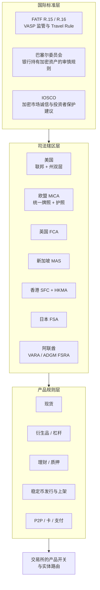
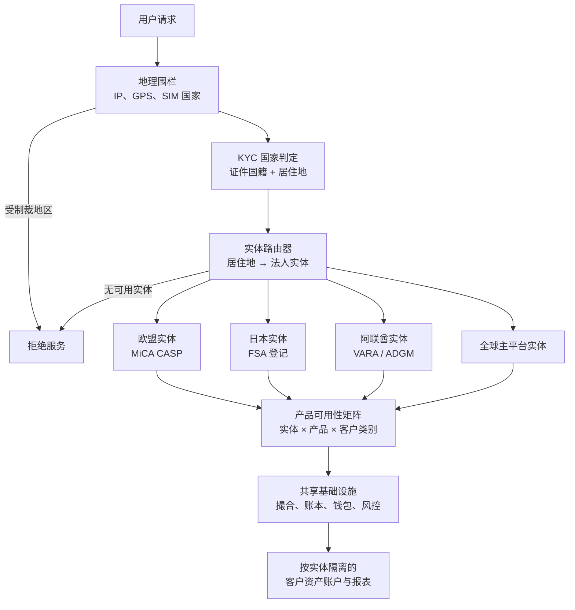
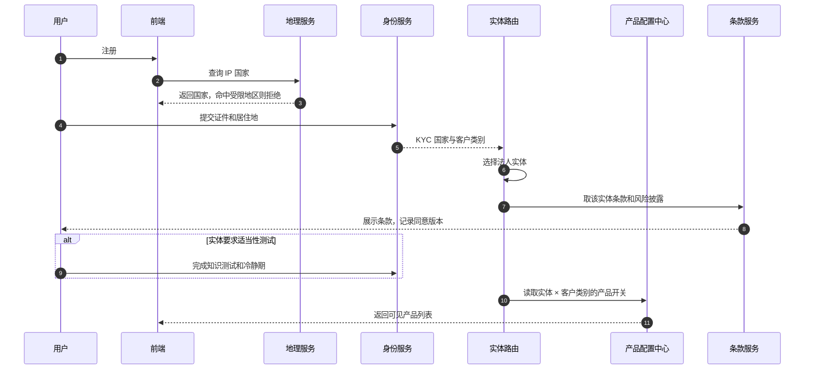
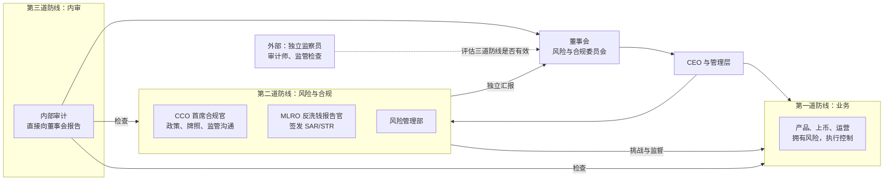
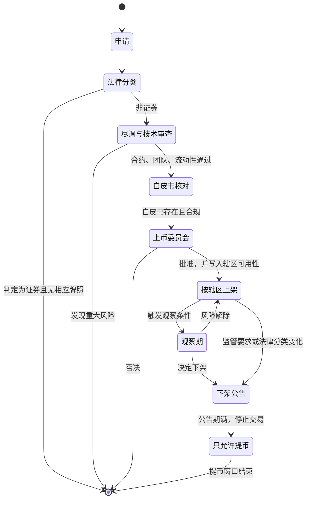
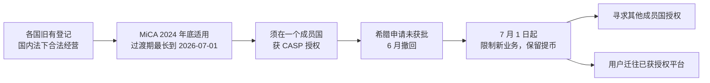
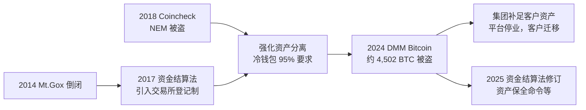

# B09 全球监管与牌照对照：一个交易所，多套规则

> 学习目标：读完本章，你能——
> 1. 用一张对照表说出美国、欧盟、英国、新加坡、香港、日本、阿联酋七个司法辖区的牌照名称、监管机构和核心要求。
> 2. 画出全球交易所"多法人实体 + 地理围栏 + 产品可用性矩阵"的系统架构，并解释用户如何被路由到对应实体。
> 3. 说明上币合规（证券属性分析、MiCA 白皮书、下架义务）和合规组织（三道防线、MLRO/CCO、独立监察员）如何落到系统流程中。
>
> 前置章节：[B01 合规防护](B01-compliance.md)（AML、Travel Rule、制裁筛查，以及 2023 年和解后的监察）、[12 商业模式](../12-business-model.md) 第 4.1–4.2 节（牌照概述、2023 年美国和解金额）
> 相关幕后篇：[B08 风控平台](B08-risk-platform.md)、[B10 税务与隐私](B10-tax-privacy.md)、[B11 安全工程](B11-security-engineering.md)、[B12 事故案例集](B12-incident-casebook.md)
> 交互实验：[license-matrix.html](../interactive/license-matrix.html)（牌照与监管矩阵 + "设计一个全球交易所"）

> ⚠️ 警告：本章仅用于学习交易所系统设计，不构成法律意见。监管规则变化很快。本章日期和阈值核对至 2026 年 10 月的公开资料。读者应以监管机构原文和公开登记册为准。

---

## 1. 一句话理解 + 🎯 打个比方

全球监管（Global Regulation）对交易所的含义是：**同一个撮合引擎，要同时满足几十套互不相同的法律**。交易所的解法不是"找一套最宽松的规则"，而是把业务拆成多个本地持牌实体，再用系统把每个用户限定在他所属实体允许的产品范围内。

> 🎯 打个比方：全球交易所像一家国际连锁药房。
> 总部只有一套进货系统和一个品牌（撮合与钱包基础设施）。
> 每个国家的门店都要单独领药房执照（本地牌照）。
> 同一种药，在 A 国可以直接卖，在 B 国要处方，在 C 国禁售（产品可用性矩阵）。
> 收银台扫顾客的身份证，决定他能买哪些药（KYC 国家 → 实体路由）。
> 新药上架前，药剂师要判断它属于"处方药"还是"保健品"（上币时的证券属性分析）。
> 如果某国吊销执照，那家门店必须停售，但要让顾客取回寄存的东西（有序退出，只开放提币）。

B01 讲了"认人 + 看钱 + 报告"的 AML 系统。本章不重复 AML 细节。本章讲 AML 之上的那一层：**你有没有资格在这个地方，向这个人，卖这个产品**。

---

## 2. 问题模型：七个司法辖区对照

### 2.1 监管要求的三层结构

读图要点：

- 国际标准层只给方向。它不直接约束企业。各辖区把标准写进本地法后，交易所才承担义务。
- 司法辖区层决定"要哪种牌照"。同一个辖区，不同产品可能归不同机构管。例如美国现货与衍生品分属不同机构的争议。
- 产品规则层决定"牌照内能卖什么、卖给谁"。例如同一张牌照下，衍生品可能只对专业投资者开放。
- 局限：本图把规则画成树状。现实中规则互相引用、互相冲突，交易所要按"最严一方"或"按客户所在地"取舍。

### 2.2 对照总表（截至 2026 年 10 月公开资料）

| 辖区 | 主监管机构 | 交易所需要的许可 | 托管与隔离 | 零售衍生品 | Travel Rule 门槛 | 币安状态（截至 2026 年公开资料） |
|---|---|---|---|---|---|---|
| 美国 | FinCEN、各州、SEC/CFTC、OFAC | FinCEN MSB 注册 + 各州汇款牌照（纽约 BitLicense） | 州法要求 + 各州担保金 | 只能在 CFTC 注册场所 | 3,000 美元 | Binance.com 不服务美国；Binance.US 为独立实体 |
| 欧盟 | 各国主管机关 + ESMA/EBA | MiCA CASP 授权（一国授权，全欧护照） | 客户资产隔离，明确的保管政策 | MiCA 不涵盖衍生品，衍生品归 MiFID II | 无最低金额 | 未持有 MiCA 授权；2026 年 6 月撤回希腊申请，7 月起限制欧盟服务 |
| 英国 | FCA | 当前：MLR 登记；2027 年 10 月 25 日起：FSMA 加密授权 | 新制度要求法定信托式隔离 | 2021 年起禁止向零售销售加密衍生品 | 无最低金额（低额可简化字段，【未核实】） | 未登记，不接受新英国用户（据公开报道） |
| 新加坡 | MAS | PSA 下 DPT 服务牌照；仅服务海外须 FSMA 下 DTSP 牌照 | 法定信托，每日对账 | 禁止向零售提供杠杆和信贷 | 1,500 新元 | 未持牌，2021 年撤回申请（据公开报道） |
| 香港 | SFC（交易平台）、HKMA（稳定币） | SFC VATP 牌照（SFO 第 1、7 类 + AMLO） | ≥ 98% 客户资产冷存储 | 零售不开放；2026 年 2 月起永续合约框架仅面向专业投资者 | 8,000 港元 | 未列入 SFC 持牌 VATP 名单 |
| 日本 | FSA | 资金结算法下"加密资产交换业者"登记 | ≥ 95% 冷钱包；热钱包部分须备等额自有资产 | 个人杠杆上限 2 倍（2020 年内阁府令） | 无最低金额 | Binance Japan 已登记；PayPay 2025 年持股 40% |
| 阿联酋 | 迪拜 VARA；阿布扎比 ADGM FSRA | VARA VASP 牌照；ADGM 交易所/清算/经纪三类许可 | 客户资产 100% 储备（VARA） | VARA：仅合格投资者 | 3,500 迪拉姆 | Binance FZE 持 VARA 牌照（2024）；Binance.com 主平台 2026 年 1 月迁入 ADGM 三实体 |

> 💡 注意：表中"零售衍生品"指能否向普通个人投资者提供永续合约、期货、杠杆现货。这一列的差异最大，也是全球交易所做产品开关的主要原因。

### 2.3 美国：联邦 + 州的双层结构

美国没有"一张加密交易所牌照"。交易所要同时满足四类要求：

1. **FinCEN MSB 注册**：货币服务业务（Money Services Business）须向 FinCEN 注册，并建 BSA/AML 计划，提交 SAR（见 B01 第 4.3 节）。
2. **州汇款牌照（Money Transmitter License，MTL）**：几乎每个州都单独发牌，各有担保金、净资产和审计要求。多州正在采用统一模板《汇款现代化法》（MTMA）。
3. **纽约 BitLicense**：纽约州金融服务局（NYDFS）依据 23 NYCRR Part 200 发放，2015 年生效。它比一般 MTL 多了网络安全、资本和上币审批要求。
4. **OFAC 制裁**：严格责任，不论金额（见 B01 第 4.6 节）。

SEC 与 CFTC 的管辖争议，核心是"某个代币是证券还是商品"：

| 时间 | 事件（公开资料） |
|---|---|
| 2023 年 6 月 | SEC 起诉币安及相关实体 |
| 2025 年 5 月 29 日 | SEC 以"有偏见驳回"（with prejudice）方式撤诉，理由是监管政策调整 |
| 2025 年 7 月 17 日 | 众议院通过 CLARITY 法案（市场结构法案，划分 SEC 与 CFTC 管辖） |
| 2025 年 7 月 18 日 | 《GENIUS 法案》签署成为法律，建立联邦支付型稳定币制度 |
| 2025 年 9 月 2 日 | SEC 与 CFTC 工作人员联合声明：注册交易所可以提供部分现货加密产品 |
| 2026 年 4 月 | FinCEN、OFAC 就稳定币发行方的 AML 和制裁义务发布拟议规则 |
| 2026 年 7 月 18 日 | GENIUS 法案规定的一年制规期限届满，最终规则未全部发布 |
| 2026 年 9 月 15 日 | 参议院对 CLARITY 法案的程序性动议投票 49:50，未达 60 票，法案未能推进 |
| 2027 年 1 月 18 日 | GENIUS 法案的最迟生效日（若最终规则早发布，则为规则发布后 120 天，取较早者） |

GENIUS 法案要点：只有"许可支付稳定币发行方"（PPSI）能发行支付型稳定币；储备 1:1，限于美元现金、短期国债等低风险资产；联邦和州两条许可路径。对交易所的影响是：生效后，向美国用户提供的稳定币须来自许可发行方或获认可的外国制度（细则以最终规则为准）。

### 2.4 欧盟：MiCA

MiCA（Markets in Crypto-Assets Regulation，加密资产市场条例，(EU) 2023/1114）是第一个覆盖整个经济体的统一加密监管框架。

| 模块 | 要点 |
|---|---|
| CASP 授权 | 在一个成员国获授权，通过"护照"（Passporting）通知即可服务全欧盟 |
| 最低资本 | 按服务类别分 3 档：5 万、12.5 万、15 万欧元；或固定开支的 1/4，取高者 |
| 过渡期 | 2024 年 12 月 30 日全面适用；按旧国内法注册的机构最长可过渡到 2026 年 7 月 1 日。ESMA 2026 年 6 月声明：未获授权者须有序退出 |
| 白皮书 | 公开发行或申请上架的加密资产须有白皮书；白皮书内容由发行方或申请上架方负责 |
| 市场滥用 | 禁止内幕交易、非法披露内幕信息、市场操纵；平台须监控并报告可疑订单与交易（STOR） |
| 稳定币 | EMT（电子货币代币，挂钩单一法币）须由信贷机构或电子货币机构发行；ART（资产参考代币）须单独授权；两者都不得向持有人付息 |
| 衍生品 | MiCA 不涵盖。加密衍生品适用 MiFID II，需投资公司牌照 |
| Travel Rule | TFR（(EU) 2023/1113）与 MiCA 同日适用，无最低金额；向自托管地址转账超过 1,000 欧元时，须核实地址归属 |

### 2.5 英国

- **当前**：加密资产企业须在 FCA 做反洗钱登记（MLR 2017）。
- **金融推广制度**：2023 年 10 月 8 日起，向英国消费者推广加密资产须由授权机构发布或批准。首次投资须有 24 小时冷静期、适当性测试，并禁止"推荐奖励"类激励。
- **新制度**：FCA 于 2026 年 6 月 30 日发布最终规则。新制度预计 2027 年 10 月 25 日生效。申请窗口预计为 2026 年 9 月 30 日至 2027 年 2 月 28 日。新的受监管活动包括运营交易平台、交易、托管、质押和发行合格稳定币。
- **零售衍生品**：FCA 自 2021 年 1 月起禁止向零售客户销售加密衍生品和 ETN。2025 年 10 月起，零售可购买在认可交易所上市的加密 ETN（【未核实细节】）。

### 2.6 新加坡

- **PSA DPT 牌照**：《支付服务法》（PSA）要求数字支付代币（DPT）服务商持牌。MAS 2023 年起分阶段加强消费者保护：客户资产须以法定信托隔离、每日对账；禁止向零售客户提供借贷、质押、信贷和杠杆交易；须做风险认知评估。
- **DTSP 新规**：《金融服务与市场法》（FSMA）第 9 部分自 2025 年 6 月 30 日起生效。在新加坡设立、但**只服务海外客户**的数字代币服务商须持 DTSP 牌照，否则停业。MAS 表示只在"极其有限的情况"下发牌，**没有过渡期**。
- **含义**：新加坡不再是"在此设点、服务全球"的离岸基地。

### 2.7 香港

- **SFC VATP 牌照**：自 2023 年 6 月 1 日起，在香港经营虚拟资产交易平台须持 SFC 牌照。
- **托管**：至少 98% 的客户虚拟资产须冷存储。平台须有补偿安排：覆盖冷存储资产的 50%、热存储及其他存储资产的 100%。
- **零售准入**：零售可交易的代币须满足"大市值"等条件，并做知识评估和集中度限制。2025 年 11 月 3 日，SFC 发通函：12 个月往绩要求不再适用于只供专业投资者的资产；HKMA 持牌稳定币免于该要求；持牌平台经事先批准可接入海外关联平台的共享订单簿。
- **衍生品与融资**：2026 年 2 月 11 日，SFC 发布一组通函：持牌 VATP 可按高层框架设计永续合约方案，**仅面向专业投资者**；持牌虚拟资产经纪可向证券保证金客户提供虚拟资产融资。
- **稳定币条例**：2025 年 8 月 1 日生效。在港发行法币稳定币，或在港外发行挂钩港元的稳定币，须持 HKMA 牌照。HKMA 于 2026 年 4 月 10 日发出首批两张牌照（汇丰、渣打合资的 Anchorpoint）。

### 2.8 日本

- **登记制**：交易所须在 FSA 登记为"加密资产交换业者"（资金结算法）。
- **资产隔离与冷钱包**：客户加密资产须与自有资产分离。至少 95% 须存冷钱包。热钱包里的客户资产，平台须用等额自有资产在冷钱包中备付。
- **历史原因**：2014 年 Mt.Gox 倒闭和 2018 年 Coincheck 被盗（约 580 亿日元 NEM），推动了登记制和冷钱包要求。
- **DMM Bitcoin（2024）**：2024 年 5 月 31 日，约 4,502 BTC（约 482 亿日元）被盗。母公司集团筹资补足客户资产。平台随后停业，客户账户迁移至 SBI VC Trade（2025 年 3 月）。
- **新动向**：2026 年 4 月 10 日，内阁批准修改《金融商品交易法》的法案，拟把加密资产纳入金融商品，引入内幕交易禁令。若国会通过，预计 2027 财年生效。
- **币安**：Binance Japan 通过收购已登记的 Sakura Exchange BitCoin 进入日本。PayPay 于 2025 年 10 月宣布取得 40% 股权。

### 2.9 阿联酋

- **迪拜 VARA**：按活动发牌（交易所、经纪交易、借贷、管理与投资等）。Binance FZE 2023 年 7 月获 MVP 牌照，2024 年 4 月获完整 VASP 牌照。衍生品和保证金交易仅限合格投资者和机构（据 VARA 登记册与公开报道）。合格投资者门槛之一：净资产 350 万迪拉姆。
- **ADGM FSRA**：阿布扎比环球市场按传统金融框架发牌。2025 年 12 月，币安获 FSRA 授权三个实体：Nest Exchange（认可投资交易所，运营 MTF）、Nest Clearing and Custody（认可清算所 + 托管）、Nest Trading（经纪交易商）。币安公告称，2026 年 1 月 5 日起 Binance.com 服务迁入这三个实体。

### 2.10 币安牌照与登记一览（截至 2026 年公开资料）

| 辖区 | 实体 / 平台 | 类型 | 状态说明 |
|---|---|---|---|
| 阿布扎比 ADGM | Nest Exchange / Nest Clearing and Custody / Nest Trading | RIE、RCH、经纪交易商 | 2025 年 12 月获批；币安官网牌照页列示 |
| 迪拜 | Binance FZE | VARA VASP 牌照 | 2024 年 4 月 |
| 巴林 | Binance Bahrain | CBB 加密资产服务商牌照 | 2022 年（公开报道） |
| 哈萨克斯坦 | AIFC 内实体 | AFSA 数字资产交易平台与托管牌照 | 2022 年获永久牌照（公开报道） |
| 日本 | Binance Japan | FSA 登记加密资产交换业者 | PayPay 持股 40% |
| 泰国 | Gulf Binance（合资） | 数字资产交易所与经纪牌照 | 2023 年获财政部牌照，SEC 监管 |
| 印度 | Binance | FIU-IND 报告实体登记 | 2024 年 5 月登记；6 月被罚约 1.88 亿卢比 |
| 欧盟 | 多个成员国旧有登记（法国、意大利等） | 国内 VASP 登记 | MiCA 过渡期于 2026 年 7 月 1 日结束后不再有效；尚无 MiCA 授权 |
| 美国 | Binance.US（BAM Trading） | FinCEN MSB + 州牌照 | 独立实体，州牌照清单【未核实】 |

> 💡 注意：币安官网牌照页（binance.com/en/legal/licenses）是最权威的入口。上表其他行来自公开报道，可能已变化。

---

## 3. 防线分层：全球交易所在碎片化规则下的架构

### 3.1 多实体 + 地理围栏 + 产品矩阵

读图要点：

- 数据从左上进入。地理围栏先拦受制裁地区，再由 KYC 判定"法律上的居住地"。IP 只能辅助，不能单独决定实体。
- 实体路由器是关键。用户的每笔资产、每张报表，都要挂在一个法人实体下。迁移实体等于迁移客户合同。
- 共享基础设施降低成本，但资产和账本必须按实体隔离。香港的共享订单簿通函就要求预先充值、货银对付和每日结算。
- 局限：VPN、双重国籍、出差会让地理信号失真。"无可用实体"的用户只能拒绝或只开放提币。

### 3.2 产品可用性矩阵（示例结构）

| 实体 | 现货 | 永续/期货 | 杠杆现货 | 理财/质押 | P2P | 卡 |
|---|---|---|---|---|---|---|
| 欧盟实体（假设持 MiCA） | ✅ | ❌ 需 MiFID II | ❌ | ⚠️ 质押按托管或代理评估 | ⚠️ | ⚠️ 需 EMI 合作 |
| 日本实体 | ✅ | ⚠️ 需第一类金融商品交易业 | ⚠️ | ⚠️ 借贷类有限 | ❌ | ❌ |
| 阿联酋 VARA 实体 | ✅ | ⚠️ 仅合格投资者 | ⚠️ 仅合格投资者 | ✅ 借贷牌照内 | ⚠️ | ⚠️ |
| 全球主平台 | ✅ | ✅（受限地区除外） | ✅ | ✅ | ✅ | ⚠️ |

✅ 允许　⚠️ 有条件　❌ 不提供。本表是示例结构，不代表币安的真实配置。交互页 [license-matrix.html](../interactive/license-matrix.html) 用公开资料逐格标注来源。

### 3.3 按地区的开户流程

读图要点：

- 第 7–8 步保存"用户同意了哪个实体、哪一版条款"。日后监管查询或实体迁移，都靠这条记录。
- 适当性测试和冷静期（英国推广制度、香港零售准入、新加坡风险认知评估）是分支流程，不是所有地区都有。
- 产品开关在后端判断。前端隐藏按钮不算合规，API 用户可以绕过前端。
- 局限：用户搬家后，居住地变化须触发复审和实体迁移（见 B01 第 4.1 节触发式复审）。

### 3.4 合规组织：三道防线

读图要点：

- 第一道防线是业务自己。产品团队设计"零售不能开合约"的开关，就是在执行控制。
- 第二道防线制定规则并挑战业务。CCO 和 MLRO 须有直通董事会的汇报线，避免被业务指标压制。
- 第三道防线检查前两道是否有效。它不参与日常决策。
- 外部监察员（例如 2023 年和解后的 DOJ、FinCEN 监察员，见 B01 第 6.1 节）位于三道防线之外。局限：监察员的报告通常不公开，外界只能看到结论。

---

## 4. 关键流程：上币合规

### 4.1 证券属性分析

美国最常用的判断工具是 Howey 测试（1946 年最高法院判例）。满足以下四点即为"投资合同"，属于证券：

1. 投入了金钱。
2. 投入共同事业。
3. 期待获得利润。
4. 利润主要来自他人的努力。

其他辖区有类似的分类：欧盟先判断是否属于 MiFID II 下的金融工具，不属于才进入 MiCA；香港区分"证券型代币"与"非证券型代币"；日本 2026 年修法拟把加密资产整体纳入金融商品。

### 4.2 上币与下架状态机

读图要点：

- 法律分类在最前面。分类错误的代价最高：上架未注册证券，可能构成无牌经营交易所。
- "按辖区上架"意味着一个代币可以在 A 实体上架、在 B 实体不上。例如香港零售只能交易满足条件的代币。
- 下架不是一刀切。平台须提前公告，停止交易后保留提币窗口，保护用户取回资产。
- 局限：稳定币有专门规则。MiCA 下，没有合规 EMT/ART 授权的稳定币，欧盟 CASP 不能向欧盟用户提供交易。

### 4.3 MiCA 下的上币义务（简化）

1. 确认代币不属于金融工具、电子货币或存款。
2. 确认已有白皮书。没有白皮书时，申请上架的平台本身须起草并承担责任。
3. 白皮书须通知主管机关，并在平台网站公开。
4. 平台须有书面的上币规则，评估代币的技术可靠性和是否涉及洗钱风险。
5. 上架后持续执行市场滥用监控，并向主管机关报告可疑订单与交易。
6. 下架须按公开的规则执行，并提前告知客户。

---

## 5. 规则、指标与阈值

### 5.1 常见监管要求横向对照

| 要求 | 美国 | 欧盟 MiCA | 英国（新制度） | 新加坡 | 香港 | 日本 | 迪拜 VARA |
|---|---|---|---|---|---|---|---|
| 最低资本 | 各州净资产 + 担保金 | 5 万–15 万欧元或固定开支 1/4 | 按 FCA 审慎规则 | 按牌照类型 | 按 SFC 要求（另须准备金） | 按资金结算法 | 10 万–150 万迪拉姆，按活动 |
| 客户资产隔离 | 州法要求 | 必须 | 法定信托式 | 法定信托 | 必须，经信托子公司 | 必须 | 必须 |
| 冷存储比例 | 无统一数字 | 无统一数字 | 无统一数字 | 无统一数字 | ≥ 98% | ≥ 95% | 无统一数字【未核实】 |
| 外部审计 | 州检查 + 财报审计 | 必须 | 必须 | 必须 | 必须 | 必须（含资产分离审计） | 必须 |
| 储备证明 PoR | 非法定 | 非法定 | 非法定 | 非法定 | 非法定 | 非法定 | 储备 100% 客户负债 |
| 利益冲突管理 | 有 | 有，须披露 | 有 | 有 | 有，禁止自营交易 | 有 | 有 |
| 市场滥用监控 | SEC/CFTC 管辖内 | MiCA 第六编 | FCA 新规 | 有 | 有 | 2026 修法拟引入内幕交易禁令 | 有 |
| 消费者披露 | 州法 + 联邦 | 白皮书 + 风险警示 | 推广制度 + 冷静期 | 风险警示，禁止公开营销 | 知识测试、风险披露 | 有 | 营销规则手册 |
| 零售衍生品 | 仅 CFTC 注册场所 | MiFID II 适当性 | 禁止 | 禁止杠杆 | 仅专业投资者（永续） | 杠杆上限 2 倍 | 仅合格投资者 |

PoR（Proof of Reserves，储备证明）在多数辖区不是法定要求。它是 2022 年 FTX 倒闭后行业的自愿做法（见 [proof-of-reserves.html](../interactive/proof-of-reserves.html)）。

### 5.2 合规运营指标（示例）

| 指标 | 定义 | 告警条件（示例） |
|---|---|---|
| 实体错配率 | KYC 居住地与所属实体不一致的用户比例 | > 0.1% |
| 受限产品越权访问 | 产品开关为关、但成功下单的请求数 | > 0 即告警 |
| 牌照到期倒计时 | 距最近一张牌照续期截止日的天数 | < 90 天 |
| 法规变更未评估数 | 已发布、但未完成影响评估的监管文件数 | > 0 且超过 30 天 |
| 白皮书缺失代币数 | 在 MiCA 实体上架、但无白皮书的代币 | > 0 即告警 |
| 下架后仍有挂单 | 进入"只允许提币"状态后仍存在的订单 | > 0 即告警 |

---

## 6. 真实案例

### 6.1 2026 年 MiCA 过渡期结束与币安欧盟服务收缩

【事实，据公开报道】币安在欧盟依靠多个成员国的旧有登记经营。2026 年 6 月 24 日前后，币安撤回在希腊提交的 MiCA 申请。7 月 1 日过渡期结束后，币安通知法国、意大利、西班牙、波兰等国用户：暂停新注册、充值、部分现货下单和理财，保留提币。币安表示将寻求在其他成员国获得授权。ESMA 于 2026 年 6 月 23 日发声明，要求未获授权的 CASP 有序退出。

读图要点：

- 根因是"过渡期是倒计时"。旧登记在过渡期结束日自动失去法律基础（【分析】）。
- 系统动作对应本章第 3 节：实体路由不变，但产品矩阵一次性关闭"充值、新开户、理财"，只保留"提币"。
- 这要求产品开关支持"按辖区、按动作"批量关闭，并在同一时刻生效。
- 局限：据报道，第三方测试发现部分限制在 8 月仍未完全落实。这说明开关的执行验证同样重要。

### 6.2 日本：从 Mt.Gox 到 DMM Bitcoin

读图要点：

- 每次大事故都推动一轮规则升级。冷钱包比例是事故的直接产物。
- DMM Bitcoin 说明冷钱包比例不能单独保证安全：被盗环节在签名流程（见 [B11 安全工程](B11-security-engineering.md) 与 [B12 事故案例集](B12-incident-casebook.md)）。
- "热钱包部分须备等额自有资产"让平台有能力补足客户损失，这是日本用户未直接受损的原因之一（【分析】）。
- 局限：资产补足依赖母公司的财力，不是制度兜底。

---

## 7. 局限与权衡

| 权衡 | 一侧 | 另一侧 | 常见做法（业界通用做法） |
|---|---|---|---|
| 单一全球平台 vs 多实体 | 单平台：流动性集中，成本低 | 多实体：牌照合规，但流动性分散 | 本地实体 + 获批的共享订单簿 |
| 先开展后申请 vs 先申请后开展 | 先开展：抢市场 | 先申请：合规，但慢 | 过渡期政策到期是硬约束 |
| 按 IP 还是按 KYC 判定 | IP：实时、可在开户前拦截 | KYC：准确，但滞后 | 两者叠加，冲突时取严 |
| 统一产品 vs 本地化产品 | 统一：开发成本低 | 本地化：满足零售限制 | 后端产品矩阵 + 前端动态渲染 |
| 退出市场 vs 坚持申请 | 退出：止损 | 坚持：保住用户，但合规风险持续 | 有序退出：只开放提币，公告充分 |
| 证券分类保守 vs 激进 | 保守：上币少，竞争力弱 | 激进：监管风险 | 按辖区分别上架 |

> 💡 注意：同一个规则在不同辖区可能方向相反。例如新加坡禁止零售杠杆，迪拜允许合格投资者杠杆。全球交易所不能用"一个开关"处理"衍生品"，必须细到"实体 × 产品 × 客户类别"。

---

## 8. 本仓库对照

本仓库（[CEX Demo](../..)）是单实体现货 MVP，没有多辖区设计。

| 能力 | 本仓库现状 | 位置 |
|---|---|---|
| 用户 KYC 等级 | ⚠️ 领域模型有 `kyc_level` 字段，没有国家或实体字段 | `../../docs/domain-model.md` |
| 风控与合规需求 | ⚠️ 已实现余额、价格保护、市场暂停、提现规则（限额、KYC 分级、白名单、冷却期、双人审批）、限频、账户冻结；没有按国家或辖区区分的规则 | `../../docs/security.md` 第 2 节 |
| 实体路由、地理围栏 | ❌ 未设计 | — |
| 产品可用性矩阵 | ❌ 未设计；交易对没有"按辖区可见"属性 | — |
| 上币状态机与下架流程 | ❌ 未设计 | — |

如果要补齐，建议按以下顺序：

1. 在用户表增加 `residence_country`、`legal_entity_id`、`client_category`（零售 / 专业 / 机构）。
2. 新增配置表 `product_availability(entity_id, product, client_category, status)`，由后端在下单、充值、申购入口统一检查。
3. 交易对增加 `listing_status` 与 `entity_visibility`，支持"只允许提币"状态。
4. 用户每次接受条款，记录 `entity_id` 和条款版本号。

---

## 9. 术语表 / 思考题

### 术语表

| 术语 | 英文 | 定义 |
|---|---|---|
| 货币服务业务 | MSB | 美国 BSA 下须向 FinCEN 注册的汇款、兑换等业务 |
| 汇款牌照 | Money Transmitter License | 美国各州发放的资金转移许可 |
| 比特许可证 | BitLicense | 纽约州对虚拟货币业务的专门许可 |
| 加密资产服务商 | CASP | MiCA 下须获授权的加密服务机构 |
| 护照 | Passporting | 欧盟内一国授权即可通知其他成员国开展业务的机制 |
| 电子货币代币 / 资产参考代币 | EMT / ART | MiCA 下的两类稳定币 |
| 数字支付代币 | DPT | 新加坡 PSA 中对加密货币的称呼 |
| 数字代币服务商 | DTSP | 新加坡 FSMA 下仅服务海外客户的服务商类别 |
| 虚拟资产交易平台 | VATP | 香港 SFC 持牌的交易平台 |
| 许可支付稳定币发行方 | PPSI | 美国 GENIUS 法案下可发行支付稳定币的机构 |
| Howey 测试 | Howey Test | 美国判断"投资合同"即证券的四要素测试 |
| 首席合规官 | CCO | 负责合规政策和监管沟通的高管 |
| 三道防线 | Three Lines of Defense | 业务、风险合规、内审分层负责的治理模型 |
| 地理围栏 | Geofencing | 按地理位置限制服务 |
| 合格投资者 | Qualified Investor | 满足资产、收入或知识门槛，可使用高风险产品的投资者 |

### 思考题

1. 打开 [license-matrix.html](../interactive/license-matrix.html)，选"新加坡 × 合约"和"迪拜 × 合约"。两者对零售的结论为何相反？如果同一个用户同时持有两地居住证明，系统应按哪个实体服务他？
2. 在"设计一个全球交易所"页签中，勾选欧盟、英国、香港，并开启"理财/质押"和"合约"。页面列出多少个冲突？哪个冲突无法通过"多申请一张牌照"解决？
3. 假设某代币在美国被认定为证券，但在欧盟有合规白皮书。请按第 4.2 节的状态机，写出它在两个实体中各自的状态，以及用户从欧盟搬到美国后会发生什么。

---

## 参考来源

以下链接为本章写作时实际查阅的公开资料（2026 年 10 月）：

- 币安牌照页：https://www.binance.com/en/legal/licenses
- ADGM 授权报道：https://gulfnews.com/your-money/cryptocurrency/binance-secures-global-exchange-licence-from-abu-dhabi-financial-regulator-1.500372508
- ADGM 三实体结构：https://www.unlock-bc.com/152962/binance-global-uae-adgm-license
- VARA 登记册（Binance FZE）：https://vara.ae/en/licenses-and-register/public-register/binance-fze
- Binance FZE 获 VARA 牌照：https://www.wam.ae/en/article/b2pw027-binance-fze-receives-vasp-licence-from-dubai’s
- VARA 衍生品与保证金规则：https://www.theblock.co/post/395873/dubais-vara-imposes-margin-governance-and-disclosure-rules-on-crypto-trading-and-derivatives
- VARA 资本要求：https://neolegal.ae/insights/vara-paid-up-capital-requirements
- GENIUS 法案实施进展：https://www.crowdfundinsider.com/2026/07/292568-the-genius-act-deadline-passes-without-final-stablecoin-rules-from-us-regulators/
- GENIUS 法案资源中心：https://www.arnoldporter.com/en/perspectives/topics/the-genius-act-and-stablecoin-regulation-resource-center
- CLARITY 法案参议院投票：https://blofin.com/academy/education/investing/did-the-clarity-act-pass
- CLARITY 法案进程：https://www.lexblog.com/2026/08/11/senate-adjourns-without-clarity-act-vote-but-september-vote-now-on-the-calendar/
- SEC 撤诉公告：https://www.sec.gov/enforcement-litigation/litigation-releases/lr-26316
- SEC 与 CFTC 联合声明：https://www.sec.gov/newsroom/press-releases/2025-110-sec-cftc-staff-issue-joint-statement-trading-certain-spot-crypto-asset-products
- ESMA 关于 MiCA 过渡期结束的声明：https://www.esma.europa.eu/sites/default/files/2026-04/ESMA75-113276571-1679_Statement_on_the_end_of_transitional_periods_under_MiCA.pdf
- 爱尔兰央行转述 ESMA 声明：https://www.centralbank.ie/regulation/markets-update/article/issue-10-2026/central-bank-of-ireland/esma-issues-a-public-statement-reminding-unauthorised-casps-of-mica-transitional-period-ending-on-1-july-2026
- 币安撤回希腊申请：https://theblock.co/post/406009/binance-ceo-remains-committed-securing-eu-license-exchange-withdraws-greece-bid
- 币安欧盟服务限制：https://www.amlintelligence.com/2026/06/news-binance-prepares-to-suspend-services-across-the-eu/
- 第三方测试欧盟限制落实情况：https://www.crowdfundinsider.com/?p=300081
- FCA 新加密制度：https://www.fca.org.uk/firms/new-regime-cryptoasset-regulation
- FCA 最终规则解读：https://www.dlapiper.com/en/insights/publications/2026/07/uk-cryptoassets-and-digital-markets-developments-fca-publishes-final-rules-on-cryptoassets
- 新加坡 DTSP 截止日：https://cms.law/en/sgp/legal-updates/singapore-s-june-30-hard-deadline-for-crypto-firms-serving-overseas-customers
- MAS DPT 消费者保护措施：https://www.morganlewis.com/pubs/2023/11/mas-introduces-further-investor-protection-measures-for-digital-payment-token-service-providers
- SFC VATP 规则（98% 冷存储与补偿安排）：https://www.mayerbrown.com/en/insights/publications/2023/05/hong-kong-sfc-concludes-consultation-on-regulation-of-virtual-asset-trading-platforms
- SFC 2025 年 11 月通函：https://www.davispolk.com/insights/client-update/hong-kong-permits-virtual-asset-exchanges-access-global-liquidity-and-expand
- 香港稳定币条例生效：https://www.davispolk.com/insights/client-update/hong-kong-s-licensing-and-regulatory-framework-stablecoins-now-effect
- HKMA 首批稳定币牌照：https://www.charltonslaw.com/hkma-issues-first-stablecoin-issuer-licences/
- 日本 95% 冷钱包要求：https://www.axios.com/2023/01/24/crypto-japan-exchanges-financial-regulation
- 日本金融商品交易法修订：https://www.fow.com/insights/japan-cabinet-approves-bill-to-regulate-digital-assets-as-financial
- DMM Bitcoin 事件：https://www.theblock.co/amp/post/298586/japanese-crypto-exchange-dmm-bitcoin-outlines-funding-plan-to-cover-over-300-million-in-hack-losses
- PayPay 入股 Binance Japan：https://about.paypay.ne.jp/en/pr/20251009/01/
- 印度 FIU 处罚令：https://fiuindia.gov.in/pdfs/judgements/Binance_Order_10_2024.pdf
- 币安巴林牌照：https://cointelegraph.com/news/binance-awarded-bahrain-crypto-service-provider-license
- 币安哈萨克斯坦牌照：https://thefintechtimes.com/binance-secures-trust-and-security-in-kazakhstan-with-regulatory-licence-from-afsa/
- Gulf Binance 泰国：https://cointelegraph.com/news/binance-thailand-general-public-launch-compete-incumbent
- Travel Rule 各地门槛：https://www.21analytics.ch/blog/the-fatfs-crypto-travel-rule-global-implementation-summary/
- 币安与 DOJ 监察讨论：https://www.theblock.co/post/370929/binance-in-talks-with-doj-over-dropping-independent-compliance-monitor-bloomberg
- SFC 2026 年 2 月通函（永续合约、融资）：https://www.stephensonharwood.com/insights/sfc-circulars-in-february-2026-trading-initiatives-to-boost-digital-asset-market-vibrancy/
- 日本杠杆上限 2 倍：https://www.theblock.co/linked/52804/
- MAS 稳定币框架：https://www.mas.gov.sg/news/media-releases/2023/mas-finalises-stablecoin-regulatory-framework
