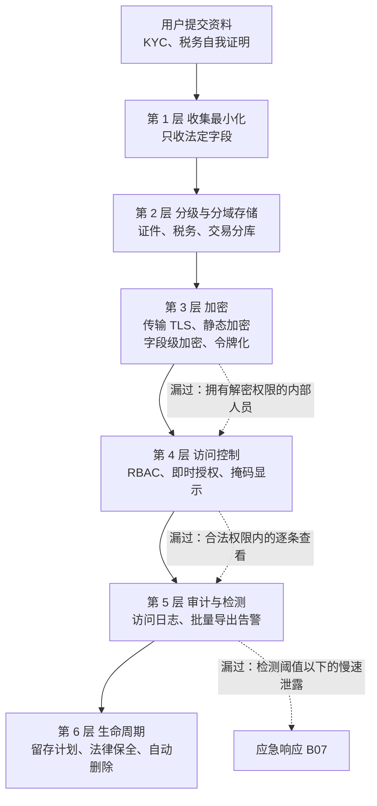
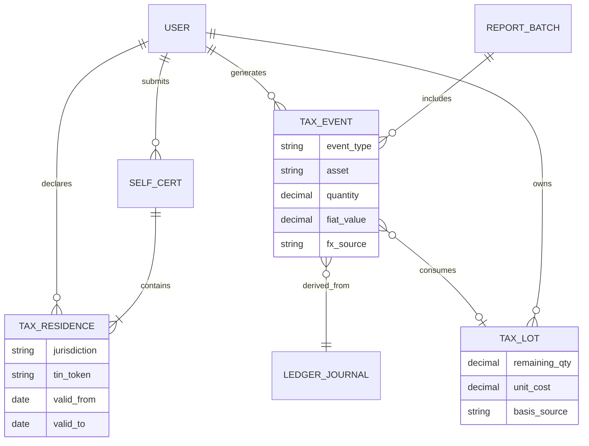
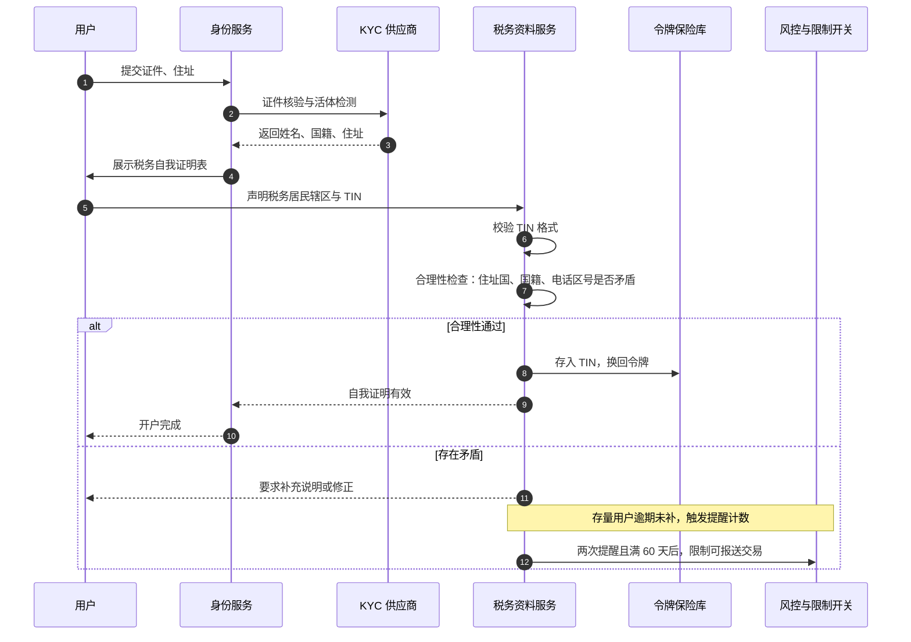
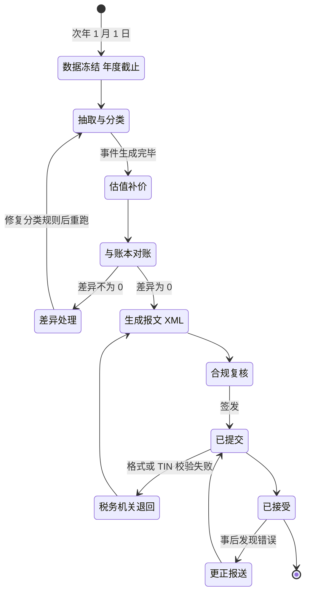
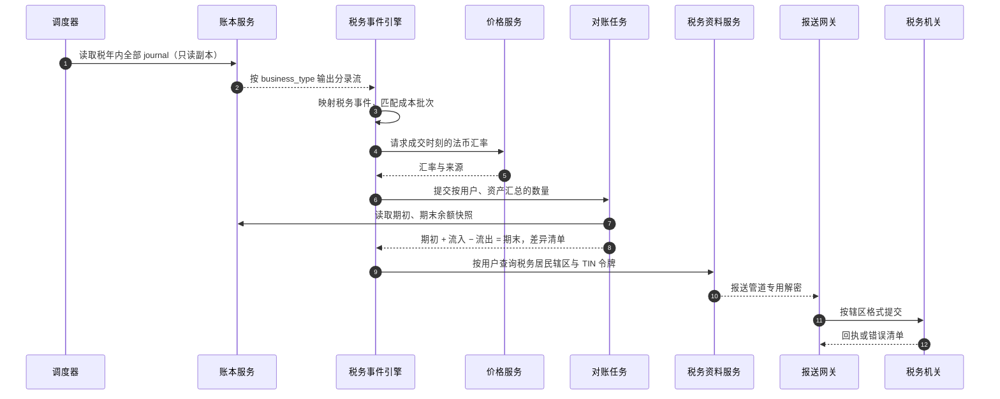
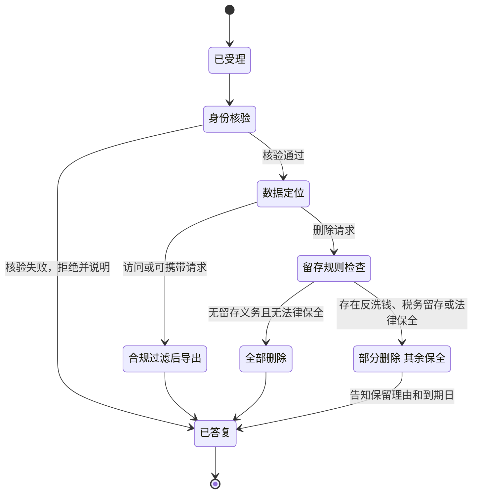
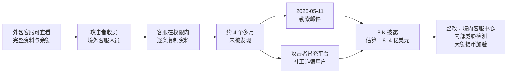
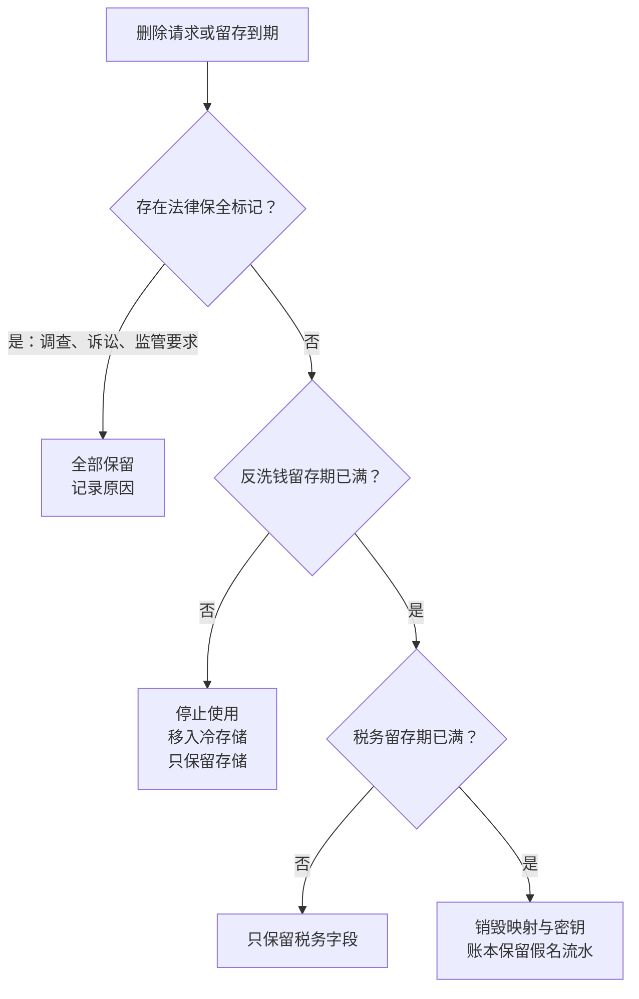

# B10 税务信息报送与数据隐私

> 学习目标：读完本章，你能——
> 1. 说出 OECD CARF、欧盟 DAC8 和美国 Form 1099-DA 各要求交易所报送什么、何时报送。
> 2. 画出"税务居民自我证明 → 交易分类 → 成本基础 → 年度报送"的系统流水线，并说明它如何与账本对账。
> 3. 解释 GDPR、PIPL 等隐私法与反洗钱留存、Travel Rule 的冲突，以及系统用哪些机制化解冲突。
>
> 前置章节：[03 账户、身份与安全](../03-account-identity-security.md)（KYC 分级）、[05 账本](../05-ledger.md)（流水只追加）、[B01 合规防护](B01-compliance.md)（KYC 生命周期、Travel Rule）、[B04 系统对账](B04-reconciliation.md)（对账矩阵）
> 相关幕后篇：[B08 风控平台](B08-risk-platform.md)、[B09 全球牌照](B09-global-licensing.md)、[B11 安全工程](B11-security-engineering.md)、[B12 事故案例库](B12-incident-casebook.md)
> 交互实验：—（本章暂无交互页）

> ⚠️ 警告：本章仅用于学习交易所系统设计。本章不构成税务意见或法律意见。税务和隐私规则会变化，各地实施细节不同。读者应以税务机关和监管机构的原文为准。本章的阈值除标注"公开资料"外，都是示例。

---

## 1. 一句话理解 + 🎯 打个比方

交易所掌握两类敏感信息：**用户的交易结果**和**用户的身份资料**。

税务信息报送（Tax Information Reporting）要求交易所把交易结果按人汇总，交给税务机关。数据隐私（Data Privacy）要求交易所只收集必要的身份资料，保护好它，并在到期后删除。两件事方向相反：一个要求"多留、多报"，一个要求"少收、早删"。本章讲系统如何同时满足它们。B01 讲"认人和看钱"，本章讲之后的数据如何报送、如何保护。

> 🎯 打个比方：交易所像一家同时兼任"税务代扣点"的银行保管库。
> 税务局要求保管库每年交一份清单：谁存了什么、卖了什么、赚了多少（税务报送）。
> 客户要求保管库不要偷看箱子，不要把钥匙复印给别人，不用的箱子要销毁（隐私）。
> 反洗钱规定又要求：销毁箱子之前，开户登记簿必须再留 5 年（留存义务）。
> 保管库的解决办法是：登记簿锁进另一个房间，只有持特别授权的人能开门，到期自动粉碎。

---

## 2. 威胁 / 问题模型

### 2.1 要防什么

| 问题 | 典型表现 | 后果 | 主要防线 |
|---|---|---|---|
| 漏报或错报 | 交易分类错；法币估值错；用户税务居民身份缺失 | 税务机关罚款（例如英国按用户计罚） | 交易分类引擎、与账本对账、自我证明校验 |
| 自我证明缺失 | 存量用户不回应税务身份问卷 | 无法报送；部分辖区要求限制交易 | 催办流程、交易限制开关 |
| 内部泄露与外部入侵 | 客服批量导出资料；攻击者拿到数据库或备份 | 社工诈骗；监管处罚；赔偿 | 最小权限、批量访问告警、字段级加密、令牌化 |
| 过度保留 | 资料在留存期满后仍未删除 | 违反隐私法的存储限制原则 | 留存计划、自动删除任务 |
| 过早删除 | 用户要求删除，系统直接删掉 KYC 资料 | 违反反洗钱留存义务；调查时无证据 | 法律保全标记、删除前规则检查 |
| 违规跨境传输 | 把欧盟或中国用户资料传到未获批准的地区 | 隐私监管处罚 | 传输机制登记、数据驻留路由 |

### 2.2 为什么交易所成了税务信息报送方

税务机关很难直接从区块链地址知道"这是谁"。中心化交易所做了 KYC，掌握"地址 ↔ 身份 ↔ 交易"的完整映射。所以税务机关把交易所定为第三方报送方，这与银行报送利息、券商报送股票卖出收入的逻辑相同。

| 年份 | 事件（公开资料） |
|---|---|
| 2014 | OECD 共同申报准则（CRS，Common Reporting Standard）要求交换非居民金融账户信息。CRS 不覆盖直接持有的加密资产 |
| 2022 | OECD 发布加密资产报告框架（CARF，Crypto-Asset Reporting Framework），填补这个缺口 |
| 2023 | 欧盟通过 DAC8，把 CARF 写入欧盟法律，并覆盖欧盟境内居民 |
| 2024 | 美国发布经纪商最终法规（T.D. 10000），新增 Form 1099-DA |

### 2.3 税务报送规则速览（截至 2026 年公开资料，中立表述）

| 规则 | 谁报送 | 报送什么 | 关键时间（公开资料） |
|---|---|---|---|
| OECD CARF | 加密资产服务商（RCASP，Reporting Crypto-Asset Service Provider） | 每个用户、每种资产的年度汇总：加密 ↔ 法币兑换、加密 ↔ 加密兑换、转账 | 据 OECD 2025 年 6 月 17 日清单，52 个辖区承诺 2027 年首次交换，17 个辖区承诺 2028 年首次交换（含美国、新加坡、香港、阿联酋） |
| 欧盟 DAC8（指令 2023/2226） | 在欧盟提供服务的 RCASP，无论是否持有 MiCA 授权 | 与 CARF 一致；覆盖欧盟境内居民 | 2023 年 10 月 17 日通过；2026 年 1 月 1 日起适用；首份报告在 2027 年 9 月 30 日前完成 |
| 英国 CARF | 英国 RCASP | 同 CARF，并含英国居民 | 2026 年 1 月 1 日起收集数据；首份报告 2027 年 5 月 31 日到期；错报每个用户最高罚 300 英镑 |
| 美国 Form 1099-DA | 托管型数字资产经纪商（Broker） | 2025 年起的交易：总收入（Gross Proceeds）。2026 年起取得的"受管资产"：成本基础 | 首批表格于 2026 年初发出（覆盖 2025 年交易） |
| 美国 DeFi 经纪商规则 | 非托管前端（原拟纳入） | — | 2025 年 4 月 10 日经《国会审查法》决议废除 |

> 💡 注意：承诺清单会更新。部分欧盟成员国未按时完成 DAC8 转化（据 2026 年 2 月公开报道）。系统应把"辖区是否生效、首次报送日"做成配置，不写死在代码里。

CARF 的三类可报送交易（Reportable Transactions，公开资料）：

1. 加密资产与法币之间的兑换。
2. 加密资产之间的兑换。
3. 加密资产转账。其中"可报送零售支付交易"超过 50,000 美元时，商户的付款客户也要被识别和报送。

1099-DA 的两个小额豁免（公开资料，IRS 填表说明）：合格稳定币年度总收入 10,000 美元以下、特定 NFT 年度总收入 600 美元以下，可按汇总方式处理或豁免逐笔报送。IRS 说明还写明：质押奖励不在 1099-DA 上报送。

### 2.4 隐私法规速览

| 法规 | 适用对象 | 与交易所最相关的条款（公开资料） |
|---|---|---|
| 欧盟 GDPR | 处理欧盟境内个人数据的机构 | 第 6(1)(c) 条：履行法定义务可作为处理依据。第 17(3) 条：法定留存义务优先于删除权。第 33 条：发现泄露后 72 小时内通知监管机构 |
| 欧盟 AMLR（条例 2024/1624） | 欧盟义务实体，含 CASP | 第 77 条：尽调和交易记录在业务关系结束后保留 5 年，之后删除。2027 年 7 月 10 日起直接适用 |
| 中国 PIPL（个人信息保护法） | 处理境内自然人个人信息的机构 | 生物识别和金融账户属于敏感个人信息。出境需通过安全评估、标准合同或认证之一。2024 年 3 月《促进和规范数据跨境流动规定》调整了门槛 |
| 中国反洗钱法（2024 年修订） | 金融机构等义务机构 | 客户身份资料和交易记录最短保存 10 年（原为 5 年）；2025 年 1 月 1 日施行 |

### 2.5 需求冲突表

| 冲突 | 一方要求 | 另一方要求 | 系统如何化解（业界通用做法） |
|---|---|---|---|
| 删除权 vs 反洗钱留存 | GDPR 第 17 条：用户可要求删除 | AMLR 第 77 条：关系结束后保留 5 年 | 写法律保全（Legal Hold）标记；停止使用，只保留存储；到期自动删除 |
| 删除权 vs 账本不可改 | 用户要求删除交易记录 | 账本流水只追加（见 [05 章](../05-ledger.md)） | 账本只存假名 ID；身份映射表单独存放，到期销毁映射 |
| 数据最小化 vs Travel Rule | 少传身份字段 | TFR 要求随转账传姓名、账号 | 只传法定最小字段；加密点对点传输；记录传输日志 |
| 数据最小化 vs 税务报送 | 不收集无关字段 | CARF 要求出生日期、出生地、TIN | 税务字段单独建域；只有报送管道能读明文 |
| 数据驻留 vs 全球风控 | 数据留在境内 | 集团风控需要全局视图 | 境内存明文，跨境只传令牌或聚合特征 |
| 用户访问权 vs 不得泄密 | GDPR 第 15 条：用户可查看自己的数据 | 反洗钱法禁止透露"你已被报告"（见 B01 4.3 节） | 访问请求导出时过滤 SAR 相关字段；由合规复核 |
| 泄露通知 vs 调查保密 | 72 小时内通知监管 | 执法机构可能要求暂缓公开 | 先通知监管，按监管意见决定通知用户的时间 |

---

## 3. 防线分层

### 3.1 数据清单与分级

数据清单（Data Inventory）：系统中每类个人数据的位置、用途、法律依据和留存期的登记表。没有清单，就无法回答"删除请求要删哪些表"。

| 等级 | 数据类别 | 示例 | 保护要求（示例） | 留存期（示例） |
|---|---|---|---|---|
| L4 极敏感 | 生物识别、证件影像 | 人脸模板、护照照片 | 独立存储；字段级加密；默认不可预览 | 关系结束后 5 年（欧盟）或 10 年（中国） |
| L4 极敏感 | 证件号、税号 | 护照号、TIN、社会保障号 | 令牌化；明文只在保险库中 | 同上 |
| L3 敏感 | 联系方式与住址 | 姓名、地址、电话、邮箱 | 字段级加密；客服界面掩码显示 | 同上 |
| L3 敏感 | 交易与余额 | 成交、充提、链上地址 | 按假名 ID 存储；批量查询需审批 | 同上；税务记录另按税法 |
| L2 内部 | 行为数据 | 登录 IP、设备指纹 | 访问记录审计 | 例如 2 年（示例） |

### 3.2 隐私防线分层

读图要点：

- 数据从上往下流。每层减少"能看到明文的人和系统"的数量。
- 加密挡住拿到磁盘或备份的外部攻击者。加密挡不住有合法权限的内部人员，所以第 4、5 层必须存在。
- 2025 年 Coinbase 事件（第 6 节）属于第 4 层漏过的类型：客服在权限范围内逐条查看资料。

### 3.3 税务数据模型

税务居民身份（Tax Residence）：一个人按某国税法负有纳税义务的身份。一个人可以同时是多个辖区的税务居民。

TIN（Taxpayer Identification Number，纳税人识别号）：税务机关发给纳税人的编号。

读图要点：

- 税务事件（TAX_EVENT）从账本分录派生，不由业务服务直接写入。这样两者可以对账（见 4.6 节）。
- 税号只存令牌（`tin_token`）。明文 TIN 在令牌保险库中，只有报送管道能换回明文。
- 局限：税务事件需要"交易时刻的法币价值"。如果账本不记录这个值，管道必须事后补价，补价来源要写进 `fx_source`。

---

## 4. 关键流程

### 4.1 自我证明融入 KYC

自我证明（Self-Certification）：用户自己声明税务居民身份和 TIN 的表格。CRS 早已使用这一机制，CARF 沿用它（公开资料）。

时间要求（公开资料）：新用户在完成开户前取得自我证明。存量用户在 2026 年 12 月 31 日前取得。DAC8 规定：用户在两次提醒且满 60 天后仍未提供，RCASP 必须阻止其可报送交易。

读图要点：

- 合理性检查用的是 KYC 已有的数据。这就是"税务自我证明流入 KYC"的含义：两者共用一份身份事实。
- 典型矛盾：用户声明只在 A 国纳税，但住址和手机号都在 B 国。系统要求解释，不直接拒绝。
- 局限：系统只能检查"是否自洽"，不能确认 TIN 真实属于该用户。部分辖区提供 TIN 校验接口，多数没有。

### 4.2 交易分类

报送管道把账本业务类型映射到税务事件类型（业界通用做法，示例）：

| 账本业务 | 税务事件 | CARF 归类 | 1099-DA | 说明 |
|---|---|---|---|---|
| 用欧元买 BTC | 取得（Acquisition） | 加密 ↔ 法币 | 不报送；建立成本批次 | 记录成本 |
| 卖 BTC 得欧元 | 处置（Disposal） | 加密 ↔ 法币 | 报送总收入 | 产生损益 |
| 用 ETH 换 BTC | 加密 ↔ 加密兑换 | 加密 ↔ 加密 | 按处置 ETH 报送 | 一次处置 + 一次取得 |
| 提币到外部地址 | 转出（Transfer Out） | 转账 | 不作为销售；可能需转移说明 | 不是处置，但成本信息随币离开 |
| 外部充值 | 转入（Transfer In） | 转账 | 成本未知 | 见 4.3 节 |
| 质押奖励、空投 | 收入（Income） | 按辖区规则 | 不在 1099-DA 报送 | 各国定性不同 |
| 交易手续费 | 费用 | 计入交易对价 | 调整收入或成本 | 手续费币种也要估值 |

> 💡 注意：USDT 等稳定币在 CARF 下属于加密资产，因此"BTC 换 USDT"是加密 ↔ 加密兑换，不是法币兑换。在 1099-DA 下，合格稳定币另有 10,000 美元的小额规则（2.3 节）。

### 4.3 成本基础：方法与"转入资产"的盲区

成本基础（Cost Basis）：取得一项资产所付出的成本。处置收入减去成本基础，就是损益。

| 方法 | 规则 | 适用说明（公开资料） |
|---|---|---|
| FIFO（先进先出） | 先卖最早买入的批次 | 美国最终法规对经纪商托管资产的默认方法 |
| 具体识别（Specific Identification） | 用户在交易时指定卖出哪个批次 | 美国允许；可用常设指令。IRS 已对 2025 年并在 2026 年延续过渡宽限 |
| 平均成本 | 同一资产用加权平均成本 | 部分辖区采用（例如英国的资产池规则），以当地法规为准 |

交易所知道自己账户内的买入成本。交易所不知道"转入资产"的成本：

1. 用户在别处买入 1 BTC，成本只有用户自己知道。
2. 用户把 BTC 充值到交易所。链上只能看到数量和时间。
3. 用户在交易所卖出。交易所知道收入，不知道成本。

所以 1099-DA 只要求对"受管资产"报成本：2026 年起取得、并且从买入到卖出都在同一经纪商账户中的资产。转入资产属于"非受管资产"，成本可以不报（IRS 填表说明）。美国还从 2025 年起要求按账户或钱包分别计算成本，不能跨钱包混算（Rev. Proc. 2024-28 提供过渡安排）。

> ⚠️ 警告：用户看到的"已实现盈亏"可能远高于真实值。原因是转入资产的成本按 0 或"未知"处理。税务报表必须明确标注"成本未知"，不能用 0 填充后当作事实展示。

### 4.4 年度报送流水线：状态机

读图要点：

- 对账是硬闸门：差异不为 0，就不能生成报文。这与 B04 的"对账不平就停提币"同一思路。
- 修复只改分类规则或补价数据，然后整批重跑。不手工改单条税务事件，否则无法复现。
- "已接受"不是终点。账本冲正、用户补交自我证明，都会引发更正报送。
- 局限：各辖区的报文格式、截止日不同。一个用户有两个税务居民辖区时，同一批事件要报两份。

### 4.5 年度报送流水线：调用链

读图要点：

- 税务管道读账本的只读副本，不给交易主链增加负载。
- 对账公式是"按用户、按资产的数量守恒"：期初余额 + 年内流入 − 年内流出 = 期末余额。不平说明分类引擎漏掉了某种业务类型。
- 局限：汇率来源不同，法币金额就不同。系统要固定一个来源并写入报表说明。

### 4.6 数据质量：与账本对账

| 检查 | 公式或条件（示例） | 失败时 |
|---|---|---|
| 数量守恒 | 每用户每资产：期初 + Σ流入 − Σ流出 − 期末 = 0 | 阻断报文生成（见 [B04](B04-reconciliation.md) 对账矩阵） |
| 覆盖率 | 已映射 journal 数 ÷ 全部用户 journal 数 = 100% | 列出未映射的 business_type |
| 估值完整 | 法币金额为空的事件数 = 0 | 触发补价任务 |
| 身份完整 | 有可报送交易但无有效自我证明的用户数 | 按辖区规则报"未提供"或限制交易 |

### 4.7 用户税务报表

用户侧报表（业界通用做法）通常提供：年度已实现损益、收入类事件（质押、空投）、逐笔明细 CSV、"成本未知"清单。币安公开事实：币安于 2023 年 2 月推出免费的 Binance Tax 工具，先在法国试点，用户可下载已实现损益、收入和交易明细（公开报道）。各地功能以官网为准。

### 4.8 字段级加密与令牌化

1. 传输加密：服务之间和对外接口使用 TLS。
2. 静态加密：数据库磁盘和备份整体加密。它防"偷硬盘"，不防"有权限的查询"。
3. 字段级加密（Field-Level Encryption）：证件号、地址等字段在应用层加密后再写库。数据库管理员看到的是密文。
4. 令牌化（Tokenization）：用无意义的令牌替换证件号或 TIN。明文只存在令牌保险库。其他系统只保存令牌。销毁映射后，所有令牌都无法还原，这称为加密粉碎（Crypto-Shredding）。它是否等同于法律意义上的删除，需要法务评估。
5. 密钥分层：每个数据域使用独立的数据密钥，数据密钥由 KMS 或 HSM 中的主密钥保护（见 [B11](B11-security-engineering.md)）。

### 4.9 数据主体请求与留存检查

数据主体请求（DSR，Data Subject Request）：用户行使访问、更正、删除、可携带等权利的请求。GDPR 一般要求在 1 个月内答复（公开资料）。

读图要点：

- 身份核验必须用强认证。攻击者常冒充用户发起"访问请求"来骗取资料。
- 数据定位依赖 3.1 节的数据清单。清单缺一张表，删除就漏一张表。
- 导出前要过滤与可疑交易报告相关的字段，避免违反 B01 4.3 节的 Tipping-off 禁令。

### 4.10 泄露通知时限

| 法规 | 通知对象 | 时限（公开资料） |
|---|---|---|
| GDPR 第 33 条 | 监管机构 | 知悉后无不当延迟，可行时不超过 72 小时；超时须说明理由 |
| PIPL 第 57 条 | 履职部门与个人 | 立即采取补救措施并通知 |
| 美国上市公司 | 投资者（SEC 8-K 第 1.05 项） | 认定事件重大后 4 个工作日内 |

---

## 5. 规则、指标与阈值

### 5.1 访问控制规则（示例）

| 编号 | 规则 | 条件（示例） | 动作 |
|---|---|---|---|
| PV-01 | 客服默认掩码 | 一线客服查看用户资料 | 证件号只显示后 4 位；证件照不可预览 |
| PV-02 | 即时授权 | 查看完整证件照 | 必须关联工单；主管审批；授权 30 分钟后失效 |
| PV-03 | 批量查看告警 | 单个客服 1 小时内查看 > 50 个不同用户（示例） | 告警并暂停账号权限 |
| PV-05 | 导出限制 | 导出 > 100 行个人数据 | 双人审批；文件加水印 |
| PV-06 | 外包隔离 | 外包客服 | 不开放余额、交易明细的批量视图 |

### 5.2 监控指标（示例）

| 指标 | 定义 | 告警条件（示例） |
|---|---|---|
| 自我证明覆盖率 | 有有效自我证明的活跃用户 ÷ 活跃用户 | 存量用户截止日前 < 95% |
| 税务事件对账差异 | 4.6 节差异用户数 | > 0 即阻断 |
| DSR 超时率 | 超过法定时限的请求比例 | > 0 |
| 敏感字段明文访问次数 | 令牌保险库解密调用数 | 环比 > 3 倍 |

---

## 6. 真实案例

### 6.1 2025 年 Coinbase 客服人员被收买导致的数据泄露

【事实，据 Coinbase 提交的 SEC 8-K 文件和公开报道】

- 2025 年 5 月 11 日，Coinbase 收到勒索邮件。攻击者声称持有客户数据，索要赎金。Coinbase 拒绝支付，并设立 2,000 万美元悬赏。
- 攻击者向美国境外从事客服工作的多名外包人员或员工付钱。这些人利用工作权限从内部系统收集客户信息。
- 泄露数据包括：姓名、地址、电话、邮箱、掩码后的社会保障号后 4 位、掩码银行账号、证件照片、余额与交易记录。密码、私钥和资金未泄露。
- 据向美国缅因州总检察长提交的通知，受影响人数为 69,461 人，不当访问最早可追溯到 2024 年 12 月 26 日。
- 8-K 文件估计补救和自愿赔偿成本为 1.8 亿至 4 亿美元。Coinbase 宣布开设美国境内客服中心，加强内部人员威胁检测。

读图要点：

- 根因不在加密失效。客服本来就有权看明文，加密层不起作用（【分析】）。
- 泄露资料的主要用途是社工诈骗：攻击者知道用户余额和证件信息，冒充平台客服更可信。
- 对照 5.1 节：PV-01 掩码、PV-02 即时授权、PV-03 批量告警、PV-06 外包隔离，每一条都针对这条链的一个环节。
- 局限：公开文件没有披露内部权限设计。上述对照是业界通用解读。更多事故见 [B12](B12-incident-casebook.md)。

---

## 7. 局限与权衡

### 7.1 留存冲突的系统化解

读图要点：

- 留存计划（Retention Schedule）按"数据类别 × 辖区"配置。同一用户的数据，可能分批在不同日期到期。
- 假名化（Pseudonymization）让账本保持完整：流水只关联假名 ID，销毁身份映射后，流水不再能识别到个人。
- 局限：GDPR 认为假名数据仍是个人数据。只有不可逆的匿名化才完全脱离 GDPR。

### 7.2 权衡表

| 权衡 | 一侧 | 另一侧 | 常见做法（业界通用做法） |
|---|---|---|---|
| 客服效率 vs 隐私 | 客服看全量资料，处理快 | 内部泄露风险高 | 默认掩码，按工单即时授权 |
| 全球统一 vs 数据驻留 | 一个数据湖，分析方便 | 违反出境规定 | 按辖区分区存储，跨境只传聚合数据 |
| 成本基础 vs 责任 | 报出转入资产成本，对用户有用 | 成本来源不可靠，承担错报责任 | 只报受管资产；其余标"成本未知" |
| 加密强度 vs 查询能力 | 全字段加密 | 无法按证件号检索去重 | 盲索引（Blind Index）：存储字段的带密钥哈希用于等值查询 |

---

## 8. 本仓库对照

本仓库（[CEX Demo](../..)）是现货交易 MVP，没有税务报送和隐私治理模块。

| 能力 | 本仓库现状 | 位置 |
|---|---|---|
| 用户身份字段 | ⚠️ `identity_users` 只有 `email`、`status` 等字段，邮箱为明文列；没有 KYC、税务字段 | `../../services/identity-service/sql/001_init.sql` |
| TOTP 密钥存储 | ⚠️ `user_two_factor_profiles.secret` 为 `text` 列，未做字段级加密 | `../../services/identity-service/sql/001_init.sql` |
| API Key 存储 | ✅ 只存 `token_hash` 和前缀，不存明文 | `../../services/identity-service/sql/003_add_customer_auth_and_api_keys.sql` |
| 运营 RBAC | ✅ 已有角色与权限表，例如 `ops.users.read`；⚠️ 没有字段掩码和按工单授权 | `../../services/identity-service/src/domain/rbac.ts` |
| 审计字段 | ✅ `ops_action_audit_logs` 记录操作人、角色、所用权限、目标、请求 / 响应；`withdrawal_audit_logs` 另有 `trace_id` 和前后快照；⚠️ 只审计运营写操作，未覆盖"查看个人资料"等只读访问 | `../../apps/ops-console/sql/001_init.sql`、`../../docs/security.md` 第 2.8 节 |
| 税务事件来源 | ⚠️ `ledger_journals.business_type` 可作为交易分类的输入；分录不记录法币估值 | `../../services/ledger-service/sql/001_init.sql` |
| 删除与留存 | ❌ 外键使用 `on delete cascade`，删除用户会连带删除 2FA 资料；没有留存计划和法律保全 | `../../services/identity-service/sql/001_init.sql` |
| 账本假名化 | ✅ 账本按 `account_id`、`user_id`（UUID）记账，不含姓名和邮箱，天然适合假名化 | `../../services/ledger-service/sql/001_init.sql` |

如果要补齐，建议按以下顺序：

1. 在 identity-service 为邮箱和 TOTP 密钥增加字段级加密，密钥来自 KMS。
2. 新增 tax-profile 表：辖区、TIN 令牌、自我证明状态和有效期（3.3 节）。
3. 新增只读的税务事件任务：消费账本分录，按 `business_type` 映射（4.2 节），并实现 4.6 节的数量守恒检查。
4. 把"查看用户资料"写入审计日志，实现 PV-03 告警。把 `on delete cascade` 改为软删除 + 留存计划 + 法律保全标记（7.1 节）。

---

## 9. 术语表 / 思考题

### 术语表

| 术语 | 英文 | 定义 |
|---|---|---|
| 加密资产报告框架 | CARF | OECD 制定的加密资产税务信息自动交换标准 |
| 加密资产服务商（报送方） | RCASP | CARF 和 DAC8 中负有报送义务的服务商 |
| 欧盟第八次行政合作指令 | DAC8 | 把 CARF 写入欧盟法律的指令 |
| 数字资产经纪商表格 | Form 1099-DA | 美国经纪商报送数字资产销售收入的表格 |
| 税务居民身份 | Tax Residence | 按某国税法负有纳税义务的身份 |
| 纳税人识别号 | TIN | 税务机关发给纳税人的编号 |
| 自我证明 | Self-Certification | 用户声明税务居民身份和 TIN 的表格 |
| 成本基础 | Cost Basis | 取得资产付出的成本，用于计算损益 |
| 字段级加密 | Field-Level Encryption | 在应用层对单个字段加密后再写库 |
| 令牌化 | Tokenization | 用无意义令牌替换敏感值，明文只存保险库 |
| 加密粉碎 | Crypto-Shredding | 销毁密钥或映射，使数据无法还原 |
| 假名化 | Pseudonymization | 用不直接识别个人的 ID 代替身份信息 |
| 法律保全 | Legal Hold | 因调查或诉讼暂停删除的标记 |
| 留存计划 | Retention Schedule | 按数据类别和辖区规定保存期限的规则 |
| 数据主体请求 | DSR | 用户行使访问、删除等隐私权利的请求 |
| 盲索引 | Blind Index | 对加密字段计算带密钥哈希，用于等值查询 |

### 思考题

1. 用户 A 在 2026 年 3 月从外部钱包充值 2 ETH，6 月用其中 1 ETH 换 USDT，9 月把 USDT 卖成欧元。请按 4.2 节写出税务事件序列。哪一步交易所不知道成本？报表应如何标注？
2. 一名欧盟用户关闭账户后第 2 年发来删除请求。同时，合规团队正在调查他 3 年前的一笔可疑充值。请按 7.1 节的流程图，写出每类数据（营销偏好、KYC 证件、交易流水、登录日志）的处理结果。
3. 对照 6.1 节的 Coinbase 案例，请为本仓库的 ops-console 设计一条"批量查看告警"规则。规则的阈值设多少？会误伤哪类正常工作（例如处理群体投诉）？

## 参考来源

- OECD 承诺清单（2025 年 6 月 17 日更新）：https://web-archive-storage.oecd.org/aemint-web-archive-prod/web-archive/c8/c84b4af3884e1acd4f5adfdeac958eb0098d421347c25e756fbc963a39135ab9.pdf
- CARF 可报送交易与零售支付门槛：https://www.simmons-simmons.com/en/publications/cl98n5rkw6goh0a76b65dso5q/the-oecds-crypto-asset-reporting-framework
- CARF 自我证明时限：https://kryptos.io/blog/carf-self-certification-tin-validation-onboarding
- 欧盟委员会 DAC8 页面：https://taxation-customs.ec.europa.eu/taxation/tax-transparency-cooperation/administrative-co-operation-and-mutual-assistance/directive-administrative-cooperation-dac/dac8_en
- DAC8 两次提醒与 60 天规则：https://www.pwc.lu/en/newsletter/2023/the-council-of-the-eu-adopts-dac8.html
- 部分成员国未按时转化 DAC8：https://www.ifcreview.com/news/2026/february/crypto-twelve-eu-member-states-miss-deadline-for-crypto-asset-information-exchange/
- 英国 CARF 实施：https://www.gov.uk/government/publications/cryptoasset-reporting-framework/implementation-of-the-cryptoasset-reporting-framework-carf
- 英国 CARF 罚则与首次报送：https://www.grantthornton.co.uk/insights/carf-and-crs-2.0-preparing-your-first-cryptoasset-tax-return
- IRS Form 1099-DA 填表说明：https://www.irs.gov/instructions/i1099da
- IRS Notice 2025-7 与 Notice 2026-20（具体识别过渡宽限及延期）：https://irs.gov/pub/irs-drop/n-25-07.pdf 、https://www.irs.gov/pub/irs-drop/n-26-20.pdf
- DeFi 经纪商规则废除：https://waysandmeans.house.gov/2025/04/10/president-trump-signs-ways-means-resolution-overturning-biden-administrations-burdensome-irs-defi-broker-rule
- GDPR 第 33 条：https://gdpr-info.eu/art-33-gdpr/
- AMLR 第 77 条：https://www.springlex.eu/en/packages/aml/amlr-regulation/article-77/
- 中国数据跨境流动规定（2024）：https://www.beneschlaw.com/insight/china-officially-promulgates-new-cross-border-data-transfer-requirements/
- 中国反洗钱法 2024 修订（保存期 10 年）：https://www.hankunlaw.com/portal/article/index/cid/8/id/14771.html
- Coinbase SEC 8-K（2025 年 5 月 14 日）：https://www.sec.gov/Archives/edgar/data/1679788/000167978825000094/coin-20250514.htm
- Coinbase 泄露影响 69,461 人：https://www.darkreading.com/threat-intelligence/coinbase-breach-compromises-70k-customers
- Binance Tax 上线报道：https://decrypt.co/120652/binance-launches-tax-tool-crypto-traders-france-canada
