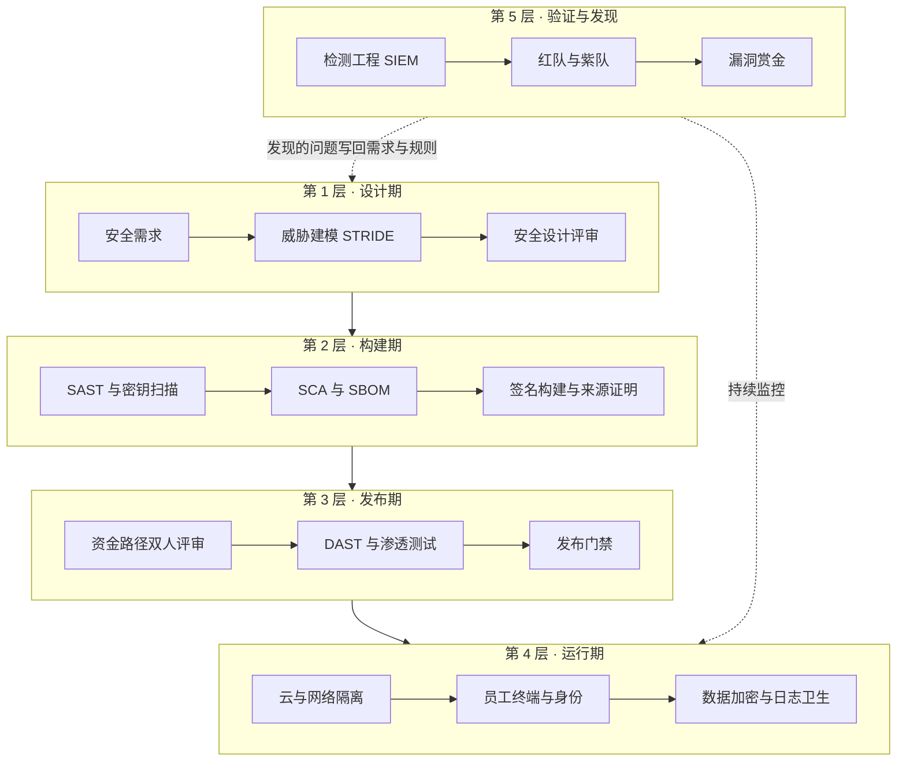
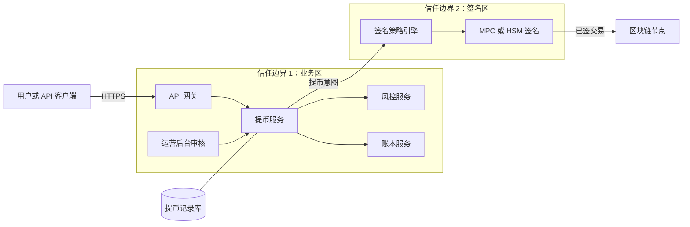
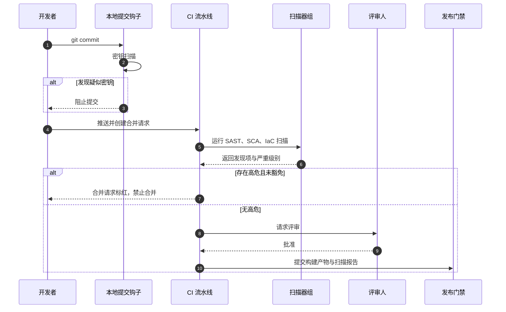
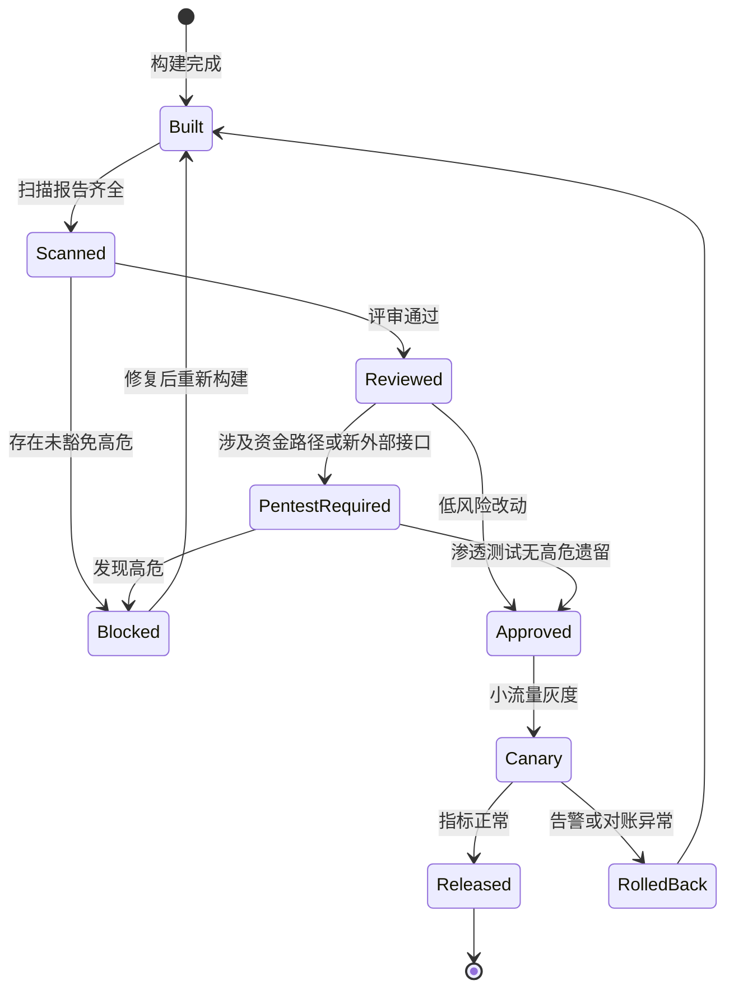
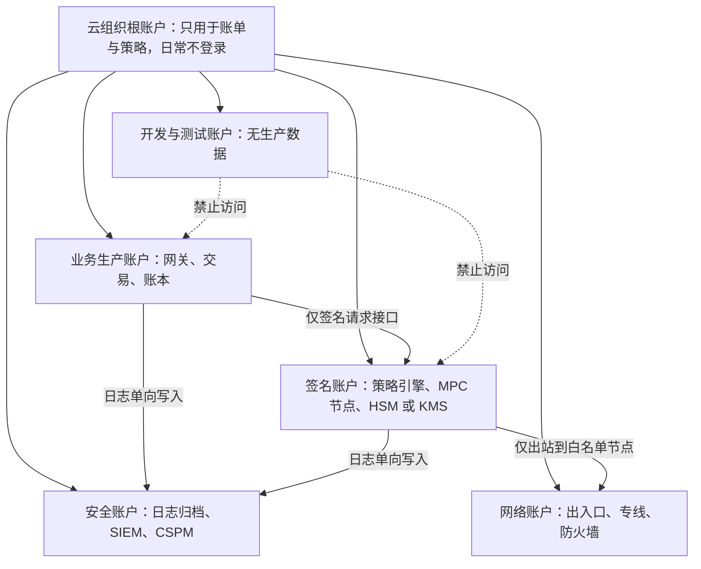
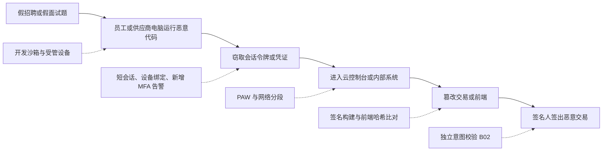

# B11 安全工程：把安全做进研发与运营

> 学习目标：读完本篇，你能——
> 1. 用 STRIDE 给提币服务做一次威胁建模，并把结果变成测试用例和发布门禁。
> 2. 说出供应链、云基础设施、员工终端三条攻击路径各自的关键防线。
> 3. 用一组安全指标和一张成熟度表，判断一个交易所安全团队处在哪个阶段。
>
> 前置章节：[B02 平台安全](B02-platform-security.md)（密钥、内控、供应链基础）、[B03 账户安全](B03-account-security.md)、[B07 应急响应](B07-incident-response.md)、[13 可靠性与安全事故](../13-reliability-security-incidents.md) 第 3.5 节
> 交互实验：[architecture-explorer.html](../interactive/architecture-explorer.html)（找出提币路径上每个服务的信任边界）；相关篇：[B08 风控平台](B08-risk-platform.md)、[B09 全球牌照](B09-global-licensing.md)、[B10 税务与隐私](B10-tax-privacy.md)、[B12 事故案例集](B12-incident-casebook.md)

## 1. 一句话理解

安全工程（Security Engineering）：把安全检查放进需求、设计、编码、构建、部署和运营的每一步，而不是在上线前做一次"安全验收"。

B02 讲"防线长什么样"。B07 讲"防线被突破后怎么办"。本篇讲**防线是怎样被造出来、被持续验证的**。B02 已经讲过的密钥仪式、MPC、PAM、JIT，本篇只引用，不重复。

> 🎯 打个比方：安全工程像造飞机，不像给飞机贴"已检查"标签。
> 设计图阶段就要算机翼受力（威胁建模）。每个零件出厂带合格证和批次号（SBOM、构建签名）。
> 总装线上每一站都有质检员（CI 扫描、代码评审）。试飞员故意做极限动作（红队、渗透测试）。
> 飞机交付后，黑匣子一直在记录（检测工程）。乘客也可以举报异响并拿到奖金（漏洞赏金）。
> 只在交付当天检查一次的飞机，没人敢坐。

> 💡 注意：本篇区分三层信息。**币安公开的事实**标注"截至 2026 年公开资料"或"据公开报道"。**业界通用做法**用于币安未公开的内部实现。**本仓库实现**见第 8 节。

## 2. 威胁 / 问题模型

本篇的"威胁"不只是攻击者，还包括**研发和运营流程中会让漏洞溜进生产的缺口**。

| 缺口 | 典型表现 | 攻击者如何利用 | 本篇对应防线 |
|---|---|---|---|
| 需求没有安全条款 | "提币接口支持批量"，没写限额 | 用批量接口绕过单笔限额 | 4.1 安全需求 |
| 设计没做威胁建模 | 签名服务信任所有内网请求 | 进入内网后直接调签名 | 4.2 STRIDE |
| 代码缺陷 | 金额用浮点数、状态机少一个校验 | 精度误差套利、重复提币 | 4.4 扫描、4.5 评审规则 |
| 依赖与构建被污染 | 恶意 npm 包、CI 被植入后门 | 构建产物带后门上线 | 4.7 供应链 |
| 云配置错误 | 存储桶公开、IAM 权限过宽 | 读取备份、横向移动 | 4.8 云与基础设施 |
| 员工终端被控 | 假招聘、假面试题 | 窃取会话令牌进入生产 | 4.9 终端与员工 |
| 数据处理不当 | 日志里出现 API Secret、身份证号 | 读日志即可接管账户 | 4.10 数据安全 |
| 发现太晚 | 告警只覆盖网络层 | 在后台慢慢操作数周 | 4.11 检测工程 |
| 从未被真实攻击过 | 防线只在文档中存在 | 第一次真实攻击就成功 | 4.12 攻防演练、4.13 赏金 |

> ⚠️ 警告：交易所的漏洞直接对应资金。一个普通网站的越权漏洞泄露数据；交易所的越权漏洞可能直接转走资产。所以"资金路径"上的代码要使用比普通代码更严格的规则（第 4.5 节）。

## 3. 防线分层

读图要点：

- 越靠前的层，修复成本越低。设计期改一行需求，比上线后修复一个资金漏洞便宜得多。
- 第 2、3 层主要拦"已知类型"的缺陷。它们漏过业务逻辑漏洞，例如"先撤单再提币"的竞态。
- 第 4 层假设代码里一定还有漏洞，目标是让漏洞"够不着"钱和数据。
- 第 5 层不阻止攻击，它验证前四层是否真的有效。它的产出必须回流到第 1 层，否则同类漏洞会反复出现。

## 4. 关键流程

### 4.1 安全开发生命周期（SDL）

安全开发生命周期（SDL，Secure Development Lifecycle）：在软件开发的每个阶段规定必须完成的安全活动。美国 NIST 的 SSDF（SP 800-218）是常用的参考框架。

阶段顺序见第 3 节总图。每个阶段必须留下"产出物"：需求条款、威胁模型、评审记录、扫描报告、门禁结论。按风险分级执行：资金路径、签名、权限类需求走全流程；文案修改只走 CI。

**安全需求示例（以"新增批量提币 API"为例）：**

1. 批量请求的总金额计入单日限额。
2. 每个目标地址都必须在白名单中。
3. 接口只接受带提币权限且绑定 IP 的 API Key。
4. 批量请求有幂等键。每一笔子请求都写审计日志。

### 4.2 威胁建模：用 STRIDE 分析提币服务

STRIDE：微软提出的威胁分类方法。六个字母分别代表六类威胁。每一类对应一个被破坏的安全属性。

S 仿冒（Spoofing）破坏身份认证；T 篡改（Tampering）破坏完整性；R 抵赖（Repudiation）破坏不可抵赖性；I 信息泄露（Information Disclosure）破坏机密性；D 拒绝服务（Denial of Service）破坏可用性；E 权限提升（Elevation of Privilege）破坏授权。

第一步是画数据流图（DFD，Data Flow Diagram），标出信任边界。

读图要点：

- 每一条穿过信任边界的箭头，都是 STRIDE 的重点分析对象。本图有三条：用户到网关、业务区到签名区、签名区到链。
- 数据库画在边界内，但也要分析：拿到数据库写权限的人能否直接把提币状态改成"已审核"？
- 局限：DFD 只描述设计意图。真实部署中如果网络 ACL 没配好，边界就不存在。所以第 4.8 节要验证部署。

**STRIDE 工作表（提币服务，示例）：**

| 元素 | 类别 | 具体威胁 | 缓解措施 | 验证方式 |
|---|---|---|---|---|
| 网关 → 提币服务 | S | 攻击者用被盗会话提交提币 | 敏感操作二次验证，见 B03 | 测试：旧会话提币被要求 2FA |
| 运营后台 → 提币服务 | R | 审核员否认自己批准过某笔提币 | 审计日志记录操作人、前后状态、trace_id，写入只追加存储 | 抽查：每笔已批准提币可追溯到审核人 |
| 运营后台 → 提币服务 | E | 单个审核员令牌即可批准大额提币 | 大额走双人审批与 step-up 认证 | 测试：单人批准大额返回 403 |
| 提币服务 → 签名区 | S | 内网其他服务伪造提币意图 | 服务间 mTLS 与调用方白名单 | 渗透测试：从非白名单服务调用被拒 |
| 提币服务 → 签名区 | T | 意图与实际待签交易不一致 | 签名区独立解码交易并比对，见 B02 第 4.3 节 | 测试：构造不一致交易必须拒签 |
| 提币记录库 | T | 有库写权限的人直接把状态改为"已审核" | 状态迁移只能经服务接口；数据库账号只读；状态变更带签名或哈希链 | 对账：库内状态与审计日志不一致即告警 |
| 提币记录库 | I | 备份泄露暴露用户地址和身份信息 | 备份加密，密钥在 KMS，见第 4.10 节 | 配置扫描：未加密备份为 0 |
| 提币服务 | D | 攻击者批量提交小额提币耗尽热钱包或人工审核队列 | 按用户与全局限流；小额合并；队列长度告警 | 压测：限流生效，正常用户不受影响 |
| 签名策略引擎 | E | 有配置权限的人把自己的地址加入白名单 | 白名单变更双人审批与冷却期，见 B02 第 5.1 节 | 测试：新地址冷却期内大额签名被拒 |

> 💡 注意：最后一列"验证方式"最重要。没有验证方式的缓解措施只是一句承诺。业界常见做法是把这一列直接变成自动化测试或发布门禁项。

### 4.3 安全设计评审

安全设计评审（Security Design Review）：安全工程师在开发前审阅设计文档和威胁模型。

**评审清单（业界通用做法，资金类服务）：**

1. 每个接口的认证方式、每个状态迁移的授权角色写清楚了吗？
2. 金额字段用整数最小单位或定点小数了吗？
3. 所有写操作有幂等键吗？失败重试会不会重复提币？
4. 跨服务调用失败时，资金处于冻结还是已扣？
5. 审计日志包含谁、何时、改了什么、前后值吗？有独立开关吗？

评审结论只有三种：通过、有条件通过（列出必改项）、退回。

### 4.4 CI 中的自动化安全扫描

| 工具类型 | 英文 | 检查什么 | 擅长 | 漏过 |
|---|---|---|---|---|
| 静态应用安全测试 | SAST | 源代码中的危险模式 | 注入、硬编码密钥、危险函数 | 业务逻辑缺陷 |
| 软件成分分析 | SCA | 依赖的已知漏洞和许可证 | 已公开 CVE 的依赖 | 未公开的恶意包 |
| 密钥扫描 | Secret Scanning | 代码和提交历史中的密钥 | 误提交的 API Key、私钥 | 已加密或拆分的密钥 |
| 动态应用安全测试 | DAST | 运行中的服务对攻击请求的反应 | 认证缺失、错误配置 | 需要业务上下文的漏洞 |
| 基础设施即代码扫描 | IaC Scanning | Terraform 等配置 | 公开存储桶、宽松安全组 | 运行期手工改动 |

读图要点：

- 密钥扫描放在最前面。密钥一旦推送到远端仓库，就要按"已泄露"处理并轮换，删除提交不够。
- 高危发现默认阻断合并。豁免必须由安全团队批准，并写明到期日。
- 局限：扫描器误报率高时，工程师会习惯性点"忽略"。所以要定期调优规则，把误报率当作指标管理。

### 4.5 资金路径的代码评审规则

资金路径（Money Path）：任何会改变余额、冻结、提币状态或签名请求的代码。

| 规则 | 说明 |
|---|---|
| 双人评审 | 资金路径改动至少 2 名评审人，其中 1 人来自所有者团队以外 |
| 禁止作者自批 | 代码托管平台强制开启，管理员也不能绕过 |
| 金额类型 | 禁止浮点数；统一使用最小单位整数或定点小数 |
| 状态机变更 | 新增或修改状态迁移，必须同时更新状态机图和测试 |
| 幂等与重试 | 每个写接口说明幂等键；评审人检查重试路径 |
| 对账影响 | 改动会影响对账规则时，必须通知 [B04](B04-reconciliation.md) 负责人 |
| 受保护文件 | 签名策略、权限矩阵、限额配置列入 CODEOWNERS，必须安全团队批准 |

CODEOWNERS：代码托管平台的一种配置。它规定某些文件的改动必须由指定团队批准。

### 4.6 渗透测试与发布门禁

渗透测试（Penetration Test）：授权的安全人员在约定范围内模拟攻击，寻找可利用的漏洞。业界常见频率是：资金类大版本上线前一次，全平台每年至少一次外部第三方测试。

读图要点：

- `Approved` 之前的每一步都由系统检查，不靠人工记忆。产物没有签名或报告缺失，门禁直接拒绝。
- 只有资金路径和新外部接口才进入 `PentestRequired`。这样渗透测试资源集中在高风险改动上。
- 灰度阶段同时看技术指标和对账结果。对账异常要回滚，即使错误率正常。
- 局限：紧急修复可能需要跳过渗透测试。业界做法是允许"事后补测"，但必须由安全负责人批准并在 7 天内（示例）补齐。

### 4.7 软件供应链安全

B02 第 4.6 节列出了依赖投毒、构建入侵、前端替换、SaaS 被入侵四类风险。本节补充具体的工程手段。

| 手段 | 定义 | 解决什么 | 交易所重点 |
|---|---|---|---|
| 依赖锁定与私有镜像 | 用锁文件固定精确版本和哈希；依赖从内部仓库拉取 | 新版本被投毒后自动升级 | CI 使用 `--frozen-lockfile`；新包进镜像前隔离与扫描 |
| SBOM | 软件物料清单：列出产物包含的全部组件与版本 | 新漏洞公布时快速定位受影响服务 | 每个构建产物附带 SBOM |
| 签名构建与来源证明 | 构建平台对产物签名，并生成"由谁、用什么源码、怎样构建"的证明 | 有人绕过 CI 上传产物 | 部署时校验签名与证明 |
| SLSA | 供应链完整性分级框架，v1.0 定义 Build L1–L3 | 给构建可信度一个可度量的目标 | 签名服务目标 Build L3 |
| 可复现构建 | 同一源码在不同机器上构建出完全相同的字节 | 构建机被植入后门而不被发现 | 签名服务、钱包前端由两套独立环境构建并比对哈希 |
| 前端完整性 | SRI、CSP、发布哈希比对 | CDN 或托管方篡改脚本 | 关键签名界面自托管，见 B02 Bybit 案例 |

SLSA（Supply-chain Levels for Software Artifacts）：一套软件供应链安全规范。截至其 v1.0 规范，Build L1 要求有来源证明，Build L2 要求托管构建平台生成签名的来源证明，Build L3 要求加固的构建平台。

> ⚠️ 警告：B02 第 4.4 节的 Bybit 案例中，被篡改的是供应商托管的前端脚本。对交易所来说，"签名人看到的界面"和"签名服务本身"都应该进入可复现构建与哈希比对的范围。

**签名服务的可复现构建流程（业界通用做法）：**

1. 发布负责人为源码打上签名标签。
2. 构建环境 A 拉取标签，构建产物。
3. 构建环境 B 由另一个团队维护，独立构建同一标签。
4. 系统比对两份产物的哈希。如果哈希不同，发布终止。
5. 两名负责人分别对产物签名。签名区部署时校验两个签名。

### 4.8 云与基础设施安全

着陆区（Landing Zone）：云上预先规划好的多账户结构，每个账户承载一类工作负载，并带有统一的安全基线。

读图要点：

- 账户是云上最强的隔离边界。签名区单独一个账户，业务账户的管理员默认没有签名账户的任何权限。
- 日志单向写入安全账户。业务和签名账户的管理员不能删除自己的日志，这对应 B02 的 WORM 要求。
- 签名账户的出站流量只能到白名单区块链节点。即使签名节点被植入木马，木马也难以把数据发往攻击者服务器。
- 局限：组织级策略写错一次，会同时影响所有账户。所以策略变更本身也要走双人评审。

| 控制项 | 做法（业界通用做法） |
|---|---|
| IAM 最小权限 | 人员不持有长期密钥；通过单点登录获取短期角色；权限定期用访问记录收紧 |
| KMS 与 HSM | 数据加密密钥由 KMS 管理；签名密钥在 HSM 或 MPC 中，原理见 [04 章](../04-wallet-custody.md) |
| 网络分段 | 公网区、业务区、数据区、签名区分开，规则见 B02 第 4.6 节 |
| 出站控制 | 签名区与数据区默认拒绝出站；只放行明确的域名或 IP |
| 不可变基础设施 | 服务器不登录修改；任何变更都重新构建镜像并替换实例 |
| CSPM | 云安全态势管理：持续扫描云配置，发现公开存储桶、宽松安全组、未加密磁盘 |

> 💡 注意：2025 年 Safe{Wallet} 事后公开的调查显示，攻击者在开发者电脑上取得了仍然有效的 AWS 会话令牌，并试图注册自己的 MFA 设备。所以"登录时有 MFA"不够，还要限制会话时长、绑定设备，并对"新增 MFA 设备"告警。

### 4.9 终端与员工安全

本节的前提是：**攻击者把交易所工程师当作入口**。下面的案例都已公开，并被美国或日本政府、安全公司归因于朝鲜相关组织。

| 年份 | 事件 | 入口 | 来源类型 |
|---|---|---|---|
| 2022 | Ronin 跨链桥被盗约 6.25 亿美元（按事发时价格） | 工程师收到假招聘 offer PDF，打开后电脑被控 | 媒体报道（The Block 等），美国政府归因 Lazarus |
| 2022 | FBI、CISA、美国财政部发布 TraderTraitor 联合公告 | 冒充招聘，诱导系统管理员与 DevOps 下载被植入木马的加密应用 | 政府公告 AA22-108A |
| 2023 起 | Contagious Interview 行动 | 冒充面试官，在"面试题"中夹带恶意 npm 包（BeaverTail） | Palo Alto Unit 42、Datadog、Socket 报告 |
| 2024 | DMM Bitcoin 被盗约 3.08 亿美元 | 冒充 LinkedIn 招聘者，向钱包软件商 Ginco 员工发送含恶意 Python 代码的"入职测试" | FBI 与日本警察厅联合声明 |
| 2025 | Safe{Wallet} 开发者电脑被控，进而导致 Bybit 被盗 | 开发者运行了含恶意代码的 Python 项目 | Safe 与 Mandiant 调查摘要 |

【据公开报道】2025 年 8 月，币安首席安全官 Jimmy Su 接受 Decrypt 采访时表示：币安几乎每天都会收到他们认定来自朝鲜攻击者的伪造简历；对方在视频面试中使用深度伪造和变声工具；币安称从未雇用过国家级攻击者，并会监测在职员工的异常行为。

【据公开报道】2025 年 11 月，Socket 报告称，Contagious Interview 行动当时已上传 197 个以上恶意 npm 包，累计下载超过 3.1 万次。

**防线（业界通用做法）：**

| 防线 | 做法 | 拦截哪个案例环节 |
|---|---|---|
| 受管设备 | 只有公司管理的设备能访问内部系统；装有 EDR | 个人电脑上的恶意面试题无法直接接触生产 |
| 开发沙箱 | 运行陌生代码必须在一次性虚拟机或云开发环境中 | "入职测试""面试题"在沙箱中运行 |
| 防钓鱼 MFA | 员工使用 FIDO2 硬件密钥；禁用短信和 TOTP 作为员工因素 | 钓鱼站拿不到可重放的验证结果 |
| 特权访问工作站（PAW） | 管理生产和签名区的专用电脑，不装聊天软件，不浏览网页 | 日常办公电脑被控也够不到签名区 |
| 内部人风险计划 | 招聘背景核查、异常行为分析、离职权限回收 | 冒名入职者、被收买员工 |
| 社会工程演练 | 定期发送模拟钓鱼和模拟"假招聘"，统计点击率 | 提高员工识别能力 |

PAW（Privileged Access Workstation，特权访问工作站）：只用于高权限操作的专用加固设备。

EDR（Endpoint Detection and Response，终端检测与响应）：在员工电脑上记录进程、网络和文件行为，并发现可疑活动的软件。

> ⚠️ 警告：内部人风险不只是"恶意员工"。【据公开报道】2025 年 5 月，Coinbase 披露海外客服人员被收买，泄露了不到 1% 月活交易用户的个人数据；Coinbase 预估相关成本为 1.8 亿至 4 亿美元。客服、外包和供应商员工都应纳入最小权限和行为监控。案例细节见 [B12 事故案例集](B12-incident-casebook.md)。

### 4.10 数据安全

| 主题 | 规则（业界通用做法） |
|---|---|
| 加密 | 外部 TLS 1.2 以上，内部 mTLS；数据库、备份、对象存储全部加密，密钥在 KMS |
| 字段级加密 | 证件号、TOTP 种子、API Secret 在应用层再加密一次 |
| 密钥管理 | 应用运行时从密钥管理服务取密钥；不写在代码、镜像或环境变量文件中 |
| 日志卫生 | 日志不得包含密码、API Secret、会话令牌、私钥、完整证件号、完整手机号 |
| 日志脱敏 | 在日志库层面统一脱敏，不依赖每个开发者记得 |
| 数据最小化 | 只采集业务需要的数据；隐私与留存期限见 [B10 税务与隐私](B10-tax-privacy.md) |

> 💡 注意：日志是最常见的密钥泄露点之一。原因是日志会被复制到 SIEM、云日志、外包分析平台，接触的人远多于数据库。所以"日志里有没有密钥"要用 CI 测试和线上扫描双重检查。

### 4.11 检测工程

检测工程（Detection Engineering）：像写软件一样编写、测试、版本化和发布安全检测规则。

| 组件 | 定义 | 交易所示例 |
|---|---|---|
| SIEM | 安全信息与事件管理：汇总日志并运行检测规则 | 汇总网关、后台、云审计、EDR 日志 |
| 检测即代码 | 检测规则存放在代码仓库，经过评审和测试后上线 | 每条规则附带一段"应触发"和"不应触发"的样例日志 |
| 金丝雀令牌 | 放在系统中的假凭证或假文件，被使用即告警 | 在开发者电脑中放一个假的云访问密钥 |
| 蜜罐 | 伪装成真实目标的诱饵系统 | 一个看起来像"冷钱包管理"的内网服务 |
| 管理操作异常检测 | 对运营后台和云控制台操作建立行为基线 | 审核员凌晨批量批准提币；新增 MFA 设备 |

**高价值检测规则（示例）：**

| 规则 | 条件 | 级别 |
|---|---|---|
| 金丝雀令牌被使用 | 任何一次调用 | SEV1，见 B07 |
| 新增 MFA 设备 | 生产角色账号新增 MFA 设备 | 高 |
| 管理员批量操作 | 1 名审核员 10 分钟内批准 > 20 笔提币（示例） | 高 |
| 日志量骤降 | 某服务日志量 < 基线 10%（示例） | 高，可能有人关日志 |

> 💡 注意：金丝雀令牌的误报率接近 0。正常员工没有理由使用一个假密钥。所以它适合直接触发高等级告警。

### 4.12 攻防演练：红队、蓝队、紫队

| 角色 | 定义 | 目标 |
|---|---|---|
| 红队（Red Team） | 模拟真实攻击者 | 达成预定目标，例如"让签名服务签出一笔测试交易" |
| 蓝队（Blue Team） | 负责防御和检测的团队，通常是 SOC | 发现并阻止红队 |
| 紫队（Purple Team） | 红蓝双方坐在一起，逐项演示攻击手法和检测结果 | 快速补齐检测规则 |

**一次演练的步骤（业界通用做法）：**

1. 演练负责人发布交战规则（RoE，Rules of Engagement）：允许的手法、禁止的目标、时间窗、停止条件、联系人。
2. 白名单联系人知道演练存在。蓝队不知道。
3. 红队执行并记录每一步。触及真实资金或生产数据时立即停止。
4. 红队和蓝队分别提交时间线。
5. 紫队复盘：每个"红队做了、蓝队没发现"的步骤变成一条新检测规则。

**交战规则的禁止项（示例）：** 不对真实用户发起钓鱼；不删除或加密生产数据；不在主网广播交易；不对第三方供应商发起攻击（除非供应商书面同意）。

桌面推演（Tabletop Exercise）见 [B07](B07-incident-response.md) 第 4.7 节。本篇建议在桌面推演中加入"员工电脑被假面试题控制"这一场景。

### 4.13 漏洞赏金运营

B02 第 4.7 节介绍了漏洞赏金的概念。本节讲运营细节。

【截至 2026 年公开资料】币安在 Bugcrowd 平台运营漏洞赏金计划。公开页面标注单个漏洞 200–10,000 美元，特别严重的问题最高 100,000 美元；奖励以 BNB 支付；严重级别参考 Bugcrowd 的漏洞评级分类（VRT）；只有附带可运行概念验证的报告才有资格获得奖金；计划不允许公开披露。金额与规则会调整，以官网为准。

**分级规则（业界通用做法）：** 技术严重度（CVSS 或 VRT）只是起点。交易所还要叠加业务影响。

| 级别 | 技术严重度 | 业务影响（示例） | 首次响应 SLA（示例） | 修复 SLA（示例） |
|---|---|---|---|---|
| P1 | 严重 | 可直接转走资金、伪造余额、绕过签名策略 | 4 小时 | 72 小时内止血 |
| P2 | 高 | 批量读取用户隐私；绕过提币冷却 | 1 个工作日 | 14 天 |
| P3 | 中 | 单用户越权读取；需要用户交互的 XSS | 3 个工作日 | 60 天 |
| P4 | 低 | 信息泄露有限；最佳实践缺失 | 5 个工作日 | 下一版本 |

**处理流程：**

1. 平台分诊人员复现报告。
2. 交易所安全团队确认级别。
3. 如果是 P1，按 B07 定为 SEV1 并启动止血。
4. 负责团队修复。安全团队验证修复。
5. 财务付款。安全团队把漏洞类型写回 SAST 规则或检测规则。

> 💡 注意：奖金必须高于"把漏洞卖给黑市"的心理价位的一部分，并且付款要快。拖延付款会让研究者转向其他平台。

## 5. 规则、指标与阈值

### 5.1 安全工程指标（示例）

| 指标 | 定义 | 目标（示例） |
|---|---|---|
| MTTD | 从攻击开始到被发现的平均时间 | 资金类 < 5 分钟，定义见 B07 |
| MTTR | 从发现到修复的平均时间 | P1 漏洞 < 72 小时 |
| 补丁延迟 | 高危 CVE 公布到生产修复的天数 | 互联网暴露服务 < 7 天 |
| 威胁模型覆盖率 | 有有效威胁模型的资金路径服务占比 | 100% |
| 门禁绕过次数 | 每月跳过发布门禁的发布数 | 0；紧急发布需事后补测 |
| 钓鱼点击率 | 模拟钓鱼中点击链接的员工占比 | < 5%，报告率 > 60% |
| 硬件密钥覆盖率 | 使用 FIDO2 的生产访问人员占比 | 100% |
| 检测规则覆盖 | 红队步骤中被蓝队发现的比例 | 逐次提高 |

> ⚠️ 警告：单看钓鱼点击率会误导。点击率降到 0 往往说明演练太简单。更重要的是"报告率"：员工发现可疑邮件后，多快报告给安全团队。

### 5.2 成熟度路线图

| 能力 | Level 1 起步 | Level 2 规范 | Level 3 度量 | Level 4 持续优化 |
|---|---|---|---|---|
| SDL | 上线前人工安全检查 | 资金路径必须有威胁模型 | 覆盖率与门禁绕过次数有月报 | 威胁模型随代码自动更新 |
| CI 扫描 | 无或仅 SCA | SAST、SCA、密钥扫描阻断高危 | 误报率与修复时长被管理 | 漏洞类型自动生成新规则 |
| 供应链 | 有锁文件 | 私有镜像、SBOM | 签名构建，SLSA Build L2 | 签名服务可复现构建，Build L3 |
| 云与基础设施 | 单账户，手工配置 | 多账户着陆区，IaC | CSPM 持续扫描，出站白名单 | 不可变基础设施，偏差自动修复 |
| 员工安全 | 密码 + TOTP | 受管设备，FIDO2 | PAW，内部人风险计划 | 演练结果驱动权限设计 |
| 检测 | 只有基础设施告警 | SIEM 汇总关键日志 | 检测即代码，金丝雀令牌 | 紫队定期验证检测覆盖 |
| 攻防验证 | 每年一次外部渗透测试 | 资金版本上线前渗透测试 | 年度红队演练 | 持续红队与公开赏金联动 |

读表方法：一个团队通常不会在所有行处于同一级。先把"供应链"和"员工安全"两行提升到 Level 3，因为第 6 节的案例都从这两行进入。

## 6. 真实案例

| 年份 | 事件 | 被突破的工程环节 | 来源类型 |
|---|---|---|---|
| 2022 | Ronin 跨链桥被盗约 6.25 亿美元（按事发时价格） | 员工终端（假招聘 PDF） | 媒体报道；美国政府归因 |
| 2024 | DMM Bitcoin 被盗约 3.08 亿美元 | 供应商员工终端 + 会话令牌 + 交易被篡改 | FBI 与日本警察厅联合声明 |
| 2025 | Bybit 被盗约 14.6 亿美元 | 供应商开发者终端 + 云会话 + 前端篡改 | Safe 与 Mandiant 调查、FBI 公告；见 B02 |
| 2025 | Coinbase 客户数据泄露 | 外包客服被收买（内部人风险） | Coinbase 提交给 SEC 的文件、媒体报道 |

读图要点：

- 三起资金案例走的是同一条链：员工终端 → 会话 → 内部系统 → 交易被改。差异只在最后一步改的是哪里。
- 每一个环节都有对应的工程防线。只要切断其中一环，攻击就无法完成。
- 最容易被忽视的是供应商。DMM 和 Bybit 的入口都在供应商员工身上，所以第 4.7 节和第 4.9 节的要求应写进供应商合同。
- 局限：公开报道不包含全部内部细节。本图只用于理解防线位置，不描述具体攻击方法。

## 7. 局限与权衡

| 权衡 | 一端 | 另一端 | 业界常见选择 |
|---|---|---|---|
| 门禁严格 vs 发布速度 | 所有改动都过渗透测试 | 只靠 CI 扫描 | 按风险分级，资金路径最严 |
| 扫描覆盖 vs 误报 | 开启全部规则 | 只开高置信规则 | 阻断规则少而准，其余仅提示 |
| 员工体验 vs 终端管控 | 完全锁定设备 | 允许自带设备 | 生产访问必须受管设备与 PAW |
| 透明 vs 风险 | 公开披露全部漏洞细节 | 永不披露 | 修复后公开摘要，不公开可复用细节 |
| 监控员工 vs 隐私 | 全量行为监控 | 不监控 | 只监控生产访问与高权限操作，并告知员工，合规见 B10 |

**常见误区：**

1. 认为"买了扫描器就是做了 SDL"。扫描器发现不了业务逻辑漏洞。威胁建模和资金路径评审不能省。
2. 认为"开发者电脑不属于生产"。第 6 节三起资金案例的起点都是一台开发或运维电脑。
3. 认为"赏金计划可以代替渗透测试"。赏金研究者只测公开入口，看不到内部服务和签名区。

## 8. 本仓库对照

| 本篇概念 | 本仓库位置 | 实现情况 |
|---|---|---|
| 威胁建模（STRIDE 风格的表格） | [`docs/security.md`](../../docs/security.md) 第 3 节 | 已编写。按资产列出威胁、现有缓解和真实 CEX 的做法，覆盖客户会话、登录凭证、API Key、2FA 种子、运营审批、提现链路、热钱包私钥、账本、内部服务、撮合通道、行情与私有实时流、基础设施；没有逐项编号 |
| 安全验收标准与测试计划 | [`docs/security.md`](../../docs/security.md) 第 4 节 | ⚠️ 没有成文的安全验收标准和测试计划；第 4 节按风险排序列出走向真实环境前的缺口，可作为本篇第 4.6 节发布门禁的起点 |
| 密钥不进代码与日志 | [`docs/security.md`](../../docs/security.md) 第 1.2、4 节 | ⚠️ 内部签名密钥、API Key 加密主密钥、数据库口令都有公开的默认测试值；文档把"进入密钥管理系统、可轮换"列为缺口 |
| 私钥从环境变量加载 | [`services/custody-adapter/src/infrastructure/evm-provider-config.ts`](../../services/custody-adapter/src/infrastructure/evm-provider-config.ts) | 演示用实现。违反第 4.10 节密钥管理规则，`docs/security.md` 第 4 节列为最高风险缺口 |
| 网关审计日志 | [`services/api-gateway/src/http/api-gateway-audit.interceptor.ts`](../../services/api-gateway/src/http/api-gateway-audit.interceptor.ts) | 已实现。只记录 userId、apiKeyId、sessionId 等标识，不记录请求头中的签名和令牌，符合日志卫生；`path` 记录完整 URL，若查询串中带敏感参数会进入日志 |
| 服务间鉴权 | [`services/identity-service/src/http/internal-service-auth.guard.ts`](../../services/identity-service/src/http/internal-service-auth.guard.ts) | HMAC 共享密钥 + 调用方白名单，托管（[`custody-adapter`](../../services/custody-adapter/src/http/internal-service-auth.guard.ts)）与链上索引（[`blockchain-indexer`](../../services/blockchain-indexer/src/http/internal-service-auth.guard.ts)）入口也已校验，例如 `api-gateway` 直接调托管会被拒。尚未达到第 4.8 节的 mTLS |
| 依赖锁定 | [`pnpm-lock.yaml`](../../pnpm-lock.yaml) | 有锁文件。`package.json` 使用 `^` 范围，需配合冻结锁文件安装 |
| 发布与变更 | — | 本仓库未实现变更单、灰度和上线前检查清单 |
| CI 安全扫描、SBOM、签名构建、SIEM、金丝雀令牌、红队 | `.github/workflows/ci.yml` | ⚠️ CI 只做构建、类型检查、单元测试和结构检查；安全扫描、SBOM 等未实现 |

关键观察：本仓库已经有一份质量较高的威胁模型和验收标准，但没有 CI 把它们变成"自动阻断"。这正是 SDL 从 Level 1 走向 Level 2 的那一步：**把文档里的验收标准变成门禁里的检查项**。

## 9. 术语表 / 思考题

### 术语表

| 术语 | 英文 | 定义 |
|---|---|---|
| 安全开发生命周期 | SDL | 规定每个开发阶段必须完成的安全活动 |
| STRIDE | — | 仿冒、篡改、抵赖、信息泄露、拒绝服务、权限提升六类威胁 |
| 软件物料清单 | SBOM | 列出产物包含的全部组件与版本 |
| SLSA | Supply-chain Levels for Software Artifacts | 软件供应链完整性分级规范 |
| 可复现构建 | Reproducible Build | 同一源码在不同环境构建出相同字节 |
| 着陆区 | Landing Zone | 预先规划的云多账户结构与安全基线 |
| 云安全态势管理 | CSPM | 持续扫描云配置错误 |
| 特权访问工作站 | PAW | 只用于高权限操作的专用加固设备 |
| 终端检测与响应 | EDR | 记录并分析员工电脑行为的软件 |
| 检测工程 | Detection Engineering | 以软件工程方式管理检测规则 |
| 金丝雀令牌 | Canary Token | 被使用即告警的假凭证或假文件 |
| 交战规则 | RoE | 红队演练的范围、禁止项与停止条件 |
| 紫队 | Purple Team | 红蓝双方协作补齐检测的演练方式 |

### 思考题

1. 为"运营后台批量审核提币"功能补一张 STRIDE 工作表，至少写出 S、R、E 三行，并为每行写一个验证方式。对照本仓库 `docs/security.md` 第 3 节"运营会话与审批权"一行，哪一行已经被识别？
2. 一名新入职的工程师收到"猎头"发来的 GitHub 编程测试。按第 4.9 节的防线，列出至少三个环节可以阻止这段代码接触到签名区。
3. 打开 [architecture-explorer.html](../interactive/architecture-explorer.html)，找到提币路径上的所有服务。哪些服务属于"资金路径"，应该列入 CODEOWNERS 并要求双人评审？

## 参考来源

- NIST SP 800-218 安全软件开发框架（SSDF）：https://csrc.nist.gov/pubs/sp/800/218/final
- Microsoft STRIDE 威胁分类：https://learn.microsoft.com/en-us/azure/security/develop/threat-modeling-tool-threats
- SLSA v1.0 规范与构建等级：https://slsa.dev/spec/v1.0/levels
- CISA SBOM 资源：https://www.cisa.gov/sbom
- Reproducible Builds 项目：https://reproducible-builds.org/
- CISA 防钓鱼 MFA 说明：https://www.cisa.gov/sites/default/files/publications/fact-sheet-implementing-phishing-resistant-mfa-508c.pdf
- CISA/FBI/财政部 TraderTraitor 联合公告 AA22-108A：https://www.cisa.gov/ncas/alerts/aa22-108a
- Ronin 假招聘入口（The Hacker News 转述 The Block 报道）：https://thehackernews.com/2022/07/hackers-used-fake-job-offer-to-hack-and.html
- DMM Bitcoin 被盗与 TraderTraitor 归因（BleepingComputer）：https://www.bleepingcomputer.com/news/security/fbi-links-north-korean-hackers-to-308-million-crypto-heist
- Unit 42 Contagious Interview 报告：https://unit42.paloaltonetworks.com/two-campaigns-by-north-korea-bad-actors-target-job-hunters/
- Datadog 关于 BeaverTail 恶意 npm 包：https://securitylabs.datadoghq.com/articles/tenacious-pungsan-dprk-threat-actor-contagious-interview/
- Socket 发现 197 个恶意 npm 包（The Hacker News）：https://thehackernews.com/2025/11/north-korean-hackers-deploy-197-npm.html
- Safe{Wallet}/Bybit 事件技术复现与调查摘要（Elastic Security Labs）：https://www.elastic.co/security-labs/bit-bybit
- 币安首席安全官谈朝鲜求职者（Decrypt，2025-08-13）：https://decrypt.co/334943/north-korean-hackers-binance
- Coinbase 客服被收买数据泄露（The Hacker News）：https://thehackernews.com/2025/05/coinbase-agents-bribed-data-of-1-users.html
- 币安 Bugcrowd 漏洞赏金计划：https://bugcrowd.com/binance
