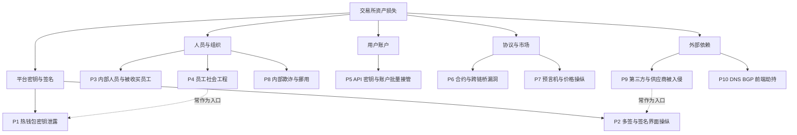
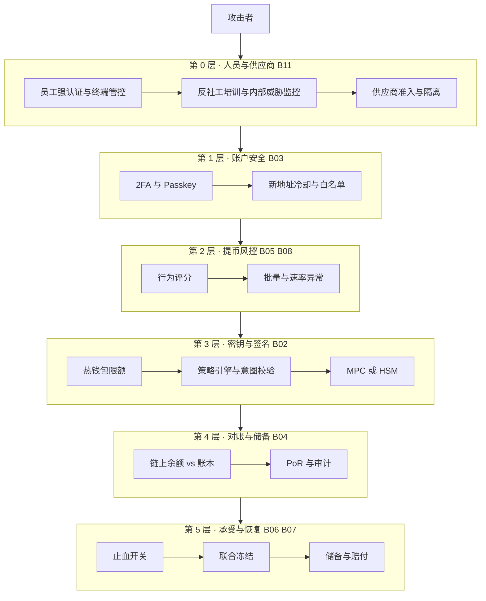
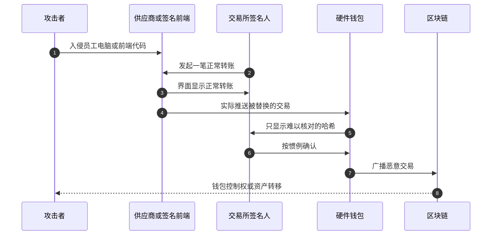
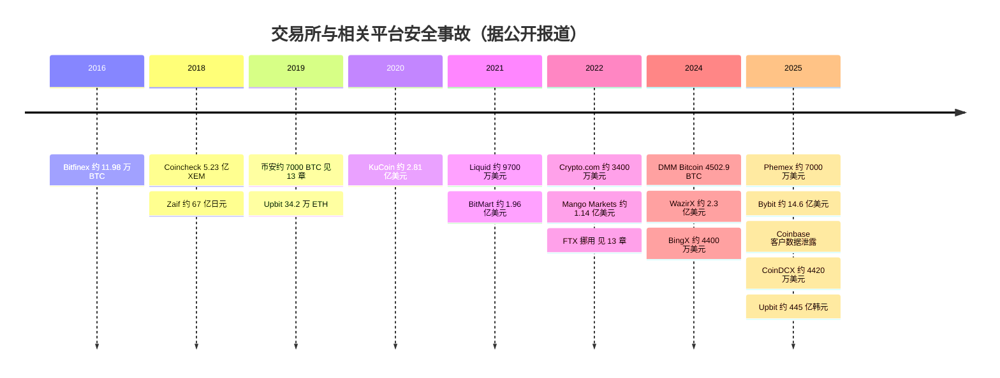
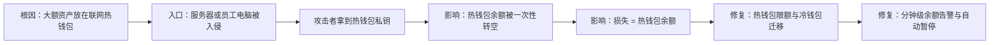
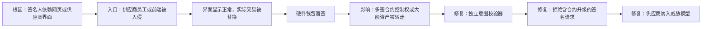
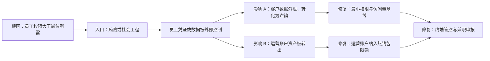
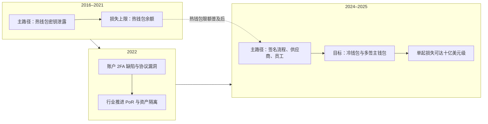

# B12 交易所安全事故案例库

> 学习目标：读完本篇，你能——
> 1. 把一起交易所安全事故归入 10 类攻击路径之一，并说出它突破了哪一层防线。
> 2. 用一张"案例卡"复盘事故：日期、损失、攻击路径、根因、发现、处置、用户结果、教训。
> 3. 解释 2016–2025 年的趋势：攻击重心从"偷热钱包私钥"转向"操纵签名流程和员工"。
>
> 前置章节：[13 可靠性与安全事故](../13-reliability-security-incidents.md)（第 4 节已复盘币安 2019、BNB Chain 跨链桥 2022、FTX 2022、Mt.Gox 2014）、[B02 平台安全](B02-platform-security.md)、[B07 应急响应](B07-incident-response.md)
> 相关篇：[B03 账户安全](B03-account-security.md)、[B04 对账](B04-reconciliation.md)、[B06 金库与流动性](B06-treasury-liquidity.md)、[B08 风控平台](B08-risk-platform.md)、[B11 安全工程](B11-security-engineering.md)
> 交互实验：[incident-explorer.html](../interactive/incident-explorer.html)（时间线、筛选、防线映射、根因测验）

---

## 1. 一句话理解

案例库回答一个问题：**过去十年，交易所的钱是从哪条路被拿走的？每条路由哪一层防线负责？**

本篇不重复讲防线原理。原理见 B02–B07。本篇把真实事故按攻击路径分类，再反查防线。

> 🎯 打个比方：案例库像航空业的事故调查档案。
> 调查员不只问"这架飞机为什么掉下来"，还问"同一类故障过去发生过几次"。
> 发动机故障、飞行员误判、塔台指令错误、维修厂偷工减料，各有各的预防手册。
> 交易所也一样：热钱包被盗、签名界面被篡改、客服被收买、供应商被入侵，分别对应不同的防线。读档案的目的，是把"别人的事故"变成"自己的检查单"。

> 💡 注意：本篇所有金额、日期、归因均"据公开报道"，来源包括当事方公告、执法机构公告、法院文件、链上分析公司报告和主流媒体。金额按事发时市值估算，不同来源会有差异。归因写"据……"，不写成定论。

---

## 2. 威胁 / 问题模型：10 类攻击路径

攻击路径（Attack Path）：攻击者从入口到拿走资产所经过的步骤序列。本篇用"最终突破点"给事故分类。

| 编号 | 攻击路径 | 最终突破点 | 典型入口 | 主责防线 |
|---|---|---|---|---|
| P1 | 热钱包密钥泄露 | 热钱包私钥或签名服务 | 服务器入侵、APT 长期潜伏 | [B02](B02-platform-security.md) 密钥与签名 |
| P2 | 多签 / 签名界面操纵 | 签名人看到的内容 ≠ 实际签的交易 | 篡改签名前端、绕过联署方审批 | [B02](B02-platform-security.md) 所见即所签 |
| P3 | 内部人员 / 被收买员工 | 员工的合法权限 | 贿赂、胁迫、恶意员工 | [B11](B11-security-engineering.md) 内部威胁、[B02](B02-platform-security.md) 内控 |
| P4 | 员工社会工程 | 员工电脑与凭证 | 假招聘、钓鱼邮件、恶意代码"测试题" | [B11](B11-security-engineering.md) 终端与身份 |
| P5 | API 密钥 / 用户账户批量接管 | 用户凭证或 2FA 流程 | 钓鱼、撞库、2FA 逻辑缺陷 | [B03](B03-account-security.md) 账户安全 |
| P6 | 智能合约 / 跨链桥漏洞 | 合约或证明验证逻辑 | 代码漏洞 | [B11](B11-security-engineering.md) 安全开发 |
| P7 | 预言机 / 价格操纵 | 抵押品估值 | 拉高低流动性代币价格 | [B08](B08-risk-platform.md) 风控平台、[B06](B06-treasury-liquidity.md) |
| P8 | 交易所内部欺诈与挪用 | 治理与资产隔离 | 管理层绕过账本规则 | [B04](B04-reconciliation.md) 对账、PoR |
| P9 | 第三方 / 供应商被入侵 | 供应商的系统或员工 | 钱包 SaaS、托管商、外包客服 | [B11](B11-security-engineering.md) 供应链、[B02](B02-platform-security.md) |
| P10 | DNS / BGP / 前端劫持 | 用户访问的网站本身 | 劫持域名解析或网络路由 | [B11](B11-security-engineering.md) 边界、[B03](B03-account-security.md) |

读图要点：

- 五个大类按"攻击者最终控制了什么"划分：密钥、人、用户账户、协议规则、外部依赖。
- 虚线说明路径会串联。很多热钱包事故（P1）的入口是员工被钓鱼（P4）。Bybit 的签名操纵（P2）入口在供应商（P9）。
- 本篇按"最终突破点"给每个案例定一个主路径，再标次路径。分类有主观成分。
- 局限：多数交易所不公开完整调查报告。"根因"常常只能写到"私钥泄露"，入口未知。

> 💡 注意：P10 本篇没有独立案例卡。公开报道中较典型的例子是 2018 年 4 月 MyEtherWallet（钱包网站，非交易所）遭 BGP 劫持：攻击者劫持了 Amazon Route 53 的路由，把用户导向钓鱼克隆站，约 15 万美元 ETH 被盗。交易所面对同样风险，防线见 B11。

---

## 3. 防线分层：每类路径应该在哪一层被拦住

下图与 [backstage/README](README.md) 的纵深防御总图一致，并加上"人员与供应商"这一层。交互页的"防线映射"使用同一套层次。

读图要点：

- 第 0 层是近年最常被突破的层。DMM、CoinDCX、Coinbase 2025 的入口都在这里。
- 第 3 层"热钱包限额"不阻止攻击，但给损失封顶。它在 Upbit 2019、BingX 2024 中限制了损失规模。
- 第 4 层主要防 P8（内部挪用）。FTX 式事故不会触发任何技术告警，只能靠对账和外部审计发现。
- 第 5 层不防攻击。它决定事故结局是"用户无损"还是"破产清算"。

### 3.1 防线覆盖矩阵（攻击路径 × 防线层）

● = 主防线，能直接拦截；◐ = 辅助，能限损或发现；○ = 基本无效。矩阵基于本篇案例归纳，属于业界通用判断，不是标准答案。

| 攻击路径 | L0 人员与供应商 | L1 账户 | L2 提币风控 | L3 密钥与签名 | L4 对账 | L5 承受与恢复 |
|---|---|---|---|---|---|---|
| P1 热钱包密钥泄露 | ◐ | ○ | ◐ | ● 限额封顶 | ◐ | ● |
| P2 多签 / 签名界面操纵 | ◐ | ○ | ○ | ● 意图校验 | ○ | ● |
| P3 内部人员 / 被收买 | ● | ◐ | ◐ | ◐ | ◐ | ◐ |
| P4 员工社会工程 | ● | ○ | ◐ | ◐ | ○ | ◐ |
| P5 账户批量接管 | ○ | ● | ● | ◐ 热钱包限额 | ○ | ● |
| P6 合约 / 跨链桥漏洞 | ○ | ○ | ◐ 异常大额充值 | ○ | ◐ | ◐ |
| P7 预言机 / 价格操纵 | ○ | ○ | ● 抵押折扣与上限 | ○ | ◐ | ◐ |
| P8 内部欺诈与挪用 | ◐ | ○ | ○ | ◐ | ● | ○ |
| P9 第三方被入侵 | ● | ○ | ○ | ● 独立校验 | ○ | ● |
| P10 DNS / BGP 劫持 | ◐ | ● 钓鱼抵抗认证 | ◐ | ○ | ○ | ◐ |

读表要点：

- 没有一层能覆盖全部路径。L3 对 P1/P2 最强，对 P3/P8 基本无效。
- P8 只有 L4 是主防线。这解释了 FTX 之后行业为什么集中推进 PoR 和资产隔离。

---

## 4. 关键流程

### 4.1 一起事故的生命周期

一起事故通常经过 8 个阶段：入口 → 潜伏与横向移动 → 资产转出 → 被发现 → 止血 → 追踪与联合冻结 → 赔付或重组 → 复盘。

- 潜伏期可以很长。KuCoin 2020 的公开说明提到攻击者长期潜伏。DMM 2024 从首次接触到转出约两个月（FBI 公告）。
- "转出 → 发现"的间隔决定损失。Coincheck 2018 约 8.5 小时，Zaif 2018 约 3 天。
- 结局有三种：平台全额兜底、按比例重组、破产清算。见第 6.4 节。完整处置流程见 [B07](B07-incident-response.md)。

### 4.2 签名流程操纵的共同模式（P2 + P9）

WazirX 2024、DMM 2024、Bybit 2025 的公开调查有相同结构：攻击者不偷私钥，而是让合法签名人签下恶意交易。

读图要点：

- 第 3–5 步是关键：界面和实际交易分离。签名人数再多也没有用。
- 第 5 步"盲签"是共同弱点。B02 第 4.3 节的独立意图校验器专门针对这一步。
- 入口不在交易所自身系统。所以供应商必须进入威胁模型（见 B11）。
- 局限：各方对责任归属常有争议。WazirX 与 Liminal 对"哪一方被入侵"的说法不一致。

---

## 5. 规则、指标与阈值：把案例变成检查单

| 来自案例的教训 | 规则（示例） | 对应案例 |
|---|---|---|
| 热钱包余额给损失封顶 | 热钱包余额 ≤ 24 小时提币量的 1.5 倍（示例） | Coincheck 2018、Upbit 2019 |
| 多链热钱包同时被清空 | 任意 3 条链热钱包在 10 分钟内同时下降 > 30%（示例），自动暂停全部提币 | Phemex 2025、BingX 2024 |
| 签名前必须独立解码 | 交易含合约升级、`delegatecall`、多签配置变更时拒绝自动签名 | WazirX 2024、Bybit 2025 |
| 联署方必须真正独立 | 联署方审批不能由交易所 API 自动触发 | Bitfinex 2016 |
| 2FA 流程必须被测试 | 每次认证流程变更后执行"无 2FA 能否提币"的回归测试 | Crypto.com 2022 |
| 新地址需要冷却 | 白名单新地址 24 小时后才能提币（Crypto.com 事后采用的规则） | Crypto.com 2022 |
| 客服不能批量查看敏感数据 | 单个客服每小时查看完整证件 > 20 份（示例）触发告警 | Coinbase 2025 |
| 运营账户也是热钱包 | 做市、流动性账户纳入热钱包限额和监控 | CoinDCX 2025 |
| 抵押品估值要防操纵 | 低流动性代币抵押率上限与价格偏离熔断 | Mango 2022 |
| 发现速度决定损失 | 热钱包异常转出到人工确认 ≤ 5 分钟（示例） | Coincheck 2018、Zaif 2018 |

**监控指标（示例）：**

| 指标 | 告警条件（示例） | 针对路径 |
|---|---|---|
| 热钱包净流出速率 | 超过 7 日同时段均值 5 倍 | P1、P5 |
| 签名请求中的合约调用类型 | 出现升级、委托调用类方法 | P2、P9 |
| 员工终端执行未签名脚本 | 出现 1 次 | P4 |
| 客服数据访问量 | 偏离个人基线 3 个标准差 | P3 |
| 抵押品价格 5 分钟涨幅 | > 50% 且该资产深度低 | P7 |
| 资产负债差额 | 任一币种账实不平 | P8 |

---

## 6. 真实案例

### 6.1 时间线

读图要点：

- 2016–2021 年的主角是热钱包（P1）。2024–2025 年签名流程、供应商和员工成为主角。
- 2025 年 Bybit 一起事件的金额，超过本表其他交易所事件金额之和。
- 2019 年和 2025 年 Upbit 两次热钱包被盗。韩国警方 2024 年把 2019 年事件归因于朝鲜，2025 年事件据报道也被怀疑与 Lazarus 有关。
- 局限：本表只收录有可靠公开报道的事件。很多小型事故没有公开。

### 6.2 案例卡

每张卡的字段固定。"防线"一栏链接到负责该层的幕后篇。

#### C01 · 2016 · Bitfinex · 约 11.98 万 BTC

| 字段 | 内容 |
|---|---|
| 日期 | 2016 年 8 月 2 日 |
| 损失 | 119,756 BTC，当时约 7,200 万美元 |
| 攻击路径 | P2 多签流程被绕过 |
| 根因 | 资金在与 BitGo 联署的多签钱包中。公开分析认为，Bitfinex 可经 API 让 BitGo 自动联署，多签退化为形式 |
| 发现与处置 | 发现：公开资料未披露发现方式。处置：暂停交易；把损失按约 36% 分摊到全部用户账户，并发行 BFX 代币作为欠条 |
| 用户结果 | 是（延迟）。BFX 于 2017 年 4 月前全部赎回或转股。美国政府 2022 年追回约 9.46 万 BTC 并申请返还 |
| 归因 | 美国人 Ilya Lichtenstein 2023 年认罪承认实施入侵，2024 年 11 月被判 5 年 |
| 教训 → 防线 | 联署方必须独立判断，不能被调用方自动触发 → [B02](B02-platform-security.md) 签名策略 |

#### C02 · 2018 · Coincheck · 5.23 亿 XEM

| 字段 | 内容 |
|---|---|
| 日期 | 2018 年 1 月 26 日 |
| 损失 | 5.23 亿 XEM，当时约 5.3 亿美元（约 580 亿日元） |
| 攻击路径 | P1 热钱包密钥泄露（入口：P4 员工被恶意邮件感染） |
| 根因 | NEM 全部存放在联网热钱包，且未使用多签。攻击者经员工电脑上的远控木马拿到密钥 |
| 发现与处置 | 发现：02:57 开始转出，11:25 才发现，间隔约 8.5 小时。处置：暂停 NEM 充提与交易；日本金融厅下达业务改善命令 |
| 用户结果 | 是（法币）。按 88.549 日元 / XEM 向约 26 万用户以自有资金赔付 |
| 归因 | 未公开定论 |
| 教训 → 防线 | 大额资产不能放热钱包；告警要能在分钟级发现 → [B02](B02-platform-security.md)、[B07](B07-incident-response.md) |

#### C03 · 2018 · Zaif · 约 67 亿日元

| 字段 | 内容 |
|---|---|
| 日期 | 2018 年 9 月 14 日 |
| 损失 | 约 67 亿日元（约 6,000 万美元）：用户资产约 45 亿日元，公司资产约 22 亿日元；其中 5,966 BTC |
| 攻击路径 | P1 热钱包密钥泄露 |
| 根因 | 管理热钱包的服务器被入侵；BTC、BCH、MONA 被转出 |
| 发现与处置 | 发现：9 月 17 日发现，晚于事发约 3 天。处置：9 月 18 日向当局报告；Fisco 集团提供 50 亿日元支持并取得控股权 |
| 用户结果 | 是。运营方与 Fisco 承诺赔付，同意转移的用户 2018 年 11 月底入账 |
| 归因 | 未公开定论 |
| 教训 → 防线 | 3 天发现期说明缺少热钱包余额实时对账 → [B04](B04-reconciliation.md)、[B06](B06-treasury-liquidity.md) |

#### C04 · 2019 · Upbit · 34.2 万 ETH

| 字段 | 内容 |
|---|---|
| 日期 | 2019 年 11 月 27 日 |
| 损失 | 342,000 ETH，当时约 5,000 万美元 |
| 攻击路径 | P1 热钱包密钥泄露 |
| 根因 | ETH 热钱包被转空；入侵细节未公开 |
| 发现与处置 | 发现：当日发现并公告。处置：暂停充提；把剩余资产全部转入冷钱包 |
| 用户结果 | 是。Upbit 用公司资产补足 |
| 归因 | 2024 年 11 月韩国警方确认为朝鲜 Lazarus 与 Andariel，这是韩国调查机构首次正式确认 |
| 教训 → 防线 | 事后冷钱包迁移有效；但 2025 年 Upbit Solana 热钱包再次被盗，说明同类风险会重复 → [B02](B02-platform-security.md) |

#### C05 · 2020 · KuCoin · 约 2.81 亿美元

| 字段 | 内容 |
|---|---|
| 日期 | 2020 年 9 月 26 日 |
| 损失 | 约 2.81 亿美元，多链多币种 |
| 攻击路径 | P1 热钱包密钥泄露 |
| 根因 | 据 KuCoin 说明，攻击者以 APT 方式长期潜伏，拿到若干热钱包私钥 |
| 发现与处置 | 发现：热钱包异常转出后发现。处置：迁移资产；Tether 冻结约 3,300 万美元 USDT，多个项目方冻结或升级代币合约 |
| 用户结果 | 是。约 84% 资金被追回或冻结，剩余约 4,555 万美元由保险基金覆盖 |
| 归因 | 据报道，联合国专家组报告指向朝鲜 |
| 教训 → 防线 | 行业联合冻结能追回大部分资产 → [B07](B07-incident-response.md) 联合冻结、[B06](B06-treasury-liquidity.md) 保险基金 |

#### C06 · 2021 · Liquid · 约 9,700 万美元

| 字段 | 内容 |
|---|---|
| 日期 | 2021 年 8 月 19 日 |
| 损失 | 约 9,700 万美元（Elliptic 估算），含 ETH、XRP、BTC、稳定币等 |
| 攻击路径 | P1 热钱包（温钱包）被入侵 |
| 根因 | 温钱包被入侵；攻击者把以太坊代币快速换成 ETH，避免被冻结 |
| 发现与处置 | 发现：当日公告。处置：暂停充提；迁移资产到冷钱包 |
| 用户结果 | 是（平台借款兜底）。Liquid 获得 FTX 1.2 亿美元债务融资 |
| 归因 | 据 Chainalysis 报告，被列入 2021 年朝鲜相关攻击 |
| 教训 → 防线 | 攻击者优先兑换可冻结资产，冻结窗口只有几分钟 → [B07](B07-incident-response.md) |

#### C07 · 2021 · BitMart · 约 1.96 亿美元

| 字段 | 内容 |
|---|---|
| 日期 | 2021 年 12 月 4 日 |
| 损失 | 约 1.96 亿美元：以太坊约 1 亿，BSC 约 9,600 万 |
| 攻击路径 | P1 热钱包密钥泄露 |
| 根因 | 据 BitMart 说明，一把私钥被盗，两个热钱包被控制 |
| 发现与处置 | 发现：安全公司 PeckShield 先发出公开预警；BitMart 起初称是例行转账，数小时后确认被盗。处置：暂停提币 |
| 用户结果 | 是。CEO 宣布用自有资金赔付 |
| 归因 | 未公开定论 |
| 教训 → 防线 | 外部比内部先发现，说明链上监控缺位；先否认再承认会损害信任 → [B07](B07-incident-response.md) 对外沟通 |

#### C08 · 2022 · Crypto.com · 约 3,400 万美元

| 字段 | 内容 |
|---|---|
| 日期 | 2022 年 1 月 17 日 |
| 损失 | 约 3,400 万美元（约 1,500 万美元 ETH，约 1,900 万美元 BTC），涉及 483 个账户 |
| 攻击路径 | P5 账户批量接管（2FA 被绕过） |
| 根因 | 部分提币在用户未输入 2FA 的情况下被批准 |
| 发现与处置 | 发现：平台风控监测到异常提币。处置：吊销全部用户的 2FA 令牌并要求重新绑定；新增"白名单新地址 24 小时后才能提币" |
| 用户结果 | 是。多数提币被拦下，其余全额赔付 |
| 归因 | 未公开 |
| 教训 → 防线 | 认证流程本身要做回归测试；冷却期是低成本限损规则 → [B03](B03-account-security.md) |

#### C09 · 2022 · Mango Markets · 约 1.14 亿美元

| 字段 | 内容 |
|---|---|
| 日期 | 2022 年 10 月 11 日 |
| 损失 | 约 1.14 亿美元 |
| 攻击路径 | P7 预言机 / 价格操纵（DeFi 平台，非 CEX，作为对照） |
| 根因 | 攻击者数分钟内把 MNGO 价格拉高超过 1,300%，以虚高持仓作抵押借空平台资产 |
| 发现与处置 | 发现：链上公开可见。处置：DAO 投票接受攻击者返还约 6,700 万美元、保留其余部分的方案 |
| 用户结果 | 是（DAO 方案）。DAO 拨出约 4,200 万美元 USDC 赔付存款人 |
| 归因 | Avraham Eisenberg 公开承认操作；2024 年被判有罪，2025 年 5 月法官撤销欺诈与操纵定罪 |
| 教训 → 防线 | CEX 的保证金与借贷产品同样怕"低流动性抵押品" → [B08](B08-risk-platform.md)、[B06](B06-treasury-liquidity.md) |

#### C10 · 2024 · DMM Bitcoin · 4,502.9 BTC

| 字段 | 内容 |
|---|---|
| 日期 | 2024 年 5 月下旬（5 月 31 日公告） |
| 损失 | 4,502.9 BTC，约 482 亿日元（约 3.08 亿美元） |
| 攻击路径 | P9 供应商被入侵（入口 P4，结果 P2） |
| 根因 | 据 FBI、DC3 与日本警察厅联合公告：攻击者冒充招聘者在 LinkedIn 联系钱包软件商 Ginco 的员工，以"笔试"为名让其运行恶意 Python 脚本；之后用会话 Cookie 冒充该员工，篡改 DMM 员工的一笔合法交易请求 |
| 发现与处置 | 发现：资产转出后发现。处置：限制新开户、提币和买入 |
| 用户结果 | 是。集团筹资约 550 亿日元保证用户 BTC 足额；DMM Bitcoin 随后决定停业，约 2025 年 3 月把账户和资产移交 SBI VC Trade |
| 归因 | 据 FBI 等联合公告，朝鲜 TraderTraitor（亦称 Jade Sleet、UNC4899） |
| 教训 → 防线 | 供应商员工的电脑等于你的签名链路 → [B11](B11-security-engineering.md)、[B02](B02-platform-security.md) |

#### C11 · 2024 · WazirX · 约 2.3 亿美元

| 字段 | 内容 |
|---|---|
| 日期 | 2024 年 7 月 18 日 |
| 损失 | 约 2.3 亿美元（悬赏公告写 2.349 亿美元） |
| 攻击路径 | P2 签名界面操纵（涉及 P9 托管服务商） |
| 根因 | 4-of-6 多签钱包（5 名 WazirX 签名人 + 1 名 Liminal）。据 WazirX 说明，Liminal 界面显示的内容与实际签名的数据不一致，载荷被替换为转移钱包控制权。Liminal 称其基础设施未被入侵，双方说法不一 |
| 发现与处置 | 发现：资产转出后发现。处置：暂停提币；发布追回悬赏；申请新加坡法院债务重组 |
| 用户结果 | 部分。2025 年 10 月新加坡高等法院批准重组方案，约 85.5% 资产价值先行分配，其余以恢复代币形式承诺 |
| 归因 | 据 Elliptic 等链上分析公司，朝鲜 Lazarus |
| 教训 → 防线 | 多签人数不能代替"所见即所签" → [B02](B02-platform-security.md)；没有储备时用户承担损失 → [B06](B06-treasury-liquidity.md) |

#### C12 · 2024 · BingX · 约 4,400 万美元

| 字段 | 内容 |
|---|---|
| 日期 | 2024 年 9 月 20 日 |
| 损失 | PeckShield 估算约 4,300 万美元，SlowMist 估算约 4,470 万美元 |
| 攻击路径 | P1 热钱包密钥泄露 |
| 根因 | 热钱包遭异常网络访问；细节未公开 |
| 发现与处置 | 发现：新加坡时间约 04:00，技术团队发现异常网络访问。处置：启动应急预案：紧急迁移资产、暂停提币；约 100 万美元被冻结 |
| 用户结果 | 是。平台承诺以自有储备全额覆盖 |
| 归因 | 未公开定论 |
| 教训 → 防线 | 损失被热钱包余额封顶；24 小时内恢复提币依赖储备 → [B06](B06-treasury-liquidity.md)、[B07](B07-incident-response.md) |

#### C13 · 2025 · Phemex · 约 7,000 万美元

| 字段 | 内容 |
|---|---|
| 日期 | 2025 年 1 月 23 日 |
| 损失 | 初报约 3,700 万美元，后续链上分析估算超过 7,000 万美元，涉及十余条链 |
| 攻击路径 | P1 热钱包密钥泄露 |
| 根因 | 多条链热钱包几乎同时被清空；入侵细节未公开 |
| 发现与处置 | 发现：链上异常流出后公告。处置：暂停提币；1 月 24–26 日分阶段恢复主流币提币 |
| 用户结果 | 承诺赔付。CEO 称冷钱包安全，并称将公布赔付方案 |
| 归因 | 据 The Block 等报道，分析人士认为可能与朝鲜 Lazarus 有关 |
| 教训 → 防线 | 多链热钱包需要"跨链联动熔断"，单链阈值不够 → [B08](B08-risk-platform.md)、[B07](B07-incident-response.md) |

#### C14 · 2025 · Bybit · 约 14.6 亿美元（简述）

| 字段 | 内容 |
|---|---|
| 日期 | 2025 年 2 月 21 日 |
| 损失 | 约 40.1 万 ETH 及约 11.3 万 stETH、cmETH、mETH，合计约 14.6 亿美元 |
| 攻击路径 | P2 签名界面操纵（入口 P9：Safe{Wallet} 开发者电脑） |
| 根因、处置 | 详见 [B02 第 4.4 节](B02-platform-security.md) 与 [B07 第 6 节](B07-incident-response.md)，本篇不重复 |
| 用户结果 | 是。未暂停提币，借款补足缺口 |
| 归因 | 据 FBI 公告，朝鲜 TraderTraitor |
| 教训 → 防线 | 冷钱包也需要意图校验 → [B02](B02-platform-security.md) |

#### C15 · 2025 · Coinbase · 客户数据泄露

| 字段 | 内容 |
|---|---|
| 日期 | 2025 年 5 月 15 日披露（据披露，数据外泄始于 2024 年 12 月 26 日） |
| 损失 | 69,461 名客户的个人数据；Coinbase 初步估计成本 1.8–4 亿美元（整改与自愿赔付） |
| 攻击路径 | P3 被收买员工（海外外包客服） |
| 根因 | 据 8-K 文件，攻击者付钱给美国境外的多名客服外包人员或员工（媒体报道位于印度），复制客户姓名、地址、证件照片、部分遮蔽的银行与 SSN 信息、余额快照 |
| 发现与处置 | 发现：据 SEC 8-K 文件，安全监控在此前数月已分别发现这些人员无业务需要访问数据，并立即解雇；5 月 11 日收到 2,000 万美元勒索邮件。处置：拒付赎金，改设 2,000 万美元悬赏；向受影响客户通知 |
| 用户结果 | 是（自愿赔付）。对被冒充 Coinbase 骗走资金的客户进行赔付 |
| 归因 | 未公开 |
| 教训 → 防线 | 数据泄露会转化为对用户的社工诈骗；客服权限要最小化并监控 → [B11](B11-security-engineering.md)、[B03](B03-account-security.md) |

#### C16 · 2025 · CoinDCX · 约 4,420 万美元

| 字段 | 内容 |
|---|---|
| 日期 | 2025 年 7 月 18 日 |
| 损失 | 约 4,420 万美元 |
| 攻击路径 | P4 员工社会工程（结果为运营账户被控制） |
| 根因 | 一个仅用于在合作交易所提供流动性的内部运营账户被入侵。据报道，攻击者通过一名工程师的工作笔记本植入恶意软件拿到凭证；该工程师被警方拘留，否认参与，承认在职期间兼职 |
| 发现与处置 | 发现：据报道，公司约 17 小时后才对外披露。处置：隔离受影响账户；以金库资金覆盖损失 |
| 用户结果 | 无用户损失。客户资产钱包未受影响 |
| 归因 | 未公开定论 |
| 教训 → 防线 | 做市和流动性账户也要按热钱包管理；员工终端是入口 → [B11](B11-security-engineering.md)、[B02](B02-platform-security.md) |

### 6.3 三条因果链

**因果链 1：热钱包密钥泄露（Coincheck 2018 → Upbit 2019 → BingX 2024）**

读图要点：

- 这条链里，损失上限由热钱包余额决定。Coincheck 把全部 NEM 放在热钱包，所以损失等于全部持仓。
- 修复不是"让热钱包不被入侵"，而是"让热钱包被入侵也不致命"。
- 发现时间是第二个变量。8.5 小时（Coincheck）和 3 天（Zaif）都远超行业今天的分钟级目标。

**因果链 2：签名流程操纵（WazirX 2024 → DMM 2024 → Bybit 2025）**

读图要点：

- 三起事件的共同点：私钥没有泄露，签名人数没有不足，签名人看到的信息是假的。
- 损失规模远大于热钱包事故，因为目标是冷钱包或多签主钱包。
- 修复链条的三步分别属于 B02（校验与策略）和 B11（供应链）。

**因果链 3：内部人员与员工（Coinbase 2025 → CoinDCX 2025）**

读图要点：

- 这类事故不需要任何密码学突破。攻击成本是一笔贿赂或一份假工作邀请。
- 影响 A 的损失发生在用户侧：用户被冒充平台的人骗走资金。平台账本不会出现差异。
- 影响 B 说明"非客户资产账户"也会被盯上。CoinDCX 的客户钱包未受影响，但平台自有资金受损。

### 6.4 跨案例分析

**按主攻击路径统计（本篇 16 张卡）：**

| 主路径 | 案例数 | 案例 | 公开报道损失合计（约） |
|---|---|---|---|
| P1 热钱包密钥泄露 | 8 | Coincheck、Zaif、Upbit 2019、KuCoin、Liquid、BitMart、BingX、Phemex | 13.3 亿美元 |
| P2 签名界面 / 多签操纵 | 3 | Bitfinex、WazirX、Bybit | 17.6 亿美元 |
| P9 供应商被入侵 | 1 | DMM Bitcoin | 3.1 亿美元 |
| P4 员工社会工程 | 1 | CoinDCX | 0.44 亿美元 |
| P3 被收买员工 | 1 | Coinbase | 数据泄露；成本估计 1.8–4 亿美元 |
| P5 账户批量接管 | 1 | Crypto.com | 0.34 亿美元 |
| P7 价格操纵 | 1 | Mango Markets | 1.14 亿美元 |

> 💡 注意：样本是"有可靠公开报道的大案"，不是随机抽样。比例只说明趋势，不能当作发生概率。P6 和 P8 的代表案例（BNB Chain 跨链桥、FTX）见 13 章。

**趋势：从"偷钥匙"到"骗签名人"**

读图要点：

- 热钱包限额和冷热分离普及后，热钱包的"性价比"下降。攻击者转向能打开冷钱包的人和流程。
- 2024–2025 年的大案多数归因于朝鲜相关组织。他们的典型手法是假招聘、假面试、渗透 IT 外包。
- 热钱包事故没有消失。Phemex 2025、Upbit 2025 仍是热钱包被盗。
- 局限：趋势由少数大案主导。一起 Bybit 就能改变全年统计。

**朝鲜相关组织的占比（据链上分析公司报告）：**

| 年份 | 来源 | 数据 |
|---|---|---|
| 2024 | Chainalysis | 朝鲜相关黑客窃取约 13.4 亿美元，占全年被盗总额（约 22 亿美元）的 61%；私钥泄露占被盗金额 43.8% |
| 2025 | Chainalysis 2026 年报告 | 朝鲜相关黑客窃取约 20.2 亿美元，约占全年被盗总额（约 34 亿美元）的 60%；占"服务类"（不含个人钱包）入侵金额的 76% |

本篇 16 张卡中，有公开归因指向朝鲜相关组织的有 7 起：Upbit 2019（韩国警方）、KuCoin（联合国专家组报告）、Liquid（Chainalysis）、DMM（FBI 等）、WazirX（Elliptic）、Bybit（FBI），以及 Phemex（分析人士推测，未经官方确认）。

**用户结局统计：**

| 结局 | 案例 |
|---|---|
| 平台或股东全额兜底 | Coincheck（法币）、Zaif、Upbit 2019、KuCoin、Liquid、BitMart、Crypto.com、DMM、BingX、Bybit |
| 延迟或间接全额 | Bitfinex（BFX 代币，约 8 个月）、Mango（DAO 方案） |
| 按比例重组 | WazirX（约 85.5% 先行分配） |
| 承诺赔付，结果未核实 | Phemex |
| 无用户资产损失 | CoinDCX；Coinbase（数据泄露，对被骗客户自愿赔付） |

读表要点：结局主要取决于平台有没有储备或股东支持，而不取决于攻击路径。这正是 [B06](B06-treasury-liquidity.md) 储备与保险基金存在的理由。

---

## 7. 局限与权衡

| 权衡 | 一端 | 另一端 | 案例启示 |
|---|---|---|---|
| 公开透明 vs 调查保密 | 立即公布全部细节 | 先止血再公告 | BitMart 先否认后承认，损害信任 |
| 自建签名 vs 采用供应商 | 全部自研 | 采购 SaaS 和托管 | WazirX、DMM、Bybit 的入口都在供应商 |
| 暂停提币 vs 维持运营 | 立即全站暂停 | 只暂停受影响链 | Bybit 未暂停但有借款；Upbit 2019 全部暂停 |
| 外包客服 vs 数据暴露 | 外包降低成本 | 数据面扩大 | Coinbase 2025 |
| 全额兜底 vs 分摊损失 | 平台承担，股东稀释 | 用户分摊，平台存活 | Bitfinex 分摊 36%；WazirX 重组 |

**案例库自身的局限：**

1. 幸存者偏差：只有被公开的事故才进入案例库。根因也常不完整：多数交易所只公布"私钥被盗"，不公布入口。
2. 数字差异：损失按事发时市值，不同来源相差 10% 以上很常见。
3. 归因不确定：链上分析公司的归因基于模式匹配，不等于司法结论。

---

## 8. 本仓库对照

| 本篇攻击路径 | 本仓库现状 | 位置 |
|---|---|---|
| P1 热钱包密钥泄露 | `custody-adapter` 的 `evm-hot-wallet` provider 可从环境变量读取私钥或助记词，直接签名广播（默认走 mock provider）；安全文档把它列为最高风险缺口 | [`docs/security.md`](../../docs/security.md) 第 3、4 节、`services/custody-adapter/src/infrastructure/evm-provider-config.ts` |
| P2 签名流程操纵 | 未实现签名策略引擎和意图校验 | 同上，见 [B02 第 8 节](B02-platform-security.md) |
| P3 / P4 内部人员与员工 | 大额提现（超过分资产阈值）需两名不同运营批准，阈值以下单人审批即可推进广播；运营强制 2FA，会话 token 放在 HttpOnly Cookie | `services/wallet-service/src/domain/withdrawal-policy.ts`、`apps/ops-console/src/http/ops-session-cookie.ts` |
| P5 账户批量接管 | 已有提币 2FA、白名单、额度与 KYC 分级限额、安全冷却期，API Key 有 nonce 防重放；没有设备绑定和异常登录检测 | `services/identity-service/src/application/identity-application-service.ts`、`services/api-gateway/src/http/api-key-signature.ts` |
| P8 内部挪用 | 账本只追加、可重放，有对账命令 | 见 [13 章第 6 节](../13-reliability-security-incidents.md) |
| L5 止血开关 | 只有单市场暂停（市场 `halted` 拒绝新单）；全站 / 单资产提币开关本仓库未实现 | `services/risk-service/src/application/market-status-service.ts` |

关键观察：本仓库最突出的两个缺口，环境变量私钥和阈值以下单人审批，分别对应本篇 P1 和 P3/P4。也就是说，案例库里出现最多的两类路径，正是本仓库接入真实资产前必须补齐的缺口。

---

## 9. 术语表 / 思考题

### 术语表

| 术语 | 英文 | 定义 |
|---|---|---|
| 攻击路径 | Attack Path | 攻击者从入口到拿走资产的步骤序列 |
| 热钱包 | Hot Wallet | 私钥在线、可自动签名的钱包 |
| 温钱包 | Warm Wallet | 介于冷热之间、需部分人工参与的钱包 |
| 盲签 | Blind Signing | 签名人看不懂待签内容就签名 |
| 联署方 | Co-signer | 多签中的独立签名参与方 |
| 社会工程 | Social Engineering | 利用人的信任或疏忽获取权限的攻击手法 |
| 内部威胁 | Insider Threat | 来自员工或外包人员的威胁 |
| 预言机操纵 | Oracle Manipulation | 通过操纵价格来源，让系统错误估值 |
| BGP 劫持 | BGP Hijacking | 伪造路由公告，让流量流向攻击者 |
| 联合冻结 | Coordinated Freeze | 交易所、发行方协同冻结被盗资产 |
| 债务重组 | Scheme of Arrangement | 经法院批准、债权人表决的偿付方案 |
| TraderTraitor | TraderTraitor | FBI 对朝鲜一个针对加密行业的攻击组织的命名 |

### 思考题

1. 打开 [incident-explorer.html](../interactive/incident-explorer.html) 的"防线映射"，选择 Coincheck 2018 和 BingX 2024。两者都是热钱包被盗，为什么损失相差 10 倍以上？哪一层防线造成了差异？
2. 你的交易所使用第三方 MPC 钱包服务。参考 DMM 2024 和 WazirX 2024，写出三条你要求供应商满足的条件，并说明哪一条不依赖供应商自身的诚信。
3. Coinbase 2025 事件中平台没有丢失一枚币，但估计成本达数亿美元。用第 3.1 节的覆盖矩阵说明：P3 路径为什么难以被 L3 密钥层拦截？在交互页的测验模式中，你能否只凭事实描述把它与 P4 区分开？

---

## 参考来源

以下为本篇各案例使用的公开报道。链接以检索时（2026 年）可访问为准。

- **C01 Bitfinex 2016**：[Cointelegraph：美国政府申请返还被盗 BTC](https://cointelegraph.com/news/bitfinex-2016-bitcoin-hack-restitution-us-government)；[SiliconANGLE：BFX 与转股](https://siliconangle.com/blog/2016/08/24/bitfinex-customers-offered-equity-in-compensation-for-bitcoin-lost-in-hacking/)；[Fin24：用户损失 36%](https://www.fin24.com/Tech/News/hacked-bitcoin-exchange-users-lose-36-of-deposits-20160808)；[Hacking Distributed：BitGo 多签分析](https://hackingdistributed.com/2016/08/03/how-bitfinex-heist-could-have-been-avoided/)；[The Hacker News：Lichtenstein 被判 5 年](https://thehackernews.com/2024/11/bitfinex-hacker-sentenced-to-5-years.html)；[Bloomberg：认罪](https://www.bloomberg.com/news/articles/2023-08-03/wall-street-rapper-s-husband-pleads-guilty-in-crypto-heist-tied-to-bitfinex-hack)
- **C02 Coincheck 2018**：[Bitcoin Magazine：赔付与改进承诺](https://bitcoinmagazine.com/business/following-massive-cryptocurrency-hack-coincheck-pledges-improve-operations-refund-losses)；[Cointelegraph：全额退款](https://www.cointelegraph.com/news/coincheck-to-refund-all-customers-affected-by-hack-faced-by-community-support)；[LIFARS：恶意软件入口](https://www.lifars.com/2018/03/malware-behind-530-million-theft-japanese-crypto-exchange/)
- **C03 Zaif 2018**：[Bitcoin Magazine](https://bitcoinmagazine.com/business/another-cryptocurrency-exchange-hack-hits-japan)；[FinTech Futures](https://www.fintechfutures.com/blockchain-crypto-digital-assets/hackers-steal-60m-from-japanese-crypto-exchange-zaif)；[Crowdfund Insider：Fisco 收购完成](https://www.crowdfundinsider.com/2018/11/141603-acquisition-of-hacked-japanese-crypto-exchange-zaif-now-complete/)
- **C04 Upbit 2019**：[SecurityWeek](https://www.securityweek.com/hackers-steal-49-million-ethereum-cryptocurrency-exchange-upbit)；[Cointelegraph：韩国警方归因 Lazarus](https://cointelegraph.com/news/upbit-hack-lazarus-south-korea-police)；[Korea JoongAng Daily](https://www.koreajoongangdaily.com/korea/north-korea-confirmed-perpetrator-of-2019-upbit-crypto-theft/12160981)
- **Upbit 2025（时间线）**：[The Block：Lazarus 被怀疑](https://www.theblock.co/post/380743/lazarus-group-suspected-upbit-hack)；[Cointelegraph：暂停充提](https://regional-front.cointelegraph.com/news/upbit-freezes-deposits-and-withdrawals-after-36m-hot-wallet-breach)
- **C05 KuCoin 2020**：[Decrypt：找到攻击者](https://decrypt.co/43806/kucoin-has-found-the-hackers-who-stole-281-million)；[Finance Magnates](https://www.financemagnates.com/cryptocurrency/news/kucoin-identifies-attackers-in-the-281-million-crypto-hack/)；[Wikipedia：KuCoin](https://en.wikipedia.org/wiki/KuCoin)；[FXStreet：追回 84%](https://www.fxstreet.com/amp/cryptocurrencies/news/kucoin-on-track-to-reopen-all-operations-after-recovering-84-of-the-280-million-hack-202011111323)
- **C06 Liquid 2021**：[Fortune](https://fortune.com/2021/08/19/hackers-liquid-crypto-exchange-japan-100-million-ethereum)；[Cointelegraph：FTX 债务融资](https://regional-front.cointelegraph.com/news/hacked-liquid-exchange-receives-120m-debt-funding-from-ftx)；[Zawya/Reuters：Chainalysis 2021 朝鲜攻击](https://www.zawya.com/en/legal/nkorean-hackers-stole-400mln-in-cryptocurrency-in-2021-report-d1b02km0)
- **C07 BitMart 2021**：[CNBC](https://www.cnbc.com/2021/12/05/hackers-take-196-million-from-crypto-exchange-bitmart-in-large-breach.html)；[Finance Magnates：赔付](https://www.financemagnates.com/cryptocurrency/news/hacked-crypto-exchange-bitmart-to-compensate-all-victims/)
- **C08 Crypto.com 2022**：[TechCrunch](https://techcrunch.com/2022/01/20/2fa-compromise-led-to-34m-crypto-com-hack/)；[Security Affairs](https://securityaffairs.com/posts/crypto-com-crypto-heist)
- **C09 Mango Markets 2022**：[Bloomberg Law：定罪被撤销](https://news.bloomberglaw.com/crypto/crypto-traders-convictions-vacated-in-mango-markets-fraud-case)；[OCCRP：返还大部分资金](https://occrp.org/daily/16921-114m-crypto-hacker-outs-himself-returns-most-of-the-money)；[Blockworks：DAO 赔付方案](https://blockworks.com/news/mango-dao-readies-42m-to-make-users-whole)
- **C10 DMM Bitcoin 2024**：[The Hacker News：FBI 归因 TraderTraitor](https://thehackernews.com/2024/12/north-korean-hackers-pull-off-308m.html)；[The Block：停业并移交 SBI](https://www.theblock.co/post/328890/japanese-exchange-dmm-bitcoin-to-shut-down-transfer-assets-to-sbi-group-unit-after-300-million-hack)
- **C11 WazirX 2024**：[The Hacker News](https://thehackernews.com/2024/07/wazirx-cryptocurrency-exchange-loses.html)；[Decrypt：法院批准重组](https://decrypt.co/344084/wazirx-secures-court-approval-for-debt-restructuring-plan)；[The Block：首个方案被驳回](https://www.theblock.co/post/357101/singapore-court-declines-wazirxs-restructuring-plan-after-last-years-230-million-exploit)
- **C12 BingX 2024**：[The Block](https://www.theblock.co/post/317448/crypto-exchange-bingx-faces-an-estimated-43-million-security-exploit-peckshield)；[Security Affairs](https://securityaffairs.com/168703/cyber-crime/hackers-stole-44m-from-bingx.html)
- **C13 Phemex 2025**：[The Block：可能与朝鲜有关](https://www.theblock.co/post/336754/north-korea-hack-group-possibly-behind-70-million-phemex-exploit-experts-say)；[Halborn 分析](https://halborn.com/blog/post/explained-the-phemex-hack-january-2025)；[CryptoSlate：赔付方案声明](https://cryptoslate.com/phemex-reassures-users-with-a-compensation-plan-after-37-million-hot-wallet-breach/)
- **C14 Bybit 2025**：[FBI IC3 公告 I-022625-PSA](https://www.ic3.gov/PSA/2025/PSA250226)；其余见 [B02](B02-platform-security.md)、[B07](B07-incident-response.md)
- **C15 Coinbase 2025**：[Help Net Security](https://www.helpnetsecurity.com/2025/05/15/coinbase-suffers-data-breach-gets-extorted/)；[The Hacker News](https://thehackernews.com/2025/05/coinbase-agents-bribed-data-of-1-users.html)；[SEC Form 8-K](https://www.sec.gov/Archives/edgar/data/1679788/000167978825000094/coin-20250514.htm)
- **C16 CoinDCX 2025**：[ForkLog](https://forklog.com/en/coindcx-exchange-suffers-44-million-hack/)；[Cointelegraph：员工被拘留](https://cointelegraph.com/news/coindcx-hack-employee-arrested-44m-crypto-theft)
- **P10 示例（MyEtherWallet 2018）**：[BleepingComputer](https://www.bleepingcomputer.com/news/security/hacker-hijacks-dns-server-of-myetherwallet-to-steal-160-000/)；[The Register](https://www.theregister.com/2018/04/24/myetherwallet_dns_hijack/)
- **跨案例统计**：[Security Boulevard：Chainalysis 2024 朝鲜 13.4 亿美元](https://securityboulevard.com/2024/12/north-korean-hackers-stole-1-34-billion-in-crypto-in-2024)；[NBC News：Chainalysis 2025 朝鲜 20.2 亿美元](https://www.nbcnews.com/news/amp/rcna249738)；[Asia News Network](https://asianews.network/north-korea-leads-global-crypto-hacks-with-2-billion-in-2025/)
