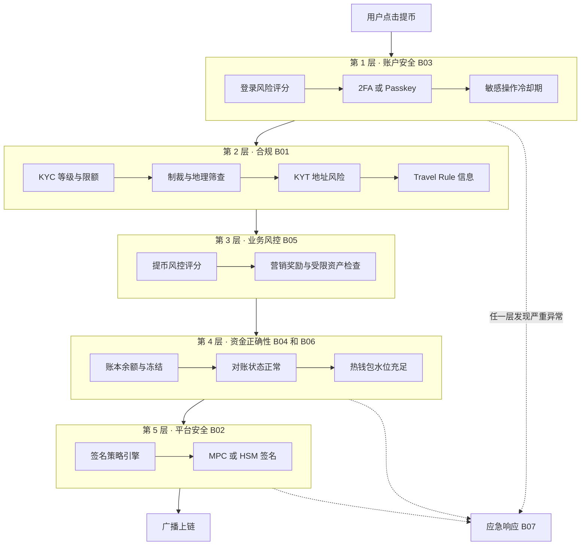
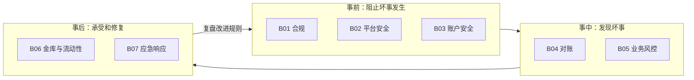

# 幕后核心：用户看不见的防线

> 前置：主线 01–13 章，建议同时读过 [产品深潜](../products/README.md) 中的 P01、P03。
> 本系列讲解合规、安全、对账、风控、金库和应急响应。B01–B07 讲每道防线是什么；B08–B12 是进阶篇，讲这些防线怎样落成工程、怎样适配各地监管，以及历史上它们是怎样被突破的。它们不产生收入，但决定交易所能不能活下去。

## 1. 一句话理解

交易所前台的每一个按钮背后，都有一组看不见的检查。这些检查回答四个问题：

1. **这个人能不能用？**（合规）
2. **这个操作是不是本人？**（账户安全）
3. **这笔钱算得对不对？**（对账）
4. **这件事会不会让平台亏钱或违法？**（业务风控、金库）

当以上检查全部失效时，还有最后一道防线：**应急响应**。

> 🎯 打个比方：前台像机场的值机柜台，乘客只看到"办理登机牌"。幕后有护照查验（合规）、安检（安全）、行李追踪（对账）、塔台调度（风控）、燃油储备（金库）和消防队（应急响应）。乘客看不见它们，但少了任何一个，飞机都不能起飞。

## 2. 纵深防御总图

下图以"一次提币"为例，展示它依次穿过哪些幕后防线：

读图要点：

- 每一层只拦截自己负责的风险。单独一层都会漏，叠在一起才可靠。
- 第 4 层"对账状态正常"是很多人忽略的一环：如果账本与链上对不平，系统应该停止该币种提币（见 B04）。
- 第 5 层是最后的技术防线。2025 年 Bybit 事件说明，签名人看到的界面本身也会被篡改（见 B02）。
- 虚线表示升级路径：任何一层发现严重异常，都会触发应急响应。

## 3. 四类幕后系统的关系

读图要点：

- 事前防线成本高、会影响用户体验，所以不可能拦住所有风险。
- 事中检测用数据发现漏网之鱼。对账针对"算错"，风控针对"做坏事"。
- 事后系统决定一次事故是"可控损失"还是"平台倒闭"。FTX 倒闭的直接原因，是没有可用的储备承受挤兑。
- 复盘把事故教训写回事前规则，形成闭环。

## 4. 目录

| 篇 | 主题 | 核心问题 | 交互实验 |
|---|---|---|---|
| [B01](B01-compliance.md) | 合规防护 | KYC/KYB、AML 交易监控、Travel Rule、制裁筛查、牌照 | [AML 资金流图谱](../interactive/aml-graph.html) |
| [B02](B02-platform-security.md) | 平台安全防护 | 密钥管理、内控、基础设施、供应链安全 | — |
| [B03](B03-account-security.md) | 账户安全风控 | 盗号攻击链与逐层防御、体验与安全的权衡 | [盗号攻防实验](../interactive/ato-defense.html) |
| [B04](B04-reconciliation.md) | 系统对账 | 全链路对账矩阵、差异处置、资产负债恒等式、熔断 | [对账实验室](../interactive/reconciliation-lab.html) |
| [B05](B05-business-risk.md) | 业务风控 | 营销反作弊、市场操纵监控、信用与资产风险 | [市场监控实验](../interactive/market-surveillance.html) |
| [B06](B06-treasury-liquidity.md) | 资金与流动性管理 | 金库运营、敞口对冲、保险基金、挤兑压力测试 | [充提模拟器](../interactive/deposit-withdraw-sim.html) |
| [B07](B07-incident-response.md) | 应急响应 | 事件分级、止血决策、链上追踪与冻结、复盘 | — |
| [B08](B08-risk-platform.md) | 实时风控平台工程 | 特征、规则、模型、图计算；影子模式、灰度与回放 | [风控决策流水线](../interactive/risk-pipeline-lab.html) |
| [B09](B09-global-licensing.md) | 全球监管与牌照 | 各地牌照要求、分区经营、合规三道防线、上币合规 | [牌照与监管矩阵](../interactive/license-matrix.html) |
| [B10](B10-tax-privacy.md) | 税务报送与数据隐私 | CARF、DAC8、1099-DA；GDPR/PIPL 与反洗钱留存的冲突 | — |
| [B11](B11-security-engineering.md) | 安全工程 | SDL、威胁建模、供应链、云与终端安全、红蓝对抗、漏洞赏金 | — |
| [B12](B12-incident-casebook.md) | 安全事故案例库 | 按攻击路径分类的历年交易所事故与防线映射 | [事故案例浏览器](../interactive/incident-explorer.html) |

## 5. 和主线章节的关系

| 主线章节 | 讲了什么 | 幕后篇补充什么 |
|---|---|---|
| [03 账户与身份](../03-account-identity-security.md) | 2FA、API 签名、KYC 等级 | B01 讲 KYC 的持续尽调；B03 讲完整攻击链 |
| [04 钱包与托管](../04-wallet-custody.md) | 冷热钱包、PoR | B02 讲密钥生命周期；B06 讲金库运营 |
| [05 账本](../05-ledger.md) | 双分录、对账基础 | B04 讲全链路对账矩阵和处置流程 |
| [09 风控](../09-risk-control.md) | 交易前后风控、限流 | B05 讲市场操纵和营销反作弊 |
| [13 可靠性与事故](../13-reliability-security-incidents.md) | 高可用、案例复盘 | B07 讲事故发生时的处置流程 |
