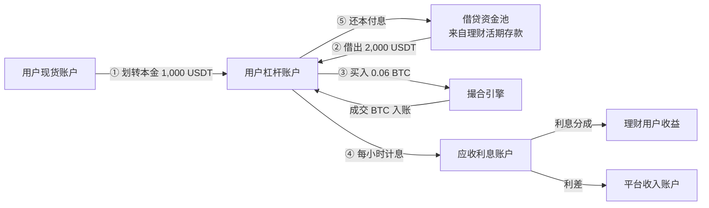
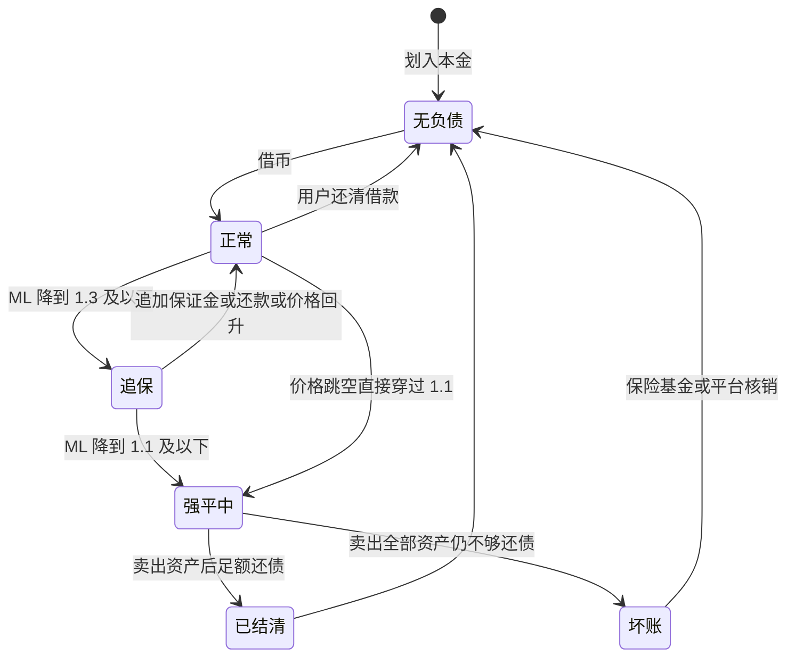
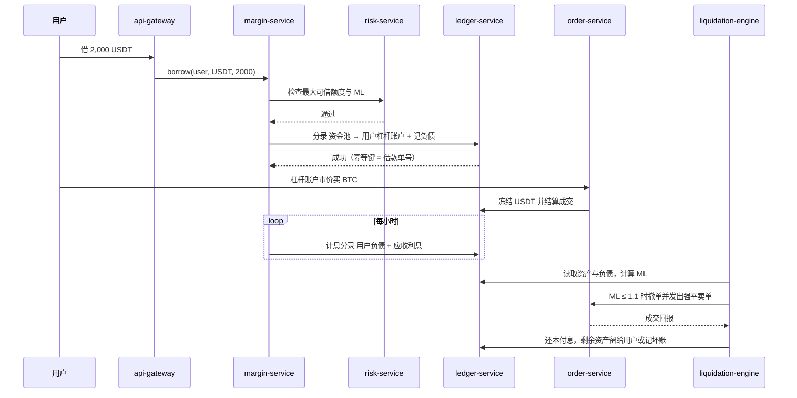
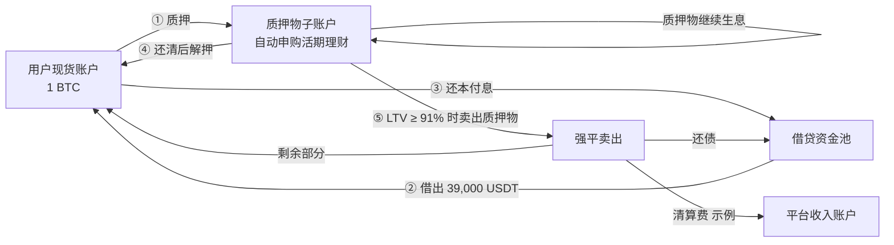
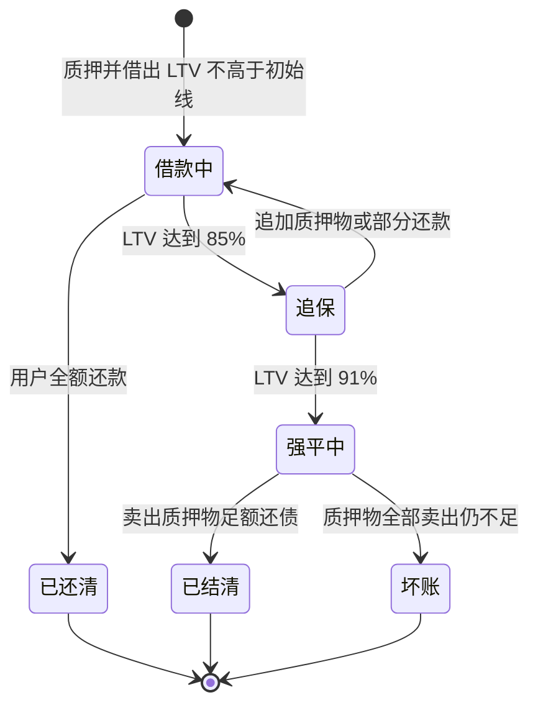
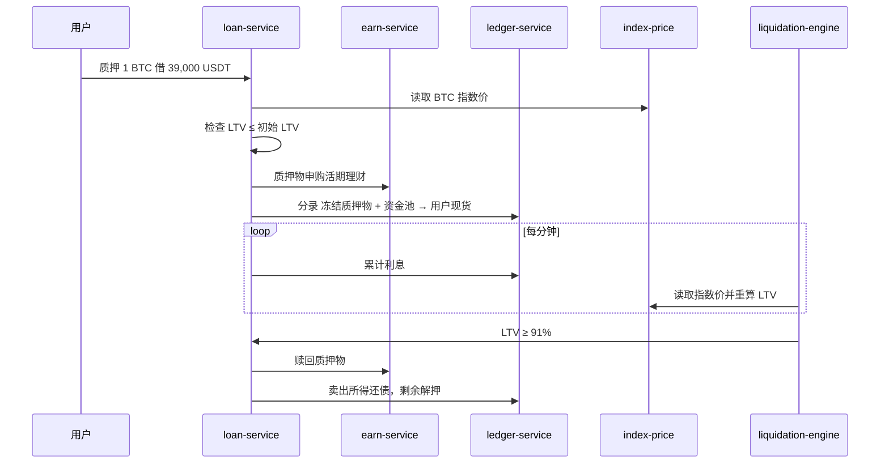
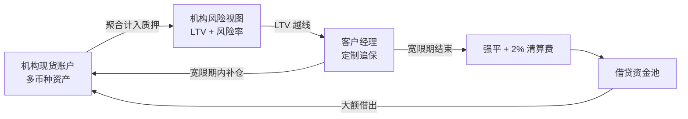
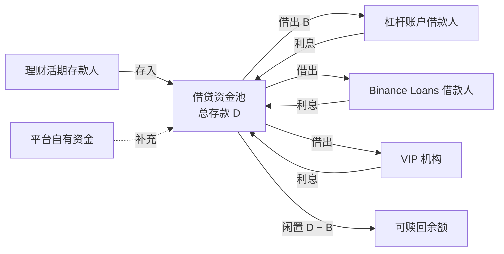
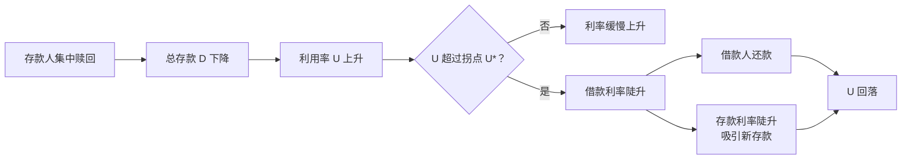
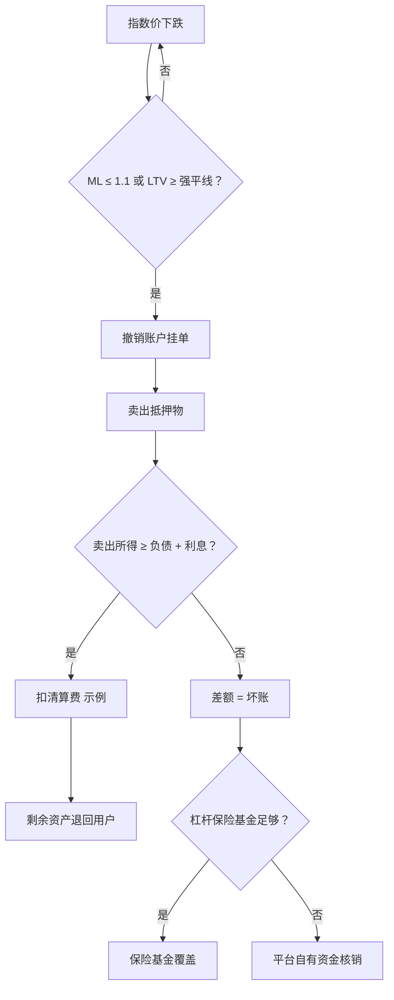

# P01 杠杆与借贷：全仓/逐仓杠杆、Binance Loans、VIP 借贷

> 学习目标：读完本章，你能——
> 1. 用保证金水平（Margin Level）公式算出杠杆账户的追保价和强平价。
> 2. 用抵押率（LTV）公式算出质押借币的追保价和强平价，并说明它与保证金水平的换算关系。
> 3. 画出"理财存款 → 借贷资金池 → 借款人"的资金流，并用拐点（kink）利率曲线解释挤兑时利率为什么飙升。
>
> 前置章节：[05 账本](../05-ledger.md)、[09 风控](../09-risk-control.md)、[10 合约与衍生品](../10-derivatives-futures.md)、[11 产品生态 §3.1 杠杆](../11-products-ecosystem.md)
> 交互实验：[margin-loan-lab.html](../interactive/margin-loan-lab.html)（借贷资金池 + 杠杆账户）
> 相关深潜：[P05 理财与质押](P05-earn-savings-staking.md)、[P04 高级衍生品](P04-advanced-derivatives.md)、[B05 业务风控](../backstage/B05-business-risk.md)、[B06 资金与流动性](../backstage/B06-treasury-liquidity.md)

> ⚠️ 警告：本章内容仅用于学习交易所系统设计，不构成投资建议。借币会放大亏损。行情跳空时，你可能损失全部本金。本章数值除标注"截至 2026 年公开资料"外，都是示例。

---

## 0. 一句话理解

杠杆和借贷是同一件事的两种包装：**用户押上一部分资产，从平台的资金池借出另一部分资产。** 平台持续计算"押的够不够还"。不够时，平台先提醒，再卖掉抵押物还债。

> 🎯 打个比方：借贷资金池像一家当铺后面的大水缸。理财用户往缸里倒水（存币），借款人拿着抵押物来舀水（借币）。当铺按"缸里还剩多少水"定价：缸快见底时，舀一瓢水的价格会突然翻几倍。这样既劝退新的舀水人，也吸引新的倒水人。当铺的"追保线"和"强平线"是两道刻度：抵押物贬值到第一道刻度，当铺打电话提醒；贬值到第二道刻度，当铺直接把抵押物卖掉。

本章顺序：第 1–3 节是三个借贷产品（杠杆账户看保证金水平 ML，Binance Loans 与 VIP 借贷看抵押率 LTV）；第 4 节是它们共用的资金池与利率模型；第 5 节是平台利差、强平与坏账。

---

## 1. 杠杆账户（Margin：全仓 / 逐仓）

### 1.1 用户看到什么

- **两种模式**（截至 2026 年公开资料）：
  - 全仓杠杆（Cross Margin）：杠杆账户内全部资产共同担保全部负债。币安把全仓分为 Classic（经典）和 Pro 两档。
  - 逐仓杠杆（Isolated Margin）：每个交易对一个独立账户。亏损只限于该账户。
- **保证金水平**（Margin Level，ML）：衡量资产能覆盖多少倍负债。币安公开公式：

```
保证金水平 ML = 总资产价值 / (总负债 + 未还利息)
```

- **全仓 Classic 阈值**（截至 2026 年公开资料，以官网为准）：

| 杠杆档 | 正常 | 追保（Margin Call） | 强平（Liquidation） |
|---|---|---|---|
| 3x | ML > 1.3 | 1.1 < ML ≤ 1.3，禁止新借款 | ML ≤ 1.1，停止交易并强平 |
| 5x | ML > 1.16 | 1.1 < ML ≤ 1.16，禁止新借款 | ML ≤ 1.1 |

- **逐仓阈值**：币安公开资料显示，ML > 2 时功能完整；ML 低于 2 时禁止转出；强平线随交易对的杠杆档变化。本章和交互页用 1.1 作为示例强平线。
- **全仓 Classic 的抵押物折算**：币安对净多头资产使用折算率（haircut）。本章示例忽略折算，按 100% 计价。
- **计息**：借款按小时计息（截至 2026 年公开资料）。币安自 2023-03-01 起每小时更新借款利率，并在杠杆数据页显示下一小时预估利率。

> 💡 注意：保证金水平和第 10 章合约的"保证金率"方向相反。保证金水平**越低越危险**（1.1 强平）。合约保证金率**越高越危险**（100% 强平）。

### 1.2 资金流



读图要点：
- 本金从现货账户划入，借款从资金池划入。两笔都是账本内划转，不上链。
- 杠杆买入走的是**同一个现货撮合引擎**。杠杆仓位是真实的币，不是合约头寸。
- 利息先记应收，用户还款时再实收。用户强平时如果资产不够还，应收利息和本金一起变成坏账候选。

### 1.3 状态机



读图要点：
- "追保"状态下用户不能新借款（币安公开规则）。这是阻止风险继续扩大的第一道闸。
- 跳空行情会让账户从"正常"直接进入"强平中"，用户没有追保窗口。
- "坏账"只在强平成交价太差时出现。坏账由平台兜底，不转嫁给理财用户（业界通用做法）。

### 1.4 系统组件与调用链

服务名与 [02 系统总架构](../02-system-architecture.md) 一致。`margin-service`、`interest-job`、`liquidation-engine` 是示意组件，币安内部命名未公开。



读图要点：
- 借款、计息、还款都是账本分录。幂等键防止网络重试造成重复借款，见 [05 账本](../05-ledger.md)。
- `liquidation-engine` 按标记价格（指数价）计算 ML，不按本所最新价（业界通用做法）。理由同第 10 章的插针问题。
- 强平卖单和普通订单进入同一个撮合引擎。流动性差时，强平卖单本身会砸低价格。

### 1.5 定价与收益来源

**用户付出的成本**：借款利息 + 交易手续费 + 强平时的清算费（示例）。

**每小时利息**：

```
每小时利息 = 借款本金 × 年化利率 / 8,760
```

数值示例（示例利率）：借 2,000 USDT，年化 8%。

1. 2,000 × 8% = 160 USDT / 年。
2. 160 / 8,760 ≈ 0.0183 USDT / 小时。
3. 持有 30 天：0.0183 × 720 ≈ 13.15 USDT。

**追保价与强平价**（全仓单币种多头，忽略利息和折算率）：

```
总资产 = 持币数量 × 价格
追保价 = 1.3 × 负债 / 持币数量
强平价 = 1.1 × 负债 / 持币数量
```

数值示例：本金 1,000 USDT，借 2,000 USDT，在 50,000 USDT 买入 0.06 BTC。

| 指标 | 计算 | 结果 |
|---|---|---|
| 开仓 ML | 3,000 / 2,000 | 1.50 |
| 追保价 | 1.3 × 2,000 / 0.06 | 43,333.33 USDT（跌 13.3%） |
| 强平价 | 1.1 × 2,000 / 0.06 | 36,666.67 USDT（跌 26.7%） |
| 破产价（资产 = 负债） | 2,000 / 0.06 | 33,333.33 USDT（跌 33.3%） |

**平台收入**：利息中扣除给理财用户的部分后剩余的利差（见第 4、5 节），以及杠杆交易手续费。

### 1.6 风险与对冲

| 风险 | 谁承担 | 平台的兜底手段 |
|---|---|---|
| 抵押物下跌 | 用户（ML 下降） | 追保线、强平线 |
| 强平成交价低于破产价 | 平台（坏账） | 杠杆保险基金、清算费积累（业界通用做法） |
| 借出币种暴涨（做空借币） | 用户；极端时平台 | 借币限额、单币种借款上限 |
| 资金池被借空 | 想借的用户、想取的存款人 | 利率模型拐点、平台自有资金补充 |

> ⚠️ 警告：做空时，你借入的是币。币价上涨会让负债变大。负债没有上限，所以做空的亏损理论上没有上限。

### 1.7 失败场景与案例

- **跳空穿仓**：示例。价格从 40,000 直接跳到 30,000。0.06 BTC 只值 1,800 USDT，负债 2,000 USDT。缺口 200 USDT 成为坏账。
- **2025-10-10 指数偏离**（公开报道，第 10 章已有细节）：USDe、WBETH、BNSOL 在币安的价格短时偏离。币安称向受影响的合约、**杠杆、借贷**用户补偿约 2.83 亿美元。教训：抵押物估价必须引用多个外部来源。

---

## 2. Binance Loans（质押借币：活期 / 定期）

### 2.1 用户看到什么

- **产品形态**（截至 2026 年公开资料）：用户质押一种币，借出另一种币。每个"抵押币-借出币"组合是一个独立仓位，相当于逐仓。
- **活期借贷**（Flexible Loan）：不设期限，随借随还。利息每分钟累计，利率每分钟更新。
- **质押物与理财联动**：活期借贷的质押物会自动申购简单赚币活期（Simple Earn Flexible）。质押物在借款期间继续获得实时 APR（截至 2026 年公开资料）。
- **定期借贷**（固定期限、固定利率）：用户锁定期限和利率。期限选项为示例：7 天、30 天。
- **抵押率**（Loan-to-Value，LTV）：

```
LTV = (借款本金 + 未还利息) / 质押物价值
```

- **三条 LTV 线**：初始 LTV（开仓上限）、追保 LTV（发提醒）、强平 LTV（卖质押物）。每个币对的数值不同。公开资料中出现过"追保 85%、强平 91%"的组合（例如 Lite Loan 产品）。本章示例采用：初始 65%、追保 85%、强平 91%。

**LTV 与保证金水平的换算**：对单一仓位，ML = 1 / LTV。LTV 91% 约等于 ML 1.099。两个产品的强平线在数学上几乎相同。

### 2.2 资金流



读图要点：
- 借到的 USDT 进入现货账户，用户可以自由使用。这与杠杆账户不同：杠杆账户的借款留在杠杆账户内。
- 质押物被冻结在独立子账户。它仍在理财池里，所以它同时是"借款人的抵押物"和"资金池的存款"。
- 强平只卖出够还债的部分（业界通用做法），剩余质押物退回用户。

### 2.3 状态机



读图要点：
- 活期借贷没有到期状态。只要 LTV 安全，借款可以一直存在。
- 定期借贷多一个"逾期"分支。逾期后利率提高（VIP 借贷的公开规则为三倍日利率，见第 3 节）。
- 追保阶段的提醒通过邮件、短信、App 推送发出。通知链路故障会让用户错过补仓窗口。

### 2.4 系统组件与调用链



读图要点：
- `loan-service`、`earn-service`、`index-price` 为示意组件名。
- 强平前要先从理财中赎回质押物。如果理财赎回本身受限，强平会变慢。平台需要内部预留流动性（业界通用做法）。

### 2.5 定价与收益来源

数值示例：质押 1 BTC，指数价 60,000 USDT，借 39,000 USDT（初始 LTV 65%）。

| 指标 | 计算 | 结果 |
|---|---|---|
| 初始 LTV | 39,000 / 60,000 | 65% |
| 追保价（LTV 85%） | 39,000 / 0.85 | 45,882.35 USDT（跌 23.5%） |
| 强平价（LTV 91%） | 39,000 / 0.91 | 42,857.14 USDT（跌 28.6%） |

**利息**：活期年化 6%（示例），30 天利息 = 39,000 × 6% × 30 / 365 ≈ 192.33 USDT。

**平台收入**：借款利率与存款利率之差，以及强平清算费（示例）。

### 2.6 风险与对冲

- **质押物单一**：一个仓位只有一种质押物。它不能像全仓杠杆那样用别的资产分摊风险。
- **币对差异化阈值**：小币种波动大、深度浅。平台给它更低的初始 LTV，留出更大缓冲。
- **双重占用**：质押物同时在理财池中。理财池被挤兑时，质押物不能被借款人以外的人赎回。平台必须在资金池层面区分"可赎回余额"和"已质押余额"（业界通用做法）。

### 2.7 失败场景与案例

- **强平螺旋**：大量用户用同一币种质押。该币下跌时，强平卖单集中出现，价格继续下跌，触发更多强平。
- **2022 年 Celsius**（公开报道）：Celsius 把存款人资产拿去做高风险出借和质押，挤兑后暂停提现并破产。教训：借贷资金池的期限错配会在挤兑时暴露。详见 [B06 资金与流动性](../backstage/B06-treasury-liquidity.md)。

---

## 3. VIP 借贷（机构信用借贷）

### 3.1 用户看到什么

截至 2026 年公开资料（币安 VIP Loan 页面）：

- 只面向币安 VIP 用户（机构）。首笔借款不低于 500,000 美元。
- 质押物留在现货钱包。只要 LTV 和风险率达标，质押物**可以在现货市场自由交易**。
- 支持跨账户聚合资产，提高资金效率。
- 支持**延迟强平**和定制化追保流程。
- 活期利率按小时计算和累计；定期利率提供 30 天和 60 天期限，按日计息。
- 逾期按三倍日利率计息。触发强平时收取 2% 清算费。

### 3.2 资金流与信用



读图要点：
- VIP 借贷的核心差异是"人在环中"。追保先走客户经理沟通，再走系统强平。
- 延迟强平提高了机构体验，也让平台在跳空行情中多承担风险。平台用尽职调查和合同条款补偿这部分风险（业界通用做法）。

### 3.3 状态机与组件（与第 2 节的差异）

- 准入：Binance Loans 面向 KYC 用户；VIP 借贷面向 VIP / KYB 机构。
- 质押物：Binance Loans 冻结在子账户；VIP 借贷留在现货钱包，可交易。
- 状态机多一个"宽限期"状态：追保 → 宽限期 → 强平。宽限期长度由合同约定。

### 3.4 定价、风险与案例

- **定价与风险**：利率参考资金池利率，再按信用、期限、规模调整（业界通用做法）。信用风险集中在少数大客户。
- **案例**：2022 年三箭资本（3AC）违约（公开报道）。多家机构借贷平台（例如 Voyager、Genesis）对其发放了大额低抵押贷款，最终产生巨额坏账。教训：信用借贷必须有抵押、有集中度上限、有实时风险视图。

---

## 4. 借贷资金从哪来：资金池与利率模型

### 4.1 资金来源

借贷资金池的主要来源是理财用户的活期存款，详见 [P05 理财与质押](P05-earn-savings-staking.md)。币安公开资料说明，理财资金用于杠杆借贷、流动性提供和机构借贷，并由抵押物担保。平台自有资金作为补充（业界通用做法）。



读图要点：
- 利用率 U = 已借出 B / 总存款 D。U 越高，闲置余额越少。
- 存款人赎回只能用闲置余额支付。U 接近 100% 时，存款人取不出钱。
- 局限：本图把多个币种画成一个池。实际每个币种一个池，利率分别计算。

### 4.2 拐点利率曲线（kink model）

业界通用做法来自链上借贷协议（Compound、Aave 公开的利率模型）。币安内部利率模型未公开。

```
如果 U ≤ U*：借款利率 R = 基础利率 + 斜率1 × U / U*
如果 U > U*：借款利率 R = 基础利率 + 斜率1 + 斜率2 × (U − U*) / (1 − U*)
存款利率 S = R × U × (1 − 平台抽成)
```

- U*：拐点利用率（kink）。拐点后的斜率2 远大于斜率1。
- 平台抽成（Reserve Factor）：利息中留给平台的比例。



读图要点：
- 这是一个负反馈回路。高利率同时减少借款、增加存款。
- 回路需要时间。借款人还款前，存款人仍取不出钱。这段时间就是流动性危机窗口。
- 局限：如果借款人被锁在亏损仓位中，他们不会因为利率高就还款。回路会失效。

### 4.3 数值示例

参数（示例）：基础利率 1%，斜率1 6%，拐点 80%，斜率2 60%，平台抽成 10%。

| 场景 | 利用率 U | 借款利率 R | 存款利率 S |
|---|---|---|---|
| 正常 | 70% | 1% + 6% × 0.875 = 6.25% | 6.25% × 0.70 × 0.9 ≈ 3.94% |
| 拐点 | 80% | 7.00% | 7% × 0.80 × 0.9 = 5.04% |
| 紧张 | 95% | 7% + 60% × 0.75 = 52.00% | 52% × 0.95 × 0.9 ≈ 44.46% |

**挤兑示例**：资金池存款 100M USDT，借出 70M（U = 70%）。

1. 存款人取出 20M。存款剩 80M。U = 87.5%。R = 7% + 60% × 0.375 = 29.5%。
2. 存款人再取出 5M。存款剩 75M。U ≈ 93.3%。R ≈ 47%。
3. 闲置余额只剩 5M。再大的赎回请求无法立即满足。

---

## 5. 平台利差、强平与坏账

### 5.1 平台利差

```
平台利息收入 = 借款利率 R × 已借出 B − 存款利率 S × 总存款 D
            = R × B × 平台抽成
```

数值示例（U = 70%，D = 100M）：借款人付 6.25% × 70M = 4.375M / 年。存款人得 3.94% × 100M ≈ 3.94M / 年。平台得约 0.4375M / 年。

> 💡 注意：存款利率低于借款利率，不等于平台"克扣"。原因是存款中只有 U 比例被借出产生利息，闲置部分不产生利息。

### 5.2 强平到坏账的链条



读图要点：
- 强平线 1.1 与破产线 1.0 之间有 10% 缓冲。正常行情下，这段缓冲足够卖出抵押物。
- 坏账只在"卖出所得低于负债"时出现。原因是跳空、流动性枯竭或强平延迟。
- 杠杆借贷没有合约那样的 ADL。平台不能强制减少别人的仓位，所以最终兜底方是平台本身（业界通用做法）。

### 5.3 强平示例

本金 1,000 USDT，负债 2,000 USDT，持有 0.06 BTC（同第 1.5 节）。

| 场景 | 强平成交价 | 卖出所得 | 还债后 | 结果 |
|---|---|---|---|---|
| 正常强平 | 36,600 | 2,196 | +196 | 扣清算费后剩余退回用户 |
| 跳空 | 32,000 | 1,920 | −80 | 坏账 80 USDT |

---

## 末尾

### 本仓库对照（CEX Demo）

本仓库没有实现杠杆、借贷、计息或强平。可以复用的部分：

| 本章需要 | 本仓库现有 | 文件 |
|---|---|---|
| 借款 / 还款 / 计息分录 | 双分录过账与幂等键 | `../../services/ledger-service/src/domain/types.ts`（`PostJournalCommand.idempotencyKey`） |
| 金额精度（避免浮点误差） | 18 位小数的 BigInt 金额 | `../../services/ledger-service/src/domain/money.ts` |
| 账户类型 | 只有 main、spot、funding、fee 等 | `../../packages/domain/src/index.ts`（需新增 margin、loan_pool、interest_receivable） |
| 借款前额度检查 | 只校验现货订单 | `../../services/risk-service/src/application/risk-application-service.ts` |

### 与主线章节的依赖

| 本章内容 | 依赖章节 | 依赖点 |
|---|---|---|
| 借款、计息、还款 | [05 账本](../05-ledger.md) | 双分录、幂等、负债账户 |
| 杠杆买卖 | [06 订单与撮合](../06-order-matching.md) | 杠杆单进入现货撮合 |
| 强平、指数价、保险基金 | [10 合约与衍生品](../10-derivatives-futures.md) | 标记价格、强平引擎 |
| 资金池来源 | [P05 理财与质押](P05-earn-savings-staking.md) | 活期理财 |
| 流动性管理 | [B06 资金与流动性](../backstage/B06-treasury-liquidity.md) | 挤兑应对 |

### 术语表

| 术语 | 英文 | 定义 |
|---|---|---|
| 全仓杠杆 | Cross Margin | 杠杆账户内全部资产共同担保全部负债 |
| 逐仓杠杆 | Isolated Margin | 每个交易对一个独立杠杆账户 |
| 保证金水平 | Margin Level, ML | 总资产价值除以（总负债 + 未还利息） |
| 追保 | Margin Call | 风险指标越过第一道线时，平台提醒用户补仓 |
| 强平 | Liquidation | 平台卖出抵押物偿还负债 |
| 破产价 | Bankruptcy Price | 资产价值恰好等于负债的价格 |
| 抵押率 | LTV, Loan-to-Value | （借款 + 利息）除以质押物价值 |
| 折算率 | Haircut / Collateral Ratio | 抵押物计价时打的折扣 |
| 利用率 | Utilization, U | 已借出金额除以总存款 |
| 拐点 | Kink | 利率曲线斜率突变的利用率 |
| 平台抽成 | Reserve Factor | 借款利息中留给平台的比例 |
| 坏账 | Bad Debt | 强平后仍无法收回的负债 |
| 挤兑 | Bank Run | 大量存款人同时赎回 |

### 思考题

1. 打开 [margin-loan-lab.html](../interactive/margin-loan-lab.html) 的"杠杆账户"。本金 1,000、借入 2 倍、开仓价 50,000。追保价和强平价是多少？与第 1.5 节的表格一致吗？把借入倍数改为 4 倍，强平价离开仓价近了多少？
2. 在"借贷资金池"标签页，把拐点从 90% 拖到 60%。点击"模拟挤兑"。利率峰值如何变化？拐点低对存款人和借款人分别意味着什么？
3. LTV 91% 和 ML 1.1 几乎等价。为什么币安仍然为两个产品各设一套指标？提示：考虑全仓多资产与单币对仓位的差别。
