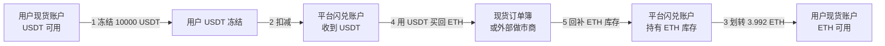
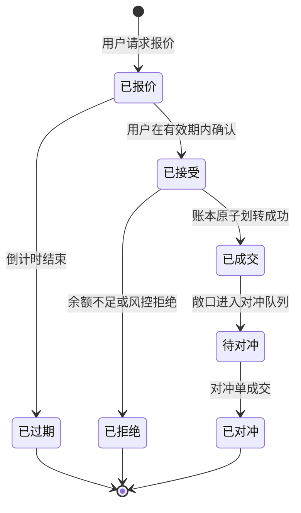
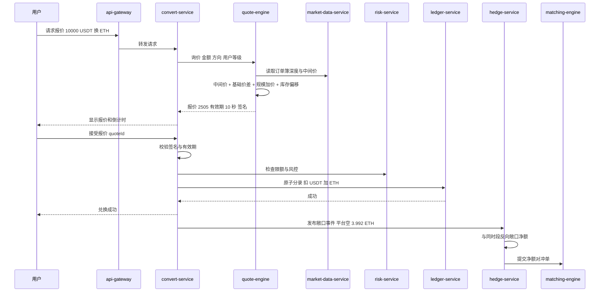
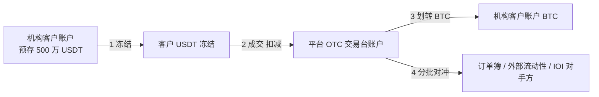
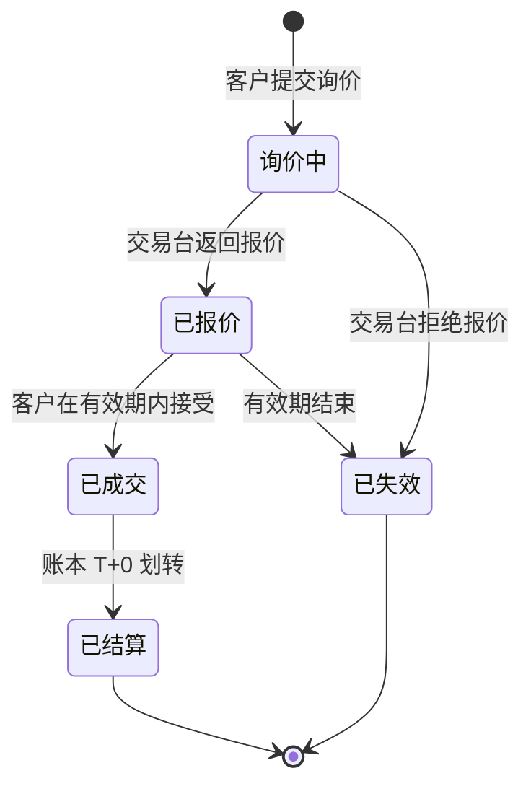
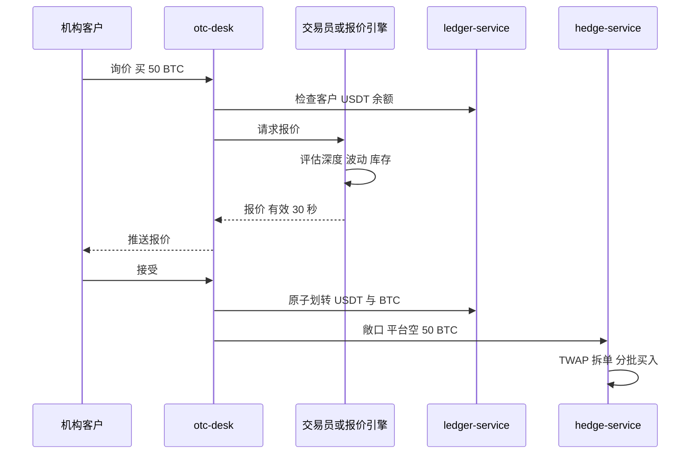
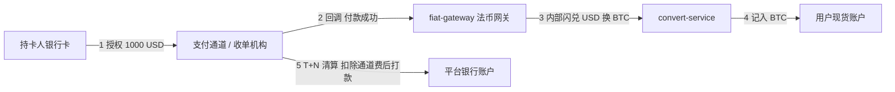
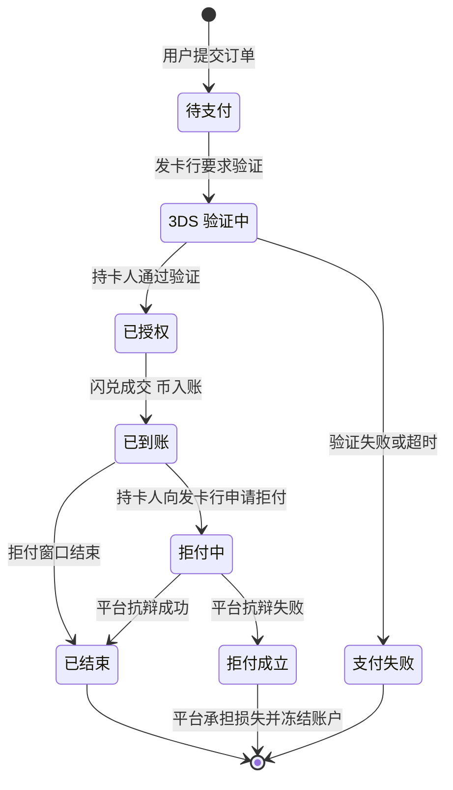
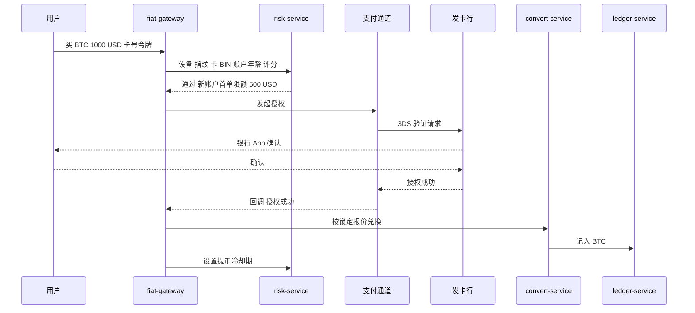
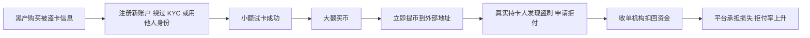

# P02 闪兑、大宗 OTC 与快捷买币

> 学习目标：读完本章，你能——
> 1. 画出闪兑的 RFQ 流程：请求报价 → 报价锁定 → 接受 → 成交 → 对冲。
> 2. 用公式算出一笔闪兑的平台盈亏：价差收入 − 逆向选择损失 − 对冲成本。
> 3. 说出银行卡买币的拒付（Chargeback）风险，以及 3DS 如何转移这部分风险。
>
> 前置章节：[05 账本](../05-ledger.md)、[06 订单与撮合](../06-order-matching.md)、[08 行情](../08-market-data.md)、[11 产品生态 §3.2 与 §3.4](../11-products-ecosystem.md)
> 交互实验：[convert-rfq.html](../interactive/convert-rfq.html)（闪兑报价沙盘）、[depth-slippage.html](../interactive/depth-slippage.html)（深度与滑点）

> ⚠️ 警告：本章不构成投资建议。本章数值除标注"截至 2026 年公开资料"外，都是示例。币安会调整参数，请以官网为准。

## 0. 一句话理解

闪兑、OTC 和快捷买币有一个共同点：**用户的对手方是平台（或平台指定的报价方），不是订单簿上的其他用户。** 平台先给一个确定价格，再自己承担价格风险，然后到市场上对冲。

> 🎯 打个比方：闪兑像机场的货币兑换柜台（第 11 章已用过这个比喻）。本章打开柜台后面的门：柜台每报出一个牌价，就承诺"这 10 秒内按这个价卖给你"。这 10 秒里汇率可能变化，柜台要么提前在牌价里多留一点利润，要么把承诺时间缩短。大客户来换 100 万，柜台不挂牌价，而是由经理单独打电话问银行要价，这就是 OTC。刷卡买外币时，发卡行还有权在几周后把钱要回去，这就是拒付风险。

第 11 章已经介绍了闪兑的基本时序。本章不重复基础流程，而是深入三个问题：报价从哪里来、平台的盈亏由什么决定、哪些用户会让平台持续亏钱。

## 1. 闪兑 Convert

### 1.1 用户看到什么

截至 2026 年公开资料，币安闪兑页面有两种模式：

| 模式 | 用户操作 | 公开规则 |
|---|---|---|
| 市价（Market） | 输入"用 X 换 Y"，点"预览"，页面显示报价和倒计时，点"确认" | 币安声明闪兑不收手续费。报价在一段时间内有效，过期后需要刷新 |
| 限价（Limit） | 设置目标价格和有效期 | 达到限价后按限价兑换。行情短暂触及限价时，订单不一定成交 |

- 报价有效期：币安闪兑 API 的"发送报价请求"接口允许 `validTime` 取 10s、30s、1m，默认 10s（截至 2026 年公开资料）。App 内的倒计时长度由平台决定。
- 限价单有效期：API 的 `expiredType` 可选 1、3、7、30 天（截至 2026 年公开资料）。
- 最小、最大金额：按币种和交易对不同，下单前页面会显示。
- 币安 FAQ 说明：闪兑价格与现货最新成交价不同，因为报价考虑了交易规模，并且是实时价格。

> 💡 注意："零手续费"不等于"零成本"。报价价格与中间价之间的差，就是用户支付的费用。本章 1.5 节给出公式。

### 1.2 资金流



读图要点：

- 第 1–3 步在账本内完成，是一组原子分录。用户立即拿到 ETH，不需要等对冲。
- 第 4–5 步是平台自己的交易。它可以晚几百毫秒发生，也可以和别的闪兑单合并。
- 出错点：第 3 步要求平台账户有足够的 ETH 库存。库存不足时，平台必须拒绝报价或先买后卖。
- 局限：图中只画了"用户买 ETH"一个方向。反方向时，资金流对称。

### 1.3 状态机



读图要点：

- 用户只能看到前四个状态。"待对冲"和"已对冲"是平台内部状态，用户无感知。
- "已过期"不扣任何资金。用户可以重新请求，拿到新的报价。
- 出错点：如果服务器时钟和报价引擎时钟不同步，过期判断会出错。业界通用做法是由服务端统一判断，报价里带过期时间戳和签名。
- 限价闪兑多一个"挂单中"状态：平台持续比较市场价和限价，满足条件时内部生成一次报价并自动接受。

### 1.4 系统组件与调用链

服务名与 [02 系统总架构](../02-system-architecture.md) 一致。`convert-service`、`quote-engine`、`hedge-service` 是本章新增的产品服务（业界通用做法，本仓库未实现）。



读图要点：

- 报价引擎只读行情，不写账本。只有 `convert-service` 调用 `ledger-service`。
- 校验有效期发生在服务端。用户端倒计时只是显示，不作为判断依据。
- 对冲是异步的。`hedge-service` 先做内部净额：A 用户买 ETH、B 用户卖 ETH，两笔敞口互相抵消，只把差额送进订单簿。
- 出错点：对冲单进入订单簿时价格已经变化。这部分损失由平台承担，用户不受影响。

### 1.5 定价与收益来源

报价引擎的报价由四部分组成（业界通用做法）：

```text
报价价格 = 中间价 × (1 + 方向 × 总价差)
总价差   = 基础价差 + 规模加价 + 波动加价 + 库存偏移
```

1. **中间价（Mid Price）**：订单簿买一与卖一的平均值。也可以取多个报价源的加权值。
2. **基础价差**：平台的目标利润。
3. **规模加价**：金额越大，对冲时吃掉的深度越多，滑点越大。报价引擎用订单簿深度估算滑点，并提前加到价格里。
4. **波动加价**：报价有效期越长、行情越剧烈，平台被动承担的价格风险越大。
5. **库存偏移**：如果平台已经持有过多 ETH，报价引擎会让"用户买 ETH"的报价更便宜，以吸引用户帮平台消化库存。

平台每笔闪兑的盈亏分解如下：

```text
单笔盈亏 = 价差收入 − 逆向选择损失 − 对冲延迟损失 − 对冲滑点
价差收入     = 名义金额 × 总价差
逆向选择损失 = 名义金额 × 从报价到接受期间的不利价格变动
对冲延迟损失 = 名义金额 × 从接受到对冲期间的不利价格变动
对冲滑点     = 名义金额 × 对冲单在订单簿上的平均冲击
```

**数值示例**（全部为示例）：

| 项目 | 计算 | 结果 |
|---|---|---|
| 用户请求 | 10,000 USDT 换 ETH，中间价 2,500 | — |
| 报价 | 2,500 × (1 + 0.20%) | 2,505 USDT/ETH |
| 用户得到 | 10,000 ÷ 2,505 | 3.99202 ETH |
| 价差收入 | 10,000 × 0.20% | 约 20.0 USDT |
| 报价期内 ETH 上涨 0.05% | 10,000 × 0.05% | −5.0 USDT |
| 对冲滑点 2 bps | 10,000 × 0.02% | −2.0 USDT |
| 平台净盈亏 | 20.0 − 5.0 − 2.0 | 约 +13.0 USDT |

> 💡 注意：价差收入是确定的，后三项是随机的。平台关心的是 1,000 笔的平均值和尾部风险，不是单笔结果。打开 [convert-rfq.html](../interactive/convert-rfq.html) 观察盈亏分布。

**用户收益从哪里来**：用户不赚平台的钱。用户买到的是"确定价格 + 不看订单簿 + 小币种之间一步兑换"的便利。例如用户想把 A 币换成 B 币，现货可能没有 A/B 交易对，闪兑在内部走 A→USDT→B 两条腿，用户只看到一个价格。

### 1.6 风险与对冲

**风险一：逆向选择（Adverse Selection）。** 定义：愿意接受报价的用户，恰好是报价对平台不利的那一部分用户。

正常用户在倒计时内随机点击"确认"。另一类用户同时盯着其他交易所的价格：

1. 用户不急着确认，等到有效期快结束时再看。如果外部价格已向有利于用户的方向移动，并且幅度大于价差，用户接受报价。
2. 如果外部价格不利，用户让报价过期，什么都不付出。

这类订单流叫**毒性流量（Toxic Flow）**。它让平台成为一个"免费期权"的卖方：用户持有在有效期内选择是否成交的权利，平台没有收权利金。

平台的防线（业界通用做法）：

| 防线 | 作用 | 代价 |
|---|---|---|
| 缩短报价有效期 | 减少用户等待"有利变动"的时间 | 用户来不及确认，体验变差 |
| 按波动率加宽价差 | 让小幅变动不足以覆盖价差 | 正常用户也付更高价格 |
| 按用户分层报价 | 对历史接受率异常、盈利异常的账户加宽价差或限额 | 需要风控画像，可能误伤 |
| 接受时重新比价 | 如果市场价已超出容忍区间，拒绝成交并要求刷新 | 用户看到"报价已失效" |
| 限制频繁询价 | 对只询价不成交的账户限流 | 需要识别正常比价行为 |

**风险二：库存风险（Inventory Risk）。** 平台成交后持有敞口。平台不对冲时，敞口随价格涨跌。业界通用做法：

1. 先做内部净额。同一时段的买单和卖单互相抵消。
2. 净额超过阈值后，再拆单送入订单簿（参见 [06 订单与撮合](../06-order-matching.md)）。
3. 订单簿深度不足时，向外部做市商询价对冲。
4. 敞口超过上限时，报价引擎提高该方向价差，或暂停该方向报价。

库存与资金调度的全局视角见 [B06 资金与流动性管理](../backstage/B06-treasury-liquidity.md)。

### 1.7 失败场景与案例

| 场景 | 原因 | 后果 | 平台处置（业界通用做法） |
|---|---|---|---|
| 行情源延迟 | 报价引擎读到旧的中间价 | 报价偏离真实价格，套利者集中接受 | 行情时间戳超过阈值时暂停报价 |
| 极端行情 | 价格在 1 秒内大幅变动 | 有效期内的报价全部变成毒性报价 | 熔断报价，提示"服务繁忙" |
| 对冲失败 | 订单簿深度枯竭或撮合暂停 | 平台持有无法平掉的敞口 | 暂停闪兑，转外部做市商 |
| 小币种价格操纵 | 有人推高小币种现货价格 | 闪兑按被操纵的中间价报价 | 多源取价，对低流动性币种设单笔上限 |

> **案例说明**：报价套利是做市行业的长期问题。外汇和传统股票做市商也面对"最后观望"（Last Look）的争议。公开报道中，多家加密交易所曾因行情异常而暂停闪兑类功能。具体事件请查阅当时的交易所公告。

## 2. 大宗 OTC

### 2.1 用户看到什么

大宗 OTC（Over-The-Counter，场外交易）：大额交易不进订单簿，由平台交易台单独报价并成交。

截至 2026 年公开资料，币安 OTC 与执行服务提供：

- **RFQ（询价）**：客户发出询价，平台交易台返回一个可成交价格。手动现货 RFQ 的最小金额为 200,000 美元或等值。现货 RFQ 不收手续费。
- **IOI（Indication of Interest，意向撮合）**：平台把大额买方和卖方在场外配对，降低对市场的冲击。
- 账户必须预先充足资金，才能执行交易。

业界通用做法：

- **大客户经理**：机构客户有专属对接人，处理询价、结算、开户资料。
- **T+0 结算**：成交后当天，平台在账本内直接完成双方资产划转。因为双方资产都已在平台托管，不需要传统金融的 T+2 清算周期。
- **算法执行**：客户也可以要求平台按 TWAP（时间加权平均价格）把大单拆成小单分批执行。

### 2.2 资金流



读图要点：

- OTC 的结算和闪兑一样在账本内完成。区别是金额更大、报价由人工或专门引擎给出。
- 第 4 步对冲可以持续数小时。平台承担整段时间的价格风险，所以 OTC 报价包含更大的风险溢价。
- IOI 模式下，平台只撮合双方，不持有敞口，第 4 步不存在。

### 2.3 状态机



读图要点：

- OTC 与闪兑的状态机几乎相同。差异在报价来源和金额等级。
- 出错点："已成交"到"已结算"之间如果客户资金不足，交易失败。所以平台要求预先充足资金。

### 2.4 系统组件与调用链



读图要点：

- 先检查余额，再报价。这样避免"报了价但客户没钱"浪费交易台的风险额度。
- 对冲用 TWAP 拆单，目的是减少市场冲击。代价是对冲期间平台持有敞口。

### 2.5 定价与收益来源

```text
OTC 报价 = 参考价 × (1 + 方向 × (基础价差 + 冲击成本估计 + 持仓风险溢价))
```

示例：客户买 50 BTC，参考价 60,000 USDT。基础价差 0.05%，冲击成本 0.10%，持仓风险溢价 0.05%（全部为示例）。报价 = 60,000 × 1.002 = 60,120。名义金额 300 万 USDT，平台预期毛利 = 300 万 × 0.20% = 6,000 USDT。实际利润取决于对冲成本。

客户为什么接受：如果客户自己在订单簿上市价买 50 BTC，冲击成本可能大于 0.20%，并且成交价不确定。OTC 给的是确定价格。

### 2.6 风险与对冲

- **持仓风险**：对冲需要时间。平台用风险限额控制交易台的最大敞口。
- **信息泄露风险**：如果交易台的对冲单被市场识别，价格会提前移动。业界通用做法是随机化拆单大小和时间。
- **对手方风险**：因为要求预先充足资金，平台对客户几乎没有信用风险。
- **合规风险**：大额资金来源需要更严格的尽职调查。见 [B01 合规](../backstage/B01-compliance.md)。

### 2.7 失败场景与案例

| 场景 | 后果 | 处置 |
|---|---|---|
| 报价后行情跳空 | 交易台对冲亏损 | 缩短报价有效期，市场异常时只报指示价 |
| 客户在多家平台同时询价 | 赢得报价的往往是报价最差的平台（赢家诅咒） | 跟踪客户的"询价-成交比"，调整报价 |
| 客户资金来源有问题 | 平台面临监管处罚 | 大额前置尽职调查，可疑交易上报 |

## 3. 快捷买币（银行卡买币）

### 3.1 用户看到什么

用户选择"用 1,000 美元买 BTC"，绑定 Visa 或 Mastercard，完成验证，几分钟内收到 BTC。

截至 2026 年公开资料，币安支持借记卡和信用卡买币，卡片需要开通 3-D Secure。实际可用卡种、币种和费率按地区不同。卡支付费率的具体数字请以下单页面显示为准。

3DS（3-D Secure）：发卡行在付款时对持卡人做第二次验证（例如短信验证码或银行 App 确认）。

### 3.2 资金流



读图要点：

- 用户在第 4 步就拿到 BTC。平台在第 5 步才真正收到法币，中间有几天的垫资。
- 第 3 步复用闪兑的报价能力。快捷买币 = 法币收款 + 一次闪兑。
- 出错点：第 5 步之后的几周内，持卡人仍可以向发卡行申请拒付，资金会被收单机构扣回。
- 局限：平台与支付通道的合作随地区和监管变化。不同地区看到的支付方式不同。

### 3.3 状态机



读图要点：

- "已到账"不是终态。拒付窗口通常以月计（业界通用做法，具体由卡组织规则决定）。
- 拒付成立时，币早已被转走。平台只能冻结该账户剩余资产，或承担损失。

### 3.4 系统组件与调用链



读图要点：

- 风控在授权前和入账后各介入一次。入账后设置提币冷却期，防止"买完立即提走"。
- 平台不保存原始卡号，只保存支付通道返回的令牌（Token）。这是卡组织数据安全标准的要求（业界通用做法）。
- 出错点：支付通道回调可能重复或乱序。`fiat-gateway` 必须按支付单号幂等处理，见 [05 账本 §3.5](../05-ledger.md)。

### 3.5 定价与收益来源

```text
用户总成本 = 卡支付手续费 + 闪兑价差 + 汇率换算差（如果卡币种与报价币种不同）
平台收入   = 卡支付手续费 − 支付通道成本 + 闪兑价差 − 拒付损失 − 欺诈处理成本
```

数值示例（全部为示例）：用户付 1,000 USD。卡支付手续费 2.0% = 20 USD。剩余 980 USD 按闪兑报价买 BTC，价差 0.3% ≈ 2.9 USD。用户总成本约 22.9 USD。支付通道向平台收 1.5%，即 15 USD。拒付准备金按交易额 0.3% 计提，即 3 USD。平台毛利 ≈ 20 − 15 + 2.9 − 3 = 4.9 USD。

快捷买币的利润率不高。它的主要价值是**拉新**：让没有币的新用户在几分钟内完成第一次买币。

### 3.6 风险与对冲

| 风险 | 来源 | 防线（业界通用做法） |
|---|---|---|
| 拒付欺诈 | 被盗卡买币后提走，真实持卡人拒付 | 3DS、设备指纹、首单限额、提币冷却期 |
| 友好欺诈（Friendly Fraud） | 持卡人本人买币后谎称未授权 | 保留 3DS 和 IP 证据，用于抗辩 |
| 通道中断 | 收单机构因合规压力终止合作 | 多通道冗余，按地区路由 |
| 拒付率超标 | 卡组织对高拒付率商户罚款或终止合作 | 监控拒付率，超阈值时收紧风控 |

> 💡 注意：3DS 的意义在于**责任转移**（Liability Shift）。按卡组织规则，交易通过 3DS 认证后，"非本人交易"类拒付的损失一般转由发卡行承担。这只覆盖欺诈类拒付，不覆盖全部拒付原因（业界通用做法，具体以卡组织规则为准）。

### 3.7 失败场景与案例



读图要点：

- 攻击链的关键节点是 E。提币冷却期直接切断"买完立即提走"。
- C 节点是早期信号。同一设备多张卡、多次小额授权失败，都应触发风控。
- 局限：冷却期会让正常新用户不满。平台需要在体验与损失之间取舍，见 [B05 业务风控](../backstage/B05-business-risk.md)。

## 末尾：与主线章节的依赖

| 本章能力 | 依赖的主线章节 | 关系 | 本仓库对照（CEX Demo） |
|---|---|---|---|
| 账本原子划转 | [05 账本](../05-ledger.md) | 闪兑、OTC、买币都靠一组分录完成换币 | `postJournal`，见 `../../services/ledger-service/src/application/ledger-application-service.ts` 第 70 行 |
| 冻结与扣减 | [05 账本 §3.4](../05-ledger.md) | 接受报价时先冻结，再扣减 | 同文件 `freezeBalance`（第 105 行）、`consumeBalance`（第 227 行） |
| 对冲下单 | [06 订单与撮合](../06-order-matching.md) | 对冲单就是平台账户提交的普通订单 | `../../services/order-service/src/application/order-application-service.ts` |
| 中间价与深度 | [08 行情](../08-market-data.md) | 报价引擎读取深度估算滑点 | `../../services/market-data-service` |
| 限额与反欺诈 | [09 风控](../09-risk-control.md) | 首单限额、提币冷却、询价限流 | `../../services/risk-service/src` |
| 收入归类 | [12 商业模式](../12-business-model.md) | 闪兑价差属于隐含交易收入 | 未实现 |
| 法币通道对账 | [B04 对账](../backstage/B04-reconciliation.md) | 支付通道流水与账本比对 | 本仓库不做法币入金（见仓库 `README.md`） |

本仓库没有 `convert-service`、`quote-engine`、`hedge-service`、`otc-desk`、`fiat-gateway`。如果要扩展，业界通用做法是新增产品服务，调用已有的账本和订单服务，不修改账本本身。

## 术语表

| 术语 | 英文 | 定义 |
|---|---|---|
| 闪兑 | Convert | 平台直接报价、用户一键换币的产品 |
| 询价 | RFQ, Request for Quote | 先请求报价，再决定是否成交的交易方式 |
| 报价有效期 | Quote Validity | 报价可以被接受的时间窗口 |
| 中间价 | Mid Price | 买一价与卖一价的平均值 |
| 价差 | Spread | 报价与中间价之间的差，是闪兑的隐含费用 |
| 基点 | bp, Basis Point | 0.01%。20 bps = 0.20% |
| 逆向选择 | Adverse Selection | 接受报价的用户恰好是让平台亏钱的那部分用户 |
| 毒性流量 | Toxic Flow | 系统性利用报价延迟获利的订单流 |
| 库存风险 | Inventory Risk | 平台持有敞口期间价格变动造成的风险 |
| 内部净额 | Internal Netting | 同时段反向敞口互相抵消，只对冲差额 |
| 场外交易 | OTC, Over-The-Counter | 不进订单簿、由交易台单独报价的大额交易 |
| 意向撮合 | IOI, Indication of Interest | 平台在场外配对大额买卖双方 |
| 时间加权平均价格 | TWAP | 把大单按时间均匀拆分执行的算法 |
| 拒付 | Chargeback | 持卡人通过发卡行撤销已完成的卡交易 |
| 3-D 安全验证 | 3DS, 3-D Secure | 发卡行在卡支付时对持卡人做的额外验证 |
| 责任转移 | Liability Shift | 通过 3DS 后，欺诈类拒付损失转由发卡行承担 |
| 收单机构 | Acquirer | 为商户处理卡支付并结算资金的机构 |

## 思考题

1. 打开 [convert-rfq.html](../interactive/convert-rfq.html)。保持默认参数（毒性用户占 20%），打开"毒性流量"开关。平台平均每笔盈亏如何变化？把报价有效期从 10 秒缩短到 3 秒，或把价差从 4 bps 加到 8 bps，哪一种更有效？哪一种对正常用户的伤害更小？
2. 一笔 OTC 询价金额 1,000 万 USDT。用 [depth-slippage.html](../interactive/depth-slippage.html) 估算在订单簿上直接成交的滑点。交易台应该在报价中加多少冲击成本？如果客户同时向 5 家平台询价，你的报价策略要怎么调整？
3. 快捷买币为新用户设置了 24 小时提币冷却期（示例）。列出这条规则拦截的攻击和误伤的用户。参考 [risk-rules-lab.html](../interactive/risk-rules-lab.html)，设计一条更精细的替代规则。
