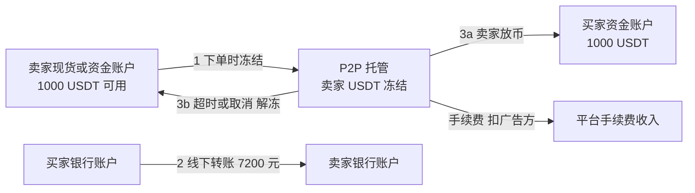
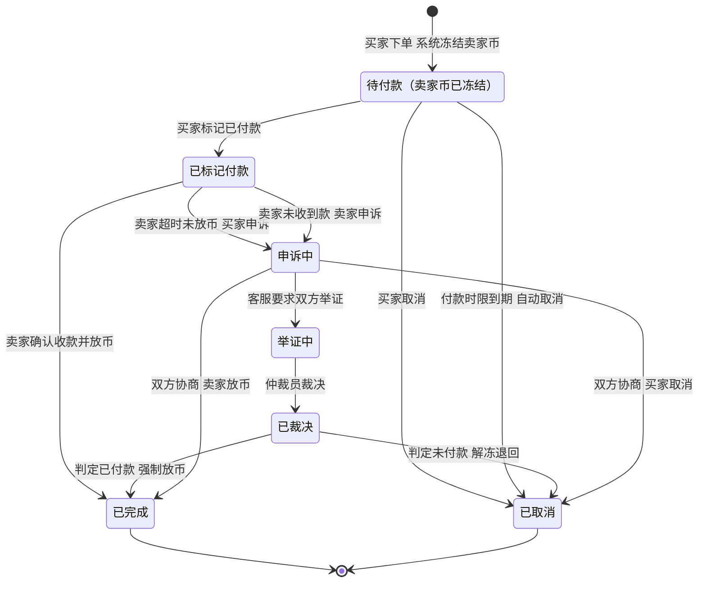
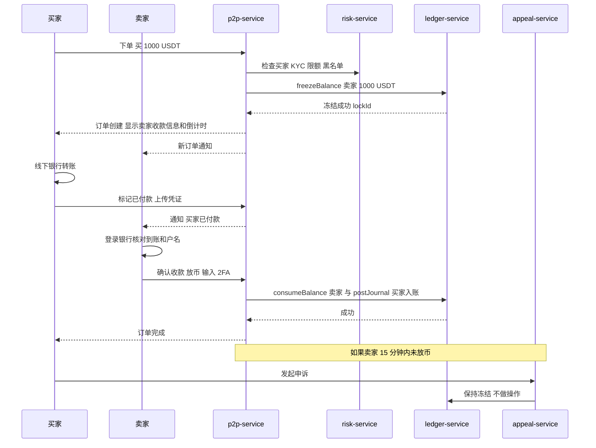
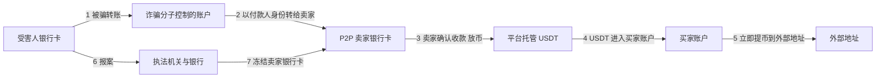
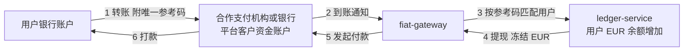
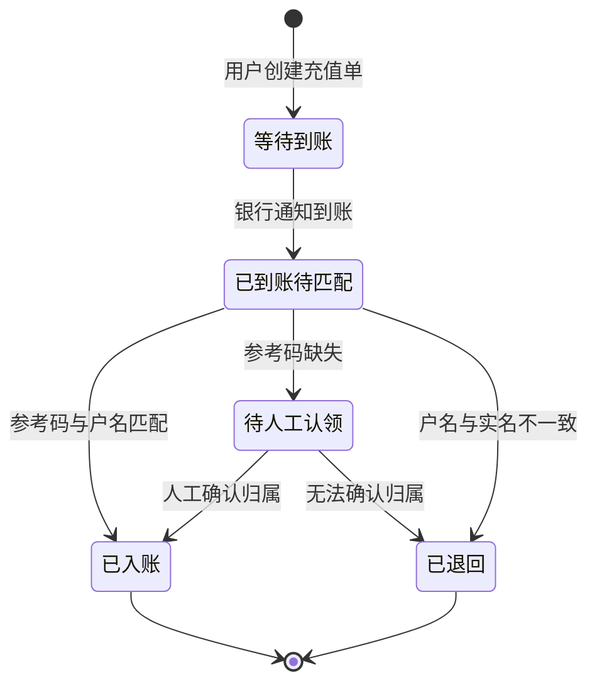
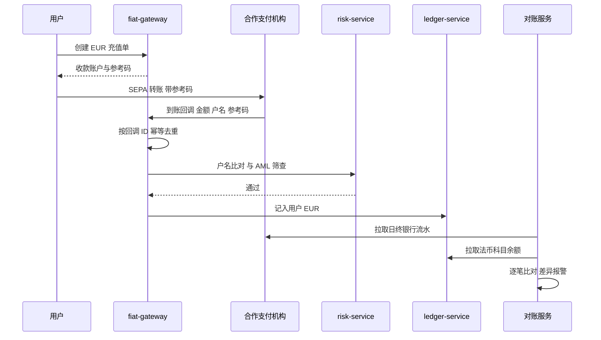

# P03 P2P 交易与法币充提

> 学习目标：读完本章，你能——
> 1. 画出 P2P 订单状态机，包括付款超时自动取消、申诉、仲裁三条分支。
> 2. 解释平台为什么只托管加密资产、不经手法币，以及这个设计带来的反诈难题。
> 3. 说出法币充提通道（银行卡、银行转账、SEPA 等）的资金流和对账要点。
>
> 前置章节：[03 账户、身份与安全](../03-account-identity-security.md)、[05 账本 §3.4 冻结生命周期](../05-ledger.md)、[09 风控](../09-risk-control.md)、[11 产品生态 §3.3 与 §3.4](../11-products-ecosystem.md)
> 交互实验：[p2p-escrow.html](../interactive/p2p-escrow.html)（P2P 订单状态机）、[aml-graph.html](../interactive/aml-graph.html)（资金关系图）

> ⚠️ 警告：本章只讲系统设计和风险机制，不构成投资或法律建议。P2P 和法币兑换在不同国家和地区的法律地位不同，读者应遵守所在地法律。本章数值除标注"截至 2026 年公开资料"外，都是示例。

## 0. 一句话理解

P2P 是"用户和用户之间用法币买卖加密资产"。平台只做两件事：**托管卖家的币**，以及**在双方争议时做裁决**。法币始终在双方的银行账户之间直接流动，平台看不到、也控制不了。

> 🎯 打个比方：P2P 像二手交易平台的"担保交易"。卖家先把货交给平台保管。买家线下把钱转给卖家。卖家确认收到钱，平台才把货交给买家。区别在于：二手平台通常也代收货款，而 P2P 平台**不代收法币**。所以平台只能看"收据"判断钱有没有付，而收据可以造假，付款人可以是别人，钱也可能来自诈骗。

第 11 章 §3.3 已给出 P2P 的基本状态机。本章补充三件事：超时与申诉的细节、反诈机制、平台的商业逻辑。

## 1. P2P 交易

### 1.1 用户看到什么

**两类角色**：

| 角色 | 英文 | 做什么 |
|---|---|---|
| 广告方（商家） | Maker / Advertiser | 发布广告：币种、价格、数量、限额、收款方式、付款时限 |
| 下单方（用户） | Taker | 浏览广告，选择一个下单 |

**公开规则（截至 2026 年公开资料，摘自币安 P2P 用户交易政策）**：

- 平台声明自己不是 P2P 交易的一方。平台托管加密资产，作为中立的撮合与争议处理方。
- 买家必须在卖家广告规定的时限内完成付款。
- 卖家确认收到全额付款后，必须在 15 分钟内放币。
- 付款账户的户名必须与买家在平台实名认证的姓名一致。使用非实名付款方式的，至少暂停 7 天 P2P 权限，争议中由买家承担损失。
- 未付款就点击"已转账，通知卖家"，账户可能被暂停。
- 买家未经卖家同意取消订单，同一天累计 3 次后，当天不能再买。
- 下单方连续 5 笔未在时限内付款，暂停买入 24 小时。广告方连续 5 笔未付款，暂停发广告 24 小时。连续 8 笔，永久关闭广告权限。
- 争议处理只认官方订单内的聊天记录。

**费用**：公开报道显示，币安对下单方收 0 手续费，对广告方按法币市场和币种收 0%–0.35%（截至 2026 年公开资料，以官网费率页为准）。

### 1.2 资金流



读图要点：

- 加密资产只在平台账本内移动：冻结 → 划转或解冻。法币只在两家银行之间移动。
- 平台账本里**没有任何法币分录**。平台对第 2 步的了解只来自买家标记、卖家确认和截图凭证。
- 出错点：第 2 步可能根本没发生（假截图），可能由第三人付款（三方支付），也可能是诈骗赃款。
- "托管"在账本上就是冻结。它对应 [05 账本](../05-ledger.md) 的冻结、解冻、扣减三种操作。

### 1.3 状态机



读图要点：

- 关键规则：**进入"已标记付款"后，系统不再自动取消订单**。因为买家可能真的已经付款，自动退币会让买家钱币两空。
- 自动取消只发生在"待付款"状态。这条规则把超时风险留给买家：没付款就别点已付款。
- 申诉期间币保持冻结。最终只有两个出口：放给买家，或解冻给卖家。
- 局限：系统只能保证"币"不会凭空消失。"钱"有没有付，需要仲裁员根据证据判断。

### 1.4 系统组件与调用链

`p2p-service`、`appeal-service` 是业界通用的产品服务划分，本仓库未实现。



读图要点：

- 放币需要卖家二次验证（2FA）。原因是放币不可逆，平台要确认是卖家本人操作。
- 下单冻结和放币划转都调用账本服务。`p2p-service` 自己不保存余额。
- 申诉服务在裁决前不触碰账本。裁决后它调用与正常流程相同的划转或解冻接口。
- 出错点：卖家把"放币"按钮当成"我看到截图了"来点，币就放出去了。平台的提示文案和二次确认是第一道防诈线。

### 1.5 仲裁证据流程

申诉进入后，业界通用做法是按下列步骤处理：

1. 系统锁定订单。双方不能再取消或放币，除非协商。
2. 客服在订单聊天中要求双方举证。举证有时限（示例：24 小时）。
3. 买家提供：银行转账回单、显示付款户名和收款户名的流水、转账时间。
4. 卖家提供：银行流水全页录屏（证明没有收到款或收到的户名不符）。
5. 仲裁员比对：金额、时间、付款户名、收款账号是否与订单一致。
6. 仲裁员裁决。系统按裁决执行放币或解冻。
7. 系统记录违规方，并按规则扣分、限权或封号。

| 争议类型 | 关键证据 | 常见裁决（示例） |
|---|---|---|
| 卖家收款后不放币 | 买家转账回单 + 银行流水 | 强制放币给买家，卖家受处罚 |
| 买家假付款截图 | 卖家银行流水录屏 | 解冻退回卖家，买家封禁 |
| 三方支付 | 收款户名与买家实名不一致 | 卖家原路退款，订单取消，买家受处罚 |
| 付款金额不足 | 银行流水 | 买家补款或卖家退款后取消 |

> 💡 注意：截图是最弱的证据，因为截图容易伪造。录屏和银行官方流水更强。仲裁员看的是证据链是否一致，不是单张图片。

### 1.6 定价与收益来源

**价格**：广告价格由商家自己定。P2P 价格通常围绕"现货价格 × 汇率"上下浮动。浮动幅度反映了法币出入金的难度和风险。

**平台为什么不收或少收手续费**：

1. **拉新**：P2P 是很多地区用户的第一个入金入口。入口越便宜，用户越多。
2. **带动其他产品**：用户买到 USDT 后，会去现货、合约、理财。真正的收入在下游产品。
3. **竞争**：P2P 市场的商家可以去任何平台发广告。手续费高，商家和流动性就会流走。
4. **成本结构**：平台不经手法币，没有支付通道成本。主要成本是客服仲裁和风控。

商家的收益来自买卖价差。示例：商家以 7.15 元买入 USDT，以 7.22 元卖出。每 1,000 USDT 赚 70 元。广告方手续费 0.20% 约 14.4 元（示例）。商家净赚约 55.6 元。商家承担的风险是收到问题资金导致银行卡被冻结。

```text
平台 P2P 收入 = Σ 广告方成交额 × 广告方费率
平台 P2P 成本 = 客服仲裁人力 + 风控系统 + 商家保证金管理 + 合规成本
```

### 1.7 风险与对冲：商家认证与反诈

**商家认证（Merchant Verification）**：

截至 2026 年公开资料，申请成为币安 P2P 商家需要完成高级身份认证；根据完成认证的地区，可能需要缴纳保证金；退出计划后保证金在 7 个工作日内全额退还。交易量、完成率等具体门槛按地区不同，以官网为准。

商家认证的作用（业界通用做法）：

- 保证金提高违约成本。商家违规时，平台可以从保证金中赔付受害方。
- 认证标识帮助用户选择更可靠的对手方。
- 平台可以对认证商家做更严格的资金来源审查。

**反诈：三类核心风险**：

| 风险 | 怎么发生 | 谁受损 | 平台防线（业界通用做法） |
|---|---|---|---|
| 三方支付 | 付款银行账户的户名与买家实名不一致 | 卖家：真实户主报案后，卖家收到的钱被认定为赃款 | 实名一致规则、卖家核对户名、违规处罚 |
| 洗钱 | 诈骗赃款通过 P2P 换成 USDT 后提走 | 卖家和平台：资金链被追查 | KYC、限额、交易图谱分析、可疑交易上报 |
| 冻卡（"黑钱"问题） | 卖家收到的法币来自电信诈骗等违法活动，银行或执法机关冻结卖家银行卡 | 卖家：银行卡被冻结，资金被扣划 | 平台无法直接解冻银行卡，只能提供订单记录配合核查 |

> ⚠️ 警告：在中文语境下，"收到黑钱导致银行卡被冻结"是 P2P 卖家最常遇到的风险。典型链条：诈骗分子骗取受害人转账 → 用受害人的钱向 P2P 卖家"买币" → 受害人报案 → 资金流水指向卖家银行卡 → 银行卡被冻结。卖家在平台上的交易看起来完全正常，但仍然受损。平台的托管机制只保护"币"，不保护"钱"。



读图要点：

- 第 2 步的付款人户名往往不是买家本人。这就是"三方支付"规则存在的原因：只要卖家坚持户名一致，这条链在第 3 步就会断。
- 第 5 步"秒提"是洗钱的强信号。平台可以对 P2P 入账的资产设置提币观察期。
- 平台能控制的是第 3、4、5 步。第 1、2、6、7 步都发生在银行体系内，平台无法干预。
- 局限：如果诈骗分子使用买家本人的银行卡（例如收购来的实名账户），户名一致规则也会失效。这需要 [aml-graph.html](../interactive/aml-graph.html) 中的图谱分析。

### 1.8 失败场景与案例

| 场景 | 现象 | 系统表现 | 处置 |
|---|---|---|---|
| 买家付款后忘记点"已付款" | 时限到期，订单自动取消 | 卖家币解冻，买家钱已付出 | 买家联系卖家退款；平台尽力协助，但不保证 |
| 卖家收款后失联 | 买家已标记付款，卖家不放币 | 订单停在"已标记付款"，不会自动取消 | 买家申诉，仲裁强制放币 |
| 买家假截图 | 卖家没核对银行就放币 | 币已划转，不可逆 | 卖家申诉追查，成功率低；这是卖家最大的操作风险 |
| 银行撤回付款 | 卖家放币后，付款被银行冲正 | 账本已完成 | 平台冻结买家剩余资产，配合调查 |

> **案例说明**：多国执法机关和公开新闻报道过利用 P2P 交易洗钱、以及 P2P 卖家因收款来源问题被冻卡的案例。不同地区监管对 P2P 的态度差异很大，部分地区限制或禁止相关业务。本章不评价具体地区政策，只解释机制。

## 2. 法币充提通道

### 2.1 用户看到什么

用户在"充值法币"页面选择币种和通道，例如欧元 SEPA 银行转账、银行卡、本地电子钱包。用户把法币打到指定账户，到账后账户出现法币余额，可以直接买币。提现时反向操作。

截至 2026 年公开资料，可用通道按地区不同。通道由平台合作的银行或持牌支付机构提供，不同地区的用户看到不同的通道列表。具体手续费和到账时间以页面显示为准。

| 通道类型 | 典型到账时间（业界通用） | 主要风险 |
|---|---|---|
| SEPA 银行转账（欧元区） | 1 个工作日内，即时 SEPA 更快 | 付款人户名不一致，需要退款 |
| 银行卡 | 即时 | 拒付，见 [P02 §3](P02-convert-otc.md) |
| 本地电子钱包 | 即时到数小时 | 通道稳定性，合规审查 |

### 2.2 资金流



读图要点：

- 与 P2P 不同，这里平台（通过合作机构）**真正经手法币**。所以账本里有法币科目，需要与银行流水对账。
- 第 3 步靠参考码匹配用户。用户忘填参考码时，资金进入"待认领"状态，需要人工处理。
- 出错点：付款户名与平台实名不一致时，业界通用做法是原路退回，不入账。

### 2.3 状态机



读图要点：

- "已入账"之前，资金在平台的客户资金账户里，但不属于任何用户余额。对账时它是一个单独的"在途"科目。
- 局限：退回也有成本和时间。被退回的资金还可能涉及反洗钱核查。

### 2.4 系统组件与调用链



读图要点：

- 回调可能重复或丢失。`fiat-gateway` 必须幂等，并用日终对账补漏。
- 对账服务是法币通道的最后防线。逐笔比对规则见 [B04 对账](../backstage/B04-reconciliation.md)。

### 2.5 定价与收益来源

```text
用户成本 = 通道手续费 + 汇率差（跨币种时）
平台收入 = 通道手续费 − 合作机构成本 + 后续交易收入
```

示例：某地区 SEPA 充值免费，银行卡充值收 1.8%（全部为示例）。平台在 SEPA 上不赚钱，甚至亏合作机构费用。平台用免费入金换用户后续的交易手续费。

### 2.6 风险与对冲

| 风险 | 说明 | 防线（业界通用做法） |
|---|---|---|
| 银行合作中断 | 合作银行因合规压力终止服务 | 每个地区至少两家合作机构；预留切换方案 |
| 客户资金隔离 | 监管要求客户法币与平台自有资金分开 | 专用客户资金账户；定期审计 |
| 反洗钱 | 法币入口是监管关注的重点 | 户名一致、来源审查、大额报告，见 [B01 合规](../backstage/B01-compliance.md) |
| 对账差异 | 银行流水与账本不一致 | 日终逐笔对账；差异在下一工作日内清零 |

### 2.7 失败场景与案例

> **案例说明**：2023 年前后，美国多家对加密行业友好的银行相继出现问题或收缩相关业务（公开新闻）。多家交易所的美元出入金通道因此受到影响。这说明法币通道依赖外部合作方，单一通道是系统性风险。具体时间线请查阅当时的新闻报道和交易所公告。

| 场景 | 后果 | 处置 |
|---|---|---|
| 合作银行暂停服务 | 某币种充提暂停 | 公告用户，启用备用通道 |
| 回调丢失 | 用户已转账但未入账 | 日终对账发现差异，人工补入账 |
| 用户填错参考码 | 资金进入待认领 | 用户提交转账凭证，人工匹配 |

## 末尾：与主线章节的依赖

| 本章能力 | 依赖的主线章节 | 关系 | 本仓库对照（CEX Demo） |
|---|---|---|---|
| P2P 托管 = 冻结 | [05 账本 §3.4](../05-ledger.md) | 下单冻结卖家币 | `freezeBalance`，`../../services/ledger-service/src/application/ledger-application-service.ts` 第 105 行 |
| 取消 = 解冻 | [05 账本 §3.4](../05-ledger.md) | 超时、取消、裁决卖家胜 | 同文件 `releaseBalance`（第 174 行） |
| 放币 = 扣减 + 入账 | [05 账本](../05-ledger.md) | 卖家确认或裁决买家胜 | 同文件 `consumeBalance`（第 227 行）、`postJournal`（第 70 行） |
| 实名与 2FA | [03 账户、身份与安全](../03-account-identity-security.md) | 户名比对、放币二次验证 | `../../services/identity-service` |
| 限额与反诈 | [09 风控](../09-risk-control.md) | 下单前检查、提币观察期 | `../../services/risk-service/src` |
| 法币对账 | [B04 对账](../backstage/B04-reconciliation.md) | 银行流水 vs 账本 | 本仓库不做法币入金（见仓库 `README.md`） |
| 反洗钱 | [B01 合规](../backstage/B01-compliance.md) | 可疑交易识别与上报 | 未实现 |

关键观察：P2P 担保托管在账本上只需要冻结、解冻、扣减三个操作。本仓库 `ledger-service` 已经具备。难点不在账本，而在账本之外：法币事实的验证、证据仲裁和反诈。

## 术语表

| 术语 | 英文 | 定义 |
|---|---|---|
| 点对点交易 | P2P, Peer-to-Peer | 用户之间用法币买卖加密资产，平台托管加密资产 |
| 广告方 / 商家 | Maker / Advertiser | 发布买卖广告的一方 |
| 下单方 | Taker | 选择广告并下单的一方 |
| 担保托管 | Escrow | 平台冻结卖家的币，条件满足后才放给买家 |
| 放币 | Release | 卖家确认收款后，平台把托管的币划给买家 |
| 付款时限 | Payment Window | 买家必须完成付款并标记的时间窗口 |
| 申诉 | Appeal | 一方对订单状态有异议时请求平台介入 |
| 仲裁 | Arbitration | 平台根据证据对申诉做出裁决 |
| 三方支付 | Third-Party Payment | 付款账户户名与买家实名不一致的付款 |
| 冻卡 | Bank Account Freeze | 银行或执法机关冻结涉案资金所在的银行账户 |
| 商家保证金 | Merchant Security Deposit | 商家缴纳的押金，用于约束违约行为 |
| 法币网关 | Fiat Gateway | 对接银行和支付机构、处理法币充提的服务 |
| SEPA | Single Euro Payments Area | 欧元区统一的银行转账体系 |
| 参考码 | Reference Code | 用户转账时填写的唯一编码，用来匹配用户 |
| 客户资金隔离 | Segregation of Client Funds | 客户资金与平台自有资金分开存放 |

## 思考题

1. 打开 [p2p-escrow.html](../interactive/p2p-escrow.html)，选择"买家假付款截图"场景。如果卖家不核对银行就点"放币"，会发生什么？平台还能做什么？对比卖家先申诉的结果。
2. 为什么"已标记付款"状态不能像"待付款"一样超时自动取消？如果改成自动取消，哪一类欺诈会变得容易？
3. 平台对 P2P 下单方免手续费。用 [revenue-model.html](../interactive/revenue-model.html) 思考：如果 P2P 每带来 1 个新用户，该用户第一年在现货和合约上贡献多少手续费，才值得平台承担 P2P 的客服与风控成本？
