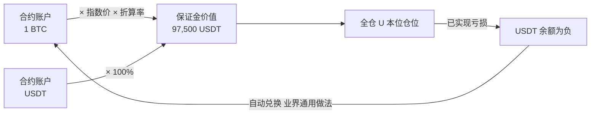
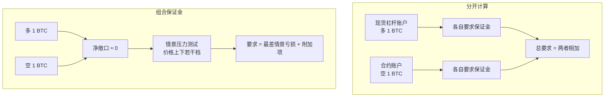
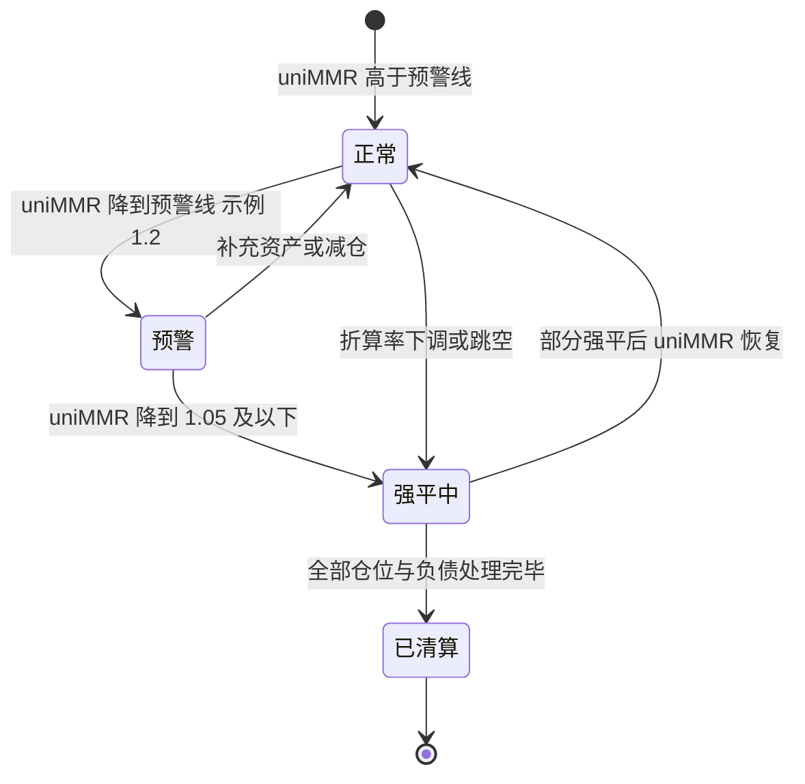
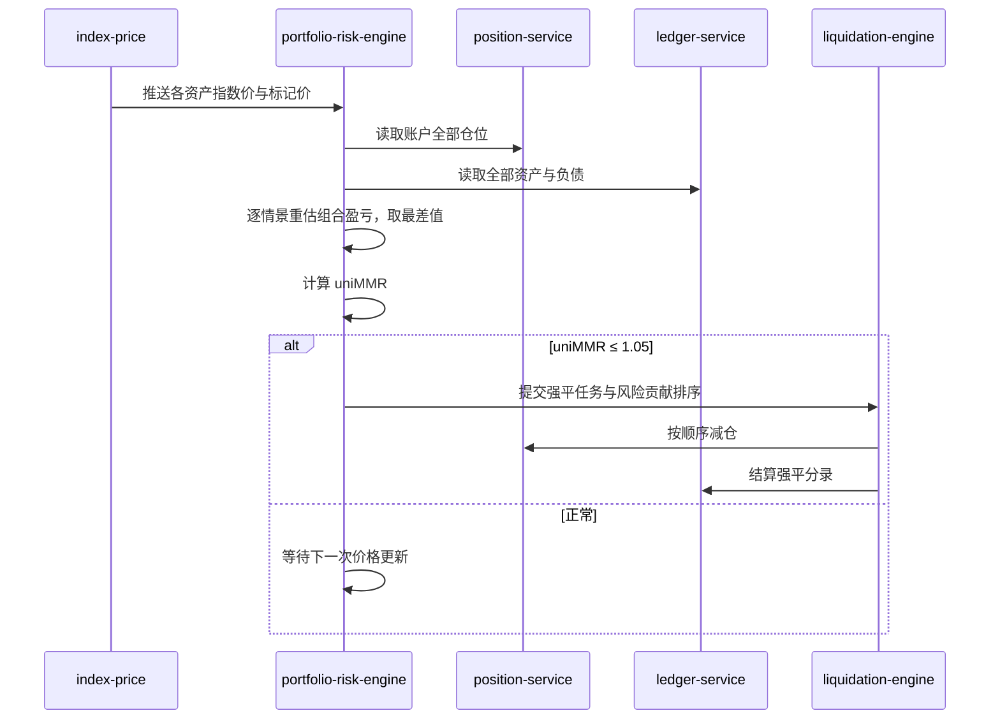
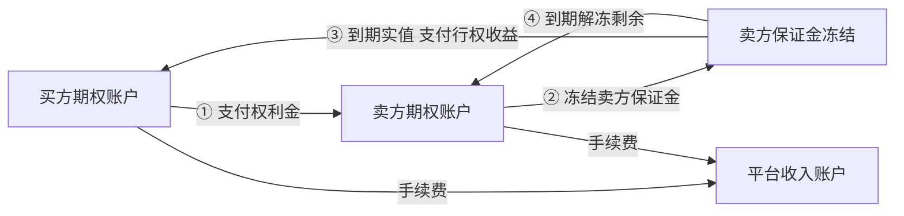
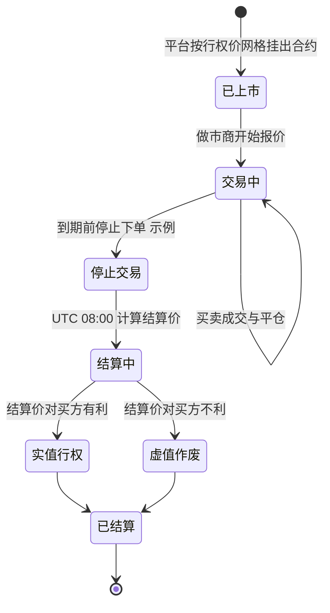
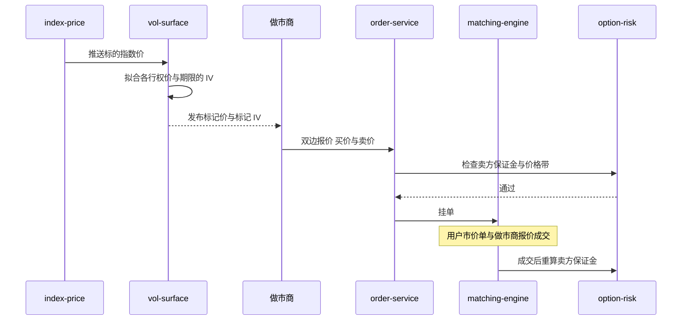
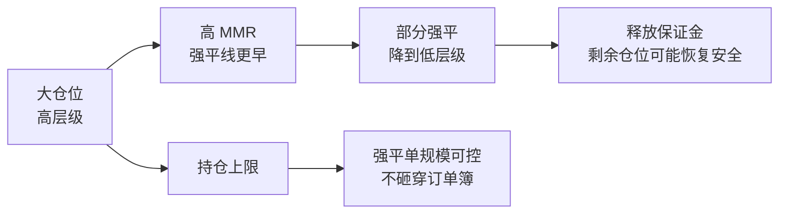
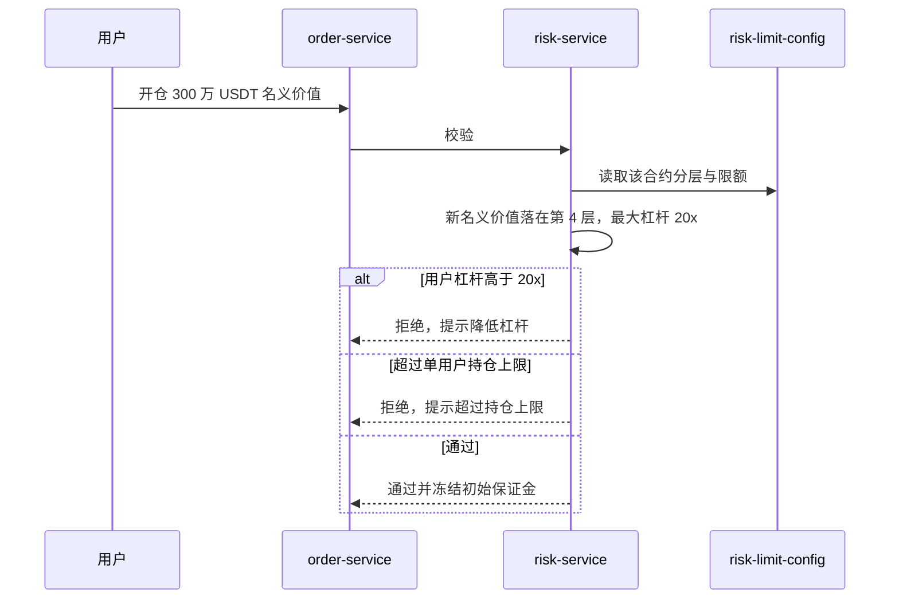

# P04 高级衍生品：多资产保证金、统一账户与组合保证金、期权、风险限额

> 学习目标：读完本章，你能——
> 1. 说明多资产保证金模式和组合保证金（Portfolio Margin）如何提高资金效率，以及它们各自引入的新风险。
> 2. 解释欧式期权的买方和卖方、四个常用 Greeks，并算出一个卖方保证金示例。
> 3. 画出合约风险限额的分层结构，说明平台为什么限制单个用户和全市场的持仓规模。
>
> 前置章节：[10 合约与衍生品](../10-derivatives-futures.md)（必读：标记价格、分层杠杆、强平、保险基金、ADL）、[09 风控](../09-risk-control.md)、[P01 杠杆与借贷](P01-margin-and-loans.md)
> 交互实验：[perpetual-liquidation.html](../interactive/perpetual-liquidation.html)（单仓位强平）、[margin-loan-lab.html](../interactive/margin-loan-lab.html)（保证金水平）、[dual-investment.html](../interactive/dual-investment.html)（卖期权的用户视角）
> 相关深潜：[P06 结构化产品](P06-structured-products.md)、[B05 业务风控](../backstage/B05-business-risk.md)

> ⚠️ 警告：本章内容仅用于学习交易所系统设计，不构成投资建议。期权卖方的亏损可能远大于收到的权利金。组合保证金会让高杠杆更容易实现。本章数值除标注"截至 2026 年公开资料"外，都是示例。

---

## 0. 一句话理解

第 10 章讲的是"一个仓位、一种保证金、一套强平"。本章讲平台如何把**多个仓位、多种资产、多种产品**放进同一个风险框架：按整个组合的真实风险收保证金，同时给每个用户和每个市场设上限。

> 🎯 打个比方：第 10 章的逐仓像给每辆车单独买保险，按车收保费。组合保证金像给整个车队买保险：保险公司看的是"整个车队在最坏天气下会损失多少"。车队里有一辆往东开的车和一辆往西开的车，二者不会在同一场暴雨中同时出事，保费就便宜。但保险公司也会规定：一个车队最多多少辆车，否则一场意外就赔不起。

| 节 | 产品或机制 | 解决的问题 | 新增的风险 |
|---|---|---|---|
| 1 | 多资产保证金模式 | 不卖 BTC 也能做 U 本位合约 | 抵押物下跌与仓位亏损叠加 |
| 2 | 统一账户 / 组合保证金 | 对冲仓位重复占用保证金 | 模型风险、折算率调整 |
| 3 | 期权 | 非线性收益、波动率交易 | 卖方尾部风险、定价依赖做市商 |
| 4 | 风险限额与分层 | 单个大仓位强平时砸穿市场 | 限额过紧影响机构体验 |

---

## 1. 多资产保证金模式（Multi-Assets Mode）

### 1.1 用户看到什么

截至 2026 年公开资料：

- U 本位合约可以用多种资产作保证金，不限于 USDT。系统按资产的折算率（Collateral Ratio / Haircut）计入保证金。
- 该模式**只支持全仓**。
- 自 2024-02-09 起，币安新开的合约账户和子账户默认开启多资产模式。

数值示例（示例折算率）：账户持有 1 BTC，指数价 100,000 USDT，折算率 97.5%。

```
保证金价值 = 数量 × 指数价 × 折算率 = 1 × 100,000 × 97.5% = 97,500 USDT
```

### 1.2 资金流



读图要点：
- 非 USDT 资产不需要卖出，只按折算后价值计入。
- 仓位亏损以 USDT 结算。USDT 不够时，USDT 余额出现负数。平台需要把其他资产兑换成 USDT 补足（业界通用做法，具体规则以官网为准）。
- 局限：BTC 作保证金去做多 BTC 合约，抵押物和仓位同向下跌，风险叠加（第 10 章币本位"双重敞口"的同类问题）。

### 1.3 状态机、组件与风险（与第 10 章的差异）

| 维度 | 单资产全仓 | 多资产模式 |
|---|---|---|
| 保证金余额 | USDT 钱包余额 + 未实现盈亏 | Σ（资产 × 指数价 × 折算率）+ 未实现盈亏 |
| 价格输入 | 合约标记价格 | 合约标记价格 + 每种抵押物的指数价 |
| 新增依赖 | — | 抵押物指数价服务、折算率配置 |
| 新增失败场景 | — | 抵押物指数价被单一来源拉低（2025-10-10 USDe 案例，见第 10 章） |

---

## 2. 统一账户与组合保证金（Portfolio Margin）

### 2.1 用户看到什么

截至 2026 年公开资料：

- 币安组合保证金（Portfolio Margin，PM）把现货杠杆、U 本位合约、币本位合约放在一个账户里统一计算风险。另有 PM Pro 版本。
- 核心指标是**统一维持保证金率**（uniMMR）。uniMMR 低于 1.05（105%）时，账户触发强平。
- PM Pro 的 uniMMR 计算口径与 PM 不同：它排除了未平仓位的未实现亏损部分（公开报道）。
- 币安会定期调整 PM 抵押资产的折算率。折算率下调会立即降低用户的 uniMMR。

**uniMMR 的概念公式**（简化示意，精确口径以官网为准）：

```
uniMMR = 账户调整后权益 / 账户总维持保证金
账户调整后权益 = Σ（资产 × 指数价 × 折算率）− 负债 + 未实现盈亏
账户总维持保证金 = 按组合风险计算的维持保证金（不是各仓位简单相加）
```

### 2.2 资金流：对冲为什么降低保证金

示例：用户持有现货多 1 BTC，同时持有永续空 1 BTC。



读图要点：
- 分开计算时，现货跌了要追保，合约涨了也要追保。两笔保证金都被占用。
- 组合计算时，价格涨跌对两条腿的影响相互抵消。最差情景亏损很小，保证金要求随之下降。
- 局限：对冲不是完美的。现货和永续之间有基差，资金费率会持续流出。平台在情景测试之外加"附加项"覆盖这些残余风险（业界通用做法）。

**情景压力测试**（业界通用做法，CME SPAN、Deribit PM 等公开方法的简化）：

1. 定义价格情景：例如 −15%、−10%、−5%、0、+5%、+10%、+15%（示例）。
2. 对期权组合，再叠加波动率情景：例如隐含波动率 ±30%（示例）。
3. 对每个情景重估整个组合的盈亏。
4. 取最差情景的亏损作为风险保证金。
5. 加上流动性附加项（大仓位）和基差附加项。

数值示例（示例）：现货多 1 BTC + 永续空 1 BTC，价格 60,000 USDT。

| 计算方式 | 现货腿 | 合约腿 | 合计 |
|---|---|---|---|
| 分开（各按 10% 示例） | 6,000 | 6,000 | 12,000 USDT |
| 组合（±15% 情景，净敞口 0，基差附加 0.5% 示例） | — | — | 300 USDT |

### 2.3 状态机



读图要点：
- "折算率下调"是 PM 特有的触发路径。用户没有交易，账户也可能突然接近强平线。
- 强平优先处理风险贡献最大的仓位，而不是一次清空全部（业界通用做法）。
- 1.05 为公开阈值；预警线 1.2 为示例。

### 2.4 系统组件与调用链



读图要点：
- `portfolio-risk-engine` 为示意组件名。它的计算量是逐仓模式的数十倍：每次价格变化都要对全部仓位跑全部情景。
- 业界通用做法是把账户按风险等级分组。高风险账户高频重算，低风险账户低频重算。
- 价格源延迟会让 uniMMR 滞后。滞后期间的跳空直接变成穿仓。

### 2.5 定价与收益来源

- 平台不对 PM 单独收费。收益来自更高的交易量和借贷利息：保证金占用下降后，同样的资金可以开更大的仓位。
- 机构和做市商是主要用户。做市商的双边报价天然对冲，PM 让他们用更少的资金提供更深的流动性。

### 2.6 风险与对冲

| 风险 | 说明 | 兜底 |
|---|---|---|
| 模型风险 | 情景范围小于真实行情（例如单日 −40%） | 定期回测；扩大情景；集中度附加项 |
| 折算率风险 | 抵押物流动性变差，折算率下调 | 提前公告；分阶段下调 |
| 相关性失效 | 两个"对冲"资产同时下跌 | 不给不同标的之间的对冲完全抵扣（业界通用做法） |
| 连锁强平 | 大账户强平卖出抵押物，压低指数价 | 部分强平、限额、保险基金 |

### 2.7 失败场景与案例

- **折算率调整**（公开报道，2024–2026 年多次）：币安多次公告下调 PM 抵押资产的折算率。持有这些资产的 PM 用户需要在生效前补仓或减仓。
- **2025-10-10**（公开报道，见第 10 章）：部分保证金资产在币安短时偏离锚定。以这些资产作抵押的账户被强平。统一账户放大了影响面：一种抵押物出问题，整个组合一起受影响。

---

## 3. 期权（Binance Options）

### 3.1 用户看到什么

截至 2026 年公开资料：

- 欧式期权（European Option）：只能在到期日行权。到期前可以在市场上卖出平仓。
- USDT 结算：到期按结算价用 USDT 现金结算，不交割标的。
- 到期周期：日、周、月、季。到期时间为 UTC 08:00（周期权为每周五，月期权为当月最后一个周五，季期权为当季最后一个周五）。
- 买方最大亏损等于已付权利金，买方仓位没有强平风险。
- 卖方（Writer）需要缴纳保证金。2025 年 8 月起，币安向全部用户开放期权卖出，但用户必须先通过适当性测评。

**基础术语**：

| 术语 | 英文 | 定义 |
|---|---|---|
| 看涨期权 | Call | 到期时以行权价买入标的的权利 |
| 看跌期权 | Put | 到期时以行权价卖出标的的权利 |
| 行权价 | Strike, K | 约定的买卖价格 |
| 权利金 | Premium | 买方付给卖方的期权价格 |
| 隐含波动率 | Implied Volatility, IV | 由期权市价反推出的波动率 |

**到期收益**（每张 1 单位标的，示例）：

```
看涨期权买方收益 = max(结算价 − K, 0) − 权利金
看跌期权买方收益 = max(K − 结算价, 0) − 权利金
卖方收益 = −买方收益
```

### 3.2 资金流



读图要点：
- 权利金在成交时立即从买方转给卖方。卖方收到的权利金通常也计入其保证金。
- 到期结算是账本内的 USDT 划转，不涉及链上交割。
- 卖方保证金不足以支付行权收益时，差额由平台的期权保险基金承担（业界通用做法）。

### 3.3 状态机



读图要点：
- 欧式期权只有一个行权时点，结算逻辑比美式简单。平台不需要处理"提前行权"。
- 实值期权自动行权（业界通用做法），用户不需要手动操作。
- 结算价通常取到期前一段时间的指数价平均值，防止到期瞬间被操纵（业界通用做法）。

### 3.4 系统组件与调用链：做市商报价



读图要点：
- 期权合约数量大（多个标的 × 多个期限 × 数十个行权价）。单个合约的自然流动性很薄，平台依赖指定做市商持续报价（业界通用做法）。
- 订单价格必须在标记价格附近的价格带内。这条规则防止用户误下极端价格单（公开资料提到价格带限制）。
- `vol-surface`、`option-risk` 为示意组件名。

### 3.5 定价与收益来源

**定价**：业界用 Black-Scholes（或 Black-76）模型。输入为标的价格、行权价、剩余期限、利率、波动率。前四个可观察，波动率不可观察。市场通过报价"告诉"你它认为的波动率，这就是 IV。

**Greeks 入门**（Greeks：期权价格对各输入的敏感度）：

| Greek | 定义 | 看涨买方符号 | 直觉 |
|---|---|---|---|
| Delta Δ | 标的涨 1 单位，期权价格变多少 | 正，0 到 1 | 平值约 0.5 |
| Gamma Γ | 标的涨 1 单位，Delta 变多少 | 正 | 临近到期的平值期权最大 |
| Vega ν | IV 涨 1 个百分点，期权价格变多少 | 正 | 期限越长越大 |
| Theta Θ | 过 1 天，期权价格变多少 | 负 | 买方每天"付租金" |

数值示例（示例，按 Black-Scholes 近似）：BTC 60,000，平值看涨 K = 60,000，7 天到期，IV 50%，利率 0。

1. 标准差 = 0.5 × √(7/365) ≈ 0.0692。
2. 平值近似：权利金 ≈ 0.4 × 60,000 × 0.0692 ≈ 1,662 USDT。
3. Delta ≈ 0.51。标的涨 100，权利金约涨 51。

**平台收入**：期权手续费（通常按标的名义价值的比例收取，并设"不超过权利金的一定比例"上限，业界通用做法）、行权手续费（示例）。**做市商收入**：买卖价差 + 对冲后的波动率溢价。

**卖方保证金**（示例公式，参考业界通用做法，币安精确公式以官网为准）：

```
卖出看涨初始保证金 = 期权标记价 + max(15% × 标的指数价 − 虚值额, 10% × 标的指数价)
虚值额（看涨） = max(K − 标的指数价, 0)
```

数值示例：卖出 1 张 BTC 看涨，K = 66,000，指数价 60,000，标记价 300 USDT。

1. 虚值额 = 66,000 − 60,000 = 6,000。
2. 15% × 60,000 − 6,000 = 3,000。
3. 10% × 60,000 = 6,000。
4. max(3,000, 6,000) = 6,000。
5. 初始保证金 = 300 + 6,000 = 6,300 USDT。

卖方收到 300 USDT 权利金，却要冻结 6,300 USDT。原因是：如果 BTC 涨到 80,000，卖方要付 14,000 USDT。

### 3.6 风险与对冲

| 风险 | 承担方 | 对冲或兜底 |
|---|---|---|
| 卖方尾部亏损 | 卖方；保证金不足时平台 | 卖方保证金、实时强平、期权保险基金 |
| 做市商 Delta 敞口 | 做市商 | 在永续或现货上反向对冲 Delta |
| 做市商 Gamma / Vega 敞口 | 做市商 | 跨行权价、跨期限组合对冲 |
| 流动性枯竭 | 用户（价差扩大） | 做市商义务（最小报价量、最大价差，业界通用做法） |
| 结算价操纵 | 平台声誉 | 结算价取时间平均 + 多源指数 |

> 💡 注意：双币投资本质上是用户卖出期权。平台把它包装成理财产品。详见 [P06 结构化产品](P06-structured-products.md) 和 [dual-investment.html](../interactive/dual-investment.html)。

### 3.7 失败场景与案例

- **卖方被逼空**：示例。用户在低波动期大量卖出虚值看涨。一次 +20% 的单日行情让期权变成实值，保证金被吃光，账户强平。
- **2018 年 OptionSellers.com**（公开报道）：一家美国资管机构卖出天然气裸看涨期权。天然气价格急涨，客户账户全部亏光并欠下经纪商债务。教训：卖方的"稳定小收益"背后是不对称的尾部亏损。

---

## 4. 合约风险限额与分层

### 4.1 用户看到什么

第 10 章 §3.3 已经给出分层杠杆表（名义价值越大，最大杠杆越低，MMR 越高）。本节补充分层之外的限额体系。以下为业界通用做法，币安的具体数值以官网"杠杆与保证金"页面为准：

| 限额 | 作用对象 | 目的 |
|---|---|---|
| 分层杠杆 | 单个仓位 | 大仓位需要更多保证金 |
| 单用户最大持仓 | 单用户单合约 | 防止一个账户强平时砸穿订单簿 |
| 全市场持仓上限 | 单合约总持仓量 | 新上线、流动性浅的合约先设低上限 |
| 单笔下单上限 | 单笔订单 | 防止误操作的"胖手指"订单 |
| 价格保护带 | 单笔订单 | 订单价格不能偏离标记价格太远 |

### 4.2 分层与强平的关系



读图要点：
- 分层让大仓位提前进入强平。提前强平给强平引擎留出更大的价格缓冲。
- 部分强平把仓位降到较低层级。降级后 MMR 变小，账户可能脱离强平（第 10 章已提到币安对高层级仓位采用部分强平）。
- 持仓上限从源头控制"最坏情况下强平单有多大"。

### 4.3 状态机与组件

限额检查发生在交易前风控，见 [09 风控](../09-risk-control.md)。



读图要点：
- 分层按"加上这笔订单之后的仓位"计算，而不是按当前仓位。
- 限额配置可以热更新。平台在极端行情前可以临时下调上限（业界通用做法）。
- `risk-limit-config` 为示意组件名。

### 4.4 定价、风险与案例

- **定价**：限额不收费。它影响的是保证金占用，从而影响用户的资金成本。
- **平台风险**：限额太松，单个巨鲸强平会耗尽保险基金并触发 ADL。限额太紧，机构流向其他交易所。
- **案例**：2022 年 Mango Markets（公开报道，链上衍生品协议）。攻击者在流动性很浅的 MNGO 永续上建立巨大仓位，同时拉升现货价格，用虚高的未实现盈利作抵押借走协议资金。教训：浅市场必须有持仓上限，未实现盈利不能被全额当作抵押物。

---

## 末尾

### 本仓库对照（CEX Demo）

本仓库只实现现货，不含合约、期权或组合保证金（见第 10 章 §6）。可以参考的模式：

| 本章需要 | 本仓库可参考的模式 | 文件 |
|---|---|---|
| 交易前限额校验 | 现货下单风控校验入口 | `../../services/risk-service/src/application/risk-application-service.ts`（`validateSpotOrder`） |
| 多资产记账 | 资产代码与账户类型 | `../../packages/domain/src/index.ts` |
| 期权结算划转 | 幂等过账 | `../../services/ledger-service/src/domain/types.ts` |

### 与主线章节的依赖

| 本章内容 | 依赖章节 | 依赖点 |
|---|---|---|
| 多资产保证金 | [10 合约与衍生品](../10-derivatives-futures.md) | 全仓、标记价格、强平 |
| 组合保证金 | [P01 杠杆与借贷](P01-margin-and-loans.md) | 现货杠杆负债、保证金水平 |
| 期权撮合 | [06 订单与撮合](../06-order-matching.md) | 限价单、价格带 |
| 期权行情 | [08 行情](../08-market-data.md) | 指数价、标记价推送 |
| 风险限额 | [09 风控](../09-risk-control.md) | 交易前风控 |
| 期权型理财 | [P06 结构化产品](P06-structured-products.md) | 双币投资 |

### 术语表

| 术语 | 英文 | 定义 |
|---|---|---|
| 多资产模式 | Multi-Assets Mode | 用多种资产按折算率作 U 本位合约保证金 |
| 折算率 | Collateral Ratio / Haircut | 资产计入保证金时乘以的比例 |
| 组合保证金 | Portfolio Margin, PM | 按整个组合在压力情景下的最差亏损收保证金 |
| 统一维持保证金率 | uniMMR | 统一账户调整后权益除以总维持保证金 |
| 情景压力测试 | Scenario Stress Test | 在多个价格和波动率情景下重估组合 |
| 欧式期权 | European Option | 只能在到期日行权的期权 |
| 权利金 | Premium | 期权买方支付给卖方的价格 |
| 隐含波动率 | Implied Volatility, IV | 由期权价格反推的波动率 |
| Delta / Gamma / Vega / Theta | Greeks | 期权价格对标的、Delta、波动率、时间的敏感度 |
| 实值 / 虚值 | In / Out of the Money | 立即行权有收益 / 无收益 |
| 做市商 | Market Maker | 持续提供双边报价的机构 |
| 风险限额 | Risk Limit | 对仓位规模、杠杆、订单的上限 |
| 持仓上限 | Position Limit | 单用户或全市场的最大持仓量 |

### 思考题

1. 用第 2.2 节的情景法，计算"现货多 1 BTC + 永续空 0.5 BTC"在 ±15% 情景下的最差亏损（价格 60,000，忽略附加项）。它比"完全对冲"多需要多少保证金？
2. 第 3.5 节的卖方示例中，把行权价改为 60,000（平值）。初始保证金是多少？为什么平值卖方的保证金比虚值高？
3. 打开 [perpetual-liquidation.html](../interactive/perpetual-liquidation.html)，把仓位从 1 BTC 调到 100 BTC。如果没有分层（MMR 固定 0.4%），强平单对订单簿意味着什么？结合 [depth-slippage.html](../interactive/depth-slippage.html) 思考。
