# P05 理财：活期、定期、质押与定投

> 学习目标：读完本章，你能——
> 1. 说出活期、定期、质押、定投、BNB Vault 的收益分别由谁支付。
> 2. 写出申购、计息、赎回三个动作的账本分录。
> 3. 用"汇率增长"模型解释 WBETH 和 BNSOL，并说明赎回为什么要排队。
>
> 前置章节：[../05-ledger.md](../05-ledger.md)、[../11-products-ecosystem.md](../11-products-ecosystem.md)（3.5 节）、[../12-business-model.md](../12-business-model.md)、[../10-derivatives-futures.md](../10-derivatives-futures.md)（第 4 节 2025-10-10 事件）
> 关联深潜：[P01-margin-and-loans.md](P01-margin-and-loans.md)（借贷资金池）、[P06-structured-products.md](P06-structured-products.md)（双币投资）、[P07-listing-launch.md](P07-listing-launch.md)（Launchpool）
> 交互实验：[../interactive/margin-loan-lab.html](../interactive/margin-loan-lab.html)（借贷利率如何随使用率变化）、[../interactive/ledger-double-entry.html](../interactive/ledger-double-entry.html)（内部划转分录）、[../interactive/launchpool-calc.html](../interactive/launchpool-calc.html)

> ⚠️ 警告：本章不构成投资建议。理财产品的收益率会变化。质押资产有价格风险和赎回等待期。

## 0. 一句话理解
理财产品不创造收益。理财产品把用户的闲置资产交给一个付费方，再把付费方的钱分给用户。付费方只有三类：借款人、区块链网络、平台营销预算。

> 🎯 打个比方：理财像一家"代收房租"的中介。你把空房（闲置币）交给中介。中介把房子租给租客（杠杆用户），或者交给政府换补贴（链上质押奖励）。中介收到租金后扣一部分，再把剩下的给你。新开业时，中介还会自掏腰包加一点"首月返现"（营销 APR）。如果租客跑路或者所有房东同时要收回房子，中介就会出问题。

本章覆盖 4 组产品：

| # | 产品 | 收益付费方 | 用户的主要风险 |
|---|---|---|---|
| 1 | Simple Earn 活期 / 定期 | 借款人 + 平台补贴 | 收益率下降、赎回额度限制 |
| 2 | ETH / SOL 质押与 WBETH / BNSOL | 区块链网络 | 赎回排队、代币脱锚、罚没 |
| 3 | Auto-Invest 定投 | 无（这是买入工具，不是收益产品） | 买入资产的价格风险 |
| 4 | BNB Vault | 以上多种来源的组合 | BNB 价格风险 |

## 1. Simple Earn 活期与定期
### 1.1 用户看到什么
截至 2026 年公开资料，币安 Simple Earn 分为两类：

| 项目 | 活期（Flexible） | 定期（Locked） |
|---|---|---|
| 申购 | 随时 | 随时，选择期限（例如 30/60/90/120 天，示例） |
| 赎回 | 随时，资产立即回到钱包；单日赎回有额度上限 | 到期自动返还；部分产品支持提前赎回 |
| 收益展示 | 实时 APR（Real-Time APR）+ 阶梯 APR（Tiered APR） | 固定 APR，期限内不变 |
| 收益发放 | 实时 APR 部分按分钟累计进理财账户；阶梯部分按日发到现货账户 | 按日发放到现货账户 |
| 到期 | 无 | 可开启自动续期（Auto-Subscribe） |

术语定义：
- 年化收益率（APR, Annual Percentage Rate）：按单利折算成一年的收益率。不包含复利。
- 实时 APR（Real-Time APR）：活期产品的基础收益率。平台按市场情况调整，可以每分钟变化。
- 阶梯 APR（Tiered APR）：活期产品的额外奖励。只对一定数量以内的资产生效。示例：前 500 USDT 额外 +5%，超出部分没有额外奖励。
- 提前赎回（Early Redemption）：定期产品到期前取回本金。

截至 2026 年公开资料，币安定期产品的提前赎回规则：平台没收期限内已发放的全部收益，并从返还本金中扣除。剩余本金在 72 小时内回到现货账户。

> 💡 注意：阶梯 APR 的"高收益"只对小额生效。示例：存入 10,000 USDT，前 500 USDT 享受 5% 阶梯奖励，后 9,500 USDT 只享受实时 APR。整体收益率远低于宣传的最高 APR。

### 1.2 资金流
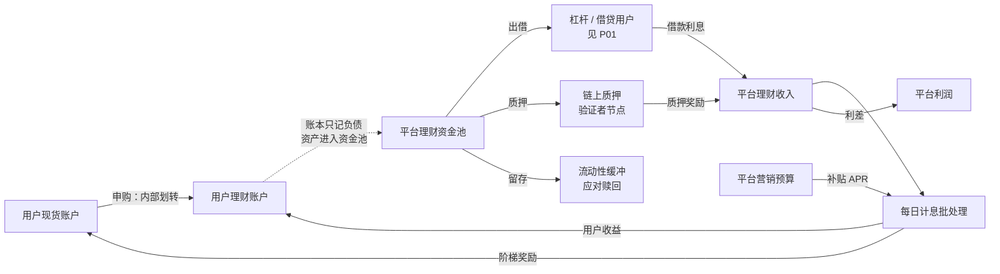

读图要点：
- 申购只是账本内部划转。链上没有任何转账。用户的币仍在平台的同一组钱包里。
- 资金池把资产分到三处：出借、质押、缓冲。分配比例是平台内部策略，币安未公开。
- 用户收益 = 借款利息 + 质押奖励 + 营销补贴 − 平台利差。
- 出错点：缓冲太小。如果赎回量超过缓冲，平台要提前收回借款或动用自有资金。

### 1.3 状态机
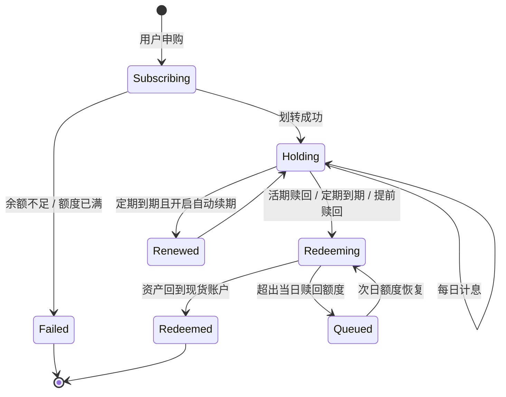

读图要点：
- 申购失败的两个原因：用户余额不足；产品总额度或个人额度已满。
- Queued 状态来自赎回额度。平台用额度控制单日流出量。
- 定期到期后，如果用户开启了自动续期，持仓直接进入下一个周期。
- 局限：本图合并了活期和定期。活期没有"到期"和"续期"两条边。

### 1.4 系统组件与调用链
主线 02 章的服务没有理财服务。下图新增 `earn-service`（理财服务，示例名）和 `interest-batch`（计息批处理任务，示例名）。

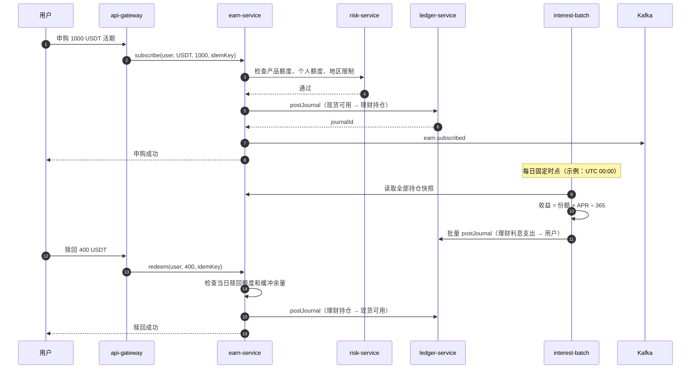

读图要点：
- 申购和赎回都是同步调用。用户在几百毫秒内看到结果。
- 计息是异步批处理。它与申购、赎回并发运行，所以必须读快照，不读实时余额。
- 出错点：赎回检查额度和记账之间有竞态。业界通用做法是用数据库行锁或额度服务的原子扣减。

**账本视角**（业界通用做法，科目名为示例）：

| 动作 | 借 | 贷 | 说明 |
|---|---|---|---|
| 申购 1000 USDT | 用户-现货可用 1000 | 用户-理财持仓 1000 | 内部划转。平台总负债不变 |
| 计息 0.137 USDT | 平台-理财利息支出 0.137 | 用户-理财持仓 0.137 | 1000 × 5% ÷ 365（示例） |
| 赎回 400 USDT | 用户-理财持仓 400 | 用户-现货可用 400 | 内部划转 |
| 定期提前赎回 | 用户-理财持仓 X | 平台-理财利息支出（冲回已发收益）+ 用户-现货可用 | 没收收益 = 冲回分录 |

计息批处理的三条工程要求：
1. 系统用**快照**计息。快照时点之后的申购从下一个周期开始计息。
2. 每个用户每天一条分录。幂等键 = `interest:{userId}:{productId}:{date}`。批处理重跑时不会重复发息。
3. 系统先汇总全部利息，再和"平台-理财利息支出"科目核对。两个数相等后，才提交批次。

> 💡 注意：币安的实时 APR 按分钟累计。按分钟发息会产生大量分录。业界通用做法是：按分钟计算应计利息（Accrued Interest），只在内存或汇总表里累加；按日或按赎回时点一次性记账。这是第 05 章"热点账户"问题的一种解法。

### 1.5 定价与收益来源
活期实时 APR 由借贷需求决定。业界通用做法是用"资金使用率"定价，与 [P01](P01-margin-and-loans.md) 的借贷利率曲线是同一个资金池的两面：
- 使用率 U = 已借出金额 ÷ 资金池总额。
- 借款利率 R_borrow = f(U)。U 越高，借款利率越高。
- 理财基础 APR = R_borrow × U × (1 − 平台抽成)。

**数值示例**（示例数值）：资金池 100,000,000 USDT，已借出 70,000,000 USDT（U = 70%），借款年利率 10%，平台抽成 20%。
- 理财基础 APR = 10% × 70% × (1 − 20%) = 5.6%。
- 营销补贴（阶梯 APR，仅前 500 USDT）+4%。存入 500 USDT 的用户看到 9.6%；存入 100,000 USDT 的用户整体约 5.6%。
- 平台每年利差收入 = 70,000,000 × 10% × 20% = 1,400,000 USDT。
- 用 [../interactive/margin-loan-lab.html](../interactive/margin-loan-lab.html) 拖动使用率，观察借款利率和理财 APR 同时变化。

收益来源汇总：

| 来源 | 谁付钱 | 可持续性 |
|---|---|---|
| 借贷利息 | 杠杆、合约、借币用户 | 牛市需求高、APR 高；熊市下降 |
| 链上质押 | 区块链网络（通胀奖励 + 手续费） | 跟随链上收益率 |
| 营销补贴 | 平台或项目方的预算 | 限时、限额，到期取消 |

### 1.6 风险与对冲
平台承担的风险：
1. **期限错配**（Maturity Mismatch）：活期负债随时可取，资产（借款、质押）有期限。这与银行的结构相同。
2. **借款人违约**：杠杆用户穿仓后，借款无法全额收回。平台用强平和保险基金兜底（见 [../10-derivatives-futures.md](../10-derivatives-futures.md)）。
3. **挤兑**（Bank Run）：大量用户同时赎回。

平台的兜底手段：

| 手段 | 作用 |
|---|---|
| 流动性缓冲 | 资金池保留一部分不出借。示例：10%–20% |
| 单日赎回额度 | 限制单个用户和全平台的单日流出量 |
| 提高借款利率 | 使用率接近上限时，借款利率陡升，借款人主动还款 |
| 平台自有资金 | 最后一道防线 |

> ⚠️ 警告：理财账户里的资产是用户对平台的债权。如果平台破产，用户与其他债权人一起排队受偿。2022 年 Celsius、BlockFi 的理财用户在破产程序中长期无法取回资产（公开新闻、法院文件）。

### 1.7 失败场景与案例
- **2022 年 Celsius 暂停提款**（公开报道）：Celsius 把用户存款投入高风险借贷和 DeFi 策略。资产价格下跌后，用户集中赎回。Celsius 暂停全部提款，随后申请破产。教训：收益来源不透明，期限错配无上限。
- **补贴退坡**（业界常见）：营销 APR 到期取消。按高 APR 做决策的用户收益落空。
- **计息批处理重复执行**（工程故障，示例）：批处理没有幂等键，重跑后每个用户收到两份利息。修复方式是冲回分录，而不是修改历史流水（见第 05 章 3.6 节）。

## 2. 链上质押与流动性质押代币：WBETH 与 BNSOL
### 2.1 用户看到什么
截至 2026 年公开资料：

| 项目 | ETH Staking | SOL Staking |
|---|---|---|
| 用户投入 | ETH | SOL |
| 用户得到 | WBETH（Wrapped Beacon ETH） | BNSOL（Binance Staked SOL） |
| 收益体现方式 | WBETH:ETH 汇率每日上涨 | BNSOL:SOL 汇率定期上涨 |
| 平台服务费 | 质押奖励的 5%（币安公开说明） | 以官网为准 |
| 赎回 | 按当时汇率换回 ETH；需要排队，等待时间取决于以太坊退出队列 | 按当时汇率换回 SOL；有等待期 |
| 不想等 | 在现货市场卖出 WBETH | 在现货市场卖出 BNSOL |

术语定义：
- 质押（Staking）：把币锁进区块链的验证者节点，帮助网络出块，换取奖励。
- 流动性质押代币（LST, Liquid Staking Token）：代表"质押中的币 + 累计奖励"的凭证代币。它可以交易、转账、做抵押。
- 罚没（Slashing）：验证者作恶或长时间离线时，网络扣除部分质押本金。

**汇率模型**：WBETH 的数量不变，每个 WBETH 能换的 ETH 越来越多。

- 1 WBETH = 1 个质押中的 ETH + 自 2023-04-27 08:00 UTC 以来的累计奖励（币安公开说明）。
- 汇率_t = 汇率_{t−1} × (1 + 当日奖励率 × (1 − 服务费率))。
- 用户持有的 ETH 价值 = WBETH 数量 × 汇率。

数值示例（示例数值）：
1. 汇率 = 1.0500。用户质押 10.5 ETH，收到 10.5 ÷ 1.05 = 10 WBETH。
2. 当日网络奖励率 = 3% ÷ 365。服务费 5%。
3. 一年后汇率 ≈ 1.05 × (1 + 3% × 95%) ≈ 1.0799（按单利近似）。
4. 用户仍持有 10 WBETH。可换回约 10.799 ETH。

> 💡 注意：WBETH 的 ETH 价值上涨，不是 WBETH 数量增加。这个设计叫"非变基"（non-rebasing）。它的好处是：WBETH 放进合约、做抵押时，余额不会自己变化，便于记账和对接 DeFi。

### 2.2 资金流
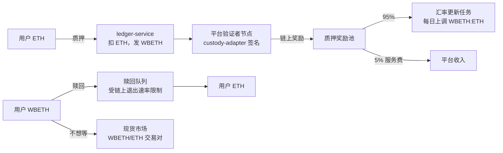

读图要点：
- 质押奖励由以太坊网络支付，不是平台支付。平台抽 5% 服务费。
- 汇率更新是一个运营动作：平台按前一天的奖励率上调汇率。
- 赎回要排队。以太坊每个周期只允许有限数量的验证者退出。
- 市场价格可以偏离汇率。急需流动性的用户在市场上折价卖出 WBETH。

### 2.3 状态机
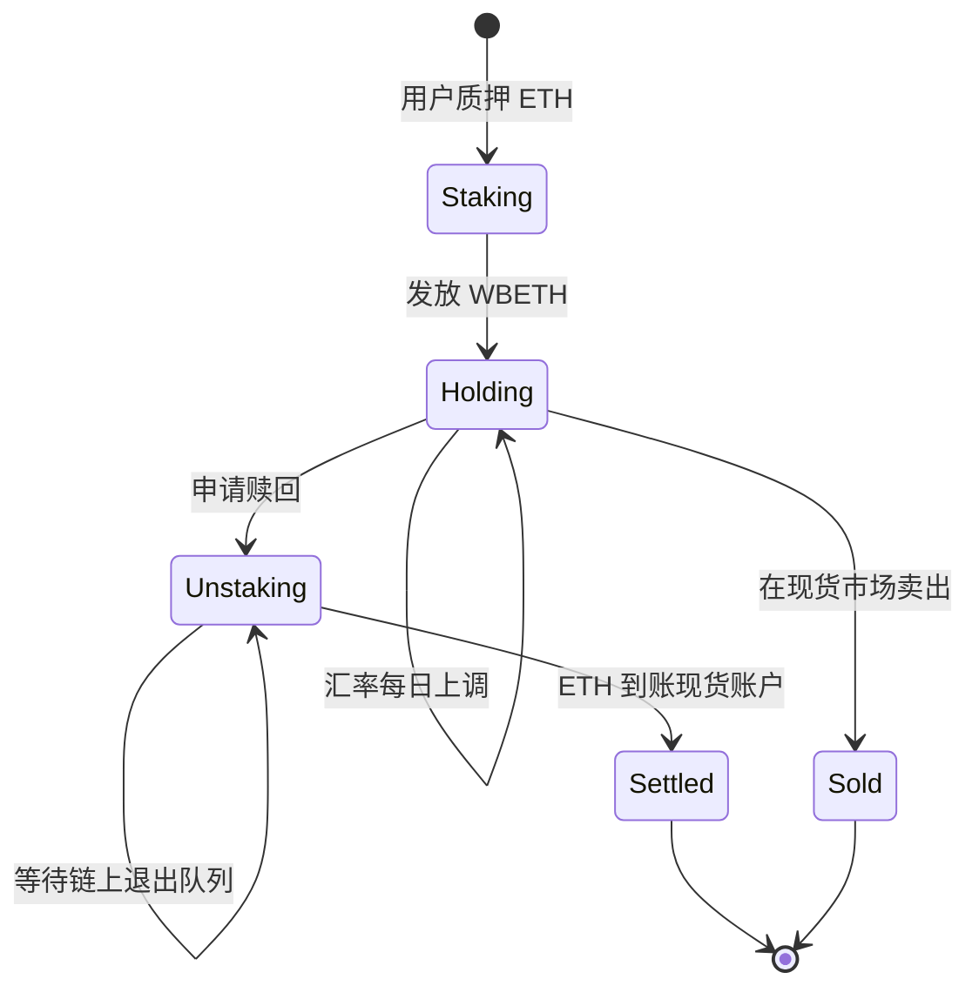

读图要点：
- Holding 是持续时间最长的状态。用户的收益只在这里通过汇率体现。
- Unstaking 的时长不由平台决定。它取决于链上退出队列的长度。
- Sold 路线立即拿到钱，但价格由市场决定，可能低于汇率。

### 2.4 系统组件与调用链
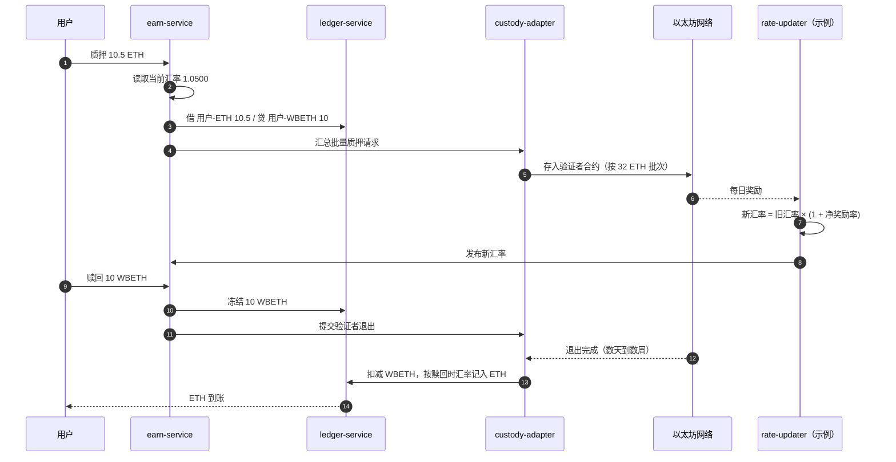

读图要点：
- 链上质押按 32 ETH 一个验证者批量执行（以太坊规则）。用户的零散质押由平台汇总。
- 赎回时，系统先冻结 WBETH，退出完成后再扣减。这复用了第 05 章的"冻结—扣减"状态机。
- 汇率更新是单点。汇率发错会影响所有持有人，需要双人复核（业界通用做法）。

### 2.5 定价与收益来源
- 用户收益率 = 链上质押收益率 × (1 − 服务费率)。
- 示例：以太坊质押收益率 3%，服务费 5%，用户净收益率 = 2.85%。
- 平台收入 = 质押总量 × 链上收益率 × 服务费率。示例：100 万 ETH × 3% × 5% = 1,500 ETH/年。

BNSOL 的模型相同。区别是 Solana 的奖励按纪元（Epoch，约 2 天）发放，所以 BNSOL:SOL 汇率按纪元更新（公开报道）。

### 2.6 风险与对冲
| 风险 | 谁承担 | 平台怎么处理 |
|---|---|---|
| 罚没 | 用户（汇率下降）或平台（自有资金补偿） | 多节点、多客户端部署，降低罚没概率 |
| 赎回排队 | 用户 | 设置每日赎回额度；用流动性池提供即时赎回（示例） |
| 市场价偏离汇率（脱锚） | 用户和用它做抵押的系统 | 保证金估价引用汇率，而不是只看订单簿 |
| 汇率更新错误 | 全体持有人 | 双人复核、上限校验（单日涨幅不超过阈值） |

### 2.7 失败场景与案例
**2025-10-10 WBETH / BNSOL 指数偏离**（公开报道，详见 [../10-derivatives-futures.md](../10-derivatives-futures.md) 第 4 节）：

当天市场剧烈下跌。币安的 USDe、WBETH、BNSOL 三种资产在 UTC 21:36–22:16 出现价格偏离。用这些资产做统一账户保证金的用户被强平。币安随后补偿受影响用户。

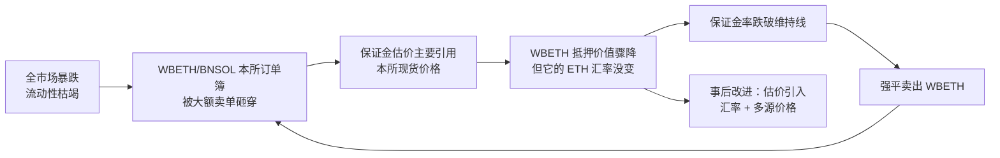

读图要点：
- 根因是估价方法：订单簿价格在流动性枯竭时不可信。WBETH 的"汇率"代表它的真实底层价值。
- 强平卖出 WBETH 又进一步压低订单簿价格，形成循环（F → B）。
- 改进方向是"以汇率为基准、以市场价为参考"的估价方式。币安公告的具体改进参数以官网为准。
- 局限：赎回排队期内，汇率无法立即兑现。所以纯用汇率估价也有风险，需要加折扣率（Haircut）。

## 3. Auto-Invest 定投
### 3.1 用户看到什么
定投（DCA, Dollar-Cost Averaging）：按固定周期、用固定金额买入资产。

截至 2026 年公开资料：
- 用户选择币种（单币或组合）、每期金额、周期（每日、每周、每两周、每月）。
- 系统到点自动扣款并买入。
- 买入的币可以自动转入 Simple Earn 活期，继续生息。
- 据公开报道，币安在 2025 年把定投迁移到闪兑的"定期买入"（Convert Recurring）。原 Auto-Invest 计划于 2025 年 3 月 31 日下线，指数定投计划于 2025 年 11 月 27 日退役。定期买入的成交价为闪兑报价，不另收兑换手续费。具体以官网为准。

> 💡 注意：定投不是收益产品。它只是一个"定时下单"工具。用户的收益完全取决于买入资产的价格走势。

### 3.2 资金流
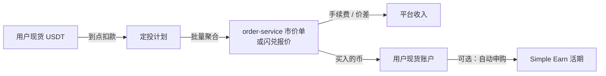

读图要点：
- 平台在定投中赚的是交易手续费或闪兑价差，不是利差。
- 批量聚合把成千上万笔小额买入合并成少量大单，降低撮合压力（业界通用做法）。
- 出错点：扣款时余额不足。系统跳过本期并通知用户。

### 3.3 状态机
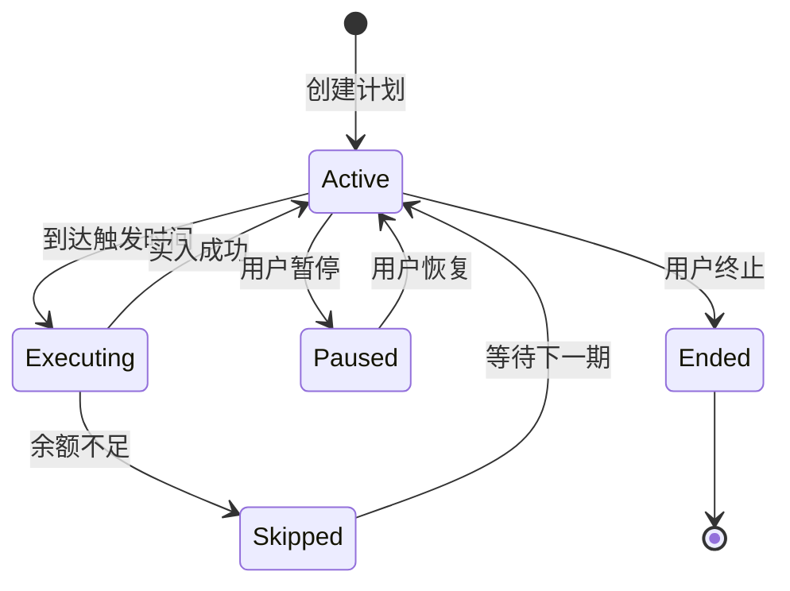

读图要点：
- 每一期是一个独立的执行单元，幂等键 = `planId + 期号`。
- Skipped 不会补买。下期只买当期金额。

### 3.4 系统组件与调用链
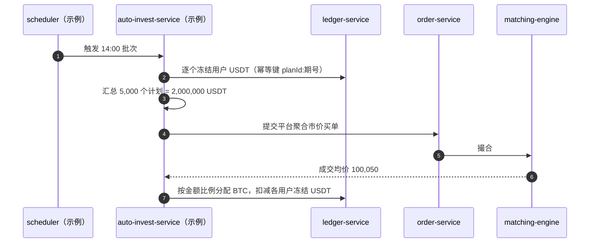

读图要点：
- 所有用户按同一个成交均价分配，保证公平。
- 聚合大单本身会产生滑点（见 [../interactive/depth-slippage.html](../interactive/depth-slippage.html)）。拆单执行可以降低滑点。

### 3.5 定价与收益来源
- 平台收入 = 每期金额 × 手续费率（或闪兑价差）。
- 示例：每周 100 USDT，费率 0.1%，一年 52 期 → 平台收入 5.2 USDT。
- 用户成本 = 手续费 + 滑点。定投的"平均成本"优势来自分散买点，不来自平台。

### 3.6 风险与对冲
- 平台风险低：用户自己承担价格风险。平台只承担执行风险（聚合单滑点、批次失败）。
- 平台用分批执行和价格保护（偏离超过阈值则暂停本批）控制执行风险（业界通用做法）。

### 3.7 失败场景与案例
- **整点拥堵**（业界常见）：大量计划设在同一整点。批次单冲击订单簿。解决：把触发时间打散到一个窗口内。
- **极端行情执行**（示例）：触发时刻恰逢插针。用户以异常价格买入。解决：设置价格保护上限。

## 4. BNB Vault
### 4.1 用户看到什么
BNB Vault 于 2020 年 11 月上线（公开报道）。用户存入 BNB，一个入口同时参与多种收益：活期利息、Launchpool 新币奖励、其他活动奖励。后来币安把 BNB 的收益整合到 Simple Earn BNB 产品里：持有 Simple Earn BNB 即可参与 Launchpool 和 HODLer Airdrops（截至 2026 年公开资料，具体入口以官网为准）。

### 4.2 资金流
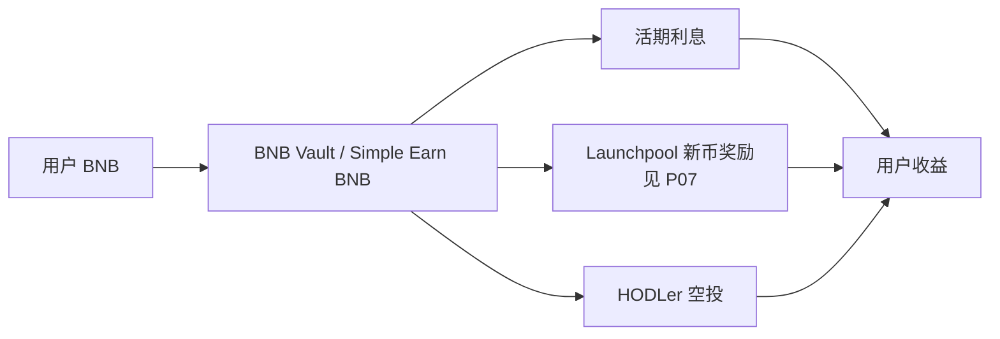

读图要点：
- 新币奖励由项目方支付。项目方用代币换取曝光和用户。
- 用户为了参与活动持有 BNB，这增加了 BNB 需求（见 [../12-business-model.md](../12-business-model.md) BNB 代币经济）。

### 4.3 状态机
BNB Vault 的状态机与 1.3 节的活期相同。区别只有一点：每个活动有独立的快照时点（见 4.4 节）。用户在快照前赎回，就失去该期活动的份额。快照只读取持仓，不冻结资产。

### 4.4 系统组件与调用链
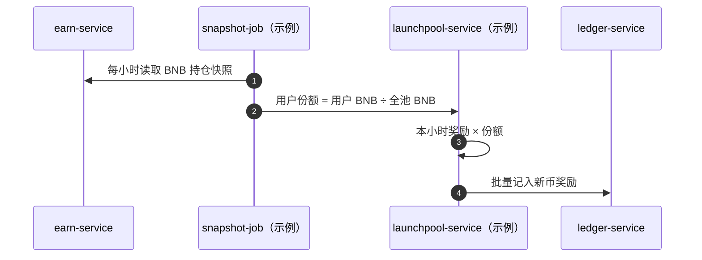

读图要点：
- 快照频率决定公平性。快照越密，"临时存入、快照后取走"的套利空间越小。
- 计算器见 [../interactive/launchpool-calc.html](../interactive/launchpool-calc.html)。

### 4.5 定价与收益来源
- 用户 Launchpool 收益 = 项目奖励总量 × 用户份额 × 新币价格。
- 示例：奖励 1,000,000 新币，用户份额 0.01%，新币价格 0.5 USDT → 50 USDT。
- APR 随全池 BNB 总量和新币价格大幅波动。宣传 APR 只是估算。

### 4.6 风险与对冲
- 用户的主要风险是 BNB 价格下跌。收益以新币计价，新币上线后价格也可能大幅下跌。
- 平台风险低。奖励来自项目方，平台不承担兑付义务。

### 4.7 失败场景与案例
- **监管认定**（公开法律文件）：2023 年美国 SEC 起诉币安时，把 BNB Vault 和 Simple Earn 列为未注册证券发行。这类认定会迫使平台按地区下线产品（见 [../12-business-model.md](../12-business-model.md) 4.2 节）。

## 5. 与主线章节的依赖
| 本章内容 | 依赖的主线章节 | 依赖点 |
|---|---|---|
| 申购 / 赎回分录 | [05 账本](../05-ledger.md) | 内部划转、幂等键、冲回而不修改 |
| 计息批处理 | [05 账本](../05-ledger.md) 3.9 | 热点账户：利息支出科目被大量写入 |
| 活期 APR | [P01 杠杆与借贷](P01-margin-and-loans.md) | 同一资金池的借贷利率曲线 |
| WBETH 赎回 | [04 钱包与托管](../04-wallet-custody.md) | 验证者签名、链上退出 |
| 2025-10-10 偏离 | [10 合约](../10-derivatives-futures.md) 第 4 节 | 保证金资产估价 |
| 资金池对账 | [B04 对账](../backstage/B04-reconciliation.md) | 理财负债 vs 出借 + 质押 + 缓冲 |

**本仓库对照**：[CEX Demo](../..) 没有理财产品。可复用和需新增的部分：

| 能力 | 仓库现状 | 需要新增 |
|---|---|---|
| 内部划转 | [ledger-application-service.ts](../../services/ledger-service/src/application/ledger-application-service.ts) 的 `postJournal`（第 70 行）已支持幂等分录 | 无 |
| 赎回冻结 | 同文件 `freezeBalance` / `consumeBalance`（第 105、227 行） | 无 |
| 理财科目 | [packages/domain/src/index.ts](../../packages/domain/src/index.ts) 的 `AccountType` 只有 main/spot/funding/fee 等 | 新增 `earn` 账户类型和"利息支出"平台账户 |
| 产品服务 | 无 | `earn-service`：产品配置、额度、持仓、赎回额度 |
| 计息批处理 | 无 | 快照 + 批量分录任务，参考 `src/scripts/reconcile-balances.ts` 的批处理结构 |
| 质押 | [custody-adapter](../../services/custody-adapter) 只做充提签名 | 验证者管理、汇率更新任务 |

## 6. 术语表
| 术语 | 英文 | 定义 |
|---|---|---|
| 实时 APR | Real-Time APR | 活期基础收益率，随市场变化 |
| 阶梯 APR | Tiered APR | 只对限额内资产生效的额外奖励 |
| 期限错配 | Maturity Mismatch | 负债可随时取出，资产有期限 |
| 质押 | Staking | 锁定币参与出块，换取奖励 |
| 流动性质押代币 | LST | 代表质押本金和累计奖励的可交易代币 |
| 非变基 | Non-rebasing | 代币数量不变，价值通过汇率增长 |
| 罚没 | Slashing | 验证者违规时被扣除部分质押本金 |
| 折扣率 | Haircut | 抵押品估价时打的折扣 |
| 定投 | DCA | 按固定周期用固定金额买入 |

## 7. 思考题
1. 打开 [../interactive/margin-loan-lab.html](../interactive/margin-loan-lab.html)，把使用率从 50% 拉到 95%。借款利率和活期 APR 怎么变？为什么平台在使用率很高时要让借款利率陡升？
2. 你持有 10 WBETH，汇率 1.08。现货市场 WBETH/ETH 报价 1.03。你急需 ETH。比较"排队赎回"和"市场卖出"的成本。如果你是统一账户的风控，用哪个价格给 WBETH 估值？为什么还要加折扣率？
3. 计息批处理在 UTC 00:05 崩溃，一半用户已发息。用 [../interactive/ledger-double-entry.html](../interactive/ledger-double-entry.html) 的思路，设计重跑方案，保证每个用户只收到一次利息。
