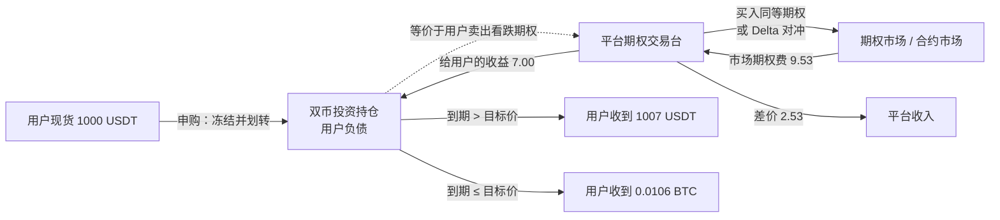
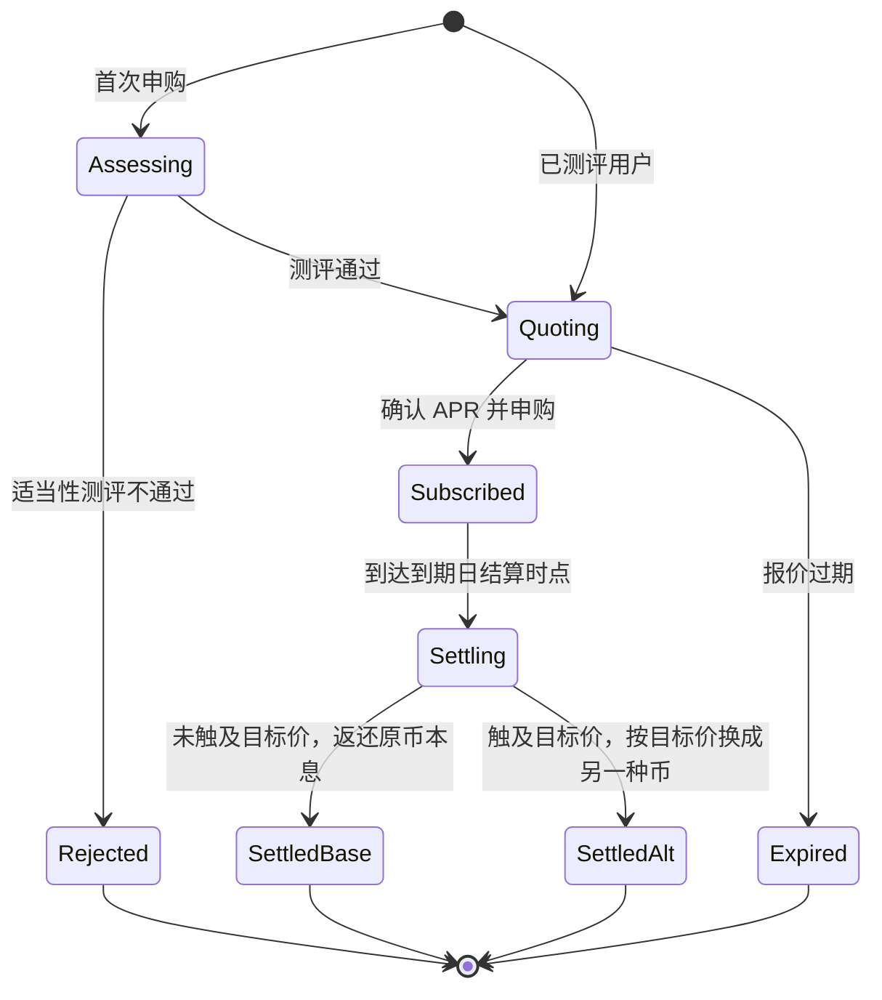
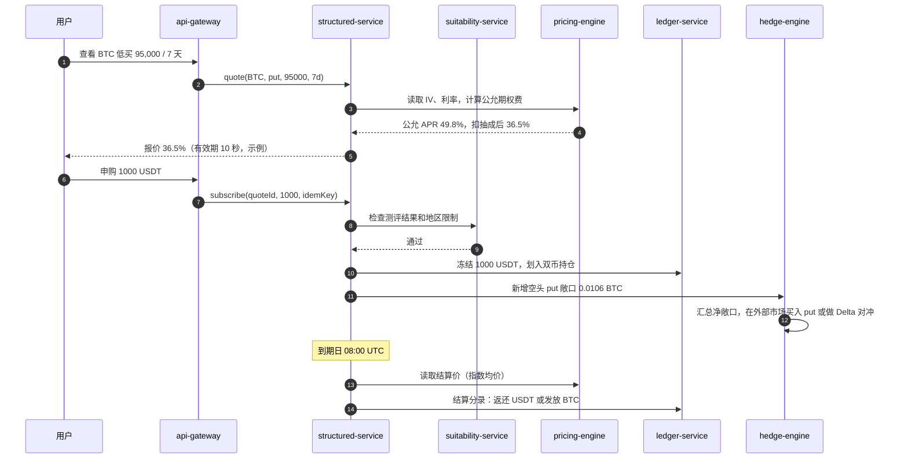
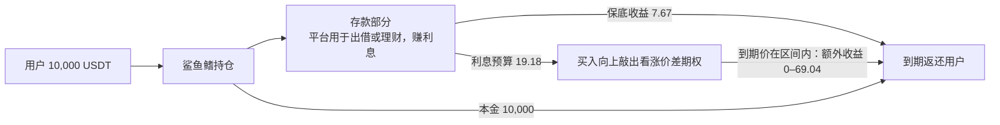
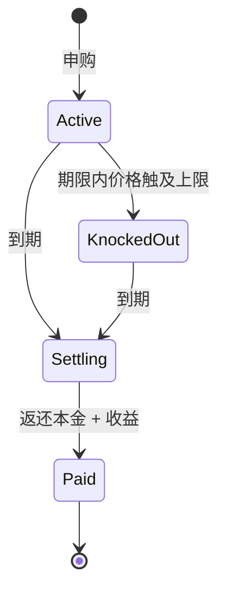
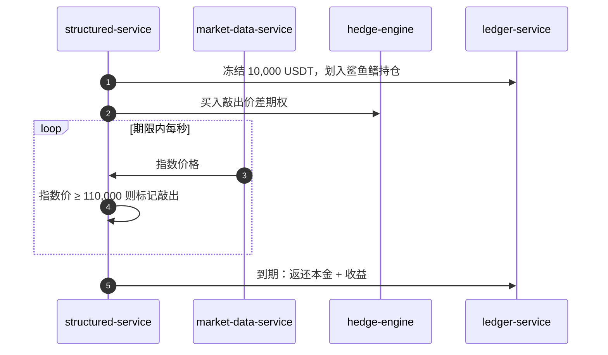

# P06 结构化产品：双币投资与鲨鱼鳍

> 学习目标：读完本章，你能——
> 1. 把双币投资拆成"存款 + 卖出期权"，并算出到期结算结果。
> 2. 用期权定价解释"高收益"从哪里来，以及平台抽成多少。
> 3. 说出保本型产品（鲨鱼鳍）的拆解方式，以及平台的对冲风险。
>
> 前置章节：[../10-derivatives-futures.md](../10-derivatives-futures.md)、[../11-products-ecosystem.md](../11-products-ecosystem.md)（3.5.3 节）、[P05-earn-savings-staking.md](P05-earn-savings-staking.md)
> 关联深潜：[P04-advanced-derivatives.md](P04-advanced-derivatives.md)（期权）、[../backstage/B05-business-risk.md](../backstage/B05-business-risk.md)（平台业务风险）
> 交互实验：[../interactive/dual-investment.html](../interactive/dual-investment.html)（双币投资拆解实验）

> ⚠️ 警告：本章不构成投资建议。双币投资不保本。以投入币种计价，用户可能亏损；以另一币种计价，用户可能错过上涨。

## 0. 一句话理解

结构化产品（Structured Product）= 一笔存款 + 一份期权。存款决定"保底拿回什么"，期权决定"收益曲线长什么样"。用户卖出期权，就拿到高收益和下行风险；用户买入期权，就拿到保本和有限的上行收益。

> 🎯 打个比方：双币投资像"替别人卖保险"。你拿出一笔钱做担保，承诺"如果 BTC 跌破 95,000，我按 95,000 接货"。买保险的人（期权买方）付你保费，这就是宣传页上的"高年化"。平时风平浪静，你白赚保费。一旦"出险"（价格暴跌），你必须按约定价接下已经贬值的 BTC。保险公司（平台）在中间转手，从保费里抽一部分。

术语定义：

- 期权（Option）：买方有权在到期日按约定价格（行权价）买入或卖出资产的合约。卖方收取期权费，承担履约义务。
- 看跌期权（Put）：买方有权按行权价卖出资产。
- 看涨期权（Call）：买方有权按行权价买入资产。
- 期权费 / 权利金（Premium）：期权买方支付给卖方的价格。
- 隐含波动率（IV, Implied Volatility）：把期权市场价格代入定价公式后反推出的波动率。IV 越高，期权越贵。

---

## 1. 双币投资（Dual Investment）

### 1.1 用户看到什么

截至 2026 年公开资料，币安双币投资有两个方向：

| 方向 | 用户投入 | 目标价位置 | 到期价 vs 目标价 | 用户拿回 |
|---|---|---|---|---|
| 低买（Buy Low） | 稳定币，例如 USDT | 低于当前价 | 到期价 ≤ 目标价 | BTC = 本息 ÷ 目标价 |
| 低买 | 同上 | 同上 | 到期价 > 目标价 | USDT 本息 |
| 高卖（Sell High） | 加密货币，例如 BTC | 高于当前价 | 到期价 ≥ 目标价 | USDT = 本息 × 目标价 |
| 高卖 | 同上 | 同上 | 到期价 < 目标价 | BTC 本息 |

产品规则（截至 2026 年公开资料，以官网为准）：

1. 用户选择币对、方向、目标价、到期日。页面显示该组合的 APR。
2. 申购后 APR 锁定。到期前价格怎么变都不影响 APR。
3. 结算时间是到期日 08:00 UTC。
4. 结算价是到期前一段时间的指数均价。业界通用做法是 07:30–08:00 UTC 的指数价格均值（OKX、KuCoin 公开规则）。币安的具体口径以官网为准。
5. 申购截止时间早于结算时间（例如提前 24 小时，业界通用做法）。
6. 一般不支持提前赎回。

> 💡 注意："收益"在两种结果下都有。区别是用户拿回哪种币。所以宣传语说"无论涨跌都赚利息"。这句话只在"以拿回的币的数量计"时成立。以投入币种的价值计，用户可能亏损。

### 1.2 资金流

读图要点：

- 数字来自 1.5 节的示例：本金 1000 USDT、目标价 95,000、7 天、APR 36.5%、IV 50%。
- 用户本金不出平台。平台只在账本上把它记成双币持仓。
- 平台用自有资金在外部市场买入同样的期权，或者用永续合约做 Delta 对冲（业界通用做法）。币安的对冲细节未公开。
- 平台收入 = 市场期权费 − 支付给用户的收益。用户看不到市场期权费。

### 1.3 状态机

读图要点：

- 报价有有效期。行情变化后 APR 会重新计算，旧报价作废。
- Subscribed 期间没有中间状态。用户不能提前赎回，平台也不做逐日估值展示（业界常见做法）。
- 两个终态的区别只有"拿回的币种"。
- 局限：如果平台支持"自动复投"，SettledBase 和 SettledAlt 之后还会进入下一轮 Quoting。

### 1.4 系统组件与调用链

主线 02 章没有结构化产品服务。下图新增 `structured-service`（产品服务）、`pricing-engine`（期权定价）、`hedge-engine`（对冲引擎）、`suitability-service`（适当性测评），均为示例名。

读图要点：

- 报价和申购是两步。报价带有效期，防止用户拿旧报价套利。
- 对冲引擎按"净敞口"对冲。很多用户的低买和高卖可以相互抵消一部分。
- 结算分录使用第 05 章的冻结—扣减模型。发放 BTC 时，对手方是平台的对冲账户。
- 出错点：结算价取错（例如取了本所插针价）。业界通用做法是用多交易所指数的时间均价。

### 1.5 定价与收益来源

**第一步：写出收益公式。**

- 期限收益率 y = APR × 天数 ÷ 365。
- 低买：本金 A（USDT），目标价 K。到期价 P。
  - P > K：拿回 A × (1 + y) USDT。
  - P ≤ K：拿回 A × (1 + y) ÷ K 个 BTC。
- 高卖：本金 Q（BTC），目标价 K。
  - P ≥ K：拿回 Q × (1 + y) × K USDT。
  - P < K：拿回 Q × (1 + y) 个 BTC。

**第二步：拆解成"存款 + 卖期权"。** 把所有结果都换算成到期时的 USDT 价值：

| 产品 | 到期价值（USDT） | 拆解 |
|---|---|---|
| 低买 | A(1+y) − N × max(K − P, 0)，N = A(1+y) ÷ K | 存款 A(1+y) USDT + 卖出 N 份看跌期权 = 现金担保卖看跌（Cash-Secured Put） |
| 高卖 | Q(1+y) × P − Q(1+y) × max(P − K, 0) | 持有 Q(1+y) BTC + 卖出 Q(1+y) 份看涨期权 = 备兑看涨（Covered Call） |

两边对任意 P 都相等。用 [../interactive/dual-investment.html](../interactive/dual-investment.html) 拖动到期价，可以看到两条曲线完全重合。

**第三步：完整数值例子**（示例数值）。

条件：本金 1000 USDT，低买 BTC。当前价 100,000，目标价 95,000，期限 7 天，APR 36.5%。

1. 期限收益率 y = 36.5% × 7 ÷ 365 = 0.7%。
2. 本息 = 1000 × 1.007 = 1007 USDT。
3. 期权数量 N = 1007 ÷ 95,000 = 0.0106 BTC。

| 情形 | 到期价 | 用户拿回 | 按到期价折算 | 对比：一直持有 USDT | 对比：今天直接买 0.01 BTC |
|---|---|---|---|---|---|
| A 高于目标价 | 98,000 | 1007 USDT | 1007 | 1000 | 980 |
| B 等于目标价 | 95,000 | 0.0106 BTC | 1007 | 1000 | 950 |
| C 远低于目标价 | 85,000 | 0.0106 BTC | 901 | 1000 | 850 |

拆解验证（情形 C）：存款 1007 − 期权赔付 0.0106 × (95,000 − 85,000) = 1007 − 106 = 901 USDT。与直接结算的结果相同。

读这张表：

- 情形 A：用户赚 7 USDT。这 7 USDT 就是卖出看跌期权的期权费。
- 情形 C：以 USDT 计，用户亏 99 USDT（−9.9%）。用户按 95,000 接到了一个只值 85,000 的 BTC。
- 情形 C 比"今天直接买"好 51 USDT。所以低买适合"本来就想在 95,000 买 BTC"的人。

**第四步：平台抽成。** 用 Black-Scholes 公式给这份看跌期权定价（r = 0，IV = 50%，示例）：

- 1 BTC 名义的 95,000 看跌期权，7 天，公允价格 ≈ 899.12 USDT。
- 用户卖出 0.0106 份，公允期权费 ≈ 0.0106 × 899.12 ≈ 9.53 USDT。
- 平台付给用户 7.00 USDT。差价 ≈ 2.53 USDT，约为公允期权费的 27%。
- 换成 APR：公允 APR ≈ 49.8%，用户拿到 36.5%，差 13.3 个百分点。

**为什么"高收益"= 卖出波动率**：

- 期权价格随 IV 上升而上升。同样的目标价和期限，IV 从 40% 升到 60%，示例中的公允 APR 从约 28.5% 升到约 73.9%。
- 用户每次申购，都是在卖出波动率（Short Volatility）。平静时赚小钱，暴跌时亏大钱。
- 页面 APR 最高的时候，通常正是市场恐慌、IV 最高的时候。这时下跌风险也最大。
- 目标价越接近当前价，期权越值钱，APR 越高，被"换币"的概率也越高。

### 1.6 风险与对冲

**用户承担的风险**：

| 风险 | 何时发生 | 结果 |
|---|---|---|
| 低买被行权 | 到期价 ≤ 目标价 | 以高于市价的价格买入 BTC |
| 高卖被行权 | 到期价 ≥ 目标价 | 以低于市价的价格卖出 BTC，错过上涨 |
| 流动性锁定 | 期限内 | 不能提前赎回，不能止损 |

**平台承担的风险**：

| 风险 | 说明 | 兜底方式（业界通用做法） |
|---|---|---|
| 对冲失败 | 外部期权市场深度不足，买不到同样的期权 | 用永续合约做 Delta 对冲；设置单币种总额度 |
| 跳空风险（Gap Risk） | 价格瞬间跳过目标价，Delta 对冲来不及调整 | 限制临近到期的目标价密度；保留风险准备金 |
| 对手方风险 | 在外部平台对冲，外部平台倒闭 | 分散对冲场所；优先在本所期权市场对冲 |
| 定价模型错误 | IV 输入错误，报价过高 | 报价上下限、人工复核新币对 |
| 结算价操纵 | 结算窗口内拉盘或砸盘 | 多交易所指数 + 30 分钟均价 |

**适当性评估**（Suitability Assessment）：平台在用户首次申购前，确认用户理解产品风险。业界通用做法：

1. 用户填写风险测评问卷：投资经验、风险承受能力、对期权的理解。
2. 系统按分数给用户定风险等级。
3. 产品也有风险等级。系统禁止用户申购高于自身等级的产品。
4. 系统在申购页强制展示"非保本"和最坏情形示例。
5. 监管地区不同，规则不同。部分地区直接下线该产品（见 [../backstage/B01-compliance.md](../backstage/B01-compliance.md)）。

### 1.7 失败场景与案例

- **单日暴跌中的低买**（情景示例）：BTC 一天下跌 20%。所有目标价在区间内的低买订单全部被行权。用户按目标价接货，账面立即亏损。这时同类产品的新报价 APR 暴涨，吸引更多用户继续"接飞刀"。
- **2025-10-10 极端行情**（公开报道，见 [../10-derivatives-futures.md](../10-derivatives-futures.md) 第 4 节）：全市场单日强平超过 190 亿美元。期权和永续市场流动性同时枯竭。对冲引擎在这类时刻最难调整仓位。
- **误解为保本**（业界常见投诉）：用户只看"无论涨跌都有收益"，忽略拿回的币种会变化。这是适当性评估和信息披露要解决的问题。

---

## 2. 鲨鱼鳍（Shark Fin）等保本型产品

### 2.1 用户看到什么

鲨鱼鳍是一类保本型结构化产品。多家交易所（例如 OKX、Bybit）公开提供此类产品。币安的同类产品名称和规则以官网为准。

示例条款（示例数值）：

| 项目 | 值 |
|---|---|
| 本金 | 10,000 USDT，到期 100% 返还 |
| 期限 | 14 天 |
| 当前 BTC 价 | 100,000 |
| 价格区间 | 100,000–110,000 |
| 到期价在区间内 | APR 从 2% 线性升到 20% |
| 到期价低于下限 | APR 2%（保底） |
| 期限内曾经突破上限 | APR 回落到 2%（敲出） |

收益曲线先上升、再断崖下降，形状像鲨鱼的背鳍，因此得名。

### 2.2 资金流

读图要点：

- 数字为示例：平台存款收益 5% × 14 ÷ 365 × 10,000 ≈ 19.18 USDT；保底 2% ≈ 7.67 USDT。
- 本金不承担价格风险。用户最多损失的是"本来可以拿到的利息"（机会成本）。
- 平台用利息预算买期权。预算越少，期权越"便宜"，条款越苛刻（区间窄、带敲出）。

### 2.3 状态机

读图要点：

- 敲出（Knock-Out）在期限内任何时刻都可能发生。敲出后收益锁定为保底 APR。
- 敲出后本金仍要等到期日才返还（业界常见做法）。
- 监控敲出需要实时价格流。这与第 08 章的指数价格服务相关。

### 2.4 系统组件与调用链

读图要点：

- 敲出判断必须用指数价格，不能用本所最新价，防止插针误触发。
- 平台是期权的买方，对冲压力小于双币投资。

### 2.5 定价与收益来源

拆解：鲨鱼鳍 = 存款 + 买入看涨价差（Bull Call Spread），再加上敲出条款。

- 看涨价差 = 买入 100,000 看涨 + 卖出 110,000 看涨。最大收益在 110,000 封顶。
- 额外收益上限 = 10,000 × (20% − 2%) × 14 ÷ 365 ≈ 69.04 USDT。
- 期权数量 N = 69.04 ÷ (110,000 − 100,000) ≈ 0.0069 BTC。

用 Black-Scholes（IV 50%，r = 0，示例）计算：

| 方案 | 期权成本 | 利息预算 19.18 − 7.67 = 11.51 够吗 |
|---|---|---|
| 普通看涨价差（无敲出） | 约 20.75 USDT | 不够 |
| 加入向上敲出条款 | 低于普通价差（敲出时期权作废） | 平台可以把成本压到预算内 |

结论：平台加入敲出条款，就是为了让期权足够便宜。这也解释了为什么"收益曲线断崖"是产品设计的必然结果，而不是巧合。

### 2.6 风险与对冲

- 用户：本金安全依赖平台信用。平台破产时，保本承诺无效。
- 用户：大多数情形只拿到保底 APR。它可能低于同期活期 APR。
- 平台：买到的期权必须与承诺的收益结构一致。条款复杂（路径依赖）时，外部市场可能没有现成期权，需要平台自行动态对冲。

### 2.7 失败场景与案例

- **敲出争议**（情景示例）：本所价格插针到 110,050，指数价格未到 110,000。如果系统用了本所价格，用户的收益被错误降为保底。修复方式是只用指数价格，并保留价格证据。
- **低利率环境**（业界规律）：存款利率越低，利息预算越少，保本产品的收益上限越低，产品吸引力下降。

---

## 3. 与主线章节的依赖

| 本章内容 | 依赖的主线章节 | 依赖点 |
|---|---|---|
| 申购冻结、到期结算 | [05 账本](../05-ledger.md) | 冻结—扣减、幂等键 |
| 结算价、敲出判断 | [08 行情](../08-market-data.md)、[10 合约](../10-derivatives-futures.md) | 指数价格、抗插针 |
| Delta 对冲 | [10 合约](../10-derivatives-futures.md)、[P04 高级衍生品](P04-advanced-derivatives.md) | 永续合约、期权 |
| 适当性评估 | [03 账户与身份](../03-account-identity-security.md)、[B01 合规](../backstage/B01-compliance.md) | KYC 等级、地区限制 |
| 期权差价收入 | [12 商业模式](../12-business-model.md) | "闪兑/双币价差"收入项 |
| 平台对冲风险 | [B05 业务风险](../backstage/B05-business-risk.md) | 敞口限额、风险准备金 |

**本仓库对照**：[CEX Demo](../..) 没有理财或结构化产品，也没有期权市场。

| 能力 | 仓库现状 | 需要新增 |
|---|---|---|
| 申购冻结、结算扣减 | [ledger-application-service.ts](../../services/ledger-service/src/application/ledger-application-service.ts) 的 `freezeBalance`、`consumeBalance`、`postJournal` | 双币持仓科目、平台对冲账户 |
| 指数价格 | [market-data-service](../../services/market-data-service) 只提供本所行情 | 多交易所指数和时间均价 |
| 期权定价 | 无 | `pricing-engine`：Black-Scholes、IV 曲面、报价有效期 |
| 对冲 | 无 | `hedge-engine`：净敞口汇总、下单到 [order-service](../../services/order-service) |
| 适当性测评 | [identity-service](../../services/identity-service) 只有 KYC | 测评问卷、产品风险等级 |

## 4. 术语表

| 术语 | 英文 | 定义 |
|---|---|---|
| 结构化产品 | Structured Product | 存款与衍生品组合成的投资产品 |
| 双币投资 | Dual Investment | 到期按目标价决定拿回哪种币的结构化产品 |
| 低买 / 高卖 | Buy Low / Sell High | 双币投资的两个方向 |
| 目标价 | Target Price | 双币投资中的行权价 |
| 结算价 | Settlement Price | 到期时用于比较目标价的指数均价 |
| 行权价 | Strike Price | 期权约定的买卖价格 |
| 现金担保卖看跌 | Cash-Secured Put | 持有足额现金并卖出看跌期权 |
| 备兑看涨 | Covered Call | 持有现货并卖出看涨期权 |
| 隐含波动率 | IV | 从期权价格反推的波动率 |
| 卖出波动率 | Short Volatility | 收取期权费、承担大幅波动损失的头寸 |
| Delta 对冲 | Delta Hedge | 用现货或永续合约抵消期权对价格的敏感度 |
| 跳空风险 | Gap Risk | 价格跳变导致对冲来不及调整的风险 |
| 看涨价差 | Bull Call Spread | 买入低行权价看涨、卖出高行权价看涨 |
| 敲出 | Knock-Out | 价格触及障碍价后期权作废 |
| 适当性评估 | Suitability Assessment | 确认用户能理解并承担产品风险的流程 |

## 5. 思考题

1. 打开 [../interactive/dual-investment.html](../interactive/dual-investment.html)，选"低买"，把目标价从 99,000 移到 90,000。APR 怎么变？被换成 BTC 的概率怎么变？用"卖保险"的比喻解释。
2. 切到"波动率→APR"模式，把 IV 从 40% 拉到 80%。页面 APR 上升，同时下方的"最坏情形"损失怎么变？为什么说高 APR 的时刻往往是最危险的时刻？
3. 一个高卖订单：0.01 BTC，目标价 105,000，7 天，APR 36.5%。到期价 120,000。用户拿回多少 USDT？相对于一直持有 BTC，少赚多少？把这个差额写成看涨期权的赔付公式。
