# P07 上币与新币发行：Launchpad、Launchpool、空投与 Alpha

> 学习目标：读完本章，你能——
> 1. 按顺序说出一个新币从申请到开盘、再到被打标签或下架的全部环节。
> 2. 用公式算出 Launchpad、Launchpool、HODLer Airdrops、Megadrop 的个人分配额。
> 3. 解释"快照取平均"如何防止临时拉高持仓，以及这些活动如何拉动 BNB 需求。
>
> 前置章节：[06 订单与撮合](../06-order-matching.md)、[04 钱包与托管](../04-wallet-custody.md)、[11 产品生态](../11-products-ecosystem.md)、[12 商业模式](../12-business-model.md)
> 交互实验：[launchpool-calc.html](../interactive/launchpool-calc.html)（Launchpool 稀释 + Launchpad 超额认购）
>
> ⚠️ 本章不构成投资建议。新币价格波动极大，参与发行活动可能亏损。

## 0. 一句话理解

上币是交易所把一个新资产接入"账本 + 钱包 + 撮合"三件套的过程。Launchpad、Launchpool 和各类空投是"上币前的分发渠道"：它们把新币按规则分给持有 BNB 的用户。

> 🎯 打个比方：交易所像一家大型超市。上币是"新商品进货上架"：采购部验货（尽调），法务看资质（合规），仓库建货位（钱包节点），收银台录入条码和价格单位（交易对参数）。Launchpad 是"开业前限量预售"，Launchpool 是"会员卡里有积分就每天送试用装"，HODLer 空投是"翻看历史会员记录，补发赠品"。会员卡就是 BNB。

标记约定：【事实】= 币安公告、官网或公开报道（截至 2026 年公开资料）；【业界】= 业界通用做法；【示例】= 演示数值。

## 1. 上币全流程

### 1.1 用户看到什么

用户只看到三条公告：

1. "币安将上线 XYZ"：公告写明开放充值时间、开盘时间、交易对。
2. "XYZ 开放充值"：用户可以把 XYZ 充值到币安。
3. "XYZ/USDT 开盘"：订单簿开放交易。提币通常在开盘后开放。

【事实】2023 年 7 月，币安用"种子标签（Seed Tag）"替代"创新区（Innovation Zone）"。带种子标签的代币波动和风险更高。用户每 90 天需通过一次风险测验，才能交易带种子标签或观察标签的代币。

【事实】观察标签（Monitoring Tag）：标记"有可能不再满足上币标准"的代币。打上观察标签不等于自动下架，但代币会被更频繁地复审。

### 1.2 资金流

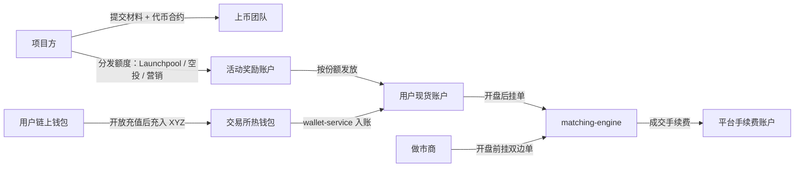

读图要点：

- 开盘时，订单簿里的卖单来自三类人：空投/挖矿获得者、充值进来的早期持有人、做市商。
- 出错点：充值通道开放太晚，订单簿卖盘稀薄，开盘价被少量买单推高后迅速回落。
- 局限：做市商合作条件属于商业合同，不公开。

### 1.3 状态机

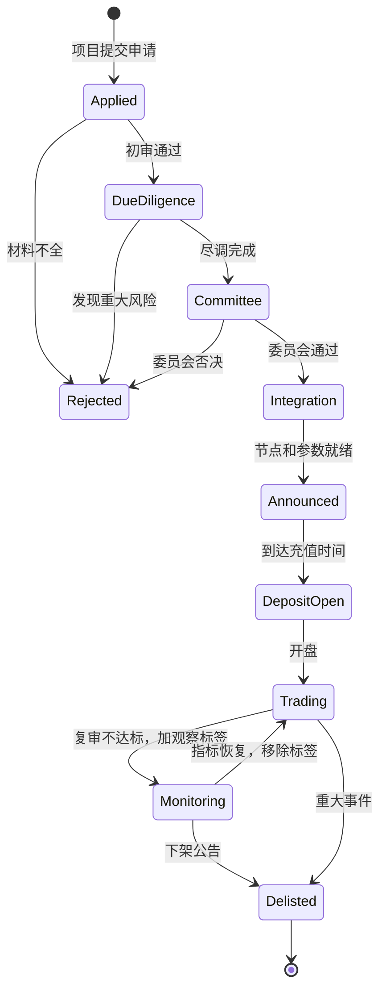

读图要点：

- 上线之后的每个代币都在 `Trading` 和 `Monitoring` 之间接受周期复审。
- 下架也是一个流程：公告 → 停止交易 → 保留一段提币窗口 → 关闭提币。
- 局限：委员会的投票规则和复审周期没有完整公开。图中状态是【业界】抽象。

### 1.4 系统组件与调用链

尽调分四条线并行。每条线输出"通过 / 不通过 / 有条件通过"。

| 尽调线 | 检查内容 | 典型否决理由 |
|---|---|---|
| 团队 | 实名背景、过往项目、法律纠纷 | 匿名团队无担保、历史跑路 |
| 代码 | 合约审计报告、增发/冻结/升级权限 | 合约可无限增发、管理员可冻结任意地址 |
| 代币经济 | 总量、流通量、解锁计划、持币集中度 | 前 10 地址持有 90%（示例）、首年大量解锁 |
| 合规 | 是否可能被认定为证券、制裁名单、隐私币 | 目标司法辖区监管风险过高 |

技术接入的调用链（服务名与 [02 系统架构](../02-system-architecture.md) 一致；`listing-service` 是【示例】服务名）：

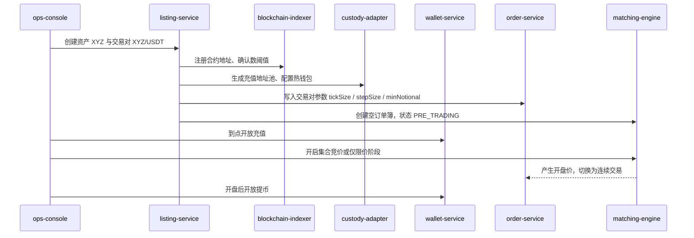

读图要点：

- 所有开关都由运营后台按时间表触发。每个开关都有独立的回滚按钮。
- `blockchain-indexer` 必须先跑通一次"小额充值 → 确认 → 入账"，才能对外开放充值。
- 出错点：合约有非标准行为（例如转账扣税代币），扫链金额与到账金额不一致，账本出现差额。

**交易对参数**（参见 [06 章 3.9 节](../06-order-matching.md)）：

1. 运营按参考价确定 tickSize。一个 tick 约为价格的 0.01%–0.1%（【业界】经验值）。
2. 【示例】参考价 0.0523 USDT：tickSize = 0.0001，stepSize = 1，minNotional = 5 USDT。

**开盘保护**（【业界】做法，币安具体参数以公告为准）：

| 方式 | 机制 | 解决什么问题 |
|---|---|---|
| 集合竞价（Call Auction） | 开盘前 N 分钟只收单不成交，到点按"成交量最大"原则算出单一开盘价 | 避免第一笔市价单把价格打飞 |
| 仅限价阶段 | 前 N 分钟禁止市价单 | 防止市价单吃穿多档 |
| 价格带保护 | 拒绝偏离参考价超过 X% 的订单，币安 API 有 `PERCENT_PRICE_BY_SIDE` 过滤器 | 限制单笔订单的价格冲击 |

### 1.5 定价与收益来源

平台从上币获得三种收益：

1. **手续费**：新币上线首日成交量往往很高（【业界】）。成交量 × 费率 = 平台收入。
2. **流量**：用户为了参与新币活动注册和充值。
3. **BNB 需求**：Launchpad、Launchpool、空投都以 BNB 持仓为门槛。

**上币费争议**（中立表述）：

- 【事实·公开报道】2024 年 10 月 31 日，一家加密投资机构的创始人在社交媒体称，币安向某项目索要约 15% 的代币供应量作为上币条件。
- 【事实·公开报道】币安联合创始人何一公开否认。她表示币安不收取代币比例或固定金额。
- 【事实·公开报道】币安自 2018 年起的公开政策是：上币费用透明，100% 捐给慈善，金额由项目方提出，平台不规定最低额。
- 【分析】争议的核心不是"有没有明面费用"，而是"空投额度、营销额度、做市安排"是否构成隐性成本。外部无法验证这些合同细节。

### 1.6 风险与对冲

| 平台承担的风险 | 兜底方式 |
|---|---|
| 尽调遗漏，项目跑路或合约被黑 | 暂停充提、观察标签、下架；必要时动用用户保护基金（SAFU，见 [12 章](../12-business-model.md)） |
| 代币被监管认定为证券 | 按司法辖区限制交易；下架 |
| 开盘拥堵，撮合延迟 | 集合竞价、仅限价阶段、单用户限频（见 [06 章 5.2 节](../06-order-matching.md)） |
| 充值不一致（扣税代币、重组） | 小额试充、确认数阈值、对账告警 |

> ⚠️ 警告：观察标签和种子标签代币可能在短时间内下架。下架后用户只能在提币窗口内转出资产。

### 1.7 失败场景与案例

- 【业界】开盘即暴跌：空投获得者在开盘第一分钟集中卖出。如果做市商买单不足，价格单边下跌。
- 【业界】"低流通、高 FDV"（完全稀释估值，Fully Diluted Valuation）：流通量只占总量 10%（示例），后续每月解锁持续带来抛压。2024 年起，这一模式在社区引发大量批评（公开讨论）。
- 【事实·公开报道】观察标签公告发布后，被标记代币的价格常在当天大幅下跌。

## 2. Launchpad：BNB 认购新币

### 2.1 用户看到什么

【事实·公开报道】Launchpad 分三个阶段：

1. **计算期（Measurement）**：系统每小时快照用户的 BNB 余额，连续若干天（公开报道的典型值为 6 天），取日均值。
2. **认购期（Subscription）**：用户提交 BNB 承诺（Commit）。承诺上限 = 计算期的平均持仓。
3. **分配期（Calculation）**：认购结束后，系统计算分配。

### 2.2 资金流

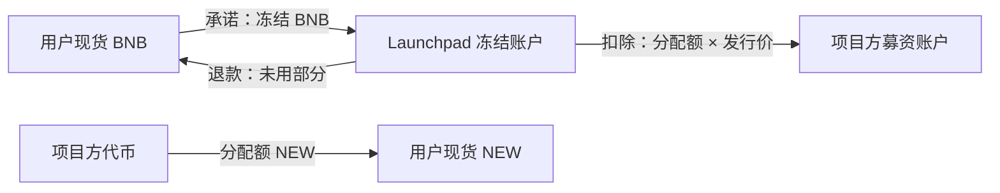

读图要点：

- 承诺阶段只冻结，不扣款。冻结使用 [05 账本](../05-ledger.md) 的"冻结/解冻"分录。
- 超额认购时，绝大部分 BNB 原路退回。真正扣除的只是分配额对应的部分。
- 出错点：分配与退款必须在一个账本事务里完成。否则出现"代币到账、BNB 未退"的中间状态。

### 2.3 状态机

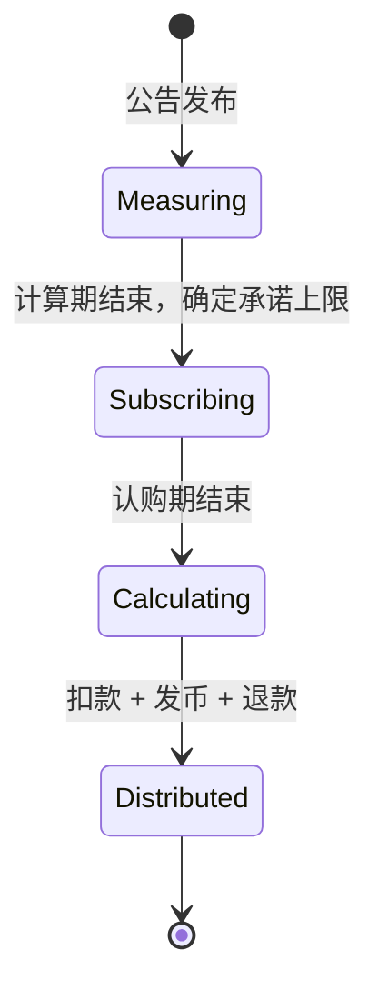

读图要点：计算期结束后，承诺上限就固定了。认购期内再充入 BNB 不提高上限。

### 2.4 系统组件与调用链

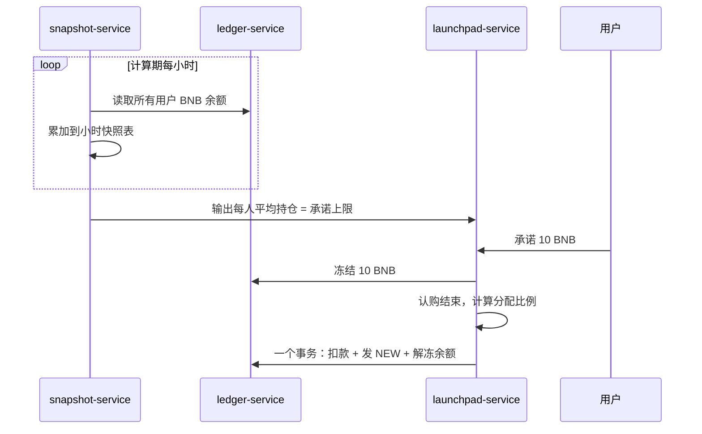

读图要点：

- `snapshot-service`、`launchpad-service` 是【示例】服务名。快照读取账本余额，不读前端缓存。
- 局限：全量快照对数千万账户是一次大批量读。【业界】做法是读从库或按账户分片读。

### 2.5 定价与收益来源

**快照防操纵**：用户在计算期最后几小时充入大量 BNB，只能提高很少的平均值。

```
平均持仓 = Σ 每小时快照余额 ÷ 快照次数
```

【示例】计算期 6 天 = 144 次快照。用户平时持有 1 BNB。最后 6 小时临时充入 100 BNB。

- 平均持仓 = (138 × 1 + 6 × 101) ÷ 144 = 744 ÷ 144 = 5.17 BNB。
- 临时充入 100 BNB 只换来 4.17 BNB 的额外承诺上限。

**分配公式**（【事实·公开报道】的近似公式）：

```
我的分配量 = 我的承诺 BNB ÷ 全网承诺 BNB × 发售总量
我的扣款 BNB = 我的分配量 × 发行价 ÷ BNB 价格
我的退款 BNB = 我的承诺 BNB − 我的扣款 BNB
```

【示例】发售 10,000,000 NEW，发行价 0.02 USDT，BNB = 600 USDT。募资目标 = 200,000 USDT = 333.33 BNB。全网承诺 1,000,000 BNB，超额认购约 3,000 倍。

1. 我承诺 10 BNB。份额 = 10 ÷ 1,000,000 = 0.001%。
2. 我的分配量 = 0.001% × 10,000,000 = 100 NEW。
3. 我的扣款 = 100 × 0.02 ÷ 600 = 0.003333 BNB。
4. 我的退款 = 10 − 0.003333 = 9.996667 BNB。

如果单人分配量有硬顶（Hard Cap），超出部分按比例分给其他用户（【事实·公开报道】）。

**平台收益**：项目方获得募资；平台获得新币交易量和 BNB 持仓需求。

### 2.6 风险与对冲

- 用户风险：开盘价低于发行价（破发）。超额认购倍数越高，单人分配越少，风险金额也越小。平台风险：BNB 集中充入，认购结束后提币通道集中拥堵。

### 2.7 失败场景与案例

- 【事实·公开报道】2023 年 7 月某次 Launchpad 认购，用户承诺的资产总值约 24 亿美元，而募资额只有数百万美元。超额认购倍数极高，绝大多数资金被退回。
- 【业界】跨账户拆分：一个人用多个 KYC 账户分别承诺，绕过单人硬顶。防线是 KYC 唯一性和设备关联风控（见 [B05 业务风控](../backstage/B05-business-risk.md)）。

## 3. Launchpool：质押挖新币

### 3.1 用户看到什么

【事实】用户把 BNB 或指定资产（公开报道中出现过 FDUSD、USDC 池）锁入 Launchpool。每个池有总奖励量和活动天数。奖励按小时发放。用户可以随时赎回本金（以具体活动规则为准）。

【事实·公开报道】每个池设有"每小时单人奖励上限"。例如某次活动的 BNB 池每小时单人上限为数十万枚新币。

### 3.2 资金流

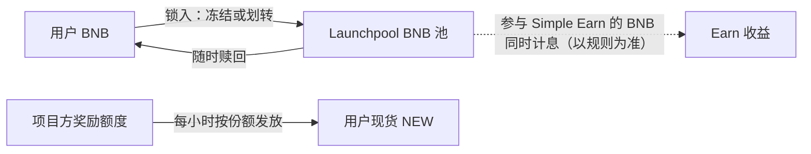

读图要点：本金不交给项目方。用户放弃的只是这段时间 BNB 的其他用途。奖励全部由项目方承担。

### 3.3 状态机

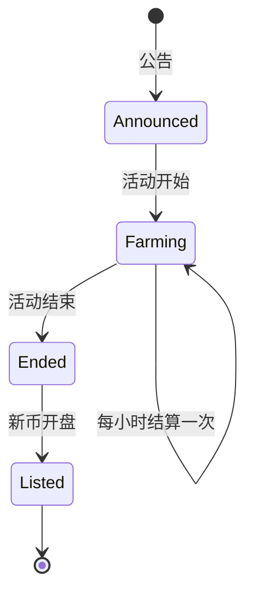

读图要点：多数活动在挖矿期间或结束时开盘。奖励在开盘前不能交易，用户只能"持有"。

### 3.4 系统组件与调用链

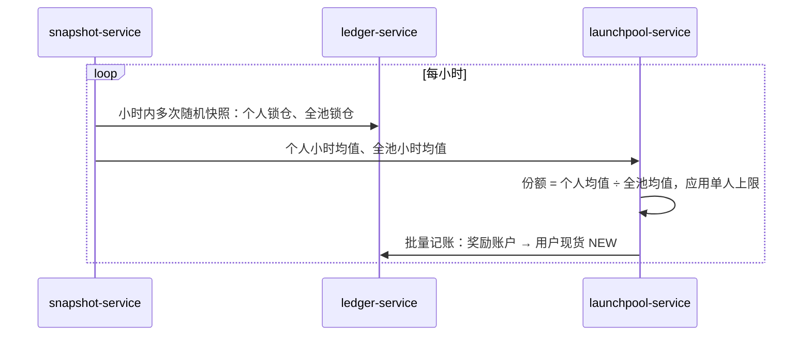

读图要点：

- 【事实·公开报道】系统每小时对个人和全池余额做多次快照，取小时平均值。
- 随机时刻快照让"整点前存入、整点后取出"失效。
- 出错点：批量记账失败需要幂等重试。幂等键 = 活动 ID + 小时 + 用户 ID。

### 3.5 定价与收益来源

**分配公式**（【事实·公开报道】）：

```
我的每小时奖励 = min( 我的小时均值 ÷ 全池小时均值 × 每小时奖励量 , 单人每小时上限 )
等价年化 = 每日奖励 × 新币价格 × 365 ÷ (我的质押量 × BNB 价格)
```

【示例】全池 2,000,000 BNB，我 10 BNB，每小时奖励 50,000 NEW，活动 5 天。NEW 开盘价 0.5 USDT，BNB = 600 USDT。

1. 份额 = 10 ÷ 2,000,000 = 0.0005%。
2. 每小时奖励 = 0.0005% × 50,000 = 0.25 NEW。
3. 每日奖励 = 0.25 × 24 = 6 NEW = 3 USDT。
4. 等价年化 = 3 × 365 ÷ (10 × 600) = 18.25%。

> 💡 注意：等价年化依赖"开盘价假设"。开盘价减半，年化同样减半。全池越大，个人份额越小。在 [launchpool-calc.html](../interactive/launchpool-calc.html) 播放"后来者涌入"，观察稀释曲线。

**快照防操纵**：如果用户只在某小时的最后 15 分钟锁入 10 BNB，该小时均值约 2.5 BNB。他只拿到 1/4 的奖励。

### 3.6 风险与对冲

- 用户风险：挖矿收益可能远小于 BNB 自身的价格波动。平台风险：BNB 下跌时，用户集中赎回并卖出。

### 3.7 失败场景与案例

- 【业界】奖励开盘即卖出：大量用户同时卖出奖励，开盘价格单边下跌。
- 【业界】多账户套利：利用多账户突破单人每小时上限。防线同 Launchpad。

## 4. 空投类：HODLer Airdrops、Megadrop、Binance Alpha

### 4.1 用户看到什么

| 机制 | 用户要做什么 | 快照与计分（截至 2026 年公开资料） |
|---|---|---|
| HODLer Airdrops | 只需把 BNB 放在 Simple Earn（活期或定期），也计入链上收益产品 | 【事实·公开报道】公告后回溯一段"历史时间窗"；窗口内每小时多次快照取平均；单人份额上限为全池 4%（公开报道的单次活动规则） |
| Megadrop | 锁定 BNB 定期产品 + 在 Binance Web3 钱包完成任务 | 【事实·公开报道】总分 = 锁仓 BNB 分 × 任务倍数 + 任务奖励分；锁仓数量越多、期限越长，分越高 |
| Binance Alpha | 在 Binance 钱包内浏览和交易尚未上现货的早期代币 | 【事实·公开报道】Alpha 积分按 15 天滚动窗口计算；空投按积分门槛领取，领取会消耗积分 |

### 4.2 资金流

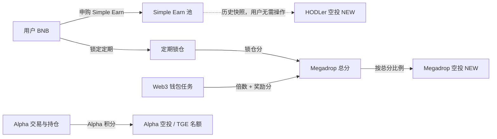

读图要点：

- 三种机制的共同点：奖励由项目方出，门槛指向 BNB 或币安钱包。
- HODLer 的"回溯"特性：公告发出时快照窗口已经结束。临时买入 BNB 没有用。
- 局限：Alpha 积分的具体计分表变化频繁。本章只描述框架。

### 4.3 状态机

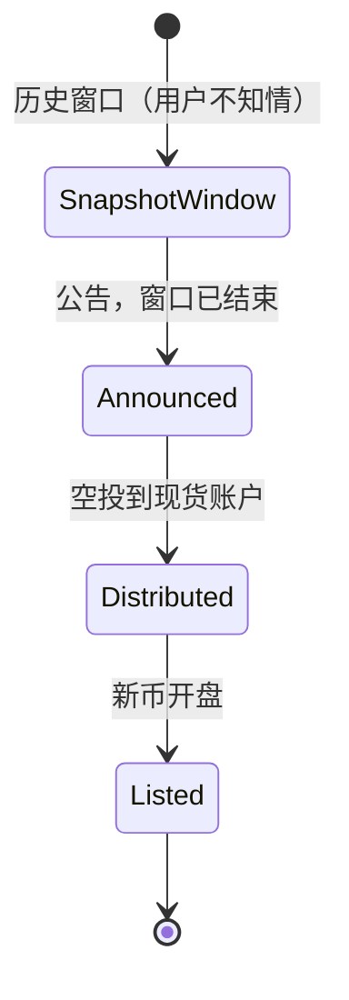

读图要点：这是 HODLer Airdrops 的状态机。Megadrop 多一个"任务进行中"状态，Alpha 多一个"积分领取"状态。

### 4.4 系统组件与调用链

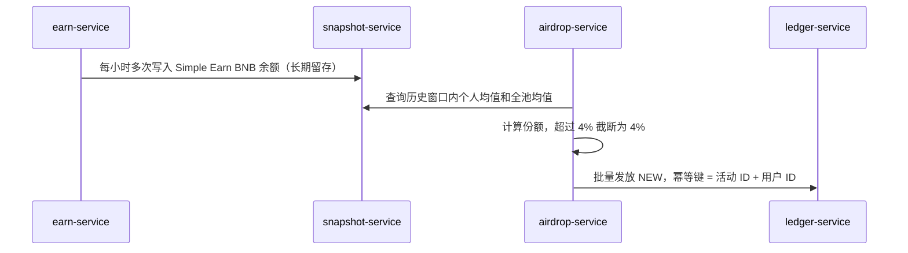

读图要点：回溯空投要求快照数据长期留存。存储成本 = 用户数 × 每小时快照次数 × 保存时长。

### 4.5 定价与收益来源

**HODLer 公式**（【示例】数值）：

```
我的份额 = min( 我的窗口均值 ÷ 全池窗口均值 , 4% )
我的空投 = 我的份额 × 空投总量
```

全池均值 30,000,000 BNB，我 30 BNB，空投总量 15,000,000 NEW。份额 = 0.0001%，空投 = 15 NEW。

**Megadrop 公式**（【示例】数值）：锁仓分 100，任务倍数 1.5，任务奖励分 20。总分 = 100 × 1.5 + 20 = 170。全网总分 10,000,000，空投总量 20,000,000 NEW。我的空投 = 170 ÷ 10,000,000 × 20,000,000 = 340 NEW。

### 4.6 风险与对冲

- 用户风险：空投代币开盘即被大量卖出，价格下跌。平台风险：Alpha 代币未经现货上币全部尽调流程，用户可能把"Alpha 展示"误解为"币安背书"。

### 4.7 失败场景与案例

- 【业界】积分刷量：用户在 Alpha 内对倒交易刷积分。平台用门槛调整和异常检测应对。
- 【分析】空投的"回溯"让临时操纵失效，但也让长期大户获得更多份额。小户的绝对收益很低。

## 5. 飞轮：BNB 需求如何被拉动

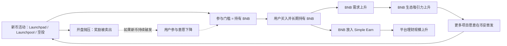

读图要点：

- 正循环：活动 → BNB 需求 → 项目首发 → 更多活动。
- 负循环：新币开盘后持续下跌，用户发现"挖到的币不值钱"，参与意愿下降。
- 快照取平均的作用：奖励长期持有者，而不是临时资金。这让 BNB 需求更"粘"。
- 局限：飞轮的强度依赖新币的二级市场表现，平台无法控制。

## 6. 与主线章节的依赖

| 本章环节 | 依赖的主线能力 | 主线章节 |
|---|---|---|
| 交易对参数、开盘保护 | tickSize / stepSize、价格带 | [06 订单与撮合](../06-order-matching.md) |
| 开放充值、确认数 | 扫链、热钱包 | [04 钱包与托管](../04-wallet-custody.md) |
| 承诺冻结、奖励发放 | 冻结/解冻、幂等分录 | [05 账本](../05-ledger.md) |
| 多账户识别 | KYC 唯一性、设备关联 | [03 账户安全](../03-account-identity-security.md)、[B05 业务风控](../backstage/B05-business-risk.md) |
| BNB 飞轮 | 代币经济 | [12 商业模式](../12-business-model.md) |
| 理财池与 HODLer | Simple Earn | [P05 理财](P05-earn-savings-staking.md) |
| 市场操纵监控 | 异常成交识别 | [B05 业务风控](../backstage/B05-business-risk.md) |

**本仓库对照**（CEX Demo）：

| 主题 | 本仓库实现 | 差距 |
|---|---|---|
| 交易对参数 | [packages/domain/src/index.ts](../../packages/domain/src/index.ts) 的 `SPOT_MARKET_DEFINITIONS`：`priceStep`、`quantityStep`、`minQuantity`、`maxPriceDeviationRatio` | 交易对写死在代码里，只有 BTC-USDT、ETH-USDT；没有上币后台 |
| 参数校验 | [services/risk-service/src/application/risk-application-service.ts](../../services/risk-service/src/application/risk-application-service.ts) 校验 step 对齐和价格偏离 | 对应 `PRICE_FILTER`、`LOT_SIZE`、`PERCENT_PRICE` 思路 |
| 冻结与发放 | [services/ledger-service/src/application/ledger-application-service.ts](../../services/ledger-service/src/application/ledger-application-service.ts) 的 `freezeBalance` / `releaseBalance` / `postJournal` | 可用来实现 Launchpad 冻结和退款；没有快照服务和活动服务 |
| 开盘保护 | 无集合竞价 | 撮合引擎只支持连续撮合 |

## 7. 术语表

| 术语 | 英文 | 定义 |
|---|---|---|
| 上币 | Listing | 把新资产接入充提和交易的过程 |
| 尽调 | Due Diligence | 对团队、代码、代币经济、合规的系统审查 |
| 种子标签 | Seed Tag | 标记高波动早期代币；交易前须通过风险测验 |
| 观察标签 | Monitoring Tag | 标记有下架风险的代币 |
| 集合竞价 | Call Auction | 先收单后统一按单一价格成交的开盘方式 |
| 承诺 | Commit | Launchpad 中用户冻结 BNB 表示认购意向 |
| 超额认购 | Oversubscription | 全网承诺额大于募资额 |
| 快照 | Snapshot | 某一时刻的余额记录；多次快照取平均防操纵 |
| 硬顶 | Hard Cap | 单人分配量或每小时奖励的上限 |
| 回溯空投 | Retroactive Airdrop | 按公告前的历史快照发放的空投 |
| 完全稀释估值 | FDV | 价格 × 代币总量 |
| 代币生成事件 | TGE | 代币首次铸造和分发的时间点 |

## 8. 思考题

1. 在 [launchpool-calc.html](../interactive/launchpool-calc.html) 中，把全池质押量从 2,000,000 拖到 8,000,000 BNB。你的等价年化下降了多少？为什么"后来者"能稀释"先来者"的收益？
2. 在同一页面的 Launchpad 部分，设置"最后 6 小时临时充入 100 BNB"。平均持仓提高了多少？如果快照只在计算期最后一刻取一次，结果会怎样？
3. HODLer Airdrops 的快照窗口在公告前已经结束。它与 Launchpool 相比，对"临时资金"和"长期持有者"的影响有什么不同？
