# P08 策略交易与跟单：网格、定投、TWAP 与 Copy Trading

> 学习目标：读完本章，你能——
> 1. 用公式算出等差网格和等比网格的每格利润，并解释价格突破区间后网格为什么"失效"。
> 2. 说清定投、TWAP 拆单、跟单交易分别把"一个用户意图"拆成了哪些订单。
> 3. 画出策略引擎的系统架构：触发器、风控、限频，以及它与撮合引擎的关系。
>
> 前置章节：[06 订单与撮合](../06-order-matching.md)、[09 风控](../09-risk-control.md)、[10 合约与衍生品](../10-derivatives-futures.md)、[11 产品生态](../11-products-ecosystem.md)
> 交互实验：[grid-bot.html](../interactive/grid-bot.html)（网格策略回测）
>
> ⚠️ 本章不构成投资建议。策略工具不保证盈利。合约网格和合约跟单使用杠杆，可能损失全部保证金。

## 0. 一句话理解

策略交易是"平台替用户挂单、撤单"。用户只提交一次策略参数。策略引擎把参数翻译成一串普通订单，按条件送进撮合引擎。撮合引擎不知道订单来自人还是策略。

> 🎯 打个比方：网格策略像一个在菜市场两头跑的小贩。他在便宜的摊位（低价格线）买进一筐，在贵的摊位（高价格线）卖出。每跑一个来回，赚一个"差价"。如果菜价一直涨，他早早卖光了货，只能看着涨；如果菜价一直跌，他手里全是越来越不值钱的菜。跟单像"抄作业"：学霸写一道题，系统自动把答案抄到每个跟随者的本子上，但抄的时候页码可能已经翻过去了（滑点和延迟）。

标记约定：【事实】= 币安公告、官网或公开报道（截至 2026 年公开资料）；【业界】= 业界通用做法；【示例】= 演示数值。

## 1. 网格交易（现货网格 / 合约网格）

### 1.1 用户看到什么

用户填写五个参数：价格下限、价格上限、网格数、网格类型（等差/等比）、投入资金。【事实】币安提供现货网格和合约网格。合约网格还可以选择方向（做多、做空、中性）和杠杆倍数。

**网格线怎么画**（区间 [L, U]，网格数 N，共 N+1 条线，第 i 条线价格为 Pᵢ）：

| 类型 | 线的位置 | 相邻两线的关系 |
|---|---|---|
| 等差（Arithmetic） | Pᵢ = L + i × (U − L) ÷ N | 价格差固定：d = (U − L) ÷ N |
| 等比（Geometric） | Pᵢ = L × rⁱ，r = (U ÷ L)^(1/N) | 价格比固定：Pᵢ₊₁ ÷ Pᵢ = r |

**每格利润公式**（本章与 [grid-bot.html](../interactive/grid-bot.html) 使用同一公式）：

```
每格资金 B = 投入资金 ÷ N
第 i 格数量 qᵢ = B ÷ Pᵢ
第 i 格一次买卖往返的利润 = qᵢ × (Pᵢ₊₁ − Pᵢ) − f × qᵢ × (Pᵢ + Pᵢ₊₁)
第 i 格利润率 = (Pᵢ₊₁ ÷ Pᵢ − 1) − f × (1 + Pᵢ₊₁ ÷ Pᵢ)
```

f 是单边手续费率。买入付一次费，卖出付一次费。

【示例】区间 80–120 USDT，N = 10，投入 1,000 USDT，f = 0.1%。

1. 等差：d = 4 USDT。最低一格（80→84）：q = 100 ÷ 80 = 1.25；利润 = 1.25 × 4 − 0.001 × 1.25 × 164 = 4.795 USDT（4.80%）。
2. 等差：最高一格（116→120）：q = 0.8621；利润 = 3.4483 − 0.2034 = 3.245 USDT（3.24%）。
3. 等比：r = 1.5^(1/10) = 1.04138。每一格利润率相同 = 0.04138 − 0.001 × 2.04138 = 3.934%，每格利润 3.934 USDT。

> 💡 注意：等差网格在低价区的利润率更高，在高价区更低。等比网格每格利润率相同，适合宽区间。如果每格利润率小于 0，网格每成交一次都亏钱。网格过密时就会出现这种情况。

### 1.2 资金流

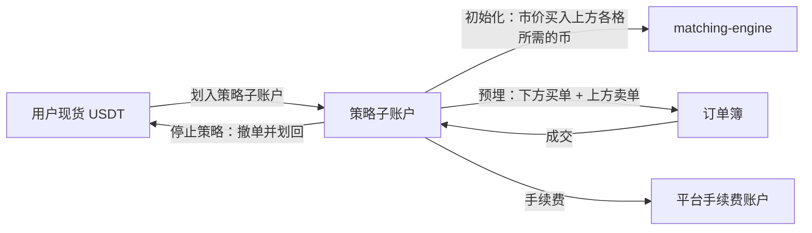

读图要点：

- 【业界】策略资金放在独立子账户。这样策略的盈亏不会与用户手动交易混在一起。
- 初始化时，当前价上方的每一格都需要"一份币"等待卖出。所以创建策略时会先买入一部分币。
- 出错点：子账户余额与挂单冻结不一致。停止策略时必须先撤完单，再划回资金。

### 1.3 状态机

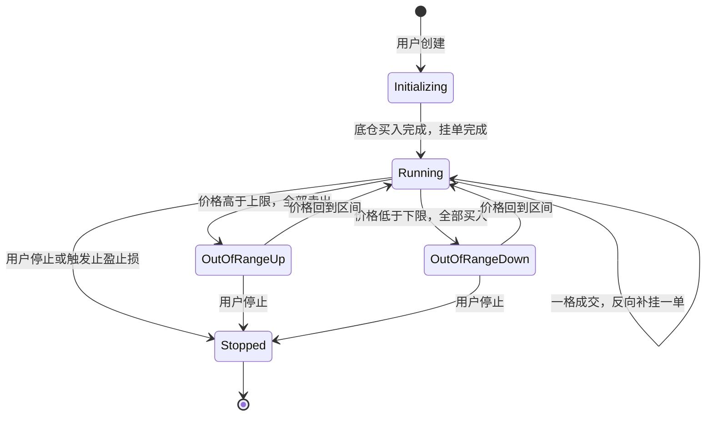

读图要点：

- 网格的核心动作只有一个：**一格成交 → 在相邻线反向补挂一单**。买单在 Pᵢ 成交，就在 Pᵢ₊₁ 挂卖单。
- `OutOfRangeUp`：用户只剩 USDT，不再享受上涨。`OutOfRangeDown`：用户只剩币，承担全部下跌。
- 这两个状态就是网格"失效"。网格不会自动移动区间，除非用户开启了【业界】常见的"移动网格/跟踪区间"选项。

### 1.4 系统组件与调用链

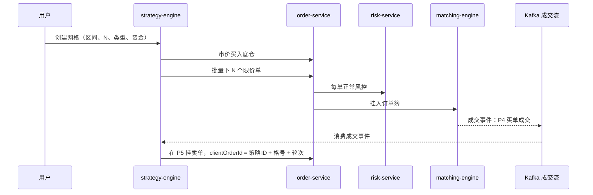

读图要点：

- 网格触发 = **预埋限价单簇**。价格到达时，撮合引擎直接成交。策略引擎不需要实时盯价。
- 策略引擎只在"成交之后"动作：补挂反向单。
- `clientOrderId` 由策略 ID、格号、轮次组成。重复消费同一成交事件时，order-service 用它去重。
- `strategy-engine` 是【示例】服务名。

### 1.5 定价与收益来源

用户的总收益分两部分：

```
总收益 = 网格利润 + 浮动盈亏
网格利润 = Σ 已完成往返的每格利润
浮动盈亏 = 当前持仓市值 − 持仓成本
```

- 网格利润来自**波动**。价格来回穿越网格线越多，往返次数越多。
- 浮动盈亏来自**趋势**。单边下跌时，浮动亏损可以远大于网格利润。

**平台怎么赚钱**：每次成交都收手续费。一个 50 格的网格，一天可能产生数十笔成交（【示例】）。策略工具本身通常不另收费（【业界】）。

在 [grid-bot.html](../interactive/grid-bot.html) 中对比"网格总收益"和"一直持有"：震荡行情网格胜出，单边上涨行情一直持有胜出。

### 1.6 风险与对冲

| 风险方 | 风险 | 兜底 |
|---|---|---|
| 用户 | 单边行情，网格失效 | 止损价、止盈价、区间外自动停止 |
| 用户（合约网格） | 杠杆导致强平 | 强平价提示；见 [10 章](../10-derivatives-futures.md) |
| 平台 | 大量网格挂单在同一价位，形成"假深度" | 行情突破时这些挂单被集中吃掉，深度瞬间变薄 |
| 平台 | 策略引擎宕机，补挂单缺失 | 重启后用订单状态对账，补齐缺失的反向单 |

### 1.7 失败场景与案例

- 【示例】等差，区间 80–120，N = 10，投入 1,000 USDT，起始价 100。价格单边跌到 60，网格全部买满。用户持有约 10.35 个币，市值约 621 USDT，剩余现金约 35 USDT。不计途中已完成的网格利润，总亏损约 344 USDT。
- 【业界】网格过密：每格利润率小于双边手续费。用户看到"成交很多"，但网格利润为负。

## 2. 定投（DCA）

### 2.1 用户看到什么

定投（Dollar-Cost Averaging，DCA）：每隔固定时间，用固定金额买入同一资产。【事实】币安曾以"定投（Auto-Invest）"提供该功能。2025 年起，它迁移到闪兑的"定期买入"（Convert Recurring），用户可选择每小时到每月的周期和金额（据公开报道）。

### 2.2 资金流

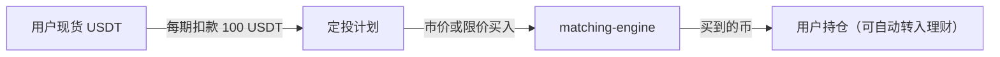

读图要点：每一期都是一笔独立的普通订单。余额不足时，这一期失败，下一期照常执行。

### 2.3 状态机

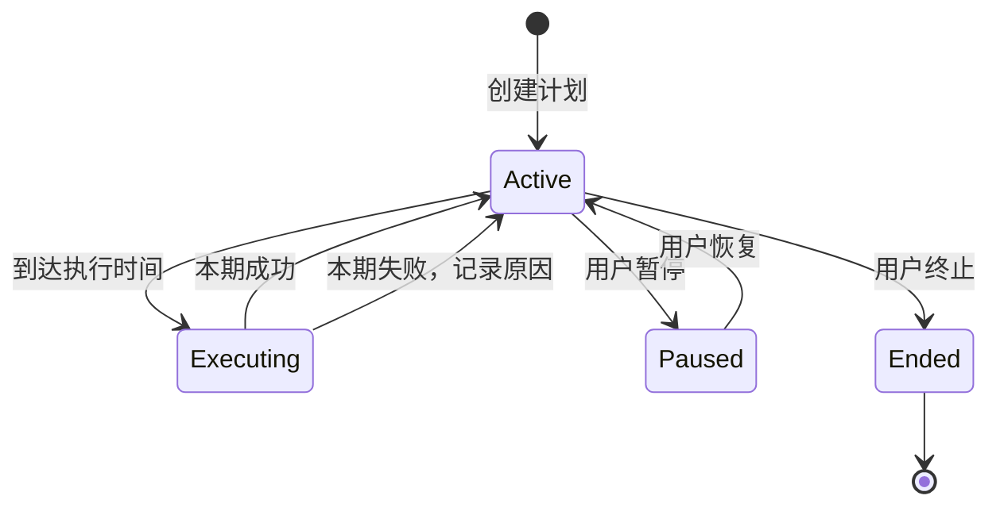

读图要点：失败的一期不补执行。补执行会让用户在不知情时买入两倍金额。

### 2.4 系统组件与调用链

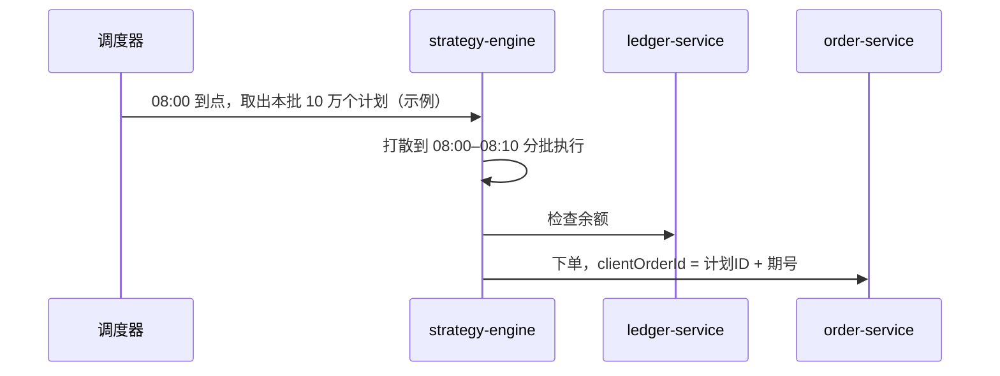

读图要点：同一时刻触发的大量定投单会冲击盘口。【业界】做法是在一个时间窗内打散执行。

### 2.5 定价与收益来源

```
平均成本 = 总投入 ÷ 总买入数量
```

【示例】三期各投 100 USDT，价格 10、5、10。买入 10 + 20 + 10 = 40 个。平均成本 = 300 ÷ 40 = 7.5 USDT，低于三次价格的算术平均 8.33。价格越低时买得越多。

### 2.6 风险与对冲

定投不消除下跌风险。它只平滑买入时点。平台风险很低：每期都是普通现货订单。

### 2.7 失败场景与案例

【业界】整点集中执行导致小币种盘口被打穿，成交均价偏离。解决方式是打散执行和限价保护。

## 3. TWAP 与算法单

### 3.1 用户看到什么

时间加权平均价格（Time-Weighted Average Price，TWAP）算法单：把一笔大单在指定时间内均匀拆成很多小单。【事实】币安向部分用户提供算法单，包括 TWAP 和成交量参与（Volume Participation）类型；具体开放范围和最低金额以官网为准。

### 3.2 资金流

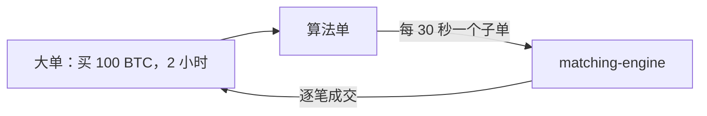

读图要点：母单冻结全部所需资金。每个子单成交后，冻结按成交额逐步消耗。

### 3.3 状态机

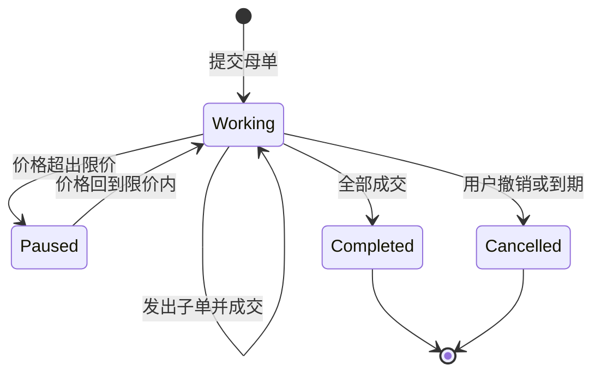

读图要点：母单状态由子单汇总得出。撤销母单 = 撤销所有未成交子单 + 停止发新子单。

### 3.4 系统组件与调用链

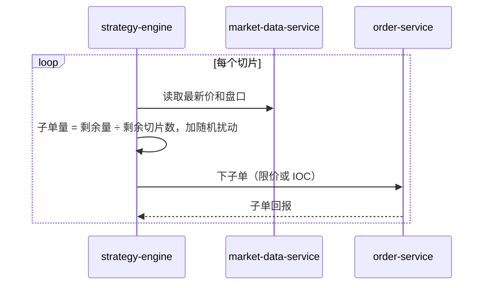

读图要点：子单量加入随机扰动，避免其他交易者识别出固定节奏。

### 3.5 定价与收益来源

```
子单量 = 剩余数量 ÷ 剩余切片数
执行质量 = 实际成交均价 − 同时段 TWAP 基准价
```

【示例】买 100 BTC，2 小时，每 30 秒一片，共 240 片，每片约 0.4167 BTC。一次性市价买 100 BTC 可能吃掉多档深度，滑点 0.5%（示例）；拆单后单片冲击接近 0。参见 [depth-slippage.html](../interactive/depth-slippage.html)。

### 3.6 风险与对冲

时间风险：拆单期间价格可能持续上涨。用户用"限价上限"控制最差价格。

### 3.7 失败场景与案例

【业界】行情服务延迟，策略引擎按旧价格下单，子单全部未成交或成交在不利价格。防线：行情时间戳过期就暂停发单。

## 4. 跟单交易（Copy Trading）

### 4.1 用户看到什么

- 带单员（Lead Trader）：公开自己的仓位和业绩，让别人跟随。
- 跟随者（Copy Trader）：选择带单员，投入跟单资金。

【事实·公开报道】币安 2023 年推出合约跟单，2024 年推出现货跟单。上线时报道的规则是固定 10% 利润分成。

【事实·截至 2026 年币安官方 FAQ】合约跟单的分成规则已经改为"按等级设上限、带单员自选比例"：

| 带单员等级 | 保证金余额门槛（之一） | 可设分成比例 |
|---|---|---|
| Regular | ≥ 500 USDT | 0%–10% |
| Cadet | ≥ 1,000 USDT | 0%–15% |
| Champion | ≥ 5,000 USDT | 0%–20% |
| Master | ≥ 10,000 USDT | 0%–30% |
| Legend | ≥ 20,000 USDT | 0%–30% |

- 带单员在本等级上限内自选比例。每周最多调整 2 次。等级徽章至少保持 7 天才会再升降级。等级还有其他考核条件，以官网为准。
- 结算：每周一 00:00（UTC）对每个跟单组合的总盈亏（已实现 + 未实现）拍快照并结算。2024-09-23 起，结算基础从"已实现盈亏"改为"总盈亏"。
- 公式：本期应分成 = max[（组合已实现盈亏 + 未实现盈亏）× 分成比例 − 已分成金额, 0]。这就是高水位线：亏损之后必须先赚回，才会再次分成。
- 带单员另获跟随者交易手续费的 10% 作为佣金，每周上限 = 组合保证金余额 × 3% × 10%。
- 早期报道"一个跟随者最多同时跟随 10 位带单员"，本次未在官方 FAQ 中复核，以官网为准。

**仓位映射**有两种模式：

| 模式 | 公式 | 示例 |
|---|---|---|
| 按比例（Ratio） | 跟随者下单额 = 带单员下单额 × (跟随者跟单资金 ÷ 带单员组合资金) | 带单员 10,000 USDT 中开 2,000；跟随者 1,000 USDT → 开 200 |
| 固定金额（Fixed） | 带单员每开一单，跟随者固定开 X USDT | 每单 50 USDT，不管带单员开多大 |

### 4.2 资金流

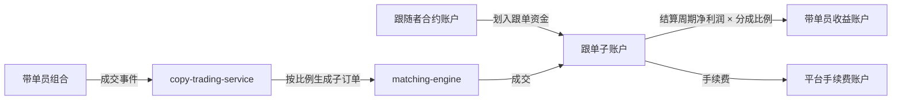

读图要点：

- 跟随者的资金始终在自己的子账户中。带单员不能动用跟随者资金，只能触发下单。
- 分成只按"净利润"计算，并使用高水位线（High-Water Mark）：亏损周期之后，必须先赚回亏损，才再次分成。币安合约跟单的结算公式就是这一做法（见上文，官方 FAQ）。

### 4.3 状态机

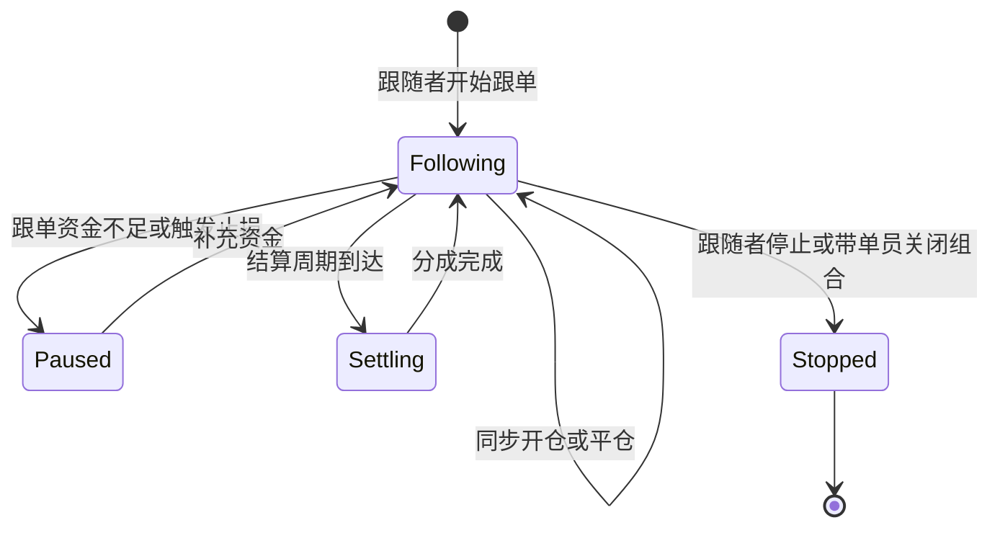

读图要点：跟随者停止跟单时，【业界】通常提供两个选项：立即平掉全部跟单仓位，或保留仓位手动管理。

### 4.4 系统组件与调用链

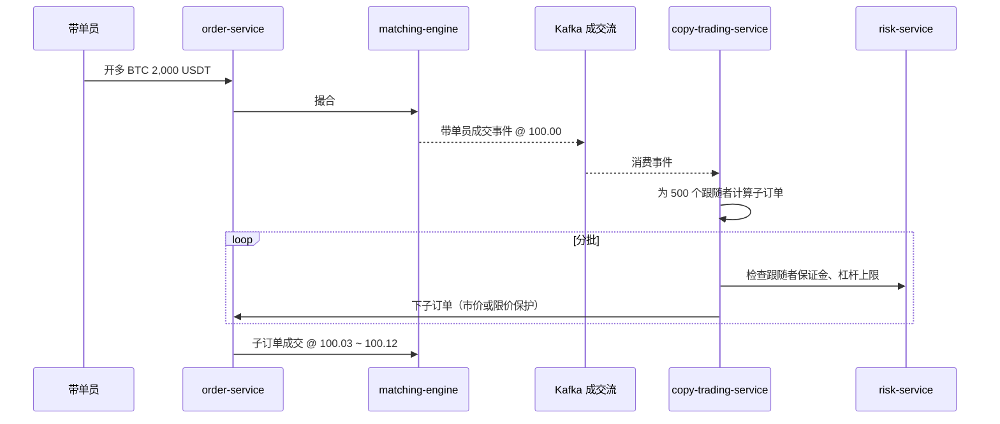

读图要点：

- 跟随者订单**一定晚于**带单员订单。它们在带单员成交之后才生成。
- 500 个子订单（示例）集中进入同一方向，推高成交价。这就是跟单滑点的来源。
- 出错点：部分跟随者风控失败，部分成功，跟随者之间的仓位结构不一致。

### 4.5 定价与收益来源

```
跟随者净收益 = 仓位盈亏 − 手续费 − 分成
分成 = max(0, 本周期净利润 − 历史亏损未弥补部分) × 分成比例
```

【示例】带单员为 Regular 等级，分成比例设为 10%。跟随者组合本周总盈亏从 0 涨到 200 USDT，之前没有分成过。分成 = max(200 × 10% − 0, 0) = 20 USDT，跟随者净得 180 USDT（未计手续费）。下周总盈亏回落到 150 USDT：max(150 × 10% − 20, 0) = 0，本周不分成。

**滑点成本**：带单员成交 100.00，跟随者平均成交 100.06。100 万 USDT 跟单资金单向成本 = 0.06% × 1,000,000 = 600 USDT（示例）。

**跟单资金上限**：【业界】平台限制单个带单员的跟随人数或总跟单资金（具体上限以官网为准）。原因：跟单资金过大时，子订单本身就会移动价格，带单员的策略不再可复制。

**平台怎么赚钱**：跟随者和带单员的交易手续费。

### 4.6 风险与对冲

| 风险 | 说明 | 平台防线（【业界】） |
|---|---|---|
| 刷业绩 | 带单员用小资金高杠杆赌出漂亮收益率，或开多个账户只展示赢的那个 | 展示最大回撤、资金规模、带单天数；要求最低资金 |
| 幸存者偏差 | 排行榜只显示活下来的带单员 | 展示历史跟随者的实际盈亏，而非带单员收益率 |
| 抢跑 | 带单员先自己建仓，再用跟随者订单推高价格后平仓 | 监控带单员个人账户与带单组合的交易时序 |
| 延迟 | 极端行情下跟随者订单成交价远差于带单员 | 跟随者可设置最大滑点，超出则不跟 |

### 4.7 失败场景与案例

- 【业界】带单员一次爆仓，所有跟随者同时被强平。跟随者看到的"历史收益率 300%"在一天内归零。
- 【业界】跟随者在带单员连续盈利后才加入，正好赶上回撤。这说明历史业绩不预示未来收益。

## 5. 策略引擎的系统架构

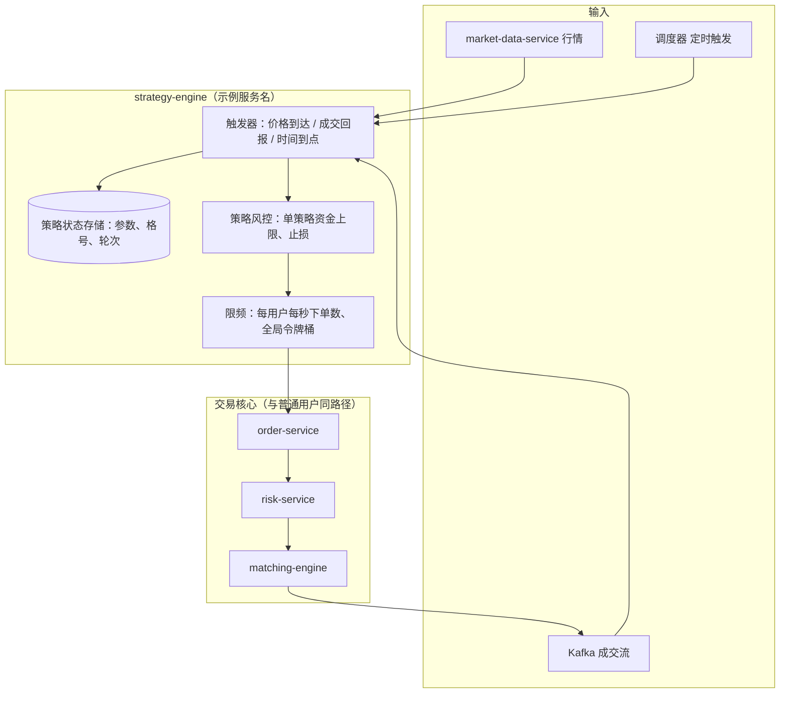

读图要点：

- 策略引擎位于撮合引擎**之外**。它是撮合引擎的"客户端"，与普通 API 用户走同一条下单路径。
- 撮合引擎保持单线程、确定性（见 [06 章](../06-order-matching.md)）。把策略逻辑放进撮合引擎，会破坏确定性和吞吐。
- 限频有两层：单策略限频防止一个策略刷单；全局令牌桶防止策略流量挤占人工下单。
- 出错点：策略引擎重启后状态丢失。【业界】做法：状态持久化，重启后与 order-service 的订单状态对账，补发或撤销。

| 设计问题 | 业界通用做法 |
|---|---|
| 重复下单 | `clientOrderId` 确定性生成，order-service 去重 |
| 触发风暴 | 价格穿越大量策略的触发点时，按优先级队列分批下单 |
| 与人工下单冲突 | 策略资金放子账户，人工下单看不到策略资金 |
| 回测与实盘偏差 | 回测假设限价单在触价时 100% 成交；实盘有排队和部分成交 |

## 6. 与主线章节的依赖

| 本章环节 | 依赖的主线能力 | 主线章节 |
|---|---|---|
| 预埋限价单、clientOrderId | 订单类型、撮合 | [06 订单与撮合](../06-order-matching.md) |
| 子账户、冻结 | 账本 | [05 账本](../05-ledger.md) |
| 合约网格、合约跟单 | 保证金、强平 | [10 合约与衍生品](../10-derivatives-futures.md) |
| 限频、下单风控 | 风控 | [09 风控](../09-risk-control.md) |
| 拆单与滑点 | 深度 | [08 行情](../08-market-data.md) |
| 带单员刷业绩监控 | 市场监控 | [B05 业务风控](../backstage/B05-business-risk.md) |

**本仓库对照**（CEX Demo）：

| 主题 | 本仓库实现 | 差距 |
|---|---|---|
| 下单入口 | [services/order-service/src/application/order-application-service.ts](../../services/order-service/src/application/order-application-service.ts) 的 `createOrder` / `cancelOrder` | 策略引擎可以作为它的调用方；本仓库没有策略引擎 |
| 限频 | [services/api-gateway/src/infrastructure/redis-rate-limiter.ts](../../services/api-gateway/src/infrastructure/redis-rate-limiter.ts) | 网关层按请求限频；没有"单策略"维度的限频 |
| 下单风控 | [services/risk-service/src/application/risk-application-service.ts](../../services/risk-service/src/application/risk-application-service.ts) | 策略子单会经过同样的 step 和价格偏离校验 |
| 自动化任务 | order-service 中的 `SpotOrderAutomationExecution`（恢复、重放） | 这是运维自动化，不是交易策略 |
| 撮合 | [engines/matching-engine/src/main.rs](../../engines/matching-engine/src/main.rs) | 只有连续撮合，不感知订单来源 |

## 7. 术语表

| 术语 | 英文 | 定义 |
|---|---|---|
| 网格交易 | Grid Trading | 在区间内按固定间隔预埋买卖单，低买高卖 |
| 等差网格 | Arithmetic Grid | 相邻网格线价格差相同 |
| 等比网格 | Geometric Grid | 相邻网格线价格比相同 |
| 网格利润 | Grid Profit | 已完成买卖往返的累计利润 |
| 浮动盈亏 | Unrealized PnL | 当前持仓按市价计算的盈亏 |
| 定投 | DCA / Auto-Invest | 定期定额买入 |
| 时间加权平均价格 | TWAP | 把大单在时间上均匀拆分执行 |
| 母单 / 子单 | Parent / Child Order | 算法单与它拆出的实际订单 |
| 带单员 | Lead Trader | 公开仓位供他人跟随的交易者 |
| 跟随者 | Copy Trader | 自动复制带单员操作的用户 |
| 利润分成 | Profit Sharing | 跟随者把净利润的一部分支付给带单员 |
| 高水位线 | High-Water Mark | 只对超过历史最高净值的部分分成 |
| 幸存者偏差 | Survivorship Bias | 只看到存活者，高估整体成功率 |
| 策略引擎 | Strategy Engine | 按条件替用户挂撤单的服务 |

## 8. 思考题

1. 在 [grid-bot.html](../interactive/grid-bot.html) 中，选择"震荡"行情和"单边上涨"行情，分别比较"网格总收益"与"一直持有"。哪种行情网格胜出？为什么？
2. 在同一页面把网格数从 10 调到 200，手续费保持 0.1%。每格利润率怎么变化？什么时候每格利润率变成负数？用 1.1 节的公式验证。
3. 跟单交易中，为什么跟单资金越大，跟随者的收益率越低于带单员的收益率？平台为什么要设置跟单资金上限？
