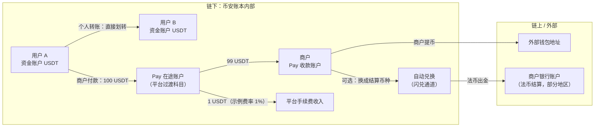
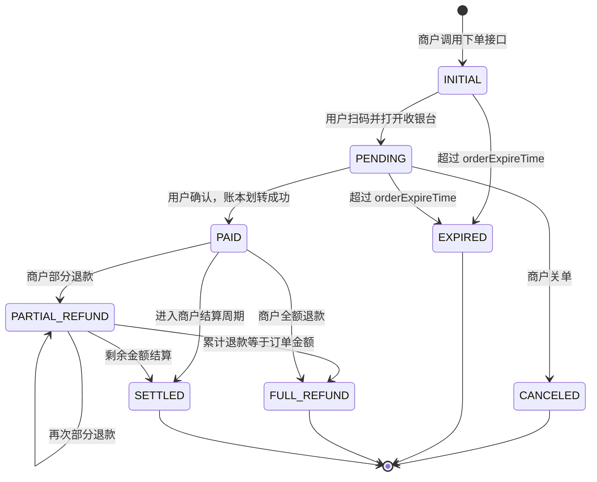
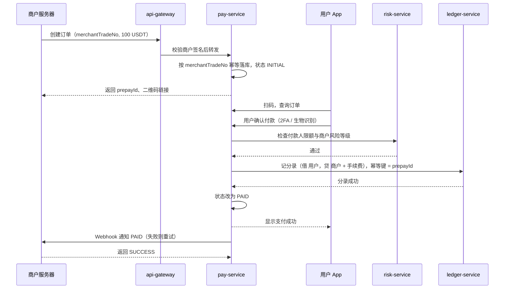
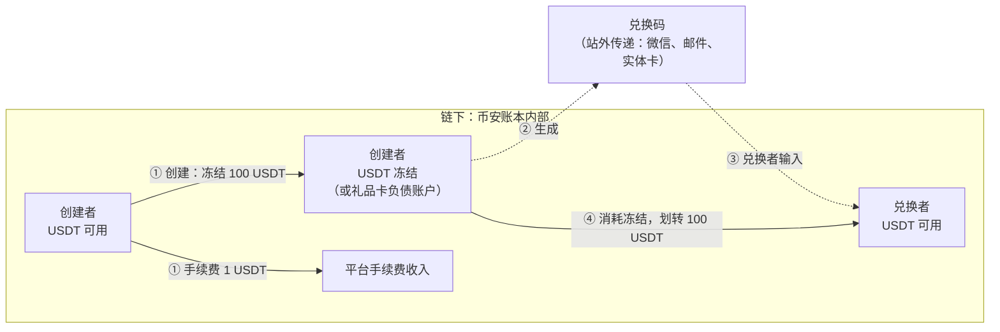
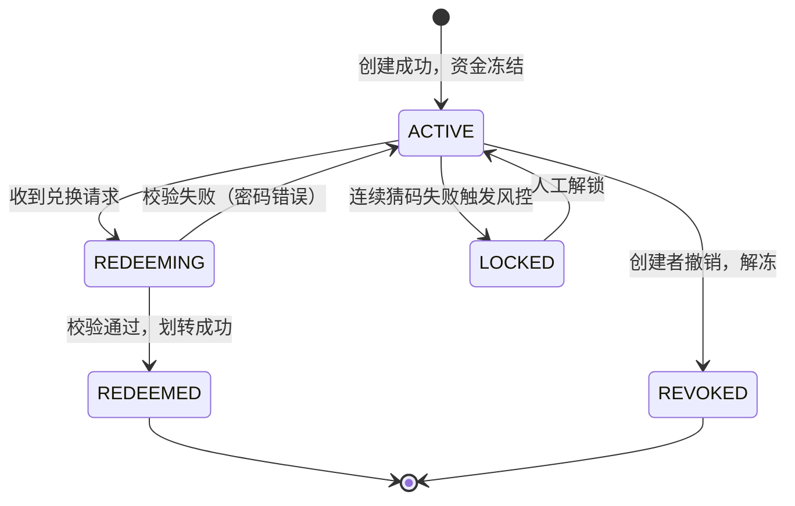
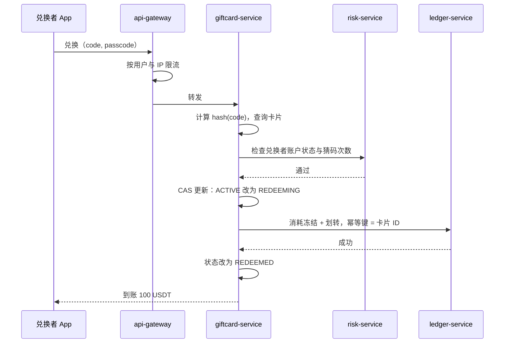
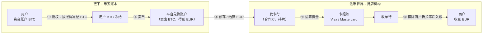
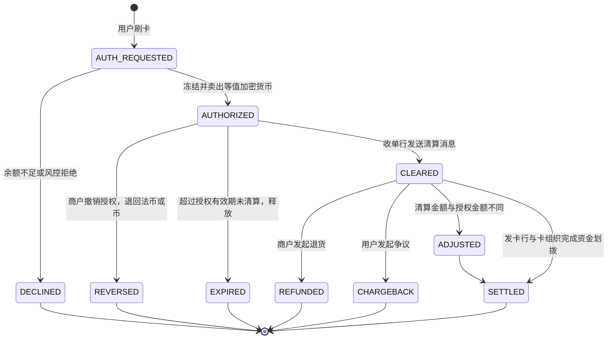
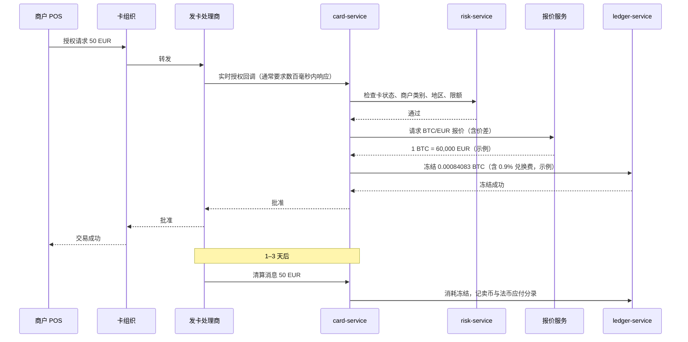

# P09 支付与卡：Binance Pay、礼品卡、Binance Card

> 学习目标：读完本章，你能——
> 1. 画出 Binance Pay、礼品卡、Binance Card 三条资金流，并标出"链上 vs 链下"边界。
> 2. 用"冻结 → 划转 → 解冻"三个账本动作解释站内支付和礼品卡。
> 3. 说清加密借记卡的"授权 → 清算"两阶段，以及平台在哪一步卖币、承担什么汇率风险。
>
> 前置章节：[../05-ledger.md](../05-ledger.md)（冻结与双分录）、[../07-clearing-settlement-fees.md](../07-clearing-settlement-fees.md)（手续费分录）、[../11-products-ecosystem.md](../11-products-ecosystem.md) 第 3.9 节（Pay 概览）、[../04-wallet-custody.md](../04-wallet-custody.md)（充提与链上边界）
> 交互实验：[../interactive/ledger-double-entry.html](../interactive/ledger-double-entry.html)（用"划转"理解 Pay）、[../interactive/revenue-model.html](../interactive/revenue-model.html)（支付类收入在总收入中的位置）

## 0. 一句话理解

三个产品都在做同一件事：把交易所账本里的数字，变成别人能用的价值。Pay 和礼品卡只改账本，不上链。Binance Card 要走出交易所，经过卡组织和银行，最后变成商户收到的法币。

> 🎯 打个比方：交易所像一座游乐园。Binance Pay 是园内的"游园币转账"，你给朋友转 10 个币，只是两张卡片上的数字变了。礼品卡是"兑换券"，你先把币锁进信封，信封上写一串密码，谁拿到密码谁就能把币取出来。Binance Card 是园区出口的"兑换窗口"，你在园外商店刷卡时，窗口当场把你的游园币卖掉，换成真钱付给商店。

三个产品的边界对比：

| 产品 | 是否上链 | 是否经过外部机构 | 账本动作 | 平台主要收入 |
|---|---|---|---|---|
| Binance Pay 个人转账 | 否 | 否 | 划转 | 无直接收入，资金留存 |
| Binance Pay 商户收款 | 否（结算提现时才可能上链） | 否（法币结算除外） | 冻结 → 划转 → 手续费分录 | 商户手续费（示例） |
| 礼品卡 | 否 | 否 | 冻结 → 消耗 → 划转 | 创建手续费 |
| Binance Card | 否（币不上链） | 是：发卡行、卡组织、收单行 | 冻结 → 卖币 → 法币清算 | 兑换价差、交换费分成 |

> 💡 注意：本章的"不上链"指资金在币安账本内移动。用户最终提币到外部地址时，仍然走 [04 章](../04-wallet-custody.md) 的提币流程。

## 1. Binance Pay（站内转账与商户收款）

### 1.1 用户看到什么

截至 2026 年公开资料：

- **个人转账**：用户输入对方的 Pay ID、邮箱或手机号，选择币种和数量，确认后对方即时到账。币安宣传"零 gas、零手续费"。
- **商户收款（C2B）**：商户调用 Binance Pay 下单接口，拿到二维码或收银台链接。用户用币安 App 扫码，确认付款。
- **订单有效期**：下单接口 `orderExpireTime` 不填时默认 1 小时，最长 15 天（币安开发者文档，截至 2026 年公开资料）。
- **退款**：商户可以多次部分退款，累计金额不能超过订单金额。退款回到付款人原账户（币安开发者文档）。
- **费用**（币安官方 FAQ《Binance Pay Fees》，2026 年 1 月 2 日更新）：
  - 小程序平台商户：交易额的 1%。季度交易额低于 9 万美元的商户，另收每月 1,000 美元最低费用（2024 年 1 月 28 日起）。
  - 商户批量付款（Payout）：交易额的 0.80%，单笔上限 5 美元（2024 年 12 月 1 日起）。
  - "Send Cash"（P2P 方式）：低于 100 美元收 0.5 美元，100 美元及以上收 1 美元。
  - 转到用户自己的 Web3/DeFi 钱包：收链上网络费，另收平台费。BNB Smart Chain 和 opBNB 为提币手续费的 50%，其他网络为 80%，上限 10 USDC 等值。
  - 普通线上收银台的商户费率，官方 FAQ 没有列出统一数字。本章用 1%（示例）计算，与小程序费率一致。

术语首次出现：

- 支付 ID（Pay ID）：币安分配给每个用户的数字标识，用于站内收付款，代替链上地址。
- 预支付单（Prepay Order）：商户下单后、用户付款前的订单。系统返回 `prepayId`、二维码链接和收银台链接。
- Webhook：系统在订单状态改变时，主动调用商户服务器的回调地址。

### 1.2 资金流



**读图要点**

- 个人转账只有一步：借 A，贷 B。两个账户都在同一个账本里，没有链上交易，所以没有 gas。
- 商户付款经过"在途账户"。在途账户让"用户已付"和"商户已入账"可以分开对账（业界通用做法）。
- 链上边界只出现在商户提币时。法币边界只出现在法币结算时。Pay 本身从不碰链。
- 局限：图中的在途账户和手续费扣法是业界通用做法。币安内部科目未公开。

### 1.3 状态机（商户订单）



**读图要点**

- `PAID` 是唯一的"资金已动"分界点。`PAID` 之前，用户余额没有变化，系统只需关单。
- 退款是一笔反向划转。系统必须校验"累计退款 ≤ 订单金额"，否则平台自掏腰包。
- 过期和取消不产生分录。这让失败路径非常便宜。
- 局限：状态名参考币安开发者文档的订单状态字段，`SETTLED` 是本章为说明结算加入的示意状态。

### 1.4 系统组件与调用链

`pay-service` 不在主线 [02 章](../02-system-architecture.md) 的架构图里。业界通常把它做成独立的业务服务，向下调用 `ledger-service`。



**读图要点**

- 幂等出现两次：商户侧用 `merchantTradeNo` 防止重复下单，账本侧用 `prepayId` 防止重复扣款。
- 账本写入成功后才改状态。如果顺序反了，系统会出现"已显示成功、未扣款"的错账。
- Webhook 是异步的。商户收不到回调时，应主动调用"查询订单"接口，不能直接判定失败。
- 局限：风控检查点和 2FA 方式为业界通用做法。

### 1.5 定价与收益来源

商户收款的账本公式（示例）：

```text
商户入账 = 订单金额 × (1 − 商户费率)
平台收入 = 订单金额 × 商户费率 + 自动兑换价差
```

数值示例：订单 100 USDT，商户费率 1%（示例），商户选择自动兑换成稳定币 X，兑换价差 0.1%（示例）。

| 分录 | 借方 | 贷方 | 金额 |
|---|---|---|---|
| 1 | 用户-USDT-可用 | 商户-USDT-可用 | 99 USDT |
| 2 | 用户-USDT-可用 | 平台手续费收入-USDT | 1 USDT |
| 3（自动兑换） | 商户-USDT-可用 | 平台做市账户-USDT | 99 USDT |
| 4（自动兑换） | 平台做市账户-稳定币 X | 商户-稳定币 X-可用 | 98.901 X |

平台的真正价值不在 1 USDT 手续费。Pay 把资金留在账本内，减少提币。每少一次提币，平台少付一次链上 gas，少一次热钱包出金风险（见 [04 章](../04-wallet-custody.md)）。

### 1.6 风险与对冲

| 风险 | 说明 | 兜底手段（业界通用做法） |
|---|---|---|
| 洗钱通道 | 站内转账不上链，链上分析工具看不到 | 收付双方都需 KYC；对转账图做关联分析，见 [B01-compliance.md](../backstage/B01-compliance.md) |
| 账户盗用 | 盗号者用 Pay 秒转资金，比提币更快 | 新设备、改密后限制 Pay 额度，见 [B03-account-security.md](../backstage/B03-account-security.md) |
| 商户欺诈 | 虚假商户收款后跑路 | 商户 KYB（企业认证）；结算延迟；保证金 |
| 汇率风险 | 订单按法币计价，用户付加密货币 | 报价锁定期短；平台通过闪兑通道即时对冲 |

### 1.7 失败场景与案例

1. **Webhook 丢失**：商户服务器宕机 10 分钟，没有收到 `PAID` 回调。商户误判订单失败，再次让用户付款。结果用户付了两次。对策：商户以"查询订单"结果为准，系统按 `merchantTradeNo` 拒绝重复下单。
2. **退款超额**：两个退款请求并发到达，各自读到"剩余可退 100"，各退 100。对策：退款在同一事务里锁订单行，或用乐观锁版本号。
3. **欧洲卡下线后的替代**：2023 年币安在欧洲停止 Binance Card 时，公开建议用户改用 Binance Pay 在支持的商户消费（新闻报道，2023 年）。这说明 Pay 不依赖卡组织，监管变化时更可控。

## 2. 礼品卡（预付凭证）

### 2.1 用户看到什么

截至 2026 年公开资料：

- 用户从余额中创建礼品卡，选择币种、金额，生成一串兑换码（可选加一串密码）。
- 收到兑换码的人在 App 中输入兑换码，资产即时进入其账户。
- 币安自 2023 年 8 月 21 日起，对购买或创建礼品卡收取 1% 手续费（币安开发者文档《Gift Card Change Log》）。兑换不收手续费，以官网为准。
- 币安开放了礼品卡 API。通过 API 批量创建礼品卡仅限通过 KYB 的机构账户（币安开发者文档）。

术语：

- 预付凭证（Prepaid Voucher）：先付钱、后兑换的凭证。凭证本身不是资产，它是对一笔冻结资产的提取权。
- 兑换码（Redemption Code）：凭证的唯一标识，持有者即可兑换。

### 2.2 资金流



**读图要点**

- 资金只在账本里移动。兑换码在站外传递，但它本身不携带资产，只携带"提取权"。
- 创建时冻结，兑换时划转。在兑换之前，这笔钱仍是创建者的资产，只是不能动。
- 另一种做法是创建时就把资金转入平台的"礼品卡负债"账户。两种做法的区别是：未兑换的钱算谁的。这影响储备金证明和会计处理（业界通用做法，币安未公开）。
- 出错点：兑换码泄露等于资金被盗。系统无法区分"合法持有者"和"偷到码的人"。

### 2.3 状态机



**读图要点**

- `REDEEMING` 是防并发的关键状态。两个人同时输入同一兑换码时，只有一个能把状态从 `ACTIVE` 改成 `REDEEMING`。
- 撤销只能发生在 `ACTIVE`。一旦兑换，资产已属于他人，撤销等于盗窃。
- 局限：`LOCKED` 和 `REVOKED` 是业界通用做法的示意，币安是否支持撤销以官网为准。

### 2.4 系统组件与调用链



**读图要点**

- 数据库只存 `hash(code)`，不存明文兑换码。数据库泄露时，攻击者拿不到可用的码（业界通用做法）。
- 限流在网关层做。兑换码空间如果太小，攻击者可以枚举。
- CAS（比较并交换）保证一张卡只兑换一次。账本幂等键是第二道防线。

### 2.5 定价与收益来源

```text
平台收入 = 创建金额 × 创建费率
沉淀资金 = 已创建 − 已兑换 − 已撤销
```

示例：某月创建 1,000,000 USDT 礼品卡，创建费率 1%（截至 2026 年公开资料，以官网为准），平台收入 10,000 USDT。月末未兑换 200,000 USDT。这 200,000 USDT 留在平台账本内，是"沉淀资金"。

### 2.6 风险与对冲

- **码的安全**：兑换码要足够长、随机，且只存哈希。密码与兑换码分开传递。
- **社会工程诈骗**：诈骗者要求受害者"用礼品卡付款"。礼品卡兑换后不可追回，是诈骗的常用工具（业界通用风险）。
- **洗钱**：礼品卡可以把资金从一个 KYC 账户转到另一个账户，且关联关系隐藏在站外。平台需要记录创建者和兑换者，供合规追查。
- **价格风险**：礼品卡锁定的是币，不是法币价值。BTC 礼品卡从创建到兑换可能贬值。平台不承担这部分风险。

### 2.7 失败场景与案例

1. **重复兑换**：缺少 CAS，两个并发请求都读到 `ACTIVE`，各划转一次。平台多付 100 USDT。对策见 2.4。
2. **兑换码被截图泄露**：用户在社交平台晒卡，没有遮挡兑换码。他人抢先兑换。平台无法追回。
3. **枚举攻击**：攻击者用大量账户猜测短兑换码。对策：兑换码长度足够；按账户、IP、设备限流；失败次数超阈值时锁定账户。

## 3. Binance Card（加密借记卡）

### 3.1 用户看到什么

截至 2026 年公开资料（地区变化频繁，以官网为准）：

- Binance Card 是一张借记卡（Debit Card）。用户在任何受理该卡组织的商户刷卡，系统从用户的币安资金账户中实时卖币付款。
- **地区变化**：
  - 2023 年 1 月，币安与 Mastercard 在巴西推出卡产品（新闻报道）。
  - 2023 年 9 月前后，Mastercard 与币安结束拉美和巴林的联名卡合作（新闻报道）。
  - 2023 年 12 月 20 日，币安在欧洲经济区停止 Visa 借记卡服务。发卡方 Contis 当时属于 Solaris 集团（新闻报道）。
  - 2025 年 10 月起，币安在巴西重新上线 Mastercard 卡（新闻报道）。第三方资料显示 2026 年在更多地区上线。
- **返现**（多个第三方来源一致，币安官网卡页面未能读取到明细）：欧洲版历史上按 BNB 月均持仓分 7 档，从 0 BNB 的 0.1% 到 600 BNB 的 8%，以 BNB 发放。巴西版于 2025 年 10 月 1 日与 Mastercard 合作上线，返现最高 2%，每月上限 120 雷亚尔。返现比例随地区变化。
- **兑换费**：多个第三方来源一致显示，刷卡时加密货币兑换法币收取 0.9% 费用；巴西版的外币交易另收 1%–2%。以 App 内披露为准。

术语：

- 卡组织（Card Scheme）：Visa、Mastercard 这类网络，负责在发卡行和收单行之间传递授权和清算消息。
- 发卡行（Issuer）：发行这张卡的持牌机构。加密卡的发卡行通常是持牌电子货币机构，交易所本身不发卡。
- 收单行（Acquirer）：为商户开通刷卡收款的机构。
- 授权（Authorization）：刷卡时，发卡行实时回答"批准 / 拒绝"，并冻结金额。
- 清算（Clearing）：通常 1–3 天后，收单行把最终金额发给发卡行，资金实际划拨。

### 3.2 资金流



**读图要点**

- 币从不上链。用户的 BTC 在币安账本内被卖掉，得到的是法币。
- 法币边界在"平台兑换账户 → 发卡行"这一步。这一段走银行转账，不走区块链。
- 发卡行通常要求平台预存法币保证金（Prefunding）。平台必须预测每天刷卡量，否则授权会因发卡行余额不足而失败（业界通用做法）。
- 局限：卖币在授权时还是清算时发生，各家不同。第三方资料称币安在刷卡时即时转换。

### 3.3 状态机（授权 vs 清算两阶段）



**读图要点**

- 授权金额和清算金额可以不同。典型例子：酒店预授权 200 EUR，退房清算 160 EUR；加油站预授权 1 EUR，实际清算 60 EUR。
- 差额是平台的问题。如果平台在授权时已卖出 200 EUR 等值 BTC，清算 160 EUR 后，平台要退还 40 EUR。退还时退 EUR 还是买回 BTC，汇率风险由谁承担，取决于产品规则。
- 退货（`REFUNDED`）通常以法币或稳定币退回，而不是按原 BTC 数量退回。用户因此承担期间的价格变化（业界通用做法，以产品条款为准）。

### 3.4 系统组件与调用链



**读图要点**

- 授权是同步、强实时的。卡组织对响应时间有严格要求，超时视为拒绝。所以 `card-service` 不能依赖慢服务。
- 报价服务决定用户实际付出多少币。价差和兑换费都藏在这一步。
- 清算是异步的。`card-service` 要把清算消息和授权记录逐笔对上，这是对账的高风险环节，见 [B04-reconciliation.md](../backstage/B04-reconciliation.md)。

### 3.5 定价与收益来源

```text
用户付出币数 = 法币金额 ÷ 报价 × (1 + 兑换费率)
平台收入 = 兑换费 + 报价价差 + 交换费分成 − 返现 − 发卡与卡组织成本
```

术语：交换费（Interchange Fee）：收单行每笔付给发卡行的费用，从商户折扣率中来。欧盟对借记卡交换费设上限 0.2%。

数值示例（全部为示例）：

| 项目 | 计算 | 金额 |
|---|---|---|
| 消费 | — | 50 EUR |
| 用户付出 BTC | 50 ÷ 60,000 × 1.009 | 0.00084083 BTC |
| 平台兑换费收入 | 50 × 0.9% | 0.45 EUR |
| 交换费分成 | 50 × 0.2% × 50%（分成比例） | 0.05 EUR |
| 返现（BNB） | 50 × 1% | −0.50 EUR |
| 发卡与卡组织成本 | 每笔固定 + 比例 | −0.10 EUR |
| 平台单笔净收入 | — | −0.10 EUR |

示例说明：高返现会让卡业务亏损。平台用卡获客、锁定 BNB 持仓，而不是靠卡本身盈利。这与 [12 章](../12-business-model.md) 的飞轮逻辑一致。

### 3.6 风险与对冲

| 风险 | 来源 | 兜底手段（业界通用做法） |
|---|---|---|
| 汇率风险 | 授权到清算之间币价变化 | 授权时即卖币，平台持有法币头寸 |
| 预存资金不足 | 发卡行账户余额不够 | 预测刷卡量，设置自动补款阈值 |
| 合作方风险 | 发卡行或卡组织终止合作 | 多发卡行备份；提前公告，引导用户转用 Pay |
| 盗刷与争议 | 卡号泄露、商户欺诈 | 3-D Secure、实时风控、拒付流程 |
| 监管风险 | 各国对加密资产支付的监管变化 | 按地区开关产品，见 [B01-compliance.md](../backstage/B01-compliance.md) |

### 3.7 失败场景与案例

1. **2023 年合作方退出**：Mastercard 结束拉美合作，欧洲发卡方停止服务。卡产品在多个地区同时下线（新闻报道，2023 年）。教训：卡业务的命脉在持牌合作方手里，交易所无法单方面保证可用性。
2. **授权超时**：报价服务延迟 2 秒。卡组织在此之前已判定超时并拒绝。用户在收银台看到失败，体验极差。对策：报价缓存、降级为固定价差。
3. **清算金额大于授权金额**：小费、汇率差导致清算金额多出 3 EUR。平台已经释放冻结，用户余额又不足。平台形成垫付，需要事后追收。

## 4. 与主线章节的依赖

| 本章内容 | 依赖主线章节 | 依赖点 |
|---|---|---|
| Pay 划转 | [../05-ledger.md](../05-ledger.md) | 双分录、幂等键、同一事务内借贷 |
| 礼品卡冻结 | [../05-ledger.md](../05-ledger.md) | 冻结 / 消耗冻结 |
| 商户手续费 | [../07-clearing-settlement-fees.md](../07-clearing-settlement-fees.md) | 手续费收入科目 |
| 自动兑换 | [P02-convert-otc.md](P02-convert-otc.md) | RFQ 报价与对冲 |
| 链上边界 | [../04-wallet-custody.md](../04-wallet-custody.md) | 提币是唯一上链出口 |
| 风控 | [../09-risk-control.md](../09-risk-control.md)、[B05-business-risk.md](../backstage/B05-business-risk.md) | 限额、商户风险等级 |
| 账户安全 | [B03-account-security.md](../backstage/B03-account-security.md) | 盗号后的快速转移 |
| 对账 | [B04-reconciliation.md](../backstage/B04-reconciliation.md) | 卡清算文件逐笔匹配 |
| 法币头寸 | [B06-treasury-liquidity.md](../backstage/B06-treasury-liquidity.md) | 发卡行预存资金 |

**本仓库对照（CEX Demo）**：本仓库没有 Pay、礼品卡、卡服务。可以用账本服务的三个接口模拟：

- 站内转账 ≈ `postJournal`：见 `../../services/ledger-service/src/application/ledger-application-service.ts`。
- 礼品卡创建与兑换 ≈ `freezeBalance` + `consumeBalance`，同一文件。
- 账户类型定义见 `../../packages/domain/src/index.ts` 的 `AccountType`。若要做 Pay，可增加 `pay_in_transit`、`giftcard_liability` 两种类型。

## 5. 术语表

| 术语 | 英文 | 定义 |
|---|---|---|
| 支付 ID | Pay ID | 站内收付款用的用户数字标识 |
| 预支付单 | Prepay Order | 商户已下单、用户未付款的订单 |
| 在途账户 | In-transit Account | 记录"已从付款方扣、未给收款方加"的过渡科目 |
| 预付凭证 | Prepaid Voucher | 对一笔冻结资产的提取权 |
| 兑换码 | Redemption Code | 预付凭证的唯一标识 |
| 卡组织 | Card Scheme | Visa、Mastercard 等授权与清算网络 |
| 发卡行 | Issuer | 发行卡片的持牌机构 |
| 收单行 | Acquirer | 为商户提供刷卡收款的机构 |
| 授权 | Authorization | 刷卡时的实时批准与冻结 |
| 清算 | Clearing | 授权之后的最终金额确认与资金划拨 |
| 交换费 | Interchange Fee | 收单行付给发卡行的每笔费用 |
| 预存资金 | Prefunding | 平台预先存放在发卡行的法币 |
| 拒付 | Chargeback | 持卡人通过发卡行发起的争议退款 |

## 6. 思考题

1. 用 [../interactive/ledger-double-entry.html](../interactive/ledger-double-entry.html) 记一笔 Pay 转账和一笔礼品卡兑换。两者在分录数量上有什么区别？为什么礼品卡需要"冻结"这一步？
2. 一张 BTC 礼品卡创建时价值 100 USDT，兑换时价值 80 USDT。损失由谁承担？如果礼品卡改为"按 USDT 计价、兑换时换成 BTC"，平台多了什么风险？
3. 酒店预授权 200 EUR，最终清算 160 EUR。如果平台在授权时卖出了 BTC，这 40 EUR 应该退成 EUR、USDT 还是按原价买回 BTC？分别列出平台和用户的风险。
