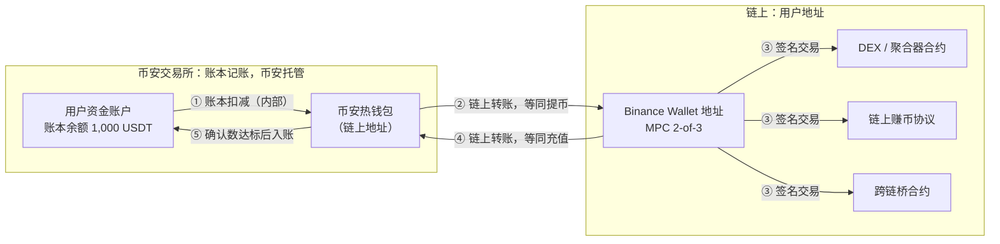
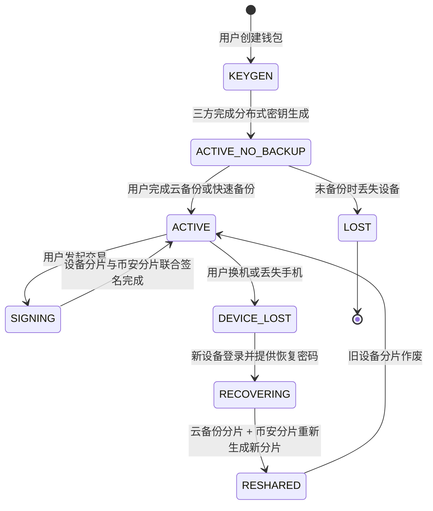
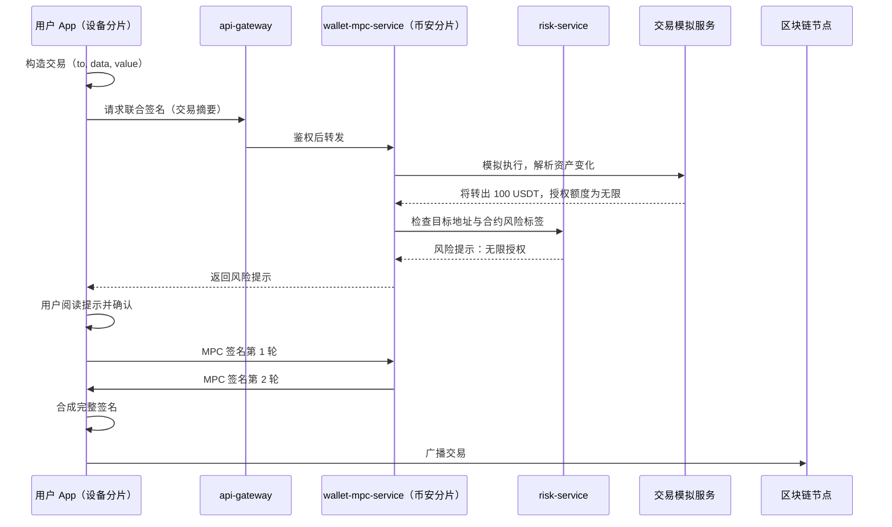
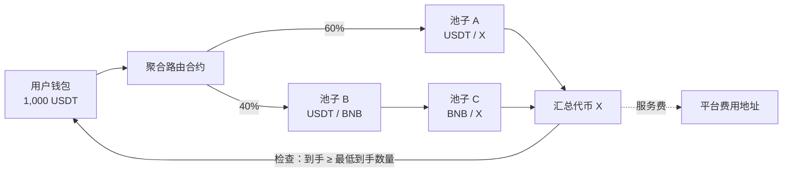
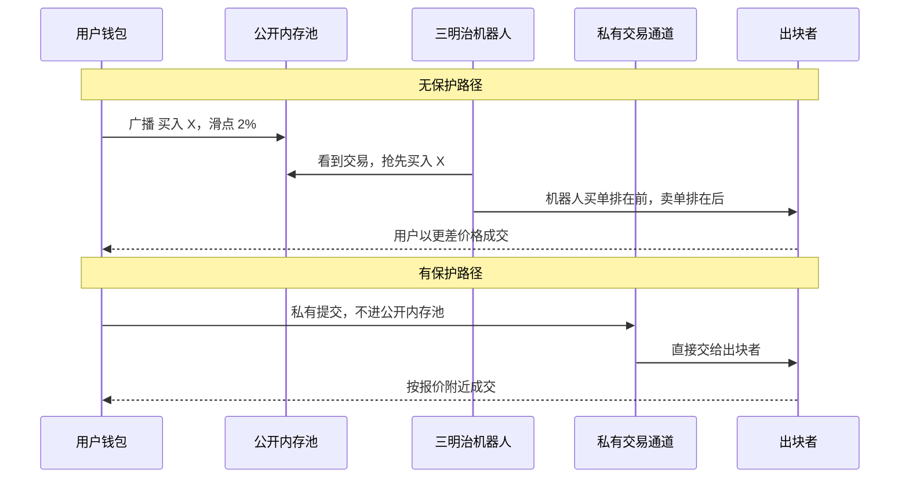
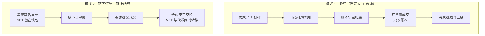
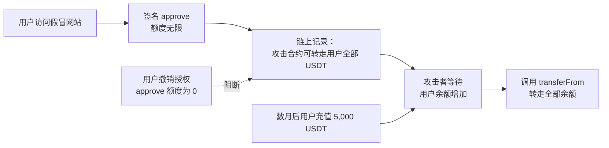

# P10 Web3 钱包：CEX 与链上世界的边界

> 学习目标：读完本章，你能——
> 1. 说清 Binance Wallet 的无私钥 MPC 方案：三片密钥在哪里、谁能单独动钱、谁不能。
> 2. 画出"交易所账户 ↔ Web3 钱包 ↔ 链上协议"之间的资金流，指出每一步是账本操作还是链上交易。
> 3. 解释钱包内 DEX 聚合交易、跨链桥、链上赚币的风险，以及 approve 无限授权为什么危险。
>
> 前置章节：[../04-wallet-custody.md](../04-wallet-custody.md)（托管与冷热钱包）、[../03-account-identity-security.md](../03-account-identity-security.md)（设备与 2FA）、[../11-products-ecosystem.md](../11-products-ecosystem.md) 第 3.10 节（Web3 钱包概览）、[../08-market-data.md](../08-market-data.md)（滑点）
> 交互实验：[../interactive/depth-slippage.html](../interactive/depth-slippage.html)（理解滑点）、[../interactive/deposit-withdraw-sim.html](../interactive/deposit-withdraw-sim.html)（理解"转入钱包 = 一次提币"）
>
> ⚠️ 警告：链上赚币、跨链桥、新币交易可能导致全部本金损失。本章不构成投资建议。

## 0. 一句话理解

交易所账户里的币，是币安账本上的一个数字，币安替你保管私钥。Web3 钱包里的币，在链上属于一个地址，签名需要你参与。两者之间的每次移动，都是一次真实的链上提币或充值。

> 🎯 打个比方：交易所账户像银行保险箱，钥匙在银行手里，你凭身份证取东西。Binance Wallet 的 MPC 方案像一个需要"三把钥匙中任意两把"才能打开的保险柜：一把在你手机里，一把在币安，一把加密后放在你自己的云盘里。币安只有一把，打不开。你丢了手机，还可以用币安那把加云盘那把找回。

## 1. 托管模式对比

| 维度 | 交易所托管（CEX 账户） | 传统自托管（助记词钱包） | MPC 无私钥钱包（Binance Wallet） |
|---|---|---|---|
| 谁控制签名 | 交易所 | 用户独自 | 用户设备 + 币安，或用户设备 + 云备份 |
| 资产记录在哪 | 交易所账本 | 链上地址 | 链上地址 |
| 丢失手机 | 不影响，登录即可 | 有助记词则可恢复 | 用云备份 + 币安分片恢复 |
| 助记词 | 无 | 有，12 或 24 个单词 | 无 |
| 交易所倒闭 | 资产可能无法取回 | 不受影响 | 需要两片才能签名；币安分片不可用时，依赖恢复方案 |
| 转账是否上链 | 站内转账不上链 | 上链 | 上链 |
| 平台能否冻结 | 能 | 不能 | 不能单独冻结链上资产，但能停止参与签名 |
| 典型风险 | 交易所挪用、被盗 | 助记词丢失、泄露 | 设备被控、授权钓鱼 |

> 💡 注意："不能单独动钱"不等于"永远可用"。如果币安服务停止，用户只剩设备分片和云备份分片两片。这两片能否独立签名，取决于恢复方案设计。币安公开说明"至少需要两片"，具体灾备流程以官网为准。

## 2. Binance Wallet（MPC 无私钥钱包）

### 2.1 用户看到什么

截至 2026 年公开资料：

- Binance Wallet 内嵌在币安 App 中，不需要单独下载，也不需要抄写助记词。
- 创建钱包时，系统生成三个密钥分片：
  1. 分片 1 由币安保管。
  2. 分片 2 存在用户设备上。
  3. 分片 3 用用户设置的恢复密码加密后，备份到用户的个人云盘（iCloud 或 Google Drive）。
- 签名至少需要两个分片。币安只持有一个分片，无法单独动用户资产（币安官方文章）。
- 币安还提供"快速备份"（Quick Backup）：用生物识别代替恢复密码，加密分片交给第三方安全服务商保存（Binance.US 帮助中心，截至 2026 年公开资料）。
- 2025 年 12 月起，一个币安账户最多可创建 5 个无私钥钱包（新闻报道）。
- 钱包支持 DEX 兑换、链上赚币、新币活动（例如 Binance Alpha 相关的 TGE 和空投）。

术语：

- 多方计算（MPC，Multi-Party Computation）：多方各持一份秘密，共同计算出签名，过程中任何一方都看不到完整私钥。
- 门限签名（TSS，Threshold Signature Scheme）：MPC 在签名场景的具体做法。"2-of-3"表示 3 片中任意 2 片可以签名。
- 密钥分片（Key Share）：完整私钥从不存在，每方只持有一片。

### 2.2 资金流：CEX 账户 ↔ Web3 钱包



**读图要点**

- 资金从交易所到钱包，是一次完整的提币：账本扣减 → 热钱包签名 → 上链。反方向是一次完整的充值，要等确认数（见 [../04-wallet-custody.md](../04-wallet-custody.md)）。
- 一旦到达钱包地址，币安账本不再记录这笔资产。币安的储备金证明也不包含它。
- 第 ③ 步每一次都是用户签名的链上交易，要付 gas，结果不可撤销。
- 局限：币安 App 在界面上把两者做成"一键划转"，但底层仍是链上交易。部分链上 gas 可能由平台补贴（以官网为准）。

### 2.3 状态机（钱包生命周期）



**读图要点**

- 密钥生成时，完整私钥从不出现。三方各自生成随机数，共同算出公钥和地址（MPC 通用做法）。
- 恢复不是"把私钥找回来"，而是重新分片（Resharing）。地址不变，旧分片作废。
- `ACTIVE_NO_BACKUP` 是危险状态。此时只有两片可用，丢一片就无法签名。
- 局限：恢复流程细节为业界通用 MPC 做法，币安具体协议未完整公开。

### 2.4 系统组件与调用链（一次签名）



**读图要点**

- 币安分片参与签名，因此币安有机会在签名前做风控：模拟交易、识别钓鱼合约、提示无限授权。这是 MPC 钱包相对纯助记词钱包的安全优势。
- 同一机制也意味着币安"可以拒绝签名"。用户的签名能力依赖币安服务可用。
- 交易一旦广播，任何一方都无法撤回。
- 局限：`wallet-mpc-service`、交易模拟服务不在主线 02 章架构中，是本章按业界通用做法加入的组件。

### 2.5 定价与收益来源

Web3 钱包本身不收保管费。平台收入来自钱包内的交易：

```text
平台收入 = DEX 兑换服务费 + 跨链服务费 + 链上赚币分成 + 新币活动带来的生态收入
```

数值示例（全部为示例）：用户在钱包内用 1,000 USDT 兑换代币 X，钱包服务费 0.3%，平台收入 3 USDT。2025 年 5 月，链上数据显示 Binance Wallet 单日兑换量约 50 亿美元（新闻报道，引用 Dune 数据）。按 0.1% 平均费率（示例）计算，单日约 500 万美元。

### 2.6 风险与对冲

| 风险 | 谁承担 | 说明 |
|---|---|---|
| 设备被恶意软件控制 | 用户 | 攻击者持有设备分片，可诱导用户确认签名 |
| 币安分片服务中断 | 用户 | 无法签名，资产仍在链上，但暂时不能动 |
| 云盘账号被盗 + 恢复密码泄露 | 用户 | 攻击者拿到分片 3，再配合币安分片恢复钱包 |
| 合约漏洞 | 用户 | 资产在链上协议里，平台不承担 |
| 声誉与监管 | 平台 | 用户在钱包里买到骗局代币，平台被指责 |

### 2.7 失败场景与案例

1. **用户误以为钱包余额受交易所保护**：交易所的用户保护基金（SAFU）设计用于交易所托管资产。钱包资产在链上，被钓鱼转走后，平台通常没有赔付义务（业界通用规则，以官网条款为准）。
2. **换机未备份**：用户只有设备分片和币安分片。换机时旧手机已重置。系统无法恢复，资产永久锁死。

## 3. 钱包内的 DEX 聚合交易

### 3.1 用户看到什么

- 用户选择"从 USDT 兑换到代币 X"，界面显示预估数量、最低到手数量、滑点容忍度、网络费。
- 币安钱包宣称提供 MEV 保护（截至 2026 年公开资料）。BNB Chain 官方也推动钱包接入 MEV 保护通道。

术语：

- DEX 聚合器（DEX Aggregator）：同时查询多个去中心化交易所的报价，把一笔订单拆分到多个池子，求最优成交。
- 滑点（Slippage）：预估成交价与实际成交价的差。用户设置"滑点容忍度"，超过就让交易失败。
- MEV（Maximal Extractable Value）：区块生产者或机器人通过调整交易顺序获得的额外收益。
- 三明治攻击（Sandwich Attack）：机器人在用户买单前先买，在用户买单后再卖，赚取用户推高的价格。

### 3.2 资金流与路由



**读图要点**

- 路由是链下算、链上执行。聚合服务在链下计算最优拆分，把路径写进交易数据，由用户签名执行。
- "最低到手数量"写在交易里，由合约检查。这是滑点保护的真正执行点。
- 出错点：链下报价和链上执行之间有时间差。行情变化后，交易可能失败，失败也要付 gas。

### 3.3 MEV 保护



**读图要点**

- 三明治攻击的前提是"机器人能看到你的交易"。私有通道去掉了这个前提。
- 滑点容忍度越大，机器人能抽走的利润越多。2% 的容忍度就是 2% 的潜在损失上限。
- 局限：私有通道要求信任通道运营方和出块者。不是所有链都有成熟的私有通道。

## 4. 跨链桥与链上赚币

### 4.1 跨链桥风险

跨链桥（Bridge）：把资产从链 A 转到链 B 的协议。常见做法是在链 A 锁定资产，在链 B 铸造等量的"包装资产"。

| 风险 | 说明 |
|---|---|
| 验证者私钥被盗 | 攻击者伪造"链 A 已锁定"的证明，在链 B 凭空铸币 |
| 合约漏洞 | 验证逻辑错误，允许重复提取 |
| 包装资产脱锚 | 链 A 锁定资产被盗后，链 B 包装资产失去支撑 |

公开案例：2022 年 BNB Chain 的跨链桥 BSC Token Hub 被利用，攻击者凭空铸造约 200 万枚 BNB。BNB Chain 验证者随后暂停了链（公开报道，2022 年 10 月）。

对比：交易所内部"跨链"不需要桥。用户在 BSC 充值 USDT，在以太坊提 USDT，交易所用两条链上各自的热钱包库存完成。风险由交易所的库存管理承担（见 [B06-treasury-liquidity.md](../backstage/B06-treasury-liquidity.md)）。

### 4.2 链上赚币

- 钱包内的"链上赚币"把资产存入第三方 DeFi 协议（借贷、质押、流动性池）。
- 收益来自协议：借款人利息、质押奖励、交易手续费分成。
- 与交易所理财的区别：交易所理财的资产留在币安账本内，由币安负责兑付（见 [P05-earn-savings-staking.md](P05-earn-savings-staking.md)）。链上赚币的资产在协议合约里，由合约代码负责兑付。

## 5. NFT 市场

### 5.1 模式：中心化订单簿 + 托管

币安 NFT 市场采用托管模式（业界通用描述，结合公开资料）：

1. 用户把 NFT 充值到币安，NFT 进入币安托管地址。
2. 币安账本记录"用户 A 拥有 NFT #123"。
3. 挂单、出价、成交都在中心化订单簿里完成，只改账本。
4. 用户提取时，币安把 NFT 从托管地址转到用户地址，这一步才上链。

另一种模式是"链下订单簿 + 链上结算"（例如 OpenSea 的 Seaport）：卖家用钱包签名一份挂单，订单存链下；买家提交成交时，合约在链上一次性完成 NFT 和代币交换。NFT 始终在卖家钱包里。



**读图要点**

- 模式 1 成交快、无 gas，但用户要信任托管方。模式 2 无托管风险，但每笔成交都有 gas。
- 模式 2 的风险在授权：卖家通常对市场合约做 `setApprovalForAll`，授权合约可以转走全部 NFT。
- 公开事实：币安在 2026 年 6 月宣布关闭中心化 NFT 服务，截止 2026 年 7 月 3 日；用户需把可转移的 NFT 提到 Binance Wallet 或其他钱包，NFT 服务迁移到 Binance Wallet（新闻报道，2026 年）。这说明行业从"托管模式"转向"钱包模式"。

## 6. 授权钓鱼与 approve 无限授权

ERC-20 的 `approve(spender, amount)` 允许合约 `spender` 从用户地址转走最多 `amount` 代币。很多 DApp 默认请求 `amount = 2^256 − 1`，即无限授权。



**读图要点**

- 授权不转钱，所以用户签名时"没有损失"，警惕性低。损失可能在几个月后才发生。
- 无限授权让"一次签名"变成"永久权限"。用户之后存入的资金也会被转走。
- 防御：只授权本次需要的数量；定期撤销不用的授权；钱包在签名前模拟交易并显示风险（见 2.4）。
- 同类风险：`permit` 离线签名（不需要上链也能授权）、NFT 的 `setApprovalForAll`。

## 7. 与主线章节的依赖

| 本章内容 | 依赖主线章节 | 依赖点 |
|---|---|---|
| 交易所 ↔ 钱包划转 | [../04-wallet-custody.md](../04-wallet-custody.md) | 提币、充值、确认数 |
| MPC 分片 | [../04-wallet-custody.md](../04-wallet-custody.md) | 交易所侧的 MPC 与冷热钱包 |
| 设备分片安全 | [../03-account-identity-security.md](../03-account-identity-security.md)、[B03-account-security.md](../backstage/B03-account-security.md) | 设备指纹、账户接管防御 |
| 滑点 | [../08-market-data.md](../08-market-data.md) | 深度与价格冲击 |
| 平台安全边界 | [B02-platform-security.md](../backstage/B02-platform-security.md) | 平台分片服务的保护 |
| 链上赚币对比 | [P05-earn-savings-staking.md](P05-earn-savings-staking.md) | 账本内理财 vs 链上协议 |
| 新币活动 | [P07-listing-launch.md](P07-listing-launch.md) | 上币与 TGE |
| 合规 | [B01-compliance.md](../backstage/B01-compliance.md) | 链上地址风险标签 |

**本仓库对照（CEX Demo）**：本仓库没有用户自托管钱包，只有交易所侧托管。

- 链上签名与广播：`../../services/custody-adapter/src/infrastructure/evm-custody-provider.ts`。它对应图 2.2 中"币安热钱包"的位置，不对应用户的 MPC 钱包。
- 扫链与确认数：`../../services/blockchain-indexer/`，对应图 2.2 第 ⑤ 步。
- 托管提供方抽象：`../../services/custody-adapter/src/domain/provider.ts`。接入第三方 MPC 托管时，可以在这里新增一个 provider。

## 8. 术语表

| 术语 | 英文 | 定义 |
|---|---|---|
| 多方计算 | MPC | 多方共同计算签名，任何一方看不到完整私钥 |
| 门限签名 | TSS | "m-of-n" 个分片即可签名的方案 |
| 密钥分片 | Key Share | 私钥的一部分，单独无法签名 |
| 重新分片 | Resharing | 不改地址、生成新分片、作废旧分片 |
| 助记词 | Seed Phrase | 12 或 24 个单词，可推导出全部私钥 |
| DEX 聚合器 | DEX Aggregator | 跨多个池子拆单求最优价的路由服务 |
| 滑点 | Slippage | 预估价与实际成交价的差 |
| MEV | Maximal Extractable Value | 通过调整交易顺序获得的额外收益 |
| 三明治攻击 | Sandwich Attack | 在用户交易前后各插一笔交易获利 |
| 跨链桥 | Bridge | 锁定链 A 资产、在链 B 铸造包装资产的协议 |
| 授权 | Approve | 允许合约从用户地址转走代币的链上记录 |
| 无限授权 | Unlimited Approval | 授权额度为最大整数的授权 |

## 9. 思考题

1. 用 [../interactive/deposit-withdraw-sim.html](../interactive/deposit-withdraw-sim.html) 模拟一次"从交易所转入 Web3 钱包"。哪一步之后，这笔资产不再出现在交易所的储备金证明里？
2. MPC 2-of-3 方案中，如果币安分片服务永久停止，用户能否只用设备分片和云备份分片签名？这对"自托管"的定义意味着什么？
3. 用 [../interactive/depth-slippage.html](../interactive/depth-slippage.html) 观察大单的价格冲击。如果你把滑点容忍度从 0.5% 调到 5%，三明治机器人能多拿走多少？
